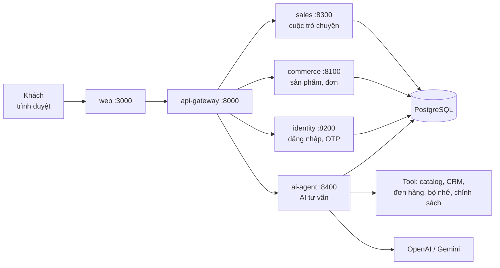

# capstone_sudocode2026

Một cửa hàng online có **nhân viên tư vấn là AI**. Khách vào trang web, xem sản phẩm và chat (hoặc gọi thoại) với AI. AI trả lời giá, tồn kho, chính sách, tra đơn hàng, và **nhớ khách** ở lần liên hệ sau. Khi khách cần người thật (khiếu nại, câu hỏi khó), AI chuyển cuộc trò chuyện cho nhân viên.

---

## 1. Chạy thử trong 5 bước

Cần: **Docker Desktop** đang chạy.

**Bước 1. Tạo file cấu hình**

```powershell
Copy-Item .env.example .env
```

**Bước 2. Điền key AI vào `.env`**

Mở `.env`, điền ít nhất:

```
OPENAI_API_KEY=sk-...
```

AI mặc định dùng OpenAI `gpt-4.1-mini`. Muốn dùng Gemini thì điền `GEMINI_API_KEY` (hoặc `GOOGLE_API_KEY`), rồi đổi model trong trang Developer.

**Bước 3. Bật hệ thống**

```powershell
docker compose up --build -d
```

Lần đầu mất vài phút để build. Kiểm tra đã chạy xong chưa:

```powershell
curl http://localhost:8000/health/ready
```

Thấy `"status":"ready"` là được.

**Bước 4. Tạo tài khoản nhân viên (admin)**

```powershell
docker compose run --rm identity-service python /app/scripts/admin/create_admin.py
```

Lệnh sẽ hỏi tên đăng nhập và mật khẩu (ít nhất 12 ký tự).

**Bước 5. Mở trình duyệt**

Vào **http://localhost:3000** và chat thử, ví dụ: *"Máy lọc không khí AirPure X giá bao nhiêu, còn hàng không?"*

Tắt hệ thống: `docker compose down` (giữ dữ liệu) hoặc `docker compose down -v` (xóa sạch dữ liệu).

---

## 2. Các trang trong ứng dụng

| Trang | Ai dùng | Làm gì |
|---|---|---|
| `/` | Khách | Trang chủ cửa hàng: danh mục, khuyến mãi, sản phẩm nổi bật |
| `/danh-muc/...`, `/tim-kiem`, `/khuyen-mai` | Khách | Danh sách sản phẩm có lọc (thương hiệu, giá, còn hàng) và sắp xếp |
| `/san-pham/<mã>` | Khách | Chi tiết sản phẩm, chọn size/màu, ưu đãi, thông số, "Hỏi trợ lý về sản phẩm này" |
| `/gio-hang`, `/thanh-toan` | Khách | Giỏ hàng; đặt hàng một đơn cho cả giỏ: xác minh số điện thoại (OTP) → địa chỉ → COD hoặc chuyển khoản VietQR → xác nhận |
| `/don-hang` | Khách | Đơn hàng của tôi, xóa dữ liệu cá nhân |
| `/chinh-sach` | Khách | Tóm tắt chính sách đổi trả, giao hàng, thanh toán, bảo hành |
| Khung chat (mọi trang) | Khách | Chat với AI, nút ☏ gọi thoại trên trình duyệt, link Zalo |
| `/login` | Nhân viên | Đăng nhập bằng tài khoản tạo ở bước 4 |
| `/ban-hang` | Bán hàng, tư vấn viên | **Trang bán hàng**: tổng quan, hội thoại & chuyển máy (web, Zalo, hotline), đơn hàng, hẹn gọi lại |
| `/calls` | Nhân viên tư vấn | Console tư vấn viên riêng (cùng nội dung mục "Hội thoại" của `/ban-hang`) |
| `/agent` | Nhân viên tư vấn | Hộp thư các cuộc trò chuyện |
| `/seller` | Nhân viên bán hàng | Xem và hủy đơn hàng |
| `/admin` | Quản trị | Tạo tài khoản, sửa tồn kho, tạo khuyến mãi |
| `/developer` | Lập trình viên | Đổi model AI, xem trace từng lượt, đo độ trễ, đổi "ngày kinh doanh" |

Khi chạy local, mã OTP không gửi SMS mà hiện ngay trên màn hình (chế độ phát triển). Khách đã xác minh số điện thoại được AI nhận ra ngay (như số người gọi trên hotline), không cần nói lại số.

**Kênh liên hệ.** Ngoài website, khách có thể nhắn **Zalo OA** và gọi **hotline** (LiveKit + SIP); cả ba dùng chung một trợ lý và hồ sơ khách. Cách kết nối từng kênh: [docs/channels.md](docs/channels.md).

---

## 3. Một tin nhắn đi qua hệ thống thế nào



1. Khách gõ tin nhắn trên **web**.
2. **api-gateway** nhận và chuyển đến đúng service (chat → ai-agent, sản phẩm → commerce, đăng nhập → identity, ...).
3. **ai-agent** xử lý qua 7 bước: hiểu câu khách → nhận diện khách → chọn hướng xử lý → AI soạn câu trả lời (gọi tool tra giá, tồn kho, đơn hàng) → kiểm tra câu trả lời → gửi → lưu lại.
4. Khi khách cần người thật, AI chuyển cuộc trò chuyện; nhân viên thấy nó ở trang `/ban-hang` (mục Hội thoại).
5. Sau mỗi cuộc, AI ghi nhớ thông tin quan trọng của khách để lần sau không phải hỏi lại.

> **Sản phẩm:** cửa hàng bán đúng catalog BTC mà AI tư vấn (`apps/ai-agent-service/data/btc`: máy lọc không khí, giày, đồ mẹ bé, ...). Giá bán và tồn kho trên web được tính bằng chính mock của BTC vào ngày kinh doanh, nên khớp với giá AI báo (`scripts/seed/btc_catalog.py`).

---

## 4. Gặp lỗi thường gặp

| Hiện tượng | Nguyên nhân hay gặp | Cách xử lý |
|---|---|---|
| AI chỉ trả lời câu an toàn rồi chuyển nhân viên | Thiếu key AI hoặc key hết hạn mức | Kiểm tra `OPENAI_API_KEY` trong `.env`, rồi `docker compose up -d ai-agent-service` |
| Lỗi 402 / `RESOURCE_EXHAUSTED` từ Gemini | Tài khoản Google AI Studio hết tiền trả trước | Dùng OpenAI, hoặc nạp thêm tiền |
| Không đăng nhập được trang nhân viên | Chưa tạo tài khoản | Làm bước 4 |
| Trang admin/seller báo 403 | Token trong `.env` khác token service đang dùng | Sau khi sửa `.env`, chạy lại `docker compose up -d` |
| `health/ready` báo `degraded` | Một service chưa khởi động xong hoặc bị lỗi | Đợi thêm, hoặc xem log: `docker compose logs -f <tên-service>` |
| Đã sửa code nhưng không thấy thay đổi | Image cũ | `docker compose up -d --build <tên-service>` |

---

## 5. Cấu trúc thư mục

```text
apps/
  web/                  Giao diện (Next.js)
  api-gateway/          Cổng vào duy nhất, định tuyến request (src/main.py)
  identity-service/     Đăng nhập nhân viên, OTP khách
  sales-service/        Cuộc trò chuyện, chuyển nhân viên, phản hồi
  commerce-service/     Sản phẩm, báo giá, tồn kho, đơn hàng
  ai-agent-service/     AI tư vấn (xem README riêng)
packages/backend-common/  Code dùng chung cho các service
data/seed/catalog/      Sản phẩm demo của trang mua hàng
scripts/                Seed dữ liệu, tạo admin, đánh giá AI, sinh dữ liệu test
tests/                  Test tự động (pytest)
docs/                   Tài liệu chi tiết
infra/                  Triển khai lên cloud (Kubernetes, Terraform)
```

---

## 6. Dành cho lập trình viên

### Chạy frontend có hot reload

```powershell
docker compose up -d postgres redis seed commerce-service identity-service sales-service ai-agent-service api-gateway
Set-Location apps/web; npm ci; npm run dev
```

### Chạy test

```powershell
# Test backend (không cần database hay key AI)
$env:PYTHONPATH="apps/ai-agent-service/src;packages/backend-common"
apps/ai-agent-service/.venv/Scripts/python -m pytest -q

# Kiểm tra frontend
Set-Location apps/web; npm run typecheck; npm run build
```

### Đánh giá chất lượng AI

Bộ chấm điểm (so sánh AI có nhớ khách và không nhớ khách, dùng scorer của BTC) nằm ở `scripts/evaluation`. Xem [scripts/evaluation/README.md](scripts/evaluation/README.md).

```powershell
apps/ai-agent-service/.venv/Scripts/python scripts/evaluation/run_eval.py evaluate --advisor openai:gpt-4.1-mini
```

Lệnh dạng BTC (`--scenarios`, `--config`, `--out`) chạy agent trên kịch bản của BTC và chấm luôn bằng `reference_eval.py`, kèm bảng truy hồi: xem [README của AI agent](apps/ai-agent-service/README.md#test-và-đánh-giá).

### Chạy service Python không qua Docker

Đặt `PYTHONPATH` gồm `packages/backend-common` và thư mục `src` của service, trỏ `DATABASE_URL` vào `localhost` (dùng `127.0.0.1` trên Windows), rồi chạy `uvicorn`. Hướng dẫn chi tiết cho AI agent: [apps/ai-agent-service/README.md](apps/ai-agent-service/README.md).

### Biến môi trường quan trọng

Bắt đầu từ [.env.example](.env.example).

| Biến | Dùng để |
|---|---|
| `OPENAI_API_KEY`, `GEMINI_API_KEY` / `GOOGLE_API_KEY` | Key cho AI (cần ít nhất một) |
| `ADMIN_TOKEN`, `AGENT_TOKEN`, `SELLER_TOKEN`, `DEVELOPER_TOKEN` | Token theo vai trò, chỉ dùng khi phát triển |
| `POSTGRES_PASSWORD`, `APP_SECRET`, `ENCRYPTION_KEY` | Database và mã hóa dữ liệu |
| `AI_GATEWAY_API_KEY` | Bật lớp kiểm tra câu trả lời thứ hai (Jev); không có thì chỉ chạy lớp kiểm tra cơ bản |
| `OTP_DELIVERY_URL` | Gửi OTP thật; để trống thì mã hiện trên màn hình |

Model AI của từng thành phần cấu hình trong [`apps/ai-agent-service/config/models.yaml`](apps/ai-agent-service/config/models.yaml). Khi deploy thật: `APP_SECRET` dài ít nhất 32 ký tự, token mạnh và khác nhau.

### Tính năng tùy chọn

| Lệnh thêm | Bật |
|---|---|
| `--profile async` | Kafka (sự kiện giữa các service); đặt `KAFKA_BROKERS=kafka:9092` |
| Langfuse (không cần profile) | Đặt `LANGFUSE_PUBLIC_KEY`, `LANGFUSE_SECRET_KEY`, `LANGFUSE_BASE_URL` trong `.env`: theo dõi từng lời gọi model, từng lượt AI và **chi phí của mỗi lần đánh giá** trên Langfuse Cloud |
| `--build-arg WITH_VOICE=1` | Gọi thoại (nhận dạng và tổng hợp giọng nói chạy local) |

---

## 7. Giới hạn hiện tại

- Các service vẫn dùng chung một database ([kế hoạch tách](docs/architecture/data-ownership-migration.md)).
- Thanh toán: COD (đơn dưới 10 triệu) và chuyển khoản VietQR (điền `BANK_*` trong `.env`); nhân viên bấm "Đã nhận tiền" sau khi đối soát. Chưa tích hợp cổng thanh toán online (MoMo, VNPAY, thẻ) vì cần tài khoản merchant.
- Hotline nhận cuộc gọi từ số điện thoại thật khi có SIP trunk của nhà mạng ([docs/channels.md](docs/channels.md)); trước đó gọi thử bằng `scripts/dev/hotline_test_call.py` hoặc nút ☏ trên web.
- Chưa có CI build/push image, chưa có HTTPS tự động khi deploy.

## Tài liệu thêm

[Mục lục docs](docs/README.md) · [Kênh Zalo & Hotline](docs/channels.md) · [HTTP API](docs/api.md) · [Kiến trúc](docs/architecture/microservices-target-structure.md) · [AI Agent](apps/ai-agent-service/README.md) · [Scripts](scripts/README.md) · [Sinh dữ liệu test](scripts/create_data/README.md) · [Triển khai](docs/deployment/README.md)
