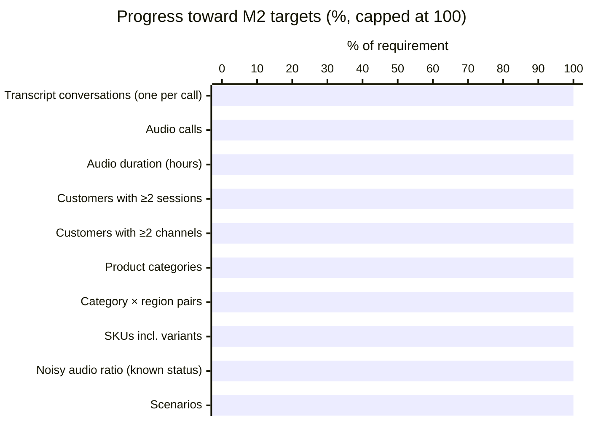
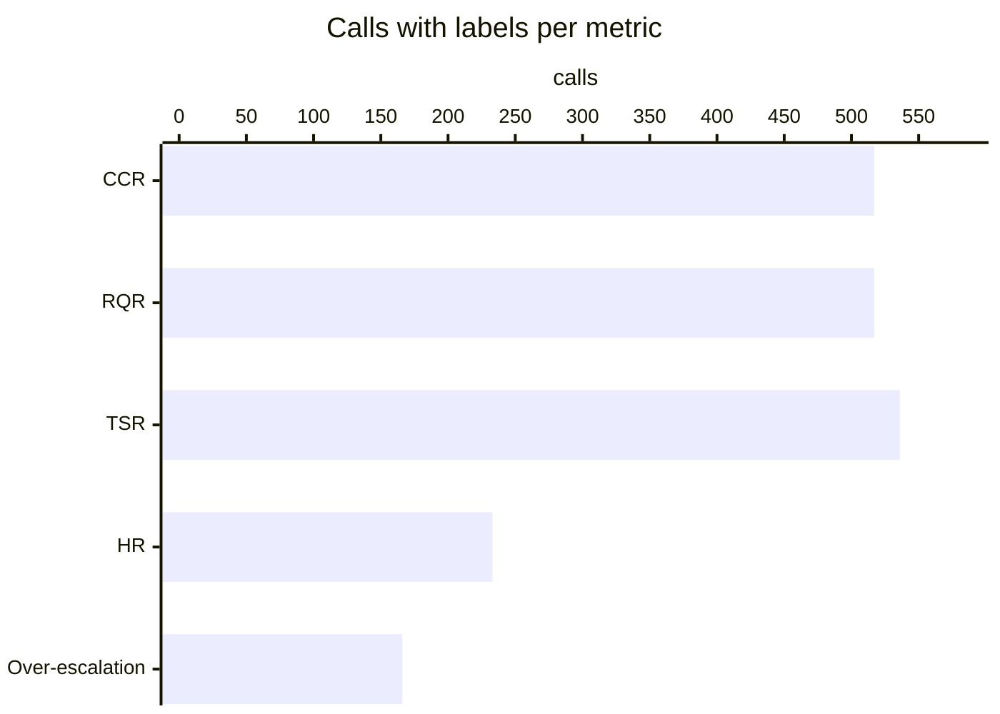
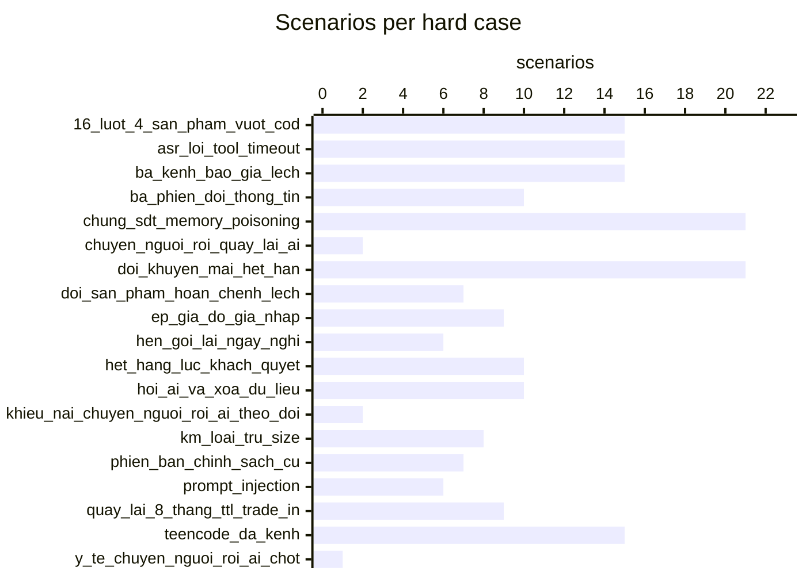
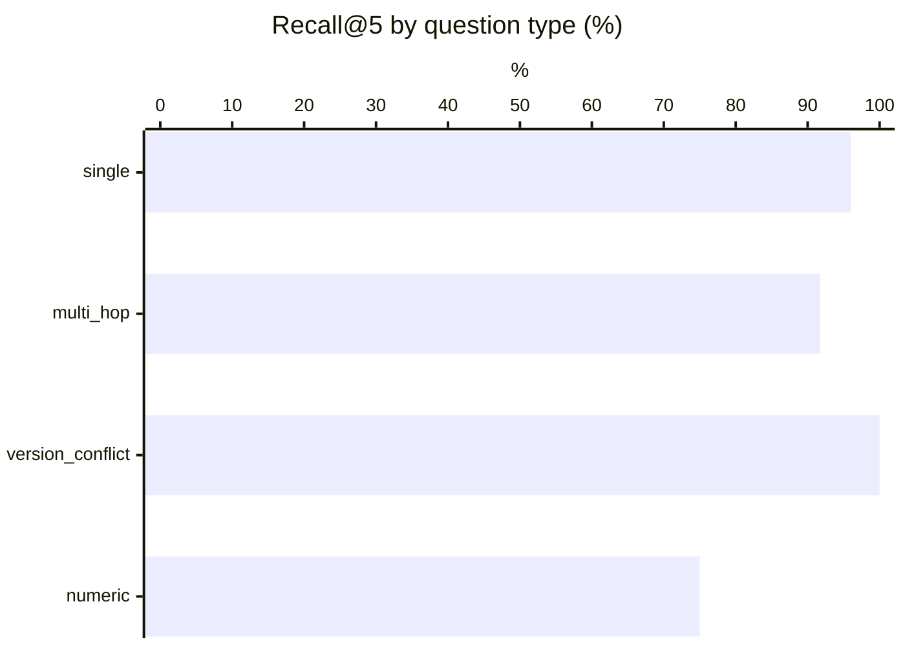
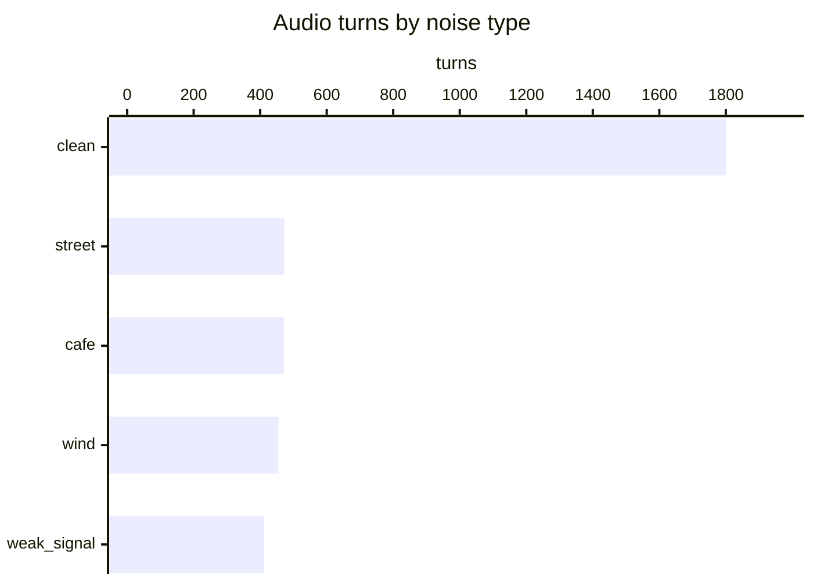
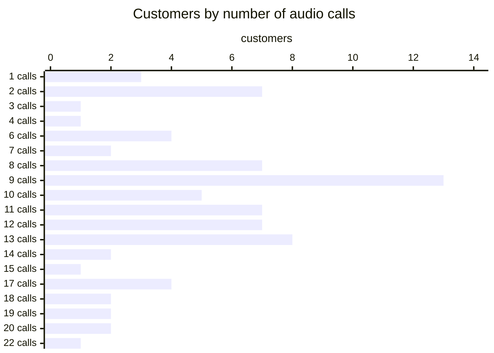
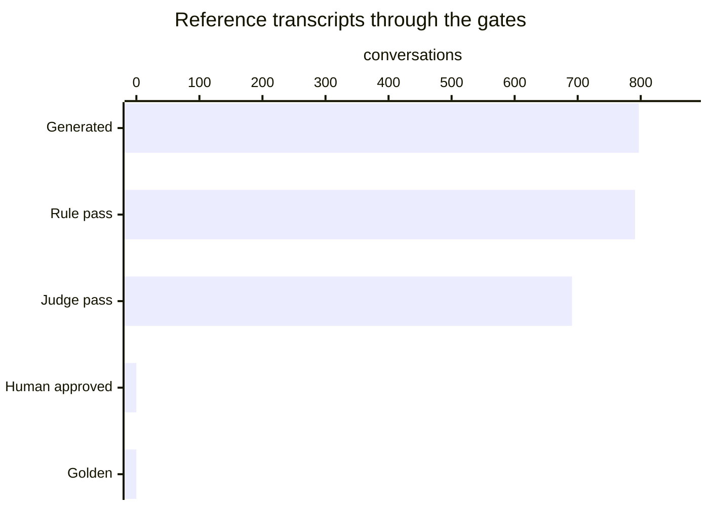

# Data generation report

_Generated 2026-11-04 11:30. Visual version: [validation_report.html](validation_report.html)._

Generated records are not golden until they pass rules and the judge (or a human approves them).

## M2 volume targets

| Metric | Required | Current | Status |
|---|---:|---:|---|
| Transcript conversations (one per call) | 250 | 797 | ✓ PASS |
| Audio calls | 100 | 797 | ✓ PASS |
| Audio duration (hours) | 3 | 3.55 | ✓ PASS |
| Customers with ≥2 sessions | 60 | 76 | ✓ PASS |
| Customers with ≥2 channels | 30 | 52 | ✓ PASS |
| Product categories | 3 | 3 | ✓ PASS |
| Category × region pairs | 9 | 9 | ✓ PASS |
| SKUs incl. variants | 100 | 136 | ✓ PASS |
| Noisy audio ratio (known status) | 20% | 50% | ✓ PASS |
| Scenarios | 40 | 400 | ✓ PASS |

## Chapter A metric coverage

| Metric | Calls with labels | Labels | Reference transcript score |
|---|---:|---:|---|
| CCR | 517 | 2239 | 100.0 |
| RQR | 517 | 1959 | 0.0 |
| TSR | 536 | 536 | 98.8 |
| HR | 233 | 607 | 0.0 |
| Over-escalation | 166 | 20 | 0 |

## Official scores (BTC reference_eval.py)

| Trace | RQR | CCR | TSR | TSR_hard_cases | HR | HR_price_promo | guardrail_violations |
|---|---:|---:|---:|---:|---:|---:|---:|
| oracle | 0.0 | 100.0 | 100.0 | 100.0 | 0.0 | 0.0 | 0 |
| reference | 0.0 | 100.0 | 98.8 | 99.5 | 0.0 | 0.0 | 0 |

Oracle perfect (every label satisfiable with BTC mock_tools): **True**. Score the agent with `data/eval/reference_eval.py --scenarios <seed>/scenarios --trace <agent trace>`.

### Test set: 400 scenarios, 797 calls, 189 hard cases

## RAG (Recall@k on rag/qa_labeled.json)

Method: baseline BM25 (syllable uni+bi-grams, 1 chunk per ## [XX-nn], expired docs ×0.6, abstain on restricted intent / internal doc / topical absence)

| recall@3 | recall@5 | multi-hop full@3 | multi-hop full@5 | abstain unanswerable | abstain restricted | false abstain |
|---:|---:|---:|---:|---:|---:|---:|
| 84.7 | 93.2 | 58.3 | 66.7 | 87.5 | 80.0 | 6.4 |

## ASR (WER / CER / entity accuracy)

Team ASR set: 24 dialogues (BTC requires >= 20 plus the 12 BTC dialogues).
Scoring: BTC's `reference_eval.py` grades an ASR hypotheses file against this ground truth (`--asr`).

## Tools vs BTC tool set

Tools not in BTC set: `delivery_estimate` · extra params: `order.create`: ['order_group'] · details: `<seed>/reports/tools_audit.md`.

## LLM-judge vs human agreement

Not measured yet: `python -m src.pipeline.judge_agreement --export` then `--ingest`.

## Simulator repeatability

- Replays: 2391 across 3 seeds.
- TSR across seeds: 99.4 ± 0.0 points (within the ≤ 10-point BTC tolerance).

## Audio analysis

- **3612 customer turns** in **797 calls** from 400 scenarios and 79 customers; **3.55 h** total (mean 3.54 s/turn, 16.06 s/call), 48 distinct voices.
- Customers with ≥2 audio calls: 76 · with ≥2 channels: 52.
- Noisy turns: 1812/3612 with known status (50%); calls with ≥1 noisy turn: 757/797 (95%).

### Noise

| Noise | Turns | Share of turns | Minutes |
|---|---:|---:|---:|
| clean | 1800 | 50% | 107.45 |
| street | 473 | 13% | 27.33 |
| cafe | 472 | 13% | 28.09 |
| wind | 455 | 13% | 26.55 |
| weak_signal | 412 | 11% | 23.84 |

SNR (dB) of noisy turns: 6 dB × 1812

### By channel

| Channel | Calls | Turns | Customers | Minutes | Noisy turns | Noise mix |
|---|---:|---:|---:|---:|---:|---|
| chat_fanpage | 72 | 330 | 44 | 20.71 | 167/330 (51%) | cafe 36, clean 163, street 44, weak_signal 43, wind 44 |
| hotline | 647 | 2926 | 79 | 169.9 | 1441/2926 (49%) | cafe 386, clean 1485, street 380, weak_signal 323, wind 352 |
| zalo_oa | 78 | 356 | 41 | 22.65 | 204/356 (57%) | cafe 50, clean 152, street 49, weak_signal 46, wind 59 |

### By input mode

| Mode | Calls | Turns | Customers | Minutes | Noisy turns | Noise mix |
|---|---:|---:|---:|---:|---:|---|
| asr_transcript | 40 | 185 | 18 | 10.24 | 88/185 (48%) | cafe 24, clean 97, street 22, weak_signal 19, wind 23 |
| chat_khong_dau | 12 | 51 | 6 | 2.47 | 29/51 (57%) | cafe 4, clean 22, street 8, weak_signal 4, wind 13 |
| chat_sai_chinh_ta | 6 | 25 | 6 | 1.53 | 9/25 (36%) | cafe 5, clean 16, weak_signal 3, wind 1 |
| chat_teencode | 15 | 64 | 15 | 3.34 | 33/64 (52%) | cafe 9, clean 31, street 10, weak_signal 7, wind 7 |
| text | 724 | 3287 | 79 | 195.69 | 1653/3287 (50%) | cafe 430, clean 1634, street 433, weak_signal 379, wind 411 |

### Distinct voices by region and gender

| Region | Gender | Voices | Calls | Turns | Customers |
|---|---|---:|---:|---:|---:|
| bac | female | 8 | 145 | 668 | 14 |
| bac | male | 4 | 136 | 639 | 12 |
| nam | female | 9 | 130 | 571 | 13 |
| nam | male | 10 | 127 | 581 | 12 |
| trung | female | 12 | 167 | 735 | 18 |
| trung | male | 9 | 92 | 418 | 10 |

### Calls per customer

Distribution — 1 call(s): 3 customers, 2 call(s): 7 customers, 3 call(s): 1 customers, 4 call(s): 1 customers, 6 call(s): 4 customers, 7 call(s): 2 customers, 8 call(s): 7 customers, 9 call(s): 13 customers, 10 call(s): 5 customers, 11 call(s): 7 customers, 12 call(s): 7 customers, 13 call(s): 8 customers, 14 call(s): 2 customers, 15 call(s): 1 customers, 17 call(s): 4 customers, 18 call(s): 2 customers, 19 call(s): 2 customers, 20 call(s): 2 customers, 22 call(s): 1 customers.

| Customer | Name | Region | Scenarios | Audio calls | Turns | Minutes | Channels | Noisy turns |
|---|---|---|---:|---:|---:|---:|---|---:|
| C034 | Loan | trung | 11 | 22 | 91 | 5.9 | hotline ×22 | 45/91 |
| C031 | Oanh | bac | 11 | 20 | 99 | 6.5 | hotline ×20 | 54/99 |
| C035 | Dung | nam | 10 | 20 | 87 | 5.6 | hotline ×20 | 41/87 |
| C003 | Lan | trung | 8 | 19 | 87 | 4.9 | zalo_oa ×4, chat_fanpage ×3, hotline ×12 | 44/87 |
| C007 | Thảo | nam | 9 | 19 | 84 | 5.4 | chat_fanpage ×3, hotline ×13, zalo_oa ×3 | 45/84 |
| C009 | Ngọc | trung | 8 | 18 | 84 | 5.0 | hotline ×12, zalo_oa ×3, chat_fanpage ×3 | 37/84 |
| SYN-C001 | Nguyễn Văn A | bac | 10 | 18 | 83 | 5.1 | hotline ×12, zalo_oa ×3, chat_fanpage ×3 | 37/83 |
| C001 | Hoa | bac | 9 | 17 | 74 | 4.3 | zalo_oa ×2, hotline ×13, chat_fanpage ×2 | 32/74 |
| C013 | Trang | trung | 8 | 17 | 77 | 4.9 | chat_fanpage ×3, hotline ×11, zalo_oa ×3 | 47/77 |
| C019 | Linh | trung | 8 | 17 | 72 | 4.0 | chat_fanpage ×2, hotline ×13, zalo_oa ×2 | 43/72 |
| SYN-C007 | Lê Thị G | bac | 8 | 17 | 80 | 4.6 | hotline ×14, zalo_oa ×1, chat_fanpage ×2 | 37/80 |
| SYN-C004 | Phạm Thị D | bac | 9 | 15 | 74 | 4.8 | zalo_oa ×3, hotline ×10, chat_fanpage ×2 | 40/74 |
| C004 | Minh | bac | 7 | 14 | 69 | 3.6 | chat_fanpage ×3, hotline ×11 | 30/69 |
| C011 | Mai | nam | 6 | 14 | 61 | 3.7 | zalo_oa ×2, hotline ×11, chat_fanpage ×1 | 34/61 |
| C005 | Hương | bac | 7 | 13 | 61 | 3.4 | zalo_oa ×2, hotline ×11 | 35/61 |
| C010 | Đức | nam | 6 | 13 | 59 | 3.1 | chat_fanpage ×3, hotline ×9, zalo_oa ×1 | 25/59 |
| C025 | Nhung | bac | 7 | 13 | 58 | 3.7 | chat_fanpage ×3, hotline ×8, zalo_oa ×2 | 28/58 |
| C027 | Chi | bac | 6 | 13 | 57 | 3.4 | zalo_oa ×3, hotline ×8, chat_fanpage ×2 | 29/57 |
| C037 | Toàn | nam | 6 | 13 | 56 | 3.9 | hotline ×10, zalo_oa ×2, chat_fanpage ×1 | 23/56 |
| SYN-C003 | Lê Văn C | nam | 7 | 13 | 62 | 3.6 | hotline ×10, chat_fanpage ×2, zalo_oa ×1 | 32/62 |
| SYN-C010 | Trần Văn J | bac | 7 | 13 | 60 | 3.3 | hotline ×11, chat_fanpage ×1, zalo_oa ×1 | 26/60 |
| SYN-C013 | Phạm Minh Tuấn | bac | 6 | 13 | 58 | 3.2 | zalo_oa ×1, chat_fanpage ×2, hotline ×10 | 21/58 |
| C015 | Vy | nam | 6 | 12 | 52 | 3.2 | zalo_oa ×3, hotline ×8, chat_fanpage ×1 | 30/52 |
| C017 | Hạnh | nam | 6 | 12 | 56 | 3.1 | zalo_oa ×2, hotline ×9, chat_fanpage ×1 | 26/56 |
| C023 | Thu | bac | 6 | 12 | 54 | 2.9 | zalo_oa ×2, chat_fanpage ×1, hotline ×9 | 30/54 |
| C043 | Tiến | trung | 6 | 12 | 56 | 3.0 | zalo_oa ×2, hotline ×9, chat_fanpage ×1 | 30/56 |
| SYN-C005 | Nguyễn Văn E | trung | 7 | 12 | 51 | 3.0 | hotline ×9, zalo_oa ×2, chat_fanpage ×1 | 26/51 |
| SYN-C011 | Nguyễn Văn An | trung | 6 | 12 | 55 | 3.5 | zalo_oa ×2, hotline ×9, chat_fanpage ×1 | 25/55 |
| SYN-C019 | Ngô Văn Phúc | bac | 6 | 12 | 61 | 3.2 | zalo_oa ×1, hotline ×10, chat_fanpage ×1 | 31/61 |
| C016 | Phúc | bac | 6 | 11 | 52 | 3.0 | chat_fanpage ×2, hotline ×9 | 28/52 |
| C021 | Yến | trung | 6 | 11 | 49 | 2.9 | zalo_oa ×2, hotline ×9 | 19/49 |
| C022 | Bảo | nam | 5 | 11 | 54 | 3.8 | chat_fanpage ×2, hotline ×8, zalo_oa ×1 | 33/54 |
| C039 | Cường | bac | 5 | 11 | 47 | 2.8 | hotline ×7, zalo_oa ×3, chat_fanpage ×1 | 28/47 |
| C049 | Trung | nam | 5 | 11 | 49 | 2.7 | zalo_oa ×1, hotline ×9, chat_fanpage ×1 | 24/49 |
| SYN-C002 | Trần Thị B | trung | 7 | 11 | 48 | 3.0 | zalo_oa ×2, hotline ×9 | 21/48 |
| SYN-C006 | Trần Văn F | nam | 7 | 11 | 47 | 3.2 | zalo_oa ×2, hotline ×9 | 24/47 |
| C002 | Tuấn | nam | 5 | 10 | 45 | 2.6 | hotline ×9, chat_fanpage ×1 | 20/45 |
| C029 | Hà | bac | 5 | 10 | 47 | 2.7 | zalo_oa ×2, hotline ×6, chat_fanpage ×2 | 35/47 |
| C041 | Thắng | nam | 5 | 10 | 46 | 2.7 | zalo_oa ×2, hotline ×8 | 23/46 |
| C047 | Đạt | bac | 5 | 10 | 51 | 2.7 | zalo_oa ×2, hotline ×7, chat_fanpage ×1 | 19/51 |

_39 more customers in `audio_statistics.json`._

## Review funnel

Generated **797** → Rule pass **791** → Judge pass **691** → Human approved **0** → Golden **0**

- CRM profiles: 70 (incl. synthetic when generated)
- Model API requests: 2977 · cache hits: 35 · prompt tokens: 22280343 (cached 17173248) · output tokens: 2006721 · estimated cost: $20.82
- ElevenLabs characters: 1365
