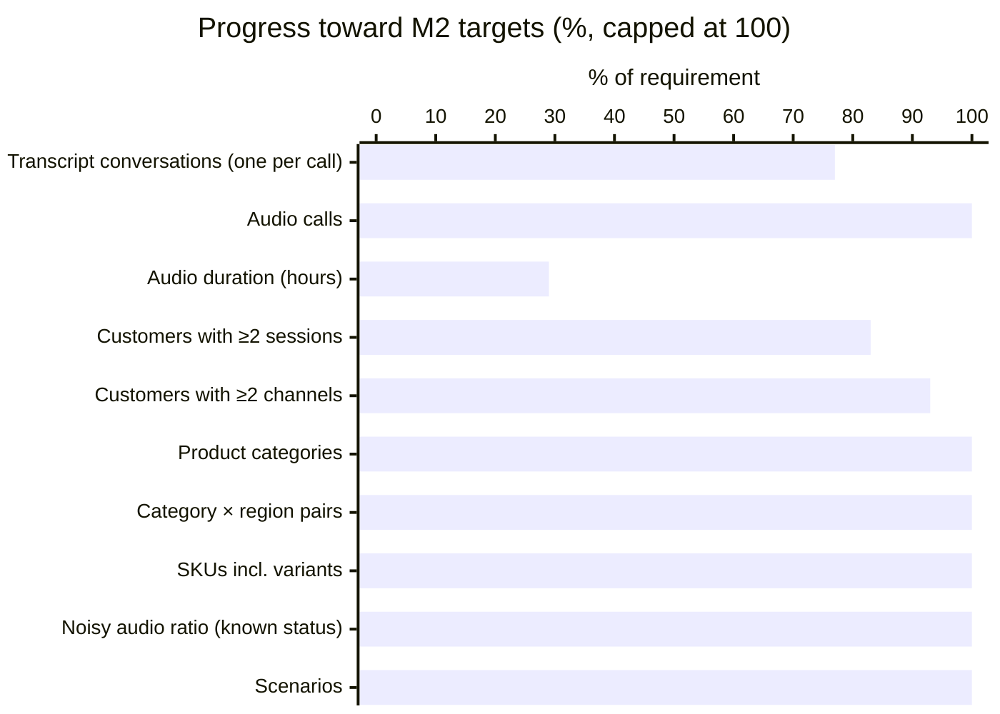
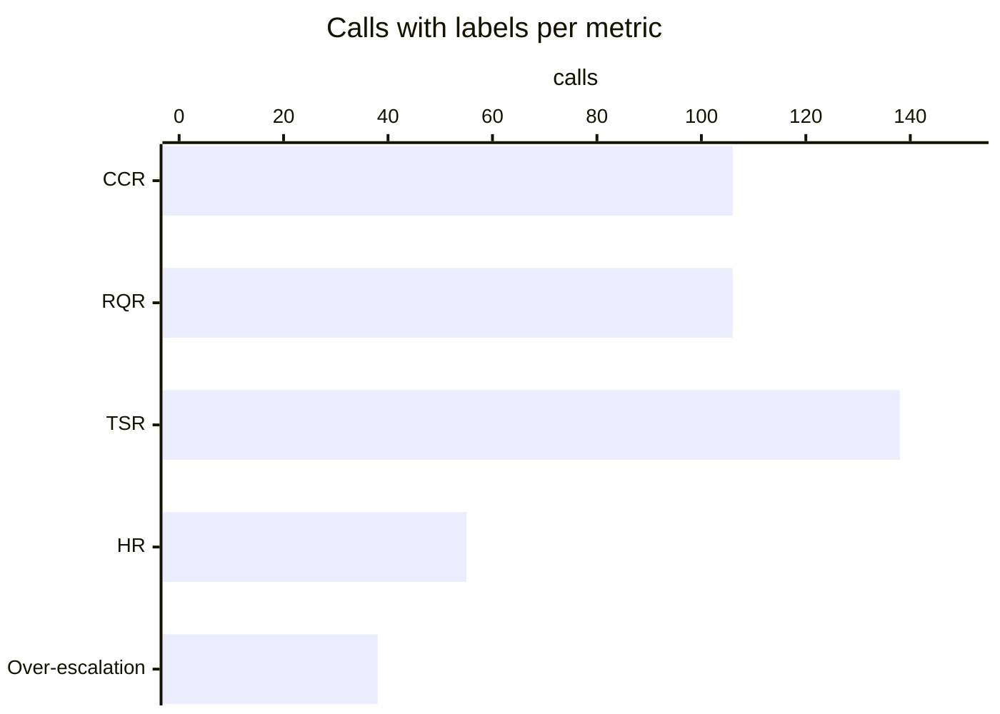
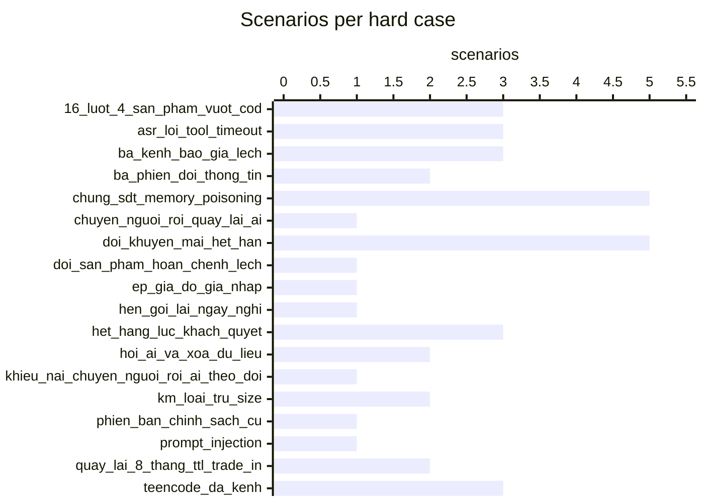
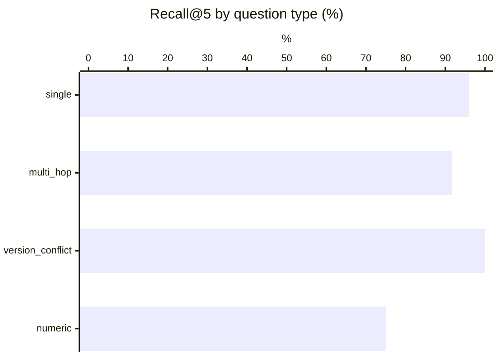
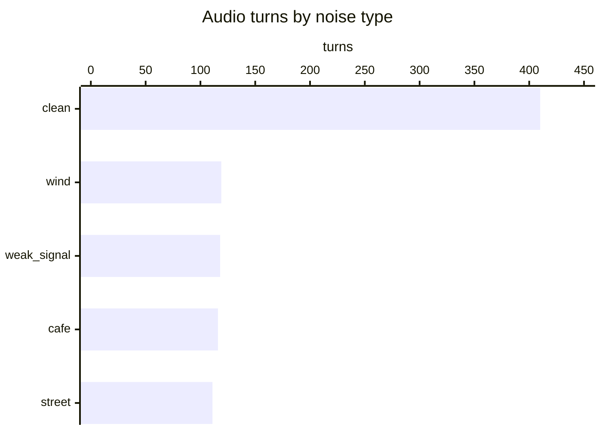
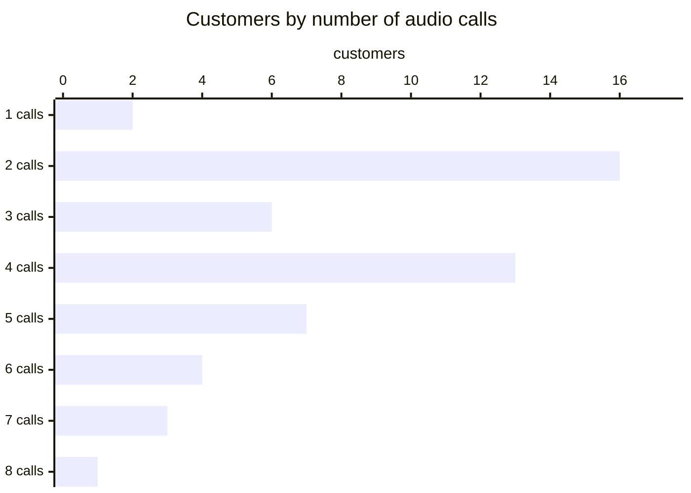
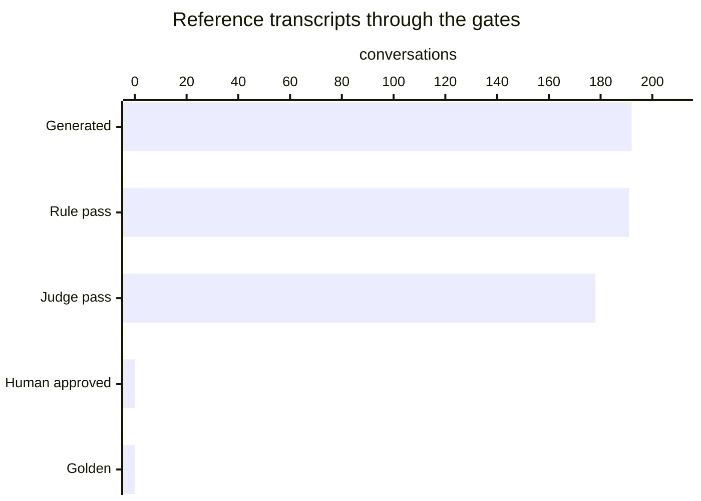

# Data generation report

_Generated 2026-11-07 12:24. Visual version: [validation_report.html](validation_report.html)._

Generated records are not golden until they pass rules and the judge (or a human approves them).

## M2 volume targets

| Metric | Required | Current | Status |
|---|---:|---:|---|
| Transcript conversations (one per call) | 250 | 192 | ○ PENDING |
| Audio calls | 100 | 192 | ✓ PASS |
| Audio duration (hours) | 3 | 0.86 | ○ PENDING |
| Customers with ≥2 sessions | 60 | 50 | ○ PENDING |
| Customers with ≥2 channels | 30 | 28 | ○ PENDING |
| Product categories | 3 | 3 | ✓ PASS |
| Category × region pairs | 9 | 9 | ✓ PASS |
| SKUs incl. variants | 100 | 136 | ✓ PASS |
| Noisy audio ratio (known status) | 20% | 53% | ✓ PASS |
| Scenarios | 40 | 99 | ✓ PASS |

## Chapter A metric coverage

| Metric | Calls with labels | Labels | Reference transcript score |
|---|---:|---:|---|
| CCR | 106 | 464 | 100.0 |
| RQR | 106 | 397 | 0.0 |
| TSR | 138 | 138 | 99.0 |
| HR | 55 | 125 | 0.0 |
| Over-escalation | 38 | 5 | 0 |

## Official scores (BTC reference_eval.py)

| Trace | RQR | CCR | TSR | TSR_hard_cases | HR | HR_price_promo | guardrail_violations |
|---|---:|---:|---:|---:|---:|---:|---:|
| oracle | 0.0 | 100.0 | 100.0 | 100.0 | 0.0 | 0.0 | 0 |
| reference | 0.0 | 100.0 | 99.0 | 97.5 | 0.0 | 0.0 | 0 |

Oracle perfect (every label satisfiable with BTC mock_tools): **True**. Score the agent with `data/eval/reference_eval.py --scenarios <seed>/scenarios --trace <agent trace>`.

### Test set: 99 scenarios, 192 calls, 40 hard cases

## RAG (Recall@k on rag/qa_labeled.json)

Method: baseline BM25 (syllable uni+bi-grams, 1 chunk per ## [XX-nn], expired docs ×0.6, abstain on restricted intent / internal doc / topical absence)

| recall@3 | recall@5 | multi-hop full@3 | multi-hop full@5 | abstain unanswerable | abstain restricted | false abstain |
|---:|---:|---:|---:|---:|---:|---:|
| 84.7 | 93.2 | 58.3 | 66.7 | 87.5 | 80.0 | 6.4 |

## ASR (WER / CER / entity accuracy)

Team ASR set: 0 dialogues (BTC requires >= 20 plus the 12 BTC dialogues).
Scoring: BTC's `reference_eval.py` grades an ASR hypotheses file against this ground truth (`--asr`).

## Tools vs BTC tool set

Tools not in BTC set: `delivery_estimate` · extra params: `order.create`: ['order_group'] · details: `<seed>/reports/tools_audit.md`.

## LLM-judge vs human agreement

Not measured yet: `python -m src.pipeline.judge_agreement --export` then `--ingest`.

## Simulator repeatability

- Replays: 576 across 3 seeds.
- TSR across seeds: 99.5 ± 0.0 points (within the ≤ 10-point BTC tolerance).

## Audio analysis

- **874 customer turns** in **192 calls** from 99 scenarios and 52 customers; **0.86 h** total (mean 3.56 s/turn, 16.19 s/call), 28 distinct voices.
- Customers with ≥2 audio calls: 50 · with ≥2 channels: 28.
- Noisy turns: 464/874 with known status (53%); calls with ≥1 noisy turn: 185/192 (96%).

### Noise

| Noise | Turns | Share of turns | Minutes |
|---|---:|---:|---:|
| clean | 410 | 47% | 24.61 |
| wind | 119 | 14% | 6.94 |
| weak_signal | 118 | 14% | 6.82 |
| cafe | 116 | 13% | 6.94 |
| street | 111 | 13% | 6.5 |

SNR (dB) of noisy turns: 6 dB × 464

### By channel

| Channel | Calls | Turns | Customers | Minutes | Noisy turns | Noise mix |
|---|---:|---:|---:|---:|---:|---|
| chat_fanpage | 21 | 95 | 18 | 5.93 | 44/95 (46%) | cafe 12, clean 51, street 5, weak_signal 12, wind 15 |
| hotline | 147 | 673 | 52 | 38.78 | 353/673 (52%) | cafe 88, clean 320, street 91, weak_signal 86, wind 88 |
| zalo_oa | 24 | 106 | 22 | 7.11 | 67/106 (63%) | cafe 16, clean 39, street 15, weak_signal 20, wind 16 |

### By input mode

| Mode | Calls | Turns | Customers | Minutes | Noisy turns | Noise mix |
|---|---:|---:|---:|---:|---:|---|
| asr_transcript | 8 | 39 | 4 | 2.01 | 15/39 (38%) | cafe 6, clean 24, street 4, weak_signal 4, wind 1 |
| chat_khong_dau | 4 | 16 | 2 | 0.81 | 10/16 (62%) | cafe 2, clean 6, street 3, wind 5 |
| chat_sai_chinh_ta | 2 | 8 | 2 | 0.44 | 3/8 (38%) | cafe 2, clean 5, weak_signal 1 |
| chat_teencode | 3 | 13 | 3 | 0.78 | 4/13 (31%) | cafe 2, clean 9, street 1, weak_signal 1 |
| text | 175 | 798 | 50 | 47.77 | 432/798 (54%) | cafe 104, clean 366, street 103, weak_signal 112, wind 113 |

### Distinct voices by region and gender

| Region | Gender | Voices | Calls | Turns | Customers |
|---|---|---:|---:|---:|---:|
| bac | female | 4 | 37 | 171 | 8 |
| bac | male | 3 | 31 | 140 | 8 |
| nam | female | 5 | 31 | 145 | 8 |
| nam | male | 6 | 28 | 126 | 8 |
| trung | female | 7 | 53 | 234 | 14 |
| trung | male | 4 | 12 | 58 | 6 |

### Calls per customer

Distribution — 1 call(s): 2 customers, 2 call(s): 16 customers, 3 call(s): 6 customers, 4 call(s): 13 customers, 5 call(s): 7 customers, 6 call(s): 4 customers, 7 call(s): 3 customers, 8 call(s): 1 customers.

| Customer | Name | Region | Scenarios | Audio calls | Turns | Minutes | Channels | Noisy turns |
|---|---|---|---:|---:|---:|---:|---|---:|
| C007 | Thảo | nam | 4 | 8 | 44 | 2.6 | chat_fanpage ×1, hotline ×6, zalo_oa ×1 | 26/44 |
| C001 | Hoa | bac | 4 | 7 | 33 | 1.8 | zalo_oa ×1, hotline ×5, chat_fanpage ×1 | 13/33 |
| C013 | Trang | trung | 3 | 7 | 33 | 2.0 | chat_fanpage ×2, hotline ×3, zalo_oa ×2 | 21/33 |
| C019 | Linh | trung | 3 | 7 | 34 | 1.8 | chat_fanpage ×1, hotline ×5, zalo_oa ×1 | 16/34 |
| C003 | Lan | trung | 3 | 6 | 29 | 1.5 | zalo_oa ×1, chat_fanpage ×1, hotline ×4 | 14/29 |
| C004 | Minh | bac | 3 | 6 | 27 | 1.5 | chat_fanpage ×2, hotline ×4 | 14/27 |
| C025 | Nhung | bac | 3 | 6 | 28 | 1.7 | chat_fanpage ×1, hotline ×4, zalo_oa ×1 | 12/28 |
| C034 | Loan | trung | 3 | 6 | 26 | 1.7 | hotline ×6 | 15/26 |
| C005 | Hương | bac | 3 | 5 | 21 | 1.2 | zalo_oa ×1, hotline ×4 | 14/21 |
| C011 | Mai | nam | 2 | 5 | 20 | 1.2 | zalo_oa ×1, hotline ×4 | 12/20 |
| C028 | Tú | bac | 2 | 5 | 21 | 1.2 | chat_fanpage ×2, hotline ×2, zalo_oa ×1 | 14/21 |
| C031 | Oanh | bac | 3 | 5 | 25 | 1.6 | hotline ×5 | 14/25 |
| C037 | Toàn | nam | 2 | 5 | 22 | 1.3 | hotline ×4, zalo_oa ×1 | 10/22 |
| SYN-C001 | Nguyễn Văn A | bac | 4 | 5 | 21 | 1.4 | hotline ×4, zalo_oa ×1 | 8/21 |
| SYN-C002 | Trần Thị B | trung | 4 | 5 | 21 | 1.5 | zalo_oa ×2, hotline ×3 | 8/21 |
| C002 | Tuấn | nam | 2 | 4 | 20 | 1.1 | hotline ×4 | 8/20 |
| C009 | Ngọc | trung | 2 | 4 | 17 | 1.0 | hotline ×2, zalo_oa ×1, chat_fanpage ×1 | 8/17 |
| C010 | Đức | nam | 2 | 4 | 17 | 0.9 | chat_fanpage ×1, hotline ×3 | 5/17 |
| C012 | Khoa | bac | 2 | 4 | 21 | 1.1 | hotline ×4 | 11/21 |
| C015 | Vy | nam | 2 | 4 | 19 | 1.2 | zalo_oa ×1, hotline ×3 | 12/19 |
| C016 | Phúc | bac | 2 | 4 | 16 | 0.9 | chat_fanpage ×1, hotline ×3 | 9/16 |
| C017 | Hạnh | nam | 2 | 4 | 18 | 1.1 | zalo_oa ×1, hotline ×2, chat_fanpage ×1 | 9/18 |
| C021 | Yến | trung | 2 | 4 | 17 | 1.0 | zalo_oa ×1, hotline ×3 | 5/17 |
| C022 | Bảo | nam | 2 | 4 | 21 | 1.4 | chat_fanpage ×1, hotline ×3 | 12/21 |
| C023 | Thu | bac | 2 | 4 | 16 | 1.0 | zalo_oa ×1, chat_fanpage ×1, hotline ×2 | 8/16 |
| C027 | Chi | bac | 2 | 4 | 16 | 0.9 | zalo_oa ×1, hotline ×2, chat_fanpage ×1 | 9/16 |
| C029 | Hà | bac | 2 | 4 | 24 | 1.4 | zalo_oa ×1, hotline ×3 | 18/24 |
| C035 | Dung | nam | 2 | 4 | 20 | 1.1 | hotline ×4 | 11/20 |
| C006 | Nam | bac | 2 | 3 | 15 | 0.8 | hotline ×3 | 10/15 |
| C018 | Quân | nam | 1 | 3 | 12 | 0.9 | chat_fanpage ×1, zalo_oa ×1, hotline ×1 | 7/12 |
| C024 | Kiên | trung | 1 | 3 | 12 | 0.6 | hotline ×3 | 7/12 |
| C030 | Việt | nam | 1 | 3 | 14 | 0.7 | hotline ×3 | 10/14 |
| C033 | Loan | trung | 1 | 3 | 12 | 0.6 | hotline ×3 | 6/12 |
| SYN-C003 | Lê Văn C | nam | 2 | 3 | 12 | 0.8 | hotline ×2, chat_fanpage ×1 | 8/12 |
| ANON-001 |  | nam | 1 | 2 | 8 | 0.5 | hotline ×2 | 3/8 |
| ANON-003 |  | trung | 1 | 2 | 8 | 0.5 | chat_fanpage ×1, hotline ×1 | 3/8 |
| C008 | Long | nam | 1 | 2 | 8 | 0.6 | hotline ×2 | 2/8 |
| C014 | Huy | trung | 1 | 2 | 14 | 0.8 | hotline ×2 | 9/14 |
| C020 | Sơn | bac | 1 | 2 | 9 | 0.4 | hotline ×2 | 4/9 |
| C026 | Dũng | trung | 1 | 2 | 8 | 0.5 | hotline ×2 | 4/8 |

_12 more customers in `audio_statistics.json`._

## Review funnel

Generated **192** → Rule pass **191** → Judge pass **178** → Human approved **0** → Golden **0**

- CRM profiles: 70 (incl. synthetic when generated)
- Model API requests: 698 · cache hits: 2 · prompt tokens: 5218464 (cached 3809408) · output tokens: 456804 · estimated cost: $5.01
- ElevenLabs characters: 47869
