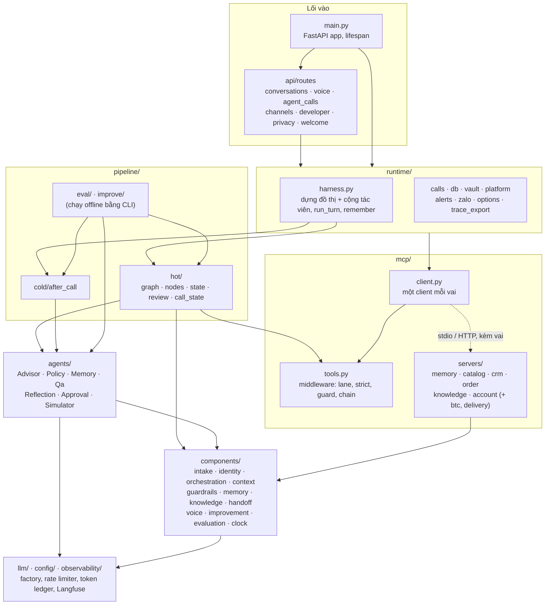
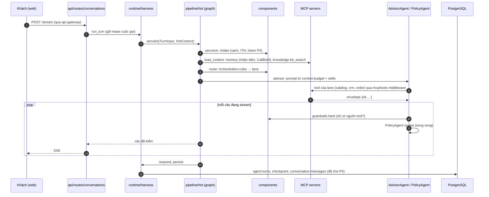
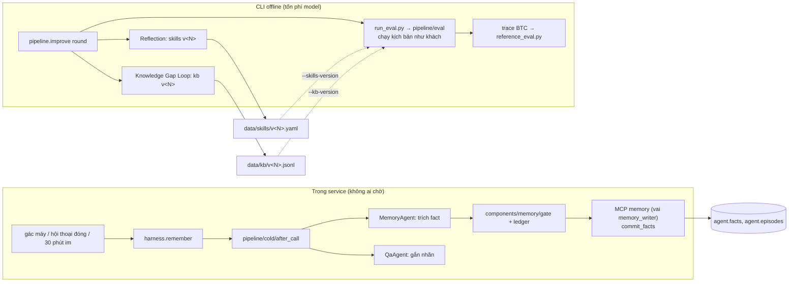

# 0. Kiến trúc hệ thống

[← Mục lục](README.md) · Tiếp theo: [Pipeline xử lý →](01-pipeline.md)

Trang này có hai phần:

- **Phần A, hệ thống (0.1–0.4):** trợ lý AI nằm ở đâu, khách đến từ kênh nào, đi qua service nào, dữ liệu nằm trong PostgreSQL, Redis hay Kafka, mỗi tình huống đi luồng nào.
- **Phần B, bên trong `ai-agent-service` (0.5–0.10):** service chia thành những lớp module nào, mỗi module làm gì, chúng gọi nhau ra sao trong một lượt, sau cuộc gọi và khi chạy offline (đánh giá, vòng cải tiến), và quy tắc phụ thuộc khi thêm code.

Chi tiết từng bước của một lượt (7 node của đồ thị nóng) xem ở [Pipeline xử lý](01-pipeline.md). Triển khai lên AWS: [docs/deployment/aws-plan.md](../deployment/aws-plan.md).

---

# Phần A. Hệ thống

## 0.1 Sơ đồ tổng thể và luồng của từng tình huống

Màu của **nút** là tầng; màu của **đường** là tình huống (số ① đến ⑦ trong bảng ở mục 0.3). Nét đứt là thành phần chỉ chạy khi bật profile tương ứng.

```mermaid
flowchart LR
    %% ── Kênh ───────────────────────────────────────────────
    subgraph KENH["👥 Kênh liên hệ"]
        direction TB
        KW["💬 Khách chat web"]
        KV["🎧 Khách gọi trên trình duyệt"]
        KH["☎️ Khách gọi hotline"]
        KZ["🟦 Khách nhắn Zalo OA"]
        NV["🧑‍💼 Nhân viên"]
    end

    %% ── Biên ───────────────────────────────────────────────
    subgraph BIEN["🌐 Biên"]
        direction TB
        WEB["web · Next.js"]
        GW["api-gateway :8000<br/>định tuyến /api/*"]
    end

    %% ── Thoại ──────────────────────────────────────────────
    subgraph THOAI["🔊 Thoại"]
        direction TB
        SIP["livekit-sip<br/>(profile hotline)"]
        LK["livekit<br/>(profile hotline)"]
        BR["hotline-bridge<br/>(profile hotline)"]
        ASR["asr-service :8500<br/>Zipformer, CPU"]
    end

    %% ── Nghiệp vụ ──────────────────────────────────────────
    subgraph NGHIEPVU["🏢 Dịch vụ nghiệp vụ"]
        direction TB
        ID["identity-service :8200<br/>khách, nhân viên, xác minh"]
        SA["sales-service :8300<br/>hội thoại, chuyển máy"]
        CO["commerce-service :8100<br/>sản phẩm, đơn hàng"]
        EV["*-events workers<br/>outbox relay + consumer"]
    end

    %% ── Trợ lý AI ──────────────────────────────────────────
    subgraph AI["🤖 ai-agent-service :8400"]
        direction TB
        API["API: stream SSE · voice WS<br/>Zalo webhook · lease cuộc gọi"]
        HOT["Đồ thị nóng LangGraph<br/>perceive → advisor → guard → respond"]
        MCP["MCP servers (stdio)<br/>catalog · crm · order · memory · knowledge · account"]
        COLD["after_call<br/>ghi bộ nhớ khi gác máy"]
        TTS["TTS VieNeu"]
    end

    %% ── Dữ liệu ────────────────────────────────────────────
    subgraph DATA["🗄️ Dữ liệu"]
        direction TB
        RD[("Redis<br/>rate limit theo phút")]
        PGP[("PostgreSQL · platform<br/>identity · conversation · commerce<br/>improvement.outbox")]
        PGA[("PostgreSQL · schema agent<br/>calls · turns · pii_vault · checkpoint<br/>facts · episodes · kb_chunks · mock_state")]
        KF[("Kafka<br/>(profile async)")]
    end

    %% ── Luồng (thứ tự định nghĩa = chỉ số của linkStyle) ───────────
    KW -->|"① chat"| WEB
    WEB -->|"① /api/conversations/…/stream"| GW
    GW -->|"① SSE"| API
    KV -->|"② WebSocket /voice"| GW
    GW -->|"② WS"| API
    API -->|"②③ âm thanh → chữ"| ASR
    HOT -->|"②③ câu đã kiểm"| TTS
    KH -->|"③ SIP"| SIP
    SIP -->|"③"| LK
    LK -->|"③ audio room"| BR
    BR -->|"③ voice WS"| API
    KZ -->|"④ webhook"| GW
    GW -->|"④ /api/channels/zalo"| API
    API -->|"①②③④ một lượt"| HOT
    HOT -->|"⑤ báo giá, tạo đơn, tra đơn"| MCP
    MCP -->|"⑤ mock BTC, bộ nhớ, tri thức"| PGA
    HOT -->|"checkpoint, transcript che PII"| PGA
    HOT -->|"⑥ handoff + outbox"| PGP
    PGP -.->|"⑥ relay"| KF
    KF -.->|"⑥ consume"| EV
    NV -->|"⑥ màn hình nhân viên"| WEB
    GW -->|"⑥"| SA
    SA -->|"⑥⑦ nhận ca, đóng hội thoại"| PGP
    COLD -->|"⑦ đọc hội thoại đã đóng"| PGP
    COLD -->|"⑦ facts, episodes"| PGA
    GW -.->|"đếm request"| RD
    GW --> ID
    GW --> CO
    ID --> PGP
    CO --> PGP

    %% ── Màu nút theo tầng ──────────────────────────────────
    classDef kenh fill:#e0f2fe,stroke:#0284c7,color:#0c4a6e,stroke-width:1.5px
    classDef bien fill:#ede9fe,stroke:#7c3aed,color:#3b0764,stroke-width:1.5px
    classDef thoai fill:#fce7f3,stroke:#db2777,color:#500724,stroke-width:1.5px
    classDef nghiepvu fill:#dcfce7,stroke:#16a34a,color:#14532d,stroke-width:1.5px
    classDef ai fill:#e0e7ff,stroke:#4f46e5,color:#1e1b4b,stroke-width:2px
    classDef data fill:#fef3c7,stroke:#d97706,color:#451a03,stroke-width:1.5px
    classDef tuychon fill:#f1f5f9,stroke:#64748b,color:#1e293b,stroke-dasharray:5 4
    class KW,KV,KH,KZ,NV kenh
    class WEB,GW bien
    class ASR thoai
    class ID,SA,CO,EV nghiepvu
    class API,HOT,MCP,COLD,TTS ai
    class RD,PGP,PGA data
    class SIP,LK,BR,KF tuychon

    %% ── Màu đường theo tình huống ──────────────────────────
    linkStyle 0,1,2 stroke:#2563eb,stroke-width:2.5px
    linkStyle 3,4 stroke:#7c3aed,stroke-width:2.5px
    linkStyle 5,6 stroke:#a855f7,stroke-width:2px
    linkStyle 7,8,9,10 stroke:#db2777,stroke-width:2.5px
    linkStyle 11,12 stroke:#0891b2,stroke-width:2.5px
    linkStyle 13 stroke:#4f46e5,stroke-width:3px
    linkStyle 14,15 stroke:#16a34a,stroke-width:2.5px
    linkStyle 16 stroke:#64748b,stroke-width:1.5px
    linkStyle 17,18,19,20,21 stroke:#ea580c,stroke-width:2.5px
    linkStyle 22,23,24 stroke:#ca8a04,stroke-width:2.5px
    linkStyle 25,26,27,28,29 stroke:#94a3b8,stroke-width:1.5px
```

---

## 0.2 Thành phần hạ tầng: dùng để làm gì

| Thành phần | Chạy khi | Dùng để | Ghi chú |
|---|---|---|---|
| **PostgreSQL 16** | luôn chạy | một database `app_db`, chia schema theo domain: `identity`, `conversation`, `commerce`, `improvement` (platform) và `agent` (trợ lý) | trợ lý chỉ chạm bảng platform ở 4 chỗ: đọc `conversation.conversations` (xác thực token, biết hội thoại nào đã đóng), ghi `conversation.messages`, ghi `conversation.handoffs` + outbox `handoff.requested`. Chi tiết: [data-ownership-migration.md](../architecture/data-ownership-migration.md) |
| ↳ schema `agent` | luôn chạy | `calls` (lease, Call Brief), `turns`, `pii_vault` (PII mã hóa AES-GCM), checkpoint LangGraph; bảng của MCP: `facts`, `episodes`, `identities`, `deletion_requests`, `kb_chunks`, `mock_state`, `zalo_*` | tách được sang database riêng bằng `AGENT_DATABASE_URL`. Đánh giá dùng database riêng tên `*_eval` (bị xóa bảng mỗi lần chạy) |
| **Redis 7** | luôn chạy | **chỉ để giới hạn tốc độ ở api-gateway**: đếm request theo khóa `ratelimit:<key>:<phút>`, hết hạn sau 120 giây | không có Redis thì gateway đếm trong bộ nhớ của chính nó; Redis lỗi giữa chừng thì trả 503. Trợ lý không dùng Redis |
| **Kafka** | profile `async` | domain event: outbox (ghi cùng transaction với dữ liệu) → relay → topic theo owner → consumer (khử trùng theo event id) | tùy chọn; tắt Kafka thì HTTP API vẫn chạy. Topic và envelope: [kafka.md](../kafka.md) |
| **LiveKit + LiveKit SIP + hotline-bridge** | profile `hotline` | nhận cuộc gọi SIP vào số hotline, đưa audio vào room, bridge nối room với WebSocket thoại của trợ lý | gọi trên trình duyệt không cần LiveKit: WebSocket đi thẳng qua gateway |
| **asr-service** | luôn chạy | nhận dạng giọng nói (Zipformer 30M trên CPU, có hotword thương hiệu) | trợ lý gọi qua `ASR_URL`; VAD, Smart Turn, barge-in và TTS VieNeu chạy trong trợ lý ([1.4 Kênh giọng nói](01-pipeline.md#14-kênh-giọng-nói)) |
| **Qdrant** | profile `retrieval` | có sẵn trong compose cho truy hồi vector | **không dùng**: không có dòng code nào đọc `QDRANT_URL`. Vector của tri thức nằm trong bộ nhớ của MCP server `knowledge`, có cache ra file; xem [0.9](#09-kho-tri-thức-embedding-lưu-ở-đâu-có-dùng-qdrant-không) |
| Model ngôn ngữ | qua API | advisor, memory agent, extractor của phần đánh giá | chọn trong `config/models.yaml` ([1.6](01-pipeline.md#16-các-model-đang-dùng)) |

---

## 0.3 Mỗi tình huống đi qua luồng nào

| # | Tình huống | Luồng | Dữ liệu ghi ở đâu |
|---|---|---|---|
| ① | **Khách chat trên web** | web → gateway → `POST /api/conversations/{id}/stream` → đồ thị nóng → câu trả lời stream về (SSE) | `agent.turns`, checkpoint; transcript đã che PII ở `conversation.messages` |
| ② | **Khách gọi trên trình duyệt** | WebSocket `/api/conversations/{id}/voice` qua gateway → VAD/Smart Turn → asr-service → đồ thị nóng → TTS VieNeu → loa khách | như ①; audio không lưu |
| ③ | **Khách gọi hotline** | SIP → livekit-sip → livekit room → hotline-bridge → cùng WebSocket thoại của ② | như ② |
| ④ | **Khách nhắn Zalo OA** | Zalo → gateway → `POST /api/channels/zalo/webhook` → đồ thị nóng → trả lời qua API Zalo | `agent.zalo_threads`, `zalo_messages`, `turns` |
| ⑤ | **Báo giá, tạo đơn, tra / đổi đơn, hẹn gọi lại** | đồ thị nóng → guard hành động → MCP `catalog`/`order`/`crm` → mock của BTC | trạng thái mock ở `agent.mock_state`; kết quả tool trong `turns` |
| ⑥ | **Chuyển cho nhân viên** (khách đòi gặp người, câu hỏi y tế, khiếu nại nặng) | đồ thị nóng → `handoff.transfer` → ghi `conversation.handoffs` + outbox `handoff.requested` → (Kafka → consumer nếu bật) → màn hình nhân viên qua sales-service, tin nhắn của khách được đánh dấu đỏ | `conversation.handoffs`, `improvement.outbox`; brief chuyển máy ở `agent.calls.handoff_brief` |
| ⑦ | **Sau cuộc gọi** (nhân viên bấm kết thúc, Sales đóng hội thoại, hoặc 30 phút im lặng) | `after_call` đọc hội thoại đã đóng → trích fact → 4 cửa kiểm → ghi bộ nhớ → tóm tắt cho Call Brief lần sau | `agent.facts`, `agent.episodes`; yêu cầu xóa ở `agent.deletion_requests` |

Khách quay lại ở bất kỳ kênh nào: bước `load_context` nhận diện khách (số điện thoại, Zalo, Facebook), dựng Call Brief từ `facts` và `episodes` của các lần trước. Vì vậy bộ nhớ dùng chung cho cả bốn kênh ([Xử lý tình huống](02-xu-ly-tinh-huong.md)).

---

## 0.4 Cổng dịch vụ

| Service | Cổng trong mạng compose | Gateway chuyển tới khi |
|---|---|---|
| api-gateway | 8000 | điểm vào duy nhất của `/api/*` từ web |
| commerce-service | 8100 | sản phẩm, giỏ hàng, đơn của web shop |
| identity-service | 8200 | đăng nhập, xác minh khách, nhân viên |
| sales-service | 8300 | hội thoại, nhận ca, chuyển máy |
| ai-agent-service | 8400 | `/api/conversations/*`, `/api/agent/*`, `/api/channels/*`, `/api/developer/*` |
| asr-service | 8500 | chỉ trợ lý gọi |

Bảng định tuyến đầy đủ: [docs/api.md](../api.md). Kênh và cách bật: [docs/channels.md](../channels.md).

---

# Phần B. Bên trong `ai-agent-service`

Mã nguồn: [`apps/ai-agent-service/src/ai_agent_service`](../../apps/ai-agent-service/src/ai_agent_service/). Một tiến trình FastAPI (`uvicorn ai_agent_service.main:app`, cổng 8400) cộng các tiến trình con MCP mà nó tự khởi động qua stdio.

## 0.5 Các lớp module và chiều phụ thuộc

Câu hỏi sơ đồ trả lời: **module nào được gọi module nào?** Mũi tên là chiều `import` trong code (đo bằng `ast` trên toàn bộ package ngày 12/11/2026).

Đọc sơ đồ từ trên xuống:

| Lớp | Thư mục | Làm gì | Không làm gì |
|---|---|---|---|
| Lối vào | [`main.py`](../../apps/ai-agent-service/src/ai_agent_service/main.py), [`api/routes/`](../../apps/ai-agent-service/src/ai_agent_service/api/routes/) | Khởi động: `db.init_db`, `db.init_checkpointer`, `harness.ready()`, nhớ lại các cuộc chưa `after_call` (`remember_unfinished`), đối soát hội thoại đã đóng, alert Kafka, chuẩn bị voice. Mỗi route nhận HTTP/SSE/WebSocket, kiểm token, rồi gọi `runtime` | Không tự chạy logic hội thoại |
| Runtime | [`runtime/`](../../apps/ai-agent-service/src/ai_agent_service/runtime/) | `harness.py` dựng **một lần** đồ thị nóng và các cộng tác viên (agent, MCP client, vault), giữ lease cuộc gọi, chạy `run_turn`, ghi transcript qua `CallStore`, và khi gác máy thì chạy `remember` → `after_call`. `db.py`: pool PostgreSQL và checkpointer LangGraph. `platform.py`: bốn chỗ duy nhất chạm bảng của platform | Không chứa luật nghiệp vụ |
| Pipeline | [`pipeline/hot`](../../apps/ai-agent-service/src/ai_agent_service/pipeline/hot/), [`pipeline/cold`](../../apps/ai-agent-service/src/ai_agent_service/pipeline/cold/), [`pipeline/eval`](../../apps/ai-agent-service/src/ai_agent_service/pipeline/eval/), [`pipeline/improve`](../../apps/ai-agent-service/src/ai_agent_service/pipeline/improve/) | Ghép các phần theo thứ tự một cuộc gọi cần: đồ thị 7 node khi khách đang chờ, `after_call` khi không ai chờ; `eval` chạy kịch bản như khách thật, `improve` chạy vòng học | `hot` không import `runtime`: cộng tác viên được đưa vào qua `HotContext`, nên runner đánh giá và test thay được |
| Agents | [`agents/`](../../apps/ai-agent-service/src/ai_agent_service/agents/) | Mỗi agent là một vai gọi model, model lấy theo tên trong `config/models.yaml` (`base.py`) | Không tự quyết định ghi bộ nhớ, chọn lane hay chặn câu: phần đó là luật trong `components` |
| Components | [`components/`](../../apps/ai-agent-service/src/ai_agent_service/components/) | Mỗi gói một chức năng, phần lớn là hàm thuần có unit test: làm sạch lời khách, nhận diện, bảng định tuyến, ngân sách context, guard, cổng ghi bộ nhớ, truy hồi | **Không import** `agents`, `pipeline`, `runtime` hay `api` (đã kiểm) |
| MCP | [`mcp/`](../../apps/ai-agent-service/src/ai_agent_service/mcp/) | `client.py` mở một client cho mỗi vai, `tools.py` bọc tool bằng middleware, `servers/` là các tiến trình con giữ dữ liệu và logic mock của BTC | Server không thấy model; model không thấy dữ liệu thật (token PII) |
| Nền | [`llm/`](../../apps/ai-agent-service/src/ai_agent_service/llm/), [`config/`](../../apps/ai-agent-service/src/ai_agent_service/config/), [`observability/`](../../apps/ai-agent-service/src/ai_agent_service/observability/) | Tạo chat model từ cấu hình, rate limiter theo model, sổ token, structured output có sửa JSON, spend guard, Langfuse, stopwatch từng bước | |

Ngoại lệ đã biết của chiều phụ thuộc, giữ lại có chủ ý hoặc chưa dọn:

- `runtime` import `api.routes` và ngược lại (vòng nhỏ giữa harness và route voice/conversations).
- `mcp/servers` import `runtime` (vault, bảng cuộc gọi) và `agents` import `mcp/servers` (logic BTC dùng chung trong `servers/btc.py`).

## 0.6 Module nào làm gì

Agents, mỗi agent một vai và một model ([`config/models.yaml`](../../apps/ai-agent-service/config/models.yaml), mục `agents` và `evaluators`):

| Agent | Chạy khi | Model hiện tại | Đầu ra |
|---|---|---|---|
| `AdvisorAgent` ([advisor.py](../../apps/ai-agent-service/src/ai_agent_service/agents/advisor.py)) | node `advisor`, mỗi lượt | `openai/gpt-5.6-luna` | bản nháp câu trả lời (stream theo câu) và lời gọi tool |
| `PolicyAgent` ([policy.py](../../apps/ai-agent-service/src/ai_agent_service/agents/policy.py)) | bên cạnh câu đang stream, sau hard guard | `evaluators.policy`: `openai/gpt-6-luna`, timeout 1,5 s | xác suất bản nháp đúng chính sách (Decisions API) |
| `MemoryAgent` ([memory.py](../../apps/ai-agent-service/src/ai_agent_service/agents/memory.py)) | `after_call` | `openai/gpt-4.1-mini` | các fact ứng viên, chưa ghi |
| `QaAgent` ([qa.py](../../apps/ai-agent-service/src/ai_agent_service/agents/qa.py)) | `after_call`; vòng cải tiến (`score`) | `openai/gpt-5.6-luna` | nhãn tình huống, điểm rubric, loại lỗi |
| `ReflectionAgent`, `ApprovalAgent` ([reflection.py](../../apps/ai-agent-service/src/ai_agent_service/agents/reflection.py), [approval.py](../../apps/ai-agent-service/src/ai_agent_service/agents/approval.py)) | chỉ trong `pipeline.improve` | `openai/gpt-6.1-terra` | thẻ bài học, câu sửa skill, quyết định duyệt thay người khi `--scripted` |
| `SimulatorAgent` ([simulator.py](../../apps/ai-agent-service/src/ai_agent_service/agents/simulator.py)) | chỉ trong vòng cải tiến | `openai/gpt-4.1-mini` | lời khách giả lập |

Components, mỗi gói một chức năng:

| Gói | Dùng ở | Việc chính |
|---|---|---|
| `intake` | `perceive`, voice, đánh giá | làm sạch chữ, NFC, ITN ("bốn triệu tám" → 4.800.000đ), che PII thành token (`pii.py`), gợi ý theo luật (`signals.py`) |
| `identity` | `load_context` | khóa nhận diện, tier `VERIFIED`/`PROBABLE`/`AMBIGUOUS`/`UNKNOWN`, câu hỏi xác nhận duy nhất (`resolver.py`) |
| `orchestration` | `route` | bảng định tuyến thuần (`rules.py`) chọn một trong 5 lane: `HANDOFF`, `CLARIFY`, `CONFIRM_IDENTITY`, `CONTINUITY`, `NEW` |
| `context` | `advisor` | thứ tự ưu tiên trong prompt (`budget.py`), dòng brief cần cho lượt (`focus.py`), skill chỉ có mặt khi đang làm việc đó (`skills.py`), gộp cuộc dài (`compact.py`) |
| `guardrails` | `advisor`, `guard`, `mcp/tools` | hard guard bằng code (`hard.py`), cắt stream thành câu (`stream.py`), kiểm tham số tool ghi (`actions.py`), đồng ý mua gắn với một đơn bất biến (`purchase.py`), câu an toàn (`fallback.py`) |
| `memory` | `load_context`, `after_call`, MCP `memory` | ontology slot, CallBrief là hàm thuần của ledger (`brief.py`), cổng ghi (`gate.py`), quyết định ghi (`ledger.py`) |
| `knowledge` | MCP `knowledge` | cắt tài liệu BTC (`corpus.py`), BM25 (`lexical.py`), embedding e5 (`semantic.py`), gộp RRF và ngưỡng từ chối (`search.py`), FAQ (`faq.py`) |
| `handoff` | `respond`, console nhân viên | Handoff Brief cho người đọc (`render.py`), lựa chọn của nhân viên với gợi ý copilot (`copilot.py`) |
| `voice` | route `voice`, `asr-service` | VAD, Smart Turn, barge-in (`turns.py`), ASR, TTS stream |
| `improvement` | `pipeline.improve`, MCP `knowledge` | tín hiệu lỗi, bài học, version skills và knowledge, nhật ký duyệt, rollback |
| `evaluation` | `pipeline.eval` | extractor gắn nhãn trace (`scorers.py`), rubric judge chỉ để chẩn đoán (`judge.py`) |
| `clock` | khắp nơi | đồng hồ ảo và giờ làm việc của shop, để đánh giá chạy đúng ngày của kịch bản |

## 0.7 Một lượt chat đi qua các module

Câu hỏi sơ đồ trả lời: **khi khách gửi một câu, module nào gọi module nào, theo thứ tự nào?** Ví dụ là chat web; voice và Zalo chỉ khác ở lối vào (xem 0.3).

Ghi chú từng bước:

1. **Lease:** `harness.run_turn` giữ lease của cuộc gọi trong `agent.calls`, nên hai request cùng cuộc không chạy chồng nhau, kể cả trên nhiều replica.
2. **`HotContext`** mang lời khách thô, số gọi đến, vault PII và các cộng tác viên. Node đọc nó, không import module toàn cục, nên runner đánh giá đưa vào bộ của nó được ([state.py](../../apps/ai-agent-service/src/ai_agent_service/pipeline/hot/state.py)).
3. **`load_context`** chỉ làm việc nặng ở lượt đầu, hoặc khi lượt mang khóa mới hay trả lời câu xác nhận. Tri thức được tra **trước** advisor bằng tool `kb_search` của vai `harness`, không phải tool của model: tiết kiệm một vòng model và cho `route` đọc điểm truy hồi ([lanes.yaml](../../apps/ai-agent-service/config/lanes.yaml)).
4. **Lane quyết định tool:** `LaneToolsMiddleware` chỉ đưa cho model tool của lane ([tools.py](../../apps/ai-agent-service/src/ai_agent_service/mcp/tools.py)). `CLARIFY` và `CONFIRM_IDENTITY` không có tool. `HANDOFF` không gọi model: harness tự chuyển máy.
5. **Mọi tool đi qua middleware:** `ToolGuardMiddleware` (timeout, một lần thử lại, circuit breaker, đồng hồ ảo), `ChainLookupMiddleware` (tìm thấy một sản phẩm thì tự lấy giá và tồn kho), kiểm tham số tool ghi bằng `guardrails.actions`, khóa idempotency `<call>:<turn>:<tool>:<hash>`.
6. **Stream theo câu:** mỗi câu qua hard guard rồi mới tới khách. `PolicyAgent` chạy bên cạnh ([review.py](../../apps/ai-agent-service/src/ai_agent_service/pipeline/hot/review.py)). Bị chặn thì `after_guard` cho advisor viết lại, tối đa 2 lần, rồi dùng câu an toàn.
7. **`persist`:** checkpointer đã lưu bộ nhớ làm việc; node này ghi dòng transcript và bản chiếu `calls` cho màn hình nhân viên, qua store mà người gọi đưa vào (bảng API, hoặc trace của runner đánh giá).

## 0.8 MCP: vai, server và ai thấy tool nào

Bốn vai (`ROLES` trong [server_base.py](../../apps/ai-agent-service/src/ai_agent_service/mcp/server_base.py)), mỗi vai một client. Server kiểm vai ở **mọi** lời gọi; vai đi kèm biến môi trường `MCP_ROLE` khi server là tiến trình con stdio, hoặc header `x-role` khi gọi qua HTTP.

| Server | `advisor` (model) | `harness` (code của đồ thị) | `memory_writer` (`after_call`) | `admin` (console, xóa dữ liệu) | Cổng HTTP mặc định |
|---|---|---|---|---|---|
| `memory` | ✓ | ✓ | ✓ | ✓ | 8801 |
| `catalog` | ✓ | ✓ | | | 8802 |
| `crm` | ✓ | ✓ | | | 8803 |
| `order` | ✓ | ✓ | | | 8804 |
| `knowledge` | | ✓ | | ✓ | 8805 |
| `account` | ✓ | | | | 8806 |

Nguồn: `SERVER_ROLES` và `HTTP_URLS` trong [client.py](../../apps/ai-agent-service/src/ai_agent_service/mcp/client.py). Một vai chỉ khởi động server có tool nó được dùng: vai `memory_writer` không phải mở sáu tiến trình và thêm một model embedding.

Tên tool: BTC đặt tên có dấu chấm (`inventory.check`). Provider kiểu OpenAI không nhận dấu chấm, nên trên dây là `inventory_check`. `client.py` đổi lại dấu chấm khi ghi trace, để bộ chấm của BTC so khớp được.

Mặc định server chạy **stdio** (tiến trình con của pod). Đặt `MCP_<SERVER>_URL` thì client gọi **HTTP** (streamable), để nhiều tiến trình agent dùng chung một server. Đây là điểm tách ra khi scale (xem [kế hoạch AWS](../deployment/aws-plan.md)).

## 0.9 Kho tri thức: embedding lưu ở đâu, có dùng Qdrant không

**Không dùng Qdrant.** Kho tri thức nhỏ (khoảng 100 đoạn), nên vector được tính một lần khi MCP server `knowledge` khởi động, giữ trong bộ nhớ, và so cosine trực tiếp với từng đoạn: vài mili giây một câu hỏi, không cần một vector database. Qdrant chỉ đáng dùng khi kho lên hàng chục nghìn đoạn trở lên.

| Phần | Cách làm | Ở đâu |
|---|---|---|
| **Nguồn** | (1) chính sách của BTC `policy/*.md`, mỗi mục `## [XX-nn]` một đoạn (99 đoạn); (2) FAQ và playbook đã duyệt `data/kb/v<N>.jsonl` (phiên bản ghi trong `config/knowledge.yaml`, hiện `version: 0`, tức chỉ có chính sách của BTC), chép vào bảng `agent.kb_chunks` khi khởi động với `scope = release`; (3) mục nhân viên lưu khi demo qua `kb_upsert`, `scope = demo`, chỉ nằm trong database, không xuất ra | [components/knowledge/corpus.py](../../apps/ai-agent-service/src/ai_agent_service/components/knowledge/corpus.py), [mcp/servers/knowledge.py](../../apps/ai-agent-service/src/ai_agent_service/mcp/servers/knowledge.py) |
| **Text của đoạn** | lưu ở file chính sách (đọc lúc khởi động) và ở `agent.kb_chunks` (`chunk_id`, `text`, hiệu lực `valid_from`/`valid_to`, `revoked`, `scope`) | PostgreSQL, schema `agent` |
| **Model embedding** | `multilingual-e5-small`, ONNX lượng tử hóa int8 (118 MB), chạy CPU bằng `onnxruntime`, 2 luồng, khoảng 13 ms một câu hỏi; câu hỏi được thêm tiền tố `query: `, đoạn văn `passage: ` như e5 yêu cầu | tải về `models/embedding/multilingual-e5-small/` lần đầu khởi động (không lên Git) |
| **Vector** | ma trận numpy trong RAM của tiến trình `knowledge`; **không lưu trong database** | bộ nhớ của MCP server |
| **Cache vector** | `vectors.npz`, khóa là hash của (model, text đoạn): khởi động lại chỉ tính lại đoạn mới hoặc đoạn đã sửa; ghi ra file tạm rồi thay, vì nhiều server `knowledge` có thể khởi động cùng lúc | `models/embedding/multilingual-e5-small/vectors.npz` |
| **Tìm kiếm** | BM25 (`k1 = 1.2`, `b = 0.75`, có xét dấu) và cosine của embedding, gộp hai bảng xếp hạng bằng Reciprocal Rank Fusion (`fusion_k = 60`), lấy 5 đoạn; giữ đúng phiên bản chính sách còn hiệu lực vào ngày của cuộc gọi hoặc của đơn (CL-01); đoạn nội bộ chỉ trả mã và hướng dẫn từ chối | [components/knowledge/search.py](../../apps/ai-agent-service/src/ai_agent_service/components/knowledge/search.py) |
| **Từ chối trả lời** | cosine của đoạn tốt nhất dưới θ = 0,829 (hiệu chỉnh trên nửa tập tinh chỉnh), hoặc đoạn tốt nhất là đoạn nội bộ hay đoạn nói "không có thông tin" | `config/knowledge.yaml` |
| **Khi thiếu model** | không có file model và không có mạng, hoặc thiếu `onnxruntime`: chỉ dùng BM25, log ghi *"Embedding packages missing … keyword-only"*; vẫn chạy đúng nhưng không bắt được câu hỏi diễn đạt khác chữ | |
| **Nhân viên vừa lưu mục mới** | các server `knowledge` của vai khác thấy `kb_chunks` đổi trong vòng `REFRESH_SECONDS` và dựng lại chỉ mục; chỉ đoạn mới phải tính vector | |

Hiệu quả trên 60 câu hỏi `rag/qa_labeled.json` của BTC (17/10): chỉ BM25 đạt Recall@3 83, Recall@5 88; BM25 + embedding đạt Recall@3 91,5, Recall@5 93,2, từ chối đúng 75% câu không có trong tài liệu và 60% câu hỏi về tài liệu nội bộ, không từ chối nhầm câu nào ([Đánh giá](05-danh-gia.md)).

---

## 0.10 Sau cuộc gọi, đánh giá và vòng cải tiến

Câu hỏi sơ đồ trả lời: **ngoài lượt của khách, còn đường nào chạy model, và chúng ghi vào đâu?**

- **`after_call`** ([after_call.py](../../apps/ai-agent-service/src/ai_agent_service/pipeline/cold/after_call.py)) là nơi chặn đầu độc bộ nhớ: chỉ ghi cho khách cuộc gọi đã xác nhận; `AMBIGUOUS` lúc gác máy thì không ghi cho ai. Bốn bước `extract` → `gate` → `commit` → `summarize`. Một finalizer sở hữu mỗi cuộc, và yêu cầu xóa dữ liệu chờ các lần ghi của nó xong.
- **Đánh giá** dùng cùng đồ thị nóng và `after_call`, nhưng với database riêng `*_eval`, đồng hồ ảo và store ghi trace. Cách chạy: [evaluation/README.md](../../evaluation/README.md).
- **Vòng cải tiến** không chạy trong service: nó tạo version mới của skills hoặc knowledge, cần duyệt, rồi được đo bằng `run_eval.py --profile gaploop|reflection|combined`. Chi tiết: [Vòng cải tiến](06-vong-cai-tien.md).

## 0.11 Khi thêm code: đặt ở đâu

| Muốn thêm | Đặt ở | Vì sao |
|---|---|---|
| Một luật kiểm câu trả lời | `components/guardrails/hard.py` + test | hàm thuần, vài mili giây, test từng luật |
| Một tool nghiệp vụ mới | server trong `mcp/servers/`, tên trong `config/lanes.yaml` của lane cần nó | vai và lane quyết định ai thấy tool; server giữ dữ liệu |
| Một luật chọn lane | `components/orchestration/rules.py` | bảng thuần, mỗi dòng một unit test |
| Một skill (cách làm một việc) | `config/prompts/agent/advisor/skills.yaml`, hoặc qua Reflection | skill chỉ vào prompt khi việc đó đang diễn ra |
| Một loại fact cần nhớ | `components/memory/ontology.py` | cổng ghi và CallBrief đọc ontology |
| Đổi model của một agent | `config/models.yaml`, mục `agents.<tên>` | không sửa code; mọi tham số model ở một file |

Đề xuất thay đổi chạm prompt, guard hoặc bộ nhớ cần được duyệt trước: [docs/plan/README.md](../plan/README.md).
