# 0. Kiến trúc hệ thống

[← Mục lục](README.md) · Tiếp theo: [Pipeline xử lý →](01-pipeline.md)

Trang này cho thấy **trợ lý AI nằm ở đâu trong cả hệ thống**: khách đến từ kênh nào, đi qua những service nào, dữ liệu nằm trong PostgreSQL, Redis hay Kafka, và mỗi tình huống thường gặp đi theo luồng nào. Bên trong một lượt của trợ lý (7 bước của đồ thị nóng) xem ở [Pipeline xử lý](01-pipeline.md).

---

## 0.1 Sơ đồ tổng thể và luồng của từng tình huống

Màu của **nút** là tầng; màu của **đường** là tình huống (số ① đến ⑦ trong bảng ở mục 0.3). Nét đứt là thành phần chỉ chạy khi bật profile tương ứng.

```mermaid
flowchart LR
    %% ── Kênh ───────────────────────────────────────────────
    subgraph KENH["👥 Kênh liên hệ"]
        direction TB
        KW["💬 Khách chat web"]
        KV["🎧 Khách gọi trên trình duyệt"]
        KH["☎️ Khách gọi hotline"]
        KZ["🟦 Khách nhắn Zalo OA"]
        NV["🧑‍💼 Nhân viên"]
    end

    %% ── Biên ───────────────────────────────────────────────
    subgraph BIEN["🌐 Biên"]
        direction TB
        WEB["web · Next.js"]
        GW["api-gateway :8000<br/>định tuyến /api/*"]
    end

    %% ── Thoại ──────────────────────────────────────────────
    subgraph THOAI["🔊 Thoại"]
        direction TB
        SIP["livekit-sip<br/>(profile hotline)"]
        LK["livekit<br/>(profile hotline)"]
        BR["hotline-bridge<br/>(profile hotline)"]
        ASR["asr-service :8500<br/>Zipformer, CPU"]
    end

    %% ── Nghiệp vụ ──────────────────────────────────────────
    subgraph NGHIEPVU["🏢 Dịch vụ nghiệp vụ"]
        direction TB
        ID["identity-service :8200<br/>khách, nhân viên, xác minh"]
        SA["sales-service :8300<br/>hội thoại, chuyển máy"]
        CO["commerce-service :8100<br/>sản phẩm, đơn hàng"]
        EV["*-events workers<br/>outbox relay + consumer"]
    end

    %% ── Trợ lý AI ──────────────────────────────────────────
    subgraph AI["🤖 ai-agent-service :8400"]
        direction TB
        API["API: stream SSE · voice WS<br/>Zalo webhook · lease cuộc gọi"]
        HOT["Đồ thị nóng LangGraph<br/>perceive → advisor → guard → respond"]
        MCP["MCP servers (stdio)<br/>catalog · crm · order · memory · knowledge · account"]
        COLD["after_call<br/>ghi bộ nhớ khi gác máy"]
        TTS["TTS VieNeu"]
    end

    %% ── Dữ liệu ────────────────────────────────────────────
    subgraph DATA["🗄️ Dữ liệu"]
        direction TB
        RD[("Redis<br/>rate limit theo phút")]
        PGP[("PostgreSQL · platform<br/>identity · conversation · commerce<br/>improvement.outbox")]
        PGA[("PostgreSQL · schema agent<br/>calls · turns · pii_vault · checkpoint<br/>facts · episodes · kb_chunks · mock_state")]
        KF[("Kafka<br/>(profile async)")]
    end

    %% ── Luồng (thứ tự định nghĩa = chỉ số của linkStyle) ───────────
    KW -->|"① chat"| WEB
    WEB -->|"① /api/conversations/…/stream"| GW
    GW -->|"① SSE"| API
    KV -->|"② WebSocket /voice"| GW
    GW -->|"② WS"| API
    API -->|"②③ âm thanh → chữ"| ASR
    HOT -->|"②③ câu đã kiểm"| TTS
    KH -->|"③ SIP"| SIP
    SIP -->|"③"| LK
    LK -->|"③ audio room"| BR
    BR -->|"③ voice WS"| API
    KZ -->|"④ webhook"| GW
    GW -->|"④ /api/channels/zalo"| API
    API -->|"①②③④ một lượt"| HOT
    HOT -->|"⑤ báo giá, tạo đơn, tra đơn"| MCP
    MCP -->|"⑤ mock BTC, bộ nhớ, tri thức"| PGA
    HOT -->|"checkpoint, transcript che PII"| PGA
    HOT -->|"⑥ handoff + outbox"| PGP
    PGP -.->|"⑥ relay"| KF
    KF -.->|"⑥ consume"| EV
    NV -->|"⑥ màn hình nhân viên"| WEB
    GW -->|"⑥"| SA
    SA -->|"⑥⑦ nhận ca, đóng hội thoại"| PGP
    COLD -->|"⑦ đọc hội thoại đã đóng"| PGP
    COLD -->|"⑦ facts, episodes"| PGA
    GW -.->|"đếm request"| RD
    GW --> ID
    GW --> CO
    ID --> PGP
    CO --> PGP

    %% ── Màu nút theo tầng ──────────────────────────────────
    classDef kenh fill:#e0f2fe,stroke:#0284c7,color:#0c4a6e,stroke-width:1.5px
    classDef bien fill:#ede9fe,stroke:#7c3aed,color:#3b0764,stroke-width:1.5px
    classDef thoai fill:#fce7f3,stroke:#db2777,color:#500724,stroke-width:1.5px
    classDef nghiepvu fill:#dcfce7,stroke:#16a34a,color:#14532d,stroke-width:1.5px
    classDef ai fill:#e0e7ff,stroke:#4f46e5,color:#1e1b4b,stroke-width:2px
    classDef data fill:#fef3c7,stroke:#d97706,color:#451a03,stroke-width:1.5px
    classDef tuychon fill:#f1f5f9,stroke:#64748b,color:#1e293b,stroke-dasharray:5 4
    class KW,KV,KH,KZ,NV kenh
    class WEB,GW bien
    class ASR thoai
    class ID,SA,CO,EV nghiepvu
    class API,HOT,MCP,COLD,TTS ai
    class RD,PGP,PGA data
    class SIP,LK,BR,KF tuychon

    %% ── Màu đường theo tình huống ──────────────────────────
    linkStyle 0,1,2 stroke:#2563eb,stroke-width:2.5px
    linkStyle 3,4 stroke:#7c3aed,stroke-width:2.5px
    linkStyle 5,6 stroke:#a855f7,stroke-width:2px
    linkStyle 7,8,9,10 stroke:#db2777,stroke-width:2.5px
    linkStyle 11,12 stroke:#0891b2,stroke-width:2.5px
    linkStyle 13 stroke:#4f46e5,stroke-width:3px
    linkStyle 14,15 stroke:#16a34a,stroke-width:2.5px
    linkStyle 16 stroke:#64748b,stroke-width:1.5px
    linkStyle 17,18,19,20,21 stroke:#ea580c,stroke-width:2.5px
    linkStyle 22,23,24 stroke:#ca8a04,stroke-width:2.5px
    linkStyle 25,26,27,28,29 stroke:#94a3b8,stroke-width:1.5px
```

---

## 0.2 Thành phần hạ tầng: dùng để làm gì

| Thành phần | Chạy khi | Dùng để | Ghi chú |
|---|---|---|---|
| **PostgreSQL 16** | luôn chạy | một database `app_db`, chia schema theo domain: `identity`, `conversation`, `commerce`, `improvement` (platform) và `agent` (trợ lý) | trợ lý chỉ chạm bảng platform ở 4 chỗ: đọc `conversation.conversations` (xác thực token, biết hội thoại nào đã đóng), ghi `conversation.messages`, ghi `conversation.handoffs` + outbox `handoff.requested`. Chi tiết: [data-ownership-migration.md](../architecture/data-ownership-migration.md) |
| ↳ schema `agent` | luôn chạy | `calls` (lease, Call Brief), `turns`, `pii_vault` (PII mã hóa AES-GCM), checkpoint LangGraph; bảng của MCP: `facts`, `episodes`, `identities`, `deletion_requests`, `kb_chunks`, `mock_state`, `zalo_*` | tách được sang database riêng bằng `AGENT_DATABASE_URL`. Đánh giá dùng database riêng tên `*_eval` (bị xóa bảng mỗi lần chạy) |
| **Redis 7** | luôn chạy | **chỉ để giới hạn tốc độ ở api-gateway**: đếm request theo khóa `ratelimit:<key>:<phút>`, hết hạn sau 120 giây | không có Redis thì gateway đếm trong bộ nhớ của chính nó; Redis lỗi giữa chừng thì trả 503. Trợ lý không dùng Redis |
| **Kafka** | profile `async` | domain event: outbox (ghi cùng transaction với dữ liệu) → relay → topic theo owner → consumer (khử trùng theo event id) | tùy chọn; tắt Kafka thì HTTP API vẫn chạy. Topic và envelope: [kafka.md](../kafka.md) |
| **LiveKit + LiveKit SIP + hotline-bridge** | profile `hotline` | nhận cuộc gọi SIP vào số hotline, đưa audio vào room, bridge nối room với WebSocket thoại của trợ lý | gọi trên trình duyệt không cần LiveKit: WebSocket đi thẳng qua gateway |
| **asr-service** | luôn chạy | nhận dạng giọng nói (Zipformer 30M trên CPU, có hotword thương hiệu) | trợ lý gọi qua `ASR_URL`; VAD, Smart Turn, barge-in và TTS VieNeu chạy trong trợ lý ([1.4 Kênh giọng nói](01-pipeline.md#14-kênh-giọng-nói)) |
| **Qdrant** | profile `retrieval` | có sẵn trong compose cho truy hồi vector | **không dùng**: không có dòng code nào đọc `QDRANT_URL`. Vector của tri thức nằm trong bộ nhớ của MCP server `knowledge`, có cache ra file; xem [0.4](#04-kho-tri-thức-embedding-lưu-ở-đâu-có-dùng-qdrant-không) |
| Model ngôn ngữ | qua API | advisor, memory agent, extractor của phần đánh giá | chọn trong `config/models.yaml` ([1.6](01-pipeline.md#16-các-model-đang-dùng)) |

---

## 0.3 Mỗi tình huống đi qua luồng nào

| # | Tình huống | Luồng | Dữ liệu ghi ở đâu |
|---|---|---|---|
| ① | **Khách chat trên web** | web → gateway → `POST /api/conversations/{id}/stream` → đồ thị nóng → câu trả lời stream về (SSE) | `agent.turns`, checkpoint; transcript đã che PII ở `conversation.messages` |
| ② | **Khách gọi trên trình duyệt** | WebSocket `/api/conversations/{id}/voice` qua gateway → VAD/Smart Turn → asr-service → đồ thị nóng → TTS VieNeu → loa khách | như ①; audio không lưu |
| ③ | **Khách gọi hotline** | SIP → livekit-sip → livekit room → hotline-bridge → cùng WebSocket thoại của ② | như ② |
| ④ | **Khách nhắn Zalo OA** | Zalo → gateway → `POST /api/channels/zalo/webhook` → đồ thị nóng → trả lời qua API Zalo | `agent.zalo_threads`, `zalo_messages`, `turns` |
| ⑤ | **Báo giá, tạo đơn, tra / đổi đơn, hẹn gọi lại** | đồ thị nóng → guard hành động → MCP `catalog`/`order`/`crm` → mock của BTC | trạng thái mock ở `agent.mock_state`; kết quả tool trong `turns` |
| ⑥ | **Chuyển cho nhân viên** (khách đòi gặp người, câu hỏi y tế, khiếu nại nặng) | đồ thị nóng → `handoff.transfer` → ghi `conversation.handoffs` + outbox `handoff.requested` → (Kafka → consumer nếu bật) → màn hình nhân viên qua sales-service, tin nhắn của khách được đánh dấu đỏ | `conversation.handoffs`, `improvement.outbox`; brief chuyển máy ở `agent.calls.handoff_brief` |
| ⑦ | **Sau cuộc gọi** (nhân viên bấm kết thúc, Sales đóng hội thoại, hoặc 30 phút im lặng) | `after_call` đọc hội thoại đã đóng → trích fact → 4 cửa kiểm → ghi bộ nhớ → tóm tắt cho Call Brief lần sau | `agent.facts`, `agent.episodes`; yêu cầu xóa ở `agent.deletion_requests` |

Khách quay lại ở bất kỳ kênh nào: bước `load_context` nhận diện khách (số điện thoại, Zalo, Facebook), dựng Call Brief từ `facts` và `episodes` của các lần trước. Vì vậy bộ nhớ dùng chung cho cả bốn kênh ([Xử lý tình huống](02-xu-ly-tinh-huong.md)).

---

## 0.4 Kho tri thức: embedding lưu ở đâu, có dùng Qdrant không

**Không dùng Qdrant.** Kho tri thức nhỏ (khoảng 100 đoạn), nên vector được tính một lần khi MCP server `knowledge` khởi động, giữ trong bộ nhớ, và so cosine trực tiếp với từng đoạn: vài mili giây một câu hỏi, không cần một vector database. Qdrant chỉ đáng dùng khi kho lên hàng chục nghìn đoạn trở lên.

| Phần | Cách làm | Ở đâu |
|---|---|---|
| **Nguồn** | (1) chính sách của BTC `policy/*.md`, mỗi mục `## [XX-nn]` một đoạn (99 đoạn); (2) FAQ và playbook đã duyệt `data/kb/v<N>.jsonl` (phiên bản ghi trong `config/knowledge.yaml`, hiện `version: 0`, tức chỉ có chính sách của BTC), chép vào bảng `agent.kb_chunks` khi khởi động với `scope = release`; (3) mục nhân viên lưu khi demo qua `kb_upsert`, `scope = demo`, chỉ nằm trong database, không xuất ra | [components/knowledge/corpus.py](../../apps/ai-agent-service/src/ai_agent_service/components/knowledge/corpus.py), [mcp/servers/knowledge.py](../../apps/ai-agent-service/src/ai_agent_service/mcp/servers/knowledge.py) |
| **Text của đoạn** | lưu ở file chính sách (đọc lúc khởi động) và ở `agent.kb_chunks` (`chunk_id`, `text`, hiệu lực `valid_from`/`valid_to`, `revoked`, `scope`) | PostgreSQL, schema `agent` |
| **Model embedding** | `multilingual-e5-small`, ONNX lượng tử hóa int8 (118 MB), chạy CPU bằng `onnxruntime`, 2 luồng, khoảng 13 ms một câu hỏi; câu hỏi được thêm tiền tố `query: `, đoạn văn `passage: ` như e5 yêu cầu | tải về `models/embedding/multilingual-e5-small/` lần đầu khởi động (không lên Git) |
| **Vector** | ma trận numpy trong RAM của tiến trình `knowledge`; **không lưu trong database** | bộ nhớ của MCP server |
| **Cache vector** | `vectors.npz`, khóa là hash của (model, text đoạn): khởi động lại chỉ tính lại đoạn mới hoặc đoạn đã sửa; ghi ra file tạm rồi thay, vì nhiều server `knowledge` có thể khởi động cùng lúc | `models/embedding/multilingual-e5-small/vectors.npz` |
| **Tìm kiếm** | BM25 (`k1 = 1.2`, `b = 0.75`, có xét dấu) và cosine của embedding, gộp hai bảng xếp hạng bằng Reciprocal Rank Fusion (`fusion_k = 60`), lấy 5 đoạn; giữ đúng phiên bản chính sách còn hiệu lực vào ngày của cuộc gọi hoặc của đơn (CL-01); đoạn nội bộ chỉ trả mã và hướng dẫn từ chối | [components/knowledge/search.py](../../apps/ai-agent-service/src/ai_agent_service/components/knowledge/search.py) |
| **Từ chối trả lời** | cosine của đoạn tốt nhất dưới θ = 0,829 (hiệu chỉnh trên nửa tập tinh chỉnh), hoặc đoạn tốt nhất là đoạn nội bộ hay đoạn nói "không có thông tin" | `config/knowledge.yaml` |
| **Khi thiếu model** | không có file model và không có mạng, hoặc thiếu `onnxruntime`: chỉ dùng BM25, log ghi *"Embedding packages missing … keyword-only"*; vẫn chạy đúng nhưng không bắt được câu hỏi diễn đạt khác chữ | |
| **Nhân viên vừa lưu mục mới** | các server `knowledge` của vai khác thấy `kb_chunks` đổi trong vòng `REFRESH_SECONDS` và dựng lại chỉ mục; chỉ đoạn mới phải tính vector | |

Hiệu quả trên 60 câu hỏi `rag/qa_labeled.json` của BTC (17/10): chỉ BM25 đạt Recall@3 83, Recall@5 88; BM25 + embedding đạt Recall@3 91,5, Recall@5 93,2, từ chối đúng 75% câu không có trong tài liệu và 60% câu hỏi về tài liệu nội bộ, không từ chối nhầm câu nào ([Đánh giá](05-danh-gia.md)).

---

## 0.5 Cổng dịch vụ

| Service | Cổng trong mạng compose | Gateway chuyển tới khi |
|---|---|---|
| api-gateway | 8000 | điểm vào duy nhất của `/api/*` từ web |
| commerce-service | 8100 | sản phẩm, giỏ hàng, đơn của web shop |
| identity-service | 8200 | đăng nhập, xác minh khách, nhân viên |
| sales-service | 8300 | hội thoại, nhận ca, chuyển máy |
| ai-agent-service | 8400 | `/api/conversations/*`, `/api/agent/*`, `/api/channels/*`, `/api/developer/*` |
| asr-service | 8500 | chỉ trợ lý gọi |

Bảng định tuyến đầy đủ: [docs/api.md](../api.md). Kênh và cách bật: [docs/channels.md](../channels.md).
