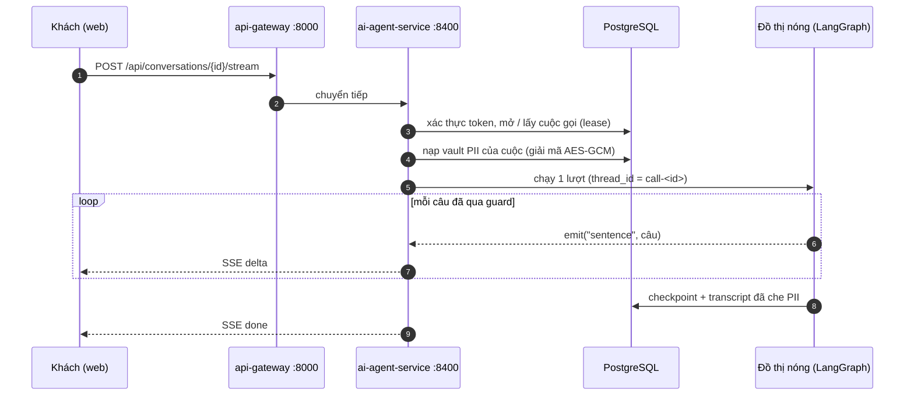
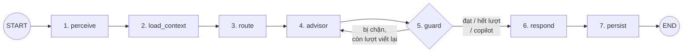
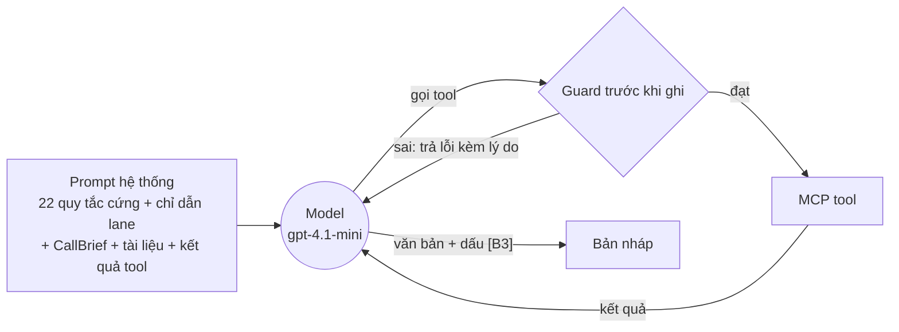
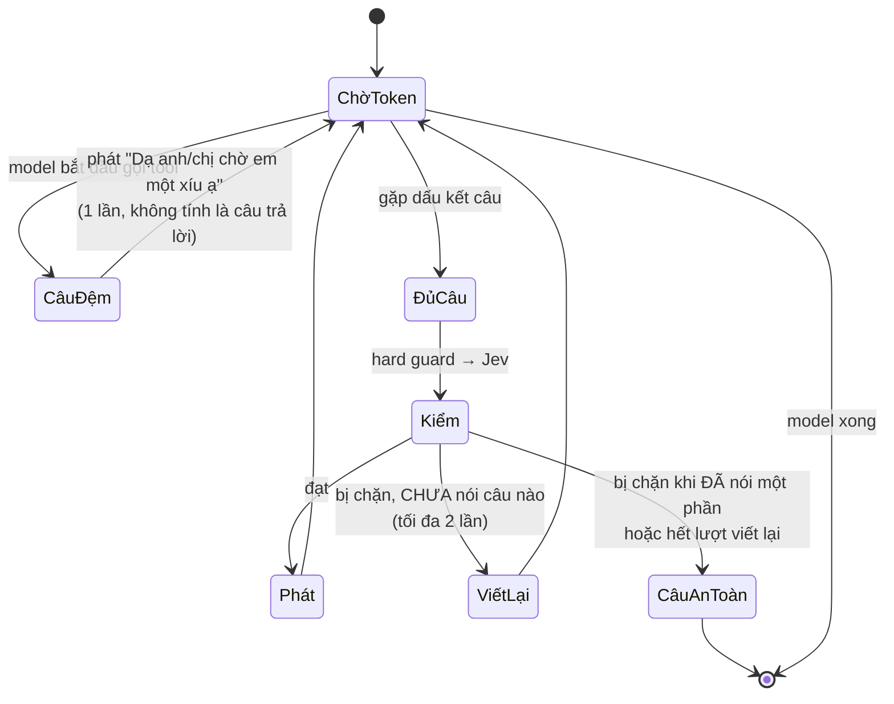
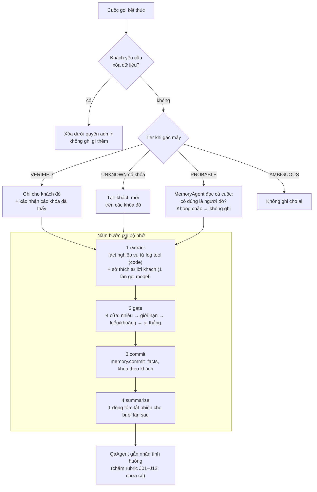
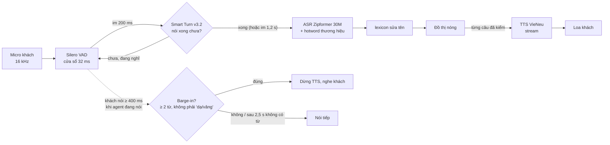

# 1. Pipeline xử lý

[← Mục lục](README.md) · Tiếp theo: [Xử lý tình huống →](02-xu-ly-tinh-huong.md)

Trang này đi theo **một tin nhắn** từ lúc khách gõ (hoặc nói) đến lúc trợ lý trả lời, rồi xem chuyện gì xảy ra **sau khi cuộc gọi kết thúc**.

---

## 1.1 Từ trình duyệt đến đồ thị

- **Mỗi conversation là một cuộc gọi** của agent. Cuộc gọi có *lease* để hai request song song không chạy chồng lên nhau; `turn_id` làm lượt *idempotent*: gửi lại cùng `turn_id` thì nhận lại kết quả cũ, không chạy lại model ([runtime/calls.py](../../apps/ai-agent-service/src/ai_agent_service/runtime/calls.py)).
- **Trạng thái làm việc** của cuộc gọi (tin nhắn, báo giá, danh tính...) nằm trong checkpoint của LangGraph, không có bảng riêng. Bảng `calls` chỉ là bản chiếu để màn hình đọc.
- **Dữ liệu thô không vào state.** Lời khách trước khi che PII, số người gọi, vault đều nằm trong `HotContext`, một đối tượng truyền vào node nhưng không bao giờ được lưu ([pipeline/hot/state.py](../../apps/ai-agent-service/src/ai_agent_service/pipeline/hot/state.py)).

---

## 1.2 Đồ thị nóng: 7 bước của một lượt

Định nghĩa: [pipeline/hot/graph.py](../../apps/ai-agent-service/src/ai_agent_service/pipeline/hot/graph.py). Thân các node: [pipeline/hot/nodes.py](../../apps/ai-agent-service/src/ai_agent_service/pipeline/hot/nodes.py).

### Bước 1: `perceive`, hiểu câu khách

Biến lời khách thành văn bản sạch, đã chuẩn hóa và đã che dữ liệu cá nhân.

| Thứ tự | Việc | Ví dụ | Module |
|---|---|---|---|
| 1 | Xóa trạng thái lượt trước (bản nháp, kết quả tool, phán quyết guard) | | `TURN_KEYS` |
| 2 | Nếu là giọng nói: sửa tên sản phẩm ASR nghe sai | "e pia" → "AirPure", "sai z eo" → "size L" | [intake/lexicon.py](../../apps/ai-agent-service/src/ai_agent_service/components/intake/lexicon.py) |
| 3 | Đổi teencode, chuẩn Unicode NFC | "sp nay co ship cod k" → "sản phẩm nay co ship cod không" | [intake/text.py](../../apps/ai-agent-service/src/ai_agent_service/components/intake/text.py) |
| 4 | ITN: số nói thành số viết, giờ hẹn thành ISO | "bốn triệu tám" → 4.800.000đ; "tối mai 8 giờ" → `2026-10-26T20:00+07:00` | [intake/itn.py](../../apps/ai-agent-service/src/ai_agent_service/components/intake/itn.py) |
| 5 | Che PII: số điện thoại, CCCD, số tài khoản, địa chỉ | "0901234567" → `<PHONE_1>` | [intake/pii.py](../../apps/ai-agent-service/src/ai_agent_service/components/intake/pii.py) |
| 6 | Đọc tín hiệu bằng luật | bực bội, đòi gặp người, khiếu nại, hỏi người hay máy, muốn xóa dữ liệu, chủ đề y tế/pháp lý | [intake/signals.py](../../apps/ai-agent-service/src/ai_agent_service/components/intake/signals.py) |
| 7 | Ghi nhận cách khách tự xưng (anh, chị, cô, chú...) | "chị muốn hỏi..." → xưng "chị" | [intake/honorific.py](../../apps/ai-agent-service/src/ai_agent_service/components/intake/honorific.py) |
| 8 | Cờ `asr_low_conf` khi độ tin cậy ASR < 0,45; cờ `new_key` khi xuất hiện số điện thoại mới | | |

Sau bước này, **model, Jev, Langfuse và checkpoint chỉ thấy token**. Giá trị thật nằm trong vault mã hóa của cuộc gọi.

### Bước 2: `load_context`, biết ai đang nói và tài liệu nói gì

Ba việc, chạy ở lượt đầu, khi có khóa mới, hoặc khi khách trả lời câu hỏi xác nhận:

1. **Nhận diện khách.** Khóa (số người gọi, Zalo ID, số khách đọc) được băm HMAC rồi tra song song trong CRM của BTC và sổ định danh. Kết quả là một **tier** (bảng ở [Xử lý tình huống §2.1](02-xu-ly-tinh-huong.md#21-bốn-mức-danh-tính)).
2. **Dựng CallBrief** (chỉ khi biết khách là ai):
   - `retrieve`: đọc fact, 3 phiên gần nhất, đơn hàng. Đây là **công tắc bộ nhớ**: tắt thì không đọc gì (cấu hình baseline).
   - `refresh`: hỏi lại tool xem những gì brief nhắc còn đúng không: giá hôm nay, khuyến mãi, tồn kho, trạng thái đơn. Cái gì đổi thì thành **cảnh báo**, ví dụ "giá đã tăng từ 4.890.000đ lên 5.200.000đ vì KM hết hạn".
   - `render`: dựng brief theo template (không để model viết tự do), đánh số dòng `B1..Bn`, mỗi dòng gắn với fact gốc. Thời gian dựng được đo làm `call_brief_latency_ms`.
3. **Tra tri thức** bằng lời khách (`kb_search`): 5 đoạn chính sách liên quan nhất, kèm cờ "nội bộ", "hết hiệu lực" và quyết định có nên **từ chối** không. Nếu câu hỏi về một đơn đã đặt, chính sách được chọn theo **ngày đặt đơn**, không theo hôm nay. Chi tiết thuật toán: [Thuật toán §3.3](03-thuat-toan.md#33-truy-hồi-tri-thức-bm25--embedding--rrf).

> Tri thức không phải là tool của model. Harness tra trước rồi đưa đoạn văn vào prompt, nhờ vậy tiết kiệm một vòng gọi model cho mỗi câu hỏi chính sách.

### Bước 3: `route`, chọn hướng xử lý

Bảng 7 luật, **luật khớp đầu tiên thắng** ([orchestration/rules.py](../../apps/ai-agent-service/src/ai_agent_service/components/orchestration/rules.py)):

| # | Lane | Khi nào | Tool được dùng |
|---|---|---|---|
| 1 | `HANDOFF` | ≥ 2 lỗi tool liên tiếp, hoặc đã nói câu an toàn ≥ 2 lần trong cuộc | `handoff_transfer` |
| 2 | `CLARIFY` | ASR nghe không rõ | không có |
| 3 | `CONFIRM_IDENTITY` | tier `PROBABLE`/`AMBIGUOUS` và câu hỏi xác nhận còn chờ | không có |
| 4 | `ORDER_SERVICE` | khách có đơn và đang nói về đơn (regex `ORDER_TALK`) | tra/sửa đơn, giao hàng, CRM, chuyển máy, xóa dữ liệu |
| 5 | `OUT_OF_SCOPE` | chủ đề bắt buộc chuyển người: y tế, thai sản, thuốc, pháp lý (PB-06) | `handoff_transfer` |
| 6 | `CONTINUITY` | khách `VERIFIED` quay lại, có brief | bộ bán hàng đầy đủ |
| 7 | `NEW` | mặc định | bộ bán hàng đầy đủ |

Ngoài lane, route còn gắn **ghi chú** vào chỉ dẫn của model: khách đang bực (PB-10, xin lỗi ngắn và đi thẳng vào việc), đã liên hệ ≥ 3 lần chưa chốt (PB-11, không ép), số dùng chung chưa xác nhận (không đọc thông tin riêng). Danh sách tool từng lane: [config/lanes.yaml](../../apps/ai-agent-service/config/lanes.yaml).

### Bước 4: `advisor`, model soạn câu trả lời

[agents/advisor.py](../../apps/ai-agent-service/src/ai_agent_service/agents/advisor.py). Một vòng **ReAct** (`langchain.agents.create_agent`): model gọi tool, đọc kết quả, gọi tiếp, cho đến khi trả lời bằng văn bản.

- **Giới hạn mỗi lượt:** tối đa 20 lần gọi tool và 8 lần gọi model; thử lại model 1 lần nếu lỗi.
- **Tool chỉ của lane đó.** Lane `CLARIFY` không có tool nào, nên "agent không gọi tool" là sự thật cơ học, không phải lời hứa trong prompt.
- **Guard trước khi ghi** ([guardrails/actions.py](../../apps/ai-agent-service/src/ai_agent_service/components/guardrails/actions.py)): trước khi `order_create`, `order_update`, `schedule_callback`, `handoff_transfer`, `memory_request_deletion` chạy, harness kiểm tham số. Ví dụ: mã sản phẩm phải xuất hiện trong kết quả tool (không tự ghép từ tên), đơn giá phải bằng báo giá hôm nay, tổng đơn COD (mọi món COD đã đặt trong cuộc gọi cùng `order_group`) không quá 10 triệu, tách đơn chỉ khi khách đồng ý, giờ hẹn phải trong giờ làm việc. Sai thì tool không chạy, model nhận lỗi có lý do để sửa.
- **Ẩn bớt brief theo tier:** dưới `VERIFIED`, các dòng brief có giá, địa chỉ, mã đơn bị **lấy ra khỏi prompt**, không chỉ "cấm nói" trong prompt.
- **Đầu ra** là văn bản thường, có dấu `[B3]` đánh dấu dòng brief đã dùng. Dấu này bị xóa trước khi khách đọc, nhưng được giữ lại làm `facts_used` trong trace (để chấm CCR).
- **Gộp ngữ cảnh** ([context/compact.py](../../apps/ai-agent-service/src/ai_agent_service/components/context/compact.py)): quá 16 tin nhắn thì các lượt cũ (trừ 4 lượt cuối) được gộp thành `working_summary` để prompt không vượt cửa sổ.

#### Streaming: kiểm từng câu trước khi nói

Khi trợ lý nói trực tiếp với khách (chế độ `speak`), câu trả lời được **stream và cắt theo câu**. Mỗi câu đi qua hard guard (và Jev nếu có rủi ro) rồi mới phát ra.

Câu đã nói thì không rút lại được, nên nếu câu thứ hai bị chặn, luồng dừng và nói câu an toàn của lane. Quá 3 câu (trừ khi đọc lại đơn) thì phần thừa không được nói.

### Bước 5: `guard`, kiểm câu trả lời

Với luồng stream, mọi câu đã được kiểm ở bước 4, nên node này bỏ qua. Với bản nháp nguyên khối (copilot, hoặc model không stream), node này chạy:

1. **Hard guard** (code thuần, vài ms): kiểm 11 nhóm luật. Bảng đầy đủ ở [Thuật toán §3.5](03-thuat-toan.md#35-hard-guard-kiểm-câu-trả-lời-bằng-code).
2. **Jev** (PolicyAgent, [agents/policy.py](../../apps/ai-agent-service/src/ai_agent_service/agents/policy.py)): chỉ khi hard guard đạt **và** câu có tín hiệu rủi ro (số, tiền, khuyến mãi, kho, đối thủ, lời hứa). Jev chỉ thấy câu nháp, kết quả tool và chính sách, **không thấy brief và lịch sử chat**, để giá cũ đứng cạnh giá mới là thấy ngay. Hết 1,5 s mà Jev chưa trả lời thì cho qua với hard guard.
3. **Quyết định:**
   - đạt → `respond`;
   - bị chặn, còn lượt → quay lại `advisor` kèm **mọi** lý do (để một lần viết lại sửa hết);
   - bị chặn lần thứ 3 → câu an toàn, đếm `safe_lines` (2 lần trong một cuộc thì lượt sau vào lane `HANDOFF`);
   - chế độ copilot → không viết lại; lý do đi kèm gợi ý thành cảnh báo cho nhân viên.

### Bước 6: `respond`, nói hoặc gợi ý

- Xóa dấu `[Bn]`, giữ danh sách dòng brief đã dùng.
- Nếu `handoff.transfer` chạy thành công trong lượt: thêm câu nối "Dạ em kết nối anh/chị với đồng nghiệp phụ trách ngay ạ...", chuyển cuộc sang **copilot**.
- Ở copilot: không nói gì với khách, bản nháp thành **gợi ý** trên console `/calls` cho nhân viên dùng, sửa hoặc bỏ.
- Token PII được giải lại ở API: khách thấy lại số của mình. CCCD và số tài khoản không bao giờ được đọc lại, chỉ 4 số cuối.

### Bước 7: `persist`, lưu lại

Checkpoint đã được LangGraph lưu. Node này ghi transcript (đã che PII) và bản chiếu `calls` qua store được truyền vào: bảng của API khi chạy thật, hoặc trace khi chạy đánh giá.

---

## 1.3 Sau cuộc gọi: `after_call`

[pipeline/cold/after_call.py](../../apps/ai-agent-service/src/ai_agent_service/pipeline/cold/after_call.py). Chạy như tác vụ nền khi cuộc gọi kết thúc: nhân viên bấm kết thúc, Sales đóng conversation, hoặc **30 phút im lặng** (reconciler kiểm mỗi phút).

Điểm quan trọng:

- **Fact nghiệp vụ** (sản phẩm đã báo giá, giá, khuyến mãi, đơn, lịch hẹn) được đọc **từ log tool bằng code**, không từ lời ai nói. Khách nói "hôm trước báo 4 triệu" mà tool nói 4,89 triệu thì tool thắng, lời khách được ghi lại là "khách nói vậy" và fact bị đánh dấu tranh chấp.
- **Sở thích và nhu cầu** (ngân sách, diện tích phòng, có trẻ nhỏ, người quyết định...) do model đọc lời khách, kèm độ tin cậy. Dưới 0,6 (câu đùa, giả định) thì không ghi.
- Mọi ứng viên mang tên extractor đã đề xuất nó, nằm trong khóa idempotency: chạy lại cùng cuộc với cùng extractor không ghi hai lần.

Chi tiết cổng ghi: [Thuật toán §3.7](03-thuat-toan.md#37-cổng-ghi-bộ-nhớ).

---

## 1.4 Kênh giọng nói

[api/routes/voice.py](../../apps/ai-agent-service/src/ai_agent_service/api/routes/voice.py), [components/voice/](../../apps/ai-agent-service/src/ai_agent_service/components/voice/). Toàn bộ chạy local trên CPU.

| Thông số | Giá trị | Ý nghĩa |
|---|---|---|
| `endpointing: smart` | im 200 ms → hỏi Smart Turn; trần 1,2 s | phân biệt khách ngừng để nghĩ với khách nói xong |
| `barge_in_ms: 400` | | tiếng ngắn hơn ("dạ", "vâng") là phụ họa, bỏ qua |
| `min_interruption_words: 2` | | cắt lời thật phải có ít nhất 2 từ, không toàn từ phụ họa |
| `false_interruption_ms: 2500` | | dừng mà không nghe được từ nào thì nói tiếp |
| `asr: zipformer-30m` | RTF ~0,03–0,4 | nhanh nhất trên CPU với WER dùng được |

Trong prompt, kênh thoại có ghi chú riêng: tối đa hai câu ngắn, mỗi lần một ý, đọc số tự nhiên. Kênh chat thì viết số dạng 3.290.000đ. Lý do chọn Zipformer thay vì PhoWhisper/VieGem: [Đánh giá §5](05-danh-gia.md#5-đánh-giá-asr).

---

## 1.5 Khi thiếu cấu hình hoặc có lỗi

Nguyên tắc: **lỗi không bao giờ là im lặng**.

| Sự cố | Hành vi |
|---|---|
| Model lỗi / hết hạn mức / quá giờ | nói câu "Dạ em xin lỗi, em chưa trả lời được ngay..."; giữ kết quả tool đã chạy; **không tự thử lại lệnh ghi** |
| Tool lỗi hạ tầng 2 lần liên tiếp | lượt sau vào lane `HANDOFF` |
| Câu an toàn lần thứ 2 trong cuộc | lượt sau vào lane `HANDOFF` |
| Không có `TYPESAFE_API_KEY` | bỏ qua Jev, hard guard vẫn chạy |
| Không tải được model embedding | truy hồi chỉ dùng BM25, manifest ghi rõ chế độ `keyword` |
| Database chưa sẵn sàng | service vẫn khởi động; `/health/ready` trả 503 |
| Thiếu gói voice | chat chạy bình thường; cuộc gọi voice nhận thông báo thiếu gói |

---

## 1.6 Các model đang dùng

Cấu hình: [config/models.yaml](../../apps/ai-agent-service/config/models.yaml). Mọi lời gọi chạy `temperature: 0` để tái lập được.

| Vai trò | Model | Nằm trên đường nóng? |
|---|---|---|
| Advisor (soạn câu trả lời) | OpenAI `gpt-4.1-mini` (đổi được trong `/developer`) | có |
| PolicyAgent (kiểm mềm) | TypeSafe `jev-latest`, timeout 1,5 s | có, chỉ câu rủi ro |
| Compactor (gộp lượt cũ) | `gpt-4.1-mini` | có, chỉ khi > 16 tin nhắn |
| MemoryAgent (trích fact) | `gpt-4.1-mini` | không (after_call) |
| Extractor (chấm điểm) | `gpt-4.1-mini` | không (chỉ khi đánh giá) |
| Embedding | `multilingual-e5-small` int8 ONNX, 118 MB, ~13 ms/câu | có |
| ASR / TTS | Zipformer 30M / VieNeu | có (voice) |
