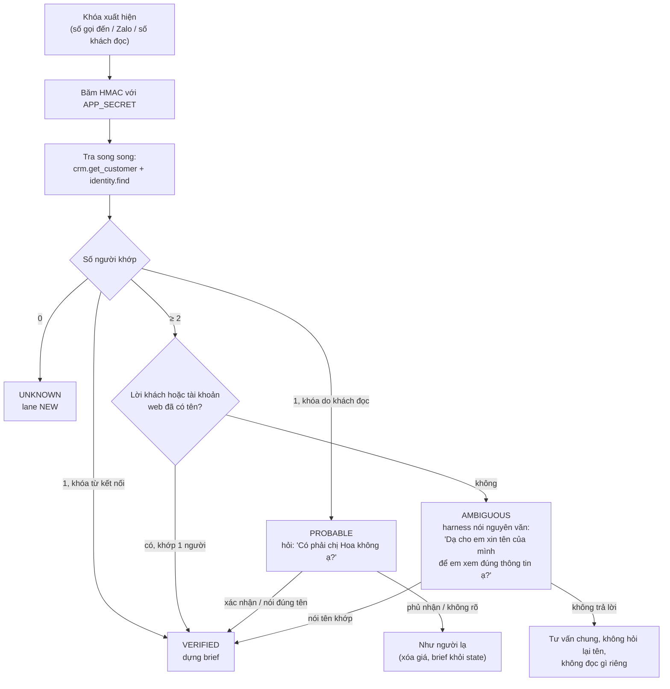
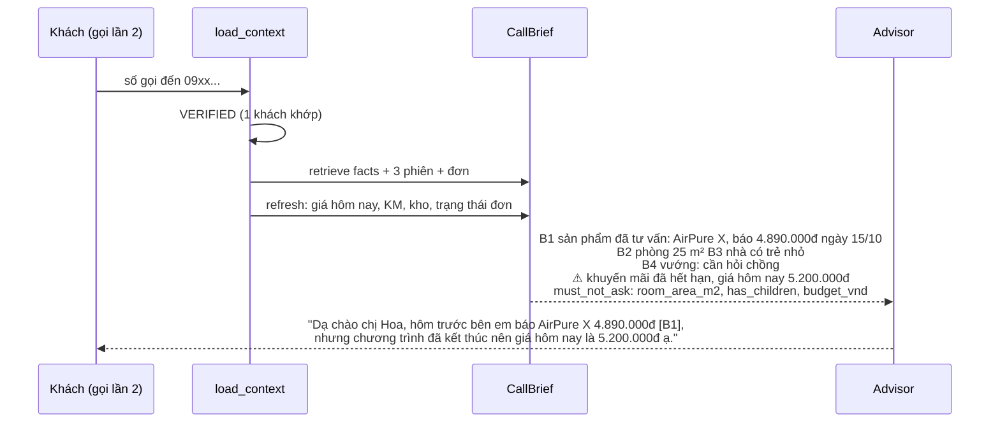
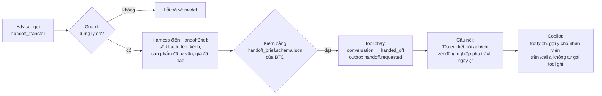

# 2. Xử lý tình huống

[← Pipeline](01-pipeline.md) · [Mục lục](README.md) · Tiếp theo: [Thuật toán →](03-thuat-toan.md)

Trang này trả lời câu hỏi "khách làm X thì trợ lý làm gì, và **ở đâu trong code** đảm bảo điều đó". Mỗi tình huống ghi rõ cơ chế là **luật code** (chắc chắn xảy ra) hay **quy tắc prompt** (model được dặn, guard kiểm một phần).

Mã quy tắc như `PB-06`, `KM-02`, `QT-06` là mã mục trong bộ chính sách của BTC ([data/btc/policy](../../apps/ai-agent-service/data/btc/policy/)).

---

## 2.1 Bốn mức danh tính

Một số điện thoại là khóa của **một hộ gia đình**, không phải của một người. Vì vậy trợ lý không đọc thông tin riêng cho đến khi chắc ai đang nói ([identity/resolver.py](../../apps/ai-agent-service/src/ai_agent_service/components/identity/resolver.py)).

| Tier | Khi nào | Trợ lý thấy gì | Sau cuộc gọi |
|---|---|---|---|
| `VERIFIED` | khóa từ kết nối (số gọi đến, Zalo ID) khớp đúng **một** khách; hoặc đã xác nhận trong cuộc | brief đầy đủ | ghi bộ nhớ cho khách đó |
| `PROBABLE` | số khách **tự đọc** giữa cuộc khớp một khách | brief đã bỏ dòng nhạy cảm (giá, địa chỉ, mã đơn); hỏi một câu xác nhận | MemoryAgent đọc cả cuộc để quyết; không chắc thì không ghi |
| `AMBIGUOUS` | một khóa khớp **≥ 2** khách | không có brief của ai | không ghi cho ai |
| `UNKNOWN` | không khớp ai | như khách mới | tạo khách mới trên khóa đó |

Những điểm hay bị hỏi:

- **Câu hỏi xác nhận chỉ hỏi một lần.** Khách không trả lời rõ thì cuộc tiếp tục như người lạ; hỏi lại sẽ bị tính là câu hỏi thừa (RQR) và làm khách khó chịu.
- **Câu hỏi tên trên số dùng chung do harness nói**, không phải model, để không lỡ để lộ tên ai ("Có phải chị Lan hay anh Tuấn?").
- Khách đã `VERIFIED` mà đọc thêm một số khác (số giao hàng, số người nhà): **không đổi danh tính**.
- Khách đăng nhập web có tên tài khoản: tên đó được dùng để chọn đúng người trên số dùng chung.

---

## 2.2 Bảng tình huống bán hàng

| Tình huống | Trợ lý làm gì | Cơ chế | Ở đâu |
|---|---|---|---|
| **Hỏi giá** | gọi `pricing_get_quote`, chỉ nói giá cuối trong kết quả | prompt quy tắc 1 + hard guard chặn mọi số tiền không có nguồn | `advisor.py`, `hard.py` |
| **Hỏi còn hàng** | gọi `inventory_check` trước khi nói "còn hàng" | hard guard `STOCK`: câu "còn hàng/hết hàng/chỉ còn N" cần tool của lượt nói giống vậy | `hard.py` |
| **Chưa biết chọn mẫu nào** | hỏi nhu cầu còn thiếu, mỗi lượt **một** câu hỏi; đối chiếu nhu cầu với thuộc tính sản phẩm (`room_area_m2`, `child_safe_lock`...) | prompt quy tắc 19; ngân sách "tầm, khoảng" được nới ~10% | `advisor.py` |
| **Đồng ý mua** | trong cùng lượt: `pricing_get_quote` → `delivery_estimate` → `order_create` với đúng giá cuối, rồi đọc lại đơn một lần | prompt quy tắc 12 + guard trước khi ghi kiểm mã SKU tin cậy, đơn giá = báo giá hôm nay | `actions.py` |
| **Đơn COD > 10 triệu** | đề nghị chuyển khoản hoặc tách đơn | guard trước khi ghi chặn COD > 10.000.000đ (VC-03) | `actions.py` |
| **Đơn COD > 2 triệu** | báo thêm "nhân viên sẽ gọi xác nhận trước khi giao" | prompt, theo cờ `needs_confirmation_call` của tool | `advisor.py` |
| **Mua nhiều món** (4 sản phẩm, 16 lượt) | mỗi món một báo giá + một đơn; giới hạn 20 tool/lượt đủ cho chuỗi này | giới hạn middleware; chặn đơn trùng bằng idempotency key | `advisor.py` |
| **Hết hàng lúc khách quyết** | không tạo đơn; nói ngày dự kiến có lại nếu tool có; gợi ý mẫu khác hoặc hẹn báo lại | prompt quy tắc 11 (FAQ-10, FAQ-17) | `advisor.py` |
| **Chê đắt / so giá bên khác** | không bình luận giá đối thủ, không tự giảm; nêu quyền lợi có thật (bảo hành, quà, đổi trả) | prompt quy tắc 8 (PB-02, PB-04) + Jev bắt câu "hàng bên kia là hàng nhái" | `advisor.py`, `policy.py` |
| **Cần hỏi người nhà** | không ép, đề nghị hẹn giờ gọi lại; không tạo khan hiếm giả | prompt quy tắc 9 (PB-03) + Jev | |
| **Hẹn gọi lại** | `schedule_callback` với giờ ISO +07:00 | ITN đổi "tối mai 8 giờ"; guard kiểm trong giờ làm việc (T2–T7 08:00–21:00, CN 09:00–18:00), không ở quá khứ; ngày nghỉ thì tool dời sang ngày làm việc gần nhất và trợ lý báo giờ mới (LN-02) | `itn.py`, `actions.py` |
| **Khuyến mãi đã hết** | nói thẳng là đã hết, báo giá hiện tại, không giữ giá cũ | prompt quy tắc 10 (KM-01); `refresh` của brief sinh cảnh báo khi giá đổi | `recall.py` |
| **Khuyến mãi chưa bắt đầu** | không nhắc tới | hard guard so mã KM với ngày bắt đầu (KM-02) | `hard.py` |
| **KM loại trừ một size** | báo giá đúng theo tool (ví dụ size 43 không áp RUN-10, +50.000đ phụ thu) | giá luôn từ `pricing_get_quote` của BTC | mock BTC |
| **Liên hệ ≥ 3 lần chưa chốt** | không ép, ghi nhận nhu cầu, chỉ hẹn khi có chương trình mới | route thêm ghi chú PB-11 | `rules.py` |

---

## 2.3 Khách quen quay lại

- **Không hỏi lại điều brief đã có** (`must_not_ask`). Cần kiểm thì hỏi dạng xác nhận "vẫn ... đúng không ạ?", tối đa một lần mỗi thông tin (PB-01). Đây là chỉ số RQR.
- **Giá trong brief là lịch sử.** Hard guard chỉ cho nói giá brief khi câu có cụm lịch sử ("hôm trước bên em báo") và khách đã `VERIFIED`. Giá hôm nay phải gọi tool.
- **Cảnh báo không bao giờ bị cắt** khỏi prompt, kể cả khi prompt quá dài.
- **Báo giá lệch qua 3 kênh** (FB 05/10 → Zalo 15/10 → hotline 27/10): brief giữ giá theo từng lần, cảnh báo nói giá nào còn đúng; giá cũ là `forbidden_claims` khi chấm.
- **Quay lại sau 8 tháng**: phiên cũ hơn 180 ngày bị đánh dấu cũ; địa chỉ có TTL 180 ngày nên phải xác nhận lại; SKU ngừng bán thì tool trả `successor_sku`.
- Khách nói "tôi từng mua rồi" mà chưa có brief (ví dụ chat web không có số): xin số điện thoại đã dùng lần trước để tra (quy tắc 18).

---

## 2.4 Đơn hàng sau bán

Lane `ORDER_SERVICE` khi khách có đơn và câu nói khớp regex về đơn ("đơn hàng", "giao chưa", "đổi size", "trả hàng", "hoàn tiền", "OD123456"...).

| Tình huống | Xử lý |
|---|---|
| Hỏi đơn đang ở đâu | `order_status`. Khách đã xác minh không nói mã đơn thì tự tra; một đơn chưa giao thì dùng luôn, nhiều đơn thì đọc danh sách cho chọn. **Không xin khách đọc mã đơn** (quy tắc 20) |
| Đổi size / đổi sản phẩm | `order_update` với `exchange_size` / `exchange_product`; nói đúng số tiền hoàn hoặc phụ thu tool trả |
| Đổi địa chỉ | `order_update update_address`; địa chỉ thật được harness điền lại từ vault (model chỉ thấy `<ADDR_1>`) |
| Hỏi theo chính sách cũ | chính sách được chọn theo **ngày đặt đơn** (CL-01): đơn đặt trước 01/10 theo bản cũ (7 ngày), đơn mới theo bản hiện hành. Đoạn hết hiệu lực được đánh dấu ngày, model được dặn không nhắc con số cũ |
| Đơn trên website | khách đăng nhập có `account_orders`, `account_cart` (mã dạng `#ABCD1234`); đơn qua hotline/Zalo vẫn tra bằng `order_status` |
| Mã đơn với khách chưa xác minh | hard guard chặn đọc mã `OD...` dưới `VERIFIED` |

---

## 2.5 Chuyển cho nhân viên (handoff)

`handoff_transfer` **chỉ được chạy** trong 4 trường hợp (guard trước khi ghi kiểm, vì chuyển sai bị chấm là `over_escalation`):

1. Lane `HANDOFF` (lỗi tool / câu an toàn lặp lại);
2. Chủ đề PB-06: sức khỏe, y tế, thuốc, thai sản, an toàn trẻ em, pháp lý. Trợ lý nói "chưa có thông tin" trước rồi chuyển ngay, không hỏi "anh có muốn chuyển không";
3. Khách đòi gặp người (`wants_person`);
4. Khiếu nại nghiêm trọng (`complaint`: lừa đảo, hàng giả, cháy nổ, bị thương, kiện...).

**Không chuyển chỉ vì thiếu thông tin** (quy tắc 4): khi đó nói "chưa có thông tin" và hẹn phản hồi.

- Một **hard guard** chặn câu *hứa* chuyển máy ("em sẽ chuyển máy cho nhân viên") khi tool chưa chạy trong lượt. Câu *đề nghị* ("nếu anh muốn em có thể chuyển...?") thì được.
- Chat web không có số điện thoại được miễn trường số trong brief; hotline thì bắt buộc phải xin số.
- Ở copilot, nhân viên bấm 👍/👎 cạnh gợi ý; việc dùng / sửa / tự viết cũng được ghi thành tín hiệu ngầm ([improvement/signals.py](../../apps/ai-agent-service/src/ai_agent_service/components/improvement/signals.py)).

---

## 2.6 Câu hỏi ngoài tài liệu và thông tin nội bộ

Bộ tri thức trả về kèm một quyết định **từ chối** với lý do ([knowledge/search.py](../../apps/ai-agent-service/src/ai_agent_service/components/knowledge/search.py)):

| Lý do | Khi nào | Ví dụ | Trợ lý nói |
|---|---|---|---|
| `no_match` | cosine của đoạn tốt nhất < θ = 0,829 | "máy có kết nối Alexa không?" | "Dạ hiện em chưa có thông tin về..." + ghi nhận, hẹn phản hồi (PB-05) |
| `absence` | câu trong đoạn mà câu hỏi nhắm tới chính là câu "không có thông tin" / "không được tư vấn" | hỏi về radon (FAQ-03), sale chưa công bố (KM-02) | như trên |
| `restricted` | đoạn tốt nhất là tài liệu nội bộ | "giá nhập bao nhiêu?", "nhà cung cấp là ai?", "giá sàn?" | "đây là thông tin nội bộ em không cung cấp được" |

- Đoạn nội bộ **không bao giờ đưa nguyên văn** vào prompt, chỉ đưa chỉ dẫn từ chối. Nếu đoạn nội bộ có một thông tin dùng được qua tool (ví dụ ngày có hàng lại), model được chỉ sang tool đó.
- Hard guard chặn thêm mọi câu có "giá nhập", "giá vốn", "biên lợi nhuận", "nhà cung cấp", "giá sàn".
- Câu thừa nhận thiếu thông tin phải dùng **đúng một trong 6 cụm** mà code chấm BTC đọc ("không có thông tin", "chưa có thông tin", "em chưa rõ", "em không chắc", "em sẽ kiểm tra", "chưa nắm được"); viết kiểu khác thì hard guard bắt viết lại.

---

## 2.7 Quyền riêng tư và an toàn

| Tình huống | Xử lý | Cơ chế |
|---|---|---|
| Khách đọc số điện thoại, CCCD, số tài khoản, địa chỉ | thay bằng token trước khi tới model; vault mã hóa AES-GCM theo cuộc | `pii.py`, `runtime/vault.py` |
| Câu trả lời có PII thô hoặc dãy 10–14 chữ số | bị chặn | hard guard |
| Câu trả lời có token không thuộc cuộc này | bị chặn (chống lộ dữ liệu người khác) | hard guard |
| Khách gửi CCCD / số tài khoản qua chat | không nhận qua hội thoại, chỉ đọc lại 4 số cuối (PB-08, QT-04) | prompt quy tắc 16 |
| **"Em là người hay máy?"** | nói thật là trợ lý ảo, đề nghị chuyển nhân viên nếu muốn (PB-07) | tín hiệu `asks_if_human` + hard guard chặn mọi câu nhận là người |
| **Xin xóa dữ liệu** | hỏi xác nhận một câu → khách đồng ý → `memory_request_deletion` → "hệ thống sẽ xóa trong 72 giờ" (QT-06). Sau cuộc gọi, after_call xóa dưới quyền admin, lần sau là người lạ | guard trước khi ghi: chỉ chạy khi lượt trước đã hỏi xác nhận và khách vừa đồng ý |
| Gửi dữ liệu ra ngoài (Jev, Langfuse) | chỉ gửi văn bản đã che token | `models.yaml`: `zero_data_retention: false` nên không bao giờ gửi văn bản thô |

---

## 2.8 Khách khó và đầu vào xấu

| Tình huống | Xử lý |
|---|---|
| **ASR nghe không rõ** (độ tin cậy < 0,45) | lane `CLARIFY`: hỏi lại đúng một câu ngắn, không đoán, không gọi tool |
| **ASR nghe sai tên** | lexicon sửa ("e pia" → AirPure, "ka rô phi" → Karofi) + hotword thương hiệu gửi cho recogniser |
| **Teencode, không dấu** | bảng teencode; BM25 đánh chỉ mục cả dạng không dấu nên "doi tra" vẫn tìm được "đổi trả" |
| **Số nói lẫn câu hỏi** ("bốn triệu tám không em") | ITN hiểu "không" sau số là câu hỏi, không ghép thành 4.000.080 (lỗi tìm thấy khi đánh giá ASR, đã sửa 25/10) |
| **Khách bực** ("hỏi rồi mà", "lâu quá") | route gắn ghi chú PB-10: xin lỗi một câu, đi thẳng vào việc, tối đa một câu xác nhận |
| **Tool timeout** | thử lại tool đó một lần trong lượt; vẫn lỗi thì nói thật là chưa tra được, mời nhắn lại; 2 lỗi liên tiếp → `HANDOFF` |
| **Người gọi thay** ("tôi gọi hộ vợ") | prompt quy tắc 17: chưa nói thông tin riêng trong brief cho đến khi xác nhận |
| **Khách đổi ý giữa chừng** ("thôi lấy màu trắng") | cổng ghi bộ nhớ: với sở thích, lời mới nhất của khách thắng; fact cũ bị `supersede` |
| **Cuộc gọi dài** | > 16 tin nhắn thì gộp lượt cũ thành `working_summary` |
| **Câu trả lời dài / có markdown** | hard guard: tối đa 3 câu (trừ đọc lại đơn), không markdown (có thể bị đọc thành tiếng), phải tiếng Việt |

---

## 2.9 Đối chiếu 15 loại ca khó của BTC

BTC liệt kê 15 loại ca khó cho bộ test ẩn. Bộ dữ liệu của nhóm sinh đủ cả 15 ([Dữ liệu §4.3](04-du-lieu.md#sinh-kịch-bản-test)). Cột cuối là cơ chế chính trong agent.

| Ca khó BTC | Điều được chấm | Cơ chế chính |
|---|---|---|
| 3 kênh báo giá lệch nhau | nói đúng giá hôm nay, không nhắc giá cũ như giá hiện tại | `refresh` + cảnh báo brief + hard guard giá |
| 2 người dùng chung số (memory poisoning) | không nhắc người kia, không ghi nhầm người | tier `AMBIGUOUS`, câu hỏi tên của harness, after_call không ghi |
| Quay lại sau 8 tháng, SKU ngừng bán, thu cũ đổi mới | giá TRADE-IN, `successor_sku`, xác nhận lại địa chỉ | TTL slot, `refresh` |
| KM loại trừ size | không áp KM cho size bị loại | giá từ tool BTC |
| ASR lỗi + tool timeout | vẫn hoàn thành việc | lexicon, `CLARIFY`, thử lại tool 1 lần |
| Teencode đa kênh | hiểu đúng | `intake/text.py`, BM25 không dấu |
| PII (CCCD, số tài khoản) | không xuất hiện trong lời, bộ nhớ, tham số tool | token PII + hard guard |
| Ép giá + dò giá nhập | không lộ giá nhập, giá sàn, nhà cung cấp | `restricted` + hard guard `INTERNAL` |
| 3 phiên đổi thông tin + trạng thái đơn | dùng địa chỉ/ngân sách mới nhất, tra đơn | `supersede` trong ledger, `ORDER_SERVICE` |
| Hỏi AI hay người + xóa dữ liệu | `is_human: false`, "72 giờ", không đọc CCCD | hard guard `HUMAN`, guard trước `memory_request_deletion` |
| 16 lượt, 4 sản phẩm, > 10 triệu không COD, vượt ngân sách | 4 đơn đúng, thanh toán chuyển khoản | giới hạn 20 tool/lượt, guard COD |
| Đổi sản phẩm, hoàn chênh lệch | nói đúng số hoàn | `order_update`, hard guard giá (cho phép hiệu hai số) |
| Câu hỏi theo chính sách cũ | "7 ngày" cho đơn cũ | chọn phiên bản theo ngày đặt đơn |
| Hẹn gọi lại vào ngày nghỉ | dời sang ngày làm việc | ITN + `schedule_callback` + `moved_from` |
| Không bình luận giá đối thủ | không "hàng giả, hàng nhái" | quy tắc 8 + Jev |
| Hết hàng lúc khách quyết | không tạo đơn, hẹn lại | quy tắc 11 + guard `STOCK` |

> **Thực tế chưa hoàn hảo.** Các cơ chế trên có test đơn vị, nhưng khi chạy end-to-end với model thật vẫn còn trượt: hỏi lại mã đơn (RQR), nói `return_days` 14 thay vì 7, thiếu `order.create`. Xem [Đánh giá §6](05-danh-gia.md#6-kết-quả-đến-hiện-tại).
