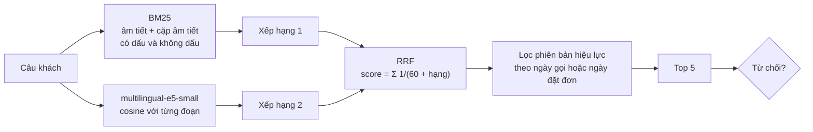
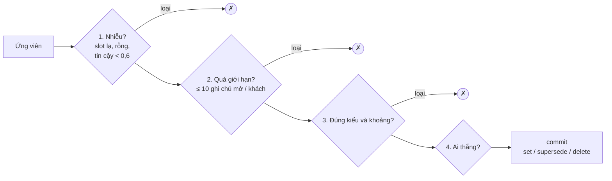

# 3. Thuật toán

[← Xử lý tình huống](02-xu-ly-tinh-huong.md) · [Mục lục](README.md) · Tiếp theo: [Dữ liệu →](04-du-lieu.md)

Trang này mô tả **cách từng thành phần tính ra kết quả**: công thức, tham số, và lý do chọn. Thứ tự đi theo pipeline.

| § | Thành phần | Loại | File |
|---|---|---|---|
| 3.1 | Chuẩn hóa đầu vào (teencode, ITN) | luật | `components/intake/text.py`, `itn.py` |
| 3.2 | Che PII và băm khóa định danh | luật + mật mã | `intake/pii.py`, `identity/resolver.py`, `runtime/vault.py` |
| 3.3 | Truy hồi tri thức | BM25 + embedding + RRF | `components/knowledge/` |
| 3.4 | Chọn lane | bảng luật | `orchestration/rules.py` |
| 3.5 | Hard guard | luật + so số | `guardrails/hard.py` |
| 3.6 | Soft guard (Jev) | model đánh giá | `agents/policy.py` |
| 3.7 | Cổng ghi bộ nhớ | luật | `memory/gate.py`, `agents/memory.py` |
| 3.8 | Dựng CallBrief | template | `memory/brief.py`, `memory/recall.py` |
| 3.9 | Gộp ngữ cảnh và ngân sách prompt | model nhỏ / trích | `context/compact.py`, `context/budget.py` |
| 3.10 | Phát hiện hết lượt nói và cắt lời | VAD + model | `voice/turns.py`, `voice/policy.py` |

> **Nguyên tắc chọn công cụ.** Cái gì làm được bằng luật thì làm bằng luật: nhanh (vài ms), tất định, giải thích được, test được từng dòng. Model chỉ dùng ở chỗ cần đọc hiểu ngôn ngữ: soạn câu trả lời, trích sở thích từ lời khách, kiểm vi phạm chính sách tinh vi.

---

## 3.1 Chuẩn hóa đầu vào

### Teencode
Bảng tra từng **từ đứng riêng** ("k" → không, "dc/đc" → được, "sp" → sản phẩm, "bn" → bao nhiêu...). Chỉ thay khi từ đứng một mình, để "249k" vẫn là tiền cho ITN. Từ mơ hồ ("a" là anh hay ạ, "e" là em) để nguyên. Sau đó chuẩn **Unicode NFC**: cùng một chữ gõ trên hai bàn phím là hai chuỗi byte khác nhau cho đến khi chuẩn hóa.

### ITN (Inverse Text Normalization)
Đổi số nói thành số viết, theo **đồng hồ ảo** của cuộc gọi (không bao giờ đọc đồng hồ hệ thống, vì bộ chấm chạy kịch bản ở các ngày khác nhau).

| Đầu vào | Kết quả | Quy tắc |
|---|---|---|
| "bốn triệu tám" | 4.800.000 | chữ số sau đơn vị là hàng kế tiếp, không phải 4.000.008 |
| "hai trăm bốn chín k" | 249.000 | |
| "một củ hai", "hai triệu rưỡi" | 1.200.000, 2.500.000 | tiếng lóng, "rưỡi" = nửa đơn vị |
| "không chín tám bốn..." | 0984... | ≥ 3 chữ số rời là **chuỗi số** (số điện thoại), không phải tiền |
| "bốn triệu tám không biết" | 4.800.000 + "không biết" | "không" sau số là hỏi/phủ định (ASR không trả dấu chấm hỏi) |
| "ô đê ba trăm mười hai nghìn..." | OD312456 | "ô đê" + số là mã đơn |
| "tối mai 8 giờ", "chiều thứ bảy 3 giờ rưỡi" | `2026-10-26T20:00:00+07:00` | ghép buổi + ngày + giờ, dạng `schedule.callback` nhận |

Giá trị chuẩn được **đặt cạnh** chữ gốc để model đọc cả hai. Cùng module có chiều ngược lại, `amounts()`, đọc mọi số tiền trong câu trả lời (5.200.000đ, 5,2 triệu, 5 triệu 2, 4tr890, 249k, và cả viết bằng chữ) để hard guard kiểm. **Một module cho hai chiều** để lời khách và câu trợ lý được đếm theo cùng một cách.

---

## 3.2 Che PII và băm khóa

### Nhận dạng
Regex theo thứ tự ưu tiên (số điện thoại trước CCCD 12 số, CCCD trước số tài khoản 9–14 số):

```text
PHONE  (+84|84|0)[35789] + 8 chữ số, cho phép dấu cách/chấm/gạch giữa nhóm ("0901 234 567")
       Dấu phân cách chỉ được chấp nhận sau 0 hoặc +84, để "500.000.000" vẫn là tiền.
CCCD   0 + 11 chữ số
BANK   9–14 chữ số
ADDR   cụm báo hiệu ("địa chỉ", "giao về", "nhà chị ở"...) + trong cùng mệnh đề
       có dấu hiệu hành chính (số nhà, ngõ, hẻm, đường, phường, quận, q7, p12) hoặc tên tỉnh
```

Tiếng Việt không có bộ nhận dạng địa chỉ dựng sẵn (Presidio cũng khuyên dùng mẫu + danh sách địa danh), nên dùng luật cụm báo hiệu.

### Vault
Mỗi giá trị được cấp token `<KIND_n>` và cất trong vault của cuộc gọi, lưu bảng `pii_vault`, **mã hóa AES-GCM** với khóa sinh từ `APP_SECRET`. `detokenize` chỉ chạy sau khi mọi guard đã đạt, và chỉ giải **token của chính cuộc đó**. Tool cần địa chỉ thật (khuyến mãi theo vùng, KM-08) thì harness điền lại.

### Khóa định danh
Mười chữ số điện thoại có thể dò ngược từ hash thường trong vài giây, nên khóa được băm **HMAC** với bí mật: `digest = HMAC(secret, kind + value)`. Chỉ giữ 4 số cuối để hiển thị. Bảng định danh lưu digest, không lưu số.

---

## 3.3 Truy hồi tri thức (BM25 + embedding + RRF)

### Kho
99 đoạn từ 14 file chính sách của BTC, **mỗi mục `## [XX-nn]` là một đoạn** (đúng cách BTC gắn nhãn Recall@k, nên không cắt hay gộp mục nào). Mỗi đoạn mang thêm: `restricted` (nội bộ), ngày hiệu lực (đọc từ `changelog.md`), các mục changelog giải thích nó. Thêm các mục FAQ/playbook đã người duyệt ở `data/kb/v<N>.jsonl` (v0 chưa có mục nào).

### Hai bảng xếp hạng



**BM25** ([lexical.py](../../apps/ai-agent-service/src/ai_agent_service/components/knowledge/lexical.py)), `k1 = 1,2`, `b = 0,75`:

$$\text{BM25}(q,d)=\sum_{t\in q}\text{IDF}(t)\cdot\frac{f(t,d)\,(k_1+1)}{f(t,d)+k_1\left(1-b+b\frac{|d|}{\text{avgdl}}\right)}$$

- **Term = âm tiết và cặp âm tiết liền nhau.** Tiếng Việt viết theo âm tiết, nhưng đơn vị mang nghĩa thường là hai âm tiết ("đổi trả", "bảo hành").
- **Mỗi âm tiết được đánh chỉ mục hai lần:** không dấu (khách gõ "doi tra", ASR sai thanh) và có dấu (vì bỏ dấu gộp nhầm nghĩa: "giá sàn" và "giá sản phẩm" đều thành `gia san`). Câu có dấu khớp mạnh với dạng có dấu và khớp thêm dạng không dấu.

**Embedding** ([semantic.py](../../apps/ai-agent-service/src/ai_agent_service/components/knowledge/semantic.py)): `multilingual-e5-small` int8 ONNX, chạy CPU (~13 ms/câu, 118 MB), vector đoạn được cache theo hash văn bản. Bắt được câu hỏi không chung từ nào với đáp án ("giao về Cần Thơ mất mấy ngày" với bảng vùng giao hàng). `bge-m3` (2,2 GB) bị loại vì không vừa máy triển khai.

**RRF** (Reciprocal Rank Fusion, Cormack và cộng sự, SIGIR 2009), `k = 60`:

$$\text{RRF}(d)=\sum_{r\in\text{rankings}}\frac{1}{k+\text{rank}_r(d)}$$

Gộp theo **hạng** chứ không theo điểm, vì điểm BM25 và cosine ở hai thang không liên quan. Cũng vì vậy điểm RRF không dùng làm ngưỡng.

### Phiên bản chính sách
Khi câu hỏi về một đơn khách đã có, ngày dùng để lọc là **ngày đặt đơn** (CL-01: đơn trước 01/10 giữ chính sách đổi trả cũ). Đoạn không còn hiệu lực vẫn có thể hiện ra nhưng được gắn chú thích "hết hiệu lực từ ngày X; chỉ áp dụng cho đơn tạo trước ngày đó".

### Quyết định từ chối

| Lý do | Điều kiện |
|---|---|
| `restricted` | đoạn tốt nhất là nội bộ và không có thông tin nào tool cung cấp thay được |
| `absence` | câu trong đoạn mà câu hỏi nhắm tới (theo độ phủ từ) khớp regex "không có thông tin / chưa kinh doanh / không được tư vấn / không được báo trước / không được tiết lộ" |
| `no_match` | cosine của đoạn tốt nhất < **θ = 0,829** |

**Vì sao cần `absence`:** BTC gắn nhãn câu "không trả lời được" bằng chính đoạn chứng minh sự vắng mặt (hỏi radon → FAQ-03 "không có thông tin"). Retriever tốt sẽ tìm ra FAQ-03 với độ tương đồng cao, nên ngưỡng một mình không bao giờ từ chối được ở đó. Phải đọc xem câu nào trong đoạn được hỏi tới.

**Dò θ:** chia đôi 60 câu có nhãn; θ = điểm thấp nhất của các câu *trả lời được* trong nửa dò, trừ 0,005 (`python -m ai_agent_service.pipeline.eval.rag --calibrate`). Khi không có embedding, θ theo độ phủ (`abstain_coverage`) đang tắt vì độ phủ không tách được câu trả lời được với câu không trên tập này.

---

## 3.4 Chọn lane

Hàm thuần `decide(RouteInput) -> RouteDecision`. `RouteInput` là **mọi thứ** route được đọc: trường nào không có ở đó thì không đọc được, nên ranh giới là chữ ký hàm, không phải quy ước.

```python
if tool_failures >= 2 or safe_lines >= 2:          return HANDOFF, 1
if asr_low_conf:                                   return CLARIFY, 2
if tier in (PROBABLE, AMBIGUOUS) and awaiting:     return CONFIRM_IDENTITY, 3
if (has_order and ORDER_TALK(said)) or \
   (tier == VERIFIED and ORDER_LOOKUP(said)):      return ORDER_SERVICE, 4
if must_transfer:                                  return OUT_OF_SCOPE, 5
if tier == VERIFIED and has_brief:                 return CONTINUITY, 6
return NEW, 7
```

Regex đọc trên văn bản **bỏ dấu, chữ thường**, nên "khong", "ko", "không" là một. Những gì cần hiểu ngữ cảnh (tài liệu có trả lời được không, người nói có phải chủ hồ sơ không, xử lý phản đối giá) **không route** mà để model quyết theo chỉ dẫn, với tài liệu và brief trước mặt.

---

## 3.5 Hard guard: kiểm câu trả lời bằng code

`check(GuardInput) -> Verdict`, vài ms mỗi câu. Trả về **mọi** lý do (không dừng ở lý do đầu) để một lần viết lại sửa hết. Lý do viết bằng tiếng Việt vì được đưa thẳng cho model.

| Nhóm | Luật |
|---|---|
| **Tiền** | mọi số tiền (chữ số hoặc chữ) phải thuộc tập cho phép (xem dưới). Giá trong brief chỉ được nói như lịch sử ("hôm trước bên em báo") và chỉ khi `VERIFIED` |
| **Ngày, tháng** | "giao trong 2 ngày", "đổi trả 7 ngày", "bảo hành 24 tháng": con số phải có trong kết quả tool, đoạn tài liệu, lời khách, hoặc luật của prompt (72 giờ xóa dữ liệu) |
| **Tồn kho** | "còn hàng / hết hàng / chỉ còn N" cần tool của lượt nói giống vậy, hoặc cảnh báo brief |
| **Khuyến mãi** | mã KM được nhắc phải được áp trong báo giá lượt này, hoặc nói như lịch sử / đã hết. KM chưa bắt đầu thì không bao giờ nhắc (KM-02) |
| **Nội bộ** | không "giá nhập, giá vốn, biên lợi nhuận, nhà cung cấp, giá sàn" |
| **PII** | không PII thô; không dãy 10–14 chữ số; không token không thuộc cuộc này |
| **Tier** | dưới `VERIFIED`: không mã đơn `OD...`, không giá đã báo |
| **Người** | không nhận là người ("em là nhân viên thật", "không phải trợ lý ảo đâu") |
| **Chuyển máy** | câu *hứa* chuyển ("em chuyển máy cho nhân viên") cần `handoff.transfer` đã chạy trong lượt; câu *đề nghị* (có "nếu", "muốn", "được không", "?") thì được |
| **Từ chối** | câu thừa nhận thiếu thông tin phải chứa một trong 6 cụm BTC chấm |
| **Hình thức** | không rỗng; ≤ 3 câu (trừ đọc lại đơn); có chữ tiếng Việt; không markdown |

### Tập số tiền được phép

```text
T = mọi số nguyên trong kết quả tool của lượt (ở mọi độ sâu, kể cả trong chuỗi)
    ∪ báo giá hôm nay đã có trong cuộc
B = { a ∈ T : a ≥ 1.000 }

Cho phép = T
         ∪ { a × q  : a ∈ B, q ∈ 2..5 }        (số lượng × đơn giá)
         ∪ { |a − b| : a, b ∈ B, a ≠ b }        (giảm giá, chênh lệch, hoàn tiền)
         ∪ số tiền trong lời khách
         ∪ số tiền trong đoạn tài liệu đã đưa cho model
```

Phép tính **chỉ được làm trên số của tool**. Số từ lời khách hay tài liệu đứng nguyên: nếu cho cộng trừ với giá, hầu như số nào cũng tạo ra được (5.200.000 − 300.000 của một đoạn tài liệu = 4.900.000).

Đây là cách ngưỡng **HR giá/khuyến mãi ≤ 5%** của BTC được biến từ hy vọng thành bảo đảm: một số tiền bịa không thể đến tai khách.

---

## 3.6 Soft guard: Jev (PolicyAgent)

Hard guard không bắt được lời hứa ngoài chính sách hay áp lực giả. Jev của TypeSafe là **model đánh giá**: nhận trạng thái, trả lời các câu hỏi kiểu Boolean kèm xác suất, không sinh văn bản.

| Câu hỏi | Bắt gì |
|---|---|
| `over_promise` | hứa điều tool/chính sách không cho (miễn phí ship, tặng quà...) |
| `stale_policy` | dùng quy định đã hết hiệu lực |
| `competitor` | bình luận về giá/hàng của bên khác |
| `false_pressure` | tạo khan hiếm, gấp gáp mà tồn kho không chứng minh |

- Chặn khi **bất kỳ** xác suất nào > **0,9** (ngưỡng chọn bằng leave-one-out trong lab 23/09).
- **Chỉ gọi khi câu có tín hiệu rủi ro** (regex trên văn bản bỏ dấu: chữ số, "triệu/nghìn/k", khuyến mãi, kho, đối thủ, lời hứa). Câu chào hay câu hỏi lại không tốn lời gọi.
- **Không thấy brief và lịch sử chat**, có chủ đích. Advisor thấy brief cũ, lời năn nỉ và giá mới cùng lúc nên dễ mềm lòng; Jev chỉ thấy câu nháp, kết quả tool và chính sách, nên giá cũ đứng cạnh giá mới là lộ ngay.
- **Timeout 1,5 s** (trung vị đo được 0,6 s, nằm trong ngân sách TTFT 3 s). Quá giờ thì câu qua với hard guard: trả lời trễ làm khách thiệt hơn bỏ một lần kiểm mềm, và hard guard đã giữ các con số rồi.

---

## 3.7 Cổng ghi bộ nhớ

### Bản thể (ontology)
34 slot phẳng, **tên trùng tên BTC** (bộ chấm so chuỗi): `product_advised`, `price_quoted_vnd`, `budget_vnd`, `room_area_m2`, `has_children`, `child_age_months`, `size`, `color`, `payment`, `address_token`, `delivery_area`, `blocker`, `decision_maker`, `objection`, `callback_at`, `order_id`... ([memory/ontology.py](../../apps/ai-agent-service/src/ai_agent_service/components/memory/ontology.py)). Mỗi slot có:

| Thuộc tính | Ví dụ |
|---|---|
| **Loại** (quyết ai thắng khi mâu thuẫn) | `preference` (sở thích, nhu cầu), `business_event` (giá đã báo, KM), `past_event` (đơn, lịch hẹn, kết quả), `open_note` |
| **Tuổi thọ** | nhu cầu: vĩnh viễn; vướng mắc, ý định mua: 30 ngày; địa chỉ: 180 ngày |
| **Nhạy cảm** | giá đã báo, mã đơn, địa chỉ: ẩn với tier dưới `VERIFIED` |
| **Kiểu giá trị** | `int`, `bool`, `date`, `code` (một trong các lựa chọn), `token` (không bao giờ là giá trị thô) |
| **Gợi ý cho model** | "phòng ngủ 5x5" là 25 m²; "để bàn với bà xã" là một vướng mắc và người quyết định |

### Trích ứng viên (MemoryAgent)
- **Fact nghiệp vụ đọc từ log tool bằng code:** sản phẩm và giá của mỗi báo giá (KM kèm ngày hết), biến thể/size/màu, đơn, lịch hẹn, chuyển máy, và từ đó là kết quả cuộc gọi. Nhiều sản phẩm được báo giá: cái được đặt (không thì cái đầu) là `product_advised`, cái khác cuối cùng là `alt_suggested`.
- **Lời khách qua một lần gọi model có cấu trúc** (temperature 0): mỗi slot kèm giá trị, ai nói, độ tin cậy. Thêm ghi chú mở, phản đối, điều trợ lý đã hứa, thái độ.
- **Luật làm dự phòng** khi không có model hoặc model lỗi (`rules-0.3`).

### Bốn cửa



Khoảng hợp lệ ví dụ: ngân sách 100.000đ–1 tỷ; diện tích 3–500 m²; tuổi bé 0–72 tháng; số lượng 1–100.

| Loại slot | Ai thắng |
|---|---|
| sở thích, nhu cầu | **khách, lời mới nhất** ("thôi anh lấy màu trắng") |
| sự kiện nghiệp vụ | **tool**; lời khách trái ngược được lưu là "khách nói", fact bị đánh dấu tranh chấp |
| sự kiện đã xảy ra | **hồ sơ hệ thống** |

`settle` áp luật thắng **trong một cuộc** trước; `check` so mỗi ứng viên còn lại với những gì ledger đang giữ; `memory.commit_facts` quyết lần nữa **dưới khóa theo khách** (hai cuộc kết thúc cùng lúc không ghi đè nhau).

> Một câu đùa không bao giờ vào ledger chỉ vì model đang "vui": cửa là code.

---

## 3.8 Dựng CallBrief

Brief là **hàm thuần của ledger**, dựng bằng template, không để model viết tự do. Nhờ vậy dựng xong trong ngân sách 3 s và mọi dòng truy được về fact gốc.

1. `retrieve` (công tắc bộ nhớ): facts hiện hành + 3 phiên gần nhất từ MCP memory, cộng phiên và đơn trong CRM của BTC. Khách đã xin xóa dữ liệu được đọc như người mới.
2. `refresh`: với mỗi sản phẩm đã tư vấn, gọi `pricing.get_quote` và `inventory.check` của **hôm nay**; mỗi đơn gọi `order.status`; kiểm khách có liên hệ kênh khác từ lần trước không. Cái gì đổi thành cảnh báo. Phiên cũ hơn 180 ngày bị báo là cũ.
3. `render`:
   - đối tượng đúng `call_brief.schema.json` của BTC: `products_advised`, `open_blockers`, `must_not_ask`, `stale_warnings`, `suggested_opening`, `latency_ms`, `precomputed_parts`;
   - các dòng đánh số `B1..Bn`, **mỗi dòng một slot** (để trích dẫn `[B3]` chỉ đúng fact đã dùng; một dòng gộp 4 nhu cầu sẽ được tính công cả 4 khi chỉ dùng 1); dòng có giá/địa chỉ/mã đơn đánh dấu `sensitive`.

Chỉ phần tóm tắt phiên được tính trước (cuối cuộc trước) và khai báo trong `precomputed_parts`, đúng yêu cầu BTC.

---

## 3.9 Gộp ngữ cảnh và ngân sách prompt

- **Thứ tự prompt** ([advisor.py](../../apps/ai-agent-service/src/ai_agent_service/agents/advisor.py), [context/budget.py](../../apps/ai-agent-service/src/ai_agent_service/components/context/budget.py)): quy tắc cứng → cảnh báo brief → chỉ dẫn lane và ghi chú → sản phẩm đã thấy trong cuộc (tối đa 15) → CallBrief → tóm tắt cuộc → tài liệu (3 đoạn đầu) → playbook → kết quả tool đã có (khi viết lại) → câu mở đầu → lý do bản nháp trước bị chặn.
- **Cắt từ dưới lên** khi vượt ngân sách (đếm ~4 ký tự/token). Các mục **được bảo vệ không bao giờ bị cắt**: quy tắc, cảnh báo, lane, brief, kết quả tool, câu mở đầu, lý do bị chặn. Mục tiêu 3.000 token là mềm: bằng chứng bắt buộc luôn giữ, phần tùy chọn dùng chỗ còn lại.
- **Gộp:** quá 16 tin nhắn thì mọi lượt trừ 4 lượt cuối được gộp vào `working_summary` và xóa khỏi thread. Có model thì một lần gọi có cấu trúc viết: sản phẩm và số lượng, giá đã báo trong cuộc, lựa chọn của khách (size, màu, thanh toán, token địa chỉ), câu hỏi còn mở, điều đã hứa. Không có model thì gộp kiểu trích: câu đầu của mỗi lượt cũ.

---

## 3.10 Phát hiện hết lượt nói và cắt lời

Ba lớp, như các hệ voice production:

1. **Silero VAD** chấm từng cửa sổ 32 ms (512 mẫu ở 16 kHz) là tiếng nói hay không.
2. Sau 200 ms im, **Smart Turn v3.2** (audio vào, 23 ngôn ngữ có tiếng Việt) đoán câu nghe đã xong hay khách chỉ ngừng để nghĩ.
3. **Trần im lặng 1,2 s** kết thúc lượt bất kể.

Chế độ `silence-<ms>` bỏ lớp 2, dùng làm baseline so sánh.

**Cắt lời (barge-in)** theo cách của LiveKit agents: tiếng nói liên tục ≥ 400 ms khi agent đang nói thì tạm dừng agent; rồi chữ nhận được quyết định: ≥ 2 từ và không toàn từ phụ họa ("ừ", "vâng", "dạ") là cắt lời thật; không thì nói tiếp; sau 2,5 s không nghe được từ nào cũng nói tiếp. TTFA (time to first audio) tính từ lúc khách ngừng nói (`speech_end`).
