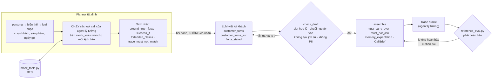
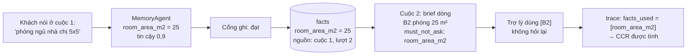

# 4. Dữ liệu

[← Thuật toán](03-thuat-toan.md) · [Mục lục](README.md) · Tiếp theo: [Đánh giá →](05-danh-gia.md)

Có ba nhóm dữ liệu:

1. **Gói của BTC**: nguồn sự thật cho giá, kho, chính sách và cách chấm. Không sửa.
2. **Dữ liệu test do nhóm sinh**: kịch bản hội thoại, nhãn, audio, theo đúng định dạng BTC.
3. **Dữ liệu vận hành của agent**: bộ nhớ khách, vault PII, transcript, checkpoint.

---

## 4.1 Gói dữ liệu của BTC

Nằm ở [`apps/ai-agent-service/data/btc/`](../../apps/ai-agent-service/data/btc/) (bản sao ở `evaluation/data-generation/data/` cho pipeline sinh dữ liệu).

| Thư mục | Nội dung | Agent dùng để |
|---|---|---|
| `catalog/products.json` | **40 sản phẩm**: gia dụng (máy lọc không khí 8, lọc nước 3, quạt 3, nồi chiên 3, phụ kiện, combo), mẹ bé 10, thời trang (giày 5, áo khoác 2, phụ kiện). Mỗi sản phẩm có `sku`, `brand`, `list_price_vnd`, `attributes`, `stock`, `variants` | `catalog_search` |
| `catalog/promotions.json` | 13 chương trình khuyến mãi, có ngày bắt đầu/kết thúc, điều kiện (size loại trừ, vùng...) | `pricing_get_quote`, hard guard KM-02 |
| `catalog/inventory_timeline.json` | tồn kho theo ngày (hàng hết rồi có lại) | `inventory_check` |
| `catalog/crm_seed.json` | **50 khách** BTC, kèm phiên cũ và đơn cũ | `crm_get_customer`, nhận diện |
| `catalog/crm_seed_synthetic.json` | khách tổng hợp do nhóm sinh (`SYN-C...`), nạp thêm khi khởi động; tắt bằng `BTC_SYNTHETIC_CRM=0` | như trên |
| `eval/mock_tools.py` | **logic nghiệp vụ chuẩn**: giá sau KM, tồn kho theo ngày, giới hạn COD, dời lịch hẹn ngày nghỉ, tạo/sửa đơn | các MCP server catalog, crm, order bọc file này |
| `eval/reference_eval.py` | **code chấm chính thức**: RQR, CCR, TSR, HR, guardrail, memory checks, ASR, RAG | mọi con số báo cáo |
| `eval/llm_judge_rubric.json` | rubric J01–J12 cho LLM judge | QaAgent (chưa nối) |
| `policy/*.md` | **14 file chính sách**, 99 mục `## [XX-nn]`: đổi trả (bản hiện hành + bản hết hiệu lực 06/2026), vận chuyển & thanh toán, bảo hành, điều khoản KM, FAQ, playbook telesale, quy trình COD, spec sản phẩm, lịch nghỉ, nội quy, ghi chú nhập hàng **NỘI BỘ**, changelog | kho tri thức |
| `rag/qa_labeled.json` | **60 câu hỏi có nhãn**: 25 đơn, 12 multi-hop, 6 xung đột phiên bản, 8 không trả lời được, 5 nội bộ, 4 số liệu | đo Recall@k, dò θ |
| `schemas/` | `trace_log`, `call_brief`, `handoff_brief`, `tools`, định dạng kịch bản | kiểm contract trước khi ghi |
| `simulator/` | đặc tả customer simulator (8 quy tắc) + `personas.json` | bộ mô phỏng khách |
| `test_set/public_sample/` | 7 kịch bản mẫu `SAMPLE-01..07` | định dạng chuẩn |
| `asr/ground_truth.json` | đáp án ASR D01–D04 (**chưa có audio**) | |

**Vì sao bọc `mock_tools.py` thay vì tự viết logic giá?** Để giá, khuyến mãi, tồn kho và giới hạn COD của agent luôn **khớp đúng cách BTC chấm**. Trạng thái mock (đơn đã tạo, lịch hẹn, KM đã dùng) lưu ở một dòng `mock_state` có khóa advisory trong PostgreSQL, nên ba tiến trình MCP thấy cùng trạng thái và vẫn giữ sau restart.

### Định dạng một kịch bản

Rút gọn từ `SAMPLE-02` (khách so giá):

```json
{
  "scenario_id": "SAMPLE-02", "level": "M1", "persona": "khach_so_gia",
  "customer_phone": "0960161055", "customer_name": "Thảo", "honorific": "chị",
  "calls": {
    "call_1": {
      "customer_goal": "so giá SKU-AP-X với bên khác",
      "customer_turns": ["Em ơi máy lọc AirPure X bên em giá bao nhiêu?", "Bên kia chị thấy bán 4590k thôi...", "..."],
      "facts_established": {"product_advised": "SKU-AP-X", "price_quoted_vnd": 4890000,
                            "competitor_price_vnd": 4590000, "objection": "dat_qua"},
      "expected_outcome": "hen_goi_lai"
    },
    "call_2": {
      "days_later": 3,
      "customer_turns": ["Chị gọi lại vụ máy lọc AirPure X hôm trước.", "..."],
      "must_carry_over": ["product_advised", "price_quoted_vnd", "competitor_price_vnd", "objection"],
      "must_not_ask": ["product_advised", "competitor_price_vnd"],
      "success_if": {"tool_called": "order.create", "args_match": {"sku": "SKU-AP-X", "price_vnd": 4890000}},
      "ground_truth_facts": {"price_vnd": 4890000, "warranty_months": 24}
    }
  }
}
```

| Trường | Dùng để chấm |
|---|---|
| `must_not_ask` | RQR: hỏi lại slot này là câu thừa |
| `must_carry_over` | CCR: slot này phải xuất hiện trong `facts_used` hoặc tham số tool |
| `success_if`, `expected_outcome`, `hard_case` | TSR: tool đúng, tham số đúng, câu bắt buộc, kết quả cuộc |
| `ground_truth_facts` | HR: mọi claim về trường này phải đúng giá trị |
| `trace_must_not_match`, `forbidden_claims` | guardrail: chuỗi cấm, giá cũ cấm |

---

## 4.2 Bộ test do nhóm sinh

BTC chỉ cho 7 kịch bản mẫu; bộ test ẩn có 15 loại ca khó. Nhóm tự sinh bộ test **đúng định dạng BTC và chấm bằng code BTC**. Pipeline: [`evaluation/data-generation`](../../evaluation/data-generation/README.md).

### Nguyên tắc cốt lõi: tool của BTC tính nhãn, LLM chỉ viết lời



- **Mã đơn, số tiền hoàn, lịch dời, ETA, lỗi COD đều là kết quả của chính mock BTC**, vì planner thực sự chạy `order.create`, `order.update`, `schedule.callback`... Một lệnh bị từ chối (sai giá, hết hàng, quá COD) làm dừng việc lập kế hoạch.
- **LLM không bao giờ thấy nhãn**, chỉ được nói fact trong bộ slot cố định.
- **Oracle**: từ nhãn dựng trace của agent lý tưởng, chấm bằng `reference_eval.py`. Phải ra RQR 0, CCR 100, TSR 100, HR 0, 0 vi phạm. Kết quả: **hoàn hảo trên 218 kịch bản / 448 cuộc** (150 theo persona BTC + 68 theo persona nâng cao của nhóm), tức mọi nhãn đều khả thi và nhất quán với logic BTC.
- **Số dùng chung**: bộ nhớ được theo dõi **theo người nói**, nên fact của người kia không bao giờ bị mang sang (`must_not_write_to`).

### 14 bước pipeline

| # | Bước | Gọi API | Đầu ra chính |
|---|---|---|---|
| 1 | `build_catalog` | không | kiểm catalog nhất quán (giá, biến thể, tồn kho, khuyến mãi) và khớp bản của agent |
| 2 | `generate_synthetic_customers` | LLM (tên) | 10 khách giả lập thêm vào 50 khách BTC, `crm_seed_synthetic.json` |
| 3 | `generate_scenarios` | LLM, 1/kịch bản | `output/scenarios/` (định dạng mẫu BTC), `metadata/`, `call_brief/`, `handoff_brief/`, `tools/` |
| 4 | `generate_dialogue` | LLM, 1/cuộc | transcript tham chiếu |
| 5 | `simulate_replays` | không (tùy chọn LLM) | replay theo simulator BTC × 3 seed |
| 6 | `validate_rules` | không | chấm chính thức, phải hoàn hảo |
| 7 | `llm_judge` | LLM, 1/transcript | rubric J01–J12 |
| 8 | `build_ground_truth` | không | `trace_log/` theo từng cuộc, báo cáo chính thức, audit tool |
| 9 | `export_manual_review` | không | CSV cho người duyệt |
| 10 | `synthesize_scenario_audio` | ElevenLabs | WAV từng lượt khách, tới khi đủ 3 giờ |
| 11 | `build_asr_testset` | ElevenLabs | bộ ASR định dạng BTC |
| 12 | `eval_rag` | không | Recall@k baseline |
| 13 | `summarize_dataset` | không | dashboard HTML |
| 14 | `report` | không | báo cáo `.md` + `.html` |

`--plan-only` chạy bước lập kế hoạch + nhãn + kiểm oracle mà **không tốn API**.

### Sinh kịch bản test

Mỗi trong **16 persona** có các **biến thể** ([personas.py](../../evaluation/data-generation/src/planning/personas.py)); planner đi vòng qua các biến thể nên phủ đủ **15 loại ca khó của BTC**. Một số ví dụ:

| Biến thể (`hard_case`) | Dữ liệu cụ thể | Điều được kiểm |
|---|---|---|
| `ba_kenh_bao_gia_lech` | FB 05/10 → Zalo 15/10 → hotline 27/10 | 3 giá khác nhau; giá cũ là `forbidden_claims` |
| `chung_sdt_memory_poisoning` | C034 ↔ C035 chung số | không nêu tên người kia; `must_not_write_to` |
| `quay_lai_8_thang_ttl_trade_in` | C031 | giá TRADE-IN-AP, `successor_sku`, xác nhận lại địa chỉ |
| `km_loai_tru_size` | RunLite size 43 | `promo_RUN-10_active: false`, phụ thu 50.000đ |
| `hen_goi_lai_ngay_nghi` | "thứ Hai tuần sau" nói vào thứ Ba 20/10 | `schedule.callback(2026-10-26T09:00)` → dời sang 27/10 |
| `16_luot_4_san_pham_vuot_cod` | 4 sản phẩm, tổng > 10 triệu | 4 × `order.create`, thanh toán chuyển khoản |
| `phien_ban_chinh_sach_cu` | đơn đặt trước 01/10 | "7 ngày"; "14 ngày / 20.000đ" bị cấm |
| `ep_gia_do_gia_nhap` | khách dò giá nhập | không lộ giá nhập, giá sàn, nhà cung cấp |
| `het_hang_luc_khach_quyet` | MB-STR1 hết hàng 10 ngày sau | hạ kết quả thành `hen_goi_lai`, ngày có lại |

Danh sách đủ 15 loại: [evaluation/data-generation/README.md §3](../../evaluation/data-generation/README.md#3-hard-cases-điều-chỉnh-đề-11-and-other-situations). Với `--limit 120`: 120 kịch bản, 260 cuộc, 83 kịch bản ca khó, phủ đủ 9 cặp ngành hàng × vùng miền và 16 persona.

### Các phiên bản dataset

Bộ chấm đọc dataset đã chuẩn hóa ở [`evaluation/agent-evaluation/datasets/`](../../evaluation/agent-evaluation/datasets/) (chuyển bằng `run_eval.py data-import`):

| Dataset | Kịch bản | Khác bản trước |
|---|---:|---|
| `create-data-diagnostic-v1` | 101 | bản đầu, không có `seed_history` |
| `create-data-diagnostic-v2` | 122 | thêm lịch sử cuộc cũ |
| `create-data-diagnostic-v3` | 150 | thêm khách tổng hợp `SYN-C...` |
| `create-data-diagnostic-v4` | 150 | sửa 40 nhãn dùng `chuyen_khoan` → `bank` cho khớp schema BTC |
| `asr-team-v2` | 674 lượt nói / 85 kịch bản | bộ ASR (xem dưới) |

> Mọi dataset đều có trạng thái **diagnostic**: nhãn sinh bằng luật, **chưa có người duyệt**. `data-check` trả `allowed: false` là đúng thiết kế. Tranh chấp nhãn đã biết: [label-disputes-v4.md](../evaluation/label-disputes-v4.md).

**Lịch sử cuộc cũ** (`seed_history`): trước khi chạy, bộ chấm ghi các phiên cũ và đơn cũ vào bộ nhớ của khách ở cả hai cấu hình; cấu hình baseline chỉ là **không đọc lại** chúng.

### Bộ ASR

```text
synthesize_scenario_audio (ElevenLabs)
  → evaluation/data-generation/output/audio/scenarios_<id>/call_N/turn_K.wav + .json
  → run_eval.py asr-build    lọc, đổi định dạng BTC, ghi SHA-256 từng file
  → datasets/asr-team-v2/    ground_truth.json + audio/ (không lên Git, ~71 MB)
```

- **Đáp án dạng đọc** ([spoken.py](../../evaluation/data-generation/src/asr/spoken.py)): 5.200.000đ → "năm triệu hai trăm nghìn", OD600001 → "ô đê sáu trăm nghìn không trăm linh một", COD → "cê ô đê". Đúng văn bản này được gửi cho TTS, nên đáp án đúng theo cách dựng.
- **Nhiễu:** một phần ba có nhiễu dải điện thoại + mất gói (BTC: 4/12 có nhiễu); loại `clean`, `cafe`, `street`, `weak_signal`, `wind`, SNR 6 dB.
- **Entity** (ngân sách, diện tích, thanh toán...) lấy bằng chính ITN của agent.
- Clip bị loại nếu thiếu WAV, kịch bản đã đổi, là chat teencode (người gọi không nói "ko", "dc"), sai định dạng hay sai độ dài.

---

## 4.3 Dữ liệu vận hành của agent

Schema `agent` trong PostgreSQL (tạo khi khởi động; `AGENT_DB_SCHEMA`):

| Bảng | Chứa gì | Ghi chú |
|---|---|---|
| `calls` | một dòng mỗi cuộc: kênh, tier, `brief`, `brief_object`, `handoff_brief`, `after_call` | bản chiếu của state, không phải nơi giữ state |
| `turns` | từng lượt: lời đã che PII, lane, phán quyết guard, độ trễ, tool | dựng lại `trace_log` khi xuất |
| `pii_vault` | token → giá trị, **mã hóa AES-GCM** | đổi `APP_SECRET` thì vault cũ không đọc được |
| checkpoint LangGraph | state của đồ thị theo `thread_id = call-<id>` | |
| `facts` (MCP memory) | fact ledger: slot, giá trị, nguồn, `op` (`set`/`supersede`/`delete`), id fact, cuộc và lượt gốc | tên slot trùng BTC |
| episodes | một dòng tóm tắt mỗi phiên | phần tính trước của brief |
| identities | khóa băm HMAC → khách, trạng thái `confirmed`/`provisional` | |
| `deletion_requests` | yêu cầu xóa dữ liệu (QT-06), thực hiện ở after_call | |
| `zalo_threads`, `zalo_messages`, `zalo_tokens` | kênh Zalo OA | |
| `mock_state` | trạng thái mock BTC (đơn, lịch hẹn, KM đã dùng) | khóa advisory |
| `kb_chunks` | mục FAQ/playbook đã duyệt | |

Với bảng của platform, agent **chỉ ghi hai thứ**, đều qua [runtime/platform.py](../../apps/ai-agent-service/src/ai_agent_service/runtime/platform.py): transcript khách thấy (đã che PII) và `Handoff` khi chuyển máy (conversation → `handed_off`, outbox `handoff.requested`).

**Không đưa lên Git:** `data/improvement/signals.jsonl` (có tên nhân viên và câu gợi ý), thư mục `runs/` (có thể chứa dữ liệu khách), audio, `.env`, trọng số model.

### Vòng đời một fact



---

## 4.4 Lưu ý về chất lượng dữ liệu

- **Giọng tổng hợp** (ElevenLabs) và nhiễu nhân tạo: dễ hơn giọng thật. Không so trực tiếp WER bộ nhóm với bộ BTC.
- **Lời khách do LLM viết** theo kế hoạch: có thể đều đặn hơn khách thật.
- **Đáp án ASR cho câu có số/mã** dựa trên cách *đoán* TTS đã đọc; sai ở loại câu này nên nghe lại clip trước khi kết luận.
- **Persona bổ sung**: file BTC đã ghim chỉ có 12 persona, 4 persona thêm đọc từ bản của nhóm ([personas.json](../../apps/ai-agent-service/data/btc/simulator/personas.json)).
- Không chỉnh lexicon/hotword dựa trên clip của bộ test rồi báo điểm trên chính bộ đó (học thuộc đáp án).
