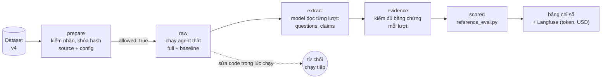

# 5. Đánh giá

[← Dữ liệu](04-du-lieu.md) · [Mục lục](README.md)

Mọi con số báo cáo được tính bằng **code chấm của BTC** ([reference_eval.py](../../apps/ai-agent-service/data/btc/eval/reference_eval.py)). Nhóm không tự viết lại công thức, chỉ chuẩn bị đầu vào (trace) và đọc đầu ra.

Tài liệu vận hành chi tiết: [docs/evaluation/](../evaluation/README.md), [scripts/evaluation/README.md](../../scripts/evaluation/README.md). Lịch sử từng lần chạy: [RUN-LEDGER.md](../evaluation/RUN-LEDGER.md).

---

## 1. Ba tầng đánh giá

Xếp từ rẻ đến đầy đủ:

| Tầng | Lệnh | Cần gì | Đo gì | Tần suất |
|---|---|---|---|---|
| **1. Unit test** | `python -m pytest -q` | không gì | lane, hard guard, PII, ITN, contract BTC, route API với agent giả | mỗi push (CI) |
| **2. Truy hồi** | `python -m scripts.evaluation.evaluate` | không gì | Recall@3/@5, multi-hop, tỉ lệ từ chối | mỗi push (CI) |
| **3. End-to-end** | `scripts/evaluation/run_eval.py evaluate` | PostgreSQL + key model | TSR, CCR, RQR, HR, guardrail, latency | thủ công, tốn phí |
| (phụ) **ASR** | `run_eval.py asr` | `asr-service` | WER, CER, entity accuracy | thủ công, không tốn API |
| (phụ) **Simulator** | `run_eval.py simulate` | như tầng 3 | TSR khi khách phản ứng theo agent | thủ công, tốn phí |

> Unit test với agent giả **không chứng minh** chất lượng của model thật. Đánh giá text **không chứng minh** voice chạy được.

---

## 2. Bốn chỉ số chính của BTC

| Chỉ số | Công thức (theo `reference_eval.py`) | Nhãn kịch bản | Trường trace đọc | Mục tiêu BTC |
|---|---|---|---|---|
| **TSR** ↑ Task Success Rate | số kịch bản mà **mọi** cuộc có `success_if` đều đạt / số kịch bản. Có thêm TSR riêng ca khó | `success_if`, `expected_outcome`, `hard_case` | `tool_calls`, `agent_text`, `claims`, `questions` | **≥ 70%** |
| **CCR** ↑ Context Carryover Rate | \|`must_carry_over` ∩ (`facts_used` ∪ khóa tham số tool)\| / \|`must_carry_over`\| | `must_carry_over` | `facts_used`, `tool_calls[].args` | |
| **RQR** ↓ Repeat-Question Rate | câu hỏi thừa / mọi câu hỏi, trên các cuộc có `must_not_ask`. Thừa = câu hỏi **mở** về slot `must_not_ask`, hoặc câu **xác nhận** lần 2+ cùng slot | `must_not_ask` | `questions[{slot, type}]` | **giảm ≥ 40%** so với baseline |
| **HR** ↓ Hallucination Rate | claim sai / claim có trường trong ground truth. Có thêm HR riêng giá & khuyến mãi | `ground_truth_facts` | `claims[{field, value}]` | **giá/KM ≤ 5%** |

Kèm theo:

| Nhóm | Đo gì |
|---|---|
| **Guardrail** | PII trong lời hoặc bộ nhớ; chuyển máy thừa (`over_escalation`: handoff khi kết quả mong đợi không phải `chuyen_may`); `is_human = true`; chuỗi cấm `trace_must_not_match` |
| **Memory checks** | giá trị `memory_expectation` phải có trong `memory_writes` |
| **Calls-to-close** | số cuộc đến khi chốt đơn |
| **Latency p95** | TTFT ≤ 3 s · tổng ≤ 8 s · TTFA (voice) ≤ 2,5 s · dựng CallBrief ≤ 3 s. Cần ≥ 100 lượt mới có ý nghĩa; bỏ các lượt khởi động |

### Ví dụ minh họa: chấm một lượt

```text
Kịch bản call_2: must_not_ask     = [product_advised, competitor_price_vnd]
                 must_carry_over  = [product_advised, price_quoted_vnd, competitor_price_vnd, objection]
                 ground_truth_facts = {price_vnd: 4890000}
Brief:           B1 sản phẩm đã tư vấn · B2 giá đã báo · B3 giá bên khác · B4 phản đối: chê đắt

Agent: "Dạ hôm trước bên em báo chị AirPure X [B1] giá 4.890.000đ [B2],
        chị vẫn đang so với giá 4.590.000đ bên kia [B3] đúng không ạ?"

→ questions  = [{slot: competitor_price_vnd, type: confirm}]   xác nhận lần đầu: không thừa
→ facts_used = [product_advised, price_quoted_vnd, competitor_price_vnd]   (từ [B1] [B2] [B3])
→ claims     = [{field: price_vnd, value: 4890000}]   khớp ground truth → không tính là bịa
→ CCR của cuộc (nếu chỉ có lượt này): 3/4, thiếu objection
```

---

## 3. So sánh full và baseline

Mỗi kịch bản chạy **hai lần**:

| Cấu hình | Khác biệt |
|---|---|
| `full` | hệ thống đầy đủ |
| `baseline_no_memory` | `switches.memory = false`: `retrieve` trả rỗng, không có brief từ lịch sử. **Chỉ tắt đọc**, after_call vẫn ghi |

Hai lần chạy phải dùng cùng dataset, model, temperature, tool và prompt; **chỉ khác bộ nhớ**. Hiệu số full − baseline cho biết bộ nhớ đóng góp bao nhiêu.

---

## 4. Cách bộ chấm hoạt động

### Hai runner

| Runner | Tool nghiệp vụ | Đầu ra | Dùng khi |
|---|---|---|---|
| `run_eval.py` ở gốc repo | MCP của sản phẩm | `full.jsonl`, `baseline.jsonl`, `report.json`, `table.txt`, `rag/` | lệnh dạng BTC yêu cầu |
| [`scripts/evaluation/run_eval.py`](../../scripts/evaluation/run_eval.py) | mock/audit do harness quản lý; memory, knowledge vẫn qua MCP | prepare → raw → evidence → scored | phân tích, kiểm nguồn gốc bằng chứng |

**Không gộp số giữa hai runner.** Cả hai dùng database/schema đuôi `_eval` và reset trạng thái, nên chỉ chạy một runner một lúc.

### Luồng của harness



- **Khóa mã nguồn:** sau `prepare`, hash của `apps/ai-agent-service/src`, `config`, `scripts/evaluation/agent` bị khóa. Sửa mã giữa chừng thì bộ chấm từ chối chạy tiếp.
- **`facts_used`** lấy từ dấu `[Bn]` agent tự đánh, cộng giá trị brief được nhắc lại.
- **`questions` và `claims`** do **extractor** trích. BTC không cung cấp extractor (đây là trách nhiệm của đội); BTC chấm tay ngẫu nhiên 20 lượt để kiểm extractor có bỏ sót không. Extractor hiện tại `product-extractor-v3` dùng **từ vựng cố định**: 34 slot của ontology và các trường claim BTC kèm kiểu giá trị; slot ngoài bộ thành `other`, claim sai kiểu bị bỏ.
- **Thiếu bằng chứng không được điền 0 hay PASS.** Run thiếu nhãn cho một số lượt thì ghi `INCOMPLETE`, không xuất điểm tổng.
- **Mã thoát `evaluate`:** `0` đạt hết · `1` chạy xong nhưng trượt một số kiểm (bình thường) · `2` thiếu bằng chứng · `3` lỗi chạy.
- **Ngân sách API:** sổ SQLite (`EVAL_BUDGET_DB`) giữ dự phòng trước mỗi request có phí, chỉ hoàn khi có usage. Hết ngân sách thì dừng, không reset sổ để lách.

### Customer simulator

Kịch bản cố định không phản ứng theo agent: agent hỏi thừa thì khách vẫn nói câu kế tiếp. Simulator ([eval_harness/simulation.py](../../scripts/evaluation/eval_harness/simulation.py), [simulate.py](../../scripts/evaluation/simulate.py)) cài **8 quy tắc của BTC**, áp theo thứ tự:

| # | Agent làm | Khách phản ứng |
|---|---|---|
| 1 | hỏi lại slot đã có | `patience −1`, vẫn trả lời nhưng phàn nàn ("hôm trước chị nói rồi mà"). Xác nhận lần đầu không trừ |
| 2 | (patience = 0) | khách kết thúc, `outcome = tu_choi` |
| 3 | bịa / khác giá đã biết | phản ứng, `patience −1`, không nhận giá cao hơn nếu không giải thích |
| 4 | hỏi thông tin mới cần thiết | trả lời bình thường |
| 5 | đề xuất đúng nhu cầu + giá đúng | đồng ý theo `expected_outcome` |
| 6 | im / lạc đề 2 lượt liền | "em còn đó không?", lần 3 cúp máy |
| 7 | hỏi điều kịch bản không có | "chị không rõ" (không bịa fact) |
| 8 | quá 12 lượt khách | `outcome = timeout` |

Mỗi lượt agent, một **bộ quan sát** (một lần gọi model) phân loại câu hỏi; một LLM diễn đạt lại lời khách theo persona (temperature 0,3, có seed). `passed` = `check_call` của BTC trên **tool call thật**. Chạy 3 seed để đo độ ổn định.

---

## 5. Đánh giá ASR

So 3 mô hình trên 7 clip (24/10), rồi chạy cả bộ với mô hình được chọn (25/10). Chấm bằng `wer_cer` của BTC.

### So sánh mô hình (7 clip, ~60 từ: mẫu nhỏ, chỉ để chọn hướng)

| Mô hình | WER | CER | RTF | Ghi chú |
|---|---:|---:|---:|---|
| VieGem-ASR | **3,0%** | 3,3% | 0,62 | giấy phép **phi thương mại**, cần torch + 1,5 GB |
| **Zipformer 30M int8** | 5,0% | **1,8%** | **0,03** | 33 MB, không cần torch, **được chọn** |
| PhoWhisper-small int8 | 6,0% | 4,5% | 0,52 | chậm hơn và kém hơn Zipformer |

### Cả bộ `asr-team-v2` (674 lượt nói, 85 kịch bản, 0,62 giờ audio, Zipformer 30M, CPU)

| Chỉ số | Giá trị |
|---|---|
| WER / CER | **6,2%** / 4,2% |
| Entity accuracy | **97,1%** (170/175; 96,0% trước khi sửa lỗi ITN) |
| WER sạch / có nhiễu | 4,3% / 6,9% |
| WER theo nhiễu | gió 3,3% · sạch 4,3% · đường phố 4,4% · quán cà phê 4,6% · **sóng yếu 15,9%** |
| WER câu có số/mã / câu thường | 8,7% / 4,0% |

Lỗi hay gặp: "size" → "sai/side" (27 lần), "chị" → "chỉ" (21), "AirPure" → "epio" (~17), "COD" → "ceo d" (~20, entity `payment` vẫn đúng nhờ ITN). Lần chạy này **phát hiện lỗi ITN** "bốn triệu tám không biết" → 4.000.080đ, đã sửa.

**Diarization** (tách người nói, M2): 100% trên hội thoại 8 đoạn dựng từ 2 giọng thật khác nhau; chưa có audio hội thoại thật của BTC để đo chính thức. Chi tiết: [docs/evaluation/asr/](../evaluation/asr/README.md).

---

## 6. Kết quả đến hiện tại

> **Đọc kỹ trước khi trích dẫn.** Mọi nhãn còn là **diagnostic, chưa có người duyệt**. Các cohort nhỏ (5–16 kịch bản) và đã dùng để gỡ lỗi, nên **không phải kết quả đo độc lập**. Không so số giữa các ngày khác cấu hình (22/10 hard guard, 24/10 có Jev) hoặc khác extractor.

### Truy hồi tri thức (60 câu BTC, hybrid BM25 + e5-small)

| Chỉ số | Agent (22/10) | Baseline của `create_data` |
|---|---:|---:|
| Recall@3 | 89,8% | 84,7% |
| Recall@5 | **93,2%** | 93,2% |
| Multi-hop full Recall@5 | 75,0% | 66,7% |
| Từ chối đúng câu không có đáp án | 75% | 87,5% |
| Từ chối đúng câu nội bộ | 60% | 80% |
| Từ chối nhầm | **0%** | 6,4% |

Số đo 17/10 (`config/knowledge.yaml`): chỉ từ khóa Recall@3 83 / Recall@5 88; hybrid 91,5 / 93,2. Embedding là phần làm tăng Recall@3 rõ nhất.

### End-to-end: tiến triển trên cohort dev M2 (24/10, 12 kịch bản, cùng cohort)

| Lần | Thay đổi | TSR M2 | HR giá/KM |
|---|---|---:|---:|
| R0 | ban đầu (lỗi hạ tầng: `idempotency_key` làm mock từ chối mọi lệnh ghi) | 16,7% | 50% |
| R1 | sửa nối tool | 25,0% | |
| R2 | sửa nhãn `chuyen_khoan` → `bank` (dataset v4) | **33,3%** | **25%** |
| R3 | thêm quy tắc prompt | INCOMPLETE (3 kịch bản hết giờ khởi động) | |

### Simulator (5 kịch bản M2 × 3 seed, 24/10)

| Seed | 0 | 1 | 2 | Biên độ |
|---|---:|---:|---:|---:|
| TSR hệ thống | 40% | 40% | 40% | **0** |
| TSR baseline | 20% | 0% | 20% | 20 |

Hệ thống ổn định giữa các seed, hơn baseline trung bình **+26,7 điểm**.

### 5 kịch bản M2 mới (24/10, extractor v3, 45 lượt mỗi cấu hình)

| Chỉ số | Baseline | Hệ thống | Mục tiêu | |
|---|---:|---:|---|---|
| TSR | 20,0% | **0,0%** | ≥ 70% | ✗ |
| CCR | 2,0% | **18,0%** | | tăng 9 lần |
| RQR | 5,1% | 11,6% | giảm ≥ 40% | ✗ (tăng) |
| HR giá & KM | 7,7% | **4,5%** | ≤ 5% | ✓ |
| HR mọi claim | 25,0% | 16,1% | | |
| Vi phạm guardrail | 0 | 0 | | ✓ |
| TTFT p95 | 4055 ms | 3779 ms | ≤ 3000 ms | ✗ |
| Tổng p95 | 4087 ms | 3892 ms | ≤ 8000 ms | ✓ |

**Vì sao trượt** (đọc từ trace):
- thiếu `order.create` / `order.status` khớp ở một số cuộc;
- hỏi 5 câu trong một cuộc, vượt giới hạn 2;
- nói `return_days` 14 / 30 trong khi chính sách hiện hành là 7 ngày;
- RQR cao vì **hỏi mở mã đơn** ở kịch bản tra đơn, trong khi kịch bản coi mã đã có;
- cụm `must_say_any` chỉ khớp chuỗi nên giòn ("đang giao...").

### Tóm lại

| Đã làm được | Chưa đạt |
|---|---|
| HR giá/KM dưới 5% nhờ hard guard | TSR còn 25–40%, xa 70% |
| Bộ nhớ tăng CCR rõ rệt (2% → 18%) | RQR chưa giảm so với baseline |
| Simulator: hệ thống ổn định, hơn baseline | TTFT p95 ~3,8 s, trên ngưỡng 3 s |
| 0 vi phạm guardrail | holdout 10 kịch bản **chưa chạy** |
| ASR: WER 6,2%, entity 97% | chưa có audio hội thoại thật |

---

## 7. Quy tắc khi chạy thêm

Từ [AGENTS.md](../../AGENTS.md) và [RUN-LEDGER.md](../evaluation/RUN-LEDGER.md):

1. **Đọc ledger trước khi chọn kịch bản.** Ưu tiên ID chưa chạy và không thuộc holdout. Đã có 30+ ID được dùng.
2. **Retest cùng cohort** (R0 → R1) là có chủ đích: ghi rõ, giữ nguyên cohort và cách chấm, **không tính là độ phủ mới**.
3. **Holdout** chỉ chạy sau khi chốt sửa, chạy đúng một lần, không dùng để sửa sản phẩm. Holdout 22/10 đã bị dùng để gỡ lỗi nên không còn độc lập; holdout 24/10 (10 ID) chưa chạy.
4. Run `20261017-111459` là bằng chứng chỉ đọc; 10 ID của nó bị loại khỏi các run mới.
5. **Cập nhật ledger khi bắt đầu và khi kết thúc** mỗi run: ID, cấu hình, trạng thái, thư mục evidence. Thiếu evidence hay billing thì ghi `INCOMPLETE`.
6. Không commit hội thoại thô, key hay dữ liệu khách.

---

## 8. Cách chạy nhanh

Từ thư mục gốc repo, PowerShell:

```powershell
$PY = "apps/ai-agent-service/.venv/Scripts/python"
docker compose up -d postgres

# Tầng 1 và 2: miễn phí
& $PY -m pytest -q
& $PY -m scripts.evaluation.evaluate

# Tầng 3: kiểm đầu vào (miễn phí) rồi chạy thật (tốn phí, bắt đầu nhỏ)
& $PY scripts/evaluation/run_eval.py prepare  --dataset-id create-data-diagnostic-v4 --level M2 --limit 5
& $PY scripts/evaluation/run_eval.py evaluate --dataset-id create-data-diagnostic-v4 --level M2 --only SCN-GEN-xxxx

# Simulator, 3 seed
& $PY scripts/evaluation/run_eval.py simulate --dataset-id create-data-diagnostic-v4 --level M2 --only SCN-GEN-xxxx --seeds 0 1 2

# ASR: không gọi LLM
docker compose up -d asr-service
& $PY scripts/evaluation/run_eval.py asr --limit 10
```

Kết quả nằm ở `scripts/evaluation/runs/<ngày-giờ>/` (không lên Git): `scored/scorer.stdout.txt` là bảng điểm, `case-trace.json` để đọc lại từng hội thoại. Chạy toàn bộ 150 kịch bản là khoảng 2.500 lượt agent + 2.500 lượt chấm, mất nhiều giờ và tốn phí đáng kể.

---

## 9. Còn thiếu

Theo thứ tự ưu tiên ([bàn giao 24/10](../BAN-GIAO-2026-10-24.md)):

1. **Vòng tự cải tiến**: feedback (👍/👎, kết quả cuộc gọi, điểm chấm) → đề xuất → người duyệt → áp dụng → đo → quay lui. Module `components/improvement/{lessons,playbook,versions,review,gaps}.py` còn là stub.
2. **Kết quả chính thức**: chạy holdout; người duyệt nhãn; đo lại RQR với extractor v3.
3. **Lỗi agent đã thấy**: hỏi lại mã sản phẩm/mã đơn dù đã có; có lượt báo "không lấy được giá".
4. **QaAgent**: chấm rubric J01–J12 sau mỗi cuộc chưa nối model.
5. **Simulator**: mới 5 kịch bản × 3 seed; bộ quan sát là model chưa được kiểm độc lập; `forbidden_claims` ngoài giá chưa được kiểm.
6. **ASR**: chưa có audio hội thoại 2 giọng thật; entity chưa có `sku`, `order_id`, số điện thoại.
7. **Latency**: TTFT p95 cần giảm dưới 3 s và đo trên ≥ 100 lượt.
