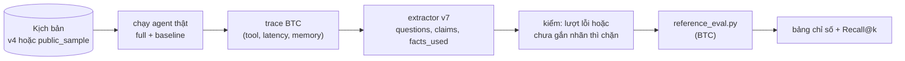

# 5. Đánh giá

[← Dữ liệu](04-du-lieu.md) · [Mục lục](README.md)

Mọi con số báo cáo được tính bằng **code chấm của BTC** ([reference_eval.py](../../apps/ai-agent-service/data/btc/eval/reference_eval.py)). Nhóm không tự viết lại công thức, chỉ chuẩn bị đầu vào (trace) và đọc đầu ra.

Cửa vào vận hành: [evaluation/README.md](../../evaluation/README.md). Luồng từng bước và bảng "chỉ số nào đọc trường nào": [docs/evaluation/scoring-flow.md](../evaluation/scoring-flow.md).

---

## 1. Các tầng đánh giá

Xếp từ rẻ đến đầy đủ:

| Tầng | Lệnh | Cần gì | Đo gì | Tần suất |
|---|---|---|---|---|
| **1. Unit test** | `python -m pytest -q` | không gì | lane, hard guard, PII, ITN, contract BTC, extractor, gói BTC, route API với agent giả | mỗi push (CI) |
| **2. Truy hồi** | `python evaluation/rag_offline.py` | không gì | Recall@3/@5, multi-hop, tỉ lệ từ chối | mỗi push (CI) |
| **3. End-to-end** | `python run_eval.py --scenarios <thư mục> ...` | PostgreSQL + key model | TSR, CCR, RQR, HR, guardrail, latency | thủ công, tốn phí |
| (phụ) **Gắn nhãn lại** | `python run_eval.py --relabel <run> --out <thư mục>` | key model (chỉ extractor) | RQR, CCR, HR trên lời agent đã có, để so extractor | thủ công, rẻ |

> Unit test với agent giả **không chứng minh** chất lượng của model thật. Đánh giá text **không chứng minh** voice chạy được.

---

## 2. Bốn chỉ số chính của BTC

| Chỉ số | Công thức (theo `reference_eval.py`) | Nhãn kịch bản | Trường trace đọc | Mục tiêu BTC |
|---|---|---|---|---|
| **TSR** ↑ Task Success Rate | số kịch bản mà **mọi** cuộc có `success_if` đều đạt / số kịch bản. Có thêm TSR riêng ca khó | `success_if`, `expected_outcome`, `hard_case` | `tool_calls`, `agent_text`, `claims`, `questions` | **≥ 70%** |
| **CCR** ↑ Context Carryover Rate | \|`must_carry_over` ∩ (`facts_used` ∪ khóa tham số tool)\| / \|`must_carry_over`\| | `must_carry_over` | `facts_used`, `tool_calls[].args` | |
| **RQR** ↓ Repeat-Question Rate | câu hỏi thừa / mọi câu hỏi, trên các cuộc có `must_not_ask`. Thừa = câu hỏi **mở** về slot `must_not_ask`, hoặc câu **xác nhận** lần 2+ cùng slot | `must_not_ask` | `questions[{slot, type}]` | **giảm ≥ 40%** so với baseline |
| **HR** ↓ Hallucination Rate | claim sai / claim có trường trong ground truth. Có thêm HR riêng giá & khuyến mãi | `ground_truth_facts` | `claims[{field, value}]` | **giá/KM ≤ 5%** |

Kèm theo:

| Nhóm | Đo gì |
|---|---|
| **Guardrail** | PII trong lời hoặc bộ nhớ; chuyển máy thừa (`over_escalation`: handoff khi kết quả mong đợi không phải `chuyen_may`); `is_human = true`; chuỗi cấm `trace_must_not_match` |
| **Memory checks** | giá trị `memory_expectation` phải có trong `memory_writes` |
| **Calls-to-close** | số cuộc đến khi chốt đơn |
| **Latency p95** | TTFT ≤ 3 s · tổng ≤ 8 s · TTFA (voice) ≤ 2,5 s · dựng CallBrief ≤ 3 s. Cần ≥ 100 lượt mới có ý nghĩa; bỏ các lượt khởi động |

### Ví dụ minh họa: chấm một lượt

```text
Kịch bản call_2: must_not_ask     = [product_advised, competitor_price_vnd]
                 must_carry_over  = [product_advised, price_quoted_vnd, competitor_price_vnd, objection]
                 ground_truth_facts = {price_vnd: 4890000}
Brief:           B1 sản phẩm đã tư vấn · B2 giá đã báo · B3 giá bên khác · B4 phản đối: chê đắt

Agent: "Dạ hôm trước bên em báo chị AirPure X [B1] giá 4.890.000đ [B2],
        chị vẫn đang so với giá 4.590.000đ bên kia [B3] đúng không ạ?"

→ questions  = [{slot: competitor_price_vnd, type: confirm}]   xác nhận lần đầu: không thừa
→ facts_used = [product_advised, price_quoted_vnd, competitor_price_vnd]   (từ [B1] [B2] [B3])
→ claims     = [{field: price_vnd, value: 4890000}]   khớp ground truth → không tính là bịa
→ CCR của cuộc (nếu chỉ có lượt này): 3/4, thiếu objection
```

---

---

## 3. So sánh full và baseline

Mỗi kịch bản chạy **hai lần**:

| Cấu hình | Khác biệt |
|---|---|
| `full` | hệ thống đầy đủ |
| `baseline_no_memory` | `switches.memory = false`: `retrieve` trả rỗng, không có brief từ lịch sử. **Chỉ tắt đọc**, after_call vẫn ghi |

Hai lần chạy phải dùng cùng dataset, model, temperature, tool và prompt; **chỉ khác bộ nhớ**. Hiệu số full − baseline cho biết bộ nhớ đóng góp bao nhiêu.

---

---

## 4. Cách chấm hoạt động

Một lệnh duy nhất, `run_eval.py` ở gốc repo, cũng là lệnh giám khảo sẽ gọi. Nó chạy kịch bản qua agent thật ở hai cấu hình, gắn nhãn câu hỏi/claim bằng extractor, rồi để `reference_eval.py` của BTC chấm. Chi tiết và lý do từng bước: [scoring-flow.md](../evaluation/scoring-flow.md).



- **`facts_used`** = slot extractor thấy được dùng lại từ cuộc trước, rồi slot của các dòng brief agent đã trích dẫn `[Bn]`.
- **`questions` và `claims`** do **extractor** trích. BTC không cung cấp extractor (đây là trách nhiệm của đội); BTC chấm tay ngẫu nhiên 20 lượt để kiểm extractor có bỏ sót không. Extractor dùng **từ vựng cố định**: 34 slot ontology, extension `channel` riêng và 18 trường claim cộng `promo_<CODE>_active`, kèm kiểu giá trị; slot ngoài bộ thành sentinel `other`, claim sai kiểu bị bỏ. Mỗi item kèm câu trích dẫn đúng nguyên văn để người chấm kiểm tay (`diagnostics.jsonl`). Schema/prompt tiếng Việt và repair/retry ở [scoring-flow](../evaluation/scoring-flow.md).
- **Thiếu bằng chứng không được điền 0 hay PASS.** Một lượt lỗi hoặc chưa gắn nhãn thì không in bảng.
- **Ngân sách API:** sổ SQLite (`EVAL_BUDGET_DB`) giữ dự phòng trước mỗi request có phí, chỉ hoàn khi có usage. Hết ngân sách thì dừng, không tạo lại sổ để lách.

---

## 5. Đánh giá ASR

Cập nhật 01/11/2026: runner ASR local đã được bổ sung qua `run_eval.py --asr/--asr-package`, xem [ASR local](../evaluation/asr-local.md). Số mới được lưu riêng, không trộn với bảng lịch sử bên dưới.

Kết quả đo ngày 24 và 25/10 bằng `wer_cer` của BTC. **Công cụ đo ASR (lệnh `asr`, bộ `asr-team-v2`, diarization) đã gỡ khỏi cây thư mục cùng bộ chấm cũ**; mã còn trong lịch sử git trước commit `358a070`. Số dưới đây là kết quả đã đo, không tái lập được từ repo hiện tại. Bộ audio của BTC (12 hội thoại) vẫn chấm được bằng `wer_cer` trong `reference_eval.py`.

### So sánh mô hình (7 clip, ~60 từ: mẫu nhỏ, chỉ để chọn hướng)

| Mô hình | WER | CER | RTF | Ghi chú |
|---|---:|---:|---:|---|
| VieGem-ASR | **3,0%** | 3,3% | 0,62 | giấy phép **phi thương mại**, cần torch + 1,5 GB |
| **Zipformer 30M int8** | 5,0% | **1,8%** | **0,03** | 33 MB, không cần torch, **được chọn** |
| PhoWhisper-small int8 | 6,0% | 4,5% | 0,52 | chậm hơn và kém hơn Zipformer |

### Cả bộ ASR của đội (674 lượt nói, 85 kịch bản, 0,62 giờ audio, Zipformer 30M, CPU)

| Chỉ số | Giá trị |
|---|---|
| WER / CER | **6,2%** / 4,2% |
| Entity accuracy | **97,1%** (170/175; 96,0% trước khi sửa lỗi ITN) |
| WER sạch / có nhiễu | 4,3% / 6,9% |
| WER theo nhiễu | gió 3,3% · sạch 4,3% · đường phố 4,4% · quán cà phê 4,6% · **sóng yếu 15,9%** |
| WER câu có số/mã / câu thường | 8,7% / 4,0% |

Lỗi hay gặp: "size" → "sai/side" (27 lần), "chị" → "chỉ" (21), "AirPure" → "epio" (~17), "COD" → "ceo d" (~20, entity `payment` vẫn đúng nhờ ITN). Lần chạy này **phát hiện lỗi ITN** "bốn triệu tám không biết" → 4.000.080đ, đã sửa.

**Diarization** (tách người nói, M2): 100% trên hội thoại 8 đoạn dựng từ 2 giọng thật khác nhau; chưa có audio hội thoại thật của BTC để đo chính thức.

---

---

## 6. Kết quả đến hiện tại

> **Đọc kỹ trước khi trích dẫn.** Các số dưới đây đo bằng bộ chấm cũ (đã gỡ) với extractor v3; extractor hiện tại là v7, nên không so trực tiếp. Các phép relabel cùng replies được ghi riêng trong [RUN-LEDGER](../evaluation/RUN-LEDGER.md). Bằng chứng gốc còn trong `evaluation/runs/` (chưa xóa). Mọi nhãn còn là **diagnostic, chưa có người duyệt**. Các cohort nhỏ (5–16 kịch bản) và đã dùng để gỡ lỗi, nên **không phải kết quả đo độc lập**. Không so số giữa các ngày khác cấu hình (22/10 hard guard, 24/10 có Jev) hoặc khác extractor.

### Truy hồi tri thức (60 câu BTC, hybrid BM25 + e5-small)

| Chỉ số | Agent (22/10) | Baseline của `create_data` |
|---|---:|---:|
| Recall@3 | 89,8% | 84,7% |
| Recall@5 | **93,2%** | 93,2% |
| Multi-hop full Recall@5 | 75,0% | 66,7% |
| Từ chối đúng câu không có đáp án | 75% | 87,5% |
| Từ chối đúng câu nội bộ | 60% | 80% |
| Từ chối nhầm | **0%** | 6,4% |

Số đo 17/10 (`config/knowledge.yaml`): chỉ từ khóa Recall@3 83 / Recall@5 88; hybrid 91,5 / 93,2. Embedding là phần làm tăng Recall@3 rõ nhất.

### End-to-end: tiến triển trên cohort dev M2 (24/10, 12 kịch bản, cùng cohort)

| Lần | Thay đổi | TSR M2 | HR giá/KM |
|---|---|---:|---:|
| R0 | ban đầu (lỗi hạ tầng: `idempotency_key` làm mock từ chối mọi lệnh ghi) | 16,7% | 50% |
| R1 | sửa nối tool | 25,0% | |
| R2 | sửa nhãn `chuyen_khoan` → `bank` (dataset v4) | **33,3%** | **25%** |
| R3 | thêm quy tắc prompt | INCOMPLETE (3 kịch bản hết giờ khởi động) | |

### Simulator (5 kịch bản M2 × 3 seed, 24/10)

| Seed | 0 | 1 | 2 | Biên độ |
|---|---:|---:|---:|---:|
| TSR hệ thống | 40% | 40% | 40% | **0** |
| TSR baseline | 20% | 0% | 20% | 20 |

Hệ thống ổn định giữa các seed, hơn baseline trung bình **+26,7 điểm**.

### 5 kịch bản M2 mới (24/10, extractor v3, 45 lượt mỗi cấu hình)

| Chỉ số | Baseline | Hệ thống | Mục tiêu | |
|---|---:|---:|---|---|
| TSR | 20,0% | **0,0%** | ≥ 70% | ✗ |
| CCR | 2,0% | **18,0%** | | tăng 9 lần |
| RQR | 5,1% | 11,6% | giảm ≥ 40% | ✗ (tăng) |
| HR giá & KM | 7,7% | **4,5%** | ≤ 5% | ✓ |
| HR mọi claim | 25,0% | 16,1% | | |
| Vi phạm guardrail | 0 | 0 | | ✓ |
| TTFT p95 | 4055 ms | 3779 ms | ≤ 3000 ms | ✗ |
| Tổng p95 | 4087 ms | 3892 ms | ≤ 8000 ms | ✓ |

**Vì sao trượt** (đọc từ trace):
- thiếu `order.create` / `order.status` khớp ở một số cuộc;
- hỏi 5 câu trong một cuộc, vượt giới hạn 2;
- nói `return_days` 14 / 30 trong khi chính sách hiện hành là 7 ngày;
- RQR cao vì **hỏi mở mã đơn** ở kịch bản tra đơn, trong khi kịch bản coi mã đã có;
- cụm `must_say_any` chỉ khớp chuỗi nên giòn ("đang giao...").

### Tóm lại

| Đã làm được | Chưa đạt |
|---|---|
| HR giá/KM dưới 5% nhờ hard guard | TSR còn 25–40%, xa 70% |
| Bộ nhớ tăng CCR rõ rệt (2% → 18%) | RQR chưa giảm so với baseline |
| Simulator: hệ thống ổn định, hơn baseline | TTFT p95 ~3,8 s, trên ngưỡng 3 s |
| 0 vi phạm guardrail | holdout 10 kịch bản **chưa chạy** |
| ASR: WER 6,2%, entity 97% | chưa có audio hội thoại thật |

---

---

## 7. Quy tắc khi chạy thêm

Theo [evaluation/README.md](../../evaluation/README.md) và [AGENTS.md](../../AGENTS.md):

1. **Chọn kịch bản chưa dùng và không thuộc holdout.** Danh sách ID đã dùng và holdout ở [evaluation/datasets/README.md](../../evaluation/datasets/README.md).
2. **Retest cùng cohort** là có chủ đích: giữ nguyên cohort và cách chấm, **không tính là độ phủ mới**; báo thay đổi nhãn tách khỏi thay đổi của agent.
3. **Holdout** chỉ chạy sau khi chốt sửa, chạy đúng một lần, không dùng để sửa sản phẩm. Holdout 22/10 đã bị dùng để gỡ lỗi nên không còn độc lập; holdout 24/10 (10 ID) chưa chạy.
4. **Đổi extractor là đổi dụng cụ đo**: chỉ so số của cùng `extractor_version`.
5. Không commit hội thoại thô, key hay dữ liệu khách; `evaluation/runs/` không nằm trong Git.

---

## 8. Cách chạy nhanh

Từ thư mục gốc repo, PowerShell:

```powershell
$PY = "apps/ai-agent-service/.venv/Scripts/python"
docker compose up -d postgres

# Tầng 1 và 2: miễn phí
& $PY -m pytest -q
& $PY evaluation/rag_offline.py

# Tầng 3: bắt đầu nhỏ (tốn phí). Không --config: cả hai cấu hình, rồi in bảng BTC
$env:EVAL_BUDGET_DB = "evaluation/runs/20261024-work/budget.sqlite"
& $PY run_eval.py --scenarios evaluation/datasets/create-data-diagnostic-v4/scenarios --only SCN-GEN-0051 --out evaluation/runs/thu-1

# Chỉ đổi extractor: gắn nhãn lại một run cũ, không chạy lại agent
& $PY run_eval.py --relabel evaluation/runs/20261024-work/development-r2-v4-M2 --out evaluation/runs/relabel-r2
```

Kết quả nằm ở thư mục `--out` (không lên Git): `table.txt` là bảng điểm, `diagnostics.jsonl` để đọc lại từng lượt và từng nhãn của extractor.

---

## 9. Còn thiếu

1. **Vòng tự cải tiến**: feedback (👍/👎, kết quả cuộc gọi, điểm chấm) → đề xuất → người duyệt → áp dụng → đo → quay lui. Module `components/improvement/{lessons,playbook,versions,review,gaps}.py` còn là stub.
2. **Kết quả chính thức**: chạy holdout; người duyệt nhãn; khóa version/hash extractor khi đo (đã có `--relabel`).
3. **Lỗi nhãn extractor đã thấy ở `SAMPLE-01`** (chưa sửa): baseline được tính `fact_usage` cho giá trị không có ở cuộc trước; bản full bỏ sót `price_quoted_vnd` khi agent nói "giá vẫn giữ nguyên"; ngày giao dự kiến bị gắn nhầm `restock_date`.
4. **Lỗi agent đã thấy**: hỏi lại mã sản phẩm/mã đơn dù đã có; có lượt báo "không lấy được giá"; nói giao trong 4 ngày khi ground truth là 2.
5. **QaAgent**: chấm rubric J01–J12 sau mỗi cuộc chưa nối model.
6. **Công cụ đã gỡ**: bộ mô phỏng khách (BTC chấm thiết kế và độ lặp lại qua 3 seed) và công cụ đo ASR không còn trong cây thư mục; mã trong lịch sử git trước commit `358a070`. Cần làm lại nếu giám khảo yêu cầu.
7. **Latency**: TTFT p95 cần giảm dưới 3 s và đo trên ≥ 100 lượt.
