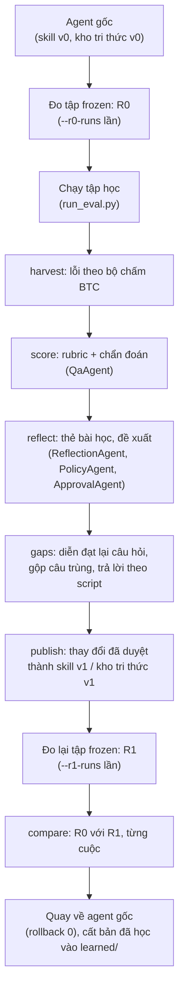
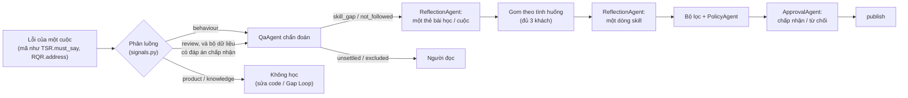
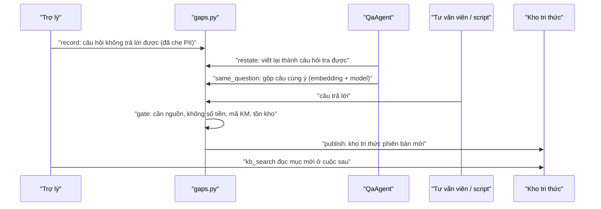

# Vòng cải tiến: Reflection và Knowledge Gap Loop

Trang này mô tả hai cơ chế tự cải tiến của trợ lý đúng như code hiện tại, các bộ dữ liệu dùng để chứng minh, kết quả đã đo được và những phần chưa xong. Điều quan trọng nhất: **một vòng luôn bắt đầu từ agent gốc, học trên tập học, đo trên tập frozen, rồi quay về agent gốc**. Tập frozen chỉ dùng để đo, không cơ chế nào được học từ nó.

| Cơ chế | Học gì | Ghi vào đâu | Ai duyệt |
|---|---|---|---|
| **Reflection** | Cách ứng xử trong một tình huống mà skill chưa dạy, hoặc đã dạy mà agent không theo | Một dòng của một skill trong [`skills.yaml`](../../config/prompts/agent/advisor/skills.yaml), thành một phiên bản skill mới | ApprovalAgent (vòng chấm tự động) hoặc người |
| **Knowledge Gap Loop** | Câu hỏi tài liệu không trả lời được, đã được tư vấn viên trả lời | Một mục mới của kho tri thức (`kb_search` đọc) | Người, sau cổng kiểm tra |

Mã nguồn: [`pipeline/improve/cli.py`](../../apps/ai-agent-service/src/ai_agent_service/pipeline/improve/cli.py) (lệnh `improve`), [`components/improvement/`](../../apps/ai-agent-service/src/ai_agent_service/components/improvement/), các agent [`qa.py`](../../apps/ai-agent-service/src/ai_agent_service/agents/qa.py), [`reflection.py`](../../apps/ai-agent-service/src/ai_agent_service/agents/reflection.py), [`approval.py`](../../apps/ai-agent-service/src/ai_agent_service/agents/approval.py), [`policy.py`](../../apps/ai-agent-service/src/ai_agent_service/agents/policy.py).

---

## 1. Một vòng (`improve round`)

Một vòng chạy những bước nào, và bước nào gọi model?



- **R0, R1**: mỗi lần là một `run_eval.py` thật trên tập frozen, chấm bằng [`reference_eval.py`](../../apps/ai-agent-service/data/btc/eval/reference_eval.py) của BTC. Agent dao động giữa các lần chạy (cùng một prompt, một cuộc lúc đạt lúc trượt), nên nên đo mỗi phía ít nhất hai lần: `--r0-runs 2 --r1-runs 2`. `compare` in TSR, RQR, CCR, HR giá và số vi phạm, kèm khoảng thấp nhất, cao nhất qua các lần, và từng cuộc **fixed** (trượt trước, đạt sau) hoặc **broken**.
- **Tập học khác khách với tập frozen.** `harvest` từ chối nếu một kịch bản của lần chạy nằm trong danh sách frozen (`--frozen-ids`).
- **Quay về agent gốc** đi qua `skill_versions.rollback` và `versions.rollback`, nên sổ cải tiến ghi lại việc quay lui. Bản đã học nằm ở `evaluation/runs/<vòng>/learned/`.
- Chế độ `--scripted` dùng khi không có người: Gap Loop dùng câu trả lời viết sẵn, và quyết định duyệt ghi rõ người duyệt là `approval-agent` hoặc `scripted-eval`, không bao giờ là một người.

---

## 2. Reflection

Một lỗi trên tập học đi tới một dòng skill mới như thế nào?



1. **Phân luồng** ([`signals.py`](../../apps/ai-agent-service/src/ai_agent_service/components/improvement/signals.py)). Mỗi lỗi lấy từ đúng các hàm của bộ chấm BTC thành một mã. `behaviour` (hỏi lại điều đã biết, hỏi quá nhiều, chuyển máy thừa, tiêu chí rubric J01, J06, J08) là phần Reflection học. `product` (gọi sai tool, nói sai chính sách, tổng đơn sai) là lỗi phải sửa trong code trước R0. `knowledge` thuộc Gap Loop. `review` (bộ chấm không thấy một cụm từ bắt buộc) chờ người đọc, **trừ khi** bộ dữ liệu có `expected.yaml`: khi đó lỗi đi tiếp tới Reflection và ApprovalAgent kiểm đầu ra.
2. **Chẩn đoán** (QaAgent, `qa_diagnose.md`). Với mỗi lỗi, đọc cuộc gọi, các skill và luật cố định, rồi nói đây là `skill_gap` (skill chưa nói), `not_followed` (skill hay luật đã nói mà agent không theo, kèm câu đó), hay `unsettled` (nói là có nhưng không chỉ ra được câu nào). Code kiểm lại câu được trích có thật trong skill hay luật không ([`lessons.settle_kind`](../../apps/ai-agent-service/src/ai_agent_service/components/improvement/lessons.py)). Cuộc có vi phạm khác (hứa giá, lộ dữ liệu) bị loại, vì một cuộc thắng bằng lời hứa sai không phải bằng chứng.
3. **Rubric** (QaAgent chấm theo [`llm_judge_rubric.json`](../../apps/ai-agent-service/data/btc/eval/llm_judge_rubric.json) của BTC). Đây là nguồn tín hiệu không phụ thuộc bộ chấm. Bằng chứng của mỗi tiêu chí phải là lời trong cuộc gọi; QaAgent so như người đọc (bỏ qua hoa thường, ngoặc kép, khoảng trắng, chỉ so phần trong ngoặc kép), còn judge của phía đánh giá vẫn so nguyên văn.
4. **Thẻ bài học** (ReflectionAgent, `reflection_lesson.md`): một thẻ cho mỗi cuộc, gồm tình huống, nên làm, không nên làm, câu mẫu, mã luật trích dẫn. Thẻ qua bộ lọc bằng code (không số tiền ngoài luật, không mã khuyến mãi, không tên khách hay sản phẩm cụ thể) rồi mới được lưu.
5. **Gom nhóm** ([`lessons.clusters`](../../apps/ai-agent-service/src/ai_agent_service/components/improvement/lessons.py)): gom theo **tình huống**, cần ít nhất 3 khách khác nhau (`MIN_SUPPORT`); một khách nhiều thẻ vẫn là một phiếu. Dòng mới được ghi vào skill mà nhiều thẻ chọn nhất.
6. **Đề xuất** (ReflectionAgent, `reflection_patch.md`): đúng một dòng, thay một câu có sẵn hoặc thêm cuối thân skill. Prompt có danh sách 17 tool của agent và việc mỗi tool làm ([`lessons.advisor_tools`](../../apps/ai-agent-service/src/ai_agent_service/components/improvement/lessons.py)), nên dòng mới không được dạy agent làm điều không tool nào làm được. Luật có điều kiện (số tiền, thời hạn, loại sản phẩm) phải ghi nguyên điều kiện. Khi mô tả skill chưa nhắc tình huống, đề xuất điền `when` và code thêm "Cả khi …" vào mô tả, vì agent chọn skill theo mô tả.
7. **Kiểm tra**: bộ lọc bằng code (`screen_patch`), áp thử được vào skill hay không, rồi PolicyAgent hỏi các câu trong [`policy_change_rules.md`](../../config/prompts/agent/policy_change_rules.md) (hứa hẹn, ép khách, trái luật cố định, bịa, chỉ đúng một khách). PolicyAgent từ chối thì ReflectionAgent được viết lại **một** lần với các lý do đó.
8. **Duyệt và publish**: xem mục 3. Phiên bản skill nằm ở `apps/ai-agent-service/data/skills/v<N>.yaml`, con trỏ ở `active.json`; quay lui chỉ là đổi con trỏ.

Model: ReflectionAgent và ApprovalAgent dùng `gpt-6.1-sol` (reasoning `low`, Responses API), QaAgent dùng `gpt-5.6-luna` (reasoning `medium`), cấu hình trong [`models.yaml`](../../apps/ai-agent-service/config/models.yaml). Câu trả lời của các agent này được lưu cache theo đúng nội dung yêu cầu (`IMPROVEMENT_CACHE`), nên chạy lại một vòng ra cùng kết quả và không trả tiền lần hai.

---

## 3. ApprovalAgent: duyệt thay người theo đáp án chấp nhận

Nhóm viết bộ dữ liệu nên biết mỗi tình huống cần học gì. Mỗi bộ có `expected.yaml`, mỗi tình huống một đoạn `accept`, ví dụ bộ warranty:

```yaml
durability_worry:
  accept: >-
    Khách lo máy sẽ hư, nhất là sau khi hết bảo hành: trợ lý giới thiệu gói bảo hành mở rộng của shop (BH-05), chỉ cho
    gia dụng trên 3.000.000đ và chỉ mua được trong 15 ngày kể từ ngày nhận hàng; không tự tính hay hứa tra ra số tiền
    của gói.
```

[`approval.py`](../../apps/ai-agent-service/src/ai_agent_service/agents/approval.py) đọc đáp án của đúng tình huống mà các cuộc làm bằng chứng thuộc về (lấy từ `metadata/<id>.json` của kịch bản), đọc đề xuất, các luật được trích và kết luận của PolicyAgent, rồi trả lời một lần: **chấp nhận** nếu cùng ý (khác chữ, ngắn hay dài hơn vẫn được), **từ chối** nếu dạy ý khác, bỏ mất điều kiện giới hạn, áp rộng ra mọi sản phẩm hay mọi cuộc, hoặc dẫn agent làm điều đáp án cấm. Prompt: [`approval_decide.md`](../../config/prompts/agent/approval_decide.md).

- ReflectionAgent không bao giờ thấy `expected.yaml`.
- Agent duyệt được phép chấp nhận dù PolicyAgent gắn cờ (phải ghi lý do), nhưng cờ của bộ lọc bằng code luôn chặn ([`review.blocking`](../../apps/ai-agent-service/src/ai_agent_service/components/improvement/review.py)).
- Bộ dữ liệu không có `expected.yaml` thì không gọi agent này; đề xuất chờ người, hoặc trong vòng `--scripted` được duyệt nếu không có cờ nào.
- Lý do chấp nhận hay từ chối nằm trong file duyệt `review/<vòng>.md`.

---

## 4. Knowledge Gap Loop

Một câu hỏi tài liệu không trả lời được đi tới kho tri thức như thế nào?



- Câu hỏi được ghi từ trace của tập học ([`gaps.record`](../../apps/ai-agent-service/src/ai_agent_service/components/improvement/gaps.py)) và từ QaAgent (`qa_unanswered.md`) khi agent không trả lời điều khách hỏi.
- QaAgent viết lại câu hỏi trước khi đưa vào chỉ mục, vì embedding lời nói thô của khách tìm kém. Câu cùng ý được gộp, một chủ đề một mục.
- Cổng kiểm tra ([`gap.gate`](../../apps/ai-agent-service/src/ai_agent_service/components/improvement/gap.py)) từ chối câu trả lời có số tiền, mã khuyến mãi hay tình trạng tồn kho. Câu trả lời của tư vấn viên ghi `source: consultant`; trong vòng chấm tự động là `answers.json` viết sẵn, ghi `approved_by: scripted-eval`.
- Rủi ro: bộ ẩn của BTC có case ngoài tài liệu chỉ đạt khi agent nói "chưa có thông tin". Một mục cho đúng chủ đề đó sẽ làm case đó trượt; người duyệt chịu rủi ro này.

---

## 5. Bộ dữ liệu chứng minh

Mỗi bộ có tập học và tập frozen khác khách, và có **cuộc đối chứng** đặt cạnh tình huống được học để lộ ra nếu bài học gây hại. Giá, tổng đơn và tồn kho trong kịch bản được kiểm với mock của BTC bằng test, không gọi model.

| Bộ | Tình huống | Học | Frozen (cần học + đối chứng) | Kiểm bằng | Test |
|---|---|---|---|---|---|
| [`data/reflection/warranty`](../../data/reflection/README.md) | Khách lo máy mau hỏng: giới thiệu bảo hành mở rộng BH-05, chỉ cho gia dụng trên 3.000.000đ | 4 | 3 + 3 (máy dưới 3 triệu, nhắc gói là sai) | `must_say_any` / `forbidden_claims` | [`test_approval_agent.py`](../../tests/agent/test_approval_agent.py) |
| [`data/reflection/budget`](../../data/reflection/README.md) | Persona `khach_mua_nhieu_mon`: hai món, tổng vượt ngân sách khách nêu, khách chốt đơn | 4 | 3 + 3 (tổng không vượt) | đơn đúng + `must_say_any` / `forbidden_claims`; rubric J11 | như trên |
| [`data/reflection/conduct`](../../data/reflection/README.md) | Khách quen hết kiên nhẫn, hỏi thêm, hay đưa đủ thông tin một lần: không hỏi lại, tối đa một câu hỏi | 12 | 9 | `must_not_ask`, `max_agent_questions` | [`test_reflection_dataset.py`](../../tests/agent/test_reflection_dataset.py) |
| [`data/gap-loop`](../../data/gap-loop/README.md) | Câu hỏi tài liệu không có (lắp tại nhà, gói quà, lấy tại kho, tích điểm, khung giờ giao) | 10 | 10 + 3 | `must_say_any` từ câu trả lời của tư vấn viên | `test_reflection_dataset.py` |
| [`data/policy-regression`](../../data/policy-regression/README.md) | Hậu mãi, giao hàng, hỏi cách khác: điều tài liệu đã nói, agent phải làm đúng từ R0 | | | | `test_reflection_dataset.py` |

---

## 6. Kết quả đến nay

Mọi số dưới đây là TSR frozen theo `reference_eval.py`, advisor `gpt-5.6-luna`, extractor `product-extractor-v11`, ngày 10/11/2026. Mỗi bộ chỉ có vài cuộc frozen, nên một cuộc lật là 11–17 điểm; đọc cùng cột từng cuộc.

| Vòng | Bộ | R0 | R1 | Đã publish | Ghi chú |
|---|---|---|---|---|---|
| `proof-warranty` | warranty | 50 / 50 | **66,7 / 66,7** | 1 dòng skill, ApprovalAgent chấp nhận | F01 trượt 2/2 trước, đạt 2/2 sau; 3 đối chứng vẫn đạt. F02, F03 chưa áp dụng bài học |
| `proof-budget` | budget | 66,7 / 66,7 | 50 (1 lần) | không | Agent gốc đã nói "vượt ngân sách" ở 3/4 cuộc học: không đủ 3 khách để học. Các cuộc trượt do lỗi đơn trùng (đã sửa) và hai kịch bản chứa món hết hàng (đã thay) |
| `proof-conduct` | conduct | 88,9 / 77,8 | (dừng) | không | Chỉ 1/12 cuộc học trượt sau khi viết lại prompt; trước đó R0 là 66,7–77,8 |
| `proof-4` (trước khi viết lại prompt) | gap-loop | 23,1 | 76,9 | 5 mục kho tri thức (`scripted-eval`) | Đối chứng F13 hỏng: agent chuyển máy |

Dòng skill được publish ở `proof-warranty`:

> Khách lo máy hỏng hoặc tốn chi phí sửa chữa sau khi hết bảo hành: với sản phẩm gia dụng trên 3.000.000đ, giới thiệu gói mua thêm bảo hành mở rộng 12 tháng, nói rõ phí bằng 8% giá sản phẩm và phải mua trong vòng 15 ngày kể từ ngày nhận hàng để khách cân nhắc; không tự tính số tiền phí hay hứa máy sẽ bền hơn (BH-05).

---

## 7. Chạy

Từ thư mục gốc repo. Mỗi vòng gọi model thật và tốn phí (khoảng 0,3 USD một bộ khi đo hai lần mỗi phía).

```bash
export PYTHONPATH=apps/ai-agent-service/src:packages/backend-common
apps/ai-agent-service/.venv/bin/python -m ai_agent_service.pipeline.improve round --name warranty-proof --learn data/reflection/warranty/learn/scenarios --frozen data/reflection/warranty/frozen/scenarios --frozen-ids data/reflection/warranty/frozen.json --r0-runs 2 --r1-runs 2 --scripted
```

Kết quả nằm ở `evaluation/runs/<name>/`: `r0-*`, `learn-*`, `r1-*` (mỗi thư mục có `full.jsonl` và `report.json`), `improvement/review/<name>-<bộ>.md` (đề xuất và lý do duyệt), `learned/` (bản đã học).

Không có `--scripted` thì vòng dừng ở file duyệt. Người điền `decision`, `reviewer`, `note` trong file JSON rồi chạy lại cùng lệnh với `--approved` để publish và đo R1.

Chạy riêng từng bước với một vòng đã có: `harvest`, `score`, `reflect`, `publish`, `compare`, `rollback`, `gaps`, `revoke` (`improve --help`). Bước `reflect` chỉ chạy một lần cho mỗi vòng; muốn chạy lại thì xóa `cards.jsonl`, `review/` và `lessons.jsonl` trong `IMPROVEMENT_DIR` của vòng đó.

Test không gọi model:

```bash
PYTHONPATH=apps/ai-agent-service/src:packages/backend-common apps/ai-agent-service/.venv/bin/python -m pytest -q tests/agent/test_approval_agent.py tests/agent/test_reflection_changes_skills.py tests/agent/test_reflection_dataset.py
```

---

## 8. Khi có sự cố

| Thấy | Nguyên nhân thường gặp | Xử lý |
|---|---|---|
| `0 changes from 0 lessons shared by 3+ customers` | Ít hơn 3 khách cùng một tình huống: agent gốc đã làm đúng phần lớn cuộc học, hoặc lỗi không phải `behaviour` | Xem `diagnoses.jsonl`; nếu agent gốc đã làm đúng thì tình huống đó không phải khoảng trống để học |
| Lỗi `review` không được chẩn đoán | Bộ dữ liệu thiếu `expected.yaml` | Thêm `accept` cho tình huống, hoặc để người đọc |
| `approval agent refuses: …` | Đề xuất dạy ý khác, bỏ điều kiện, hoặc đáp án `accept` viết quá rộng | Đọc lý do trong `review/*.md`; `accept` chỉ nên giữ phần cốt lõi, không lặp điều agent đã làm |
| `Rubric for … incomplete` | Bằng chứng không phải lời trong cuộc gọi | Log in ra phần không khớp; cuộc đó không có điểm rubric nhưng vẫn được chẩn đoán theo bộ chấm |
| R1 có `GUARD.over_escalation` mà không có gì được publish | Agent dao động giữa các lần chạy | Đo hai lần mỗi phía; lỗi có từ R0 là lỗi của agent gốc, sửa trong code |
| `Not the original agent: skills version N` | Một vòng trước dừng giữa chừng, chưa quay về bản gốc | `improve rollback --to 0 --reviewer <tên> --reason <lý do>` |

---

## 9. Chưa xong và đề xuất kiểm tra tiếp

**Đã sửa trong code nhưng chưa kiểm bằng lần chạy thật** (10/11/2026, sau `proof-warranty`):

- Ghi tình huống vào mô tả skill (`when`): để F02, F03 của warranty áp dụng được bài học.
- Agent không chuyển máy khi khách chỉ bày tỏ lo lắng (luật 9 và ghi chú khi tìm tài liệu không ra, [`nodes.py`](../../apps/ai-agent-service/src/ai_agent_service/pipeline/hot/nodes.py)): đối chứng F06 của warranty.
- Guard không cho tạo đơn mới cho món đã nằm trong một đơn nhiều dòng ([`actions.py`](../../apps/ai-agent-service/src/ai_agent_service/components/guardrails/actions.py)): các cuộc trượt của budget.
- Rubric so trích dẫn như người đọc, và judge tính tổng đơn nhiều dòng (J11 áp được).

**Đề xuất kiểm tra theo thứ tự:**

1. Chạy lại `warranty` (`--r0-runs 2 --r1-runs 2`). Kỳ vọng, chưa đo: R1 lên trên 66,7 nếu F02, F03 áp dụng bài học, và F06 không còn chuyển máy.
2. Chạy lại `budget` với dữ liệu và guard đã sửa. Nếu agent gốc vẫn nói "vượt ngân sách" ở đa số cuộc học thì bỏ bộ này khỏi danh sách chứng minh Reflection (giữ làm kiểm tra hồi quy cho đơn nhiều món).
3. Chạy lại `gap-loop` sau khi viết lại prompt, để có số R0 mới và xem đối chứng F13 còn chuyển máy không.
4. Thêm một tình huống chưa dạy: khách hẹn mốc cần hàng mà giao không kịp (VC-01, LN-03), đối chứng là ca giao kịp.

**Chưa làm:**

- Rubric chưa là tín hiệu học: J11 (minh bạch ngân sách) và các tiêu chí khác ngoài J01, J06, J08 vẫn phân vào `product`, chỉ dùng để đo.
- Chưa có giao diện để người duyệt đề xuất; người duyệt sửa file JSON.
- Chưa có bộ nhãn để hiệu chỉnh ApprovalAgent và PolicyAgent (ngưỡng của PolicyAgent là tạm).
- Mỗi bộ frozen chỉ 6–13 cuộc, chưa đủ để nói khác biệt nhỏ có ý nghĩa thống kê.
- Bài học được ghi thẳng vào thân skill. Khi nhiều bài học dồn vào một skill, nên chuyển sang ghi chú theo tình huống.
- `docs/design.md` mục 10 chưa cập nhật theo ApprovalAgent, `expected.yaml` và cách gom theo tình huống.
