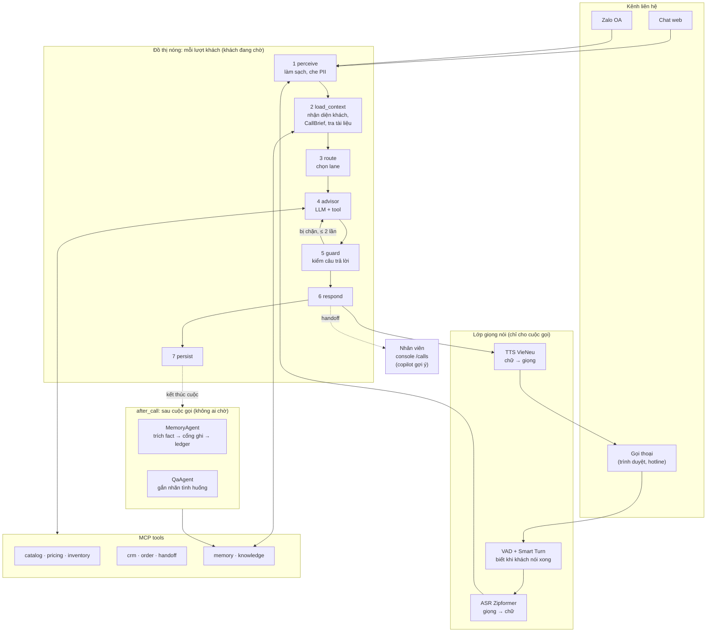

# Tài liệu AI: trợ lý tư vấn bán hàng

Bộ tài liệu này giải thích **phần AI** của dự án: một nhân viên tư vấn ảo trả lời khách qua chat web, Zalo và cuộc gọi thoại. Trợ lý báo giá, kiểm tra tồn kho, tạo đơn, tra đơn, hẹn gọi lại, **nhớ khách giữa các lần liên hệ**, và chuyển cho nhân viên thật khi cần.

Mã nguồn chính: [`apps/ai-agent-service`](../../apps/ai-agent-service/). README kỹ thuật của service: [apps/ai-agent-service/README.md](../../apps/ai-agent-service/README.md).

---

## Đọc theo thứ tự nào

| # | Tài liệu | Trả lời câu hỏi | Dành cho |
|---|---|---|---|
| 1 | [Pipeline xử lý](01-pipeline.md) | Một tin nhắn đi qua những bước nào? Sau cuộc gọi xảy ra gì? Voice chạy ra sao? | mọi người |
| 2 | [Xử lý tình huống](02-xu-ly-tinh-huong.md) | Khách mới, khách quen, số dùng chung, khiếu nại, hết hàng, hỏi ngoài tài liệu... được xử lý thế nào? | PM, QA, dev |
| 3 | [Thuật toán](03-thuat-toan.md) | Truy hồi tri thức, chọn lane, guardrail, chuẩn hóa số nói, che PII, cổng ghi bộ nhớ hoạt động thế nào? | dev, người làm AI |
| 4 | [Dữ liệu](04-du-lieu.md) | Dữ liệu BTC gồm gì? Bộ kịch bản test được sinh ra sao? Bộ nhớ lưu những gì? | data, dev |
| 5 | [Đánh giá](05-danh-gia.md) | Đo bằng chỉ số nào, chạy thế nào, kết quả hiện tại ra sao, còn thiếu gì? | cả nhóm |

---

## Bức tranh tổng thể

Ba ý chính để nhớ:

1. **Mọi con số đều đến từ tool.** Giá, khuyến mãi, tồn kho, thời gian giao, trạng thái đơn chỉ được nói khi có trong kết quả tool của lượt đó. Một bộ kiểm tra bằng code (hard guard) chặn mọi câu có con số không có nguồn, trước khi khách nhìn thấy.
2. **LLM chỉ làm phần cần hiểu ngôn ngữ.** Chọn lane, xác định danh tính, chặn câu sai, quyết định ghi bộ nhớ đều là luật trong code: nhanh, giải thích được, test được. Model chỉ soạn câu trả lời và đọc lời khách để trích thông tin sau cuộc gọi.
3. **Bộ nhớ chỉ ghi cho người đã xác nhận.** Một số điện thoại có thể của nhiều người trong một nhà. Khi chưa chắc ai đang nói, trợ lý tư vấn như khách mới và sau cuộc gọi không ghi gì cho ai.

---

## Từ điển nhanh

| Thuật ngữ | Nghĩa |
|---|---|
| **BTC** | Ban tổ chức cuộc thi. Họ cung cấp catalog, chính sách, `mock_tools.py` (logic giá/kho/đơn) và `reference_eval.py` (code chấm điểm chính thức) |
| **Lượt** (turn) | Một câu của khách và câu trả lời của trợ lý |
| **Cuộc gọi** (call) | Một phiên liên hệ. Một kịch bản test có 1–3 cuộc, cách nhau vài ngày |
| **Lane** | Hướng xử lý của lượt (`NEW`, `CONTINUITY`, `ORDER_SERVICE`, `HANDOFF`...). Lane quyết định model được dùng tool nào |
| **Tier** | Mức chắc chắn về danh tính: `VERIFIED`, `PROBABLE`, `AMBIGUOUS`, `UNKNOWN` |
| **CallBrief** | Bản tóm tắt về khách quen, dựng từ bộ nhớ ở đầu cuộc gọi: đã tư vấn gì, báo giá bao nhiêu, còn vướng gì, không được hỏi lại gì |
| **Fact ledger** | Sổ ghi các thông tin về khách (ngân sách, diện tích phòng, size...), có phiên bản và nguồn gốc |
| **Hard guard** | Bộ kiểm tra câu trả lời bằng code (regex, so số) |
| **Jev / PolicyAgent** | Bộ kiểm tra mềm bằng model đánh giá của TypeSafe, bắt lỗi chính sách mà regex không thấy |
| **Safe line** | Câu an toàn khi không tin được bản nháp: "Dạ để em kiểm tra kỹ rồi phản hồi anh/chị ngay ạ." |
| **Copilot** | Sau khi chuyển cho nhân viên, trợ lý không nói với khách nữa mà soạn gợi ý cho nhân viên |
| **Token PII** | Chuỗi thay thế dữ liệu cá nhân, ví dụ `<PHONE_1>`, `<ADDR_1>`. Model không bao giờ thấy số thật |
| **ITN** | Inverse Text Normalization: đổi "bốn triệu tám" thành 4.800.000đ |
| **full / baseline** | Hai cấu hình khi đánh giá: có bộ nhớ và tắt đọc bộ nhớ, để đo bộ nhớ giúp được bao nhiêu |
| **TSR, CCR, RQR, HR** | Bốn chỉ số chính của BTC. Xem [Đánh giá](05-danh-gia.md#2-bốn-chỉ-số-chính-của-btc) |

---

## Trạng thái hiện tại (25/10/2026)

| Phần | Trạng thái |
|---|---|
| Đồ thị 7 bước, streaming từng câu, guard, handoff, copilot | chạy được, có test |
| Bộ nhớ giữa các cuộc (ledger, CallBrief, after_call) | chạy được, có test contract với schema BTC |
| Tri thức (BM25 + embedding + RRF + ngưỡng từ chối) | chạy được; Recall@5 93,2% trên 60 câu BTC |
| Voice (VAD, Smart Turn, ASR, TTS, barge-in) | chạy được; WER 6,2% trên 674 lượt nói tổng hợp |
| Vòng tự cải tiến (`components/improvement/*`), QA chấm rubric | **còn là stub**, chưa có trên đường chạy |
| Chất lượng end-to-end | TSR M2 còn 25–40% trên các cohort nhỏ, xa ngưỡng 70% của BTC. Mọi nhãn còn là diagnostic, chưa có người duyệt |

Chi tiết số liệu và giới hạn: [Đánh giá](05-danh-gia.md#6-kết-quả-đến-hiện-tại).
