# 00. Tổng quan tài liệu kiến trúc

Bộ tài liệu này trả lời yêu cầu "Tài liệu kiến trúc: sơ đồ hệ thống và vòng lặp harness, thiết kế bộ nhớ, danh sách tools, các quyết định thiết kế và lý do lựa chọn". Mọi con số và tên trong bộ tài liệu được đọc trực tiếp từ mã nguồn, kèm đường dẫn để đối chiếu.

## 1. Yêu cầu và nơi trả lời

| Yêu cầu | Tài liệu | Nội dung chính |
|---|---|---|
| Sơ đồ hệ thống | [01-he-thong.md](01-he-thong.md) | Sơ đồ logic toàn platform, bảng service, gateway, outbox, Valkey, luồng theo từng kênh (web chat, gọi thoại, Zalo, chuyển nhân viên) |
| Vòng lặp harness | [02-vong-lap-harness.md](02-vong-lap-harness.md) | Hot graph 7 node, trình tự một lượt, chọn lane, vòng tool của advisor, guardrail, stream từng câu, cold path, vòng cải tiến, đánh giá, model theo vai trò |
| Thiết kế bộ nhớ | [03-bo-nho.md](03-bo-nho.md) | Các tầng bộ nhớ, ontology slot, đường ghi và đường đọc, mức định danh, PII, quyền được quên, knowledge base và lọc hiệu lực |
| Danh sách tools | [04-tools.md](04-tools.md) | 6 MCP server, 4 role, bảng đầy đủ từng tool, tool ngoài MCP, lọc theo lane, `ToolGuardMiddleware` |
| (Bổ sung) Triển khai | [05-trien-khai.md](05-trien-khai.md) | AWS EKS (Terraform, Kustomize, KEDA, Karpenter), CI/CD, môi trường local bằng docker-compose, lịch vòng cải tiến |
| Quyết định thiết kế và lý do | [06-quyet-dinh-thiet-ke.md](06-quyet-dinh-thiet-ke.md) | Bảng tóm tắt, 14 ADR (bối cảnh, quyết định, lý do, phương án đã cân nhắc, đánh đổi), giới hạn hiện tại và hướng tới |

Thứ tự đọc gợi ý: 01 → 02 → 03 → 04 → 06; 05 khi cần biết hệ thống chạy ở đâu.

## 2. Hệ thống trong một trang

Nền tảng gồm hai phần chạy chung một stack:

- **Cửa hàng trực tuyến**: `web` (Next.js) gọi `api-gateway`, phía sau là `commerce-service`, `identity-service`, `sales-service`. Ba service này là lớp mỏng gắn các router từ `packages/backend-common`, cùng dùng một Postgres `app_db` chia theo schema.
- **Trợ lý bán hàng AI**: `ai-agent-service` trả lời khách qua chat web, cuộc gọi thoại trong trình duyệt và Zalo OA. Agent tra cứu và hành động qua 6 MCP server (`memory`, `catalog`, `crm`, `order`, `knowledge`, `account`). Giá, tồn kho và đơn hàng đi qua mock của BTC (`apps/ai-agent-service/data/btc/eval/mock_tools.py`), nên con số agent nói là con số bộ chấm tính.

Một lượt của khách đi như sau (chi tiết ở [02-vong-lap-harness.md](02-vong-lap-harness.md)):

```mermaid
flowchart LR
  K["Khách nói hoặc gõ"] --> P["perceive: làm sạch, ITN, token hoá PII"]
  P --> L["load_context: định danh, Call Brief, tìm kiến thức"]
  L --> R["route: chọn lane bằng luật"]
  R --> A["advisor: model + tools qua MCP"]
  A --> G["guard: kiểm tra cứng và mềm"]
  G --> S["respond: nói từng câu đã kiểm tra"]
  S --> D["persist: lưu lượt"]
  D -. "kết thúc cuộc gọi" .-> C["after_call: MemoryAgent ghi sổ nhớ"]
```

Ba nguyên tắc xuyên suốt, mỗi nguyên tắc có ADR riêng ở [06-quyet-dinh-thiet-ke.md](06-quyet-dinh-thiet-ke.md):

1. **Model đề xuất, code quyết định.** Lane được chọn bằng luật, thao tác ghi phải qua kiểm tra trước khi chạy, câu trả lời qua hard check trước khi nói, sổ nhớ chỉ được ghi qua cổng bằng code sau cuộc gọi.
2. **Model không thấy dữ liệu cá nhân thô.** Số điện thoại, địa chỉ, CCCD, số tài khoản được thay bằng token trước khi tới model, trace hay checkpoint; giá trị thật nằm trong vault mã hoá AES-GCM.
3. **Cải tiến không cần huấn luyện lại.** Reflection sửa skill, Knowledge Gap Loop bổ sung FAQ; mọi thay đổi có người duyệt, có phiên bản và có rollback.

## 3. Một số con số chính

| Hạng mục | Giá trị | Nguồn |
|---|---|---|
| Node của hot graph | 7: `perceive`, `load_context`, `route`, `advisor`, `guard`, `respond`, `persist` | `apps/ai-agent-service/src/ai_agent_service/pipeline/hot/graph.py` |
| Lần gọi model / tool tối đa mỗi lượt của advisor | 2 / 20 | `apps/ai-agent-service/src/ai_agent_service/agents/advisor.py` (`MODEL_CALLS_PER_RUN`, `TOOL_CALLS_PER_RUN`) |
| Số lần viết lại khi câu trả lời bị chặn | 1, sau đó nói câu an toàn | `apps/ai-agent-service/src/ai_agent_service/pipeline/hot/nodes.py` (`MAX_REGENERATIONS`) |
| Nén hội thoại | khi hơn 16 tin nhắn, giữ 8 tin gần nhất | `apps/ai-agent-service/src/ai_agent_service/components/context/compact.py` |
| Ngưỡng độ tin cậy để ghi một fact | 0.6 | `apps/ai-agent-service/src/ai_agent_service/components/memory/gate.py` (`MIN_CONFIDENCE`) |
| Timeout tool đọc / ghi | 2.0 s / 10.0 s, circuit breaker mở 60 s | `apps/ai-agent-service/src/ai_agent_service/mcp/tools.py` |
| Tìm kiến thức | BM25 + `multilingual-e5-small`, RRF `fusion_k = 60`, `top_k = 5`, ngưỡng từ chối cosine 0.829 | `apps/ai-agent-service/config/knowledge.yaml` |
| Model của advisor / guard mềm | `gpt-5.6-luna` / Decisions API `gpt-6-luna` | `apps/ai-agent-service/config/models.yaml` |
| Số pod agent trên EKS | 2–10, KEDA theo tải lượt và cuộc gọi | `infra/kubernetes/overlays/aws-production/scaling.yaml` |

## 4. Thuật ngữ

| Thuật ngữ | Nghĩa trong hệ thống |
|---|---|
| BTC | Ban tổ chức. Gói của BTC (`apps/ai-agent-service/data/btc/`) gồm tài liệu chính sách, mock tool, định dạng kịch bản và bộ chấm `reference_eval` |
| Harness | Phần code bao quanh model: dựng ngữ cảnh, cấp tool, kiểm tra, stream, lưu trạng thái (`apps/ai-agent-service/src/ai_agent_service/runtime/harness.py`) |
| Hot path / cold path | Hot path chạy trong lúc khách chờ (một lượt hội thoại). Cold path chạy sau khi cuộc gọi kết thúc (ghi bộ nhớ, chấm QA) |
| Hot graph | Đồ thị LangGraph 7 node xử lý một lượt; trạng thái được checkpoint vào Postgres theo thread `call-<id>` |
| Lane | Nhánh xử lý của một lượt: `NEW`, `CONTINUITY`, `CONFIRM_IDENTITY`, `CLARIFY`, `HANDOFF`. Mỗi lane được một bộ tool riêng |
| Tier | Mức chắc chắn về danh tính người đang nói: `VERIFIED`, `PROBABLE`, `AMBIGUOUS`, `UNKNOWN`. Tier quyết định model được thấy gì |
| Call Brief | Bản tóm tắt những gì shop biết về khách, đánh số dòng `B1..Bn`, dựng từ sổ nhớ lúc đầu cuộc gọi |
| Sổ nhớ (ledger) | Bảng `facts` chỉ ghi thêm của mcp-memory; thay đổi đóng dòng cũ và thêm dòng mới |
| Copilot | Chế độ sau khi chuyển nhân viên: agent chỉ gợi ý, nhân viên quyết định và trả lời |
| Guard cứng / guard mềm | Guard cứng là kiểm tra bằng code (`hard.check`, `actions.check`). Guard mềm là PolicyAgent hỏi Decisions API và so xác suất với ngưỡng |
| Outbox | Bảng sự kiện ghi cùng giao dịch với thay đổi dữ liệu; event worker đọc và phát đi (Kafka là tuỳ chọn) |

## 5. Quy ước trong bộ tài liệu

- Đường dẫn tính từ gốc repo. `A/` là viết tắt của `apps/ai-agent-service/src/ai_agent_service/`. Số dòng ghi dạng `file:dòng`.
- Khi comment trong code và code khác nhau, tài liệu theo code. Các chỗ lệch đáng chú ý được ghi ngay tại mục liên quan (ví dụ số lần viết lại là 1 dù vài comment ghi 2).
- Sơ đồ và mô tả theo cấu hình mặc định. Các cờ mặc định tắt được liệt kê ở [02-vong-lap-harness.md](02-vong-lap-harness.md) mục 12.
- Mục "Hiện trạng / Hướng tới" ghi rõ chỗ thiết kế đi trước code hoặc phần còn tạm, để người đọc đối chiếu code không bị lệch. Danh sách đầy đủ ở [06-quyet-dinh-thiet-ke.md](06-quyet-dinh-thiet-ke.md) mục 4.
