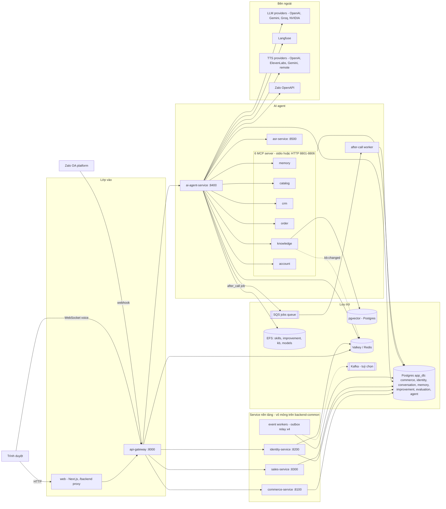
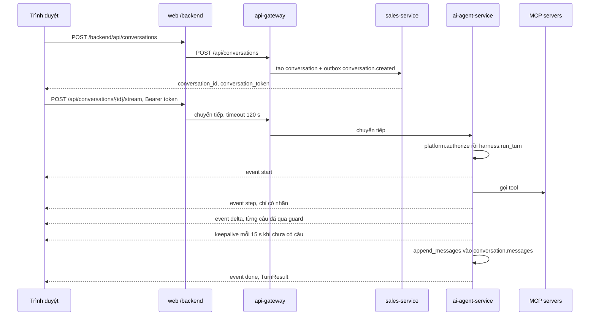
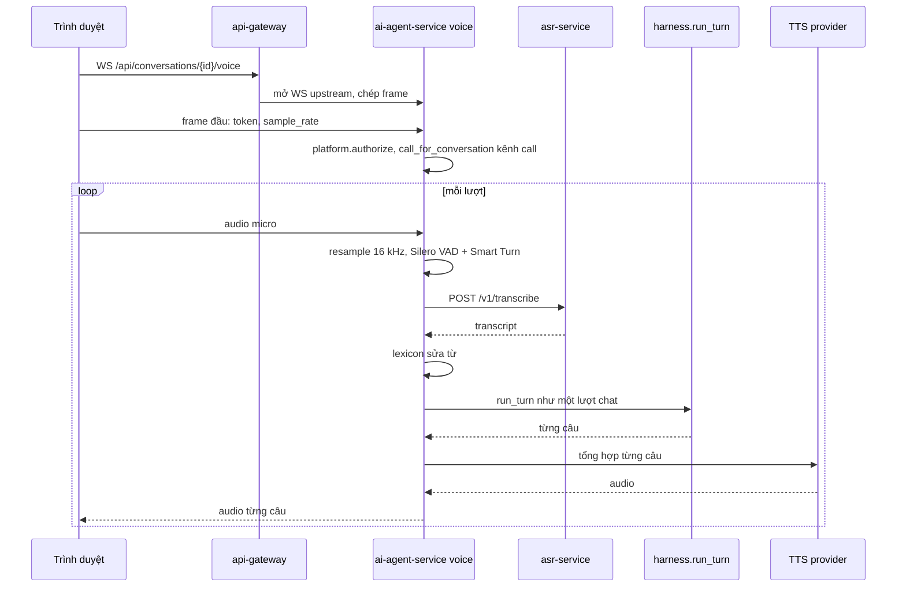
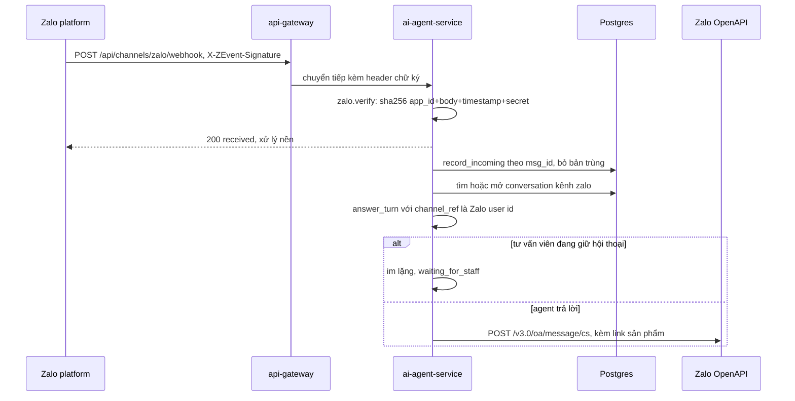
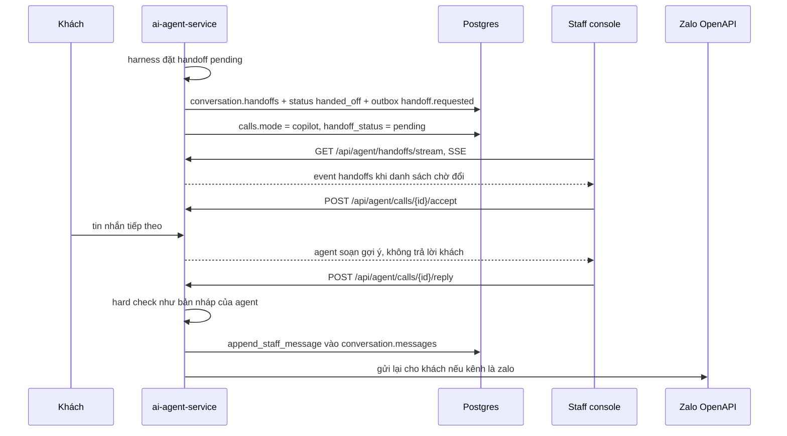

# 01. Sơ đồ hệ thống

Tài liệu này mô tả các thành phần đang chạy, cách chúng nói chuyện với nhau và luồng đi của từng kênh khách hàng. Mọi con số đều kèm đường dẫn tới mã nguồn để đối chiếu. Vòng lặp của agent nằm ở [02-vong-lap-harness.md](02-vong-lap-harness.md), bộ nhớ ở [03-bo-nho.md](03-bo-nho.md), công cụ MCP ở [04-tools.md](04-tools.md), triển khai ở [05-trien-khai.md](05-trien-khai.md). Danh mục toàn bộ tài liệu xem ở [00-tong-quan.md](00-tong-quan.md).

## 1. Tổng quan

Nền tảng gồm hai phần chạy chung một stack. Phần thứ nhất là một cửa hàng trực tuyến: danh mục sản phẩm, giỏ hàng, tài khoản khách, đơn hàng, cùng các trang cho nhân viên bán hàng và quản trị. Phần thứ hai là trợ lý bán hàng AI (telesales/sales assistant), trả lời khách qua chat trên web, cuộc gọi thoại trong trình duyệt và Zalo OA. Khi cần, trợ lý chuyển cuộc hội thoại cho tư vấn viên. Các service nền tảng (`commerce-service`, `identity-service`, `sales-service`) được viết bằng FastAPI và dùng chung mã trong `packages/backend-common`. `ai-agent-service` chạy harness của agent và gọi 6 MCP server để tra danh mục, CRM, đơn hàng, kiến thức, bộ nhớ và tài khoản. Toàn bộ đứng sau một `api-gateway`, phía trước là ứng dụng `web` viết bằng Next.js.

## 2. Sơ đồ logic

Ghi chú về sơ đồ:

- `web` chỉ chuyển tiếp HTTP qua route `/backend/[...path]` (`apps/web/src/app/backend/[...path]/route.ts`). Riêng WebSocket thoại thì trình duyệt mở thẳng tới gateway: `NEXT_PUBLIC_VOICE_URL`, nếu không đặt thì dùng host của trang với cổng 8000 (`apps/web/src/services/voice.ts:53-62`).
- MCP server mặc định là tiến trình con của `ai-agent-service`, giao tiếp qua stdio. Khi `MCP_TRANSPORT=http`, chúng chạy độc lập trên các cổng 8801-8806 (`apps/ai-agent-service/src/ai_agent_service/mcp/client.py:74-81`, `:103-105`).
- SQS, EFS và Valkey dùng chung cho nhiều pod chỉ xuất hiện trong bản triển khai cloud. Khi chạy local, after-call chạy ngay trong tiến trình API và Valkey của agent bị tắt (xem mục 4.3). Chi tiết ở [05-trien-khai.md](05-trien-khai.md).

## 3. Bảng service

| Service | Ngôn ngữ / framework | Cổng | Dữ liệu sở hữu | Endpoint chính |
|---|---|---|---|---|
| `web` | Next.js `^16.4.6`, React `19.3.0` (`apps/web/package.json:13-14`) | 3000 (`apps/web/Dockerfile:19,24`) | không có | trang shop, `/ban-hang`, `/admin`; proxy `/backend/*` |
| `api-gateway` | Python, FastAPI, httpx, websockets | 8000 (`apps/api-gateway/Dockerfile:10`) | không có (chỉ khoá rate limit trong Valkey) | proxy `/api/*`, WS `/api/conversations/{id}/voice`, `/health/ready` |
| `commerce-service` | FastAPI, vỏ mỏng | 8100 (`apps/commerce-service/Dockerfile`) | schema `commerce` | `/api/catalog*`, `/api/seller/orders*`, `/api/admin/catalog`, `/api/admin/inventory/{sku_code}`, `/api/admin/promotions` |
| `identity-service` | FastAPI, vỏ mỏng | 8200 (`apps/identity-service/Dockerfile`) | schema `identity` | `/api/auth/login`, `/api/customer/*`, `/api/conversations/{id}/identity/challenge\|verify`, `/api/admin/users` |
| `sales-service` | FastAPI, vỏ mỏng | 8300 (`apps/sales-service/Dockerfile`) | schema `conversation` | `POST /api/conversations`, `/api/conversations/{id}[/messages\|/end\|/brief\|/orders\|/feedback]`, `/api/staff/*`, `/api/admin/proposals` |
| `ai-agent-service` | FastAPI, LangGraph checkpointer, fastmcp | 8400 (`apps/ai-agent-service/Dockerfile:53`) | schema `agent` (`AGENT_DB_SCHEMA`) | `/api/conversations/{id}/turns\|stream\|voice-message`, WS `/voice`, `/api/agent/*`, `/api/developer/*`, `/api/channels/*` |
| 6 MCP server | fastmcp | stdio; HTTP 8801-8806 | bảng trong schema `agent` | `memory`, `catalog`, `crm`, `order`, `knowledge`, `account` (`mcp/client.py:53-60`) |
| after-call worker | `python -m ai_agent_service.worker` | không có | đọc SQS `JOBS_QUEUE_URL` | chạy `after_call` và sweep |
| `asr-service` | FastAPI | 8500 (`apps/asr-service/Dockerfile:25`) | trọng số mô hình (volume `voice-models`) | `POST /v1/transcribe`, WS `/v1/stream`, `/v1/models` (`apps/asr-service/src/asr_service/main.py`) |
| event workers x4 | `python -m src.messaging.worker --service <owner>` | không có | đọc/ghi `improvement.outbox` | `commerce`, `identity`, `sales`, `ai-agent` (`docker-compose.yml:292-307`) |
| `hotline-bridge` | Python, LiveKit | không có | không có | chỉ chạy trong profile `hotline` (`docker-compose.yml:392`) |

**Ba service nền tảng là vỏ mỏng.** Mỗi `main.py` chỉ tạo `FastAPI`, gắn router và khai báo `/health`, `/health/ready`. Tổng số dòng Python trong `apps/commerce-service/src`, `apps/identity-service/src`, `apps/sales-service/src` lần lượt là 42, 47 và 68. Các module `src.api.routes.*`, `src.db.*`, `src.core.*` đều thuộc `packages/backend-common/src`. Dockerfile chép thư mục này vào `/app/shared/src` và đặt `PYTHONPATH=/app/shared:/app/service` (`apps/commerce-service/Dockerfile`).

**Các schema Postgres.** `packages/backend-common/migrations/0001_competition.sql:3-8` tạo `commerce`, `identity`, `conversation`, `memory`, `improvement` và `evaluation`. Schema `agent` do `ai-agent-service` tự tạo khi khởi động (`apps/ai-agent-service/src/ai_agent_service/config/database.py:30,78-81`). Mỗi kết nối của agent đặt `search_path` về schema này (`config/database.py:58`). Bảng `outbox` và `processed_events` nằm trong schema `improvement` (`packages/backend-common/src/db/models.py:316-318,401-403`).

## 4. Giao tiếp giữa các thành phần

### 4.1 Gateway

Bảng định tuyến lấy từ `upstream_for()` (`apps/api-gateway/src/main.py:100-124`). Thứ tự kiểm tra trong code là thứ tự trong bảng:

| Tiền tố đường dẫn | Upstream |
|---|---|
| `api/catalog`, `api/catalog/*` | commerce |
| `api/auth/*`, `api/customer/*` | identity |
| `api/conversations/*` chứa `/identity/` | identity |
| `api/conversations/*` kết thúc bằng `/turns`, `/stream`, `/voice-message` | ai-agent |
| `api/conversations`, các `api/conversations/*` còn lại | sales |
| `api/admin/users*` | identity |
| `api/admin/catalog*`, `api/admin/inventory/*`, `api/admin/promotions*` | commerce |
| `api/admin/proposals*`, `api/staff/*` | sales |
| `api/seller/*` | commerce |
| `api/developer/*`, `api/agent/*`, `api/channels/*` | ai-agent |
| mọi đường dẫn khác, kể cả `/internal/*` | 404 `No service owns this route` |

Các giới hạn tại gateway:

- **Rate limit:** 120 yêu cầu/phút cho mỗi IP, chỉ áp cho đường dẫn `/api/`. Quá ngưỡng thì trả 429 kèm `Retry-After: 60` (`main.py:48-76`). Bộ đếm là khoá `ratelimit:<ip>:<phút>` trên Redis, tăng bằng một script Lua INCR+EXPIRE. Không có `REDIS_URL` thì dùng cửa sổ trượt trong bộ nhớ. Redis lỗi thì trả 503 `Rate limiter unavailable` (`main.py:52-62`).
- **Body:** tối đa 2 MB (`MAX_BODY = 2 * 1024 * 1024`, `main.py:30`). Gateway kiểm tra cả `Content-Length` lẫn số byte đọc thực tế (`main.py:46,234`). Proxy `/backend` của web cũng chặn ở 2 MB (`apps/web/src/app/backend/[...path]/route.ts:45`).
- **WebSocket thoại:** mỗi frame tối đa 256 KB (`MAX_FRAME`, `main.py:31`). Gateway chỉ chép frame theo cả hai chiều. Việc xác thực do agent làm (`main.py:154-209`).
- **Timeout upstream:** 120 s cho `/stream` và `/turns`, 30 s cho các đường dẫn còn lại (`main.py:244`).
- **Header:** chỉ chuyển tiếp `authorization`, `content-type`, `accept`, `x-request-id`, `x-zevent-signature`. Gateway tự thêm `x-client-ip` để identity áp giới hạn OTP theo địa chỉ (`main.py:220-230`).

### 4.2 Transactional outbox và event workers

Khi service ghi một thay đổi nghiệp vụ, nó ghi kèm một dòng `Outbox` trong cùng transaction. Ví dụ: tạo hội thoại sinh `conversation.created`, agent chuyển cho nhân viên sinh `handoff.requested` (`apps/ai-agent-service/src/ai_agent_service/runtime/platform.py:57,153`). Event worker hoạt động như sau (`packages/backend-common/src/messaging/worker.py`):

- `EVENT_OWNERS` gán mỗi loại sự kiện cho một service sở hữu (`worker.py:23-40`). Topic có dạng `telesales.<owner>.events` (`worker.py:44-48`).
- Mỗi tick, worker lấy tối đa 20 dòng chưa phát, dùng `FOR UPDATE SKIP LOCKED` (`worker.py:95-99`). Vòng lặp nghỉ 1 s giữa hai tick (`worker.py:189`).
- **Có Kafka** (`KAFKA_BROKERS`): worker phát sự kiện lên topic của owner, mặc định phát thêm một bản lên `telesales.domain.events` (`KAFKA_LEGACY_TOPIC_MIRROR`, `worker.py:118`). Sau đó worker tiêu thụ topic của chính owner đó với consumer group `telesales-<service>-events-v1` (`worker.py:146-162`).
- **Không có broker:** worker gọi `process()` trực tiếp trên dòng outbox (`worker.py:129-130`). Đây là chế độ polling mặc định của `docker-compose.yml`. Kafka chỉ có trong profile `async` (`docker-compose.yml:340-341`).
- `process()` chống trùng bằng `processed_events`. Với `conversation.ended`, nó tóm tắt bộ nhớ và tạo `Proposal` khi có lượt gọi tool lỗi. Với `identity.customer.deleted`, nó gọi `POST /internal/customer-deletions` của agent (`worker.py:51-79`, `packages/backend-common/src/identity/deletion.py:15-21`).
- Bảng owner/topic có trong `contracts/kafka/topics.md`, envelope có trong `contracts/kafka/event-envelope.schema.json`.

Màn hình nhân viên cũng nghe Kafka (`handoff.requested`, `conversation.claimed`... trên `telesales.sales.events`). Không có Kafka thì nó đọc lại bảng `calls` mỗi 5 s (`POLL_SECONDS`, `apps/ai-agent-service/src/ai_agent_service/runtime/alerts.py:28-31`).

### 4.3 Valkey / Redis

| Mục đích | Khoá / kênh | Biến môi trường | Nguồn |
|---|---|---|---|
| Rate limit gateway | `ratelimit:<ip>:<phút>` | `REDIS_URL` | `apps/api-gateway/src/main.py:32,55` |
| Giới hạn gửi OTP | `{otp}:cooldown:*`, `{otp}:hour:*`, `{otp}:ip:*` | `REDIS_URL` | `packages/backend-common/src/identity/otp_limits.py:1-20` |
| Rate limiter mô hình dùng chung giữa các pod | `<prefix>:<provider/model>:req\|in\|out\|cool` | `AGENT_REDIS_URL` | `apps/ai-agent-service/src/ai_agent_service/llm/shared_limiter.py:1-17` |
| Tải của pod, chi phí mô hình | `load:turns:<pod>`, `load:calls:<pod>` (TTL 30 s, ghi mỗi 10 s); `spend:day:*`, `spend:conv:*` | `AGENT_REDIS_URL` | `runtime/load.py:3-17,32-33` |
| Bước tool đang chạy cho màn hình nhân viên | `steps:{<call>}` (2 phút) | `AGENT_REDIS_URL` | `runtime/steps.py:9-10` |
| Báo kiến thức thay đổi | pub/sub `kb:changed` | `AGENT_REDIS_URL` | `components/knowledge/notify.py:1-20` |

Không có `AGENT_REDIS_URL` thì các chức năng trên chạy trong bộ nhớ tiến trình. Rate limiter mô hình khi đó chia ngân sách cho `MODEL_LIMITER_PODS`. Kiến thức thì quay về cơ chế kiểm tra stamp `kb_chunks` mỗi 10 giây. `docker-compose.yml` không đặt `AGENT_REDIS_URL`, nên khi chạy local chỉ gateway và identity dùng Redis.

### 4.4 Hàng đợi after-call

Đặt `JOBS_QUEUE_URL` thì khi cuộc gọi kết thúc, API gửi một message `after_call` lên SQS. Worker `ai_agent_service.worker` nhận message theo lô `WORKER_BATCH` (mặc định 5), long polling 20 s (`apps/ai-agent-service/src/ai_agent_service/worker.py:40-41`). Worker chạy MemoryAgent và QaAgent, đồng thời chạy sweep mỗi 60 s (`runtime/jobs.py:26`). Không đặt biến này thì cả hai việc chạy ngay trong tiến trình API (`runtime/jobs.py:3-13`, `main.py:93-103`).

## 5. Luồng theo kênh

### 5.1 Chat trên web (SSE)

- Web tạo phiên bằng `POST /api/conversations` (`apps/web/src/lib/session.ts:66`). Sales sinh token ngẫu nhiên và chỉ lưu digest của nó (`packages/backend-common/src/api/routes/conversations.py`).
- `/stream` xác thực trước khi mở stream, nên token sai nhận 404 thường, không phải lỗi SSE. Lượt trả lời chạy như một task, vẫn tiếp tục khi kết nối rơi. Mỗi `delta` là một câu đã qua guard. `HEARTBEAT_SECONDS = 15` (`apps/ai-agent-service/src/ai_agent_service/api/routes/conversations.py:36,242-306`).
- Một tin nhắn dài tối đa 4000 ký tự (`conversations.py:47`). Tin nhắn thoại ghi trong chat đi qua `POST /voice-message`: PCM 16 kHz, tối đa 60 s, được nhận dạng thành chữ rồi gửi như một lượt `/stream` (`conversations.py:310-349`).

### 5.2 Gọi thoại trong trình duyệt (WebSocket)

- Frame đầu tiên phải đến trong 10 s, là JSON `{token, sample_rate}`, sample rate trong khoảng 8000-192000 Hz. Sai token thì đóng với mã 4404, hội thoại đã đóng thì 4409 (`apps/ai-agent-service/src/ai_agent_service/api/routes/voice.py:98-125`).
- Chuỗi xử lý được mô tả ở `voice.py:12-13`. Agent gọi ASR qua HTTP khi `ASR_URL` được đặt (mặc định `http://asr-service:8500`, `docker-compose.yml:226`; `components/voice/asr.py:50-56,141-150`).
- TTS chọn theo `voice.tts` trong `config/models.yaml`, hoặc theo `VOICE_TTS`. Các engine gồm `openai`, `elevenlabs`, `gemini`, `remote`, `vieneu` (chạy local) và `edge` (`components/voice/tts.py:1-40`). Câu được tách bằng `tts.sentences()` (`voice.py:591`).
- Hotline điện thoại dùng cùng WebSocket này qua `hotline-bridge` và LiveKit (`apps/hotline-bridge/bridge.py:1-18`).

### 5.3 Zalo OA (webhook)

- Chữ ký được kiểm tra bằng so sánh thời gian hằng (`apps/ai-agent-service/src/ai_agent_service/runtime/zalo.py:141-155`). Webhook trả 200 ngay và chạy lượt trả lời trong nền (`api/routes/channels.py:26-36`).
- `handle()` gọi chính `conversations.answer_turn` mà web dùng (`zalo.py:288-341`). Tin nhắn ảnh hoặc file nhận câu trả lời cố định là agent chỉ đọc được chữ. Mỗi tin văn bản gửi đi tối đa 2000 ký tự (`MAX_TEXT`, `zalo.py:60`). Đường dẫn gửi là `SEND_PATH = "/v3.0/oa/message/cs"` (`zalo.py:57`).
- Chưa cấu hình khoá gửi thì câu trả lời vẫn được ghi vào `zalo_messages` với trạng thái `not_sent` (`zalo.py:33-34`).

### 5.4 Chuyển cho tư vấn viên

- Khi lượt trả lời có `handoff.status == "pending"`, `platform.record_handoff` tạo `Handoff` (`conversation.handoffs`), chuyển hội thoại sang `handed_off` và ghi outbox `handoff.requested` (`api/routes/conversations.py:158-163`, `runtime/platform.py:144-158`).
- `calls.request_handoff` chuyển cuộc gọi sang chế độ `copilot`. Trong chế độ này agent chỉ soạn gợi ý cho tư vấn viên (`runtime/calls.py:267-280`). Câu trả lời của tư vấn viên chỉ được gửi sau khi đã `accepted` (`calls.py:330-336`).
- SSE của màn hình nhân viên gửi keepalive mỗi 15 s (`api/routes/agent_calls.py:118,144-149`). Câu trả lời của tư vấn viên được ghi vào chat trên nền tảng và gửi qua Zalo nếu hội thoại đến từ Zalo (`agent_calls.py:278-292`).
- Phía Sales, nhân viên còn có `/api/staff/conversations/{id}/claim|transfer|messages` (`packages/backend-common/src/api/routes/staff.py`).

## 6. Hiện trạng / Hướng tới

- **Một cơ sở dữ liệu chung.** Mọi service dùng chung `app_db` (`docker-compose.yml:13`) và tách nhau bằng schema. Agent ghi trực tiếp vào bảng do Sales sở hữu (`conversation.messages`, `conversation.handoffs`) và vào `improvement.outbox`. `runtime/platform.py:3-5` tự gọi phần này là *Transitional*: nó sẽ được thay bằng API hoặc sự kiện của Sales. `contracts/kafka/topics.md` cũng ghi rằng outbox và `processed_events` dùng chung *during this migration phase*.
- **Dữ liệu thương mại của agent.** Tool danh mục, CRM và đơn hàng của agent chạy trên mock của BTC qua `mcp/servers/btc.py`, không gọi API của `commerce-service`. Trạng thái của mock nằm trong một dòng Postgres để ba tiến trình `mcp-catalog`, `mcp-crm`, `mcp-order` thấy cùng một trạng thái (`mcp/servers/btc.py:1-30`). Khi `SHOP_ORDERS=1` (mặc định trong compose, `docker-compose.yml:167`), `runtime/shop_orders.py` chép đơn agent tạo sang `commerce.orders` và cho `order.status` đọc đơn trên website. Đây là cầu nối tạm thời. Lần chạy đánh giá không bật biến này.
- **Vector của kiến thức.** Hướng đã chốt là lưu embedding của kiến thức trong Postgres bằng pgvector, như trên sơ đồ. Code hiện tại lưu đoạn văn trong `kb_chunks` (schema `agent`), tính embedding bằng mô hình ONNX chạy local, cache vector trên đĩa và tính cosine ngay trong tiến trình `mcp-knowledge` (`components/knowledge/semantic.py:1-20,95-115`).
- **Kênh còn hạn chế.** Facebook chỉ là nhãn kênh `fanpage` trong schema API (`packages/backend-common/src/api/schemas.py:7`), chưa có webhook. Hotline điện thoại chỉ chạy khi bật profile `hotline` (`docker-compose.yml:358-412`). Lý do và hướng xử lý xem ở [06-quyet-dinh-thiet-ke.md](06-quyet-dinh-thiet-ke.md).
