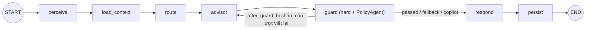
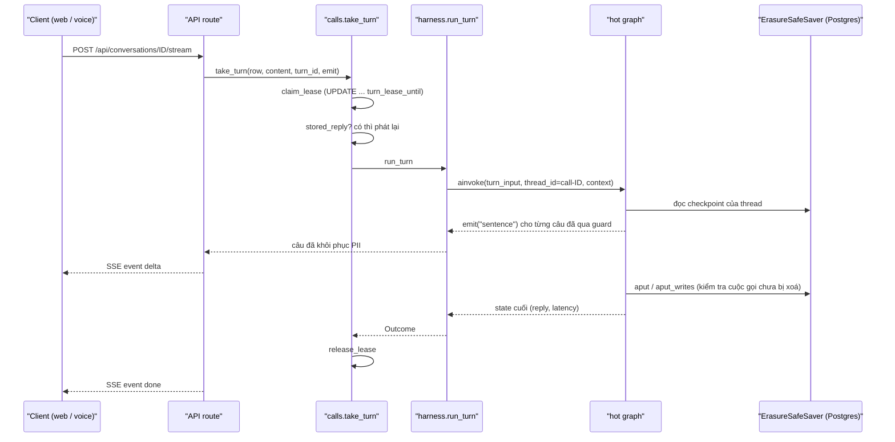
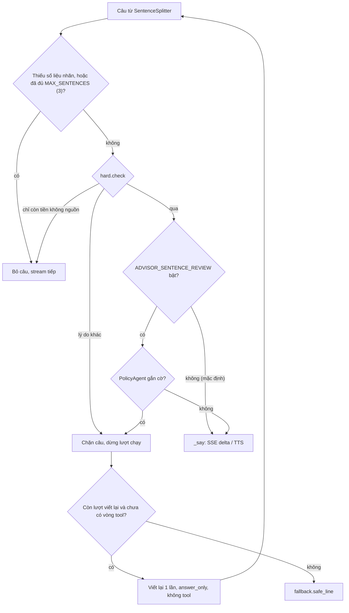
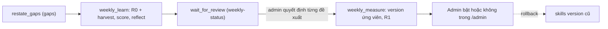

# 02. Vòng lặp harness

Trang này mô tả một lượt khách đi qua hệ thống như thế nào: hot graph LangGraph, cách chọn lane, vòng gọi tool của AdvisorAgent, các lớp guardrail, cách stream từng câu, cold path sau cuộc gọi và vòng cải tiến hằng tuần. Các mục 13–17 đối chiếu trực tiếp với yêu cầu kiến trúc của đề (C.2 "Harness Agent"): vòng lặp 8 bước, Session Continuity, "Phải trình bày và bảo vệ được", mục tiêu hiệu năng, và không giả làm người. Trang tổng quan: [00-tong-quan.md](00-tong-quan.md). Bộ nhớ xem [03-bo-nho.md](03-bo-nho.md), danh sách tool xem [04-tools.md](04-tools.md).

Viết tắt đường dẫn: `A/` = `apps/ai-agent-service/src/ai_agent_service/`. Số dòng ghi theo dạng `file:dòng`.

## 1. Tổng quan

| Vòng | Khi nào chạy | Ở đâu |
|---|---|---|
| Hot path | Mỗi lượt khách là **một lần gọi** `graph.ainvoke` trên hot graph, thread `call-<id>` | `A/runtime/harness.py:173-174`, `:273` |
| Cold path | Một lần khi cuộc gọi kết thúc (`hang_up`), không ai phải chờ nó | `A/runtime/calls.py:204-221`, `A/pipeline/cold/after_call.py` |
| Improvement loop | Mỗi tuần, thứ Hai lúc 02:00 (Asia/Ho_Chi_Minh) | `infra/airflow/dags/improvement_weekly.py:73` |

Hot graph được compile một lần cho mỗi process và dùng chung cho mọi cuộc gọi. Graph không giữ state riêng của cuộc gọi nào; state nằm trong checkpointer, theo từng thread (`A/pipeline/hot/graph.py:41-43`).

## 2. Hot graph

Graph có 7 node (`A/pipeline/hot/graph.py:38`). Cạnh có điều kiện là `after_guard` (`A/pipeline/hot/nodes.py:1646-1651`): đi tới `respond` khi verdict `passed`, khi có `fallback`, hoặc khi `mode == "copilot"`; các trường hợp còn lại quay về `advisor`.

| Node | Đọc | Ghi | Việc chính |
|---|---|---|---|
| `perceive` (`nodes.py:93`) | `HotContext.text`, `asr_confidence`, `vault` | `messages`, `flags`, `input_mode`, `call_facts`; reset `TURN_KEYS` | Lexicon cho ASR, làm sạch, NFC, ITN, token hoá PII; `asr_low_conf` khi confidence < `ASR_LOW_CONFIDENCE = 0.45` (`nodes.py:67`, `:136`) |
| `load_context` (`nodes.py:150`) | khoá kết nối, `keys_seen`, `awaiting` | `tier`, `customer_id`, `brief`, `brief_lines`, `knowledge`, `passages_read` | Xác định danh tính và dựng Call Brief (chi tiết ở [03-bo-nho.md](03-bo-nho.md)), rồi `kb.search` trên lời khách ở mọi lượt có lời |
| `route` (`nodes.py:501`) | `tier`, `flags`, bộ đếm lỗi, `awaiting` | `lane`, `route_rule`, `route_reason`, `route_notes` | Bảng luật ở mục 4 |
| `advisor` (`nodes.py:523`) | lát cắt state (`_agent_context`) | `draft`, `tool_results`, `quotes`, `working_summary`, `latency`, ... | Compaction, AdvisorAgent, stream từng câu đã kiểm tra (mục 5, 7) |
| `guard` (`nodes.py:1453`) | `draft`, `tool_results` | `guard`, `regen_count`, `block_reasons`, `safe_lines` | Hard check rồi PolicyAgent; bỏ qua khi bản nháp đã được stream |
| `respond` (`nodes.py:1657`) | `draft`, `tool_results`, `pending_purchase` | `reply`, `messages`, `handoff`, `suggestion`, `mode` | Bỏ dấu `[Bn]`; chèn câu bắc cầu sau `handoff.transfer`; ở copilot thì tạo gợi ý cho tư vấn viên |
| `persist` (`nodes.py:1727`) | toàn bộ state | `deletion_awaiting_for` | Ghi transcript và bảng `calls` qua `store` |

**HotState và HotContext** (`A/pipeline/hot/state.py`):

- `HotState` (`state.py:67`) là `TypedDict` được checkpoint theo `thread_id = call-<id>`. Chỉ lời khách **đã token hoá** được đưa vào `messages`. `TURN_KEYS` (`state.py:190-202`) được `perceive` xoá ở đầu mỗi lượt để bản nháp hay verdict của lượt trước không lọt sang lượt sau.
- `HotContext` (`state.py:205-249`) **không bao giờ được checkpoint**. Nó chứa văn bản thô, `caller_phone`, `vault` (bảng token ↔ giá trị thật), `identity_secret`, `arrived` (mốc bắt đầu tính TTFT), callback `emit`, và các collaborator `advisor`, `policy`, `compactor`, `harness`, `store`.

## 3. Trình tự một lượt lúc chạy

- **Lease:** `TURN_LEASE_SECONDS = 180` (`A/runtime/calls.py:38`). Lease được giành bằng một UPDATE có điều kiện (`calls.py:132-139`), nên mỗi cuộc gọi chỉ có một lượt chạy tại một thời điểm. Nếu lượt bị chết giữa chừng, lease tự hết hạn. Một `turn_id` đã có câu trả lời thì được phát lại, không chạy lại advisor (`calls.py:170-173`).
- **Checkpointer:** `ErasureSafeSaver` kế thừa `AsyncPostgresSaver`. Mỗi lần ghi checkpoint, nó gọi `require_writable_call` trong cùng transaction, nên không ghi được vào một cuộc gọi đã bị xoá dữ liệu (`A/runtime/db.py:167-187`).
- **SSE:** route `/stream` phát các event `start`, `delta`, `step`, `done` hoặc `error`, kèm keepalive mỗi `HEARTBEAT_SECONDS = 15` (`A/api/routes/conversations.py:36`, `:242-300`). Mỗi `delta` là một câu đã qua guard. Route `/turns` trả JSON (`conversations.py:237`).
- **Voice:** WebSocket `/api/conversations/{id}/voice` (`A/api/routes/voice.py:90`). Chuỗi xử lý: VAD Silero + Smart Turn → ASR cục bộ → lexicon → `harness.run_turn` (cùng lượt như chat) → TTS theo từng câu. Phía voice cũng giành lease, thử tối đa 20 lần, mỗi lần cách 0,25 s (`voice.py:531-544`).

## 4. Chọn lane

Luật nằm trong `A/components/orchestration/rules.py:101-114`. **Luật khớp đầu tiên thắng.** Mọi luật chỉ đọc state mà code biết chắc (bộ đếm lỗi, độ tin cậy ASR, tier, có brief hay không). Không luật nào đoán nội dung khách đang nói.

| # | Điều kiện | Lane |
|---|---|---|
| 1 | `tool_failures >= TOOL_FAILURES (2)`, hoặc `model_failures >= MODEL_FAILURES (2)`, hoặc một lần chuyển máy đang chờ số điện thoại và nay đã có số (`rules.py:39-41`) | `HANDOFF` |
| 2 | `asr_low_conf` | `CLARIFY` |
| 3 | tier `PROBABLE` / `AMBIGUOUS` và câu hỏi xác nhận chưa xong | `CONFIRM_IDENTITY` |
| 4 | `VERIFIED` và có brief | `CONTINUITY` |
| 5 | còn lại | `NEW` |

Lane có thể được thêm ghi chú: PB-10 khi khách đang bực, PB-11 khi `sessions_without_close >= 3`, và một ghi chú riêng cho số dùng chung chưa rõ là ai (`rules.py:47-55`, `:88-98`).

Tool theo lane (`apps/ai-agent-service/config/lanes.yaml`): `CLARIFY` và `CONFIRM_IDENTITY` không có tool nào. `NEW` và `CONTINUITY` có toàn bộ tool nghiệp vụ; riêng `CONTINUITY` có thêm `memory_get_episodes` và `memory_search_calls`. `HANDOFF` không có mục trong file vì harness tự chuyển máy, không qua model (`nodes.py:559-564`, `_transfer`). Knowledge base không phải tool của lane nào; `load_context` truy xuất trước. Chi tiết từng tool: [04-tools.md](04-tools.md).

## 5. Vòng tool của AdvisorAgent

AdvisorAgent dùng `langchain.agents.create_agent` (vòng ReAct) và không có state (`A/agents/advisor.py:1239-1290`). Thứ tự middleware (`advisor.py:1276-1287`):

1. `ChainLookupMiddleware`: khi model vừa tìm sản phẩm, harness tự tra giá và tồn kho trong một vòng của chính nó (chained lookup), nên tiết kiệm một vòng model (`A/mcp/tools.py:710-722`).
2. `ContextPromptMiddleware`: dựng system prompt cho mỗi lần gọi model.
3. `ModelRetryMiddleware`: `max_retries=1`, `initial_delay=1.0` (khi `retries` khác 0).
4. `ModelCallLimitMiddleware`: `run_limit = MODEL_CALLS_PER_RUN = 2`, `exit_behavior="error"`.
5. `ToolCallLimitMiddleware`: `run_limit = TOOL_CALLS_PER_RUN = 20`, `exit_behavior="continue"` (`advisor.py:1243-1245`).
6. `LaneToolsMiddleware`: chỉ đưa cho model các tool của lane hiện tại.
7. `StrictToolsMiddleware`: chỉ bật khi model là OpenAI.
8. `ActionGuardMiddleware`: guardrail trước khi thực thi (mục 6a).
9. `ToolGuardMiddleware`: timeout `DEFAULT_TIMEOUT = 2.0` s, riêng tool ghi là `WRITE_TIMEOUT = 10.0` s; retry 1 lần; circuit breaker mở sau 2 lỗi, giữ 60 s (`A/mcp/tools.py:376-399`).

**Lần gọi model cuối:** `_is_last` đúng khi `run_model_call_count >= model_limit - 1`, khi đang warm-up, hoặc khi ở chế độ `answer_only`. Lúc đó prompt được nối thêm câu "lần viết cuối", request dùng `tool_choice="none"`, và mọi tool call trong câu trả lời bị gỡ bỏ (`advisor.py:576-605`). Danh sách tool vẫn giữ nguyên để không làm trượt prompt cache (`advisor.py:587`). Với giới hạn 2, lượt điển hình là: lần 1 viết câu mở và gọi tool, lần 2 trả lời từ kết quả tool.

**Ghép context** (`prompt_parts`, `advisor.py:328-372`):

- Phần tĩnh: `HARD_RULES` cộng các skill. Skill nằm sẵn trong prompt khi `ADVISOR_SKILLS` tắt.
- Phần của lượt, theo đúng thứ tự: `skills` (chỉ khi nạp theo yêu cầu), `today`, `warnings`, `lane`, `products`, `earlier`, `basket`, `orders`, `offered`, `brief`, `summary`, `knowledge`, `playbook`, `tool_results`, `opening`, `blocked`, `no_handoff`, `call_state`.
- Với OpenAI, phần tĩnh là system message. Phần của lượt đi vào messages qua `with_turn_context`, để phần tiền tố được cache (`advisor.py:581-583`).

**Ngân sách token** (`A/components/context/budget.py`): `max_tokens=3000` (`advisor.py:328`). Đây là ngân sách mềm, chỉ áp cho phần của lượt. Token được ước lượng bằng `(len + 3) // 4` (`budget.py:33-34`). Các section trong `PROTECTED` không bao giờ bị cắt (`budget.py:16-17`). Các section không thuộc `PROTECTED` (`playbook`, `offered`) được giữ theo thứ tự cho tới khi hết ngân sách. Section bị cắt được ghi vào `prompt_stats`.

**Compaction** (`A/components/context/compact.py:30-33`): khi thread có hơn `THRESHOLD = 16` message, phần trước `KEEP_MESSAGES = 8` message cuối được gộp vào `working_summary` rồi bị xoá khỏi thread bằng `RemoveMessage` (`nodes.py:539-545`). Việc gộp dùng model `compactor` với structured output, 2 lần thử. Nếu lỗi thì gộp kiểu trích xuất: lấy câu đầu của mỗi lượt (`compact.py:76-88`).

## 6. Guardrails

### 6a. Trước khi thực thi tool ghi

`WRITE_TOOLS` gồm `order_create`, `order_update`, `schedule_callback`, `handoff_transfer`, `memory_request_deletion` (`A/components/guardrails/actions.py:35`). `actions.check` (`actions.py:57-138`) kiểm tra:

| Tool | Kiểm tra chính |
|---|---|
| mọi tool ghi ở `copilot` | luôn bị từ chối, vì tư vấn viên là người thao tác (`actions.py:118-119`) |
| `order_create` | có số điện thoại; tier cho phép; mã sản phẩm đáng tin; giá bằng báo giá hôm nay; tổng COD tối đa `COD_LIMIT_VND = 10_000_000` (`actions.py:38`); không trùng đơn trừ khi intent `one_more` |
| `order_update` | đơn thuộc khách (hoặc đơn tạo trong chính cuộc gọi này); không lặp lại thay đổi đã làm; còn trong hạn đổi trả; intent `change` |
| `schedule_callback` | giờ Việt Nam, không ở quá khứ, trong giờ làm việc (LN-01/LN-02) |
| `handoff_transfer` | ngoài lane `HANDOFF`, PolicyAgent đọc intent `handoff`; brief được điền và kiểm tra theo schema |
| `memory_request_deletion` | `VERIFIED` và khách đã đồng ý (intent `delete`, QT-06) |
| `order_status`, `crm_get_customer` (đọc dữ liệu riêng) | phải là `VERIFIED` (`actions.py:102-115`) |

**Đồng ý mua hàng** (`advisor.py:867-896`, `A/components/guardrails/purchase.py`):

1. `actions.check` qua thì harness tạo `purchase.draft` để đọc lại đơn.
2. PolicyAgent đọc intent `purchase` và chia theo band.
3. Nếu API không trả lời, harness dùng regex `YES` / `CONSENT`, và chỉ chấp nhận khi khách vừa nghe đúng đơn đó được đọc lại.
4. Nếu khách chưa đồng ý, tool trả lỗi `CONFIRMATION_REQUIRED` kèm `purchase_draft` để model đọc lại đơn.
5. Nếu đồng ý, `purchase.authorize` cấp một receipt có ký, sống `TTL_SECONDS = 300` (`purchase.py:23`).

Band intent `(có, không)` (`A/agents/policy.py:185-186`): `purchase (0.9, 0.3)`, `delete (0.9, 0.3)`, `handoff (0.8, 0.2)`, `change (0.8, 0.3)`, `one_more (0.8, 0.2)`, `other_model (0.7, 0.3)`. Chỉ một "có" rõ ràng mới được tính là đồng ý; kết quả "không chắc" được tính là không (`advisor.py:1050-1053`). Intent được hỏi qua `PolicyAgent.probability` với timeout của evaluator `1.5` s (`apps/ai-agent-service/config/models.yaml:359`).

### 6b. Hard check trên câu trả lời

`A/components/guardrails/hard.py:192-215` chỉ dùng code, không gọi model. Các nhóm kiểm tra: PII thô hoặc dãy 10–14 chữ số; token PII không thuộc cuộc gọi này; thông tin nội bộ (giá nhập, biên lợi nhuận...); tự nhận là người thật; mã đơn hoặc giá trong brief khi tier dưới `VERIFIED`; khuyến mãi chưa bắt đầu (KM-02); và mọi số tiền phải có nguồn (`_money`). Hàm trả về mọi lý do cùng lúc, không chỉ lý do đầu tiên. Hard check chạy trên **từng câu** khi stream.

### 6c. PolicyAgent (soft review)

PolicyAgent gọi OpenAI Decisions API (`POST /v1/decisions`, model `gpt-6-luna`) (`A/llm/decisions.py:3`, `models.yaml:355-359`). Nó chỉ đọc `PolicyInput`: câu đang xét, kết quả tool, tier, đoạn chính sách, những gì đã xác lập trước trong cuộc gọi và lời khách. Nó không đọc brief hay hội thoại của advisor (`policy.py:7-11`, `:210-225`). Có 10 câu hỏi, mỗi câu một ngưỡng (`policy.py:70-92`):

| Câu hỏi | Ngưỡng | Câu hỏi | Ngưỡng |
|---|---|---|---|
| `over_promise` | 0.8 | `unsupported_fact` | 0.9 |
| `stale_policy` | 0.9 | `false_transfer` | 0.65 |
| `competitor` | 0.9 | `unbacked_action` | 0.8 |
| `unsupported_absence` | 0.8 | `claims_human` | 0.8 |
| `false_pressure` | 0.9 | `unquoted_price` | 0.8 |

`review` dùng `REVIEW_TIMEOUT = 5.0` s (`policy.py:55`). Nếu API không trả lời, bản nháp được cho qua chỉ với hard check, và verdict ghi `decided_by = "skipped:<code>"` (`policy.py:292-294`).

> **Hiện trạng:** ở chế độ `speak`, câu trả lời được stream và node `guard` trả `{}` (`nodes.py:1463-1464`). Review từng câu chỉ chạy khi `ADVISOR_SENTENCE_REVIEW=1`, và cờ này mặc định tắt (`A/mcp/tools.py:803-805`, `nodes.py:1281-1286`). Vì vậy, mặc định câu nói với khách **chỉ qua hard check**. PolicyAgent vẫn chạy cho intent trước tool ghi (6a) và cho toàn bộ bản nháp ở `copilot` (`nodes.py:1478-1487`). Ở `copilot`, verdict đi kèm gợi ý dưới dạng cảnh báo, không viết lại.

### 6d. Viết lại, câu an toàn, chuyển người

`MAX_REGENERATIONS = 1` (`nodes.py:60`). Trong lượt stream, câu bị chặn được viết lại **một lần**, và chỉ khi lượt chạy đó chưa có vòng tool. Lần viết lại ở chế độ `answer_only`, không có tool, đi tiếp từ những câu khách đã nghe (`nodes.py:1083-1091`). Nếu vẫn bị chặn, harness nói `fallback.safe_line` theo lane (`A/components/guardrails/fallback.py:21`, `:71-79`). Nếu lượt đó đã tạo đơn, câu nói là `order_placed`. Mỗi lượt chỉ có một câu đính chính (`nodes.py:1078-1082`).

Khi model lỗi lần đầu, harness nói `model_error` ("nhắc lại giúp em"). Lần thứ `MODEL_FAILURES = 2` liên tiếp thì harness tự chuyển máy ngay trong lượt (`nodes.py:590-603`). Lỗi hạ tầng của tool được đếm vào `tool_failures`, và luật 1 đưa lượt sau sang `HANDOFF`. Câu an toàn **không** phải lý do chuyển người (`rules.py:9-11`).

`MAX_SENTENCES = 3` (`hard.py:38`). Riêng khi đọc lại đơn (`ORDER_SUMMARY`), câu trả lời được dài hơn (`nodes.py:1354`).

## 7. Stream từng câu và voice

`_streamed` (`nodes.py:1039`) đọc event từ `advisor.stream`. `SentenceSplitter` (`A/components/guardrails/stream.py`) cắt câu tại `.`, `!`, `?` hoặc `…` có khoảng trắng theo sau. Câu dài quá `MAX_SENTENCE = 200` ký tự thì bị cắt (`stream.py:21`). `_offer` kiểm tra từng câu rồi gọi `_say`, và `_say` đẩy câu qua `emit("sentence")`. Khi có vòng tool, harness có thể phát `filler` hoặc `hold_line` (`nodes.py:1176-1193`).

**TTFT:** `_say` ghi `first_token_ms` là thời điểm token đầu tiên của **câu đầu tiên được nói** được sinh ra. Mốc bắt đầu là lúc request tới backend (`HotContext.arrived`). Câu bị chặn không được tính, filler cũng không (`nodes.py:1421-1435`). Harness trả `ttft_ms = first_token_ms`, hoặc `total_ms` nếu không có câu nào (`A/runtime/harness.py:291-305`). Riêng voice còn đo TTFA: từ lúc VAD báo khách ngừng nói tới byte audio đầu tiên rời server (`voice.py:18-27`).

**Barge-in** (`A/components/voice/turns.py`, `A/components/voice/policy.py`, `models.yaml:375-385`):

- Khách nói liên tục `barge_in_ms = 400` thì playback tạm dừng.
- Lời nhận được chỉ được coi là ngắt lời khi có ít nhất `min_interruption_words = 2` từ và không chỉ gồm từ đệm ("dạ", "vâng"). Một lệnh đơn trong `INTERRUPT_COMMANDS` ("dừng", "thôi"...) cũng ngắt được (`policy.py:28`, `:33-47`).
- Sau `false_interruption_ms = 2500` mà chưa nghe ra từ nào, playback tiếp tục.
- Endpointing mặc định là `smart` (Smart Turn, `probe_ms = 200`, trần `max_silence_ms = 1200`) (`turns.py:121-130`).

## 8. Cold path sau cuộc gọi

`after_call` (`A/pipeline/cold/after_call.py:53-98`):

1. Nếu trong cuộc gọi khách xin xoá dữ liệu (QT-06), harness thực hiện xoá dưới role `admin` và không ghi gì.
2. Nếu không, MemoryAgent `extract` các fact ứng viên.
3. Bước `gate` chỉ ghi cho khách đã được xác nhận: `VERIFIED` ghi trực tiếp; `PROBABLE` chỉ ghi dạng *unconfirmed*; `AMBIGUOUS` không ghi gì.
4. `commit` qua `memory.commit_facts`, sau đó `summarize` thành một dòng episode.
5. QaAgent gắn tag cho cuộc gọi. Chi tiết ở [03-bo-nho.md](03-bo-nho.md).

Kích hoạt (`A/runtime/jobs.py:60-71`): nếu không có `JOBS_QUEUE_URL`, `after_call` chạy như một task trong chính process API. Nếu có, harness gửi một message lên SQS cho worker. Hàng `calls` được đánh dấu `memory_status = 'pending'` trước khi gửi, và cứ mỗi `SWEEP_SECONDS = 60` có một lượt quét nhặt lại các cuộc gọi chưa được ghi nhớ (`jobs.py:26`, `:74-96`).

## 9. Vòng cải tiến

Có hai cơ chế (`A/pipeline/improve/cli.py:1-43`):

- **Reflection** (đổi skill):
  1. `harvest`: grader của BTC tìm lỗi, không dùng model.
  2. `score`: QaAgent chấm theo rubric và phân loại `not_followed` / `skill_gap`.
  3. `reflect`: ReflectionAgent viết lesson card. Khi ít nhất `MIN_SUPPORT = 3` khách cùng chung một bài học (`A/components/improvement/lessons.py:37`), nó soạn một câu thay đổi skill. Câu này qua bộ lọc bằng code và `PolicyAgent.review_change` (`CHANGE_THRESHOLD = 0.8`, `CHANGE_TIMEOUT = 45.0` s, `policy.py:58`, `:136`).
  4. `publish`: một người duyệt trong file review rồi xuất bản thành skills version mới. `rollback --to N` đưa skills về một version cũ (`cli.py:142-143`).
  - ApprovalAgent chỉ quyết định thay người duyệt khi tập học có ghi bài học mong đợi. Nếu không, thay đổi chờ người duyệt (`cli.py:376-382`, `:519-531`).
- **Knowledge Gap Loop** (đổi knowledge base): `gaps` viết lại từng câu hỏi chưa trả lời được thành câu độc lập, gộp các câu cùng nghĩa (`SAME_CANDIDATE = 0.75`, `A/components/improvement/gaps.py:138`), rồi xuất bản các câu trả lời đã có.

**Vòng hằng tuần** (`A/pipeline/improve/weekly.py`, `infra/airflow/dags/improvement_weekly.py:49-55`, `:81-90`): đo R0 với skill đang dùng → học → chờ admin → đo R1 với version ứng viên. Vòng này **không bao giờ tự bật version**; admin bật trong `/admin`. Một vòng chờ quá `REVIEW_DAYS = 7` ngày thì hết hạn (`weekly.py:36`). Sensor poll mỗi 30 phút, tối đa 8 ngày. Khi không có Airflow, `infra/improve/run.py` chạy đúng các lệnh `STEPS` đó qua `learn` và `tick`.

## 10. Đánh giá

`run_eval.py` chỉ gọi tiếp `A/pipeline/eval/cli.py:main` (`run_eval.py:22-24`). Có hai cấu hình, `full` và `baseline_no_memory` (`A/pipeline/eval/cli.py:119`), khác nhau ở đúng một switch `memory`, và switch này chỉ có `retrieve` đọc (`A/pipeline/eval/runner.py:21-27`, `:74`). Khi không truyền `--config`, cả hai chạy và script `eval/reference_eval.py` của BTC in bảng kết quả (`A/pipeline/eval/report.py:171-184`). Mỗi lần chạy dùng DB riêng có hậu tố `*_eval` và checkpointer trong bộ nhớ, nên không lẫn với dữ liệu của API.

## 11. Model theo vai trò

Nguồn: `apps/ai-agent-service/config/models.yaml:81-211`, `:355-359`. Mặc định `temperature: 0.0` (`:50`), nhưng nhiều agent ghi đè bằng `null`.

| Vai trò | Provider / model | Ghi chú |
|---|---|---|
| `advisor` | openai / `gpt-5.6-luna` | `reasoning_effort: none`, `max_tokens: 2048` (`:85-105`) |
| `policy` (evaluator) | OpenAI Decisions / `gpt-6-luna` | `timeout: 1.5` (`:355-359`) |
| `compactor` | openai / `gpt-4.1-mini` | (`:136-140`) |
| `memory` | openai / `gpt-4.1-mini` | sau cuộc gọi (`:128-132`) |
| `qa` | openai / `gpt-5.6-luna` | `reasoning_effort: medium` (`:148-156`) |
| `knowledge` | openai / `gpt-5.6-luna` | offline (`:161-168`) |
| `reflection`, `approval` | openai / `gpt-6.1-terra` | Responses API (`:182-201`) |
| `simulator` | openai / `gpt-4.1-mini` | `temperature: 0.3` (`:206-211`) |
| `extractor` (chỉ cho eval) | openai / `gpt-5.6-luna` | (`:111-122`) |

`AGENT_PROFILE=local` (`models.yaml:219-237`) chuyển `advisor`, `memory`, `compactor` sang `google_genai / gemini-3.5-flash-lite`, và `simulator` sang `gemini-3.1-flash-lite`. `qa`, `reflection`, `approval` giữ nguyên model.

## 12. Cờ mặc định tắt

| Biến | Mặc định | Khi bật thì |
|---|---|---|
| `ADVISOR_SENTENCE_REVIEW` (`A/mcp/tools.py:803-805`) | `0` | PolicyAgent review từng câu đã nói, chạy song song với stream; câu bị gắn cờ dẫn tới một câu đính chính |
| `ADVISOR_EARLY_INTENTS` (`A/agents/policy.py:174-178`) | `0` | Hỏi trước `EARLY_INTENTS` (`purchase`, `handoff`, `delete`, `one_more`, `other_model`) ở đầu lượt, khi lane có tool ghi |
| `ADVISOR_SKILLS` (`A/components/context/skills.py:82-85`) | `0` | Skill được nạp theo yêu cầu qua `load_skill` (`MAX_LOADED = 3`) thay vì nằm sẵn trong prompt |
| `ADVISOR_PRODUCT_ADVISE` (`A/mcp/tools.py:667-669`) | `0` | Thêm tool `product_advise` cho lane `NEW` / `CONTINUITY` |
| `ADVISOR_FIRST_CLAUSE` (`A/mcp/tools.py:797-800`) | `0` | Trên hotline, nói vế đầu của câu trước, khi vế đó dài ít nhất 20 ký tự và 4 từ (`stream.py:31-32`) |
| `VOICE_FILLER` (`A/api/routes/voice.py:619`) | khác `"1"` | TTS đọc câu đệm "chờ em một xíu" khi vòng tool bắt đầu |
| `VOICE_HOLD_MS` (`A/api/routes/voice.py:236`) | `0` | Sau N ms không nghe thấy gì trong lúc đang tra cứu, nói câu chờ theo tool (`fallback.HOLD_BY_TOOL`) |
| `REVIEW_HEAD_START_MS` (`A/config/config_manager.py:76-79`) | `0` (nói ngay) | Cho review chạy trước N ms rồi mới nói câu; chỉ có tác dụng khi review từng câu đang bật |
| `HANDOFF_AUTO_ACCEPT` (`A/config/config_manager.py:64-74`) | tắt | Hệ thống tự nhận cuộc chuyển máy (`accepted_by = "auto"`), cuộc gọi giữ `speak` thay vì `copilot`; dùng cho chạy thử |

> **Hiện trạng / Hướng tới:** cạnh `guard → advisor` của graph chỉ được dùng khi advisor không stream (advisor không có `stream`) ở chế độ `speak`. Với AdvisorAgent hiện tại, việc viết lại diễn ra bên trong node `advisor` (`_streamed`). Ở `copilot` thì không viết lại. Các cờ ở mục 12 tắt vì chưa đo được ảnh hưởng lên metric chấm điểm; quyết định thiết kế xem [06-quyet-dinh-thiet-ke.md](06-quyet-dinh-thiet-ke.md), triển khai xem [05-trien-khai.md](05-trien-khai.md), hệ thống tổng thể xem [01-he-thong.md](01-he-thong.md).

## 13. Đối chiếu vòng lặp của đề

Đề mô tả mỗi lượt là `PERCEIVE (ASR/NLU) → RESOLVE IDENTITY (nhận diện khách) → RETRIEVE (memory + RAG) → PLAN (next action) → GUARDRAIL (policy check) → ACT (gọi tool / trả lời) → OBSERVE (kết quả trả về) → PERSIST (ghi nhớ có chọn lọc)`, đầu vào là audio hoặc text, đầu ra là lời nói + hành động nghiệp vụ + cập nhật bộ nhớ.

| Bước của đề | Node / hàm trong code | Làm gì | file:line |
|---|---|---|---|
| PERCEIVE (ASR/NLU) | voice: VAD + ASR + `process_recognition`; graph: `perceive` | Voice lọc tiếng đệm, tiếng vọng, sửa tên sản phẩm bằng lexicon; `perceive` làm sạch, NFC, ITN, token hoá PII, đọc tín hiệu (bực, số điện thoại mới) | `A/api/routes/voice.py:469-483`, `A/pipeline/hot/nodes.py:93-144` |
| RESOLVE IDENTITY | `load_context` → `_identify`, `_look_up`, `resolver.decide`, `_settle` | Băm khoá, tra CRM + ledger song song, gán tier, hỏi một câu xác nhận khi cần | `nodes.py:223-300`, `:311-327`, `:412-443`, `A/components/identity/resolver.py:88-95` |
| RETRIEVE (memory + RAG) | `_brief` (`recall.retrieve`, `recall.refresh`, `briefs.render`) và `_knowledge` (`kb_search`) | Dựng Call Brief đã kiểm lại bằng tool hôm nay; truy xuất tài liệu cho lời khách | `nodes.py:446-487`, `:175-188` |
| PLAN (next action) | `route` (bảng luật lane) + lần gọi model thứ nhất của AdvisorAgent | Chọn lane và bộ tool; model chọn một việc cho lượt và các tool cần gọi | `nodes.py:501-517`, `A/components/orchestration/rules.py:101-114`, `config/prompts/agent/advisor/rules.md:5-12` |
| GUARDRAIL (policy check) | `ActionGuardMiddleware` + `actions.check` trước tool ghi; `hard.check` trên từng câu trong `_offer`; node `guard` | Chặn hành động sai trước khi thực thi; chặn câu sai trước khi nói | `A/agents/advisor.py:637`, `:854`; `nodes.py:1356-1366`, `:1453` |
| ACT (gọi tool / trả lời) | tool qua `ToolGuardMiddleware`; `_say` | Gọi tool với timeout, retry, circuit breaker; phát từng câu đã kiểm qua `emit("sentence")` | `A/mcp/tools.py:376-399`; `nodes.py:1421-1435` |
| OBSERVE (kết quả trả về) | event `tools` của vòng ReAct; `_absorb` | Envelope kết quả về lần gọi model thứ hai để model trả lời bằng lời của nó; state ghi báo giá, đơn, bộ đếm lỗi | `nodes.py:1194-1202`, `:906-975` |
| PERSIST (ghi nhớ có chọn lọc) | node `persist` + checkpointer; cold path `after_call` | Ghi transcript, bảng `calls`, checkpoint; sau cuộc gọi chỉ ghi fact qua `gate` theo tier | `nodes.py:1727-1747`, `A/runtime/db.py:167-187`, `A/pipeline/cold/after_call.py:53-98` |

```mermaid
flowchart LR
    PC["PERCEIVE: perceive"] --> RI["RESOLVE IDENTITY: _identify"]
    RI --> RT["RETRIEVE: _brief + _knowledge"]
    RT --> PL["PLAN: route + advisor lần 1"]
    PL --> GA["GUARDRAIL trước ghi: ActionGuard"]
    GA --> AC["ACT: tool qua ToolGuard"]
    AC --> OB["OBSERVE: kết quả về advisor lần 2"]
    OB --> GS["GUARDRAIL trước nói: hard.check từng câu"]
    GS --> SAY["ACT: _say ra SSE hoặc TTS"]
    SAY --> PS["PERSIST: persist, sau cuộc gọi after_call"]
```

Khác biệt so với thứ tự của đề:

- RESOLVE IDENTITY và RETRIEVE chung một node `load_context`. Phần memory chỉ chạy khi cần nhận diện (lượt đầu, lượt có số điện thoại mới, câu trả lời cho câu xác nhận); các lượt sau dùng brief đã checkpoint. Phần RAG chạy ở mọi lượt có lời (`nodes.py:164-172`, `:234-242`).
- PLAN, ACT, OBSERVE là một vòng ReAct trong node `advisor`, tối đa 2 lần gọi model (mục 5). Plan và lệnh gọi tool nằm trong cùng một lần gọi model.
- GUARDRAIL đứng ở hai chỗ, không phải một: **trước khi tool ghi thực thi** (ActionGuard, mục 6a) và **trước khi từng câu được nói**, tức là sau ACT/OBSERVE của tool (hard check, mục 6b). Ở chế độ `speak` node `guard` không còn việc (`nodes.py:1463-1464`).
- PERSIST có hai tầng: trong lượt (checkpoint, transcript) và ghi nhớ dài hạn có chọn lọc ở cold path (mục 8). Riêng web chat với khách `VERIFIED`, harness gọi `remember(call_id, finalize=False)` sau mỗi lượt (`A/runtime/harness.py:287-289`).
- Đầu ra: lời nói (`emit("sentence")` → SSE delta hoặc TTS), hành động nghiệp vụ (tool ghi trong `WRITE_TOOLS`, mục 6a), cập nhật bộ nhớ (cold path).

## 14. Session Continuity (tính năng bắt buộc số 1)

Cách lưu và đọc bộ nhớ: [03-bo-nho.md](03-bo-nho.md). Mục này chỉ đối chiếu từng yêu cầu của đề với code.

**14a. Nhận ra khách quay lại qua số điện thoại.** Khoá lấy từ kết nối (`caller_phone`, `zalo_id`, `fb_id`) (`nodes.py:389-409`), băm HMAC với secret trước khi tra (`resolver.py:69-75`), tra song song CRM của BTC (`crm_get_customer`) và ledger (`identity_find`) (`nodes.py:412-443`). Bảng tier (`resolver.py:10-15`, `:88-95`): khoá từ kết nối khớp đúng một khách là `VERIFIED`; số khách tự đọc giữa cuộc khớp một khách là `PROBABLE`; khớp hai khách trở lên là `AMBIGUOUS`; không khớp là `UNKNOWN`. Khi đã `VERIFIED`, một số mới khách đọc (số giao hàng, số người nhà) không đổi danh tính (`nodes.py:248-249`).

**14b. Call Brief nạp trước khi trả lời.** Brief được dựng trong `load_context`, trước `advisor`, ngay lượt đầu. Trên voice agent nói trước: lượt mở đầu không có lời khách (`content=None`, `phase="opening"`) vẫn qua `load_context` (`voice.py:271`, `:433-438`, `harness.py:257`).

| Đề yêu cầu | Trường / dòng của brief | file:line |
|---|---|---|
| Khách là ai | `customer_name`, `honorific`, `customer_phone` (chỉ 4 số cuối) | `A/components/memory/brief.py:270-273` |
| Đã gọi bao nhiêu lần | `n_previous_sessions`; dòng "Khách quen: …, đã liên hệ N lần trước." | `brief.py:165-167`, `:275` |
| Sản phẩm đã tư vấn, giá/KM đã báo | `products_advised` (`sku`, `price_quoted_vnd`, `promo_code`, `promo_still_active`, `quoted_on`); dòng giá ghi rõ "Đây là lịch sử; giá hôm nay phải lấy lại bằng pricing_get_quote." | `brief.py:188-202`, `:279-282` |
| Vướng mắc còn dở ("chờ hỏi chồng") | slot `blocker` → "Việc còn dở: …" và `open_blockers`; `decision_maker`; `open_items` của lần trước | `brief.py:95-96`, `:180-186`, `:289` |
| Hành động tiếp theo gợi ý | `suggested_next_action` | `brief.py:294`, `:326-333` |

Mỗi dòng được đánh số `B1..Bn` và mang `fact_ids` (`brief.py:257`). Dưới `VERIFIED`, harness giữ lại dòng nhạy cảm: `PROBABLE` chỉ thấy dòng không nhạy cảm, `AMBIGUOUS`/`UNKNOWN` không thấy dòng nào (`nodes.py:681-684`).

> **Một phần:** `suggested_opening` và `suggested_next_action` có trong object brief (schema BTC, trace) nhưng không được đưa vào prompt advisor. Advisor tự viết câu mở từ các dòng `Bn` theo chỉ dẫn lane (`advisor.py:305`, `:364`).

**14c. Mở đầu bằng xác nhận tiếp nối.** Khách `VERIFIED` có brief đi lane `CONTINUITY` (`rules.py:112-113`). Chỉ dẫn lane: chào bằng tên, một câu xác nhận tiếp nối nhắc tối đa hai thông tin (đơn đã đặt, việc còn dở, sản phẩm và giá đã báo), đánh dấu `[Bn]`, rồi hỏi khách muốn tiếp tục thế nào (`config/prompts/agent/advisor/notes.yaml:2-8`). Lượt mở đầu thêm section `opening`: nói rõ là trợ lý tự động, xác nhận tiếp nối theo Call Brief, không gọi tool (`notes.yaml:20-27`, `advisor.py:364`). Ví dụ mẫu ở `rules.md:67-70`. Lượt đầu advisor thấy toàn bộ brief; các lượt sau `focus.lines` giữ tối đa `MAX_LINES = 6` dòng theo chủ đề (`A/components/context/focus.py:22`, `:49-59`).

**14d. Không hỏi lại điều đã biết.**

- `must_not_ask` là các slot ledger đã có thuộc `ASKED_ONCE` (`brief.py:291`, `A/components/memory/ontology.py:146-150`). Danh sách này được chèn vào chỉ dẫn lane: "Không hỏi mở lại: {must_not_ask}" (`advisor.py:305`, `notes.yaml:8`), chỉ khi `VERIFIED` (`nodes.py:712`). Dòng nhu cầu trong brief ghi kèm "(đã biết, không hỏi lại)" (`brief.py:88-89`).
- Luật 10: không hỏi lại điều brief đã có; cần kiểm thì hỏi dạng xác nhận "vẫn … đúng không ạ?", mỗi điều tối đa một lần (`rules.md:48`).
- Xác minh danh tính bằng **một câu hỏi xác nhận**, không hỏi mở: `PROBABLE` → lane `CONFIRM_IDENTITY`, không tool, đúng một câu (`apps/ai-agent-service/config/lanes.yaml:22`, `notes.yaml:14-19`); `AMBIGUOUS` → câu cố định của harness `AMBIGUOUS_QUESTION` (`A/components/guardrails/fallback.py:25`, `nodes.py:547-551`). Câu trả lời do PolicyAgent đọc (intent `identity`), word list chỉ là dự phòng (`nodes.py:359-371`). Hỏi xong thì không hỏi lại, dù kết quả thế nào (`nodes.py:311-327`).

> **Một phần:** "không hỏi lại" được ép bằng prompt và bằng việc brief đưa sẵn thông tin. Hard check và 10 câu hỏi của PolicyAgent không có luật bắt câu hỏi lặp.

**14e. (M2) Khuyến mãi hết hạn, hết hàng.** `recall.refresh` kiểm lại mọi điều brief trích dẫn bằng tool, cho ngày của cuộc gọi, trong cùng ngân sách Call Brief (`A/components/memory/recall.py:109-192`):

- KM báo lần trước không còn trong `applied_promos` → cảnh báo kèm giá hôm nay và "Nói thẳng là khuyến mãi đã hết, không giữ giá cũ." (`recall.py:144-153`). Giá đổi → cảnh báo (`:154-158`). Không tra được giá → "không nói giá cho tới khi tra lại được" (`:159-160`).
- Hết hàng hoặc ngừng bán → cảnh báo kèm ngày có lại hoặc sản phẩm thay thế, "Không tạo áp lực, không hứa có hàng." (`:161-167`, `:176-184`). Lần liên hệ cuối quá `STALE_DAYS = 180` ngày → nhắc hỏi lại địa chỉ, nhu cầu (`:39`, `:186-191`).
- Cảnh báo vào `stale_warnings` và section `warnings`, thuộc `PROTECTED` nên không bao giờ bị cắt (`A/components/context/budget.py:16`). Khi có cảnh báo, `next_action` là nói điều đã thay đổi trước (`brief.py:327-328`). Giá nói với khách là nhãn `{giá:SKU}` do code điền từ báo giá **hôm nay** của cuộc gọi (`fallback.py:88-112`, `rules.md:34`). `order_create` phải đúng giá báo hôm nay (mục 6a).

> **Một phần:** giá cũ trong brief được hard check coi là số có nguồn (`brief_prices`, `A/components/guardrails/hard.py:226`), vì luật 1 cho phép nhắc "hôm trước bên em báo" kèm `[Bn]` (`rules.md:35`). Việc không báo lại giá cũ như giá hiện hành dựa vào cảnh báo và prompt. Câu `stale_policy` của PolicyAgent chỉ chạy trên lời nói khi bật `ADVISOR_SENTENCE_REVIEW` (mục 6c).

**14f. (M2) Khách gọi từ số lạ.** Số không khớp thì là `UNKNOWN`, lane `NEW`, không có brief. Nếu khách tự đọc số giữa cuộc, `perceive` gắn `flags.new_key` (`nodes.py:123-128`, `:141`). `_identify` tra lại, ra `PROBABLE`, hỏi một câu xác nhận; xác nhận xong thì thành `VERIFIED` và brief được dựng ngay trong lượt đó (`nodes.py:288-299`, `:327`). Luật 10 bảo advisor xin số đã dùng khi khách nói đã từng mua mà chưa có brief (`rules.md:48`). Sau cuộc gọi, `PROBABLE` chỉ được ghi fact dạng *unconfirmed* (mục 8), và lần sau brief có dòng "Chưa xác nhận: …" chỉ được nhắc dưới dạng câu hỏi (`brief.py:242-255`). Web chat đã đăng nhập mà CRM không biết thì là `VERIFIED` với `customer_id = web:<account_id>` (`nodes.py:263-271`). Khách đã xin xoá dữ liệu (QT-06) được đọc như khách mới (`recall.py:50-51`, `nodes.py:460-462`).

**14g. Thời gian nạp Call Brief (≤ 5 s M1 / ≤ 3 s M2).** Mốc `started` lấy ngay trước khi tra khoá (`nodes.py:244`). `latency_ms` được tính sau `retrieve` và `refresh` (`nodes.py:471`); bước `render` sau đó là template, không gọi model (`brief.py:3-4`). Giá trị vào `brief.latency_ms` và `call_brief_latency_ms`, chỉ có khi là khách quay lại (`nodes.py:485`), rồi vào `latency` của lượt (`harness.py:300`). Stopwatch stage `context` đo wall time của cả bước định danh (`nodes.py:164`, `A/observability/stopwatch.py:13`). Ngưỡng dùng khi chấm: `LIMITS_MS` có `call_brief_chat: 5000` và `call_brief_voice: 3000` (`A/pipeline/eval/performance.py:32`); bảng in dòng "Thời gian nạp Call Brief (p95)" (`A/pipeline/eval/tables.py:163`). Brief nhanh vì các tra cứu chạy song song bằng `asyncio.gather` (`nodes.py:421`, `recall.py:46-49`, `:133-137`, `:170`), và phần tóm tắt episode đã được tính ở cuối cuộc trước (`precomputed_parts`, `brief.py:299`). Số đo: mục 16.

## 15. Phải trình bày và bảo vệ được

### (a) Cái gì vào prompt, cái gì bị cắt khi context dài

Thứ tự các section của prompt: mục 5, "Ghép context". Khi context dài, phần bị bớt theo thứ tự sau:

1. **Ngân sách mềm** 3000 token cho phần của lượt (`advisor.py:322`, `:328`). Chỉ `playbook` và `offered` (không thuộc `PROTECTED`) bị bỏ khi vượt. Tên section bị cắt được ghi vào `prompt_stats` và log (`budget.py:16-17`, `nodes.py:554-558`).
2. **Brief theo chủ đề:** đầy đủ ở lượt đầu, lượt vừa bị chặn và lượt không nhận ra chủ đề; còn lại giữ dòng `open`/`other` cộng các dòng chủ đề cần, tối đa 6 dòng. Số `Bn` không đổi (`focus.py:22`, `:37`, `:49-59`).
3. **Theo tier:** dòng nhạy cảm bị giữ lại dưới `VERIFIED`; `warnings` và `must_not_ask` chỉ có khi `VERIFIED` (`nodes.py:681-684`, `:711-712`).
4. **Hội thoại:** compaction khi quá 16 message (mục 15f).
5. **Kết quả tool lượt trước:** chỉ giữ 12 mục gần nhất, mỗi mục tối đa 500 ký tự (`CALL_LOG_SIZE`, `CALL_LOG_CHARS`, `nodes.py:53-54`, `:746`).

Không bao giờ bị cắt: `rules`, `skills`, `knowledge`, `warnings`, `brief`, `tool_results`, `summary`, `call_state`, `opening`, `blocked` và các section khác trong `PROTECTED` (`budget.py:16-17`).

### (b) Khi nào gọi tool, khi nào không

- **Gọi:** giá, KM, tồn kho, ngày giao, trạng thái đơn chỉ được lấy từ tool của cuộc gọi (`rules.md:33`). Bảng chọn tool theo việc của khách ở `rules.md:19-30`. Tool ghi chỉ chạy khi qua `actions.check` và khách đã đồng ý (mục 6a).
- **Harness tự gọi, không qua model:** tra danh tính và làm mới brief (`nodes.py:412-443`, `recall.py:109-192`); `kb_search` ở mọi lượt có lời (`nodes.py:175-188`); tra giá và tồn kho nối sau một `catalog_search` tìm ra đúng một mẫu (`A/mcp/tools.py:710-722`); `handoff_transfer` ở lane `HANDOFF` (`nodes.py:559-564`).
- **Không gọi:** câu hỏi chính sách trả lời từ tài liệu đã truy xuất sẵn (`rules.md:28`, `lanes.yaml:13-15`); lane `CLARIFY` và `CONFIRM_IDENTITY` không có tool (`lanes.yaml:21-22`); lượt mở đầu (`notes.yaml:22-27`); lần gọi model cuối của lượt dùng `tool_choice="none"` (mục 5). ActionGuard từ chối `order_status`/`crm_get_customer` dưới `VERIFIED` (`actions.py:102-115`) và mọi tool ghi ở `copilot` (`actions.py:118-119`).

### (c) Xử lý lỗi: hệ thống nói gì với khách lúc đó?

`{who}` là cách gọi khách ("chị", hoặc "anh/chị" khi chưa biết) (`nodes.py:1443-1447`).

| Tình huống | Phát hiện ở đâu | Hệ thống làm gì | Câu nói với khách |
|---|---|---|---|
| Tool timeout / lỗi hạ tầng | `ToolGuardMiddleware`: quá 2 s (tool ghi 10 s, `kb_search` 3 s) → `TIMEOUT` / `TOOL_ERROR` (`tools.py:380-384`, `:428-441`) | Tool đọc thử lại 1 lần, tool ghi không thử lại (`tools.py:484`); envelope lỗi về model; `_absorb` tăng `tool_failures` (`nodes.py:958`) | Model nói theo luật 5: chưa tra được lúc này, mời nhắn lại sau ít phút, không hứa tự báo lại (`rules.md:41`). Không có câu cố định |
| Tool lỗi 2 lần liên tiếp | circuit breaker mở 60 s (`tools.py:391-393`); route luật 1 (`rules.py:102-103`) | Lượt sau harness tự gọi `handoff_transfer`, không qua model (`nodes.py:606-647`) | Chuyển được: "Dạ em kết nối {who} với đồng nghiệp phụ trách ngay ạ, {who} chờ em một chút." Không chuyển được hoặc đã chuyển rồi: "Dạ hệ thống tra cứu bên em đang chậm, {who} nhắn lại giúp em sau ít phút nhé ạ." (`fallback.py:30`, `:33`) |
| Đang chờ tool | event `tool_started` (`nodes.py:1176-1193`) | Phát câu đệm / câu chờ; voice chỉ đọc khi bật cờ (mục 12) | "Dạ {who} chờ em một xíu ạ." (`fallback.py:36`); câu chờ theo tool, ví dụ "Dạ để em xem giá hôm nay{to} ạ." (`fallback.py:46-58`) |
| ASR rỗng, chỉ tiếng đệm, tiếng vọng | `process_recognition` (`voice.py:469-483`, `A/components/voice/policy.py:35-49`) | Không tính là lượt; câu đang tạm dừng được phát tiếp | Không nói gì |
| ASR ném lỗi | `voice.py:458-463` | Gửi event lỗi lên trang | "Chưa nhận dạng được giọng nói. Vui lòng nói lại." (hiển thị trên trang, `voice.py:460`) |
| ASR độ tin cậy thấp | `perceive`: `asr_confidence < 0.45` → `asr_low_conf` (`nodes.py:136`) → lane `CLARIFY` | Model hỏi lại đúng một câu, không tool (`notes.yaml:12-13`); bị chặn thì nói câu của lane | "Dạ em nghe chưa rõ, {who} nói lại giúp em được không ạ?" (`fallback.py:31`, `:72-74`) |
| LLM lỗi / sai định dạng (exception, vượt `ModelCallLimit`) | `advisor`, `_streamed` bắt exception (`nodes.py:574-578`, `:1092-1107`) | Lần đầu nói câu xin nhắc lại; lần thứ 2 liên tiếp tự chuyển người ngay trong lượt (`nodes.py:590-603`) | "Dạ em xin lỗi, em chưa trả lời được ngay, {who} nhắc lại giúp em câu vừa rồi được không ạ?" (`fallback.py:32`) |
| LLM lỗi khi đã nói một phần | `nodes.py:1096-1104` | Kết thúc bằng câu an toàn, `model_failures` + 1 | "Dạ phần này em chưa có thông tin chắc chắn để báo {who} ạ." (`fallback.py:21`); nếu lượt đã tạo đơn: "Dạ em đã tạo đơn cho {who} rồi ạ, {who} cần đổi gì trong đơn thì báo em nhé." (`fallback.py:39`) |
| LLM viết sai dạng: chữ khác hệ Latin, nhãn giá chưa có báo giá, số tiền không nguồn, quá 3 câu | `_offer` (`nodes.py:1335-1355`, `:1359-1363`) | Bỏ câu đó, stream tiếp, không viết lại | Câu đó không được nói |
| Câu vi phạm hard check (PII, nội bộ, nhận là người, KM chưa bắt đầu) | `hard.check` (`hard.py:192-215`) | Viết lại 1 lần, `answer_only` (mục 6d) | Vẫn bị chặn: câu an toàn như trên |
| Model không trả lời sau kết quả tool | `nodes.py:1134-1143` | Câu an toàn, đếm `safe_lines` | Câu an toàn như trên |
| Tool trả envelope sai | `BAD_ENVELOPE` (`tools.py:927`) | Lỗi không thử lại, về model | Theo luật 5 |
| Compactor lỗi | `A/components/context/compact.py:76-88` | Gộp kiểu trích xuất | Khách không thấy gì |

> **Một phần:** hiện chưa nơi nào trong `A/` truyền `asr_confidence` vào `run_turn`; đường voice gọi `harness.run_turn` không có tham số này (`voice.py:542-543`). Vì vậy luật `CLARIFY` có trong graph nhưng không được kích hoạt trên voice. Lời ASR sai mà vẫn có chữ đi thẳng vào advisor, sau lexicon.

### (d) Khi nào chuyển người, và handoff mang theo gì

**Khi nào:**

- Model quyết định theo luật 6: khách xin gặp người; xin tư vấn sức khoẻ, thuốc, thai sản, pháp lý, an toàn của trẻ (PB-06); khiếu nại nghiêm trọng; câu hỏi mà tài liệu và tool đều không trả lời được. Không chuyển khi khách chỉ chê giá, muốn đổi trả, hỏi bảo hành, hoặc gặp hết hàng (`rules.md:42-44`).
- Ngoài lane `HANDOFF`, ActionGuard hỏi PolicyAgent intent `handoff` (band 0.8 / 0.2) trước khi cho tool chạy (mục 6a).
- Harness tự chuyển theo luật 1: 2 lỗi tool, 2 lượt model lỗi, hoặc một lần chuyển đang chờ số điện thoại và nay đã có số (`rules.py:102-107`); model lỗi lần thứ 2 ngay trong lượt (`nodes.py:599-601`). Câu an toàn không phải lý do chuyển (`rules.py:9-11`).

**Handoff Brief mang theo:** schema BTC `handoff_brief.schema.json` bắt buộc `customer_phone`, `customer_name`, `escalation_reason`, `conversation_summary` (20–800 ký tự), `product_advised`, `price_quoted_vnd`, `open_questions`, `next_action`, `generated_at`; ngoài ra có `customer_id`, `channel`, `escalation_reason_detail`, `promo_code`, `facts_confirmed`, `sentiment`, `history_refs` (`data/btc/schemas/handoff_brief.schema.json:6-16`).

- `fill_handoff` điền phần harness biết: danh tính, kênh, thời điểm, sản phẩm và giá (lấy từ brief, báo giá trong cuộc, hoặc đơn gần nhất). Câu hỏi mở mặc định là lời khách cuối; `next_action` mặc định theo lý do (`actions.py:494-511`, `nodes.py:657-673`, `:727-737`).
- `handoff_problems` kiểm brief theo schema. Thiếu số điện thoại thì model phải xin số (`NEEDS_NUMBER`) (`actions.py:425-443`); lượt sau có số thì luật 1 chuyển tiếp.
- `escalation_reason` là một trong `REASONS`: `cau_hoi_y_te`, `ngoai_pham_vi_tai_lieu`, `khach_yeu_cau_gap_nguoi`, `khieu_nai_nghiem_trong`, `loi_he_thong`, `khach_mat_kien_nhan`, `khac` (`A/components/handoff/render.py:15-23`).
- Chuyển thành công: `respond` chèn câu bắc cầu một lần, đặt `mode = copilot`, `handoff.status = pending`, reset bộ đếm lỗi (`nodes.py:1689-1707`). Câu bắc cầu chỉ được nói sau khi tool trả `ok` (`nodes.py:640-646`, `rules.md:43`). Tư vấn viên nhận cuộc trên console; advisor chỉ còn soạn gợi ý (`notes.yaml` mục `copilot`).

> **Một phần:** `render_handoff` (`render.py:26-43`) dựng đoạn văn đọc trong 10 giây cho tư vấn viên, nhưng hiện chưa được gọi ở đâu trong `A/`. Runtime chỉ dùng `REASONS` để gắn nhãn (`harness.py:43`, `:505`, `:510`).

### (e) (M2) Xử lý barge-in

Thông số ở mục 7. Khi khách ngắt thật, harness chỉ giữ trong thread phần khách đã nghe, tính theo `played_ms` mà trình duyệt báo (`voice.py:799-821`, `keep_heard` ở `harness.py:334-345`). Lời khách nói trong lúc agent còn đang nghĩ cũng phải qua cùng ngưỡng; nếu qua, nó thay lượt đang chạy, và lượt cũ bị đánh dấu `superseded`, không phát tiếp (`voice.py:490`, `:509-517`).

### (f) (M2) Compaction / tóm tắt khi vượt cửa sổ token

Khi thread có hơn `THRESHOLD = 16` message, các message trước `KEEP_MESSAGES = 8` message cuối được gộp vào `working_summary` rồi bị xoá khỏi thread (`compact.py:31-33`, `nodes.py:539-545`). Việc gộp dùng model `compactor` (`gpt-4.1-mini`, `apps/ai-agent-service/config/models.yaml:136-140`); nếu lỗi thì gộp kiểu trích xuất. `summary` thuộc `PROTECTED`. Giữa các cuộc gọi, mỗi cuộc được tóm thành một dòng episode ở cold path (mục 8).

> **Một phần:** ngưỡng compaction tính theo số message, không đo token thật; ngân sách 3000 token cũng chỉ là ước lượng 4 ký tự / token (`budget.py:33-34`).

## 16. Mục tiêu hiệu năng

| Chỉ số (đề) | Đo ở đâu trong code |
|---|---|
| TTFT chat p95 ≤ 3 s (M1) | `ttft_ms` = `first_token_ms` của câu đầu tiên được nói, tính từ `HotContext.arrived`; câu bị chặn và filler không tính (`nodes.py:1421-1435`, `harness.py:291-296`) |
| Total latency p95 ≤ 8 s (M1) | `total_ms` = từ `arrived` tới khi graph xong (`harness.py:291`) |
| TTFA voice p95 ≤ 2,5 s (M2) | `ttfa_ms` = từ `speech_end` (VAD) tới `first_audio` rời server (`voice.py:857`), ghi bằng `record_ttfa` (`harness.py:324-331`); con số phía trình duyệt `ttfa_client_ms` để riêng (`voice.py:865`) |
| Call Brief ≤ 5 s / ≤ 3 s | mục 14g |
| Demo ≥ 2 phiên đồng thời | `run_eval.py --scenarios <dir> --performance --sessions 1,3,5` (`A/pipeline/eval/cli.py:33-34`, `:169-172`) → `load_test`: mỗi mức chạy N phiên cùng lúc, mỗi phiên `LOAD_TURNS = 3` lượt, memory tắt; một mức "held" khi không lượt nào lỗi và cả hai p95 nằm trong ngưỡng chat (`A/pipeline/eval/runner.py:696-735`) |

Ba lượt đầu của process được đánh dấu `warmup` (`WARMUP_TURNS = 3`, `harness.py:59`, `:301`). `stages_ms` của stopwatch cho biết thời gian đi đâu (`stopwatch.py:1-22`). `run_eval.py --performance RUN_DIR` đọc trace đã ghi và tính latency bằng `reference_eval.latency` của BTC (`performance.py:1-6`, `:115`), với ngưỡng `LIMITS_MS` (`performance.py:32`). TTFA không đo được qua `run_eval.py` vì nó phát text (`performance.py:5-6`).

**Thiết kế cho nhiều phiên:** graph compile một lần và không giữ state; mỗi cuộc gọi là một thread checkpoint `call-<id>` (mục 1). Lease theo cuộc gọi chỉ cho một lượt chạy trên một cuộc tại một thời điểm, còn các cuộc khác chạy song song (`A/runtime/calls.py:38`, `:132-139`; voice `voice.py:532-545`). Cold path tách khỏi lượt (mục 8). Trên EKS, KEDA scale `ai-agent-service` theo số lượt đang chạy (target 6 / pod) và số WebSocket voice (4 / pod), từ 2 tới 10 pod (`infra/kubernetes/overlays/aws-production/scaling.yaml:8-36`). Chính file đó ghi các target này là số khởi đầu, chưa đo (`:6-7`). Worker sau cuộc gọi scale theo độ dài hàng SQS (`infra/kubernetes/overlays/production/after-call-worker.yaml:71-86`).

## 17. Không giả làm người (mục D của đề)

- Prompt: "Không bao giờ nhận là người", khách hỏi thì nói thật là trợ lý ảo và đề nghị chuyển nhân viên (PB-07, `rules.md:2`). Lượt mở đầu phải nói rõ là trợ lý tự động (`notes.yaml:22`, `:26`); câu mở mẫu của brief cũng vậy (`brief.py:316`, `:323`).
- Hard check, chạy trên mọi câu theo mặc định: regex `HUMAN` (`hard.py:43-47`) sinh lý do "Không được nhận là người thật." (`hard.py:211-212`). Câu đó bị chặn, viết lại một lần hoặc thay bằng câu an toàn.
- PolicyAgent có câu hỏi `claims_human`, ngưỡng 0.8 (`A/agents/policy.py:79`, `:92`, `:105`). Mặc định nó chỉ chạy ở `copilot`; trên lời nói thì cần bật `ADVISOR_SENTENCE_REVIEW` (mục 6c).

> **Một phần:** regex chỉ bắt những cách nói trực tiếp đã liệt kê. Câu chỉ ám chỉ là người thật chỉ bị bắt khi bật review từng câu.
