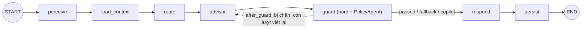
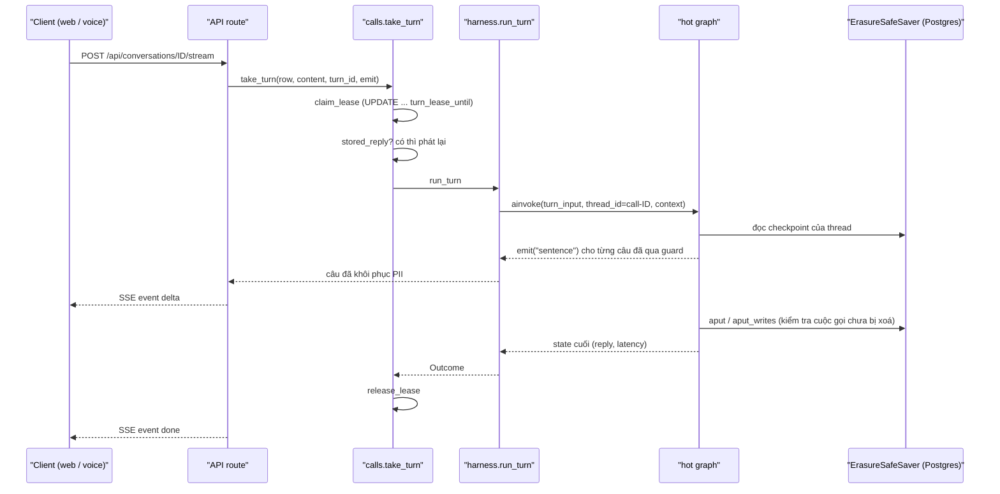
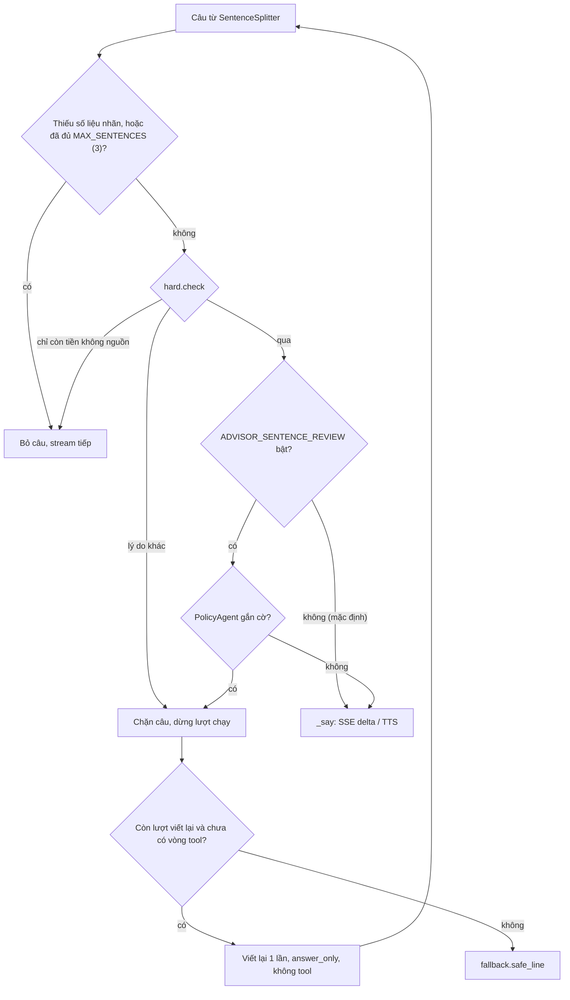
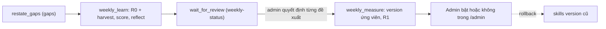

# 02. Vòng lặp harness

Trang này mô tả một lượt khách đi qua hệ thống như thế nào: hot graph LangGraph, cách chọn lane, vòng gọi tool của AdvisorAgent, các lớp guardrail, cách stream từng câu, cold path sau cuộc gọi và vòng cải tiến hằng tuần. Trang tổng quan: [00-tong-quan.md](00-tong-quan.md). Bộ nhớ xem [03-bo-nho.md](03-bo-nho.md), danh sách tool xem [04-tools.md](04-tools.md).

Viết tắt đường dẫn: `A/` = `apps/ai-agent-service/src/ai_agent_service/`. Số dòng ghi theo dạng `file:dòng`.

## 1. Tổng quan

| Vòng | Khi nào chạy | Ở đâu |
|---|---|---|
| Hot path | Mỗi lượt khách là **một lần gọi** `graph.ainvoke` trên hot graph, thread `call-<id>` | `A/runtime/harness.py:173-174`, `:273` |
| Cold path | Một lần khi cuộc gọi kết thúc (`hang_up`), không ai phải chờ nó | `A/runtime/calls.py:204-221`, `A/pipeline/cold/after_call.py` |
| Improvement loop | Mỗi tuần, thứ Hai lúc 02:00 (Asia/Ho_Chi_Minh) | `infra/airflow/dags/improvement_weekly.py:73` |

Hot graph được compile một lần cho mỗi process và dùng chung cho mọi cuộc gọi. Graph không giữ state riêng của cuộc gọi nào; state nằm trong checkpointer, theo từng thread (`A/pipeline/hot/graph.py:41-43`).

## 2. Hot graph

Graph có 7 node (`A/pipeline/hot/graph.py:38`). Cạnh có điều kiện là `after_guard` (`A/pipeline/hot/nodes.py:1646-1651`): đi tới `respond` khi verdict `passed`, khi có `fallback`, hoặc khi `mode == "copilot"`; các trường hợp còn lại quay về `advisor`.

| Node | Đọc | Ghi | Việc chính |
|---|---|---|---|
| `perceive` (`nodes.py:93`) | `HotContext.text`, `asr_confidence`, `vault` | `messages`, `flags`, `input_mode`, `call_facts`; reset `TURN_KEYS` | Lexicon cho ASR, làm sạch, NFC, ITN, token hoá PII; `asr_low_conf` khi confidence < `ASR_LOW_CONFIDENCE = 0.45` (`nodes.py:67`, `:136`) |
| `load_context` (`nodes.py:150`) | khoá kết nối, `keys_seen`, `awaiting` | `tier`, `customer_id`, `brief`, `brief_lines`, `knowledge`, `passages_read` | Xác định danh tính và dựng Call Brief (chi tiết ở [03-bo-nho.md](03-bo-nho.md)), rồi `kb.search` trên lời khách ở mọi lượt có lời |
| `route` (`nodes.py:501`) | `tier`, `flags`, bộ đếm lỗi, `awaiting` | `lane`, `route_rule`, `route_reason`, `route_notes` | Bảng luật ở mục 4 |
| `advisor` (`nodes.py:523`) | lát cắt state (`_agent_context`) | `draft`, `tool_results`, `quotes`, `working_summary`, `latency`, ... | Compaction, AdvisorAgent, stream từng câu đã kiểm tra (mục 5, 7) |
| `guard` (`nodes.py:1453`) | `draft`, `tool_results` | `guard`, `regen_count`, `block_reasons`, `safe_lines` | Hard check rồi PolicyAgent; bỏ qua khi bản nháp đã được stream |
| `respond` (`nodes.py:1657`) | `draft`, `tool_results`, `pending_purchase` | `reply`, `messages`, `handoff`, `suggestion`, `mode` | Bỏ dấu `[Bn]`; chèn câu bắc cầu sau `handoff.transfer`; ở copilot thì tạo gợi ý cho tư vấn viên |
| `persist` (`nodes.py:1727`) | toàn bộ state | `deletion_awaiting_for` | Ghi transcript và bảng `calls` qua `store` |

**HotState và HotContext** (`A/pipeline/hot/state.py`):

- `HotState` (`state.py:67`) là `TypedDict` được checkpoint theo `thread_id = call-<id>`. Chỉ lời khách **đã token hoá** được đưa vào `messages`. `TURN_KEYS` (`state.py:190-202`) được `perceive` xoá ở đầu mỗi lượt để bản nháp hay verdict của lượt trước không lọt sang lượt sau.
- `HotContext` (`state.py:205-249`) **không bao giờ được checkpoint**. Nó chứa văn bản thô, `caller_phone`, `vault` (bảng token ↔ giá trị thật), `identity_secret`, `arrived` (mốc bắt đầu tính TTFT), callback `emit`, và các collaborator `advisor`, `policy`, `compactor`, `harness`, `store`.

## 3. Trình tự một lượt lúc chạy

- **Lease:** `TURN_LEASE_SECONDS = 180` (`A/runtime/calls.py:38`). Lease được giành bằng một UPDATE có điều kiện (`calls.py:132-139`), nên mỗi cuộc gọi chỉ có một lượt chạy tại một thời điểm. Nếu lượt bị chết giữa chừng, lease tự hết hạn. Một `turn_id` đã có câu trả lời thì được phát lại, không chạy lại advisor (`calls.py:170-173`).
- **Checkpointer:** `ErasureSafeSaver` kế thừa `AsyncPostgresSaver`. Mỗi lần ghi checkpoint, nó gọi `require_writable_call` trong cùng transaction, nên không ghi được vào một cuộc gọi đã bị xoá dữ liệu (`A/runtime/db.py:167-187`).
- **SSE:** route `/stream` phát các event `start`, `delta`, `step`, `done` hoặc `error`, kèm keepalive mỗi `HEARTBEAT_SECONDS = 15` (`A/api/routes/conversations.py:36`, `:242-300`). Mỗi `delta` là một câu đã qua guard. Route `/turns` trả JSON (`conversations.py:237`).
- **Voice:** WebSocket `/api/conversations/{id}/voice` (`A/api/routes/voice.py:90`). Chuỗi xử lý: VAD Silero + Smart Turn → ASR cục bộ → lexicon → `harness.run_turn` (cùng lượt như chat) → TTS theo từng câu. Phía voice cũng giành lease, thử tối đa 20 lần, mỗi lần cách 0,25 s (`voice.py:531-544`).

## 4. Chọn lane

Luật nằm trong `A/components/orchestration/rules.py:101-114`. **Luật khớp đầu tiên thắng.** Mọi luật chỉ đọc state mà code biết chắc (bộ đếm lỗi, độ tin cậy ASR, tier, có brief hay không). Không luật nào đoán nội dung khách đang nói.

| # | Điều kiện | Lane |
|---|---|---|
| 1 | `tool_failures >= TOOL_FAILURES (2)`, hoặc `model_failures >= MODEL_FAILURES (2)`, hoặc một lần chuyển máy đang chờ số điện thoại và nay đã có số (`rules.py:39-41`) | `HANDOFF` |
| 2 | `asr_low_conf` | `CLARIFY` |
| 3 | tier `PROBABLE` / `AMBIGUOUS` và câu hỏi xác nhận chưa xong | `CONFIRM_IDENTITY` |
| 4 | `VERIFIED` và có brief | `CONTINUITY` |
| 5 | còn lại | `NEW` |

Lane có thể được thêm ghi chú: PB-10 khi khách đang bực, PB-11 khi `sessions_without_close >= 3`, và một ghi chú riêng cho số dùng chung chưa rõ là ai (`rules.py:47-55`, `:88-98`).

Tool theo lane (`apps/ai-agent-service/config/lanes.yaml`): `CLARIFY` và `CONFIRM_IDENTITY` không có tool nào. `NEW` và `CONTINUITY` có toàn bộ tool nghiệp vụ; riêng `CONTINUITY` có thêm `memory_get_episodes` và `memory_search_calls`. `HANDOFF` không có mục trong file vì harness tự chuyển máy, không qua model (`nodes.py:559-564`, `_transfer`). Knowledge base không phải tool của lane nào; `load_context` truy xuất trước. Chi tiết từng tool: [04-tools.md](04-tools.md).

## 5. Vòng tool của AdvisorAgent

AdvisorAgent dùng `langchain.agents.create_agent` (vòng ReAct) và không có state (`A/agents/advisor.py:1239-1290`). Thứ tự middleware (`advisor.py:1276-1287`):

1. `ChainLookupMiddleware`: khi model vừa tìm sản phẩm, harness tự tra giá và tồn kho trong một vòng của chính nó (chained lookup), nên tiết kiệm một vòng model (`A/mcp/tools.py:710-722`).
2. `ContextPromptMiddleware`: dựng system prompt cho mỗi lần gọi model.
3. `ModelRetryMiddleware`: `max_retries=1`, `initial_delay=1.0` (khi `retries` khác 0).
4. `ModelCallLimitMiddleware`: `run_limit = MODEL_CALLS_PER_RUN = 2`, `exit_behavior="error"`.
5. `ToolCallLimitMiddleware`: `run_limit = TOOL_CALLS_PER_RUN = 20`, `exit_behavior="continue"` (`advisor.py:1243-1245`).
6. `LaneToolsMiddleware`: chỉ đưa cho model các tool của lane hiện tại.
7. `StrictToolsMiddleware`: chỉ bật khi model là OpenAI.
8. `ActionGuardMiddleware`: guardrail trước khi thực thi (mục 6a).
9. `ToolGuardMiddleware`: timeout `DEFAULT_TIMEOUT = 2.0` s, riêng tool ghi là `WRITE_TIMEOUT = 10.0` s; retry 1 lần; circuit breaker mở sau 2 lỗi, giữ 60 s (`A/mcp/tools.py:376-399`).

**Lần gọi model cuối:** `_is_last` đúng khi `run_model_call_count >= model_limit - 1`, khi đang warm-up, hoặc khi ở chế độ `answer_only`. Lúc đó prompt được nối thêm câu "lần viết cuối", request dùng `tool_choice="none"`, và mọi tool call trong câu trả lời bị gỡ bỏ (`advisor.py:576-605`). Danh sách tool vẫn giữ nguyên để không làm trượt prompt cache (`advisor.py:587`). Với giới hạn 2, lượt điển hình là: lần 1 viết câu mở và gọi tool, lần 2 trả lời từ kết quả tool.

**Ghép context** (`prompt_parts`, `advisor.py:328-372`):

- Phần tĩnh: `HARD_RULES` cộng các skill. Skill nằm sẵn trong prompt khi `ADVISOR_SKILLS` tắt.
- Phần của lượt, theo đúng thứ tự: `skills` (chỉ khi nạp theo yêu cầu), `today`, `warnings`, `lane`, `products`, `earlier`, `basket`, `orders`, `offered`, `brief`, `summary`, `knowledge`, `playbook`, `tool_results`, `opening`, `blocked`, `no_handoff`, `call_state`.
- Với OpenAI, phần tĩnh là system message. Phần của lượt đi vào messages qua `with_turn_context`, để phần tiền tố được cache (`advisor.py:581-583`).

**Ngân sách token** (`A/components/context/budget.py`): `max_tokens=3000` (`advisor.py:328`). Đây là ngân sách mềm, chỉ áp cho phần của lượt. Token được ước lượng bằng `(len + 3) // 4` (`budget.py:33-34`). Các section trong `PROTECTED` không bao giờ bị cắt (`budget.py:16-17`). Các section không thuộc `PROTECTED` (`playbook`, `offered`) được giữ theo thứ tự cho tới khi hết ngân sách. Section bị cắt được ghi vào `prompt_stats`.

**Compaction** (`A/components/context/compact.py:30-33`): khi thread có hơn `THRESHOLD = 16` message, phần trước `KEEP_MESSAGES = 8` message cuối được gộp vào `working_summary` rồi bị xoá khỏi thread bằng `RemoveMessage` (`nodes.py:539-545`). Việc gộp dùng model `compactor` với structured output, 2 lần thử. Nếu lỗi thì gộp kiểu trích xuất: lấy câu đầu của mỗi lượt (`compact.py:76-88`).

## 6. Guardrails

### 6a. Trước khi thực thi tool ghi

`WRITE_TOOLS` gồm `order_create`, `order_update`, `schedule_callback`, `handoff_transfer`, `memory_request_deletion` (`A/components/guardrails/actions.py:35`). `actions.check` (`actions.py:57-138`) kiểm tra:

| Tool | Kiểm tra chính |
|---|---|
| mọi tool ghi ở `copilot` | luôn bị từ chối, vì tư vấn viên là người thao tác (`actions.py:118-119`) |
| `order_create` | có số điện thoại; tier cho phép; mã sản phẩm đáng tin; giá bằng báo giá hôm nay; tổng COD tối đa `COD_LIMIT_VND = 10_000_000` (`actions.py:38`); không trùng đơn trừ khi intent `one_more` |
| `order_update` | đơn thuộc khách (hoặc đơn tạo trong chính cuộc gọi này); không lặp lại thay đổi đã làm; còn trong hạn đổi trả; intent `change` |
| `schedule_callback` | giờ Việt Nam, không ở quá khứ, trong giờ làm việc (LN-01/LN-02) |
| `handoff_transfer` | ngoài lane `HANDOFF`, PolicyAgent đọc intent `handoff`; brief được điền và kiểm tra theo schema |
| `memory_request_deletion` | `VERIFIED` và khách đã đồng ý (intent `delete`, QT-06) |
| `order_status`, `crm_get_customer` (đọc dữ liệu riêng) | phải là `VERIFIED` (`actions.py:102-115`) |

**Đồng ý mua hàng** (`advisor.py:867-896`, `A/components/guardrails/purchase.py`):

1. `actions.check` qua thì harness tạo `purchase.draft` để đọc lại đơn.
2. PolicyAgent đọc intent `purchase` và chia theo band.
3. Nếu API không trả lời, harness dùng regex `YES` / `CONSENT`, và chỉ chấp nhận khi khách vừa nghe đúng đơn đó được đọc lại.
4. Nếu khách chưa đồng ý, tool trả lỗi `CONFIRMATION_REQUIRED` kèm `purchase_draft` để model đọc lại đơn.
5. Nếu đồng ý, `purchase.authorize` cấp một receipt có ký, sống `TTL_SECONDS = 300` (`purchase.py:23`).

Band intent `(có, không)` (`A/agents/policy.py:185-186`): `purchase (0.9, 0.3)`, `delete (0.9, 0.3)`, `handoff (0.8, 0.2)`, `change (0.8, 0.3)`, `one_more (0.8, 0.2)`, `other_model (0.7, 0.3)`. Chỉ một "có" rõ ràng mới được tính là đồng ý; kết quả "không chắc" được tính là không (`advisor.py:1050-1053`). Intent được hỏi qua `PolicyAgent.probability` với timeout của evaluator `1.5` s (`apps/ai-agent-service/config/models.yaml:359`).

### 6b. Hard check trên câu trả lời

`A/components/guardrails/hard.py:192-215` chỉ dùng code, không gọi model. Các nhóm kiểm tra: PII thô hoặc dãy 10–14 chữ số; token PII không thuộc cuộc gọi này; thông tin nội bộ (giá nhập, biên lợi nhuận...); tự nhận là người thật; mã đơn hoặc giá trong brief khi tier dưới `VERIFIED`; khuyến mãi chưa bắt đầu (KM-02); và mọi số tiền phải có nguồn (`_money`). Hàm trả về mọi lý do cùng lúc, không chỉ lý do đầu tiên. Hard check chạy trên **từng câu** khi stream.

### 6c. PolicyAgent (soft review)

PolicyAgent gọi OpenAI Decisions API (`POST /v1/decisions`, model `gpt-6-luna`) (`A/llm/decisions.py:3`, `models.yaml:355-359`). Nó chỉ đọc `PolicyInput`: câu đang xét, kết quả tool, tier, đoạn chính sách, những gì đã xác lập trước trong cuộc gọi và lời khách. Nó không đọc brief hay hội thoại của advisor (`policy.py:7-11`, `:210-225`). Có 10 câu hỏi, mỗi câu một ngưỡng (`policy.py:70-92`):

| Câu hỏi | Ngưỡng | Câu hỏi | Ngưỡng |
|---|---|---|---|
| `over_promise` | 0.8 | `unsupported_fact` | 0.9 |
| `stale_policy` | 0.9 | `false_transfer` | 0.65 |
| `competitor` | 0.9 | `unbacked_action` | 0.8 |
| `unsupported_absence` | 0.8 | `claims_human` | 0.8 |
| `false_pressure` | 0.9 | `unquoted_price` | 0.8 |

`review` dùng `REVIEW_TIMEOUT = 5.0` s (`policy.py:55`). Nếu API không trả lời, bản nháp được cho qua chỉ với hard check, và verdict ghi `decided_by = "skipped:<code>"` (`policy.py:292-294`).

> **Hiện trạng:** ở chế độ `speak`, câu trả lời được stream và node `guard` trả `{}` (`nodes.py:1463-1464`). Review từng câu chỉ chạy khi `ADVISOR_SENTENCE_REVIEW=1`, và cờ này mặc định tắt (`A/mcp/tools.py:803-805`, `nodes.py:1281-1286`). Vì vậy, mặc định câu nói với khách **chỉ qua hard check**. PolicyAgent vẫn chạy cho intent trước tool ghi (6a) và cho toàn bộ bản nháp ở `copilot` (`nodes.py:1478-1487`). Ở `copilot`, verdict đi kèm gợi ý dưới dạng cảnh báo, không viết lại.

### 6d. Viết lại, câu an toàn, chuyển người

`MAX_REGENERATIONS = 1` (`nodes.py:60`). Trong lượt stream, câu bị chặn được viết lại **một lần**, và chỉ khi lượt chạy đó chưa có vòng tool. Lần viết lại ở chế độ `answer_only`, không có tool, đi tiếp từ những câu khách đã nghe (`nodes.py:1083-1091`). Nếu vẫn bị chặn, harness nói `fallback.safe_line` theo lane (`A/components/guardrails/fallback.py:21`, `:71-79`). Nếu lượt đó đã tạo đơn, câu nói là `order_placed`. Mỗi lượt chỉ có một câu đính chính (`nodes.py:1078-1082`).

Khi model lỗi lần đầu, harness nói `model_error` ("nhắc lại giúp em"). Lần thứ `MODEL_FAILURES = 2` liên tiếp thì harness tự chuyển máy ngay trong lượt (`nodes.py:590-603`). Lỗi hạ tầng của tool được đếm vào `tool_failures`, và luật 1 đưa lượt sau sang `HANDOFF`. Câu an toàn **không** phải lý do chuyển người (`rules.py:9-11`).

`MAX_SENTENCES = 3` (`hard.py:38`). Riêng khi đọc lại đơn (`ORDER_SUMMARY`), câu trả lời được dài hơn (`nodes.py:1354`).

## 7. Stream từng câu và voice

`_streamed` (`nodes.py:1039`) đọc event từ `advisor.stream`. `SentenceSplitter` (`A/components/guardrails/stream.py`) cắt câu tại `.`, `!`, `?` hoặc `…` có khoảng trắng theo sau. Câu dài quá `MAX_SENTENCE = 200` ký tự thì bị cắt (`stream.py:21`). `_offer` kiểm tra từng câu rồi gọi `_say`, và `_say` đẩy câu qua `emit("sentence")`. Khi có vòng tool, harness có thể phát `filler` hoặc `hold_line` (`nodes.py:1176-1193`).

**TTFT:** `_say` ghi `first_token_ms` là thời điểm token đầu tiên của **câu đầu tiên được nói** được sinh ra. Mốc bắt đầu là lúc request tới backend (`HotContext.arrived`). Câu bị chặn không được tính, filler cũng không (`nodes.py:1421-1435`). Harness trả `ttft_ms = first_token_ms`, hoặc `total_ms` nếu không có câu nào (`A/runtime/harness.py:291-305`). Riêng voice còn đo TTFA: từ lúc VAD báo khách ngừng nói tới byte audio đầu tiên rời server (`voice.py:18-27`).

**Barge-in** (`A/components/voice/turns.py`, `A/components/voice/policy.py`, `models.yaml:375-385`):

- Khách nói liên tục `barge_in_ms = 400` thì playback tạm dừng.
- Lời nhận được chỉ được coi là ngắt lời khi có ít nhất `min_interruption_words = 2` từ và không chỉ gồm từ đệm ("dạ", "vâng"). Một lệnh đơn trong `INTERRUPT_COMMANDS` ("dừng", "thôi"...) cũng ngắt được (`policy.py:28`, `:33-47`).
- Sau `false_interruption_ms = 2500` mà chưa nghe ra từ nào, playback tiếp tục.
- Endpointing mặc định là `smart` (Smart Turn, `probe_ms = 200`, trần `max_silence_ms = 1200`) (`turns.py:121-130`).

## 8. Cold path sau cuộc gọi

`after_call` (`A/pipeline/cold/after_call.py:53-98`):

1. Nếu trong cuộc gọi khách xin xoá dữ liệu (QT-06), harness thực hiện xoá dưới role `admin` và không ghi gì.
2. Nếu không, MemoryAgent `extract` các fact ứng viên.
3. Bước `gate` chỉ ghi cho khách đã được xác nhận: `VERIFIED` ghi trực tiếp; `PROBABLE` chỉ ghi dạng *unconfirmed*; `AMBIGUOUS` không ghi gì.
4. `commit` qua `memory.commit_facts`, sau đó `summarize` thành một dòng episode.
5. QaAgent gắn tag cho cuộc gọi. Chi tiết ở [03-bo-nho.md](03-bo-nho.md).

Kích hoạt (`A/runtime/jobs.py:60-71`): nếu không có `JOBS_QUEUE_URL`, `after_call` chạy như một task trong chính process API. Nếu có, harness gửi một message lên SQS cho worker. Hàng `calls` được đánh dấu `memory_status = 'pending'` trước khi gửi, và cứ mỗi `SWEEP_SECONDS = 60` có một lượt quét nhặt lại các cuộc gọi chưa được ghi nhớ (`jobs.py:26`, `:74-96`).

## 9. Vòng cải tiến

Có hai cơ chế (`A/pipeline/improve/cli.py:1-43`):

- **Reflection** (đổi skill):
  1. `harvest`: grader của BTC tìm lỗi, không dùng model.
  2. `score`: QaAgent chấm theo rubric và phân loại `not_followed` / `skill_gap`.
  3. `reflect`: ReflectionAgent viết lesson card. Khi ít nhất `MIN_SUPPORT = 3` khách cùng chung một bài học (`A/components/improvement/lessons.py:37`), nó soạn một câu thay đổi skill. Câu này qua bộ lọc bằng code và `PolicyAgent.review_change` (`CHANGE_THRESHOLD = 0.8`, `CHANGE_TIMEOUT = 45.0` s, `policy.py:58`, `:136`).
  4. `publish`: một người duyệt trong file review rồi xuất bản thành skills version mới. `rollback --to N` đưa skills về một version cũ (`cli.py:142-143`).
  - ApprovalAgent chỉ quyết định thay người duyệt khi tập học có ghi bài học mong đợi. Nếu không, thay đổi chờ người duyệt (`cli.py:376-382`, `:519-531`).
- **Knowledge Gap Loop** (đổi knowledge base): `gaps` viết lại từng câu hỏi chưa trả lời được thành câu độc lập, gộp các câu cùng nghĩa (`SAME_CANDIDATE = 0.75`, `A/components/improvement/gaps.py:138`), rồi xuất bản các câu trả lời đã có.

**Vòng hằng tuần** (`A/pipeline/improve/weekly.py`, `infra/airflow/dags/improvement_weekly.py:49-55`, `:81-90`): đo R0 với skill đang dùng → học → chờ admin → đo R1 với version ứng viên. Vòng này **không bao giờ tự bật version**; admin bật trong `/admin`. Một vòng chờ quá `REVIEW_DAYS = 7` ngày thì hết hạn (`weekly.py:36`). Sensor poll mỗi 30 phút, tối đa 8 ngày. Khi không có Airflow, `infra/improve/run.py` chạy đúng các lệnh `STEPS` đó qua `learn` và `tick`.

## 10. Đánh giá

`run_eval.py` chỉ gọi tiếp `A/pipeline/eval/cli.py:main` (`run_eval.py:22-24`). Có hai cấu hình, `full` và `baseline_no_memory` (`A/pipeline/eval/cli.py:119`), khác nhau ở đúng một switch `memory`, và switch này chỉ có `retrieve` đọc (`A/pipeline/eval/runner.py:21-27`, `:74`). Khi không truyền `--config`, cả hai chạy và script `eval/reference_eval.py` của BTC in bảng kết quả (`A/pipeline/eval/report.py:171-184`). Mỗi lần chạy dùng DB riêng có hậu tố `*_eval` và checkpointer trong bộ nhớ, nên không lẫn với dữ liệu của API.

## 11. Model theo vai trò

Nguồn: `apps/ai-agent-service/config/models.yaml:81-211`, `:355-359`. Mặc định `temperature: 0.0` (`:50`), nhưng nhiều agent ghi đè bằng `null`.

| Vai trò | Provider / model | Ghi chú |
|---|---|---|
| `advisor` | openai / `gpt-5.6-luna` | `reasoning_effort: none`, `max_tokens: 2048` (`:85-105`) |
| `policy` (evaluator) | OpenAI Decisions / `gpt-6-luna` | `timeout: 1.5` (`:355-359`) |
| `compactor` | openai / `gpt-4.1-mini` | (`:136-140`) |
| `memory` | openai / `gpt-4.1-mini` | sau cuộc gọi (`:128-132`) |
| `qa` | openai / `gpt-5.6-luna` | `reasoning_effort: medium` (`:148-156`) |
| `knowledge` | openai / `gpt-5.6-luna` | offline (`:161-168`) |
| `reflection`, `approval` | openai / `gpt-6.1-terra` | Responses API (`:182-201`) |
| `simulator` | openai / `gpt-4.1-mini` | `temperature: 0.3` (`:206-211`) |
| `extractor` (chỉ cho eval) | openai / `gpt-5.6-luna` | (`:111-122`) |

`AGENT_PROFILE=local` (`models.yaml:219-237`) chuyển `advisor`, `memory`, `compactor` sang `google_genai / gemini-3.5-flash-lite`, và `simulator` sang `gemini-3.1-flash-lite`. `qa`, `reflection`, `approval` giữ nguyên model.

## 12. Cờ mặc định tắt

| Biến | Mặc định | Khi bật thì |
|---|---|---|
| `ADVISOR_SENTENCE_REVIEW` (`A/mcp/tools.py:803-805`) | `0` | PolicyAgent review từng câu đã nói, chạy song song với stream; câu bị gắn cờ dẫn tới một câu đính chính |
| `ADVISOR_EARLY_INTENTS` (`A/agents/policy.py:174-178`) | `0` | Hỏi trước `EARLY_INTENTS` (`purchase`, `handoff`, `delete`, `one_more`, `other_model`) ở đầu lượt, khi lane có tool ghi |
| `ADVISOR_SKILLS` (`A/components/context/skills.py:82-85`) | `0` | Skill được nạp theo yêu cầu qua `load_skill` (`MAX_LOADED = 3`) thay vì nằm sẵn trong prompt |
| `ADVISOR_PRODUCT_ADVISE` (`A/mcp/tools.py:667-669`) | `0` | Thêm tool `product_advise` cho lane `NEW` / `CONTINUITY` |
| `ADVISOR_FIRST_CLAUSE` (`A/mcp/tools.py:797-800`) | `0` | Trên hotline, nói vế đầu của câu trước, khi vế đó dài ít nhất 20 ký tự và 4 từ (`stream.py:31-32`) |
| `VOICE_FILLER` (`A/api/routes/voice.py:619`) | khác `"1"` | TTS đọc câu đệm "chờ em một xíu" khi vòng tool bắt đầu |
| `VOICE_HOLD_MS` (`A/api/routes/voice.py:236`) | `0` | Sau N ms không nghe thấy gì trong lúc đang tra cứu, nói câu chờ theo tool (`fallback.HOLD_BY_TOOL`) |
| `REVIEW_HEAD_START_MS` (`A/config/config_manager.py:76-79`) | `0` (nói ngay) | Cho review chạy trước N ms rồi mới nói câu; chỉ có tác dụng khi review từng câu đang bật |
| `HANDOFF_AUTO_ACCEPT` (`A/config/config_manager.py:64-74`) | tắt | Hệ thống tự nhận cuộc chuyển máy (`accepted_by = "auto"`), cuộc gọi giữ `speak` thay vì `copilot`; dùng cho chạy thử |

> **Hiện trạng / Hướng tới:** cạnh `guard → advisor` của graph chỉ được dùng khi advisor không stream (advisor không có `stream`) ở chế độ `speak`. Với AdvisorAgent hiện tại, việc viết lại diễn ra bên trong node `advisor` (`_streamed`). Ở `copilot` thì không viết lại. Các cờ ở mục 12 tắt vì chưa đo được ảnh hưởng lên metric chấm điểm; quyết định thiết kế xem [06-quyet-dinh-thiet-ke.md](06-quyet-dinh-thiet-ke.md), triển khai xem [05-trien-khai.md](05-trien-khai.md), hệ thống tổng thể xem [01-he-thong.md](01-he-thong.md).
