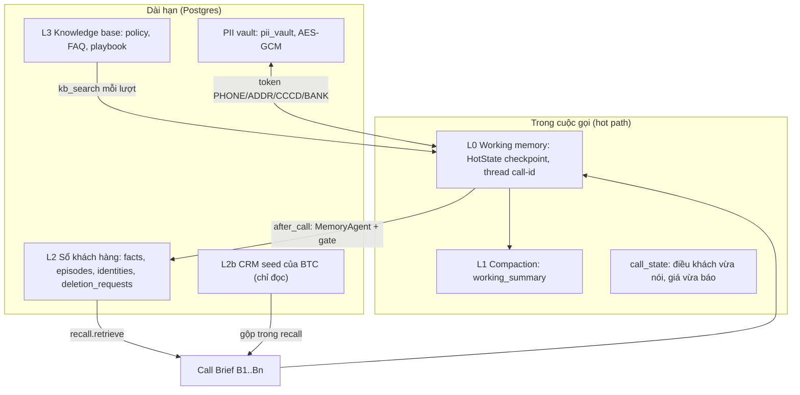
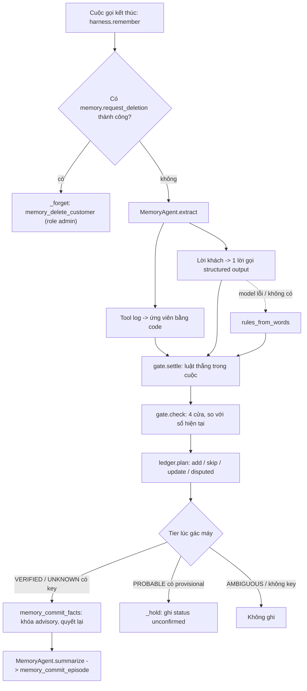
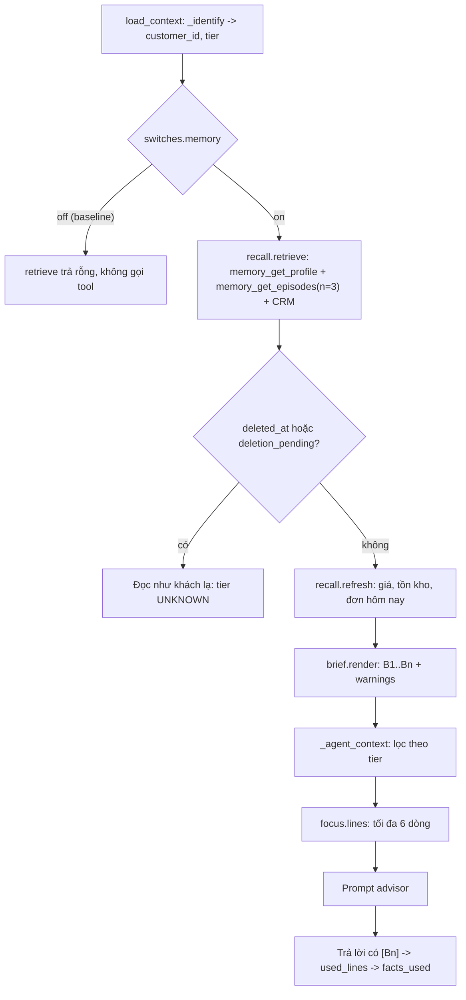

# 03. Thiết kế bộ nhớ

Tài liệu này mô tả agent nhớ gì, nhớ ở đâu, ai được ghi, ai được đọc, và quên như thế nào. Mọi hằng số dưới đây đọc trực tiếp từ code; đường dẫn viết tương đối so với gốc repo, `A/` là `apps/ai-agent-service/src/ai_agent_service/`. Đồ thị hot path chi tiết ở [02-vong-lap-harness.md](02-vong-lap-harness.md), bảng tool ở [04-tools.md](04-tools.md), lý do của từng lựa chọn ở [06-quyet-dinh-thiet-ke.md](06-quyet-dinh-thiet-ke.md).

Nguyên tắc chung: **model đề xuất, code quyết định**. Không có đường nào để model tự ghi vào sổ khách hàng. Chỉ role `memory_writer` (MemoryAgent chạy sau cuộc gọi) được gọi `memory_commit_facts`, và mọi ứng viên phải qua cổng bằng code trước.

## 1. Các tầng bộ nhớ

| Tầng | Lưu ở đâu | Sống bao lâu | Nguồn trong code |
|---|---|---|---|
| L0 Working memory | Checkpoint LangGraph trong Postgres, `thread_id = call-<id>`; `ErasureSafeSaver` khóa dòng `calls` (`FOR UPDATE`) trước mỗi lần ghi và từ chối ghi khi `memory_status = 'deleted'` | Một cuộc gọi | `A/runtime/db.py:167-187`, `A/runtime/harness.py:173-174` |
| L0 `call_state` | Trong `HotState.call_facts`: các slot khách nói trong cuộc (`room_area_m2`, `has_children`, `child_age_months`, `budget_vnd`, `quantity`, `size`, `color`, `payment`, `delivery_area`, `blocker`, `preferred_channel`), sản phẩm vừa báo giá, câu hỏi đang chờ khách trả lời | Một cuộc gọi | `A/pipeline/hot/call_state.py:17-45` |
| L1 Compaction | `HotState.working_summary` | Một cuộc gọi | `A/components/context/compact.py` |
| L2 Sổ khách hàng | Bảng `facts`, `episodes`, `identities`, `deletion_requests` của `mcp-memory` | Theo TTL từng slot | `A/mcp/servers/memory.py:61-131` |
| L2b CRM seed | Dữ liệu BTC, đọc qua `crm_get_customer`; không bao giờ ghi | Cố định | `A/components/memory/recall.py:53-66` |
| L3 Knowledge base | Policy `*.md` của BTC, `kb_chunks`, vector trong pgvector | Theo cửa sổ hiệu lực | `A/components/knowledge/`, `A/mcp/servers/knowledge.py` |
| PII vault | Bảng `pii_vault`, mỗi token một dòng, giá trị mã hóa | Theo cuộc gọi, xóa cùng khách | `A/runtime/db.py:91-103`, `A/runtime/vault.py` |

### L1: nén hội thoại dài

`needs_compact` trả về đúng khi thread có **hơn 16** message (`THRESHOLD = 16`, so sánh `>`); khi đó mọi message trừ **8** message cuối (`KEEP_MESSAGES = 8`, tức bốn lượt gần nhất) được gập vào `working_summary` và xóa khỏi thread bằng `RemoveMessage` (`A/components/context/compact.py:31-61`, `A/pipeline/hot/nodes.py:538-545`). Có model `compactor` thì một lời gọi structured output (`attempts=2`) viết năm mục: sản phẩm đã bàn, giá đã báo trong cuộc, lựa chọn của khách, câu còn mở, điều đã hứa. Model lỗi hoặc không có thì gập kiểu trích xuất: câu đầu của mỗi lượt cũ, cắt 160 ký tự (`compact.py:64-88`). `call_state` không bị gập, nên điều khách đã nói không bị mất dù cuộc gọi dài bao nhiêu.

## 2. Ontology: sổ nhớ được phép giữ gì

`A/components/memory/ontology.py` định nghĩa bốn loại (`Kind`, dòng 30): `preference`, `business_event`, `past_event`, `open_note`. Loại quyết định ai thắng khi mâu thuẫn. Tên slot giữ nguyên tên của BTC vì bộ chấm so khớp chuỗi.

Ký hiệu nguồn ghi: **tool** là đọc từ tool log bằng code (`from_tools`, `A/agents/memory.py:342-403`); **khách** là lời khách qua model hoặc luật dự phòng; **NV** là lời nhân viên (chỉ qua model); **hệ thống** là kết quả cuộc gọi khi không tool nào chốt (`_outcome_from_words`, `A/agents/memory.py:422-440`). TTL trống nghĩa là không hết hạn. "Nhạy cảm" là `sensitive=True`: không bao giờ đọc cho người nghe dưới VERIFIED.

| Slot | Kind | TTL (ngày) | Nhạy cảm | Nguồn ghi |
|---|---|---|---|---|
| `product_advised` | business_event | | | tool (`pricing.get_quote`, `order.create`, `order.update`) |
| `alt_suggested` | business_event | | | tool (sản phẩm báo giá khác) |
| `variant_sku` | preference | | | tool |
| `size` | preference | | | tool (biến thể), khách |
| `color` | preference | | | tool (biến thể), khách |
| `price_quoted_vnd` | business_event | | có | tool (`final_price_vnd`); lời khách chỉ thành `disputed` |
| `quoted_on` | business_event | | | tool |
| `quoted_sku` | business_event | | | tool |
| `promo_code` | business_event | | | tool |
| `promo_expiry` | business_event | | | tool (`end` do `btc.enrich` thêm) |
| `budget_vnd` | preference | | | khách |
| `blocker` | preference | 30 | | khách |
| `decision_maker` | preference | 30 | | khách |
| `callback_at` | past_event | 30 | | tool (`schedule.callback`) |
| `outcome` | past_event | 30 | | tool (`order.create`, `schedule.callback`, `handoff.transfer`), hệ thống |
| `order_id` | past_event | | có | tool (`order.create`) |
| `order_ids` | past_event | | có | tool (gộp, không trùng) |
| `payment` | preference | | | tool (tham số `order.create`), khách |
| `address_token` | preference | 180 | có | khách (chỉ token `<ADDR_n>`) |
| `delivery_area` | preference | 180 | | khách |
| `quantity` | preference | 30 | | khách |
| `owned_sku` | business_event | | | tool (`crm.get_customer`) |
| `phone_provided` | preference | | | khách (chỉ `true`, không ghi số) |
| `preferred_channel` | preference | | | khách |
| `callback_time` | preference | 30 | | khách |
| `competitor_price_vnd` | preference | 30 | | khách |
| `objection` | preference | 30 | | khách |
| `objection_handling` | past_event | 30 | | NV |
| `sentiment` | preference | 30 | | khách |
| `commitments` | past_event | 30 | | NV |
| `room_area_m2` (gia-dung) | preference | | | khách |
| `has_children` (gia-dung) | preference | | | khách |
| `usage_need` (thoi-trang) | preference | | | khách |
| `child_age_months` (me-be) | preference | | | khách |
| `note` (ghi chú mở) | open_note | | | khách |

Nguồn: `A/components/memory/ontology.py:63-137`. Danh sách slot model được phép gọi tên là `FROM_WORDS` (dòng 156-160); slot tool ghi không nằm trong đó, nên model không thể bịa mã đơn hay giá. `ASKED_ONCE` (dòng 146-150) là tập slot thành `must_not_ask` của brief.

## 3. Đường ghi (cold path)

### 3.1 Trích xuất (`A/agents/memory.py`)

- **Từ tool log, bằng code** (`from_tools`, dòng 342-403): chỉ đọc lời gọi `ok` và không bị guard chặn. Sản phẩm chính là sản phẩm của đơn cuối, không có đơn thì là báo giá đầu tiên; giá, `quoted_on`, `promo_code`, `promo_expiry` lấy từ đúng báo giá của sản phẩm đó, bỏ qua khuyến mãi loại `freeship`/`freecod`.
- **Từ lời nói, một lời gọi structured output** (`_from_words`, dòng 267-292): schema `CallMemory` gồm danh sách `Observation(slot, value, said_by, turn, confidence)` và `sentiment`. Code loại quan sát có slot ngoài `FROM_WORDS`, có `said_by` sai (chỉ `commitments`, `objection_handling` là của nhân viên), hoặc trỏ tới lượt không có thật, rồi ép kiểu bằng `coerce`.
- **Dự phòng bằng luật**: không có model, thiếu key hoặc lời gọi lỗi thì `rules_from_words` (dòng 165-231) chạy thay. Khi không có đơn, luật còn bù `blocker`, `decision_maker` nếu model bỏ sót (`BACKSTOP`, dòng 162, 259-260).
- Mỗi ứng viên mang `extractor` (`rules-0.3` hoặc `model-<tên>-<sha prompt>`, dòng 59 và 250), là một phần khóa idempotency.

### 3.2 Cổng bốn cửa (`A/components/memory/gate.py`)

| Cửa | Điều kiện dừng | Dòng |
|---|---|---|
| `noise` | giá trị rỗng, `confidence < MIN_CONFIDENCE` (0.6), chuỗi không phải tool mà còn dãy số 9-14 chữ số (PII lọt), slot không có trong ontology | 37, 121-129 |
| `under_cap` | ghi chú mở thứ 11: `OPEN_NOTE_CAP = 10` mỗi khách | 33, 125-126 |
| `valid_format` | sai kiểu (`coerce`) hoặc ngoài `RANGES`: `budget_vnd` 100.000 đến 1.000.000.000; `price_quoted_vnd`, `competitor_price_vnd` 1.000 đến 1.000.000.000; `room_area_m2` 3 đến 500; `child_age_months` 0 đến 72; `quantity` 1 đến 100 | 39-46, 130-135 |
| `wins` | khách nói về một bản ghi nghiệp vụ mà không có gì để phản bác, hoặc trùng với bản ghi: **khách không bao giờ tự lập một bản ghi** | 136-143 |

Ai thắng (`settle`, dòng 74-105): với `preference`, lời mới nhất của khách thắng (ưu tiên customer > tool > system > agent); với `business_event`/`past_event` (`RECORDS`), tool > system > agent, còn lời khách trái với bản ghi được giữ nguyên như một **claim** và `check` đánh dấu `disputed=True` (dòng 144).

### 3.3 Kế hoạch và commit

`ledger.plan` (`A/components/memory/ledger.py:48-69`): chưa có giá trị thì `add`; trùng thì `skip`; khác thì `update` (đóng dòng cũ, mở dòng mới); claim bị tranh chấp thì `add` với `disputed`. `valid_to = on + ttl_days` (dòng 54-55). `plan_writes` còn vô hiệu hóa `promo_code`/`promo_expiry` cũ khi có báo giá mới không kèm khuyến mãi, và `variant_sku` cũ khi sản phẩm đổi (`A/pipeline/cold/after_call.py:231-249`).

`memory_commit_facts` (`A/mcp/servers/memory.py:355-450`) là cửa duy nhất vào bảng `facts`:

1. Một transaction, `pg_advisory_xact_lock(hashtextextended('memory:<customer_id>', 0))`: hai cuộc gọi của cùng khách kết thúc cùng lúc sẽ xếp hàng (dòng 376).
2. `_not_deleted`: khách đã có tombstone thì từ chối (dòng 543-545).
3. Quyết lại trên dữ liệu hiện tại: giá trị đang active trùng thì bỏ qua; khác thì đóng dòng cũ (`invalidated`, `valid_to = on`, `superseded_by`) và chèn dòng mới (dòng 415-450). Sổ chỉ chèn, không ghi đè, không xóa.
4. Thứ tự theo `source.observed_at` (giờ của lượt nói, `after_call.py:179-180`): một tab cũ hay finalizer chậm không thay được fact mới hơn (`memory.py:424-428`).
5. Idempotency bằng index: `facts_once_idx` trên `(customer_id, slot, call_id, turn, extractor_version)` và `_already` kiểm tra trước, nên chạy lại `after_call` không ghi hai lần; `facts_active_slot_idx` chỉ cho một dòng active mỗi slot (trừ `open_note`) (dòng 81-92, 453-460).

Sau facts là episode: `summarize` dựng một dòng bằng template, ví dụ "Cuộc 2 (15/10, hotline): tư vấn ... khách cần hỏi chồng", kèm `goal`, `open_items`, `outcome`; `memory_commit_episode` upsert theo `(customer_id, call_id)` (`A/agents/memory.py:294-325`, `A/mcp/servers/memory.py:511-540`).

### 3.4 Nhánh theo tier lúc gác máy

| Tình huống | Hành vi | Nguồn |
|---|---|---|
| VERIFIED | Xác nhận key đã thấy, ghi facts và episode cho đúng khách | `after_call.py:146-202` |
| UNKNOWN có key | Tạo khách mới `N-xxxxx-xxxxx` trên key (ưu tiên key từ kết nối), rồi ghi như trên | `after_call.py:158-167`, `memory.py:324-352` |
| UNKNOWN không key | Bỏ qua ("anonymous") | `after_call.py:161-162` |
| Không VERIFIED nhưng có `provisional.customer_id` | Coi là PROBABLE: facts ghi với `status = 'unconfirmed'`, cạnh facts của khách, không đè; cuộc VERIFIED sau xác nhận hoặc phủ nhận qua `memory_settle_unconfirmed` | `after_call.py:79-92, 121-143`, `memory.py:404-414, 470-508` |
| PROBABLE/AMBIGUOUS không có liên kết tạm | Không ghi cho ai | `after_call.py:149-150` |
| Có yêu cầu xóa | Không trích xuất, chạy `_forget` (mục 7) | `after_call.py:72-74` |

Ghi giữa cuộc: với kênh `web`, bật memory và tier VERIFIED, sau mỗi lượt harness gọi `remember(call_id, finalize=False)`, tức `extract` rồi `_remember(..., episode=False)`: facts được ghi ngay, episode và QA để lúc kết thúc (`A/runtime/harness.py:287-289, 601-608`). Finalizer giữ lease `turn_lease_until` 5 phút, gia hạn mỗi 30 giây; lúc khởi động, `remember_unfinished` chạy lại tối đa 20 cuộc đã kết thúc trong 2 ngày mà chưa nhớ xong (`harness.py:516-555, 621-633`).

## 4. Đường đọc

- **Retrieve** (`A/components/memory/recall.py:42-81`): `memory_get_profile` chỉ trả fact có `status` thuộc `active`, `disputed`, `unconfirmed` và `valid_from <= on <= valid_to` (`A/mcp/servers/memory.py:170-175`). Phiên CRM gộp vào danh sách episode với `source: "crm"`, đơn CRM gộp với `order_id`/`order_ids` trong sổ.
- **Refresh** (`recall.py:109-192`), chạy trong ngân sách latency của Call Brief, sinh cảnh báo không bao giờ bị cắt khỏi prompt:

| Cảnh báo | Điều kiện | Dòng |
|---|---|---|
| Khuyến mãi đã hết | `promo_code` đã báo không còn trong `applied_promos` của `pricing_get_quote` hôm nay | 144-153 |
| Giá đã đổi | `final_price_vnd` khác giá đã báo (và không phải do khuyến mãi hết) | 154-158 |
| Không tra được giá | `pricing_get_quote` không trả lời | 159-160 |
| Ngừng bán / hết hàng | `inventory_check`: `discontinued` (kèm `successor_sku`) hoặc `in_stock is False` (kèm `restock_expected`) | 161-167 |
| Liên hệ kênh khác | Lần liên hệ mới nhất ở kênh khác, mới hơn lần gần nhất ở kênh này | 195-212 |
| Cũ | Lần liên hệ gần nhất cách hơn `STALE_DAYS = 180` ngày | 39, 186-191 |

- **Render** (`A/components/memory/brief.py:139-301`): brief là hàm thuần của sổ, dựng từ template, không do model viết. Mỗi dòng `B<i>` mang `fact_ids` của đúng slot nó nêu (dòng 257). Dòng báo giá, dòng đơn, dòng fact `disputed` ("Cần xác nhận lại...") và dòng `unconfirmed` luôn `sensitive=True`.
- **Lọc theo tier** (`A/pipeline/hot/nodes.py:676-686`): PROBABLE chỉ thấy dòng không nhạy cảm; dưới PROBABLE không thấy dòng nào; `warnings`, `must_not_ask` và `customer_id` chỉ đưa vào khi VERIFIED (dòng 700, 710-711). Đây là lọc dữ liệu, không phải lời dặn trong prompt.
- **Focus** (`A/components/context/focus.py:22-59`): ở lượt đầu, lượt không nhận ra chủ đề hoặc sau khi bị chặn, brief giữ nguyên; còn lại giữ dòng loại `open`/`other` và điền theo chủ đề tới `MAX_LINES = 6`. Số thứ tự dòng không đổi nên `[Bn]` vẫn truy được. `ADVISOR_CONTEXT=full` tắt focus.
- **Trích dẫn**: `lines_used` tách `[Bn]` khỏi câu trả lời (`nodes.py:85-87`); `facts_used` đi `Bn -> fact_ids -> slot` (`A/pipeline/eval/trace.py:78-82`, `brief.used_slots` ở `brief.py:63-68`).
- **Công tắc memory**: `switches.memory` (`A/pipeline/hot/state.py:57`). Tắt thì không đọc CRM, `retrieve` trả rỗng (`recall.py:44-45`, `nodes.py:452-459`): cùng một đồ thị, chỉ khác một bit, dùng làm baseline khi đánh giá.

## 5. Các mức định danh

`A/components/identity/resolver.py:88-95` (`decide`) là bảng tier. Key (số điện thoại, `zalo_id`, `fb_id`) được băm bằng HMAC-SHA256 với secret dẫn xuất (`derived_key("identity")`), lấy 32 ký tự hex, trước mọi lần tra cứu; bảng `identities` chỉ chứa digest (`resolver.py:69-75`, `A/runtime/vault.py:21-23`). Chỉ giữ 4 số cuối để hiển thị.

| Tier | Khi nào | Model thấy | Bị giữ lại |
|---|---|---|---|
| VERIFIED | Key từ kết nối khớp đúng một khách, hoặc khớp đã được xác nhận trong cuộc | Brief (sau focus), cảnh báo, `must_not_ask`, `customer_id` | Không |
| PROBABLE | Key khách tự đọc giữa cuộc khớp một khách | Chỉ dòng không nhạy cảm; lane `CONFIRM_IDENTITY` hỏi một câu xác nhận | Giá, địa chỉ, mã đơn, cảnh báo, `must_not_ask`, `customer_id` |
| AMBIGUOUS | Một key khớp từ hai khách trở lên (số dùng chung) | Không có dòng brief; câu hỏi tên cố định | Toàn bộ brief |
| UNKNOWN | Không khớp | Không có dòng brief; lane `NEW` | Toàn bộ brief |

## 6. Dữ liệu cá nhân (PII)

- **Token hóa** (`A/components/intake/pii.py:39-44, 169-185`): số điện thoại thành `<PHONE_n>`, CCCD 12 số bắt đầu bằng 0 thành `<CCCD_n>`, số tài khoản 9-14 chữ số thành `<BANK_n>`, địa chỉ (cụm từ báo hiệu + mốc hành chính hoặc tên tỉnh) thành `<ADDR_n>`. Model, checkpoint, transcript, trace chỉ thấy token.
- **Vault** (`A/runtime/vault.py:26-59`): mỗi token một dòng `pii_vault(call_id, token, kind, value_enc, customer_id, said)`, mã hóa AES-GCM với nonce 12 byte và khóa `derived_key("pii-vault")`. Nạp trước lượt, lưu phần mới sau lượt.
- **Tool nhận giá trị thật, model thì không**: `ToolGuardMiddleware._with_context` điền `customer_phone` từ context và thay token `<ADDR_n>` bằng địa chỉ thật trước khi tool chạy; `visible_result` token hóa lại kết quả trước khi model đọc (`A/mcp/tools.py:508-547, 883-904`).
- **Trả lại cho khách (PB-08)**: `for_customer` khôi phục theo từng câu: số điện thoại để nguyên trong câu xác nhận giao hàng hoặc khi chính khách vừa đọc nó, ngoài ra chỉ còn 3 số cuối (`PHONE_TAIL = 3`); địa chỉ của khách được khôi phục; CCCD và số tài khoản chỉ còn `****` cộng 4 ký tự cuối (`pii.py:207-250`).
- Cổng ghi chặn mọi ứng viên không phải tool còn chứa dãy số dài (`gate.py:123-124`); `address_token` chỉ nhận token `<ADDR_n>` (`ontology.py:230-232`).

## 7. Quyền được quên (QT-06)

1. Khách yêu cầu, nhân viên xác nhận lại, advisor gọi `memory_request_deletion`: chỉ ghi một dòng `deletion_requests`, báo khách dữ liệu sẽ xóa trong 72 giờ; khách chưa định danh thì lỗi `NOT_IDENTIFIED` (`A/mcp/servers/memory.py:548-577`).
2. Từ lúc đó `memory_get_profile` trả `deletion_pending = true`, `recall.retrieve` coi như đã quên (`recall.py:50-51`) và brief đọc khách như người lạ (`nodes.py:461-464`).
3. `after_call` thấy yêu cầu thành công thì không trích xuất gì, chạy `_forget`: chỉ khi tier VERIFIED; không có role `admin` thì để `deletion_pending` chờ (`A/pipeline/cold/after_call.py:101-118`).
4. `memory_delete_customer` (role `admin`, `memory.py:580-658`), trong một transaction dưới advisory lock: từ chối `DELETION_BUSY` khi còn lượt đang chạy; xóa `facts`, `episodes`, `identities`, `pii_vault`, `turns` của các cuộc liên quan; che giá trị PII trong `mock_state`; gỡ mọi liên kết khách trên dòng `calls` và đặt `memory_status = 'deleted'`; xóa checkpoint `call-<id>`.
5. **Tombstone**: dòng `deletion_requests` giữ `done_at`, xóa `reason` và `call_id` (dòng 647-654). `_not_deleted` chặn mọi lần ghi muộn cho khách này, `deleted_at` khiến cuộc sau đọc như khách lạ dù CRM của BTC vẫn còn số đó.

## 8. Knowledge base (bộ nhớ truy xuất)

### 8.1 Corpus

| Nguồn | Cách cắt | Nguồn trong code |
|---|---|---|
| Policy của BTC, `data/btc/policy/*.md` | Một chunk cho mỗi mục `## [XX-nn]` (99 mục), `chunk_id` là mã mục; tiêu đề tài liệu và tiêu đề mục được ghép vào văn bản đánh chỉ mục | `A/components/knowledge/corpus.py:32, 127-134, 148-174` |
| FAQ/playbook đã duyệt, `data/kb/v<N>.jsonl` | Một dòng một entry; lúc khởi động `sync_release` chép vào `kb_chunks` với `scope = 'release'` | `corpus.py:288-300`, `A/mcp/servers/knowledge.py:83-114` |
| Entry chiến dịch | Lấy `valid_from`/`valid_to` và sản phẩm từ `promotions.json`; chiến dịch không phải khuyến mãi mà không có `valid_to` bị từ chối | `corpus.py:246-264` |

### 8.2 Tìm kiếm lai

Tham số ở `apps/ai-agent-service/config/knowledge.yaml` (dòng 5-31), nạp vào `Settings` (`A/components/knowledge/search.py:68-79`):

| Thành phần | Giá trị |
|---|---|
| BM25 trên âm tiết và cặp âm tiết, có và không dấu | `k1 = 1.2`, `b = 0.75`, `accents: true` (`A/components/knowledge/lexical.py`) |
| Embedding | `multilingual-e5-small` (`Xenova/multilingual-e5-small`, ONNX int8 `onnx/model_quantized.onnx`, 2 luồng CPU), tiền tố `query: ` / `passage: ` (`A/components/knowledge/semantic.py:56`) |
| Lưu và tìm vector | Thiết kế: Postgres với **pgvector**, cạnh bảng `kb_chunks`; điểm là cosine giữa vector câu hỏi và vector đoạn. Hiện trạng: vector được tính trong tiến trình `mcp-knowledge`, cache trên đĩa, cosine tính ngay trong tiến trình (`A/components/knowledge/semantic.py`) |
| Hợp nhất | Reciprocal Rank Fusion, `fusion_k = 60`: mỗi bảng xếp hạng cộng `1/(k + rank)` (`lexical.py:117-129`) |
| Số đoạn trả về | `top_k = 5`; hot path gọi `k=5`, tool giới hạn `MAX_K = 8` |
| Ngưỡng từ chối | `abstain_cosine = 0.829` trên cosine của đoạn tốt nhất; chế độ chỉ từ khóa dùng `abstain_coverage = 0.0` (tắt) |

Ngoài hai bảng xếp hạng chính, `search` thêm bảng ưu tiên playbook đúng `situation` và entry viết cho sản phẩm đang bàn (`search.py:196-204`).

### 8.3 Lọc theo metadata và hết hạn

- **Cửa sổ hiệu lực từ changelog của BTC** (`corpus.py:73-80`): CL-01 tách chính sách đổi trả thành hai bản: `DT-OLD-*` có `valid_to = 2026-09-30`, `DT-01`..`DT-07` có `valid_from = 2026-10-01`. Tài liệu có "HẾT HIỆU LỰC từ dd/mm/yyyy" trong tiêu đề hết hiệu lực từ ngày trước đó (`corpus.py:177-183`). Các mục CL-02..CL-05 chỉ đi kèm chunk để giải thích, không mở cửa sổ.
- **Ngày dùng để lọc**: `day = order_date or on` (`search.py:205`). `on` là ngày của cuộc gọi; khi câu hỏi về một đơn đã có, `_order_days` lấy ngày của đơn được nhắc (theo mã đơn hoặc tên sản phẩm), ngày khách tự nói ("đơn đặt ngày 28/9"), hoặc đơn mới nhất kèm danh sách ngày các đơn khác để báo `version_differs` (`A/pipeline/hot/nodes.py:199-217`).
- **Lọc trước top-k**: đoạn không còn hiệu lực bị loại **trước khi** lấy `[:k]`, nên số liệu cũ không tới được model và đoạn đang hiệu lực được nhận chỗ; id bị loại chỉ ghi vào `withheld` cho trace, kèm `explains` là mục changelog giải thích (`search.py:206-222`).
- **`restricted`**: tài liệu có tiêu đề chứa "NỘI BỘ" hoặc "không dùng để tư vấn khách", cộng mục `KM-06` (sàn giá). Văn bản chỉ trả cho role `admin`; role khác nhận mã đoạn và chỉ dẫn từ chối, hoặc chuyển sang tool (`NB-02` sang `inventory_check`) (`corpus.py:38-46`, `knowledge.py:217`, `search.py:56-59, 236-252`).
- **Ngành hàng và sản phẩm**: mỗi chunk mang `industry` (`gia-dung`, `thoi-trang`, `me-be`) theo tiền tố hoặc mã (`corpus.py:84-93`). Lúc tìm, entry có `applies_to` (SKU, `category:...`) cho sản phẩm khác với sản phẩm cuộc gọi đang bàn bị loại (`_fits`, `search.py:230-232`).
- **Lý do từ chối** (`search.py:275-286`): `no_match` khi không có đoạn hoặc cosine dưới ngưỡng; `restricted` khi đoạn tốt nhất là nội bộ và không có tool thay; `absence` khi câu của đoạn mà câu hỏi nhắm tới nói "không có thông tin" hoặc cấm nói (`ABSENCE`, dòng 50-53).
- **Khuyến mãi**: `btc.enrich` thêm `end` và `name` cho mỗi khuyến mãi trong kết quả `pricing.get_quote` và `pricing.quote_order` (`A/mcp/servers/btc.py:256-277`); `end` thành `promo_expiry` trong sổ. Khuyến mãi đã hết thành cảnh báo trong `recall.refresh` (mục 4). Khuyến mãi chưa bắt đầu không bao giờ được nhắc, kể cả bằng ngày bắt đầu trong câu nói về khuyến mãi: hard guard KM-02 (`A/components/guardrails/hard.py:264-278`).
- **TTL của facts là bộ lọc lúc đọc**: hết `valid_to` thì `memory_get_profile` không trả fact đó, nhưng dòng vẫn nằm trong sổ; không có job xóa (`memory.py:170-175`).
- **Phiên bản tri thức và rollback**: `version` trong `knowledge.yaml` (hiện là `0`, file rỗng: chỉ corpus của BTC) trỏ tới `data/kb/v<N>.jsonl`; `sync_release` làm cho các dòng `release` của `kb_chunks` khớp đúng file đó, nên rollback là đổi con trỏ rồi khởi động lại. Thiếu file là lỗi, không phải base rỗng (`corpus.py:293-300`). Khi entry demo hoặc FAQ thay đổi, writer phát `kb:changed` trên Valkey (`AGENT_REDIS_URL`), mỗi `mcp-knowledge` đánh dấu index cũ và dựng lại ở lần tìm kế tiếp; kiểm tra dấu thời gian mỗi `REFRESH_SECONDS = 10` giây là đường dự phòng (`A/components/knowledge/notify.py:1-30`, `knowledge.py:70, 181-205, 352`, `A/components/knowledge/faq.py:127, 138`).

Triển khai Postgres và Valkey: xem [05-trien-khai.md](05-trien-khai.md). Tổng quan hệ thống: [01-he-thong.md](01-he-thong.md), mục lục: [00-tong-quan.md](00-tong-quan.md).
