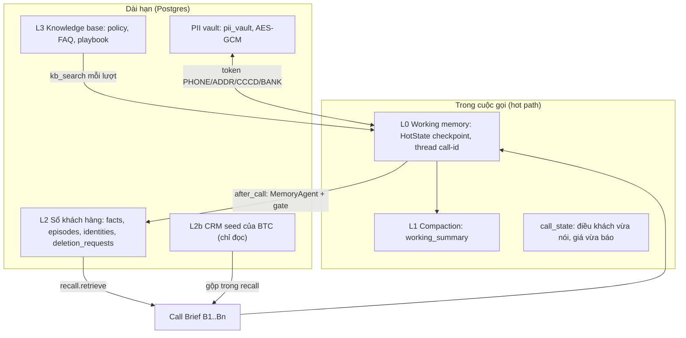
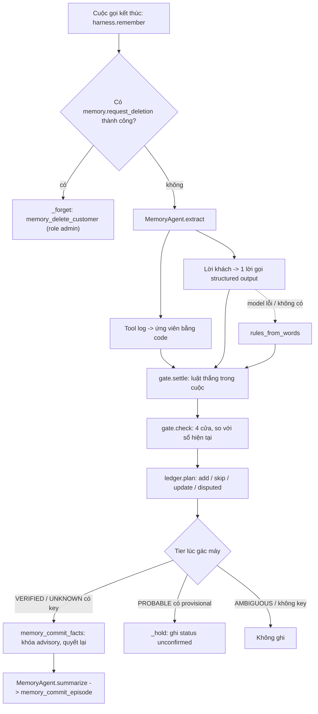
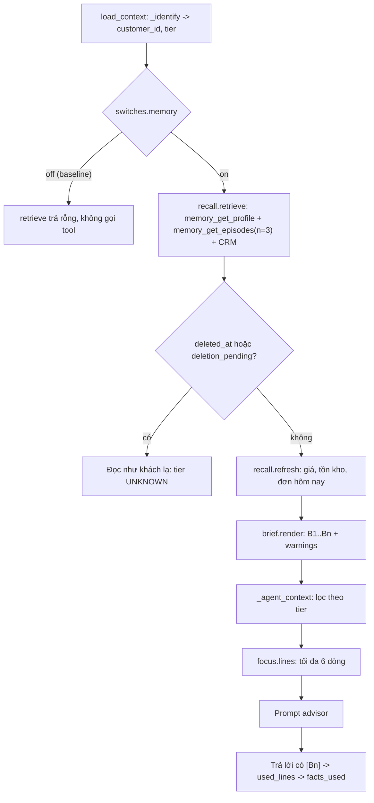
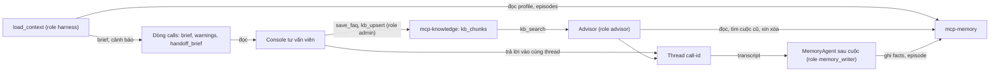

# 03. Thiết kế bộ nhớ

Tài liệu này mô tả agent nhớ gì, nhớ ở đâu, ai được ghi, ai được đọc, và quên như thế nào. Mọi hằng số dưới đây đọc trực tiếp từ code; đường dẫn viết tương đối so với gốc repo, `A/` là `apps/ai-agent-service/src/ai_agent_service/`. Đồ thị hot path chi tiết ở [02-vong-lap-harness.md](02-vong-lap-harness.md), bảng tool ở [04-tools.md](04-tools.md), lý do của từng lựa chọn ở [06-quyet-dinh-thiet-ke.md](06-quyet-dinh-thiet-ke.md).

Nguyên tắc chung: **model đề xuất, code quyết định**. Không có đường nào để model tự ghi vào sổ khách hàng. Chỉ role `memory_writer` (MemoryAgent chạy sau cuộc gọi) được gọi `memory_commit_facts`, và mọi ứng viên phải qua cổng bằng code trước.

## 1. Các tầng bộ nhớ



| Tầng | Lưu ở đâu | Sống bao lâu | Nguồn trong code |
|---|---|---|---|
| L0 Working memory | Checkpoint LangGraph trong Postgres, `thread_id = call-<id>`; `ErasureSafeSaver` khóa dòng `calls` (`FOR UPDATE`) trước mỗi lần ghi và từ chối ghi khi `memory_status = 'deleted'` | Một cuộc gọi | `A/runtime/db.py:167-187`, `A/runtime/harness.py:173-174` |
| L0 `call_state` | Trong `HotState.call_facts`: các slot khách nói trong cuộc (`room_area_m2`, `has_children`, `child_age_months`, `budget_vnd`, `quantity`, `size`, `color`, `payment`, `delivery_area`, `blocker`, `preferred_channel`), sản phẩm vừa báo giá, câu hỏi đang chờ khách trả lời | Một cuộc gọi | `A/pipeline/hot/call_state.py:17-45` |
| L1 Compaction | `HotState.working_summary` | Một cuộc gọi | `A/components/context/compact.py` |
| L2 Sổ khách hàng | Bảng `facts`, `episodes`, `identities`, `deletion_requests` của `mcp-memory` | Theo TTL từng slot | `A/mcp/servers/memory.py:61-131` |
| L2b CRM seed | Dữ liệu BTC, đọc qua `crm_get_customer`; không bao giờ ghi | Cố định | `A/components/memory/recall.py:53-66` |
| L3 Knowledge base | Policy `*.md` của BTC, `kb_chunks`, vector trong pgvector | Theo cửa sổ hiệu lực | `A/components/knowledge/`, `A/mcp/servers/knowledge.py` |
| PII vault | Bảng `pii_vault`, mỗi token một dòng, giá trị mã hóa | Theo cuộc gọi, xóa cùng khách | `A/runtime/db.py:91-103`, `A/runtime/vault.py` |

### L1: nén hội thoại dài

`needs_compact` trả về đúng khi thread có **hơn 16** message (`THRESHOLD = 16`, so sánh `>`); khi đó mọi message trừ **8** message cuối (`KEEP_MESSAGES = 8`, tức bốn lượt gần nhất) được gập vào `working_summary` và xóa khỏi thread bằng `RemoveMessage` (`A/components/context/compact.py:31-61`, `A/pipeline/hot/nodes.py:538-545`). Có model `compactor` thì một lời gọi structured output (`attempts=2`) viết năm mục: sản phẩm đã bàn, giá đã báo trong cuộc, lựa chọn của khách, câu còn mở, điều đã hứa. Model lỗi hoặc không có thì gập kiểu trích xuất: câu đầu của mỗi lượt cũ, cắt 160 ký tự (`compact.py:64-88`). `call_state` không bị gập, nên điều khách đã nói không bị mất dù cuộc gọi dài bao nhiêu.

### Đối chiếu tầng bộ nhớ của đề (C.1 "Thiết kế lớp bộ nhớ")

Đề đặt tên bốn tầng; tên L0..L3 ở trên là tên trong code. Bảng dưới nối từng tầng của đề với chỗ hiện thực.

| Tầng của đề | Đề yêu cầu | Hiện thực trong repo | Nguồn |
|---|---|---|---|
| M1 Working | Ngữ cảnh lượt hiện tại: khách vừa nói gì, điều gì đang chờ xác nhận | `HotState` trong checkpoint của thread `call-<id>`. `call_facts` (11 slot trong `KEPT`) được nạp lại mỗi lượt, lời mới nhất thắng, và đưa vào prompt thành "Khách đã nói trong cuộc này (không hỏi lại): ...", "Sản phẩm vừa báo giá: ...", "Em đang chờ khách trả lời: <câu hỏi cuối của agent>". Phần đang chờ xác nhận: `awaiting` (`confirm` cho PROBABLE, `name` cho AMBIGUOUS), `pending_purchase` (đơn đã đọc lại, chờ khách đồng ý, biên nhận hết hạn sau `TTL_SECONDS = 300`), `deletion_awaiting_for` (yêu cầu xóa chờ xác nhận lại) | `A/pipeline/hot/call_state.py:17-45`, `A/pipeline/hot/nodes.py:139, 714`, `A/pipeline/hot/state.py:85, 104, 138, 152`, `A/components/guardrails/purchase.py:23` |
| M1 Episodic | Tóm tắt mỗi cuộc, ví dụ "Cuộc 1 (12/03): tư vấn model X, báo 4.89tr, khách hẹn hỏi chồng" | Bảng `episodes`, một dòng mỗi `(customer_id, call_id)`, kèm `channel`, `started_at`, `goal`, `open_items`, `outcome`, `source_turn_span`. Dòng tóm tắt dựng bằng template, không do model viết: `Cuộc {n} ({dd/mm}, {kênh}): tư vấn {sku} {giá} kèm {KM}, gợi ý thêm {sku}, chốt đơn {mã}, hẹn gọi lại {lúc}, khách {blocker}`, ví dụ trong code: "Cuộc 1 (15/10, hotline): tư vấn SKU-AP-Y 5.200.000đ kèm GIFT-FILTER, khách cần hỏi chồng". Brief đọc 3 episode gần nhất | `A/agents/memory.py:25-26, 294-325` (template ở dòng 313), `A/mcp/servers/memory.py:104-121`, `A/components/memory/recall.py:48` |
| M1 Profile | Sự thật bền: phòng 25m², có con nhỏ, ngân sách khoảng 5tr | Bảng `facts`, slot `preference` không có TTL: `room_area_m2 = 25`, `has_children = true`, `child_age_months`, `budget_vnd = 5000000` ("tầm 5 triệu" ép kiểu thành số nguyên VND). Chúng cũng nằm trong `ASKED_ONCE`, nên thành `must_not_ask` của brief | `A/components/memory/ontology.py:78-80, 122-137, 146-150`, mục 2 |
| M2 Semantic/KB | Giá, tồn kho, khuyến mãi còn hiệu lực, chính sách đổi trả qua RAG | Chính sách, FAQ, playbook, chiến dịch: knowledge base tìm lai, lọc cửa sổ hiệu lực trước top-k (mục 8). Giá, tồn kho, khuyến mãi không lấy từ sổ hay KB mà hỏi tool theo ngày cuộc gọi: `recall.refresh` gọi `pricing_get_quote`, `inventory_check`, `order_status` cho mọi thứ brief nhắc lại (mục 4) | `A/components/memory/recall.py:109-192`, `A/components/knowledge/search.py:205-222` |

## 2. Ontology: sổ nhớ được phép giữ gì

`A/components/memory/ontology.py` định nghĩa bốn loại (`Kind`, dòng 30): `preference`, `business_event`, `past_event`, `open_note`. Loại quyết định ai thắng khi mâu thuẫn. Tên slot giữ nguyên tên của BTC vì bộ chấm so khớp chuỗi.

Ký hiệu nguồn ghi: **tool** là đọc từ tool log bằng code (`from_tools`, `A/agents/memory.py:342-403`); **khách** là lời khách qua model hoặc luật dự phòng; **NV** là lời nhân viên (chỉ qua model); **hệ thống** là kết quả cuộc gọi khi không tool nào chốt (`_outcome_from_words`, `A/agents/memory.py:422-440`). TTL trống nghĩa là không hết hạn. "Nhạy cảm" là `sensitive=True`: không bao giờ đọc cho người nghe dưới VERIFIED.

| Slot | Kind | TTL (ngày) | Nhạy cảm | Nguồn ghi |
|---|---|---|---|---|
| `product_advised` | business_event | | | tool (`pricing.get_quote`, `order.create`, `order.update`) |
| `alt_suggested` | business_event | | | tool (sản phẩm báo giá khác) |
| `variant_sku` | preference | | | tool |
| `size` | preference | | | tool (biến thể), khách |
| `color` | preference | | | tool (biến thể), khách |
| `price_quoted_vnd` | business_event | | có | tool (`final_price_vnd`); lời khách chỉ thành `disputed` |
| `quoted_on` | business_event | | | tool |
| `quoted_sku` | business_event | | | tool |
| `promo_code` | business_event | | | tool |
| `promo_expiry` | business_event | | | tool (`end` do `btc.enrich` thêm) |
| `budget_vnd` | preference | | | khách |
| `blocker` | preference | 30 | | khách |
| `decision_maker` | preference | 30 | | khách |
| `callback_at` | past_event | 30 | | tool (`schedule.callback`) |
| `outcome` | past_event | 30 | | tool (`order.create`, `schedule.callback`, `handoff.transfer`), hệ thống |
| `order_id` | past_event | | có | tool (`order.create`) |
| `order_ids` | past_event | | có | tool (gộp, không trùng) |
| `payment` | preference | | | tool (tham số `order.create`), khách |
| `address_token` | preference | 180 | có | khách (chỉ token `<ADDR_n>`) |
| `delivery_area` | preference | 180 | | khách |
| `quantity` | preference | 30 | | khách |
| `owned_sku` | business_event | | | tool (`crm.get_customer`) |
| `phone_provided` | preference | | | khách (chỉ `true`, không ghi số) |
| `preferred_channel` | preference | | | khách |
| `callback_time` | preference | 30 | | khách |
| `competitor_price_vnd` | preference | 30 | | khách |
| `objection` | preference | 30 | | khách |
| `objection_handling` | past_event | 30 | | NV |
| `sentiment` | preference | 30 | | khách |
| `commitments` | past_event | 30 | | NV |
| `room_area_m2` (gia-dung) | preference | | | khách |
| `has_children` (gia-dung) | preference | | | khách |
| `usage_need` (thoi-trang) | preference | | | khách |
| `child_age_months` (me-be) | preference | | | khách |
| `note` (ghi chú mở) | open_note | | | khách |

Nguồn: `A/components/memory/ontology.py:63-137`. Danh sách slot model được phép gọi tên là `FROM_WORDS` (dòng 156-160); slot tool ghi không nằm trong đó, nên model không thể bịa mã đơn hay giá. `ASKED_ONCE` (dòng 146-150) là tập slot thành `must_not_ask` của brief.

## 3. Đường ghi (cold path)



### 3.1 Trích xuất (`A/agents/memory.py`)

- **Từ tool log, bằng code** (`from_tools`, dòng 342-403): chỉ đọc lời gọi `ok` và không bị guard chặn. Sản phẩm chính là sản phẩm của đơn cuối, không có đơn thì là báo giá đầu tiên; giá, `quoted_on`, `promo_code`, `promo_expiry` lấy từ đúng báo giá của sản phẩm đó, bỏ qua khuyến mãi loại `freeship`/`freecod`.
- **Từ lời nói, một lời gọi structured output** (`_from_words`, dòng 267-292): schema `CallMemory` gồm danh sách `Observation(slot, value, said_by, turn, confidence)` và `sentiment`. Code loại quan sát có slot ngoài `FROM_WORDS`, có `said_by` sai (chỉ `commitments`, `objection_handling` là của nhân viên), hoặc trỏ tới lượt không có thật, rồi ép kiểu bằng `coerce`.
- **Dự phòng bằng luật**: không có model, thiếu key hoặc lời gọi lỗi thì `rules_from_words` (dòng 165-231) chạy thay. Khi không có đơn, luật còn bù `blocker`, `decision_maker` nếu model bỏ sót (`BACKSTOP`, dòng 162, 259-260).
- Mỗi ứng viên mang `extractor` (`rules-0.3` hoặc `model-<tên>-<sha prompt>`, dòng 59 và 250), là một phần khóa idempotency.

### 3.2 Cổng bốn cửa (`A/components/memory/gate.py`)

| Cửa | Điều kiện dừng | Dòng |
|---|---|---|
| `noise` | giá trị rỗng, `confidence < MIN_CONFIDENCE` (0.6), chuỗi không phải tool mà còn dãy số 9-14 chữ số (PII lọt), slot không có trong ontology | 37, 121-129 |
| `under_cap` | ghi chú mở thứ 11: `OPEN_NOTE_CAP = 10` mỗi khách | 33, 125-126 |
| `valid_format` | sai kiểu (`coerce`) hoặc ngoài `RANGES`: `budget_vnd` 100.000 đến 1.000.000.000; `price_quoted_vnd`, `competitor_price_vnd` 1.000 đến 1.000.000.000; `room_area_m2` 3 đến 500; `child_age_months` 0 đến 72; `quantity` 1 đến 100 | 39-46, 130-135 |
| `wins` | khách nói về một bản ghi nghiệp vụ mà không có gì để phản bác, hoặc trùng với bản ghi: **khách không bao giờ tự lập một bản ghi** | 136-143 |

Ai thắng (`settle`, dòng 74-105): với `preference`, lời mới nhất của khách thắng (ưu tiên customer > tool > system > agent); với `business_event`/`past_event` (`RECORDS`), tool > system > agent, còn lời khách trái với bản ghi được giữ nguyên như một **claim** và `check` đánh dấu `disputed=True` (dòng 144).

### 3.3 Kế hoạch và commit

`ledger.plan` (`A/components/memory/ledger.py:48-69`): chưa có giá trị thì `add`; trùng thì `skip`; khác thì `update` (đóng dòng cũ, mở dòng mới); claim bị tranh chấp thì `add` với `disputed`. `valid_to = on + ttl_days` (dòng 54-55). `plan_writes` còn vô hiệu hóa `promo_code`/`promo_expiry` cũ khi có báo giá mới không kèm khuyến mãi, và `variant_sku` cũ khi sản phẩm đổi (`A/pipeline/cold/after_call.py:231-249`).

`memory_commit_facts` (`A/mcp/servers/memory.py:355-450`) là cửa duy nhất vào bảng `facts`:

1. Một transaction, `pg_advisory_xact_lock(hashtextextended('memory:<customer_id>', 0))`: hai cuộc gọi của cùng khách kết thúc cùng lúc sẽ xếp hàng (dòng 376).
2. `_not_deleted`: khách đã có tombstone thì từ chối (dòng 543-545).
3. Quyết lại trên dữ liệu hiện tại: giá trị đang active trùng thì bỏ qua; khác thì đóng dòng cũ (`invalidated`, `valid_to = on`, `superseded_by`) và chèn dòng mới (dòng 415-450). Sổ chỉ chèn, không ghi đè, không xóa.
4. Thứ tự theo `source.observed_at` (giờ của lượt nói, `after_call.py:179-180`): một tab cũ hay finalizer chậm không thay được fact mới hơn (`memory.py:424-428`).
5. Idempotency bằng index: `facts_once_idx` trên `(customer_id, slot, call_id, turn, extractor_version)` và `_already` kiểm tra trước, nên chạy lại `after_call` không ghi hai lần; `facts_active_slot_idx` chỉ cho một dòng active mỗi slot (trừ `open_note`) (dòng 81-92, 453-460).

Sau facts là episode: `summarize` dựng một dòng bằng template, ví dụ "Cuộc 2 (15/10, hotline): tư vấn ... khách cần hỏi chồng", kèm `goal`, `open_items`, `outcome`; `memory_commit_episode` upsert theo `(customer_id, call_id)` (`A/agents/memory.py:294-325`, `A/mcp/servers/memory.py:511-540`).

### 3.4 Nhánh theo tier lúc gác máy

| Tình huống | Hành vi | Nguồn |
|---|---|---|
| VERIFIED | Xác nhận key đã thấy, ghi facts và episode cho đúng khách | `after_call.py:146-202` |
| UNKNOWN có key | Tạo khách mới `N-xxxxx-xxxxx` trên key (ưu tiên key từ kết nối), rồi ghi như trên | `after_call.py:158-167`, `memory.py:324-352` |
| UNKNOWN không key | Bỏ qua ("anonymous") | `after_call.py:161-162` |
| Không VERIFIED nhưng có `provisional.customer_id` | Coi là PROBABLE: facts ghi với `status = 'unconfirmed'`, cạnh facts của khách, không đè; cuộc VERIFIED sau xác nhận hoặc phủ nhận qua `memory_settle_unconfirmed` | `after_call.py:79-92, 121-143`, `memory.py:404-414, 470-508` |
| PROBABLE/AMBIGUOUS không có liên kết tạm | Không ghi cho ai | `after_call.py:149-150` |
| Có yêu cầu xóa | Không trích xuất, chạy `_forget` (mục 7) | `after_call.py:72-74` |

Ghi giữa cuộc: với kênh `web`, bật memory và tier VERIFIED, sau mỗi lượt harness gọi `remember(call_id, finalize=False)`, tức `extract` rồi `_remember(..., episode=False)`: facts được ghi ngay, episode và QA để lúc kết thúc (`A/runtime/harness.py:287-289, 601-608`). Finalizer giữ lease `turn_lease_until` 5 phút, gia hạn mỗi 30 giây; lúc khởi động, `remember_unfinished` chạy lại tối đa 20 cuộc đã kết thúc trong 2 ngày mà chưa nhớ xong (`harness.py:516-555, 621-633`).

### 3.5 M1: ghi gì và không ghi gì (tránh rác trong bộ nhớ)

| Được ghi | Không được ghi | Cơ chế | Nguồn |
|---|---|---|---|
| Slot có trong ontology | Slot lạ, chuyện ngoài lề không thành slot | Model chỉ được gọi tên slot trong `FROM_WORDS`; quan sát khác bị bỏ; cửa `noise` chặn slot ontology không biết | `A/agents/memory.py:280-281`, `gate.py:127-129` |
| Lời khách cho slot khách nói (nhu cầu, lựa chọn, việc còn dở) | Giá, mã đơn, khuyến mãi, lịch gọi lại do model hay khách "nhớ" | Slot nghiệp vụ chỉ đọc từ tool log bằng code (`from_tools`); lời khách về một bản ghi không bao giờ tự lập bản ghi (cửa `wins`) | `A/agents/memory.py:342-403`, `gate.py:136-144` |
| Quan sát gắn đúng người nói và đúng lượt có thật | Quan sát gán sai người nói hoặc trỏ tới lượt không tồn tại | `said_by` phải là `customer`, trừ `commitments`/`objection_handling` là của nhân viên; `(turn, speaker)` phải có trong transcript | `A/agents/memory.py:276-284` |
| Điều khách khẳng định | Câu đùa, giả định, nhu cầu của người thứ ba | Model tự chấm `confidence`; dưới `MIN_CONFIDENCE = 0.6` thì bị cửa `noise` chặn | `gate.py:37, 121-122` |
| Token `<ADDR_n>`, cờ `phone_provided = true` | Số điện thoại, CCCD, số tài khoản dạng thô | Ứng viên không phải tool còn dãy 9-14 chữ số thì bị chặn; `address_token` chỉ nhận token | `gate.py:123-124`, `ontology.py:230-232` |
| Giá trị đúng kiểu, trong khoảng hợp lý | "Ngân sách 5 đồng", "phòng 2.500 m²" | `coerce` theo `value_type`, `RANGES` | `gate.py:39-46, 130-135` |
| Tối đa 10 ghi chú mở mỗi khách | Ghi chú thứ 11, ghi chú trùng | `OPEN_NOTE_CAP`; `ledger.plan` bỏ qua ghi chú đã có | `gate.py:33, 125-126`, `ledger.py:59-61` |
| Cuộc của khách đã VERIFIED (hoặc khách mới có key) | Cuộc AMBIGUOUS, ẩn danh; khách có yêu cầu xóa trong cuộc hoặc đã có tombstone | Nhánh theo tier (mục 3.4), `requested_deletion`, `_not_deleted` | `after_call.py:72-74, 146-162`, `memory.py:543-545` |

### 3.6 M1: khách đổi ý ("thôi anh lấy màu trắng")

Yêu cầu: thông tin cũ phải bị vô hiệu, không bao giờ có hai giá trị mâu thuẫn cùng sống. Có ba lớp, mỗi lớp bằng code:

1. **Trong cuộc, ở working memory**: `call_state.heard` gộp dict, lời của lượt mới đè slot cũ (`A/pipeline/hot/call_state.py:23-26`), nên prompt chỉ còn màu mới.
2. **Trong cuộc, trước khi ghi**: `gate.settle` xếp ứng viên theo lượt; với `preference` ưu tiên customer (3) > tool (2) > system (1) > agent (0) và so bằng `>=`, nên lời khách muộn hơn thắng; mỗi slot chỉ còn một người thắng (`gate.py:74-105`).
3. **Giữa các cuộc, trong sổ**: `ledger.plan` thấy giá trị khác đang active thì ra `update` kèm `replaces = <fact_id cũ>` (`ledger.py:62-69`); `memory_commit_facts` dưới advisory lock đóng dòng cũ (`status = 'invalidated'`, `valid_to = on`, `superseded_by = <fact_id mới>`) rồi chèn dòng mới (`memory.py:415-449`). Index `facts_active_slot_idx` (unique trên `(customer_id, slot)` với `status = 'active' AND kind <> 'open_note'`, `memory.py:91-92`) biến một lần ghi đôi thành lỗi, nên hai màu active cùng lúc là không thể ở mức cơ sở dữ liệu. `memory_get_profile` không trả dòng `invalidated` (`memory.py:170-172`).

Ví dụ đổi màu: đen sang trắng trong một cuộc, rồi đổi lại giữa hai cuộc (luật dự phòng, `COLOUR` ở `A/agents/memory.py:134`, giá trị viết thường không dấu như catalog):

| Thời điểm | Sự kiện | Sổ `facts` sau đó |
|---|---|---|
| Cuộc 1, lượt 3 | Khách: "chị lấy màu đen" → ứng viên `color = "den"`, customer, lượt 3 | |
| Cuộc 1, lượt 7 | Khách: "thôi chị lấy màu trắng" → ứng viên `color = "trang"`, lượt 7. `call_state` chỉ còn "trắng"; `settle` giữ `trang`, bỏ `den` | |
| Cuộc 1 kết thúc | `plan`: chưa có gì → `add` | `F-a color=trang active`, `source.call = call_1, turn = 7` |
| Cuộc 2, lượt 4 | Khách: "à thôi, lấy màu đen đi" → `update replaces F-a` | `F-a invalidated, valid_to = ngày cuộc 2, superseded_by = F-b`; `F-b color=den active` |
| Cuộc 3, lúc nhận diện | `memory_get_profile` | Chỉ `F-b`; dòng brief nói màu "đen" (`brief.py:36, 207-215`), `[Bn]` trỏ `F-b` |

Hai trường hợp biên: lời khách về một **bản ghi** (giá đã báo, mã đơn) không thay được bản ghi mà thành fact `disputed` cạnh nó (mục 4.3); và một tab cũ hay finalizer chậm có `observed_at` cũ hơn dòng đang giữ thì bị bỏ qua (`memory.py:424-428`).

## 4. Đường đọc



- **Retrieve** (`A/components/memory/recall.py:42-81`): `memory_get_profile` chỉ trả fact có `status` thuộc `active`, `disputed`, `unconfirmed` và `valid_from <= on <= valid_to` (`A/mcp/servers/memory.py:170-175`). Phiên CRM gộp vào danh sách episode với `source: "crm"`, đơn CRM gộp với `order_id`/`order_ids` trong sổ.
- **Refresh** (`recall.py:109-192`), chạy trong ngân sách latency của Call Brief, sinh cảnh báo không bao giờ bị cắt khỏi prompt:

| Cảnh báo | Điều kiện | Dòng |
|---|---|---|
| Khuyến mãi đã hết | `promo_code` đã báo không còn trong `applied_promos` của `pricing_get_quote` hôm nay | 144-153 |
| Giá đã đổi | `final_price_vnd` khác giá đã báo (và không phải do khuyến mãi hết) | 154-158 |
| Không tra được giá | `pricing_get_quote` không trả lời | 159-160 |
| Ngừng bán / hết hàng | `inventory_check`: `discontinued` (kèm `successor_sku`) hoặc `in_stock is False` (kèm `restock_expected`) | 161-167 |
| Liên hệ kênh khác | Lần liên hệ mới nhất ở kênh khác, mới hơn lần gần nhất ở kênh này | 195-212 |
| Cũ | Lần liên hệ gần nhất cách hơn `STALE_DAYS = 180` ngày | 39, 186-191 |

- **Render** (`A/components/memory/brief.py:139-301`): brief là hàm thuần của sổ, dựng từ template, không do model viết. Mỗi dòng `B<i>` mang `fact_ids` của đúng slot nó nêu (dòng 257). Dòng báo giá, dòng đơn, dòng fact `disputed` ("Cần xác nhận lại...") và dòng `unconfirmed` luôn `sensitive=True`.
- **Lọc theo tier** (`A/pipeline/hot/nodes.py:676-686`): PROBABLE chỉ thấy dòng không nhạy cảm; dưới PROBABLE không thấy dòng nào; `warnings`, `must_not_ask` và `customer_id` chỉ đưa vào khi VERIFIED (dòng 700, 710-711). Đây là lọc dữ liệu, không phải lời dặn trong prompt.
- **Focus** (`A/components/context/focus.py:22-59`): ở lượt đầu, lượt không nhận ra chủ đề hoặc sau khi bị chặn, brief giữ nguyên; còn lại giữ dòng loại `open`/`other` và điền theo chủ đề tới `MAX_LINES = 6`. Số thứ tự dòng không đổi nên `[Bn]` vẫn truy được. `ADVISOR_CONTEXT=full` tắt focus.
- **Trích dẫn**: `lines_used` tách `[Bn]` khỏi câu trả lời (`nodes.py:85-87`); `facts_used` đi `Bn -> fact_ids -> slot` (`A/pipeline/eval/trace.py:78-82`, `brief.used_slots` ở `brief.py:63-68`).
- **Công tắc memory**: `switches.memory` (`A/pipeline/hot/state.py:57`). Tắt thì không đọc CRM, `retrieve` trả rỗng (`recall.py:44-45`, `nodes.py:452-459`): cùng một đồ thị, chỉ khác một bit, dùng làm baseline khi đánh giá.

### 4.1 M2: hết hạn theo thời gian (khuyến mãi cũ, ý định mua đã nguội)

| Thứ có thể cũ | Cơ chế | Nguồn |
|---|---|---|
| Ý định mua, việc còn dở | Không có slot riêng tên "ý định mua"; nó nằm trong `blocker`, `decision_maker`, `quantity`, `callback_time`, `objection`, `competitor_price_vnd`, `sentiment`, `outcome`, `callback_at`, `commitments`, `objection_handling`, tất cả TTL 30 ngày. Địa chỉ (`address_token`), `delivery_area` 180 ngày. Nhu cầu và lựa chọn không hết hạn | `A/components/memory/ontology.py:9, 81-117`, bảng mục 2 |
| Cách TTL áp dụng | `valid_to = ngày cuộc + ttl_days` lúc ghi; `memory_get_profile` chỉ trả fact có `valid_from <= on <= valid_to`, nên sau 30 ngày "khách cần hỏi chồng" không còn tới brief. Dòng vẫn ở trong sổ (để truy vết), không có job xóa | `ledger.py:53-55`, `memory.py:170-172` |
| Khuyến mãi đã báo | `promo_code`/`promo_expiry` không có TTL trong sổ, vì ngày hết là của chương trình chứ không của khách: mỗi lần nhận diện, `recall.refresh` hỏi `pricing_get_quote` cho ngày hôm nay; mã đã báo không còn trong `applied_promos` thì thành cảnh báo "Khuyến mãi ... đã hết ngày ...; giá hôm nay là ... Nói thẳng là khuyến mãi đã hết, không giữ giá cũ." Báo giá mới không kèm khuyến mãi thì `plan_writes` vô hiệu hóa `promo_code`/`promo_expiry` cũ | `recall.py:141-153`, `after_call.py:231-242` |
| Giá đã báo | Không bao giờ đọc lại như giá hôm nay: giá khác thì cảnh báo "Giá ... đã đổi"; tra không được thì "không nói giá cho tới khi tra lại được" | `recall.py:154-160` |
| Khuyến mãi, chính sách trong KB | Entry chiến dịch mang `valid_from`/`valid_to` từ `promotions.json`; đoạn hết hiệu lực bị loại trước top-k | `corpus.py:246-264`, `search.py:206-222` |
| Cả hồ sơ lâu không liên hệ | Lần liên hệ gần nhất cách hơn `STALE_DAYS = 180` ngày: "địa chỉ và nhu cầu có thể đã đổi, hỏi lại là hợp lý" | `recall.py:39, 186-191` |

### 4.2 M2: nguồn gốc của từng ký ức ("đến từ cuộc gọi nào")

Mỗi dòng `facts` mang cột `source` (JSONB), do `after_call` và `ledger.plan` ghép lại:

```json
{"call_id": "42", "call": "call_3", "channel": "zalo", "turn": 7,
 "said_by": "customer", "extractor_version": "rules-0.3", "observed_at": "<giờ của lượt 7>"}
```

`call_id`, `call` (`call_<số thứ tự cuộc của khách>`, hoặc `unconfirmed` cho nhánh PROBABLE), `channel` do `after_call` đặt (`after_call.py:127, 177`); `turn`, `said_by`, `extractor_version` do `ledger.plan` thêm (`ledger.py:56`); `observed_at` là giờ của lượt nói (`after_call.py:179-180`). Cùng dòng còn có `valid_from`, `confidence`, `created_at`, `superseded_by` (`memory.py:62-75`). Giá trị trên là ví dụ minh họa hình dạng, không phải dữ liệu thật. Trace ghi mỗi lần ghi là `{key, value, op, source: "call_3#turn7", fact_id}` (`memory.py:463-467`). Episode giữ `call_id`, `channel`, `started_at`, `source_turn_span` (`memory.py:104-118`, `after_call.py:194-197`).

Chiều đọc: mỗi dòng brief `B<i>` mang `fact_ids` của đúng các fact nó nêu (`brief.py:54, 257`); advisor trích `[Bn]`; `used_slots` chỉ nhận tham chiếu tường minh, không nhận việc lặp chuỗi (`brief.py:63-68`), rồi `facts_used` của trace đi `Bn -> fact_id -> slot` (`A/pipeline/eval/trace.py:78-82`). Dòng `unconfirmed` nói rõ kênh và ngày ("có người liên hệ qua ... bằng số của khách nhưng chưa xác nhận", `brief.py:242-253`), cảnh báo kênh khác nói kênh, ngày và tóm tắt (`recall.py:195-212`), phiên CRM của BTC mang `source: "crm"` (`recall.py:61`).

### 4.3 M2: chống đầu độc bộ nhớ khi khách đưa thông tin sai

| Mối nguy | Phòng thủ | Nguồn |
|---|---|---|
| Khách nói sai giá đã báo, mã đơn, khuyến mãi ("hôm trước em báo 4 triệu rưỡi") | Bản ghi nghiệp vụ chỉ do tool lập. Lời khách trái với bản ghi được giữ như claim, ghi `status = 'disputed'` cạnh bản ghi, không thay; brief nói "Cần xác nhận lại ...: khách từng nói ..., khác với hệ thống. Hỏi xác nhận, không tự chọn bên." (dòng nhạy cảm). Không có gì để phản bác thì không ghi | `gate.py:94-98, 136-144`, `ledger.py:63-64`, `brief.py:229-238` |
| Model trích xuất bịa slot nghiệp vụ | Model chỉ gọi được `FROM_WORDS`; tool-only slot đọc từ tool log | `A/agents/memory.py:280-281, 342-403` |
| Người gọi đọc số của người khác | Key khách tự đọc chỉ cho PROBABLE: một câu xác nhận, chưa thấy giá, địa chỉ, mã đơn. Gác máy khi chưa xác nhận thì mọi điều họ nói ghi `unconfirmed`, cạnh facts thật, không đè, và chỉ hiện như một câu hỏi xác nhận | `resolver.py:88-95`, `after_call.py:121-143`, `memory.py:404-414`, `brief.py:242-253` |
| "Xác nhận" để hợp thức hóa dữ liệu lạ | Ở cuộc VERIFIED sau, khách phủ nhận thì đóng hết `unconfirmed`; khách thừa nhận cũng không nâng giá trị nào lên `active` (`confirmed: 0`): giá trị nào cần giữ phải được nói lại trong cuộc đã xác minh | `after_call.py:83-92`, `memory.py:470-508` |
| Số dùng chung (vợ chồng, cửa hàng) | Một key khớp hai khách trở lên là AMBIGUOUS: không dòng brief nào, một câu hỏi tên cố định; trả lời không khớp ai thì tư vấn chung. Gác máy khi còn AMBIGUOUS thì không ghi cho ai. Màn hình nhân viên cũng không gắn tên cho số dùng chung | `A/pipeline/hot/nodes.py:270-277, 312-315`, `after_call.py:149-150`, `A/api/routes/agent_calls.py:88-94` |
| Model tự cho mình quyền ghi | Chỉ luồng định danh nâng được tier; `_settle_identity` hạ mọi cuộc chưa VERIFIED có liên kết tạm về PROBABLE | `after_call.py:139-143` |

## 5. Các mức định danh

`A/components/identity/resolver.py:88-95` (`decide`) là bảng tier. Key (số điện thoại, `zalo_id`, `fb_id`) được băm bằng HMAC-SHA256 với secret dẫn xuất (`derived_key("identity")`), lấy 32 ký tự hex, trước mọi lần tra cứu; bảng `identities` chỉ chứa digest (`resolver.py:69-75`, `A/runtime/vault.py:21-23`). Chỉ giữ 4 số cuối để hiển thị.

| Tier | Khi nào | Model thấy | Bị giữ lại |
|---|---|---|---|
| VERIFIED | Key từ kết nối khớp đúng một khách, hoặc khớp đã được xác nhận trong cuộc | Brief (sau focus), cảnh báo, `must_not_ask`, `customer_id` | Không |
| PROBABLE | Key khách tự đọc giữa cuộc khớp một khách | Chỉ dòng không nhạy cảm; lane `CONFIRM_IDENTITY` hỏi một câu xác nhận | Giá, địa chỉ, mã đơn, cảnh báo, `must_not_ask`, `customer_id` |
| AMBIGUOUS | Một key khớp từ hai khách trở lên (số dùng chung) | Không có dòng brief; câu hỏi tên cố định | Toàn bộ brief |
| UNKNOWN | Không khớp | Không có dòng brief; lane `NEW` | Toàn bộ brief |

### 5.1 Case 2: ngữ cảnh hợp nhất theo danh tính khách qua số điện thoại / Zalo ID / FB ID

- **Một khách, nhiều key**: bảng `identities(key_type, key_hash, customer_id, status)` với `key_type IN ('phone', 'zalo_id', 'fb_id')`, một key có thể trỏ nhiều khách (`memory.py:123-130`). Kết nối mang key nào thì `_keys` băm key đó: `caller_phone`, `zalo_id`, `fb_id`, mỗi cái `from_connection=True` (`A/pipeline/hot/nodes.py:389-399`); `zalo_id`/`fb_id` là `channel_ref` của cuộc theo kênh (`A/runtime/harness.py:236-237`). Lúc gác máy, `memory_confirm_identity` gắn các key đã thấy vào đúng một `customer_id` (`after_call.py:153-167`).
- **Ngữ cảnh hợp nhất**: `facts` và `episodes` khóa theo `customer_id`, không theo kênh, nên cuộc Zalo hôm nay đọc được điều khách nói qua hotline tuần trước. Mỗi episode giữ `channel`; khi lần liên hệ mới nhất ở kênh khác và mới hơn lần gần nhất ở kênh này, refresh thêm cảnh báo "Lần liên hệ gần nhất là qua {kênh} ngày ...: {tóm tắt}. Khách có thể đang gọi tiếp chuyện đó" (`recall.py:195-212`).
- **Kênh thật**: web chat và Zalo OA (webhook có kiểm chữ ký, `A/runtime/zalo.py:1-30`, `A/api/routes/channels.py:26-41`). **Một phần: Facebook không có tích hợp kênh trực tiếp** (không có webhook Fanpage). Phần còn lại đã có: kênh `facebook` trong schema `calls` (`A/runtime/db.py:44`), ánh xạ `fanpage` của platform (`A/runtime/calls.py:43`), key `fb_id`, và kịch bản đánh giá đưa `fb_id` vào như kết nối (`A/pipeline/eval/scenarios.py:37-41, 212-219`).

**Giải quyết xung đột giữa các nguồn**:

| Xung đột | Ai thắng | Nguồn |
|---|---|---|
| Tool và lời khách, cho một bản ghi nghiệp vụ | Tool > system > agent; lời khách thành `disputed` | `gate.py:94-105, 136-144` |
| Tool và lời khách, cho một sở thích (màu, size, thanh toán) | Khách > tool > system > agent, lời mới nhất | `gate.py:100-103` |
| Hai cuộc của cùng khách trên hai kênh kết thúc cùng lúc | Advisory lock theo khách xếp hàng hai lần ghi; server quyết lại trên dữ liệu hiện tại; `observed_at` cũ hơn không thay dòng mới hơn | `memory.py:23-33, 376, 424-428` |
| CRM seed của BTC và sổ của mình | CRM chỉ đọc, không bao giờ bị ghi. Phiên CRM gộp vào danh sách episode với `source: "crm"`, xếp theo ngày; đơn CRM gộp với `order_id`/`order_ids` trong sổ, không trùng; trạng thái đơn lấy lại từ `order_status` hôm nay | `recall.py:52-76, 172-175` |
| Khách đã xin xóa nhưng CRM còn số | Tombstone thắng: đọc như khách lạ, lịch sử CRM cũng không hiện | `recall.py:50-51`, mục 7 |

## 6. Dữ liệu cá nhân (PII)

- **Token hóa** (`A/components/intake/pii.py:39-44, 169-185`): số điện thoại thành `<PHONE_n>`, CCCD 12 số bắt đầu bằng 0 thành `<CCCD_n>`, số tài khoản 9-14 chữ số thành `<BANK_n>`, địa chỉ (cụm từ báo hiệu + mốc hành chính hoặc tên tỉnh) thành `<ADDR_n>`. Model, checkpoint, transcript, trace chỉ thấy token.
- **Vault** (`A/runtime/vault.py:26-59`): mỗi token một dòng `pii_vault(call_id, token, kind, value_enc, customer_id, said)`, mã hóa AES-GCM với nonce 12 byte và khóa `derived_key("pii-vault")`. Nạp trước lượt, lưu phần mới sau lượt.
- **Tool nhận giá trị thật, model thì không**: `ToolGuardMiddleware._with_context` điền `customer_phone` từ context và thay token `<ADDR_n>` bằng địa chỉ thật trước khi tool chạy; `visible_result` token hóa lại kết quả trước khi model đọc (`A/mcp/tools.py:508-547, 883-904`).
- **Trả lại cho khách (PB-08)**: `for_customer` khôi phục theo từng câu: số điện thoại để nguyên trong câu xác nhận giao hàng hoặc khi chính khách vừa đọc nó, ngoài ra chỉ còn 3 số cuối (`PHONE_TAIL = 3`); địa chỉ của khách được khôi phục; CCCD và số tài khoản chỉ còn `****` cộng 4 ký tự cuối (`pii.py:207-250`).
- Cổng ghi chặn mọi ứng viên không phải tool còn chứa dãy số dài (`gate.py:123-124`); `address_token` chỉ nhận token `<ADDR_n>` (`ontology.py:230-232`).

### 6.1 Đối chiếu yêu cầu PII của đề (C.1, M1/M2)

| Đề yêu cầu | Hiện thực | Nguồn |
|---|---|---|
| Che số điện thoại, CCCD, địa chỉ **trước khi gửi ra model bên ngoài** | Lời khách bị token hóa ngay ở `perceive`, trước mọi model; kết quả tool token hóa lại trước khi model đọc; brief, dòng brief, cảnh báo token hóa trước khi vào state; lời tư vấn viên cũng vậy | `A/pipeline/hot/nodes.py:122, 482-484`, `A/mcp/tools.py:900-904`, `A/runtime/calls.py:342` |
| Che **trong log** | Transcript (`turns`), `handoff_brief`, checkpoint chỉ lưu token. Lớp chặn cuối cho trace Langfuse: client dựng với `Langfuse(mask=mask)`, `mask` thay đệ quy số di động Việt Nam, dãy 12 chữ số và email bằng `[REDACTED]`; generation ghi ngoài LangChain chỉ gửi tên, model, số token và metadata, không gửi nội dung. Dòng log của `after_call` chỉ ghi mã cuộc, mã khách, số lượng. **Một phần**: không có filter ở mức handler log của Python; mẫu của Langfuse không gồm địa chỉ và số tài khoản, nên phần đó dựa hoàn toàn vào token hóa phía trước | `A/runtime/harness.py:485, 655`, `A/llm/tracing.py:42-61, 91, 94-96`, `after_call.py:117, 135, 201` |
| **M2: token hóa** để doanh nghiệp vẫn dùng được giá trị | Vault AES-GCM theo cuộc; tool nhận giá trị thật (giao hàng, tra đơn), model thì không; khách nghe lại số và địa chỉ của chính mình đúng chỗ (PB-08); nhân viên chỉ thấy 4 số cuối | `A/runtime/vault.py:26-59`, `A/mcp/tools.py:508-547`, `pii.py:207-250`, `A/api/routes/agent_calls.py:182-185` |
| **Xóa toàn bộ dữ liệu của một khách khi được yêu cầu** | `memory_request_deletion` rồi `memory_delete_customer` (role `admin`): facts, episodes, identities, `pii_vault`, `turns`, checkpoint, che PII trong `mock_state`, tombstone | mục 7 |

## 7. Quyền được quên (QT-06)

1. Khách yêu cầu, nhân viên xác nhận lại, advisor gọi `memory_request_deletion`: chỉ ghi một dòng `deletion_requests`, báo khách dữ liệu sẽ xóa trong 72 giờ; khách chưa định danh thì lỗi `NOT_IDENTIFIED` (`A/mcp/servers/memory.py:548-577`).
2. Từ lúc đó `memory_get_profile` trả `deletion_pending = true`, `recall.retrieve` coi như đã quên (`recall.py:50-51`) và brief đọc khách như người lạ (`nodes.py:461-464`).
3. `after_call` thấy yêu cầu thành công thì không trích xuất gì, chạy `_forget`: chỉ khi tier VERIFIED; không có role `admin` thì để `deletion_pending` chờ (`A/pipeline/cold/after_call.py:101-118`).
4. `memory_delete_customer` (role `admin`, `memory.py:580-658`), trong một transaction dưới advisory lock: từ chối `DELETION_BUSY` khi còn lượt đang chạy; xóa `facts`, `episodes`, `identities`, `pii_vault`, `turns` của các cuộc liên quan; che giá trị PII trong `mock_state`; gỡ mọi liên kết khách trên dòng `calls` và đặt `memory_status = 'deleted'`; xóa checkpoint `call-<id>`.
5. **Tombstone**: dòng `deletion_requests` giữ `done_at`, xóa `reason` và `call_id` (dòng 647-654). `_not_deleted` chặn mọi lần ghi muộn cho khách này, `deleted_at` khiến cuộc sau đọc như khách lạ dù CRM của BTC vẫn còn số đó.

## 8. Knowledge base (bộ nhớ truy xuất)

### 8.1 Corpus

| Nguồn | Cách cắt | Nguồn trong code |
|---|---|---|
| Policy của BTC, `data/btc/policy/*.md` | Một chunk cho mỗi mục `## [XX-nn]` (99 mục), `chunk_id` là mã mục; tiêu đề tài liệu và tiêu đề mục được ghép vào văn bản đánh chỉ mục | `A/components/knowledge/corpus.py:32, 127-134, 148-174` |
| FAQ/playbook đã duyệt, `data/kb/v<N>.jsonl` | Một dòng một entry; lúc khởi động `sync_release` chép vào `kb_chunks` với `scope = 'release'` | `corpus.py:288-300`, `A/mcp/servers/knowledge.py:83-114` |
| Entry chiến dịch | Lấy `valid_from`/`valid_to` và sản phẩm từ `promotions.json`; chiến dịch không phải khuyến mãi mà không có `valid_to` bị từ chối | `corpus.py:246-264` |

### 8.2 Tìm kiếm lai

Tham số ở `apps/ai-agent-service/config/knowledge.yaml` (dòng 5-31), nạp vào `Settings` (`A/components/knowledge/search.py:68-79`):

| Thành phần | Giá trị |
|---|---|
| BM25 trên âm tiết và cặp âm tiết, có và không dấu | `k1 = 1.2`, `b = 0.75`, `accents: true` (`A/components/knowledge/lexical.py`) |
| Embedding | `multilingual-e5-small` (`Xenova/multilingual-e5-small`, ONNX int8 `onnx/model_quantized.onnx`, 2 luồng CPU), tiền tố `query: ` / `passage: ` (`A/components/knowledge/semantic.py:56`) |
| Lưu và tìm vector | Thiết kế: Postgres với **pgvector**, cạnh bảng `kb_chunks`; điểm là cosine giữa vector câu hỏi và vector đoạn. Hiện trạng: vector được tính trong tiến trình `mcp-knowledge`, cache trên đĩa, cosine tính ngay trong tiến trình (`A/components/knowledge/semantic.py`) |
| Hợp nhất | Reciprocal Rank Fusion, `fusion_k = 60`: mỗi bảng xếp hạng cộng `1/(k + rank)` (`lexical.py:117-129`) |
| Số đoạn trả về | `top_k = 5`; hot path gọi `k=5`, tool giới hạn `MAX_K = 8` |
| Ngưỡng từ chối | `abstain_cosine = 0.829` trên cosine của đoạn tốt nhất; chế độ chỉ từ khóa dùng `abstain_coverage = 0.0` (tắt) |

Ngoài hai bảng xếp hạng chính, `search` thêm bảng ưu tiên playbook đúng `situation` và entry viết cho sản phẩm đang bàn (`search.py:196-204`).

### 8.3 Lọc theo metadata và hết hạn

- **Cửa sổ hiệu lực từ changelog của BTC** (`corpus.py:73-80`): CL-01 tách chính sách đổi trả thành hai bản: `DT-OLD-*` có `valid_to = 2026-09-30`, `DT-01`..`DT-07` có `valid_from = 2026-10-01`. Tài liệu có "HẾT HIỆU LỰC từ dd/mm/yyyy" trong tiêu đề hết hiệu lực từ ngày trước đó (`corpus.py:177-183`). Các mục CL-02..CL-05 chỉ đi kèm chunk để giải thích, không mở cửa sổ.
- **Ngày dùng để lọc**: `day = order_date or on` (`search.py:205`). `on` là ngày của cuộc gọi; khi câu hỏi về một đơn đã có, `_order_days` lấy ngày của đơn được nhắc (theo mã đơn hoặc tên sản phẩm), ngày khách tự nói ("đơn đặt ngày 28/9"), hoặc đơn mới nhất kèm danh sách ngày các đơn khác để báo `version_differs` (`A/pipeline/hot/nodes.py:199-217`).
- **Lọc trước top-k**: đoạn không còn hiệu lực bị loại **trước khi** lấy `[:k]`, nên số liệu cũ không tới được model và đoạn đang hiệu lực được nhận chỗ; id bị loại chỉ ghi vào `withheld` cho trace, kèm `explains` là mục changelog giải thích (`search.py:206-222`).
- **`restricted`**: tài liệu có tiêu đề chứa "NỘI BỘ" hoặc "không dùng để tư vấn khách", cộng mục `KM-06` (sàn giá). Văn bản chỉ trả cho role `admin`; role khác nhận mã đoạn và chỉ dẫn từ chối, hoặc chuyển sang tool (`NB-02` sang `inventory_check`) (`corpus.py:38-46`, `knowledge.py:217`, `search.py:56-59, 236-252`).
- **Ngành hàng và sản phẩm**: mỗi chunk mang `industry` (`gia-dung`, `thoi-trang`, `me-be`) theo tiền tố hoặc mã (`corpus.py:84-93`). Lúc tìm, entry có `applies_to` (SKU, `category:...`) cho sản phẩm khác với sản phẩm cuộc gọi đang bàn bị loại (`_fits`, `search.py:230-232`).
- **Lý do từ chối** (`search.py:275-286`): `no_match` khi không có đoạn hoặc cosine dưới ngưỡng; `restricted` khi đoạn tốt nhất là nội bộ và không có tool thay; `absence` khi câu của đoạn mà câu hỏi nhắm tới nói "không có thông tin" hoặc cấm nói (`ABSENCE`, dòng 50-53).
- **Khuyến mãi**: `btc.enrich` thêm `end` và `name` cho mỗi khuyến mãi trong kết quả `pricing.get_quote` và `pricing.quote_order` (`A/mcp/servers/btc.py:256-277`); `end` thành `promo_expiry` trong sổ. Khuyến mãi đã hết thành cảnh báo trong `recall.refresh` (mục 4). Khuyến mãi chưa bắt đầu không bao giờ được nhắc, kể cả bằng ngày bắt đầu trong câu nói về khuyến mãi: hard guard KM-02 (`A/components/guardrails/hard.py:264-278`).
- **TTL của facts là bộ lọc lúc đọc**: hết `valid_to` thì `memory_get_profile` không trả fact đó, nhưng dòng vẫn nằm trong sổ; không có job xóa (`memory.py:170-175`).
- **Phiên bản tri thức và rollback**: `version` trong `knowledge.yaml` (hiện là `0`, file rỗng: chỉ corpus của BTC) trỏ tới `data/kb/v<N>.jsonl`; `sync_release` làm cho các dòng `release` của `kb_chunks` khớp đúng file đó, nên rollback là đổi con trỏ rồi khởi động lại. Thiếu file là lỗi, không phải base rỗng (`corpus.py:293-300`). Khi entry demo hoặc FAQ thay đổi, writer phát `kb:changed` trên Valkey (`AGENT_REDIS_URL`), mỗi `mcp-knowledge` đánh dấu index cũ và dựng lại ở lần tìm kế tiếp; kiểm tra dấu thời gian mỗi `REFRESH_SECONDS = 10` giây là đường dự phòng (`A/components/knowledge/notify.py:1-30`, `knowledge.py:70, 181-205, 352`, `A/components/knowledge/faq.py:127, 138`).

## 9. Case 3: bộ nhớ dùng chung giữa các agent, giữa AI và người



**Ai đọc, ai ghi trong `mcp-memory`**: role được kiểm ở server trên mỗi lời gọi (`A/mcp/server_base.py:6-9, 52`).

| Tool | `advisor` | `harness` | `memory_writer` | `admin` |
|---|---|---|---|---|
| `memory_get_profile`, `memory_get_episodes`, `memory_get_open_items` | đọc | đọc | đọc | đọc |
| `memory_search_calls` | đọc | | | đọc |
| `identity_find` | | có | có | có |
| `identity_link_provisional` | | có | | |
| `memory_confirm_identity`, `memory_commit_facts`, `memory_settle_unconfirmed`, `memory_commit_episode` | | | ghi | |
| `memory_request_deletion` | ghi yêu cầu | | | |
| `memory_delete_customer` | | | | xóa |

Nguồn: `A/mcp/servers/memory.py:55, 159-580`. Role `harness` là của `load_context` (`recall.py:9`), `memory_writer` của MemoryAgent lúc gác máy (`A/runtime/harness.py:153-156`), `admin` của `_forget` và của việc lưu FAQ (`after_call.py:114`, `A/runtime/calls.py:407`).

**AI và người cùng đọc một bộ nhớ**:

- Mỗi lượt harness ghi lên dòng `calls` đúng brief, dòng brief, cảnh báo mà advisor thấy, và `handoff_brief` khi chuyển người, tất cả đã token hóa (`A/runtime/harness.py:394, 448-487`, `A/pipeline/hot/nodes.py:482-484`). Console tư vấn viên (role platform `admin` và `agent`) đọc lại dòng đó cùng transcript qua `call_turns`, giải token nhưng chỉ hiện 4 số cuối điện thoại (`A/runtime/calls.py:432-445`, `A/api/routes/agent_calls.py:4, 28, 182-185`).
- Lời tư vấn viên đi vào chính thread `call-<id>` thành message `human_agent` (`calls.py:366-372`, `harness.py:348-354`), sau khi qua cùng hard check như bản nháp của AI (`calls.py:343-352`). Vì vậy AI đọc được điều người vừa nói khi nhận lại cuộc, và MemoryAgent đọc lời người như lời của shop: cam kết, cách xử lý phản đối của tư vấn viên vào sổ dưới `said_by = agent` khi trích xuất bằng model; luật dự phòng chỉ đọc lời khách (`A/agents/memory.py:174-176, 276-277, 282`).
- **FAQ của tư vấn viên vào KB**: `save_faq` gọi `kb_upsert` với role `admin`, `provenance = {call_id, saved_by}`, scope `demo`, có hiệu lực ngay; `kb:changed` báo mọi `mcp-knowledge` dựng lại index (`calls.py:405-414`, `A/mcp/servers/knowledge.py:289-353`). Câu trả lời của một người thành tri thức cho mọi cuộc sau, có ghi nguồn.

Triển khai Postgres và Valkey: xem [05-trien-khai.md](05-trien-khai.md). Tổng quan hệ thống: [01-he-thong.md](01-he-thong.md), mục lục: [00-tong-quan.md](00-tong-quan.md).
