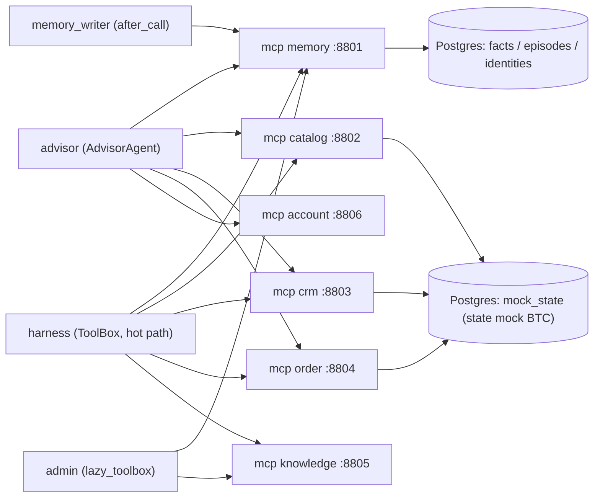
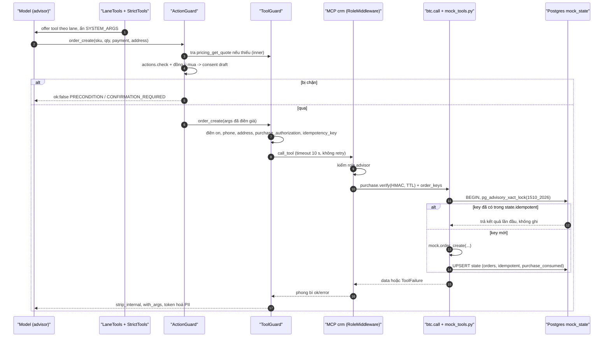

# 04. Danh sách tools

> Phạm vi: tất cả tool mà agent có thể gọi (qua MCP hoặc không), ai được gọi, ở lane nào, và lớp bảo vệ quanh mỗi lần gọi. Đối chiếu với yêu cầu tool (C.2) và MCP (C.3) của đề: mục 8, 9, 10.
> Quy ước: `A/` = `apps/ai-agent-service/src/ai_agent_service/`. Mọi số liệu trích từ code; nếu comment và code khác nhau thì theo code.
> Liên quan: [00-tong-quan.md](00-tong-quan.md) · [01-he-thong.md](01-he-thong.md) · [02-vong-lap-harness.md](02-vong-lap-harness.md) · [03-bo-nho.md](03-bo-nho.md) · [05-trien-khai.md](05-trien-khai.md) · [06-quyet-dinh-thiet-ke.md](06-quyet-dinh-thiet-ke.md)

## 1. Cơ chế: 6 MCP server, 4 role

### 1.1 Server và transport

| Thành phần | Giá trị | Nguồn |
|---|---|---|
| Server | `memory`, `catalog`, `crm`, `order`, `knowledge`, `account` (mỗi server một module `A/mcp/servers/<tên>.py`) | `A/mcp/client.py:53-60` (`SERVERS`) |
| Transport mặc định | `stdio`: mỗi role tự spawn subprocess `python -m ai_agent_service.mcp.servers.<tên>` | `A/mcp/client.py:103-105`, `124-137` |
| Transport HTTP | `MCP_TRANSPORT=http`; URL lấy từ `MCP_<SERVER>_URL`, mặc định `http://127.0.0.1:<port>/mcp` | `A/mcp/client.py:138-141` |
| Cổng HTTP | memory 8801, catalog 8802, crm 8803, order 8804, knowledge 8805, account 8806 | `A/mcp/client.py:74-81` (`HTTP_URLS`) |
| Role truyền đi | stdio: biến môi trường `MCP_ROLE`; HTTP: header `x-role` | `A/mcp/server_base.py:50-51`, `91-95` |
| Kiểm role | `RoleMiddleware.on_call_tool`: role không nằm trong danh sách của tool thì raise `FORBIDDEN` | `A/mcp/server_base.py:98-114` |
| Phong bì kết quả | `{"ok": true, "data": ...}` hoặc `{"ok": false, "error": {"code","retryable","message","details"}}` | `A/mcp/server_base.py:78-88` |
| Lỗi không lường trước | mọi exception khác thành `INTERNAL`, `retryable: true` | `A/mcp/server_base.py:157-161` |
| Tool `health` | đăng ký tự động trên mọi server, mọi role; client lọc bỏ trước khi đưa cho model | `A/mcp/server_base.py:126-129`, `A/mcp/client.py:177` |

Lưu ý khi chạy HTTP: `Server.run()` có cổng mặc định `8800` (`A/mcp/server_base.py:179`); cổng 8801–8806 do lệnh khởi chạy truyền `--port` (ví dụ `infra/kubernetes/overlays/aws-production/mcp.yaml:24`). Kiểm role chỉ chặn ở **lúc gọi**, không chặn ở **lúc liệt kê**: danh sách tool một role thấy là toàn bộ tool của các server nó nạp; phần lọc cho model thuộc về lane (mục 4).

### 1.2 Tên tool trên dây

BTC đặt tên có dấu chấm (`inventory.check`). Provider tương thích OpenAI không nhận dấu chấm, nên server đăng ký `inventory_check`; `dotted()` đổi **dấu gạch dưới đầu tiên** về dấu chấm khi ghi trace (`A/mcp/client.py:93-100`). `ClientGroup` thêm tiền tố tên server (`catalog_inventory_check`), `_unprefixed()` bỏ tiền tố đó (`A/mcp/client.py:183-194`). Kết quả: model, `config/lanes.yaml` và trace mỗi nơi chỉ thấy một cách viết.

### 1.3 Role nạp server nào

| Role | Dùng bởi | Server được nạp (`SERVER_ROLES`) |
|---|---|---|
| `advisor` | AdvisorAgent (LLM) | memory, catalog, crm, order, account |
| `harness` | code của hot path (`load_context`, route HANDOFF) qua `ToolBox` | memory, catalog, crm, order, knowledge |
| `memory_writer` | `after_call` (MemoryAgent ghi sổ) | memory |
| `admin` | xoá dữ liệu, `kb_upsert`; mở lười (`lazy_toolbox`) | memory, knowledge |

Nguồn: `A/mcp/client.py:64-71`, `A/mcp/server_base.py:52`; nơi dùng: `A/runtime/harness.py:84`, `95-101`, `156`.

## 2. Bảng đầy đủ các MCP tool

Liệt kê từ mọi decorator `@server.tool(...)` trong `A/mcp/servers/*.py`. Cột **Lane** là lane mà model được offer tool (`apps/ai-agent-service/config/lanes.yaml`); "—" nghĩa là model không bao giờ thấy, chỉ code gọi. **Nguồn gốc**: "BTC" = bọc hàm trong `apps/ai-agent-service/data/btc/eval/mock_tools.py` (`TOOLS`, dòng 302-304); "Đội" = tool tự viết.

Timeout trong bảng là của đường model (`ToolGuardMiddleware`, mục 5.1). Đường code dùng `ToolBox`: role `harness` 3.0 s (`A/mcp/tools.py:973`, `A/runtime/harness.py:101`), `memory_writer` và `admin` lười 10.0 s (`A/runtime/harness.py:84`, `156`).

| Tool (wire) | Server | Đọc/Ghi | Role | Lane | Ghi chú (tham số, system-filled, idempotency, nguồn gốc) | Nguồn |
|---|---|---|---|---|---|---|
| `catalog_search` | catalog | Đọc | advisor, harness | NEW, CONTINUITY | `query, category, sku, max_price_vnd, min_room_area_m2`. BTC + tìm lỏng của đội khi không khớp (`match: exact/loose/none`). 2.0 s | `A/mcp/servers/catalog.py:36` |
| `inventory_check` | catalog | Đọc | advisor, harness | NEW, CONTINUITY | `sku`; `on` hệ thống điền. BTC. 2.0 s | `A/mcp/servers/catalog.py:80` |
| `pricing_get_quote` | catalog | Đọc | advisor, harness | NEW, CONTINUITY | `sku, qty, address, basket_skus`; `on`, `customer_phone` hệ thống điền. BTC + `enrich` thêm `name`, `end` cho khuyến mãi. Kết quả có thể chứa trường `_internal*` (bị cắt). 2.0 s | `A/mcp/servers/catalog.py:97` |
| `pricing_quote_order` | catalog | Đọc | advisor, harness | NEW, CONTINUITY | `lines: [{sku, qty}]`, `address`; `on`, `customer_phone` hệ thống điền. Rỗng thì `BAD_ARGUMENTS`. BTC (thêm 11/2026) + `enrich` từng unit. 2.0 s | `A/mcp/servers/catalog.py:141` |
| `delivery_estimate` | catalog | Đọc | advisor, harness | NEW, CONTINUITY | `address`; `on` hệ thống điền. **Đội**: dùng luật `_eta` và `HOLIDAYS` của mock trước khi có đơn; thiếu địa chỉ thì trả theo từng vùng (`by_area`). 2.0 s | `A/mcp/servers/catalog.py:173`, `A/mcp/servers/delivery.py:24` |
| `crm_get_customer` | crm | Đọc | advisor, harness | NEW, CONTINUITY | `phone, zalo_id, fb_id`. Khi tier `VERIFIED` thì args bị thay bằng `{"phone": <số đã xác minh>}`. Kết quả bị giới hạn về đúng khách đã xác minh. BTC. 2.0 s | `A/mcp/servers/crm.py:34` |
| `order_create` | crm | **Ghi** | advisor | NEW, CONTINUITY | Một sản phẩm: `sku, qty`; nhiều unit: `lines [{sku, qty, price_vnd}]`; `payment` (COD/bank/momo/zalopay), `address`, `basket_skus`, `order_group`. Hệ thống điền: `price_vnd`, `promo_code`, `customer_phone`, `on`, `call_id`, `turn_id`, `purchase_authorization`, `idempotency_key`. Không retry. BTC (+ `order_group` của đội). 10.0 s | `A/mcp/servers/crm.py:65` |
| `schedule_callback` | crm | **Ghi** | advisor | NEW, CONTINUITY | `callback_at` (giờ VN, không offset); `note`, `customer_phone`, `idempotency_key` hệ thống điền. Thiếu số thì `BAD_REQUEST`. BTC + giữ giờ nếu nằm trong giờ làm (giờ dài ngày 11/11, LN-02). 10.0 s | `A/mcp/servers/crm.py:157`, `177-186` |
| `handoff_transfer` | crm | **Ghi** | advisor, harness | NEW, CONTINUITY | `brief` (model viết `escalation_reason`, `escalation_reason_detail`, `conversation_summary`, `open_questions`, `next_action`; hệ thống bổ sung phone, tên, sản phẩm, giá, giờ); `idempotency_key` hệ thống điền. Harness tự gọi ở lane HANDOFF. BTC. 10.0 s | `A/mcp/servers/crm.py:194` |
| `order_status` | order | Đọc | advisor, harness | NEW, CONTINUITY | `order_id`; `customer_phone` hệ thống điền. Khi `SHOP_ORDERS=1` thì ghép thêm đơn website trong 1.0 s (`WEBSITE_BUDGET`). BTC. 2.0 s | `A/mcp/servers/order.py:26-55` |
| `order_update` | order | **Ghi** | advisor | NEW, CONTINUITY | `order_id, action` (`exchange_size`, `exchange_product`, `return`, `update_address`), `new_variant_sku`, `new_address`, `reason`; `on`, `idempotency_key` hệ thống điền. Đội thêm: chặn đổi trả quá 7 ngày (`RETURN_WINDOW_CLOSED`, DT-01), ghi địa chỉ mới thật vào đơn. BTC. 10.0 s | `A/mcp/servers/order.py:58-147` |
| `memory_get_profile` | memory | Đọc | cả 4 role | — | `customer_id`, `on`. Trả facts còn hiệu lực + `deleted_at`, `deletion_pending`. Đội | `A/mcp/servers/memory.py:159` |
| `memory_get_episodes` | memory | Đọc | cả 4 role | CONTINUITY | `customer_id` (hệ thống điền), `n` ≤ 10. Đội | `A/mcp/servers/memory.py:190` |
| `memory_search_calls` | memory | Đọc | advisor, admin | CONTINUITY | `query`; `customer_id`, `call_id` hệ thống điền. Tối đa 5 dòng, 240 ký tự/dòng, PII token bị che `[đã che]`. Đội | `A/mcp/servers/memory.py:56-59`, `235` |
| `memory_get_open_items` | memory | Đọc | cả 4 role | — | `customer_id`, `on`. Định nghĩa nhưng không được gọi (mục 7). Đội | `A/mcp/servers/memory.py:264` |
| `identity_find` | memory | Đọc | harness, memory_writer, admin | — | `key_type` (phone/zalo_id/fb_id), `key_hash` (đã băm, không bao giờ là số thô). Đội | `A/mcp/servers/memory.py:280` |
| `identity_link_provisional` | memory | Ghi | harness | — | `customer_id, key_type, key_hash`; `ON CONFLICT DO NOTHING`, advisory lock theo khách. Đội | `A/mcp/servers/memory.py:302` |
| `memory_confirm_identity` | memory | Ghi | memory_writer | — | `keys`, `customer_id` (thiếu thì tạo `N-xxxxx-xxxxx`). Đội | `A/mcp/servers/memory.py:324-352` |
| `memory_commit_facts` | memory | Ghi | memory_writer | — | `customer_id, decisions, on`; idempotent qua unique index `facts_once_idx`. Đội | `A/mcp/servers/memory.py:82-84`, `355` |
| `memory_settle_unconfirmed` | memory | Ghi | memory_writer | — | `customer_id, confirm, on`. Đội | `A/mcp/servers/memory.py:470` |
| `memory_commit_episode` | memory | Ghi | memory_writer | — | `customer_id, episode`; upsert theo `(customer_id, call_id)`. Đội | `A/mcp/servers/memory.py:511` |
| `memory_request_deletion` | memory | **Ghi** | advisor | NEW, CONTINUITY | `reason`; `customer_id`, `call_id`, `idempotency_key` hệ thống điền. Chỉ ghi yêu cầu (xoá trong 72 h). Đội. 10.0 s | `A/mcp/servers/memory.py:548` |
| `memory_delete_customer` | memory | Ghi | admin | — | `customer_id, call_ids`; xoá facts/episodes/identities, để lại tombstone. Đội | `A/mcp/servers/memory.py:580` |
| `kb_search` | knowledge | Đọc | harness, admin | — | `query, k` (≤ 8), `on, order_date, situation, other_order_dates, about, include`. Harness gọi trước advisor. Đội. 3.0 s | `A/mcp/servers/knowledge.py:72`, `251` |
| `kb_upsert` | knowledge | Ghi | admin | — | `source` (faq/playbook), `title, text, ...`; chỉ ghi scope `demo`, từ chối sửa chunk `release`. Đội. 3.0 s | `A/mcp/servers/knowledge.py:289` |
| `account_profile` | account | Đọc | advisor | NEW, CONTINUITY (khi đăng nhập) | `account_id` hệ thống điền. Đội | `A/mcp/servers/account.py:56` |
| `account_cart` | account | Đọc | advisor | NEW, CONTINUITY (khi đăng nhập) | `account_id` hệ thống điền; tổng giỏ tính tại server. Đội | `A/mcp/servers/account.py:80` |
| `account_orders` | account | Đọc | advisor | NEW, CONTINUITY (khi đăng nhập) | `account_id` hệ thống điền, `limit` 1–10. Đội | `A/mcp/servers/account.py:112` |
| `health` | cả 6 | Đọc | cả 4 role | — (ẩn) | Trả `{server, role}`; client bỏ khỏi danh sách | `A/mcp/server_base.py:126` |

Tổng: 28 tool nghiệp vụ (memory 12, catalog 5, crm 4, order 2, knowledge 2, account 3) cộng `health` trên mỗi server.

Các tool ghi "đặt in đậm" là `WRITE_TOOLS` của đường model: `order_create`, `order_update`, `schedule_callback`, `handoff_transfer`, `memory_request_deletion` (`A/mcp/tools.py:71-73`, trùng với `A/components/guardrails/actions.py:35`).

## 3. Tool không qua MCP

| Tool | Ai trả lời | Khi nào có | Làm gì | Nguồn |
|---|---|---|---|---|
| `order_split_cod` | `ActionGuardMiddleware._split` | Luôn thêm khi advisor có `order_create` | Giỏ COD vượt `COD_LIMIT_VND = 10_000_000`: gọi `pricing_quote_order`, chia bằng `actions.cod_split`, rồi đặt từng đơn qua chính `order_create` (có `order_group` "1"/"2", `basket_skus`). Lần đầu trả `CONFIRMATION_REQUIRED` kèm từng đơn để đọc lại. Các lần gọi thật được ghi vào `inner` cho trace | `A/mcp/tools.py:642-664`, `A/agents/advisor.py:659-718`, `1263-1265`, `A/components/guardrails/actions.py:38` |
| `product_advise` | `ChainLookupMiddleware._advised` | Chỉ khi `ADVISOR_PRODUCT_ADVISE=1` và có đủ search/quote/stock | Một lần gọi: `catalog_search` → xếp theo độ hợp (diện tích, ngân sách, khoá trẻ em) → `pricing_get_quote` + `inventory_check` cho 3 ứng viên đầu (`ADVISE_TOP = 3`) | `A/mcp/tools.py:636-638`, `667-690`, `743-785`, `A/agents/advisor.py:1266-1268` |
| `load_skill` | LangChain `@tool` trong advisor | Luôn gắn, nhưng bị gỡ khỏi request khi `ADVISOR_SKILLS` tắt (mặc định tắt: mọi skill đã nằm sẵn trong prompt) | Nạp quy trình của shop theo tên | `A/agents/advisor.py:1227-1236`, `1262`, `573-575`, `A/components/context/skills.py:82-85` |
| Chained lookup | `ChainLookupMiddleware.abefore_model` | Sau một vòng tool mà `catalog_search` trả đúng 1 sản phẩm (không có `successor_sku`) | Harness tự gọi `pricing_get_quote(qty=1)` và `inventory_check` cho sku đó nếu lượt này chưa gọi; message đánh dấu `chained`. Không phải tool model gọi | `A/mcp/tools.py:592-626`, `721-731` |

Mọi lần gọi bên trong ba cơ chế trên đều đi qua cùng `ToolGuardMiddleware` (`A/mcp/tools.py:787-794`, `A/agents/advisor.py:720-732`).

## 4. Lane và lọc tool

### 4.1 Lane → tool (`config/lanes.yaml`)

Lane do `route` chọn, kiểu `Lane = Literal["HANDOFF", "CLARIFY", "CONFIRM_IDENTITY", "CONTINUITY", "NEW"]` (`A/components/orchestration/rules.py:37`).

| Lane | Tool được offer | Nguồn |
|---|---|---|
| `CLARIFY` | không có | `lanes.yaml:21` |
| `CONFIRM_IDENTITY` | không có | `lanes.yaml:22` |
| `NEW` | `load_skill`, `account_cart`, `account_orders`, `account_profile`, `catalog_search`, `product_advise`, `inventory_check`, `pricing_get_quote`, `pricing_quote_order`, `delivery_estimate`, `order_create`, `order_split_cod`, `order_status`, `crm_get_customer`, `order_update`, `schedule_callback`, `handoff_transfer`, `memory_request_deletion` | `lanes.yaml:23-45` |
| `CONTINUITY` | như `NEW` + `memory_get_episodes`, `memory_search_calls` | `lanes.yaml:47-68` |
| `HANDOFF` | không có dòng trong bảng → không tool nào; harness tự gọi `handoff_transfer` không qua model | `A/mcp/tools.py:275-280`, `A/pipeline/hot/nodes.py:636` |

`kb_search` không thuộc lane nào: `load_context` gọi nó trước khi advisor chạy (`A/pipeline/hot/nodes.py:175-183`).

### 4.2 Luật lọc thêm của `LaneToolsMiddleware` (`A/mcp/tools.py:263-308`)

| Luật | Điều kiện | Dòng |
|---|---|---|
| Lane lạ | lane không có trong bảng → không tool MCP nào | 274-280 |
| Tool không phải MCP (structured output...) | giữ nguyên | 297-301 |
| `account_*` | gỡ nếu context không có `account_id` (khách chưa đăng nhập) | 283-285 |
| `handoff_transfer` | gỡ khi chưa có `customer_phone` và lần chuyển trước đã bị trả `NEEDS_NUMBER` | 286-292 |
| `WRITE_TOOLS` | gỡ hết khi `mode == "copilot"` (tư vấn viên thao tác) | 293-296 |
| Thứ tự | sắp ổn định theo `_offered_late`: tool thường (0) → write (1) → `handoff_transfer` (2) → `memory_*` đọc (3) → `account_*` (4), để giữ prefix chung dài cho prompt cache | 246-260, 302 |

### 4.3 `StrictToolsMiddleware`: ẩn tham số khỏi schema

Chỉ bật khi LLM là `openai-chat` (`A/agents/advisor.py:1271`, `1283`). Schema gửi model ở strict mode, đã bỏ:

| Nhóm | Tham số bị ẩn | Nguồn |
|---|---|---|
| `SYSTEM_ARGS` (mọi tool) | `on`, `customer_phone`, `customer_id`, `account_id`, `call_id`, `turn_id`, `purchase_authorization`, `idempotency_key` | `A/mcp/tools.py:95-96` |
| `HARNESS_ARGS` | `order_create`: `price_vnd`, `promo_code`; `schedule_callback`: `note` | `A/mcp/tools.py:101` |
| `MODEL_ARGS` (thay thế) | `handoff_transfer.brief` thành object đóng 5 trường bắt buộc; `ADVISOR_SHORT_BRIEF=1` rút còn 3 trường | `A/mcp/tools.py:104-151` |

Việc thực thi không đổi: harness vẫn thấy và điền đủ mọi tham số (`A/mcp/tools.py:197-198`).

## 5. `ToolGuardMiddleware` và `ActionGuardMiddleware`

Thứ tự middleware của advisor (`A/agents/advisor.py:1276-1287`): `ChainLookup` → `ContextPrompt` → `ModelRetry` → `ModelCallLimit(2)` → `ToolCallLimit(20, continue)` → `LaneTools` → `StrictTools` → `ActionGuard` → `ToolGuard`. Giới hạn: `TOOL_CALLS_PER_RUN = 20`, `MODEL_CALLS_PER_RUN = 2` (`A/agents/advisor.py:1243-1245`).

### 5.1 Hằng số của ToolGuard (`A/mcp/tools.py`)

| Hằng / hành vi | Giá trị | Dòng |
|---|---|---|
| `DEFAULT_TIMEOUT` | 2.0 s | 381 |
| `WRITE_TIMEOUT` (mọi `WRITE_TOOLS`) | 10.0 s | 384, 427-428 |
| `TIMEOUTS` | `kb_search` 3.0 s, `kb_upsert` 3.0 s | 380 |
| Retry | `retries=1`; chỉ khi `error.retryable` **và** tool không thuộc `WRITE_TOOLS` | 391, 484 |
| Circuit breaker | mở sau `breaker_failures=2` lỗi hạ tầng liên tiếp, đóng sau `breaker_seconds=60.0`; thành công thì về 0 | 392-393, 480-481, 494-506 |
| Mã lỗi tính cho breaker | `TIMEOUT`, `TOOL_ERROR`, `INTERNAL`, `CIRCUIT_OPEN` (lỗi nghiệp vụ như `PRICE_MISMATCH` không tính) | 64, 487-488 |
| Khi đang mở | trả ngay `CIRCUIT_OPEN`, `retryable: false` | 421-424 |

### 5.2 Tham số do hệ thống điền (`_with_context`, dòng 508-577)

| Tham số | Cách điền | Dòng |
|---|---|---|
| `idempotency_key` | luôn xoá giá trị model viết; write tool nhận key `call:turn:tool:sha256[:16]`; riêng `order_create` dùng `purchase.order_key` (phạm vi cả cuộc gọi) | 526, 571-574, 850-869; `A/components/guardrails/purchase.py:111-115` |
| Mặc định khai báo | write tool được ghi rõ `qty`, `payment`... vào args để trace đúng đơn thật | 528-529, 824-831 |
| `on` | ngày của cuộc gọi, ghi đè | 530-532 |
| `customer_phone` | số của context, ghi đè (trừ `crm_get_customer`) | 538-539 |
| `crm_get_customer.phone` | tier `VERIFIED` thì args chỉ còn `{"phone": <số đã xác minh>}` | 534-537 |
| `address` | bỏ nếu khớp `NO_ADDRESS` ("chưa có", "không rõ", "N/A"...); token `<ADDR_n>` đổi về địa chỉ thật từ `context.addresses` + vault; rỗng thì lấy địa chỉ gần nhất | 81, 540-547, 811-821 |
| `customer_id`, `account_id`, `call_id` | lấy từ context, ghi đè | 548-556 |
| `order_create`: `call_id`, `turn_id`, `purchase_authorization` | biên nhận đồng ý mua ký HMAC-SHA256 (`purchase.receipt`), TTL 300 s | 557-568; `purchase.py:23`, `278-297` |
| `schedule_callback.callback_at` | chuẩn hoá theo `clock.tool_time` | 569-570 |
| `basket_skus` | bỏ chính sku đang báo giá khi `qty == 1` | 223-234, 527 |

### 5.3 Hậu xử lý kết quả

| Bước | Tác dụng | Dòng |
|---|---|---|
| `strip_internal` | xoá mọi key bắt đầu bằng `_internal` ở mọi độ sâu; phong bì sai thành `BAD_ENVELOPE` | 916-932 |
| `with_args` | gắn args thật đã chạy vào message (bỏ `purchase_authorization`) cho trace | 872-880 |
| `visible_result` | token hoá lại PII qua vault; `crm_get_customer` chỉ giữ hồ sơ của `customer_id` đã xác minh, nếu không thì `PROFILE_SCOPE` | 883-904 |
| `with_status_words` | `order_status`: thêm `status_text` tiếng Việt và `return_window` khi quá 7/30 ngày | 346-373 |
| `with_hints` | lỗi `UNKNOWN_SKU` kèm gợi ý gọi `catalog_search` | 331-343 |

### 5.4 ActionGuard: kiểm tra trước khi ghi (tóm tắt)

`ActionGuardMiddleware` (`A/agents/advisor.py:637-914`) áp cho `WRITE_TOOLS` ∪ `CUSTOMER_READ_TOOLS` (`order_status`, `crm_get_customer`; `A/components/guardrails/actions.py:35-36`): bỏ tham số không khai báo và `null`; chờ review câu vừa nói (`review_flags`); chặn chuyển máy sớm ngoài lane HANDOFF và bổ sung brief (`fill_handoff`); tự tra giá/tồn kho còn thiếu (kết quả ghi vào `inner`); điền giá theo báo giá hôm nay (`_filled_order`); chặn đơn trùng (`ALREADY_CREATED`); `actions.check` (tier `VERIFIED`, copilot cấm ghi, luật riêng từng tool); `order_create` cần khách đồng ý với bản đọc lại (`CONFIRMATION_REQUIRED` kèm `purchase_draft`); `schedule_callback` chặn đặt trùng (`ALREADY_BOOKED`) và giờ quá 60 ngày (`CALLBACK_HORIZON_DAYS`, dòng 918). Chi tiết: [02-vong-lap-harness.md](02-vong-lap-harness.md).

### 5.5 Một lần gọi tool ghi

## 6. Nguồn gốc: mock của BTC và phần đội thay đổi

`A/mcp/servers/btc.py` nạp `data/btc/eval/mock_tools.py` một lần bằng `importlib` (`btc.py:80-96`); file của BTC không bị sửa. Mười tool trong `TOOLS` của mock được bọc: `crm.get_customer`, `catalog.search`, `inventory.check`, `pricing.get_quote`, `pricing.quote_order`, `order.create`, `order.status`, `order.update`, `schedule.callback`, `handoff.transfer` (`mock_tools.py:302-304`).

**State dùng chung.** Ba process `catalog`, `crm`, `order` cùng nạp mock, nên state toàn cục của mock (`_ORDERS`, `_CALLBACKS`, `_TICKETS`, `_ONCE_USED`) được lưu trong một dòng Postgres `mock_state (id=1, state JSONB)` (`btc.py:59-65`, `128-143`). Đọc: nạp state, không khoá, không ghi (`btc.py:219-223`). Ghi (`WRITES` = 4 tool ghi của BTC, `btc.py:71`): transaction + `pg_advisory_xact_lock(1510_2026)`; kết quả lưu theo `idempotency_key` trong `state.idempotent`, lặp key thì trả lại kết quả lần đầu (`btc.py:150-187`, `224-232`). `order.create` còn kiểm biên nhận mua: hết hạn, đã dùng, hoặc thiếu key thì từ chối (`btc.py:161-168`, `209-216`). Mock trả `{"error": ...}` thì thành `ToolFailure(code viết hoa, retryable=False, details=phần còn lại)` (`btc.py:236-242`). `reset()` xoá dòng state, runner đánh giá gọi theo từng kịch bản (`btc.py:245-250`).

| Đội thay đổi | Mô tả | Nguồn |
|---|---|---|
| Enrich khuyến mãi | `applied_promos` của `pricing.get_quote` và từng unit `pricing.quote_order` thêm `name`, `end` từ `promotions.json` | `btc.py:256-277` |
| Tìm lỏng | `catalog.search` không khớp: tìm lại từng category, xếp theo cặp từ liên tiếp, trả `match: loose/none`, tối đa 10 | `btc.py:297-343` |
| `delivery_estimate` | tool mới, dùng `_eta` + `HOLIDAYS` của mock | `delivery.py:17-39`, `catalog.py:173-188` |
| Giờ gọi lại | mock dời giờ nhưng nếu `clock.is_working_time` (giờ dài ngày 11/11) thì giữ giờ khách chọn | `crm.py:177-183` |
| `update_address` | mock chỉ trả `updated`; đội ghi địa chỉ vào `_ORDERS` và tính lại `estimated_delivery` | `order.py:119-147`; `mock_tools.py:276-277` |
| Cửa sổ đổi trả DT-01 | `return`/`exchange_*` quá `RETURN_DAYS = 7` ngày thì `RETURN_WINDOW_CLOSED` | `order.py:87-93`; `actions.py:518-523` |
| Khách CRM tổng hợp | nạp thêm `catalog/crm_seed_synthetic.json` vào CRM trong bộ nhớ (tắt bằng `BTC_SYNTHETIC_CRM=0`) | `btc.py:99-117` |
| `order_group`, biên nhận mua | tham số của đội, không chuyển xuống mock | `crm.py:121-129`, `btc.py:196-216` |
| Đơn website | `SHOP_ORDERS=1` và DB không phải `_eval`: `order_create` sao chép nền, `order_status`/`order_update` dùng thêm đơn website | `crm.py:130-141`, `order.py:39-55`, `100-115`; `A/runtime/shop_orders.py:45-51` |

Tool hoàn toàn của đội: `delivery_estimate`, 12 tool `memory`/`identity`, 2 tool `kb_*`, 3 tool `account_*`, và 3 tool ngoài MCP (`order_split_cod`, `product_advise`, `load_skill`).

## 7. Tool định nghĩa nhưng không được offer

| Tool | Tình trạng | Bằng chứng |
|---|---|---|
| `memory_get_open_items` | Đăng ký cho cả 4 role nhưng không nằm trong lane nào và không có lời gọi `.call`/`.data` nào trong `A/`; chỉ có nhãn hiển thị | `A/mcp/servers/memory.py:264`; `A/runtime/steps.py:46` |
| `memory_get_profile`, `identity_find` | Không offer cho model; harness dùng khi `load_context` / nhận diện | `A/components/memory/recall.py:47`, `A/pipeline/hot/nodes.py:419-420` |
| `memory_delete_customer` | Không qua lane; `after_call` gọi bằng role `admin`, API quyền riêng tư gọi thẳng hàm Python | `A/pipeline/cold/after_call.py:114`, `A/api/routes/privacy.py:38` |
| `kb_upsert` | Chỉ role `admin`, gọi từ `runtime/calls.py` khi lưu FAQ demo | `A/runtime/calls.py:408-409` |
| `product_advise` | Có trong lane nhưng chỉ được gắn khi `ADVISOR_PRODUCT_ADVISE=1` (mặc định tắt) | `A/mcp/tools.py:667-669` |
| `load_skill` | Có trong lane nhưng bị gỡ khỏi request khi `ADVISOR_SKILLS` tắt (mặc định) | `A/agents/advisor.py:573-575` |

## 8. Đối chiếu tool của đề (C.2 Tool integration)

Đề yêu cầu: ở M1 agent gọi được ít nhất 3 tool (`crm.get_customer`, `catalog.search` + `inventory.check`, `order.create`), và "giá phải lấy từ tool, agent không được tự bịa giá hay khuyến mãi"; ở M2 thêm `pricing.get_quote` (chỉ khuyến mãi còn hiệu lực), `order.status` / `order.update`, `schedule.callback`.

### 8.1 Bảng "Đối chiếu tool của đề"

| Tool của đề | Mức theo đề | Tên trên dây | Server | Trạng thái | Nguồn |
|---|---|---|---|---|---|
| `crm.get_customer` | M1 | `crm_get_customer` | crm | Có. Harness gọi khi nhận diện khách và dựng Call Brief; advisor cũng được offer | `A/mcp/servers/crm.py:34`; `A/pipeline/hot/nodes.py:419`, `456` |
| `catalog.search` | M1 | `catalog_search` | catalog | Có, thêm tìm lỏng của đội | `A/mcp/servers/catalog.py:36` |
| `inventory.check` | M1 | `inventory_check` | catalog | Có; harness tự gọi kèm khi search trả đúng 1 sản phẩm (mục 3) | `catalog.py:80`; `A/mcp/tools.py:596`, `710-731` |
| `order.create` | M1 | `order_create` | **crm** | Có, write tool | `A/mcp/servers/crm.py:65` |
| `pricing.get_quote` | M2 | `pricing_get_quote` | catalog | Có (mục 8.3) | `catalog.py:97-129` |
| `pricing.quote_order` | BTC bổ sung 11/2026 | `pricing_quote_order` | catalog | Có, cho đơn nhiều máy | `catalog.py:141` |
| `order.status` | M2 | `order_status` | order | Có | `A/mcp/servers/order.py:29` |
| `order.update` | M2 | `order_update` | order | Có, write tool | `order.py:58` |
| `schedule.callback` | M2 | `schedule_callback` | crm | Có, write tool | `crm.py:157` |
| `handoff.transfer` | (schema BTC: M1) | `handoff_transfer` | crm | Có, write tool | `crm.py:194` |
| `memory.read` / `memory.write` | M1, qua mcp-memory | `memory_get_*`, `memory_commit_*`... | memory | Có, schema do đội thiết kế (mục 2, mục 9) | `A/mcp/servers/memory.py:159-580` |

- Cột "Mức theo đề" theo C.2. `tools.schema.json` của BTC ghi mức riêng, ví dụ `schedule.callback` "M1", `pricing.get_quote` "M1 (khuyến nghị) / M2" (`apps/ai-agent-service/data/btc/schemas/tools.schema.json:90`, `157`).
- Tên tool và tham số bắt buộc giữ đúng của BTC vì server gọi thẳng hàm của mock (mục 6); chỉ đổi dấu chấm thành gạch dưới trên dây (mục 1.2). `tests/test_auth_mcp.py:39-49` kiểm tra các server phục vụ đủ chín tool của BTC cùng `memory_get_profile`, `kb_search`.
- Ở lane `NEW` và `CONTINUITY`, model được offer toàn bộ tool trên (mục 4.1), tối đa 20 lần gọi tool mỗi lượt (`A/agents/advisor.py:1243`).
- Lệch so với cách chia server của đề: ba tool ghi `order.create`, `schedule.callback`, `handoff.transfer` nằm ở server `crm`; server `order` chỉ có `order.status`, `order.update`.

### 8.2 Giá lấy từ tool: cơ chế thực thi

Câu "agent không được tự bịa giá hay khuyến mãi" được thực thi bằng code ở 5 chỗ, không chỉ bằng prompt:

| Lớp | Cơ chế | Nguồn |
|---|---|---|
| Model không viết số giá | Luật 1 của advisor: giá và tổng viết bằng nhãn `{giá:<mã>}`, `{tổng}`. `fill_figures` thay nhãn bằng giá hôm nay của mã đó lấy từ `quotes` của cuộc gọi và `pricing.quote_order` của lượt; nhãn không có báo giá thì câu đó **không được nói** | `config/prompts/agent/advisor/rules.md:33-34`; `A/components/guardrails/fallback.py:88-112`; `A/pipeline/hot/nodes.py:583`, `1337-1343`, `1560-1578` |
| Hard check số tiền | Mọi số tiền trong câu (số hoặc chữ) phải có nguồn: kết quả tool của cuộc gọi, báo giá hôm nay, tổng giỏ, đoạn chính sách BTC đọc lượt này, số lượng nhân đơn giá, hiệu hai số của cùng một đối tượng, lời khách, giá trong brief. Không có nguồn thì bị chặn | `A/components/guardrails/hard.py:13`, `117-155`, `224-231`; `unsourced_money` dòng 218-221 |
| Model không thấy trường giá khi đặt đơn | `StrictToolsMiddleware` ẩn `price_vnd`, `promo_code` của `order_create` khỏi schema (`HARNESS_ARGS`); `_filled_order` điền giá bằng báo giá hôm nay, thiếu thì ActionGuard tự gọi `pricing_get_quote` | `A/mcp/tools.py:98-101`, `182-194`; `A/agents/advisor.py:834-844`, `947-951` |
| Kiểm tra trước khi ghi | `actions.check`: `price_vnd` phải bằng `pricing.get_quote` hôm nay của mã đó; đơn nhiều dòng phải khớp từng máy với `pricing.quote_order`; mã sản phẩm phải xuất hiện trong kết quả tool của cuộc gọi | `A/components/guardrails/actions.py:9`, `264-277`, `330-339` |
| Mock của BTC | `order.create` tự báo giá lại và trả `price_mismatch` kèm `expected_units` khi giá không khớp | `apps/ai-agent-service/data/btc/eval/mock_tools.py:224-229` |

Ghi chú: `StrictToolsMiddleware` chỉ bật khi LLM là `openai-chat` (`A/agents/advisor.py:1271`, `1283`); với provider khác, `price_vnd` vẫn hiện trong schema nhưng hai lớp `_filled_order` và `actions.check` vẫn chạy. Mô tả tool `pricing_get_quote` mà model đọc ghi rõ đây là "the only source of a price or a promotion" (`catalog.py:112`).

### 8.3 `pricing.get_quote` chỉ trả khuyến mãi còn hiệu lực

Logic nằm trong mock của BTC, đội không sửa (`mock_tools.py:92-138`):

- Khuyến mãi mà ngày `on` nằm ngoài `[start, end]` bị bỏ qua: đã hết hạn thì chỉ ghi **mã** vào `expired_promos`; chưa bắt đầu thì không trả ra gì (comment "chưa bắt đầu → không lộ", dòng 107-109).
- Còn hạn nhưng không đủ điều kiện (số lượng, vùng, `requires_owned_sku`, `once_per_customer`, giá trị tối thiểu) thì vào `ineligible_promos` kèm lý do (dòng 110-118).
- Chỉ khuyến mãi còn hạn và đủ điều kiện mới vào `applied_promos` và `final_price_vnd`; nhóm không cộng dồn chỉ lấy cái có lợi nhất (KM-04, dòng 128-133).
- `on` không do model viết: bị ẩn khỏi schema (`SYSTEM_ARGS`) và ToolGuard ghi đè bằng ngày của cuộc gọi (`A/mcp/tools.py:95-96`, `530-532`); server dùng ngày tham chiếu nếu thiếu (`catalog.py:124-128`).
- Đội chỉ **thêm** `name`, `end` vào từng mục của `applied_promos`, không thêm hay bỏ khuyến mãi nào (`A/mcp/servers/btc.py:256-277`). `_internal_price_floor_vnd` bị `strip_internal` xoá trước khi model thấy (`mock_tools.py:138`, `A/mcp/tools.py:916`).
- Lớp dự phòng: hard check KM-02 chặn câu nhắc mã hoặc ngày bắt đầu của khuyến mãi chưa bắt đầu (`A/components/guardrails/hard.py:264-279`).

## 9. Đối chiếu yêu cầu MCP của đề (C.3)

| Yêu cầu của đề | Mức | Trạng thái | Cách đáp ứng | Nguồn |
|---|---|---|---|---|
| Ít nhất 2 MCP server | M1 | Có | 6 server: memory, catalog, crm, order, knowledge, account | `A/mcp/client.py:53-60` |
| `mcp-memory` bắt buộc, đọc/ghi bộ nhớ khách | M1 | Có | Đọc: `memory_get_profile`, `memory_get_episodes`, `memory_search_calls`. Ghi: `memory_commit_facts`, `memory_commit_episode`, `memory_confirm_identity`, `memory_settle_unconfirmed`. Provenance: mỗi fact có `source` (`call_id`, `turn`, `extractor_version`), cũng là khoá idempotency | `A/mcp/servers/memory.py:1-4`, `61-84`, `159-580` |
| `mcp-catalog` hoặc `mcp-crm` | M1 | Có cả hai | catalog 5 tool, crm 4 tool | `A/mcp/servers/catalog.py`, `crm.py` |
| `mcp-order` | M2 | Một phần | Server có, nhưng chỉ chứa `order.status`, `order.update`; `order.create` nằm ở `mcp-crm` | `A/mcp/servers/order.py:29`, `58`; `crm.py:65` |
| `mcp-knowledge` (RAG chính sách/FAQ) | M2 | Có | `kb_search` trên `policy/*.md` của BTC + FAQ/playbook đã duyệt; harness gọi mỗi lượt trước advisor | `A/mcp/servers/knowledge.py:1-22`, `251`; `A/pipeline/hot/nodes.py:165-171` |
| Phân quyền theo tool (tool nào được ghi dữ liệu) | M2 | Có | Mỗi tool khai danh sách role; `RoleMiddleware` kiểm ở server trước khi tool chạy | `A/mcp/server_base.py:98-114`, `131-165` |

### 9.1 Mô hình phân quyền

Quyền được thực thi **ở server**, "whatever the client claims" (`A/mcp/server_base.py:6-11`). Role đi theo biến môi trường `MCP_ROLE` (stdio) hoặc header `x-role` (HTTP). Khi chạy HTTP trên EKS, NetworkPolicy `mcp-from-the-agent-only` chỉ cho `ai-agent-service` và `ai-agent-worker` chạm cổng MCP để không pod nào tự xưng role khác ([05-trien-khai.md](05-trien-khai.md), mục 3).

| Role | Ai dùng | Tool **ghi** được phép | Không được |
|---|---|---|---|
| `advisor` | AdvisorAgent (LLM) | `order_create`, `order_update`, `schedule_callback`, `handoff_transfer`, `memory_request_deletion` (chỉ ghi yêu cầu) | mọi tool ghi ledger, `identity_*`, `kb_search`, `kb_upsert`, `memory_delete_customer` |
| `harness` | code hot path (`ToolBox`) | `identity_link_provisional`, `handoff_transfer` (lane HANDOFF) | commit ledger, `order_create`, `order_update`, `schedule_callback` |
| `memory_writer` | `after_call` (MemoryAgent) | `memory_confirm_identity`, `memory_commit_facts`, `memory_settle_unconfirmed`, `memory_commit_episode` | không nạp server nghiệp vụ nào (chỉ `memory`) |
| `admin` | `after_call` khi xoá (QT-06), lưu FAQ demo | `memory_delete_customer`, `kb_upsert` (chỉ scope `demo`) | không nạp catalog, crm, order |

Nguồn: decorator `roles=` của từng tool (`A/mcp/servers/memory.py:280`, `302`, `330`, `355`, `470`, `511`, `548`, `580`; `crm.py:65`, `157`, `194`; `order.py:58`; `knowledge.py:251`, `289`), `SERVER_ROLES` (`A/mcp/client.py:64-71`).

- **Advisor không ghi được ledger.** Chỉ `memory_writer` được commit (`memory.py:355`). Sự kiện nghiệp vụ trong ledger do MemoryAgent đọc từ tool log bằng code, không từ lời ai nói (`A/agents/memory.py:7-13`).
- **Xoá chỉ có `admin`.** Advisor chỉ ghi yêu cầu (`memory.py:548`); `after_call` thực hiện xoá bằng role `admin`, mở lười (`A/pipeline/cold/after_call.py:16-18`, `A/runtime/harness.py:84`).
- **Lớp thứ hai ở phía client:** `LaneToolsMiddleware` gỡ mọi `WRITE_TOOLS` ở chế độ copilot và `account_*` khi chưa đăng nhập (mục 4.2); `actions.check` kiểm tham số mọi write tool (mục 5.4).

## 10. Chất lượng tích hợp tool (đúng schema, xử lý lỗi)

| Khía cạnh | Cách làm | Nguồn |
|---|---|---|
| Schema từ một nguồn | FastMCP sinh schema từ type hints và docstring `Args:` của hàm tool; `lines` dùng `TypedDict` để strict mode không gửi object rỗng | `A/mcp/server_base.py:23-26`, `136-137`; `A/mcp/servers/catalog.py:132-140` |
| Strict mode | Mọi object đóng (`additionalProperties: false`), mọi trường `required`, trường tuỳ chọn thành nullable; null bị bỏ trước khi gọi | `A/mcp/tools.py:154-198`, `237` |
| Tham số lạ | ActionGuard bỏ tham số tool không khai báo (model hay mang tham số của tool này sang tool khác) | `A/agents/advisor.py:613-624` |
| Tham số hệ thống | `on`, `customer_phone`, `idempotency_key`... do harness điền, model không viết (mục 4.3, 5.2) | `A/mcp/tools.py:95-96`, `508-577` |
| Handoff Brief | Kiểm trực tiếp với `schemas/handoff_brief.schema.json` của BTC sau khi harness điền | `A/components/guardrails/actions.py:428-436`; `A/components/btc_schemas.py:1-30` |
| Phong bì lỗi chung | `{"ok": false, "error": {code, retryable, message, details}}`; lỗi nghiệp vụ trả như dữ liệu để model đọc (ví dụ báo giá thay thế), không raise | `A/mcp/server_base.py:12-17`, `78-88`, `146-161` |
| Lỗi của mock | `{"error": ...}` thành `ToolFailure` mã viết hoa, `retryable: false`, phần còn lại vào `details` (`PRICE_MISMATCH` kèm giá đúng, `OUT_OF_STOCK` kèm tồn kho) | `A/mcp/servers/btc.py:36-38`, `236-242` |
| Hạ tầng | Quá giờ thành `TIMEOUT`, exception thành `TOOL_ERROR` (đều `retryable: true`); phong bì sai thành `BAD_ENVELOPE`; tool lạ role thì server raise `FORBIDDEN` | `A/mcp/tools.py:427-442`, `927`; `A/mcp/server_base.py:110-113` |
| Retry | 1 lần, chỉ khi `retryable` và không phải write tool | `A/mcp/tools.py:473-489` |
| Circuit breaker | 2 lỗi hạ tầng liên tiếp thì mở 60 s (`CIRCUIT_OPEN`); lỗi tool liên tiếp đưa lượt sau sang lane HANDOFF (luật 1, `TOOL_FAILURES = 2`) | `A/mcp/tools.py:392-393`, `494-506`; `A/components/orchestration/rules.py:40` |
| Ghi an toàn khi lặp | Write tool không retry; `idempotency_key` do harness tạo; server lưu kết quả lần đầu theo key | `A/mcp/tools.py:71-73`; `A/mcp/servers/btc.py:24-33` |
| Gợi ý sửa | `UNKNOWN_SKU` kèm gợi ý gọi `catalog_search`; ActionGuard trả lý do bằng tiếng Việt để lần gọi sau sửa | `A/mcp/tools.py:331`; `A/components/guardrails/actions.py:264-277` |
