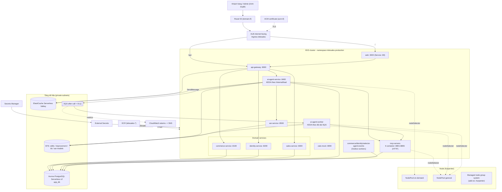

# 05. Triển khai

Tài liệu này mô tả cách hệ thống chạy thật: đích chính là **AWS EKS** (Terraform `infra/terraform/aws-eks/`, manifest `infra/kubernetes/`), bên cạnh môi trường phát triển cục bộ bằng `docker-compose.yml`. Mục lục chung xem [00-tong-quan.md](00-tong-quan.md); kiến trúc logic xem [01-he-thong.md](01-he-thong.md); lý do chọn các phương án xem [06-quyet-dinh-thiet-ke.md](06-quyet-dinh-thiet-ke.md). Mọi con số dưới đây đều kèm đường dẫn file nguồn để đối chiếu.

## 1. Tổng quan trên AWS EKS

Manifest được dựng bằng kustomize theo lớp: `base` (Deployment, Service) → `overlays/production` (after-call worker, PDB) → `overlays/aws-production` (EFS, MCP over HTTP, ASR, autoscaling, Ingress, NetworkPolicy, Secrets), cộng `overlays/aws-cluster` (Karpenter, đối tượng cấp cluster). Namespace ứng dụng là `telesales-production` (`overlays/aws-production/kustomization.yaml:11`).



### 1.1. Biên mạng và vào cửa

- **VPC** 3 AZ, CIDR mặc định `10.40.0.0/16`; subnet public cho ALB và NAT, subnet private cho node, cơ sở dữ liệu, Valkey, EFS (`infra/terraform/aws-eks/network.tf:1-28`, `variables.tf:17-20`). Mặc định chỉ một NAT gateway cho cả 3 AZ (`variables.tf:22-26`). Region mặc định `ap-southeast-1` (`variables.tf:12-15`).
- **Route 53 / ACM**: Terraform có thể mua domain qua Route 53 Domains hoặc tạo hosted zone cho domain mua nơi khác (`domain.tf:13`, `domain.tf:79-82`); chứng chỉ ACM xác thực bằng DNS (`acm.tf:13-40`). Bản ghi trỏ domain về ALB không nằm trong Terraform vì ALB do Load Balancer Controller tạo (`acm.tf:6`).
- **ALB Ingress** (`infra/kubernetes/overlays/aws-production/ingress.yaml`): `scheme: internet-facing`, `target-type: ip`, nghe cổng 80 và 443, chuyển hướng HTTP sang HTTPS, chính sách `ELBSecurityPolicy-TLS13-1-2-2021-06`, idle timeout 300 giây (đủ cho SSE và cuộc gọi voice yên lặng), loại bỏ header không hợp lệ (dòng 9-16). Đường `/api` đi tới `api-gateway:8000`, còn lại tới `web:80` (dòng 23-30). Health check của target group web được đổi thành `/` (`kustomization.yaml:69-73`).
- **Nhóm bảo mật tầng dữ liệu** chỉ nhận kết nối từ security group của node EKS, trên các cổng 5432 (Postgres), 6379 (Valkey), 2049 (EFS) (`network.tf:31-49`).

### 1.2. Cluster và node

- EKS dùng module `terraform-aws-modules/eks/aws ~> 21.0`, Kubernetes `1.34` (`eks.tf:4-9`, `variables.tf:34-37`). Add-on EKS: `coredns`, `kube-proxy`, `vpc-cni`, `eks-pod-identity-agent`, `aws-efs-csi-driver` (`eks.tf:19-30`).
- **Managed node group `system`**: min 2 / max 3 / desired 2, loại `m7i-flex.large` mặc định, taint `CriticalAddonsOnly` để chỉ add-on và Karpenter chạy ở đây (`eks.tf:32-44`, `variables.tf:48-52`).
- **Helm add-on** (`addons.tf`): Karpenter (phiên bản theo biến), AWS Load Balancer Controller `3.6.2`, External Secrets `2.14.0`, KEDA `2.21.0`, metrics-server `3.14.0` (dòng 27-109).
- **Karpenter** (`infra/kubernetes/overlays/aws-cluster/karpenter.yaml`): `EC2NodeClass telesales` dùng AMI `al2023@latest`, IMDSv2 bắt buộc với hop limit 1, đĩa gp3 40Gi mã hóa (dòng 10-27). Hai NodePool, cùng chỉ on-demand, `amd64`, `m7i-flex.large` / `c7i-flex.large` do tài khoản AWS Free plan (dòng 6-9):
  - `on-demand`: giới hạn 32 vCPU, `consolidationPolicy: WhenEmpty`, `consolidateAfter: 10m` để không bao giờ dời pod đang có cuộc gọi (dòng 29-44).
  - `general`: giới hạn 48 vCPU, `WhenEmptyOrUnderutilized`, `consolidateAfter: 2m` (dòng 46-61).
- **Quyền AWS của từng workload** qua EKS Pod Identity, mỗi service account một role, không gắn quyền lên node (`identity.tf:1-74`): `ai-agent-service` chỉ được `sqs:SendMessage`, `ai-agent-worker` được receive/delete/change visibility/get attributes, `keda-operator` chỉ `GetQueueAttributes` (`queue.tf:28-57`).

### 1.3. Tầng dữ liệu

| Thành phần | Cấu hình đã kiểm chứng | Nguồn |
|---|---|---|
| Aurora PostgreSQL Serverless v2 | `aurora-postgresql`, `db.serverless`, 0-4 ACU, một writer; giữ `app_db` với các schema của services (gồm pgvector cho vector tri thức theo thiết kế của nhóm). Cluster tạo bằng `create-aurora-express.ps1` rồi import vào Terraform (`ignore_changes = all`). App kết nối với `sslmode=require` | `aws-eks/data.tf:3-48`, `aurora-import.tf`, `overlays/aws-production/secrets.yaml:27` |
| ElastiCache Serverless Valkey | engine `valkey` major 8, tối đa 5 GB và 5000 ECPU/s, chỉ TLS (`rediss://`); dùng cho rate limit gateway, OTP, model limiter, tín hiệu tải, spend ledger, `kb:changed` | `aws-eks/data.tf:50-69`, `overlays/aws-production/kustomization.yaml:30-33` |
| SQS after-call + DLQ | visibility timeout 300 s, giữ 4 ngày, long polling 20 s, SSE; sau 5 lần nhận thất bại chuyển sang DLQ (giữ 14 ngày) | `aws-eks/queue.tf:9-26` |
| EFS | mã hóa, throughput `elastic`, mount target ở mỗi subnet private, access point uid/gid 1000 tại `/agent`; PV/PVC `agent-data` 5Gi `ReadWriteMany`, `Retain` | `aws-eks/data.tf:71-101`, `overlays/aws-production/storage.yaml` |
| Secrets Manager + External Secrets | secret `<prefix>/app` (giá trị nhập tay, không qua Terraform state) và `<prefix>/database`; `ExternalSecret telesales-secrets` làm mới mỗi 1h và dựng `DATABASE_URL`, `REDIS_URL` | `aws-eks/data.tf:14-17,118-123`, `overlays/aws-production/secrets.yaml` |
| ECR | 9 repository `telesales-*`, tag `IMMUTABLE`, quét khi push | `aws-eks/data.tf:103-116` |
| CloudWatch + SNS | alarm DLQ có message (>0, chu kỳ 300 s) và alarm message cũ nhất chờ quá 600 s (2 chu kỳ); gửi tới SNS topic `<prefix>-alarms`, email tùy chọn | `aws-eks/queue.tf:59-91`, `identity.tf:76-86` |

EFS chứa dữ liệu mà mọi pod agent cùng chia sẻ: `skills`, `improvement`, `kb` (mount bằng `subPath` vào `/app/agent/data/...`) và trọng số ASR (`subPath: asr-models`). Init container `seed-agent-data` chép dữ liệu từ image sang EFS bằng `cp -rn`, không ghi đè phiên bản đã được duyệt lúc chạy (`overlays/aws-production/agent-patch.yaml:1-38`, `asr.yaml:29-30`). Chi tiết bộ nhớ xem [03-bo-nho.md](03-bo-nho.md).

## 2. Bảng workload trên EKS

Overlay `aws-production` gỡ `spec.replicas` của `api-gateway`, `web`, `commerce-service`, `identity-service`, `sales-service`, `ai-agent-service` để autoscaler quyết định (`overlays/aws-production/kustomization.yaml:84-88`).

| Workload | Replicas / scaling | Node pool | Ghi chú |
|---|---|---|---|
| `web` | HPA 2-6, CPU 70% (`scaling.yaml:62-72`) | không gắn nodeSelector | Next.js cổng 3000, Service cổng 80 (`base/services.yaml:44-47`); PDB `minAvailable: 1` (`overlays/production/availability.yaml:10-17`) |
| `api-gateway` | HPA 2-6, CPU 70% (`scaling.yaml:50-60`) | không gắn nodeSelector | cổng 8000; đọc `REDIS_URL` từ secret (`base/workloads.yaml:54-57`) |
| `commerce-service` | HPA 2-4, CPU 70% (`scaling.yaml:74-84`) | không gắn nodeSelector | cổng 8100; PDB `minAvailable: 1` (`availability.yaml:1-8`) |
| `identity-service` | HPA 2-4, CPU 70% (`scaling.yaml:86-96`) | không gắn nodeSelector | cổng 8200 |
| `sales-service` | HPA 2-4, CPU 70% (`scaling.yaml:98-108`) | không gắn nodeSelector | cổng 8300 |
| `ai-agent-service` | KEDA `ScaledObject` 2-10, poll 15 s, cooldown 300 s; trigger `metrics-api` trên `/internal/load`: 6 lượt đang xử lý/pod và 4 cuộc gọi voice/pod; scale down tối đa 1 pod mỗi 120 s (`scaling.yaml:8-36`) | `on-demand` (`agent-patch.yaml:14-15`) | cổng 8400; `terminationGracePeriodSeconds: 120`; request 250m/768Mi, limit 2 CPU/2560Mi (`agent-patch.yaml:13,28-31`); `MODEL_LIMITER_PODS=10` khớp max replicas (`kustomization.yaml:34-35`) |
| `mcp-servers` | HPA 2-6, CPU 70% (`scaling.yaml:38-48`) | `general` (`mcp.yaml:19-20`) | 6 container (memory, catalog, crm, order, knowledge, account) cổng 8801-8806, `FASTMCP_STATELESS_HTTP=true` (`mcp.yaml:22-137`); agent dùng `MCP_TRANSPORT=http` (`kustomization.yaml:36-43`) |
| `asr-service` | 1 replica cố định (`asr.yaml:10`) | `general` (`asr.yaml:18-19`) | cổng 8500, Zipformer 30M trên CPU, `ASR_THREADS=2`; startup probe tối đa 60 lần x 10 s cho lần tải trọng số đầu (`asr.yaml:24-35`) |
| `ai-agent-worker` | KEDA 1-6 theo SQS, `queueLength: 5`, `scaleOnInFlight: true`, poll 15 s, cooldown 300 s (`overlays/production/after-call-worker.yaml:70-88`) | `general` (`agent-patch.yaml:47-48`) | chạy `after_call` (MemoryAgent, QaAgent) và sweep mỗi phút; `terminationGracePeriodSeconds: 180` (`after-call-worker.yaml:1-8,33`) |
| `commerce-events`, `identity-events`, `sales-events`, `ai-agent-events` | 1 replica mỗi cái (`base/workloads.yaml:193,223,253,283`) | không gắn nodeSelector | `python -m src.messaging.worker --service <tên>`; không có `KAFKA_BROKERS` thì chỉ poll bảng Outbox (`packages/backend-common/src/messaging/worker.py:87,143`) |
| `zalo-mock` | 1 replica, trạng thái trong bộ nhớ (`zalo-mock.yaml:13`) | `general` (`zalo-mock.yaml:21-22`) | cổng 8090; admin mở qua `/admin/zalo`, web proxy `/zalo-mock/*` |
| Job `telesales-migrate` | `backoffLimit: 2` (`infra/kubernetes/migrate-job.yaml:6`) | - | chạy `Database(...).migrate()` với `MIGRATION_DATABASE_URL` từ secret tạo tay |
| Job `telesales-seed` | `backoffLimit: 2` (`infra/kubernetes/seed-job.yaml:11`) | - | nạp catalogue BTC, 70 khách CRM, đơn cũ; chạy lại an toàn (`seed-job.yaml:1-5`) |

Mọi container chạy `runAsNonRoot` uid 1000, `readOnlyRootFilesystem: true`, drop toàn bộ capability (ví dụ `base/workloads.yaml:13,21-24`; riêng `zalo-mock` không đặt read-only root, `zalo-mock.yaml:44-46`).

### 2.1. Mở rộng theo số khách hàng

Thêm khách thì thêm pod, không phải thêm cấu hình theo khách:

- Pod agent không giữ state cuộc gọi: state nằm trong Postgres checkpointer, graph compile một lần dùng chung (`apps/ai-agent-service/src/ai_agent_service/pipeline/hot/graph.py:41-42`), nên lượt chat kế tiếp chạy được ở pod bất kỳ. Cuộc gọi thoại giữ WebSocket ở một pod, vì vậy scale-in chậm (tối đa 1 pod mỗi 120 s, `scaling.yaml:8-36`) và pod có `terminationGracePeriodSeconds: 120` (`agent-patch.yaml:13`).
- Mỗi cuộc gọi chỉ một lượt chạy một lúc nhờ lease `turn_lease_until` trên bảng `calls` (`apps/ai-agent-service/src/ai_agent_service/runtime/calls.py:38`, `132-147`), dù lượt đến pod nào.
- Việc sau cuộc gọi đi qua SQS sang `ai-agent-worker` (`apps/ai-agent-service/src/ai_agent_service/runtime/jobs.py:1-13`); giới hạn tốc độ gọi mô hình dùng chung qua Valkey cho mọi pod (`apps/ai-agent-service/src/ai_agent_service/llm/shared_limiter.py:1-14`).

Chi tiết, giới hạn (state mock BTC ghi tuần tự dưới một advisory lock) và cách thêm ngành hàng hoặc kênh mới: [06-quyet-dinh-thiet-ke.md](06-quyet-dinh-thiet-ke.md), mục 6.

## 3. NetworkPolicy

File `infra/kubernetes/overlays/aws-production/network-policy.yaml`. Mặc định chặn mọi ingress (`default-deny-ingress`, dòng 11-17); egress để mở vì model API, Aurora, Valkey, SQS, EFS đều nằm ngoài namespace (dòng 9). Cần network policy agent của VPC CNI (dòng 10). Các đường được mở:

| Policy | Đích | Nguồn được phép | Dòng |
|---|---|---|---|
| `from-the-load-balancer` | `telesales-web`, `telesales-gateway` | ipBlock `10.40.0.0/16` (ALB trong VPC) | 19-30 |
| `services-from-the-gateway` | commerce, identity, sales, ai-agent | gateway, web, `identity-events`, `ai-agent-events` | 32-48 |
| `agent-load-from-keda` | `telesales-ai-agent` cổng 8400 | namespace `keda` | 50-60 |
| `mcp-from-the-agent-only` | `telesales-mcp` cổng 8801-8806 | `ai-agent-service`, `ai-agent-worker` | 62-80 |
| `asr-from-the-agent-only` | `telesales-asr` cổng 8500 | `ai-agent-service`, `ai-agent-worker` | 82-94 |
| `zalo-mock-from-web-and-agent` | `telesales-zalo-mock` cổng 8090 | web, agent, worker | 96-108 |
| `gateway-from-zalo-mock` | gateway cổng 8000 | `zalo-mock` (webhook) | 110-121 |

Policy `mcp-from-the-agent-only` là điểm bảo mật quan trọng: khi MCP chạy qua HTTP, vai trò của lời gọi nằm trong header, nên chỉ agent và worker được chạm tới cổng MCP để không pod nào tự xưng vai trò admin (`mcp.yaml:5-6`, `network-policy.yaml:4-5`). Chi tiết tool và phân quyền xem [04-tools.md](04-tools.md).

## 4. CI/CD

### 4.1. `.github/workflows/deploy-eks.yml` (phát hành)

Chạy bằng tay (`workflow_dispatch`, dòng 8-14), trong environment `aws-production` cần người duyệt (dòng 27; `infra/terraform/aws-eks/github.tf:1-3`), `concurrency` không hủy giữa chừng (dòng 20-22), timeout 90 phút (dòng 28). Xác thực AWS bằng OIDC, không lưu key trong GitHub (`github.tf:35-52`). Các bước:

1. Checkout; xác định `TAG` = 12 ký tự đầu của commit, hoặc `image_tag` nhập vào khi rollback (dòng 36-43).
2. Đọc tham số SSM `/telesales-production/overlay` do Terraform ghi (endpoint và ARN, không có secret) (dòng 51-60; `github.tf:95-101`).
3. Build và push 8 image (`backend-common`, `gateway`, `commerce`, `identity`, `sales`, `ai-agent` có voice, `web`, `asr`); bỏ qua image đã có tag trong ECR (dòng 65-96), rồi kiểm tra đủ 8 image (dòng 98-104).
4. Render manifest bằng `scripts/deployment/render_deployment.py --environment aws-production` (dòng 106-109).
5. Mở API endpoint của cluster cho IP của runner (dòng 111-123).
6. Apply riêng phần cấp cluster (`-l telesales/part=cluster`, tức Karpenter) trước, vì Job migrate cần node (dòng 125-126; `overlays/aws-cluster/kustomization.yaml:8-10`).
7. Migrate: chạy `migrate-job.yaml` với image đúng tag, chờ tối đa 15 phút (dòng 128-139).
8. Roll out toàn bộ manifest, chờ từng Deployment tối đa 10 phút (dòng 141-147).
9. Seed dữ liệu demo bằng `seed-job.yaml` (dòng 149-158).
10. Smoke test `https://$DOMAIN/` (dòng 160-163), rồi luôn đóng lại API endpoint (dòng 165-167).

Khi rollback (`image_tag` khác rỗng) thì bỏ qua build, migrate và seed (dòng 5-6, 33).

**`render_deployment.py`** chạy `kubectl kustomize` cho `aws-production` và `aws-cluster`, nối thành một file `reports/generated/deployment.yaml`, đổi mọi `telesales-<image>:dev` thành `<registry>/telesales-<image>:<tag>`, điền các `__PLACEHOLDER__` từ output `overlay` của Terraform, và từ chối ghi nếu còn placeholder chưa điền (`scripts/deployment/render_deployment.py:1-11,19-23,64-79`). Script chỉ render, không apply.

### 4.2. Kiểm tra tự động

- `.github/workflows/terraform-eks.yml`: chạy khi push/PR chạm `infra/terraform/aws-eks/**`; `terraform fmt -check`, `init -backend=false`, `validate` (Terraform 1.14.4) và kiểm tra hai overlay `aws-production`, `aws-cluster` vẫn build được. `plan`/`apply` làm bằng tay (dòng 1-31).
- `.github/workflows/offline-checks.yml`: chạy trên mọi push/PR. Job `backend`: `pytest` với service `postgres:17` và `redis:7-alpine` (dòng 6-30). Job `frontend`: `npm ci`, `typecheck`, `test:unit`, `build`, rồi smoke test Playwright trên stack offline (3 spec: `session`, `offline-checkout`, `call-console`) (dòng 31-77).

## 5. Môi trường phát triển cục bộ

`docker-compose.yml` dùng chung; `docker-compose.override.yml` được Compose đọc tự động và chỉ publish cổng trên `127.0.0.1` (`docker-compose.override.yml:1-6`).

| Service | Cổng (host 127.0.0.1 / nội bộ) | Phụ thuộc |
|---|---|---|
| `postgres` (`postgres:16`, DB `app_db`) | 5432 | - |
| `redis` (`redis:7-alpine`) | 6379 | - |
| `seed` (chạy một lần) | - | postgres, redis healthy |
| `commerce-service` | nội bộ 8100 | postgres, seed |
| `identity-service` | nội bộ 8200 | postgres, seed |
| `sales-service` | nội bộ 8300 | postgres, seed |
| `asr-service` | 8500 | - (tắt bằng `ASR_LOCAL=0`) |
| `ai-agent-service` | nội bộ 8400 | postgres, seed |
| `api-gateway` | 8000 | postgres, redis, seed, 4 service trên healthy |
| `web` | 3000 | api-gateway healthy, seed |
| `commerce/identity/sales/ai-agent-events` | - | postgres, redis healthy |
| `agent-seed` (chạy một lần) | - | ai-agent-service healthy |

Nguồn: `docker-compose.yml:51-339`, `docker-compose.override.yml:8-18`. Khác với EKS, ở cục bộ `ai-agent-service` tự khởi động các MCP server làm tiến trình con qua stdio (`docker-compose.yml:148-150`), và dữ liệu `skills`, `improvement`, `kb` nằm trên Docker volume thay vì EFS (`docker-compose.yml:236-245`).

**Profile tùy chọn:**

- `async`: `kafka` (`apache/kafka:3.9.1`, KRaft một node) (`docker-compose.yml:340-353`). Worker chỉ dùng Kafka khi đặt `KAFKA_BROKERS`, mặc định rỗng (`docker-compose.yml:27`).
- `hotline`: `livekit` (cổng 7880 trên 127.0.0.1, 7881, UDP 40000-40100), `livekit-sip` (5060 UDP/TCP, UDP 40200-40300), `hotline-bridge` nối LiveKit với `ai-agent-service` và `sales-service` (`docker-compose.yml:358-412`, `docker-compose.override.yml:21-23`).
- `zalo-mock`: giả lập Zalo OA trên 127.0.0.1:8090, đẩy webhook vào gateway (`docker-compose.override.yml:25-53`).

**Lệnh khởi động** (từ `Makefile` và chú thích trong file compose):

```bash
make dev                               # = docker compose up --build   (Makefile:3-4)
docker compose up -d --build           # docker-compose.yml:2
make seed                              # = docker compose run --rm seed (Makefile:9-10)
docker compose --profile zalo-mock up -d   # docker-compose.override.yml:26
make down                              # = docker compose down          (Makefile:6-7)
```

## 6. Lịch vòng cải tiến hằng tuần

Vòng cải tiến (Gap Loop + Reflection, xem [02-vong-lap-harness.md](02-vong-lap-harness.md)) có hai cách lập lịch dùng chung một danh sách lệnh `STEPS`.

**Airflow** (`infra/airflow/dags/improvement_weekly.py`): DAG `improvement_weekly`, `schedule="0 2 * * 1"` (02:00 thứ Hai, giờ `Asia/Ho_Chi_Minh`), `catchup=False`, `max_active_runs=1`, `retries: 0` vì mỗi lời gọi model tốn tiền (dòng 70-78). Thứ tự `restate_gaps -> weekly_learn -> wait_for_review -> weekly_measure` (dòng 6, 91):

| Bước | Việc làm | Giới hạn |
|---|---|---|
| `restate_gaps` | gom và diễn đạt lại câu hỏi chưa có tài liệu trả lời để admin duyệt; không tự xuất bản | - |
| `weekly_learn` | R0 trên tập frozen, Reflection trên tập learn, nộp đề xuất cho admin | timeout 6 giờ (dòng 82-83) |
| `wait_for_review` | `BashSensor` chế độ reschedule, poll `weekly-status` mỗi 30 phút | tối đa 8 ngày (dòng 86-88) |
| `weekly_measure` | đo phiên bản skills ứng viên (R1) trên tập frozen; DAG không bao giờ tự bật phiên bản | timeout 6 giờ (dòng 89-90) |

**Runner không cần Airflow** (`infra/improve/run.py` + `infra/improve/Dockerfile`): hai lệnh `learn` (chạy `restate_gaps` rồi `weekly_learn`) và `tick` (kiểm tra tuần này và tuần trước, gọi `weekly_measure` khi mọi đề xuất đã được quyết định) (`run.py:1-13,59-82`). Trên AWS, runner này được định nghĩa trong root Terraform `infra/terraform/aws/` dưới dạng task Fargate 2 vCPU / 8 GB, mount EFS (`ecs.tf:103-145`), với hai lịch EventBridge Scheduler theo giờ `Asia/Ho_Chi_Minh`: `learn` lúc `cron(0 2 ? * MON *)` và `tick` lúc `cron(0 10,16,22 ? * * *)`, không retry (`ecs.tf:186-224`). Lịch mặc định ở trạng thái `DISABLED` (`variables.tf:144-148`); task kết thúc với mã lỗi khác 0 sẽ kích hoạt rule cảnh báo (`monitoring.tf:71-88`).

## 7. Hiện trạng và hướng tới

**Hiện trạng (đã kiểm tra trong repo):**

- Hotline (LiveKit, SIP, `hotline-bridge`) và Kafka chỉ có dưới dạng profile Compose; `infra/kubernetes/` không có manifest nào cho chúng. Trên EKS, các events worker chạy chế độ poll Outbox trong Postgres.
- EKS manifest không có `CronJob` cho vòng cải tiến hằng tuần. Runner EventBridge + Fargate nằm ở root `infra/terraform/aws/` (phương án EC2 + Compose, `infra/terraform/aws/versions.tf:1-4`), không thuộc `infra/terraform/aws-eks/`. ECR của EKS có repo `telesales-improve` (`aws-eks/data.tf:105-106`) nhưng `deploy-eks.yml` không build image này.
- Kênh Zalo trên EKS dùng `zalo-mock` với khóa giả, chưa phải Official Account thật (`overlays/aws-production/kustomization.yaml:51-58`).
- Tài khoản ở AWS Free plan: không dùng Spot, chỉ loại instance Free Tier (`karpenter.yaml:6-9`); Aurora ở cấu hình express, 0-4 ACU, một writer (`aws-eks/data.tf:6-10`).
- Ngưỡng scale của agent (6 lượt, 4 cuộc gọi mỗi pod) là con số khởi đầu, chưa đo bằng tải thật (`scaling.yaml:6-7`).
- Bảng `kb_chunks` nằm trong `app_db`; chỉ mục tìm kiếm tri thức được dựng khi `mcp-knowledge` khởi động (`apps/ai-agent-service/src/ai_agent_service/mcp/servers/knowledge.py:5-21`).

**Hướng tới:**

- Đưa hotline lên EKS (LiveKit, SIP cần UDP, không đi qua ALB) và quyết định có cần Kafka trên cluster hay giữ Outbox polling.
- Chạy vòng cải tiến trên chính cluster EKS (CronJob hoặc EventBridge + Fargate trỏ vào Aurora và EFS của EKS), và thêm `telesales-improve` vào workflow build.
- Khi lên gói trả phí: mở rộng NodePool (`general` dùng Spot, nhiều loại instance hơn) như ghi chú trong `karpenter.yaml:7-9`, bật NAT theo từng AZ (`variables.tf:22-26`).
- Đo lại ngưỡng KEDA bằng `run_eval.py --performance` rồi cập nhật `scaling.yaml`.
