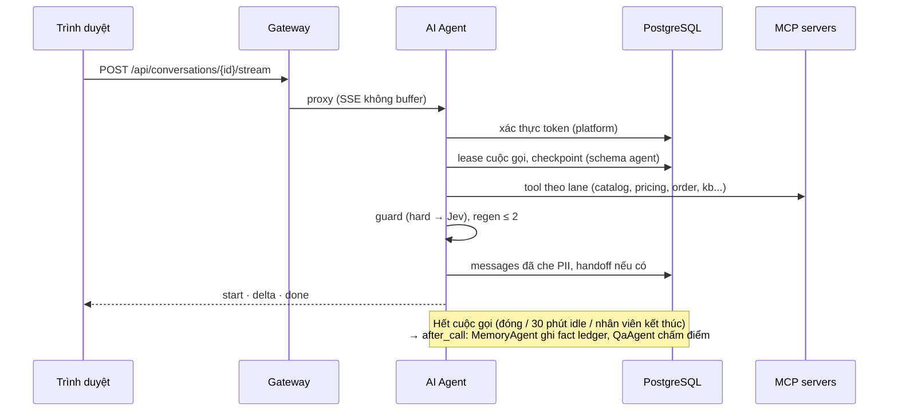

# Kiến trúc microservice

## Hiện trạng

Gateway chuyển từng nhóm endpoint đến một tiến trình FastAPI riêng (bảng định tuyến trong [api.md](../api.md)). Các service vẫn dùng chung:

- **một database PostgreSQL**, chia schema theo domain (`identity`, `conversation`, `commerce`, `memory`, `improvement`);
- **một outbox** và các event worker trong `packages/backend-common/src/messaging`;
- **code chuyển tiếp** trong `packages/backend-common`: ORM, migrations, security, các handler HTTP mà Commerce, Identity và Sales đăng ký lại.

AI Agent là ngoại lệ. Nó có code riêng hoàn toàn trong `apps/ai-agent-service` và schema riêng `agent`: cuộc gọi, transcript, PII vault, checkpoint LangGraph và bảng của các MCP server. Từ backend-common, agent chỉ dùng `Settings`, `Security` (để xác thực conversation token) và ORM của conversation. Mọi chỗ agent chạm vào bảng platform nằm trong `runtime/platform.py`:

| Agent làm gì | Bảng platform |
|---|---|
| Xác thực token của lượt chat | đọc `conversation.conversations` |
| Ghi bản transcript khách nhìn thấy (đã che PII) | ghi `conversation.messages` |
| Chuyển cho nhân viên | ghi `conversation.handoffs`, cập nhật trạng thái `handed_off`, ghi outbox `handoff.requested` |
| Biết conversation nào Sales đã đóng để chạy after_call | đọc `conversation.conversations` |

## Luồng request và event



- Những thao tác người dùng phải chờ kết quả (catalog, order, lượt chat) đi bằng HTTP request/response. Lượt chat không cần Kafka.
- Thay đổi domain ghi outbox trong cùng transaction. Worker theo owner publish lên topic Kafka, hoặc xử lý trực tiếp trong database khi Kafka tắt ([kafka.md](../kafka.md)).
- Consumer phải chịu được event bị gửi lặp lại.

## Quy tắc sở hữu

- **Identity** sở hữu credential, phiên đăng nhập, role, xác minh và consent.
- **Sales** sở hữu conversation, inbox, handoff và feedback. AI Agent nhận `conversation_id` từ Sales, không tự tạo conversation.
- **Commerce** sở hữu catalog, giá, tồn kho, quote và order. Service khác gọi API hoặc nghe event, không ghi bảng của Commerce.
- **AI Agent** sở hữu hành vi agent, bộ nhớ dài hạn (fact ledger, episode) và kho tri thức của mình. Giá, khuyến mãi và tồn kho mà agent đọc qua tool hiện lấy từ `mock_tools.py` của BTC (`data/btc`), vì BTC chấm điểm theo đúng dữ liệu đó, không theo catalog demo của Commerce.
- Event schema để trong `contracts/`. Producer và consumer nằm trong service sở hữu.
- **Không thêm tính năng mới vào `backend-common`.**

## Cấu trúc đích của một service

```text
apps/<service>/
  src/
    api/              HTTP routes + schemas
    domain/           luật nghiệp vụ
    application/      use case
    infrastructure/   repository, Kafka adapter, client ngoài
    main.py
  migrations/  tests/  Dockerfile  requirements.txt
```

Commerce, Identity và Sales đã có các thư mục này, nhưng phần lớn mới là khung: logic thật vẫn import từ backend-common. Muốn chuyển một service sang database riêng, phải thay import trực tiếp bằng API/event trước, rồi mới làm theo [kế hoạch sở hữu dữ liệu](data-ownership-migration.md).
