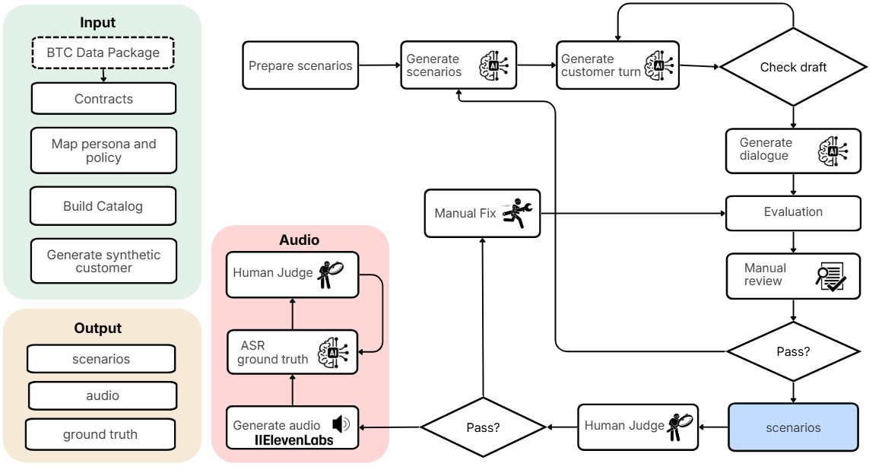
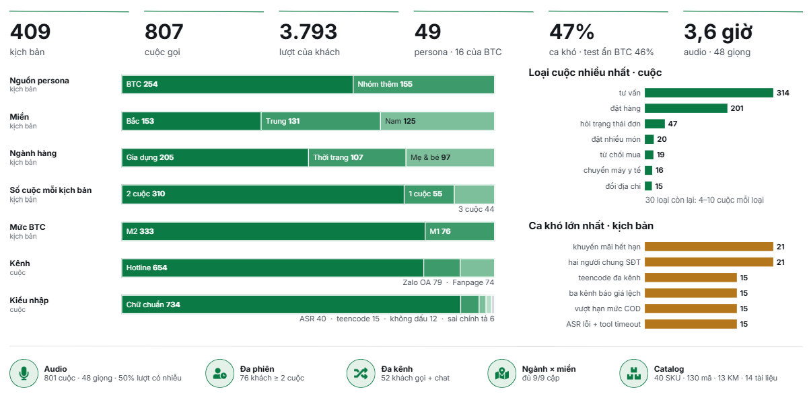

# Dataset đánh giá agent telesales

Tài liệu này mô tả bộ dữ liệu dùng để chấm agent telesales: bộ dữ liệu gồm những gì, được sinh ra thế nào, phân bố ra sao, giới hạn ở đâu và thông tin cá nhân được xử lý thế nào. Đường dẫn tính từ gốc repo; các link trỏ thẳng tới thư mục hoặc file mã nguồn để đối chiếu.

## 1. Tổng quan

Bộ dữ liệu chính là [`data/dev`](../../data/dev): **409 kịch bản, 807 cuộc gọi, 3.793 lượt khách**, sinh tự động theo đúng định dạng kịch bản của BTC (`schemas/scenario_format.md` trong gói BTC). Bộ này đo agent trên bốn chỉ số của BTC:

| Chỉ số | Ý nghĩa |
|---|---|
| TSR | Tỉ lệ hoàn thành nhiệm vụ của cuộc gọi |
| CCR | Tỉ lệ mang ngữ cảnh sang cuộc gọi sau |
| RQR | Tỉ lệ hỏi lại thông tin khách đã nói |
| HR | Tỉ lệ bịa thông tin |

Mỗi cuộc gọi có đủ bộ nhãn: `ground_truth_facts`, `success_if`, `must_carry_over`, `must_not_ask`, Call Brief và Handoff Brief mong đợi, tool call và trace của agent lý tưởng, kèm một hội thoại mẫu.

### 1.1. Các tập dữ liệu

| Tập | Vai trò | Quy mô / nguồn |
|---|---|---|
| [`data/dev`](../../data/dev) | Bộ chấm chính, nguồn của mọi tập con | 409 kịch bản · 807 cuộc · 3.793 lượt khách |
| [`data/reflection`](../../data/reflection), [`data/gap-loop`](../../data/gap-loop) | Tập learn và frozen cho vòng cải tiến (Reflection, Knowledge Gap Loop) | Cắt từ `data/dev`, bổ sung một số ca riêng |
| [`data/hard-cases`](../../data/hard-cases), [`data/policy-regression`](../../data/policy-regression) | Tập con theo ca khó và theo luật chính sách | Cắt theo tag trong `data/dev/metadata/` |
| [`data/dev/audio`](../../data/dev/audio), [`data/dev/asr_test`](../../data/dev/asr_test) | Audio từng lượt khách và bộ hội thoại hai người, dùng để chấm ASR | 3,6 giờ audio · 24 hội thoại hai người (35,7 phút) |

### 1.2. Cấu trúc `data/dev`

| Thư mục / file | Nội dung | Bước sinh ra |
|---|---|---|
| [`scenarios/`](../../data/dev/scenarios) | Kịch bản theo định dạng BTC: `SCN-GEN-*` dùng persona BTC, `SCN-ADV-*` dùng persona nâng cao | `generate_scenarios`, `sync_customer_turns` |
| [`metadata/`](../../data/dev/metadata) | Persona, biến thể, ca khó, loại cuộc, `relevant_policy_ids` của từng kịch bản | `generate_scenarios` |
| [`call_brief/`](../../data/dev/call_brief), [`handoff_brief/`](../../data/dev/handoff_brief) | Brief mong đợi | `generate_scenarios` |
| [`tools/`](../../data/dev/tools), [`trace_log/`](../../data/dev/trace_log) | Tool call và trace của agent lý tưởng (oracle) | `build_ground_truth` |
| [`conversations/`](../../data/dev/conversations) | Hội thoại mẫu giữa khách và agent lý tưởng | `generate_dialogue` |
| [`judgments/`](../../data/dev/judgments) | Kết quả LLM judge J01–J12 | `llm_judge` |
| [`review/`](../../data/dev/review) | Bảng duyệt thủ công và `golden_manifest.json`, bộ đã qua mọi cổng | `export_manual_review` |
| [`reports/`](../../data/dev/reports) | Báo cáo kiểm catalog, oracle, validation, thống kê, dashboard | Nhiều bước |
| [`rag/`](../../data/dev/rag) | Câu hỏi và kết quả đánh giá truy hồi chính sách | `eval_rag` |
| [`audio/`](../../data/dev/audio), [`asr_reference/`](../../data/dev/asr_reference), [`asr_test/`](../../data/dev/asr_test) | Audio TTS, nhãn ASR, bộ ASR hai người | `synthesize_scenario_audio`, `build_asr_testset` |
| `conversion-report.json` | Mọi trường nhãn đã sửa qua các bản duyệt | `build_dev_r4.py` |

## 2. Cách sinh dữ liệu

**Nguyên tắc: code của BTC tính nhãn, LLM chỉ viết lời.** Mọi con số trong nhãn (giá sau khuyến mãi, tồn kho theo ngày, mã đơn, tiền hoàn, ngày giao, giới hạn COD, lịch gọi lại) là kết quả chạy thật [`mock_tools.py`](../../apps/ai-agent-service/data/btc/eval/mock_tools.py) của BTC. LLM không bao giờ thấy nhãn.

Pipeline nằm ở [`evaluation/data-generation`](../../evaluation/data-generation). Mỗi bước là một module trong [`src/pipeline/`](../../evaluation/data-generation/src/pipeline), chạy riêng được hoặc chạy cả chuỗi bằng [`run_all.py`](../../evaluation/data-generation/src/pipeline/run_all.py).

Pipeline gồm ba khối:

- **Input** (mục 2.1): từ gói BTC dựng contracts, ánh xạ persona với policy, build catalog và sinh khách giả lập.
- **Vòng sinh kịch bản** (mục 2.2–2.3): Prepare scenarios → Generate scenarios → Generate customer turn → Check draft → Generate dialogue → Evaluation → Manual review → Pass? → scenarios → Human Judge → Pass?. Có ba nhánh xử lý khi không đạt:
  - Check draft không đạt thì quay lại Generate customer turn (sinh lại lời khách).
  - Pass? sau Manual review không đạt thì quay lại Generate scenarios (sinh lại kịch bản).
  - Pass? sau Human Judge không đạt thì sang **Manual Fix**: người duyệt sửa nhãn tại chỗ thành một phiên bản nhãn mới, không sinh lại kịch bản, rồi **quay lại Evaluation** để đánh giá lại và đi tiếp qua Manual review, Human Judge như lần đầu (chi tiết ở mục 2.3, bước 6). Đạt thì kịch bản đi sang khối Audio.
- **Audio** (mục 2.4): Generate audio (ElevenLabs) → ASR ground truth → Human Judge. Nhãn ASR bị Human Judge trả về thì sửa lại ở bước ASR ground truth.

**Output** gồm `scenarios` (kịch bản và nhãn hội thoại), `audio` (lời khách dạng WAV) và `ground truth` (nhãn TSR/CCR/RQR/HR và nhãn ASR).

Model theo vai trò, cấu hình ở [`config/settings.yaml`](../../evaluation/data-generation/config/settings.yaml):

| Vai trò | Model | Dùng ở bước |
|---|---|---|
| `scenario` | `gpt-4o-mini` | Viết lời khách |
| `dialogue` | `gpt-4.1` | Viết hội thoại mẫu |
| `simulator` | `gpt-4o-mini` | Customer simulator (khi chạy `--llm`) |
| `judge` | `gpt-5` | LLM judge J01–J12 |
| `asr_reference` | `gpt-4.1-mini` | Viết dạng đọc của lời khách trước TTS |

Temperature 0.7 cho các bước viết, 0.1 cho judge; `generation.seed = 20261007` giữ phần lập kế hoạch tất định.

### 2.1. Input

**BTC Data Package.** Đầu vào chỉ đọc là gói BTC ở [`apps/ai-agent-service/data/btc`](../../apps/ai-agent-service/data/btc):

| Thư mục | Nội dung |
|---|---|
| [`catalog/`](../../apps/ai-agent-service/data/btc/catalog) | Sản phẩm, khuyến mãi, timeline tồn kho, CRM 50 khách (`crm_seed.json`) |
| [`policy/`](../../apps/ai-agent-service/data/btc/policy) | Chính sách, FAQ, playbook (mỗi mục là một heading `## [XX-nn]`) |
| [`schemas/`](../../apps/ai-agent-service/data/btc/schemas) | Định dạng kịch bản, Call Brief, Handoff Brief, tool, trace_log |
| [`eval/`](../../apps/ai-agent-service/data/btc/eval) | `mock_tools.py`, `reference_eval.py`, `llm_judge_rubric.json` |
| [`simulator/`](../../apps/ai-agent-service/data/btc/simulator) | 16 persona BTC và luật customer simulator |
| [`test_set/`](../../apps/ai-agent-service/data/btc/test_set), [`asr/`](../../apps/ai-agent-service/data/btc/asr), [`rag/`](../../apps/ai-agent-service/data/btc/rag) | Mẫu `SAMPLE-0*`, định dạng bộ ASR, bộ câu hỏi RAG có nhãn |

[`tests/agent/test_btc_pack.py`](../../tests/agent/test_btc_pack.py) ghim hash từng file (`btc_pack.sha256.json`) để gói này không bị sửa.

**Contracts.** Schema của `ground_truth_facts`, `success_if`, `must_carry_over`, `must_not_ask`, Call Brief, Handoff Brief, tool call và trace được mô tả bằng model Pydantic ở [`src/schemas/`](../../evaluation/data-generation/src/schemas) và đối chiếu với schema BTC qua [`src/utils/btc_schemas.py`](../../evaluation/data-generation/src/utils/btc_schemas.py). Bước `build_ground_truth` kiểm lại mọi brief, tool call và dòng trace theo schema BTC (`reports/schema_check.json`).

**Map persona and policy.** Có hai bộ persona, mô tả ở [`src/planning/persona_config.py`](../../evaluation/data-generation/src/planning/persona_config.py):

- 16 persona BTC: mục tiêu và mức ở [`config/personas.yaml`](../../evaluation/data-generation/config/personas.yaml), kế hoạch cuộc gọi ở [`src/planning/personas.py`](../../evaluation/data-generation/src/planning/personas.py). Kịch bản `SCN-GEN-*`.
- 33 persona nâng cao của nhóm: [`config/personas_advanced.yaml`](../../evaluation/data-generation/config/personas_advanced.yaml) và [`src/planning/personas_advanced.py`](../../evaluation/data-generation/src/planning/personas_advanced.py). Kịch bản `SCN-ADV-*`. Bộ này phủ các tình huống bộ gốc chưa kiểm: hỏi sản phẩm shop không bán, hỏi lạc đề, gõ không dấu / sai chính tả, bảo hành và đổi trả trong/quá hạn, cộng dồn và quy đổi khuyến mãi, trả góp, bảo hành mở rộng, mua lõi lọc thay thế, mua nhiều máy lọc hoặc tách đơn COD trên 10 triệu.

Mỗi persona là một danh sách biến thể; mỗi biến thể là chuỗi `CallTemplate` có `kind` (loại cuộc) định nghĩa ở [`src/planning/call_kinds.py`](../../evaluation/data-generation/src/planning/call_kinds.py). `kind` quyết định kết quả mong đợi, cách planner gán nhãn và cảnh mà LLM sẽ viết thành lời.

Policy của từng cuộc (`relevant_policy_ids`) được gán bằng luật trong [`src/planning/policies.py`](../../evaluation/data-generation/src/planning/policies.py), từ ba nguồn: loại cuộc (đặt hàng → PB-09, VC-01), trạng thái nhãn do `mock_tools` tính (COD trên 2.000.000đ → QT-01, VC-05; trên 10.000.000đ → VC-03; khuyến mãi hết hạn → KM-01; hết hàng → FAQ-17; ngừng bán → FAQ-16, CL-05) và lời khách (hỏi người nhà → PB-03, chê đắt → PB-02, giá đối thủ → PB-04, khách sốt ruột → PB-10). Ví dụ với persona BTC:

| Persona | Policy đặc trưng |
|---|---|
| `khach_so_gia` | PB-02 chê đắt, PB-04 "bên kia rẻ hơn", KM-06 giá sàn, NB-01 giá nhập (không được lộ), KM-01 khuyến mãi hết hạn |
| `khach_do_du_hoi_nguoi_nha` | PB-03 hỏi người nhà, LN-01/LN-02 giờ làm và ngày nghỉ khi hẹn gọi lại |
| `khach_da_mua_doi_size` | DT-01, DT-03 đổi size, DT-04 hoàn tiền, QT-03/QT-04 |
| `khach_hoi_nhieu_khong_mua` | PB-11 khách nhiều lần không mua |
| `khach_goi_lan_3_het_kien_nhan` | PB-10 khách giận |
| `khach_da_kenh_fb_hotline` | Không có policy riêng: kiểm trí nhớ giữa các kênh |
| `khach_ngoai_pham_vi_chuyen_may` | PB-06 câu hỏi y tế / an toàn trẻ |
| `khach_hoi_ngoai_tai_lieu` | PB-05 hỏi ngoài tài liệu, CL-01 + DT-OLD-01/03 (bẫy chính sách cũ) |
| `khach_da_kenh_mau_thuan` | PB-02, PB-04, KM-01, CL-02 (giá lệch giữa các kênh) |
| `hai_nguoi_chung_sdt` | Không có policy riêng: kiểm giữ đúng thông tin từng người dùng chung số |
| `khach_quay_lai_sau_8_thang` | FAQ-16 + CL-05 sản phẩm ngừng bán, VC-06 |
| `khach_mua_nhieu_mon` | VC-03 đơn trên 10 triệu không COD, FAQ-19, KM-05 |
| `khach_asr_nhiem_tool_timeout` | Không có policy riêng: kiểm lỗi ASR và tool timeout, có FAQ-17 hết hàng |
| `khach_co_don_chua_co_lich_su` | VC-06 theo dõi đơn |
| `khach_cap_nhat_thong_tin` | VC-06 (đổi địa chỉ đơn) |
| `khach_yeu_cau_xoa_du_lieu` | QT-06 xoá dữ liệu, PB-07 "người hay máy" |

**Build Catalog** ([`build_catalog.py`](../../evaluation/data-generation/src/pipeline/build_catalog.py), không gọi model). Kiểm từng file parse được (sản phẩm, khuyến mãi, timeline tồn kho, CRM BTC, CRM giả lập); mọi SKU mà khuyến mãi, quà tặng, timeline tồn kho hay đơn CRM nhắc tới phải tồn tại; biến thể của mỗi đơn CRM phải còn hàng vào ngày đặt và có giá đúng bằng giá `mock_tools` báo cho ngày đó; ID và SĐT giả lập không trùng của BTC. Có lỗi thì pipeline dừng (`reports/catalog_check.json`).

**Generate synthetic customer** ([`generate_synthetic_customers.py`](../../evaluation/data-generation/src/pipeline/generate_synthetic_customers.py), prompt [`synthetic_customers.md`](../../config/prompts/data-generation/synthetic_customers.md)). Thêm khách giả lập vào `crm_seed_synthetic.json`, không sửa `crm_seed.json` của BTC. Model chỉ đặt tên; phần còn lại do code gán:

- ID `SYN-Cxxx`, SĐT dải `099800xxxx`, miền;
- mỗi đơn là một SKU còn hàng vào ngày đặt, giá sau khuyến mãi của ngày đó (`mock_tools.pricing_get_quote`);
- mỗi khách có một đơn đã giao (cho ca bảo hành, đổi trả), một đơn đang mở (cho ca hỏi trạng thái, khiếu nại giao hàng); cứ hai khách có một khách có thêm máy cũ đã hết bảo hành;
- cứ hai khách có một Zalo ID, cứ ba khách có một Facebook ID, để có kịch bản đa kênh.

### 2.2. Sinh kịch bản và hội thoại

1. **Prepare scenarios.** [`persona_config.py`](../../evaluation/data-generation/src/planning/persona_config.py) chọn persona và số kịch bản cần sinh (`--limit` cho persona BTC, `--advanced-limit` cho persona nâng cao); mỗi kịch bản được gán khách, sản phẩm, ngày, kênh và biến thể của persona.
2. **Generate scenarios** ([`generate_scenarios.py`](../../evaluation/data-generation/src/pipeline/generate_scenarios.py) + [`planner.py`](../../evaluation/data-generation/src/planning/planner.py)). Planner chạy **thật** mọi tool call của agent lý tưởng trên một bản `mock_tools` mới cho từng kịch bản: mã đơn, tiền hoàn, lịch gọi lại, ngày giao, giới hạn COD đều do logic của BTC tính. Mỗi cuộc được gán nhãn hai bước: báo giá chung (`_label_quote`), rồi nhãn riêng theo loại cuộc (`_label_<kind>`). Sau khi có lời khách, `assemble()` ghép thêm `must_carry_over`, `must_not_ask`, Call Brief mong đợi và `metric_focus`.
3. **Generate customer turn** (prompt [`scenario_writer.jinja`](../../config/prompts/data-generation/scenario_writer.jinja)). LLM viết lời khách theo persona và cảnh của loại cuộc, kèm những dữ kiện khách tự nói (`facts_stated`). Với cuộc có kiểu nhập khác chữ chuẩn, LLM viết thêm bản ASR, teencode, không dấu hoặc sai chính tả (`customer_turns_asr`).
4. **Check draft** (`check_draft` trong [`planner.py`](../../evaluation/data-generation/src/planning/planner.py), không gọi model). Bản nháp bị trả lại nếu:
   - số cuộc khác kế hoạch, hoặc số lượt khách ít hơn `min_turns` của loại cuộc;
   - thiếu dữ kiện khách bắt buộc phải nói, hoặc nói sai giá trị của slot cần chính xác (ví dụ "trả tiền khi nhận hàng" khi kế hoạch là chuyển khoản);
   - thiếu chuỗi bắt buộc xuất hiện nguyên văn;
   - số dòng `customer_turns_asr` không khớp số lượt, hoặc có dòng ASR khi kiểu nhập là chữ chuẩn;
   - khách đổi ý mà không nói rõ đã đổi; khách gọi lần đầu mà nói "hôm trước / lần trước" (bịa lịch sử);
   - lời khách chứa số điện thoại;
   - cuộc chốt đơn mà lượt cuối của khách không đồng ý xác nhận đơn (PB-09).

   Lỗi được gửi kèm prompt để sinh lại, tối đa 4 lần (`MAX_DRAFT_ATTEMPTS`); vẫn sai thì kịch bản bị loại và ghi vào `reports/scenario_failures.json`.
5. **Generate dialogue** ([`generate_dialogue.py`](../../evaluation/data-generation/src/pipeline/generate_dialogue.py), prompt [`dialogue_full_call.jinja`](../../config/prompts/data-generation/dialogue_full_call.jinja)). `gpt-4.1` viết một hội thoại mẫu cho mỗi cuộc. Mỗi bản nháp được chấm ngay bằng chính bộ kiểm của bước Evaluation (các cuộc trước của kịch bản được phát lại trên mock mới để mã đơn tồn tại). Bản có lỗi được viết lại kèm danh sách lỗi, tối đa 3 lần (`MAX_ATTEMPTS`); giữ bản ít lỗi nhất.
6. **Sync customer turns** ([`sync_customer_turns.py`](../../evaluation/data-generation/src/pipeline/sync_customer_turns.py), không gọi model). Lượt khách mà hội thoại mẫu thêm vào cuối cuộc (ví dụ câu "đúng rồi em" khi agent đọc lại đơn) được đưa ngược vào kịch bản, để `run_eval.py` phát đủ lượt cho agent.

### 2.3. Đánh giá và duyệt kịch bản

1. **Evaluation.** Bốn lớp chấm tự động:

   | Lớp | Module | Cách làm |
   |---|---|---|
   | Simulator | [`simulate_replays.py`](../../evaluation/data-generation/src/pipeline/simulate_replays.py), [`src/simulator/`](../../evaluation/data-generation/src/simulator) | Phát lại hội thoại trên customer simulator theo 8 quy tắc BTC với 3 seed; báo TSR trung bình ± độ lệch (yêu cầu lệch ≤ 10 điểm). Simulator không bao giờ thấy nhãn ẩn |
   | Luật BTC | [`validate_rules.py`](../../evaluation/data-generation/src/pipeline/validate_rules.py) | Chuyển hội thoại thành trace, chạy lại tool call trên `mock_tools`, chấm bằng `reference_eval.py` chính thức. Hội thoại mẫu phải đạt tuyệt đối: RQR 0, CCR 100%, `success_if` đạt, HR 0, không vi phạm guardrail. Kiểm thêm: trường định danh, tool call bị mock từ chối, số tiền nói ra không có trong dữ kiện, schema BTC |
   | Oracle | [`build_ground_truth.py`](../../evaluation/data-generation/src/pipeline/build_ground_truth.py), [`src/ground_truth/traces.py`](../../evaluation/data-generation/src/ground_truth/traces.py) | Dựng trace agent lý tưởng chỉ từ nhãn và chấm bằng `reference_eval.py`. Oracle không đạt CCR 100 · RQR 0 · TSR 100 · HR 0 nghĩa là nhãn sai |
   | Kiểm nhãn | [`check_labels.py`](../../evaluation/data-generation/src/pipeline/check_labels.py) | Ba lỗi oracle không bắt được: hội thoại mẫu có lượt khách sau lượt cuối của kịch bản (`truncated`); cần `order.create` mà khách không đồng ý (`no_consent`); hội thoại mẫu trượt `check_call` của BTC (`reference_fails`) |
   | LLM judge | [`llm_judge.py`](../../evaluation/data-generation/src/pipeline/llm_judge.py), hướng dẫn [`judge_guidance.md`](../../config/prompts/data-generation/judge_guidance.md) | Tiêu chí J01–J12 của rubric BTC, chọn theo `applies_to` của từng tiêu chí; model trả PASS/FAIL kèm một trích dẫn làm bằng chứng. Độ đồng thuận với người đo bằng Cohen's kappa ([`judge_agreement.py`](../../evaluation/data-generation/src/pipeline/judge_agreement.py), ≥ 20 mẫu) |

2. **Manual review** ([`export_manual_review.py`](../../evaluation/data-generation/src/pipeline/export_manual_review.py)). Xuất `review/needs_manual_review.csv` gồm các cuộc trượt luật, cuộc judge nghi ngờ hoặc thiếu judge, và mọi cuộc thuộc nhóm rủi ro: PII và SĐT dùng chung, xoá dữ liệu, chuyển máy, bảo mật, prompt injection. Người duyệt điền `approve` = Y/N.
3. **Pass?** Lệnh `--ingest` đọc quyết định và ghi `review/golden_manifest.json` theo luật: **đạt luật BTC VÀ (judge đạt mà không cần duyệt HOẶC người duyệt Y)**. Người duyệt không thể vượt qua một lỗi luật; người duyệt N luôn loại bản ghi. Bản không đạt quay lại Generate scenarios (hoặc chỉ viết lại hội thoại bằng `run_all --only-failed`).
4. **Human Judge.** Người duyệt kiểm tính hợp lý của kịch bản, nhãn và thông tin nghiệp vụ theo [`SKILL.md`](../../evaluation/datasets/ground-truth-review/SKILL.md), với công cụ ở [`evaluation/datasets/ground-truth-review/`](../../evaluation/datasets/ground-truth-review). [`auto_verify.py`](../../evaluation/datasets/ground-truth-review/auto_verify.py) chạy các kiểm tra tự động (không gọi model) và xuất `review/review_sheet.csv`; người duyệt điền `approve_labels` (nhãn) và `approve_conversation` (hội thoại mẫu) cho từng cuộc.
5. **Pass?** Đạt thì [`approve_gold.py`](../../evaluation/datasets/ground-truth-review/approve_gold.py) ghi `review/golden_manifest.json` (chỉ cuộc có cả nhãn và hội thoại đều Y) và kịch bản chuyển sang khối Audio. Không đạt thì chuyển sang Manual Fix.
6. **Manual Fix.** Nhãn được sửa tại chỗ, không sinh lại kịch bản, rồi quay lại **Evaluation** (bước 1) để đánh giá lại; kịch bản đã sửa đi lại qua Manual review và Human Judge như lần đầu:
   1. Thay đổi được viết vào script dựng phiên bản nhãn ([`build_dev_r4.py`](../../evaluation/datasets/ground-truth-review/build_dev_r4.py)). Script đọc nhãn cũ từ một commit git cố định (`SOURCE_REF`), áp các nhóm sửa và chỉ thay các thư mục nhãn (`scenarios`, `metadata`, `asr_reference`, `tools`, `call_brief`, `handoff_brief`). Mỗi trường bị sửa được ghi giá trị cũ, giá trị mới, bằng chứng, người đề xuất và quyết định vào `conversion-report.json`; nhãn còn tranh chấp ghi vào `DISPUTES.md` và để ở trạng thái chờ.
   2. Dựng lại trace oracle bằng `build_ground_truth --root ../../data/dev`: oracle phải lại đạt CCR 100 · RQR 0 · TSR 100 · HR 0.
   3. Nếu lời khách đổi, viết lại hội thoại mẫu của các cuộc đó bằng [`regenerate_conversations.py`](../../evaluation/datasets/ground-truth-review/regenerate_conversations.py) (chạy lại validate, judge, manual review), rồi đọc lại audio của lượt đã đổi bằng `synthesize_scenario_audio --changed-only`. Cuộc nào chưa viết lại được thì [`mark_conversations.py`](../../evaluation/datasets/ground-truth-review/mark_conversations.py) đánh N để không bị dùng làm ví dụ.
   4. Chạy lại `auto_verify.py`; ô `approve_conversation` của cuộc vừa viết lại bị xoá để người duyệt duyệt lại.

   Bản nhãn đã dùng cho một run không bị ghi đè: mỗi lần sửa là một phiên bản mới (r3 → r4), giữ trong git theo commit. `official_gt_approved` chỉ thành `true` khi mọi cuộc có `approve_labels` = Y.

### 2.4. Audio

1. **Generate audio** ([`synthesize_scenario_audio.py`](../../evaluation/data-generation/src/pipeline/synthesize_scenario_audio.py), [`elevenlabs_client.py`](../../evaluation/data-generation/src/providers/elevenlabs_client.py)). ElevenLabs (`eleven_v4`) đọc từng lượt khách thành WAV 16 kHz mono: `audio/scenarios_<id>/call_<n>/turn_<k>.wav`, kèm file `.json` ghi lời, dạng đọc, thực thể, giọng, nhiễu và thời lượng.
   - 48 giọng theo miền, giới tính và độ tuổi ([`config/voices.yaml`](../../evaluation/data-generation/config/voices.yaml)).
   - 50% số lượt được trộn nhiễu ở SNR 6 dB ([`audio_noise.py`](../../evaluation/data-generation/src/utils/audio_noise.py)): `street`, `cafe`, `wind`, `weak_signal` (lọc dải điện thoại 300–3400 Hz và mất gói).
   - Kịch bản được đọc theo thứ tự ID tới khi đủ 3 giờ (mục tiêu M2 của BTC); mỗi run giới hạn 250.000 ký tự ElevenLabs. Lời chat gõ (teencode, không dấu) không đọc thành audio.
2. **ASR ground truth** ([`src/asr/reference.py`](../../evaluation/data-generation/src/asr/reference.py), prompt [`asr_reference.md`](../../config/prompts/data-generation/asr_reference.md)). Giọng đọc không đọc chữ viết ("5.200.000đ", "AirPure X") mà đọc dạng nói ("năm triệu hai trăm nghìn", "e pia x"). `gpt-4.1-mini` viết dạng nói này **trước** khi TTS đọc, nên nhãn ASR đúng bằng lời đã nói. Kết quả ở [`asr_reference/`](../../data/dev/asr_reference), tổng hợp thành `ground_truth.json` theo định dạng `data/asr/` của BTC.
3. **Bộ ASR hai người** ([`build_asr_testset.py`](../../evaluation/data-generation/src/pipeline/build_asr_testset.py)). 24 cuộc trọn vẹn, agent và khách mỗi người một giọng, để đo thứ mà audio từng lượt không đo được: ghi âm hai người và phân vai người nói. Mỗi cuộc thứ ba đi qua dải điện thoại có mất gói (`weak_signal`, 10 dB). `audio/<id>.segments.json` là nhãn phân vai.
4. **Human Judge.** Người duyệt kiểm nhãn ASR; nhãn sai được trả về bước ASR ground truth để sửa. Khi một bản nhãn đổi lời khách, [`carry_audio.py`](../../evaluation/data-generation/src/pipeline/carry_audio.py) giữ audio của lượt không đổi và `synthesize_scenario_audio --changed-only` chỉ đọc lại lượt đã đổi.

### 2.5. Các bước báo cáo

| Bước | Module | Đầu ra |
|---|---|---|
| Thống kê audio | [`audio_report.py`](../../evaluation/data-generation/src/pipeline/audio_report.py) | Tỉ lệ sạch / nhiễu của hai bộ ASR |
| Đánh giá RAG | [`eval_rag.py`](../../evaluation/data-generation/src/pipeline/eval_rag.py), [`src/rag/retriever.py`](../../evaluation/data-generation/src/rag/retriever.py) | Recall@3/@5 của baseline BM25 bằng `reference_eval.rag_eval`; mỗi cuộc có `relevant_policy_ids` thành một câu hỏi |
| Thống kê bộ dữ liệu | [`summarize_dataset.py`](../../evaluation/data-generation/src/pipeline/summarize_dataset.py) | `reports/dataset_statistics.json`, CSV từng chiều, `dataset_dashboard.html`, độ phủ từng chỉ số |
| Báo cáo | [`report.py`](../../evaluation/data-generation/src/pipeline/report.py) | Báo cáo Markdown + HTML |

### 2.6. Chạy lại

Kiểm nhãn không tốn phí và nên chạy trước mọi lần chấm. Chạy agent tốn phí model, nên thử một kịch bản trước.

| Việc | Lệnh | Tốn phí |
|---|---|---|
| Kiểm nhãn (oracle phải đạt CCR 100 · RQR 0 · TSR 100 · HR 0) | `python -m src.pipeline.build_ground_truth` trong `evaluation/data-generation` | Không |
| Lập kế hoạch và kiểm nhãn, chưa gọi model | `python -m src.pipeline.run_all --plan-only` | Không |
| Dựng lại nhãn r4 | `python evaluation/datasets/ground-truth-review/build_dev_r4.py` | Không |
| Chạy thử vài kịch bản | `python -m src.pipeline.run_all --limit 2 --advanced-limit 2 --skip-audio --output ../runs/<tên>` | Ít |
| Sinh bộ mới | `python -m src.pipeline.run_all --fresh --output ../runs/<tên>` | Có (model + ElevenLabs) |
| Tiếp tục sau khi hết quota | `python -m src.pipeline.run_all --resume` | Có |
| Chấm thử một kịch bản | `python run_eval.py --scenarios data/dev/scenarios --only SCN-GEN-0001 --out evaluation/runs/<tên>` | Có |
| Chấm cả bộ | `python run_eval.py --scenarios data/dev/scenarios --out evaluation/runs/<tên>` | Có |

> **Cảnh báo:** luôn kèm `--output` khi chạy `run_all --fresh`. Thiếu nó, `--fresh` xoá `data/dev`.

## 3. Phân bố

409 kịch bản gồm 807 cuộc gọi và 3.793 lượt khách, phủ 49 persona (16 của BTC, 33 của nhóm), 3 miền và 3 ngành hàng. 193 kịch bản (47%) là ca khó, gần tỉ lệ 19/41 (46%) của bộ test ẩn BTC.

Cả 314 cuộc tư vấn đều kết thúc bằng hẹn gọi lại (khách chưa quyết ở cuộc đầu), nên đây là nhóm lớn nhất. Riêng luật PB-03 (hỏi người nhà, hẹn 19:00 ngày làm việc kế tiếp) có 45 cuộc.

| Chiều | Phân bố |
|---|---|
| Nguồn persona | BTC 254 · nhóm (nâng cao) 155 kịch bản |
| Miền | Bắc 153 · Trung 131 · Nam 125 kịch bản |
| Ngành hàng | Gia dụng 205 · Thời trang 107 · Mẹ & bé 97 kịch bản |
| Gia dụng | Máy lọc không khí 125 · máy lọc nước 31 · nồi chiên 23 · quạt 16 · khác 10 |
| Thời trang | Giày 88 · áo khoác 19 |
| Số cuộc mỗi kịch bản | 1 cuộc: 55 · 2 cuộc: 310 · 3 cuộc: 44 |
| Mức BTC | M1: 76 · M2: 333 kịch bản |
| Kênh | Hotline 654 · Zalo OA 79 · Fanpage 74 cuộc |
| Kiểu nhập | Chữ chuẩn 734 · bản ASR 40 · teencode 15 · không dấu 12 · sai chính tả 6 cuộc |
| Loại cuộc (nhiều nhất) | Tư vấn 314 · đặt hàng 201 · hỏi trạng thái đơn 47 · đặt nhiều món 20 · từ chối mua 19 · chuyển máy y tế 16 · đổi địa chỉ 15; 30 loại còn lại mỗi loại 4–10 cuộc |
| Ca khó lớn nhất | Khuyến mãi hết hạn 21 · hai người chung SĐT 21 · teencode đa kênh 15 · ba kênh báo giá lệch 15 · vượt hạn mức COD 15 · ASR lỗi + tool timeout 15 kịch bản |

| Hạng mục | Hiện tại |
|---|---|
| Audio (TTS) | 801 cuộc, 3,6 giờ, 48 giọng; 50% số lượt có nhiễu |
| Bộ ASR hai người | 24 hội thoại / 35,7 phút |
| Khách đa phiên | 76 khách ≥ 2 cuộc, 69 khách ≥ 3 cuộc |
| Khách đa kênh (gọi + chat) | 52 khách (44 qua Fanpage, 41 qua Zalo) |
| Ngành × miền | 3 ngành, 3 miền, đủ 9/9 cặp |
| Catalog và chính sách | 40 SKU gốc, 130 mã bán được (6 sản phẩm có 96 biến thể size/màu, cộng 34 sản phẩm không có biến thể), 13 khuyến mãi, 14 tài liệu chính sách |

Số liệu chi tiết từng chiều do [`summarize_dataset.py`](../../evaluation/data-generation/src/pipeline/summarize_dataset.py) xuất ra `data/dev/reports/dataset_statistics/*.csv` và `dataset_dashboard.html`.

## 4. Hạn chế

Bộ dữ liệu là dữ liệu tổng hợp: nó đo được agent có làm đúng luật và đúng dữ kiện của BTC không, nhưng chưa phản ánh đầy đủ cách khách thật nói.

| Hạn chế | Ảnh hưởng | Cách xử lý hiện tại |
|---|---|---|
| Lời khách do LLM viết | Câu gọn và đúng kịch bản hơn khách thật; ít lạc đề, ít ngắt lời | Biến thể ASR, teencode, không dấu, sai chính tả; persona nâng cao có cách nói và độ kiên nhẫn riêng |
| Tỉ lệ ca khó cao (47%) và lệch về tư vấn/hẹn gọi lại (45% số cuộc) | TSR tổng không phải tỉ lệ của lưu lượng thật | Báo cáo luôn tách TSR ca khó; chạy tập con theo tag khi cần |
| Nhãn chính sách gán bằng luật ([`policies.py`](../../evaluation/data-generation/src/planning/policies.py)) | `relevant_policy_ids` chưa có người duyệt; nhiều cuộc cần 5–8 mục nên recall "đủ mọi mục" của RAG sẽ thấp | Chỉ dùng cho đánh giá RAG, không dùng cho TSR/CCR/RQR/HR |
| Bảo hành, trả góp, bảo hành mở rộng không có tool của BTC | Nhãn đọc từ văn bản chính sách | Kiểm bằng cụm bắt buộc; đổi chính sách phải sửa hằng số trong [`call_kinds.py`](../../evaluation/data-generation/src/planning/call_kinds.py) |
| Chưa có kịch bản huỷ đơn / từ chối nhận COD (QT-02, VC-07) và mua 2 máy lọc cùng mẫu | Thiếu độ phủ cho các luật này | Chờ tool huỷ đơn và câu trả lời của BTC về FAQ-19 |
| Hội thoại mẫu còn lỗi | 240/578 hội thoại mẫu của agent lý tưởng sai về miễn phí vận chuyển, thời hạn bảo hành | Hội thoại mẫu không dùng để chấm agent; agent được chấm bằng nhãn và oracle |
| Extractor là một LLM (`gpt-4.1-mini`) | RQR và HR phụ thuộc phiên bản extractor; một lượt trích sai schema làm run không ra số | Chỉ so số cùng `extractor_version` (hiện v13); đổi extractor thì `run_eval.py --relabel` trên cùng câu trả lời |
| Sinh ra không tất định | Chạy lại pipeline cho lời khác | Cache theo prompt; seed cố định cho phần lập kế hoạch; chỉ `review/golden_manifest.json` là bộ đã qua mọi cổng |
| Simulator chưa bỏ lượt khách mà agent đã trả lời trước (mục 3 đặc tả BTC) | Khách có thể hỏi lại điều đã được nói | Chưa xử lý |

## 5. Xử lý thông tin cá nhân

Bộ dữ liệu không chứa dữ liệu của người thật. Mọi khách đều là khách giả lập: 50 khách trong CRM của BTC và khách của nhóm trong [`crm_seed_synthetic.json`](../../apps/ai-agent-service/data/btc/catalog/crm_seed_synthetic.json).

- **Khách giả lập của nhóm:** model chỉ đặt tên. ID (`SYN-Cxxx`) và SĐT (dải `099800xxxx`) do code gán theo quy tắc, không trùng khách của BTC ([`build_catalog.py`](../../evaluation/data-generation/src/pipeline/build_catalog.py) kiểm tra).
- **Model sinh lời không thấy thông tin liên lạc:** [`src/utils/pii.py`](../../evaluation/data-generation/src/utils/pii.py) (`redact_contacts`) thay SĐT bằng `[PHONE]`, số 12 chữ số (CCCD) bằng `[ID]`, email bằng `[EMAIL]`, và giá trị các trường `phone`, `zalo_id`, `fb_id`, `email`, `cccd` bằng `[REDACTED]` trước khi đưa vào prompt (planner, sinh hội thoại, simulator).
- **Lời khách không tự chứa SĐT:** `check_draft` từ chối bản nháp có SĐT. Chỉ các kịch bản kiểm nhận diện (29 cuộc chat có mã kênh không có trong CRM) cho khách đọc SĐT giả lập ở lượt cuối, như mẫu `SAMPLE-04` của BTC.
- **PII là một đối tượng được kiểm:** ca khó `doi_san_pham_hoan_chenh_lech` (số tài khoản) và `hoi_ai_va_xoa_du_lieu` (CCCD) đưa số giả vào lời khách; nhãn `trace_must_not_match` buộc số đó không xuất hiện trong lời agent, bộ nhớ hay tham số tool. 10 cuộc kiểm yêu cầu xoá dữ liệu (`xoa_du_lieu`). Nhóm này luôn qua người duyệt, không tự vào bộ chuẩn.
- **Phía agent khi chấm:** [`components/intake/pii.py`](../../apps/ai-agent-service/src/ai_agent_service/components/intake/pii.py) đổi SĐT, CCCD, số tài khoản và địa chỉ thành token (`<PHONE_1>`, `<CCCD_1>`, `<BANK_1>`, `<ADDR_1>`) trước khi model hoặc trace thấy. Giá trị thật nằm trong vault theo từng cuộc gọi; CCCD và số tài khoản không bao giờ được đọc lại, chỉ 4 số cuối (QT-04, PB-08). Chi tiết ở [../architecture/03-bo-nho.md](../architecture/03-bo-nho.md).
- **Lưu trữ:** hội thoại thô của agent khi chấm nằm trong `evaluation/runs/`, không lên git. Key API nằm trong `.env` (mẫu ở [`config/.env.example`](../../evaluation/data-generation/config/.env.example)), cũng không lên git. Audio của `data/dev` (giọng tổng hợp ElevenLabs đọc lời khách giả lập) có trong git vì không chứa giọng người thật.
