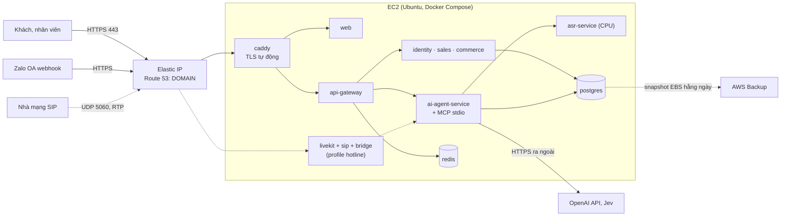
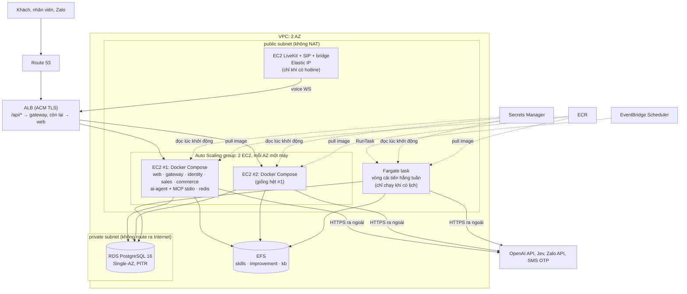
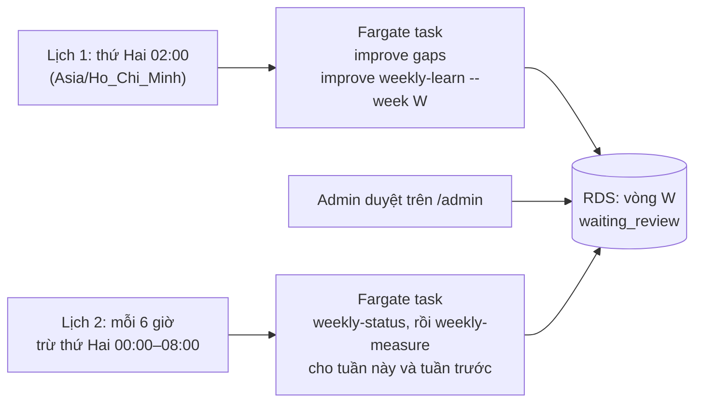
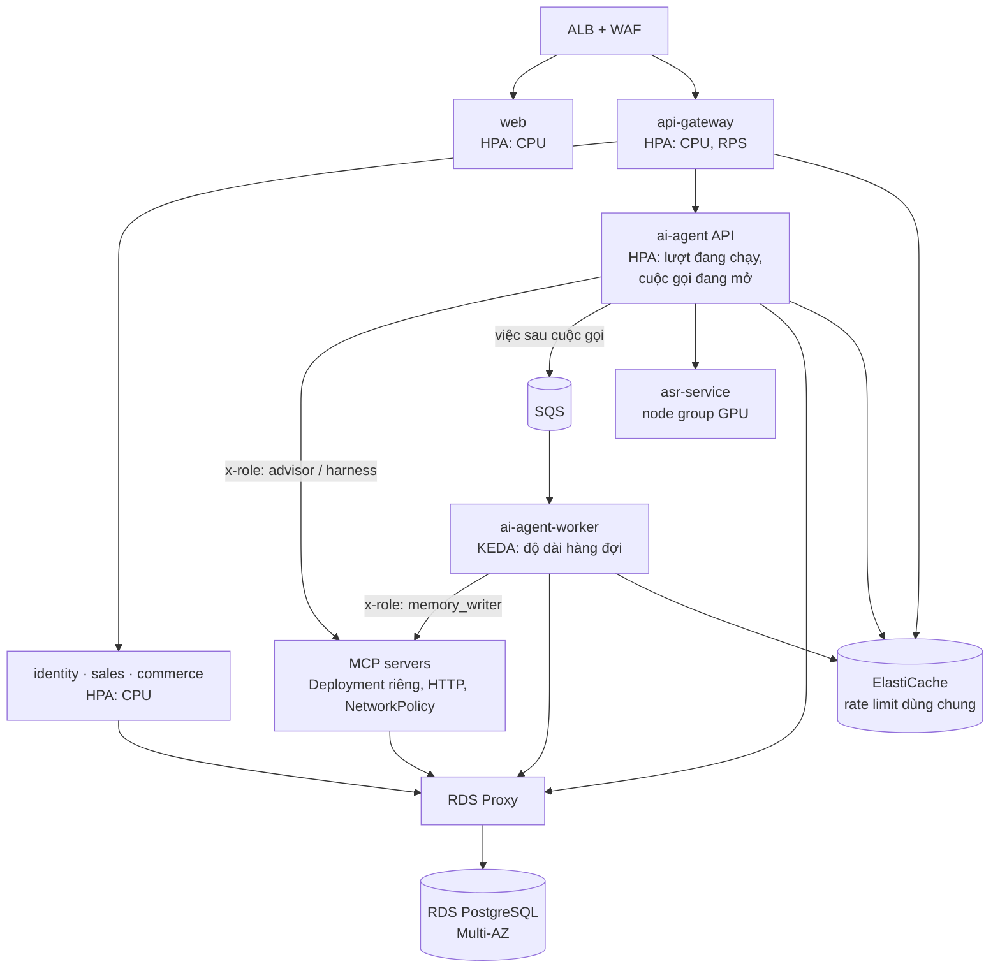

# Kế hoạch triển khai trên AWS

Trang này là **thiết kế**. Giai đoạn 2 đã có code: Terraform `infra/terraform/aws`, compose `infra/compose/docker-compose.aws.yml`, image vòng cải tiến `infra/improve`, workflow `deploy-aws.yml` và `terraform-aws.yml`. Cách dựng và phát hành từng bước: [aws-terraform-cicd.md](aws-terraform-cicd.md). **Chưa ai apply hay deploy lên một tài khoản AWS thật**; code mới qua `terraform validate`, `actionlint`, `shellcheck`, `docker compose config` và test.

Kế hoạch đi hai giai đoạn, cộng một lộ trình nâng cấp khi cần:

1. **Giai đoạn 1, một EC2 + Docker Compose:** dùng lại nguyên `infra/compose/docker-compose.cloud.yml`. Nhanh nhất để có demo HTTPS.
2. **Giai đoạn 2, bản gọn:** ALB + 2 EC2 chạy cùng bộ Docker Compose + RDS PostgreSQL + EFS. Mục tiêu: không còn một điểm hỏng, có backup tự động của RDS, đổi version không gián đoạn. Cố ý **không** dùng EKS, WAF, NAT Gateway, ElastiCache, VPC interface endpoint, MWAA: đó là các khoản tính tiền theo giờ dù không có tải, và hệ thống ở cỡ hiện tại chưa cần chúng (mục 3.1).
3. **Khi lớn hơn:** bật lại từng phần theo tín hiệu cụ thể (mục 7). Kiến trúc EKS đầy đủ nằm ở đó.

Kiến trúc ứng dụng mà kế hoạch này triển khai: [docs/ai/00-kien-truc.md](../ai/00-kien-truc.md). Cách chạy local và GCP: [README.md](README.md).

---

## 1. Hệ thống cần chạy những gì

Lấy từ `docker-compose.yml` và `infra/kubernetes/base/workloads.yaml`:

| Thành phần | Image / nguồn | Yêu cầu đặc biệt trên cloud |
|---|---|---|
| `web` (Next.js) | `apps/web/Dockerfile` | thành phần duy nhất cần ra Internet, cùng `/api/*` của gateway |
| `api-gateway` :8000 | `apps/api-gateway/Dockerfile` | giới hạn 120 request/phút mỗi IP cho `/api/*` (Redis nếu có `REDIS_URL`, không thì đếm trong tiến trình); SSE và WebSocket đi qua |
| `identity-service` :8200, `sales-service` :8300, `commerce-service` :8100 | Dockerfile riêng | PostgreSQL |
| `*-events` workers (4) | `packages/backend-common/Dockerfile` | chỉ cần khi bật Kafka (profile `async`) |
| `ai-agent-service` :8400 | `apps/ai-agent-service/Dockerfile` (`WITH_VOICE=1` khi cần thoại) | request 1Gi / limit 3Gi RAM, voice thêm khoảng 1,5Gi; 6 tiến trình con MCP qua stdio; gọi model qua Internet; tự tạo bảng trong schema `agent` khi khởi động; skills và trạng thái cải tiến là file (`/app/agent/data/skills`, `/app/agent/data/improvement`) |
| `asr-service` :8500 | `apps/asr-service/Dockerfile` | CPU được, GPU thì nhanh hơn (`ASR_DEVICE=cuda`); đặt `ASR_API_KEY` |
| PostgreSQL 16 | `postgres:16` | một database `app_db`, nhiều schema; agent cần quyền `CREATE` |
| Redis 7 | `redis:7-alpine` | chỉ cho rate limit của gateway |
| Kafka | `apache/kafka:3.9.1`, profile `async` | tùy chọn |
| LiveKit + LiveKit SIP + `hotline-bridge` | profile `hotline` | UDP công khai: SIP 5060, RTP 40000–40100 và 40200–40300, TCP 7881 (`infra/livekit/livekit.yaml`) |
| Qdrant | profile `retrieval` | **không triển khai**: không code nào dùng ([0.9](../ai/00-kien-truc.md#09-kho-tri-thức-embedding-lưu-ở-đâu-có-dùng-qdrant-không)) |

Bên ngoài: API model (OpenAI theo `config/models.yaml`; Google, Groq, NVIDIA nếu đổi model), Jev/TypeSafe cho soft guard, Zalo OA, nhà cung cấp SMS cho OTP, Langfuse (tùy chọn).

### 1.1 IP của khách sau proxy (đã sửa)

Rate limit của gateway đếm theo `request.client.host` ([main.py](../../apps/api-gateway/src/main.py)). Gateway chạy `uvicorn` không đặt `--forwarded-allow-ips`, nên uvicorn chỉ tin `X-Forwarded-For` từ `127.0.0.1`. Đứng sau Caddy (giai đoạn 1) hay ALB (giai đoạn 2), `client.host` là IP của proxy: **mọi khách dùng chung một ô 120 request/phút**, và khi đông khách thì ai cũng nhận 429.

Đã sửa bằng cấu hình, không sửa code. `api-gateway` giờ có `FORWARDED_ALLOW_IPS=10.0.0.0/8,172.16.0.0/12,192.168.0.0/16` trong `docker-compose.cloud.yml`, `docker-compose.aws.yml` và `infra/kubernetes/base/workloads.yaml`. Với cấu hình này, uvicorn tin proxy nằm trong dải IP riêng, rồi lấy địa chỉ ngoài cùng bên phải của `X-Forwarded-For` mà không thuộc các dải đó. ALB nối IP thật vào cuối header, nên một `X-Forwarded-For` giả do khách gửi lên không qua mặt được giới hạn. Test: `tests/agent/test_improve_runner.py`. Chưa kiểm trên cloud thật: hai máy khác IP cùng gửi 100 request trong một phút, không máy nào được nhận 429.

Điểm này càng quan trọng khi không có WAF: rate limit của gateway là lớp chặn spam duy nhất trước API.

---

## 2. Giai đoạn 1: một EC2 với Docker Compose

Câu hỏi sơ đồ trả lời: **một VM duy nhất chứa những gì, và cái gì đi ra ngoài?**



### 2.1 Các bước

1. **Mạng:** VPC mặc định là đủ cho demo. Security group mở TCP 80, 443 và UDP 443 (HTTP/3 của Caddy). Nếu dùng tổng đài, mở thêm UDP 5060, 40000–40100, 40200–40300 và TCP 7881. Chỉ mở SSH 22 cho IP quản trị, hoặc dùng SSM Session Manager và không mở 22.
2. **Máy:** Ubuntu 24.04, ổ EBS gp3 ít nhất 60 GB (image, weights voice, database). Cỡ máy là giả định cần đo, không phải số đã đo:
   - chỉ chat: khoảng 4 vCPU / 16 GB (ví dụ `m7i.xlarge`), vì riêng một replica agent đã có thể tới 3 GB và chạy 6 tiến trình con;
   - có thoại và ASR trên CPU: tăng lên 8 vCPU / 32 GB, hoặc tách ASR sang máy GPU (mục 4.1).
3. **DNS:** Route 53 (hoặc DNS hiện có) trỏ bản ghi A của `DOMAIN` về Elastic IP.
4. **Cài và chạy:** đúng như mục 0 của [README.md](README.md):
   ```bash
   cp infra/compose/.env.cloud.example .env   # điền DOMAIN và các secret, xem mục 5
   docker compose -f docker-compose.yml -f infra/compose/docker-compose.cloud.yml up -d --build
   ```
5. **Backup:** AWS Backup chụp snapshot EBS hằng ngày, giữ ít nhất 7 ngày. Thêm `pg_dump` hằng đêm lên S3 (mã hóa SSE-KMS) để khôi phục được từng database.
6. **Log:** compose đã giới hạn log 50 MB mỗi service. Muốn giữ lâu hơn thì cài CloudWatch Agent đọc log của Docker.

### 2.2 Giới hạn của giai đoạn 1

- Một máy là một điểm hỏng: máy chết thì cả hệ thống dừng, và khôi phục từ snapshot mất vài chục phút.
- PostgreSQL nằm chung máy: không có point-in-time recovery.
- Đổi version phải `up -d --build` trên máy, nên có vài giây gián đoạn.

---

## 3. Giai đoạn 2: bản gọn

Giai đoạn 2 gỡ đúng ba giới hạn ở 2.2, và không thêm gì khác:

| Giới hạn của giai đoạn 1 | Giai đoạn 2 gỡ bằng |
|---|---|
| một máy là một điểm hỏng | 2 EC2 ở 2 AZ sau một ALB, trong Auto Scaling group tự thay máy hỏng |
| database chung máy, không PITR | RDS PostgreSQL 16, backup tự động 7 ngày, point-in-time recovery |
| đổi version bị gián đoạn | ASG instance refresh: thay từng máy một, ALB chỉ gửi request tới máy đã khỏe |

Ứng dụng trên mỗi máy vẫn là **chính bộ Docker Compose** của giai đoạn 1, bỏ `caddy` và `postgres`. Không phải viết task definition ECS hay manifest Kubernetes mới: toàn bộ trạng thái đã nằm trong PostgreSQL (lease cuộc gọi, checkpoint LangGraph, hội thoại), nên hai máy chạy song song mà không cần biết nhau.

### 3.1 Bỏ gì, vì sao, bao giờ bật lại

Các khoản dưới đây tính tiền **theo giờ, kể cả khi không có tải**, nên ở quy mô demo hoặc vài nghìn cuộc hội thoại mỗi ngày, chúng thường đắt hơn chính phần máy chạy ứng dụng. Giá là ước lượng từ bảng giá niêm yết, **chưa kiểm** bằng AWS Pricing Calculator cho region đã chọn.

| Bỏ | Tính tiền theo | Thay bằng | Bật lại khi |
|---|---|---|---|
| **AWS WAF** | web ACL + mỗi rule hằng tháng + mỗi triệu request | rate limit của gateway (120/phút/IP, mục 1.1); security group chỉ cho ALB vào máy; token cho mọi route nhân viên | thấy bot hoặc spam thật trong log ALB (nhiều 429, request lạ vào `/api/*`), hoặc mở chiến dịch công khai lớn |
| **EKS** | control plane khoảng 0,10 USD/giờ (≈ 73 USD/tháng), cộng các add-on phải tự vận hành (Load Balancer Controller, EFS CSI, External Secrets, Karpenter) | Docker Compose trên ASG (mục 3.4) | cần scale từng service độc lập, hoặc vượt khoảng 4 máy (mục 7) |
| **NAT Gateway** | mỗi AZ theo giờ (≈ 40 USD/tháng mỗi cái) + mỗi GB dữ liệu | máy chạy ở **public subnet** có public IPv4; security group không mở cổng nào từ Internet ngoài từ ALB | yêu cầu compliance bắt máy phải ở private subnet |
| **VPC interface endpoint** (ECR, Secrets Manager, Logs) | mỗi endpoint × mỗi AZ theo giờ | đi thẳng ra Internet từ public subnet. Giữ **S3 gateway endpoint** vì miễn phí | khi đã có NAT, để giảm phí NAT |
| **ElastiCache** | mỗi node theo giờ | container `redis` sẵn có trong compose, mỗi máy một cái | gateway chạy trên nhiều hơn 2 máy, hoặc cần rate limit model dùng chung (mục 7) |
| **RDS Multi-AZ** | gấp đôi giá instance | RDS **Single-AZ**, backup tự động + PITR | cần chịu được mất cả một AZ mà không khôi phục tay; đổi sang Multi-AZ là một thao tác `modify` |
| **3 AZ** | thêm subnet, thêm máy | **2 AZ** | khi có Multi-AZ và cần nhiều máy hơn |
| **Amazon MWAA** | environment theo giờ, chạy 24/7 dù DAG chỉ chạy vài giờ mỗi tuần | EventBridge Scheduler gọi ECS task trên Fargate, chỉ tính tiền lúc task chạy (mục 3.7) | có nhiều pipeline định kỳ phụ thuộc nhau, đáng để có Airflow |
| **MSK** | broker theo giờ | không bật Kafka; HTTP API chạy được không cần Kafka | cần luồng event bất đồng bộ (profile `async`) |

Không dùng WAF thì cần chấp nhận: không có lớp lọc SQL injection hay bot ở biên. Lớp bảo vệ còn lại là xác thực của từng service, validation của FastAPI, và rate limit theo IP. Rate limit theo IP chỉ đúng khi đã làm mục 1.1.

### 3.2 Sơ đồ

Câu hỏi sơ đồ trả lời: **request của khách đi qua những gì, và dữ liệu nằm ở đâu?**



Các khối:

- **ALB:** kết thúc TLS bằng chứng chỉ ACM (miễn phí). Hai rule giống Caddyfile của giai đoạn 1 ([Caddyfile](../../infra/compose/caddy/Caddyfile)): `/api/*` (gồm WebSocket voice `/api/conversations/{id}/voice` và webhook Zalo) tới cổng gateway, còn lại tới cổng web. Cổng 80 chuyển sang 443.
- **EC2 trong ASG:** mỗi máy chạy cùng một bộ compose, kéo image có tag cố định từ ECR. Máy không lưu gì cần giữ: hỏng thì ASG thay máy mới.
- **RDS:** nơi duy nhất giữ dữ liệu nghiệp vụ và trạng thái agent.
- **EFS:** file mà agent cần dùng chung giữa hai máy và với vòng cải tiến (mục 3.5).
- **Fargate task:** vòng cải tiến hằng tuần, tách khỏi máy phục vụ khách (mục 3.7).

### 3.3 Mạng

- **VPC** 2 AZ, hai lớp subnet:
  - public: ALB, EC2 của ASG, Fargate task, EC2 LiveKit;
  - private: RDS (không route ra Internet).
- **Security group:**
  - ALB: nhận 80 và 443 từ Internet;
  - EC2 ứng dụng: chỉ nhận cổng web và gateway từ security group của ALB. Không mở SSH: vào máy bằng SSM Session Manager;
  - RDS: chỉ nhận 5432 từ security group của EC2 ứng dụng và của Fargate task;
  - EFS: chỉ nhận 2049 từ hai security group đó;
  - EC2 LiveKit: UDP 5060 cho dải IP của nhà mạng SIP, RTP cho Internet.
- **Public IPv4:** mỗi EC2 và Fargate task có một public IPv4 để ra Internet. AWS tính phí nhỏ cho mỗi IPv4 công khai theo giờ, vẫn rẻ hơn nhiều so với NAT Gateway.
- **S3 gateway endpoint** (miễn phí) cho `pg_dump` và log lên S3.
- **LiveKit không đặt sau ALB:** ALB không chuyển UDP. Chạy LiveKit trên một EC2 riêng có Elastic IP, hoặc dùng LiveKit Cloud. Cuộc gọi trên trình duyệt không cần LiveKit: WebSocket voice đi thẳng qua ALB.

### 3.4 Máy và Docker Compose

**Cỡ máy (giả định, cần đo):** 2 máy `r7i.large` (2 vCPU / 16 GB), mỗi AZ một máy, ASG `min=2, max=4`.

- Chọn họ `r` (nhiều RAM, ít CPU): agent giữ tới 3 GB RAM mỗi tiến trình và phần lớn thời gian của một lượt là chờ model, nên RAM hết trước CPU.
- Môi trường staging hoặc demo có thể đặt `min=max=1`. Vẫn có RDS và ASG tự thay máy hỏng, chỉ mất tính sẵn sàng khi đổi version.
- Khi đã đo được tải ổn định, mua Compute Savings Plans cho phần máy chạy thường trực.

**File compose** [docker-compose.aws.yml](../../infra/compose/docker-compose.aws.yml), ghép đè lên `docker-compose.yml`. Nó khác `docker-compose.cloud.yml` ở những điểm:

1. bỏ `caddy` (ALB làm thay) và `postgres` (RDS làm thay);
2. dùng `image: <ECR>/telesales-<service>:${TAG}` thay vì `build:`, để cả hai máy chạy đúng cùng một version;
3. `web` và `api-gateway` publish cổng ra máy cho ALB (target type `instance`); các service khác không publish cổng nào;
4. `DATABASE_URL` trỏ RDS với `sslmode=require`;
5. `api-gateway` có `FORWARDED_ALLOW_IPS` bằng CIDR của VPC (mục 1.1);
6. volume `agent-skills`, `agent-improvement` và thư mục `data/kb` của agent là bind mount vào EFS (mục 3.5);
7. logging driver `awslogs` gửi log thẳng lên CloudWatch Logs, không cần CloudWatch Agent.

**Khởi động máy:** user data của launch template cài Docker và mount EFS. Sau đó nó đọc `TAG` và secret từ SSM Parameter Store / Secrets Manager, ghi ra `.env`, rồi `docker compose pull && docker compose up -d`. Máy mới của ASG tự lên đúng version, không cần ai SSH vào.

**Health check:** ALB kiểm `/health/ready` của gateway (healthcheck mà compose đã dùng; nó kiểm cả identity, sales, commerce) và `/` của web. ASG dùng health check của ELB, nên một máy mà ứng dụng chết sẽ bị thay.

### 3.5 Những điểm riêng của `ai-agent-service`

| Vấn đề | Cách làm |
|---|---|
| **SSE** `/api/conversations/{id}/stream` và **WebSocket voice** | ALB hỗ trợ cả hai và không buffer response. Đặt `idle_timeout` của ALB ít nhất 300 giây (mặc định 60), vì một cuộc gọi thoại giữ WebSocket lâu. Một WebSocket là một kết nối liền, ở yên trên một máy suốt cuộc gọi, nên không cần sticky session |
| **Hai máy, hai agent** | chat không cần sticky: lease và checkpoint nằm trong PostgreSQL, nên lượt sau đi vào máy nào cũng được. Mỗi máy chạy vòng đối soát hội thoại đã đóng của riêng nó (`_reconcile_forever`), đã được thiết kế cho nhiều replica |
| **Skills và vòng cải tiến** | `/app/agent/data/skills` và `/app/agent/data/improvement` trên EFS, dùng chung giữa hai máy và Fargate task. Admin bật version là ghi `active.json` trên EFS. Agent chỉ đọc skills lúc khởi động, nên sau khi bật phải restart `ai-agent-service` trên từng máy (instance refresh, hoặc SSM Run Command `docker compose restart ai-agent-service` lần lượt từng máy) |
| **Knowledge (`data/kb`)** | trên EFS. Lần khởi động đầu tiên của cả nhóm máy chép `data/kb` từ image sang EFS, một lần, có khóa trên EFS. Ở local và giai đoạn 1, compose mount volume `agent-kb`, nên version knowledge không còn mất khi tạo lại container |
| **Thay đổi runtime từ Agent Console** (model, voice, ngày nghiệp vụ) | chỉ áp dụng cho tiến trình nhận request ([options.py](../../apps/ai-agent-service/src/ai_agent_service/runtime/options.py)). Với hai máy: đổi qua `config/models.yaml` rồi rollout, hoặc chấp nhận và ghi rõ trong vận hành |
| **6 tiến trình con MCP** | giữ stdio. Tách MCP thành service HTTP riêng chỉ cần khi scale lớn (mục 7) |
| **Weights embedding và voice** (`/app/models`) | bake vào image, hoặc để trong volume `voice-models` trên ổ EBS của máy. Không cần EFS: mỗi máy tải một lần |
| **`APP_SECRET`** sinh khóa của PII vault | lưu trong Secrets Manager, **không xoay vòng tự động**: đổi giá trị thì vault cũ không giải mã được |
| **Schema `agent`** tự tạo khi khởi động | role runtime trên RDS cần quyền `CREATE` trên database, hoặc tạo sẵn schema `agent` với owner là role đó |
| **Gọi model ra ngoài** | đi thẳng từ public subnet. Đặt ngân sách và cảnh báo chi tiêu ở phía provider |

### 3.6 Dữ liệu

- **RDS for PostgreSQL 16, Single-AZ.** Cỡ khởi điểm `db.t4g.medium` (giả định, cần đo), gp3 50 GB có autoscaling dung lượng.
  - Backup tự động 7 ngày, có point-in-time recovery.
  - `deletion_protection = true`; parameter group `rds.force_ssl = 1`.
  - Performance Insights bản miễn phí (7 ngày).
- **Database đánh giá** (`*_eval`, bị xóa bảng mỗi lần chạy `run_eval.py`): một database riêng `app_db_eval` trên **cùng instance**, để không phải trả thêm một instance. Không bao giờ trỏ `EVAL_DATABASE_URL` vào `app_db`. Vòng đánh giá chạy lúc 02:00 nên không tranh tải với khách.
- **Redis:** container `redis` trong compose, mỗi máy một cái, không lưu ra đĩa. Nó chỉ giữ bộ đếm rate limit, nên mất là không sao. Hệ quả: giới hạn thực tế là 120 request/phút/IP **cho mỗi máy**, tức tới 240 với hai máy.
- **EFS:** chỉ trả theo dung lượng dùng (vài MB tới vài trăm MB), không có phí cố định. Bật AWS Backup cho EFS.
- **`pg_dump` hằng đêm lên S3** như giai đoạn 1: bản xuất từng database, độc lập với snapshot của RDS.

### 3.7 Vòng cải tiến hằng tuần, không Airflow

Ở local, vòng chạy bằng DAG `infra/airflow/dags/improvement_weekly.py` ([đề xuất 001](../plan/001-vong-cai-tien-hang-tuan-va-dashboard.md)). Trên AWS, MWAA quá đắt cho một việc chạy vài giờ mỗi tuần. Dùng **EventBridge Scheduler** gọi **ECS RunTask trên Fargate**, chỉ tính tiền lúc task chạy.

Câu hỏi sơ đồ trả lời: **không có Airflow thì ai chờ admin duyệt?**



Không cần bộ chờ (sensor) như DAG, vì hai lệnh đã an toàn khi chạy lặp lại ([weekly.py](../../apps/ai-agent-service/src/ai_agent_service/pipeline/improve/weekly.py)):

- `weekly-status` chuyển vòng sang `expired` khi quá 7 ngày chưa duyệt xong. Ngoài ra nó chỉ đọc.
- `weekly-measure` chỉ làm khi vòng đang `waiting_review` và không còn đề xuất nào chờ. Mọi trường hợp khác nó in "nothing to measure" và thoát 0.
- Lịch 2 xét cả tuần trước, vì vòng bắt đầu thứ Hai có hạn duyệt kéo sang thứ Hai tuần sau.
- Lịch 2 tránh khung thứ Hai 00:00–08:00 để không đo cùng lúc với lượt học. Hai run đánh giá dùng chung một database `*_eval` sẽ đụng khóa ("Another evaluation is using this database").

Lệnh của từng bước lấy nguyên từ `STEPS` trong file DAG, nên DAG local và lịch trên AWS chạy cùng một lệnh. Phần này đã có code:

- **[infra/improve/run.py](../../infra/improve/run.py):** hai lệnh `learn` và `tick`. Nó đọc `STEPS` từ file DAG, điền ISO week theo giờ Việt Nam, và với `tick` thì xét cả tuần này lẫn tuần trước. Test: `tests/agent/test_improve_runner.py`.
- **[Image `telesales-improve`](../../infra/improve/Dockerfile):** giữ đúng cấu trúc repo. File whitelist `Dockerfile.dockerignore` chỉ copy những gì vòng đọc: `run_eval.py`, bộ kịch bản, `config/prompts`, `docs/evaluation` (hash hợp đồng của extractor). Image chạy với uid 1000, trùng user `app` của image agent, nên file trên EFS ghi qua lại được.
- **Task definition Fargate `improve`** ([ecs.tf](../../infra/terraform/aws/ecs.tf)): 2 vCPU / 8 GB. Nó mount EFS cho `skills`, `improvement`, `kb` và `runs`. Thư mục `runs` cần thiết vì lesson và file review của một tuần phải còn đó giữa task học và task đo. Hai lịch EventBridge mặc định **tắt** (`improve_schedule_enabled`).

Chi phí lớn nhất của vòng vẫn là phí model cho R0, học và R1, không phải AWS.

---

## 4. Các bước của giai đoạn 2

Từng bước, từ bucket state tới release đầu tiên và cách quay lui: [aws-terraform-cicd.md](aws-terraform-cicd.md). Tóm tắt:

| Phần | File | Ghi chú |
|---|---|---|
| Hạ tầng | [infra/terraform/aws](../../infra/terraform/aws/) | viết tay bằng resource của provider AWS 6.x (không dùng module ngoài), để đọc được hết trong một thư mục. Remote state S3 có khóa (`use_lockfile`) |
| Khởi động máy | [user_data.sh.tftpl](../../infra/terraform/aws/templates/user_data.sh.tftpl) | Amazon Linux 2023, Docker và Compose, mount EFS, đọc release từ SSM, secret từ Secrets Manager, rồi `compose up` |
| Phát hành | [deploy-aws.yml](../../.github/workflows/deploy-aws.yml) | build và push image theo SHA, dời tag `latest-release`, migrate và seed bằng Fargate task `ops`, ghi release, instance refresh, smoke test |
| Thay hạ tầng | [terraform-aws.yml](../../.github/workflows/terraform-aws.yml) | `plan` trên pull request bằng role chỉ đọc; `apply` chạy tay và cần người duyệt |
| Quyền | [github.tf](../../infra/terraform/aws/github.tf) | GitHub OIDC, không có access key; ba role: deploy, terraform-plan, terraform-apply |
| Giám sát | [monitoring.tf](../../infra/terraform/aws/monitoring.tf) | alarm ALB 5xx/4xx/độ trễ, target không khỏe, RDS CPU và dung lượng, Fargate task lỗi, AWS Budgets |

Khác với bản kế hoạch trước: dùng Amazon Linux 2023 (có sẵn SSM agent và AWS CLI), migrate và seed chạy bằng Fargate task `ops` thay vì trên một máy, và secret nằm trong một object JSON để máy và task đọc chung.

### 4.1 ASR trên GPU (tùy chọn)

Một EC2 GPU riêng chạy image `asr-service`, chỉ mở 8500 cho security group của máy ứng dụng. Đặt `ASR_URL` và `ASR_API_KEY` cho agent. Bật/tắt máy theo lịch (EventBridge Scheduler) nếu chỉ cần trong giờ làm việc. Chạy ASR trên CPU trước, đo WER và độ trễ, rồi mới thuê GPU.

---

## 5. Secret cần có

Bảng mục 3 của [README.md](README.md), cộng các khóa mà code hiện đọc:

| Khóa | Ghi chú |
|---|---|
| `DATABASE_URL`, `MIGRATION_DATABASE_URL` | RDS, `sslmode=require` |
| `EVAL_DATABASE_URL` | `app_db_eval`, chỉ cho task vòng cải tiến |
| `REDIS_URL` | `redis://redis:6379/0`, container trong compose của từng máy |
| `APP_SECRET`, `ENCRYPTION_KEY` | không xoay vòng tự động (3.5) |
| `ADMIN_TOKEN`, `AGENT_TOKEN`, `SELLER_TOKEN`, `DEVELOPER_TOKEN`, `HOTLINE_BRIDGE_KEY` | mạnh, khác nhau |
| **`OPENAI_API_KEY`** | bắt buộc với `config/models.yaml` hiện tại (mọi agent đều dùng `openai`). Bảng của README chưa có dòng này |
| `GOOGLE_API_KEY`, `GROQ_API_KEY`, `NVIDIA_API_KEY` | chỉ khi đổi model sang provider đó |
| `TYPESAFE_API_KEY` / `AI_GATEWAY_API_KEY` | soft guard; thiếu thì chỉ chạy hard guard |
| `ASR_API_KEY` | khi ASR ở máy riêng |
| `LANGFUSE_PUBLIC_KEY`, `LANGFUSE_SECRET_KEY`, `OTP_DELIVERY_URL`, `OTP_DELIVERY_TOKEN` | tùy chọn |

---

## 6. Vận hành

- **Log và metric:**
  - CloudWatch Logs qua driver `awslogs`, giữ 14–30 ngày (đặt retention, mặc định là giữ mãi);
  - CloudWatch metric có sẵn của ALB, EC2, RDS; không cần Container Insights;
  - Langfuse cho trace của model (tùy chọn, đã che PII theo [observability/turns.py](../../apps/ai-agent-service/src/ai_agent_service/observability/turns.py)).
- **Cảnh báo tối thiểu** (CloudWatch alarm gửi SNS email):
  - ALB 5xx và target không khỏe;
  - ALB 429 tăng đột biến: dấu hiệu spam, cân nhắc bật WAF (3.1);
  - p95 `TargetResponseTime` của ALB;
  - RDS CPU, dung lượng trống, số kết nối;
  - Fargate task của vòng cải tiến thoát khác 0;
  - chi tiêu model ở dashboard của provider, và AWS Budgets cho chi tiêu AWS.
- **Backup và khôi phục:** RDS automated backup + PITR, AWS Backup cho EFS, `pg_dump` lên S3. Thử khôi phục RDS sang một instance mới ít nhất một lần trước khi phục vụ khách thật.
- **Dữ liệu cá nhân:** đặt chính sách lưu giữ cho `agent.turns`, `agent.pii_vault`, snapshot và log trước khi có khách thật. Yêu cầu xóa đi qua route `privacy` (lệnh có ký từ outbox của Identity).

---

## 7. Khi lớn hơn: nâng cấp theo tín hiệu

Không nâng cấp theo lịch, mà khi thấy một tín hiệu cụ thể. Mỗi dòng bật lại độc lập.

| Tín hiệu | Bật |
|---|---|
| spam, bot, quét lỗ hổng trong log ALB | AWS WAF với rate-based rule cho `/api/*` và bộ rule quản lý của AWS |
| cần chịu mất một AZ mà không khôi phục tay | RDS Multi-AZ |
| hơn 2 máy gateway, cần rate limit chính xác | ElastiCache, đặt `REDIS_URL` dùng chung |
| nhiều pod agent cùng chạm quota model | rate limiter model dùng chung qua ElastiCache (cần sửa code, điểm nghẽn 1 bên dưới) |
| số kết nối RDS gần trần | tách MCP thành service HTTP, thêm RDS Proxy (điểm nghẽn 2) |
| cần scale từng service riêng, nhiều hơn khoảng 4 máy, hoặc đội đã quen Kubernetes | EKS, dùng lại `infra/kubernetes` (7.2) |
| compliance yêu cầu máy ở private subnet | NAT Gateway + VPC interface endpoint |

### 7.1 Cái gì nghẽn trước (đọc từ code ngày 12/11/2026)

Các điểm nghẽn này đúng với mọi cách triển khai, dù là compose hay EKS.

| # | Điểm nghẽn | Vì sao | Cách gỡ | Cần sửa code? |
|---|---|---|---|---|
| 1 | **Giới hạn của provider model** (request và token mỗi phút) | Đây là trần thật của hệ thống: mỗi lượt gọi advisor, có thể kèm PolicyAgent, và mỗi cuộc gọi kết thúc gọi MemoryAgent và QaAgent. Rate limiter nằm **trong từng tiến trình** (`_LIMITERS` trong [factory.py](../../apps/ai-agent-service/src/ai_agent_service/llm/factory.py)), nên N máy cùng bắn tới N lần giới hạn trong `config/models.yaml` | Ngắn hạn: chia `rate_limits` cho số máy tối đa. Dài hạn: limiter dùng chung qua ElastiCache. Xin nâng quota ở provider | có, cho limiter dùng chung |
| 2 | **Số tiến trình và kết nối database mỗi agent** | Mỗi vai MCP tự mở tiến trình stdio riêng ([client.py](../../apps/ai-agent-service/src/ai_agent_service/mcp/client.py)): tới 13 tiến trình, mỗi cái một pool PostgreSQL tối đa 2 kết nối ([server_base.py](../../apps/ai-agent-service/src/ai_agent_service/mcp/server_base.py)), cộng pool API tối đa 5 ([db.py](../../apps/ai-agent-service/src/ai_agent_service/runtime/db.py)): khoảng 31 kết nối mỗi agent | Chạy MCP server thành service riêng, client gọi qua HTTP (`MCP_<SERVER>_URL`, cổng 8801–8806). Thêm RDS Proxy | không: đã có chế độ HTTP |
| 3 | **Việc nền chạy trong tiến trình API** | `after_call` chạy bằng task asyncio, và mỗi agent chạy vòng đối soát 60 giây một lần (`_reconcile_forever` trong [main.py](../../apps/ai-agent-service/src/ai_agent_service/main.py)) | Tách worker riêng kéo việc từ hàng đợi (SQS) | có |
| 4 | **Tùy chọn runtime theo tiến trình** | Đổi từ Agent Console chỉ áp cho tiến trình nhận request | Lưu tùy chọn trong PostgreSQL và đọc lại định kỳ | có, nếu cần đổi lúc chạy |
| 5 | **Cuộc gọi thoại** | WebSocket giữ suốt cuộc gọi; VAD và Smart Turn chạy trong agent, ASR ở `asr-service` | Scale agent theo số cuộc gọi đang mở, không theo CPU. ASR trên GPU | không, chỉ cần metric |
| 6 | **PostgreSQL ghi** | Mỗi lượt ghi checkpoint LangGraph, `agent.turns`, `conversation.messages`; lease cuộc gọi là một `UPDATE` có điều kiện ([calls.py](../../apps/ai-agent-service/src/ai_agent_service/runtime/calls.py)) | Scale dọc instance RDS | có, nếu cần read replica |

Mỗi bước nâng cấp nên đo trước và sau với cùng tải: `run_eval.py --performance --sessions <mức>` cho p95 TTFT và số phiên giữ được, cộng CloudWatch cho CPU, RAM và số kết nối RDS. Chưa có số đo nào cho các bước này.

### 7.2 Kiến trúc đầy đủ trên EKS

Khi đã có các tín hiệu ở bảng trên, chuyển sang EKS. Câu hỏi sơ đồ trả lời: **sau khi gỡ các điểm nghẽn, mỗi phần scale theo tín hiệu nào?**



Ánh xạ từ manifest hiện có:

| Hiện có | Trên AWS |
|---|---|
| `infra/kubernetes` (Kustomize, Job migration) | EKS managed node group hoặc EKS Auto Mode; thêm overlay `aws-production` với Ingress `ingressClassName: alb` |
| Secret Kubernetes `telesales-secrets` | Secrets Manager + External Secrets Operator |
| volume `voice-models` (`emptyDir`) | EFS qua EFS CSI Driver |
| DAG `improvement_weekly` | giữ EventBridge + Fargate của 3.7, hoặc MWAA với `EksPodOperator` khi có nhiều pipeline |

`render_deployment.py` hiện chỉ render `--environment production|staging`; muốn dùng overlay `aws-production` thì phải sửa script, hoặc chạy `kubectl kustomize` trực tiếp.

---

## 8. Việc cần người quyết định

| Quyết định | Lựa chọn | Đề xuất |
|---|---|---|
| Region | `ap-southeast-1` (Singapore), hoặc region gần Việt Nam hơn nếu đủ dịch vụ | Singapore; đo độ trễ thật từ Việt Nam trước khi chốt |
| Nền chạy của giai đoạn 2 | Docker Compose trên ASG, ECS, hay EKS | Compose trên ASG: dùng lại file đã có, không phí control plane, ít thứ phải học. ECS là bước giữa nếu cần scale từng service mà chưa muốn Kubernetes |
| Số máy | 1 (staging, demo) hay 2 (khách thật) | 2 khi có khách thật; 1 cho staging |
| WAF | bật ngay hay khi có tín hiệu | khi có tín hiệu (3.1), sau khi đã làm mục 1.1 |
| ASR | CPU trên máy ứng dụng, hay EC2 GPU riêng | CPU trước, đo, rồi mới thuê GPU |
| Tổng đài | LiveKit tự chạy trên EC2, hay LiveKit Cloud | chỉ làm khi có hợp đồng SIP |
| Giai đoạn 1 có cần không | đi thẳng giai đoạn 2, hay demo trên EC2 trước | EC2 trước nếu cần demo sớm |

## 9. Chi phí

Chưa ước tính bằng AWS Pricing Calculator cho region và cỡ máy đã chốt. Các khoản theo thứ tự lớn dự kiến:

1. API model (tính theo token, không phải AWS). Đây gần như chắc chắn là khoản lớn nhất.
2. 2 EC2 chạy thường trực; giảm được bằng Savings Plans.
3. RDS Single-AZ và dung lượng backup.
4. ALB (theo giờ + theo LCU).
5. Public IPv4, CloudWatch Logs, EFS, ECR, Fargate của vòng cải tiến (vài giờ mỗi tuần): đều nhỏ.

So với bản EKS cũ, bản gọn bỏ các khoản cố định: control plane EKS, NAT Gateway mỗi AZ, VPC interface endpoint, ElastiCache, WAF, MWAA, và nửa giá RDS (Multi-AZ). Mục 3.1 ghi mỗi khoản và khi nào cần bật lại.

Giai đoạn 1 chỉ tốn một EC2, một EBS, một Elastic IP và snapshot, cộng API model.

## 10. Phạm vi kiểm chứng

Chưa có gì trong trang này được chạy trên AWS. Mỗi phần cần kiểm như sau:

| Phần | Cần kiểm |
|---|---|
| `FORWARDED_ALLOW_IPS` (mục 1.1) | hai IP khác nhau không chia chung giới hạn 120/phút sau proxy |
| Terraform AWS | `terraform plan` và `terraform apply` trên tài khoản thật |
| `docker-compose.aws.yml` | máy mới của ASG tự lên đúng version từ user data |
| ALB | SSE stream được, WebSocket voice giữ được một cuộc gọi dài qua `idle_timeout` 300 giây |
| Instance refresh | không có request lỗi trong lúc thay máy (chạy tải nhẹ trong lúc refresh) |
| EFS | admin bật version skills, restart, cả hai máy trả lời theo version mới |
| Vòng cải tiến trên Fargate | lịch 1 tạo vòng; duyệt trên `/admin`; lịch 2 đo và chuyển vòng sang `measured` |
| Backup | khôi phục RDS thành công sang một instance mới |
