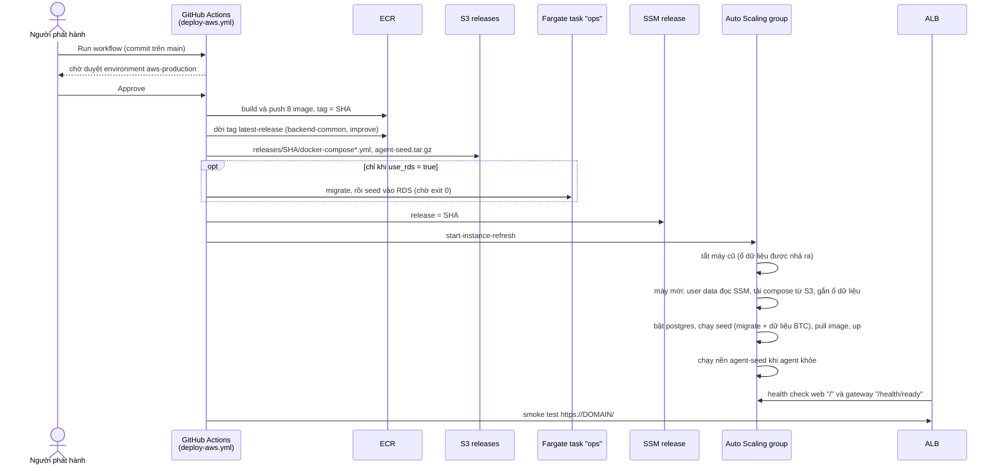

# Triển khai AWS: Terraform và CI/CD với GitHub Actions

Trang này hướng dẫn dựng hạ tầng giai đoạn 2 của [aws-plan.md](aws-plan.md) bằng Terraform, rồi phát hành bằng GitHub Actions. Thiết kế (vì sao ALB + EC2 + Docker Compose, vì sao không EKS, WAF, NAT) nằm ở aws-plan; trang này chỉ nói **làm thế nào**.

**Cấu hình mặc định: một máy CPU, khoảng 215 USD/tháng.**
- Một EC2 `t3.xlarge` (4 vCPU, 16 GB) chạy cả stack, gồm ASR trên CPU (`ASR_LOCAL=1`).
- PostgreSQL chạy trong container trên chính máy đó. File dữ liệu nằm trên một ổ EBS riêng (`data_volume_gb`), ổ này còn nguyên khi máy bị thay.
- Backup: snapshot ổ mỗi ngày, cộng `pg_dump` mỗi đêm lên S3.

Muốn quay về cấu hình 2 máy + RDS thì đặt `use_rds = true` (mục 10). Có hai đánh đổi so với RDS:
- **Mỗi lần phát hành gián đoạn vài phút**, vì máy cũ phải tắt để nhả ổ dữ liệu trước khi máy mới gắn vào.
- **Không có point-in-time recovery.** Tối đa mất dữ liệu kể từ snapshot hoặc `pg_dump` gần nhất.

**Đã kiểm:** `terraform validate` và `terraform fmt` qua với provider AWS 6.73; hai workflow qua `actionlint`; user data qua `shellcheck`; file compose AWS dựng được bằng `docker compose config`; image `telesales-improve` build và chạy được; `tests/agent/test_improve_runner.py`. **Chưa kiểm:** chưa có lần `terraform apply` hay lần deploy nào trên tài khoản AWS thật. Lần đầu làm theo trang này là lần kiểm đầu tiên; ghi lại chỗ sai vào đây.

---

## 1. Những gì có trong repo

| File | Làm gì |
|---|---|
| [infra/terraform/aws/](../../infra/terraform/aws/) | toàn bộ hạ tầng: VPC 2 AZ, ALB + ACM, Auto Scaling group (1 máy), ổ EBS dữ liệu + snapshot hằng ngày (DLM), EFS, ECR, S3 cho release và backup, Secrets Manager, ECS (chỉ Fargate task), lịch EventBridge, role IAM cho GitHub, alarm và budget. RDS chỉ khi `use_rds = true` |
| [infra/terraform/aws/templates/user_data.sh.tftpl](../../infra/terraform/aws/templates/user_data.sh.tftpl) | việc máy làm khi khởi động: cài Docker, mount EFS, gắn và mount ổ dữ liệu, đọc release và secret, migrate + seed vào Postgres của máy, chạy compose, hẹn giờ `pg_dump` |
| [infra/compose/docker-compose.aws.yml](../../infra/compose/docker-compose.aws.yml) | compose ghép đè lên `docker-compose.yml`: image từ ECR, không Caddy, Postgres trên ổ dữ liệu (profile `local-database`) hoặc không Postgres khi dùng RDS, file của agent trên EFS, log lên CloudWatch |
| [infra/improve/](../../infra/improve/) | image `telesales-improve` và `run.py` cho vòng cải tiến hằng tuần (thay Airflow) |
| [.github/workflows/terraform-aws.yml](../../.github/workflows/terraform-aws.yml) | `plan` trên mỗi pull request đụng tới Terraform; `apply` khi chạy tay và đã được duyệt |
| [.github/workflows/deploy-aws.yml](../../.github/workflows/deploy-aws.yml) | build và push image, migrate, seed, thay từng máy; hoặc quay lui về một release cũ |

## 2. Luồng một lần phát hành

Câu hỏi sơ đồ trả lời: **từ lúc bấm "Run workflow" tới lúc khách thấy version mới, ai làm gì?**



- **Tag bất biến:** ECR không cho ghi đè một tag, nên mỗi release là một SHA cố định. Ngoại lệ duy nhất là `latest-release`: Fargate task không đổi được image lúc chạy, nên workflow dời tag này sang release mới.
- **Một máy, tắt cũ trước (mặc định):** ổ EBS chỉ gắn được vào một máy, nên refresh chạy với `MinHealthyPercentage = 0` (workflow đọc từ `min_healthy` trong SSM `deploy`). Trang **ngừng phục vụ trong lúc thay**, khoảng 5–20 phút, tùy thời gian agent nạp. Nên phát hành ngoài giờ demo.
- **Với `use_rds = true`:** migrate chạy trước khi thay máy, trong lúc máy cũ vẫn phục vụ, nên migration phải tương thích ngược. Refresh giữ ≥ 50% máy khỏe, không gián đoạn.
- **Thời gian:** build khoảng 10–20 phút (lần sau nhanh hơn nhờ cache). Một máy mới khỏe sau tối đa `health_check_grace_seconds` = 1200 giây, vì agent nạp lâu.

### Dữ liệu mẫu trên AWS

Local có hai service nạp dữ liệu mẫu (`seed`, `agent-seed`, xem [README mục 0](README.md#0-docker-compose-local-và-cloud)). Trên AWS chúng chạy ở chỗ khác:

| Local | AWS | Nạp |
|---|---|---|
| `seed` | user data, mỗi lần máy khởi động, trước `up` (mặc định); hoặc Fargate task `ops` một lần mỗi release (`use_rds = true`) | Migration, danh mục BTC, 70 khách CRM và đơn cũ của họ (`catalog/crm_seed*.json` có sẵn trong image `backend-common`). Chạy lại an toàn |
| `agent-seed` | user data của máy, chạy nền, **một lần mỗi release** (khóa `/mnt/efs/.agent-seed.lock`, đánh dấu `/mnt/efs/.agent-seed-<SHA>`) | Cuộc gọi trước của mỗi khách vào bộ nhớ agent trong PostgreSQL. Không gọi model |

- `data/dev` không nằm trong image nào (`.dockerignore`). Vì vậy workflow đóng gói `data/dev/scenarios` và các file `call_1.json` thành `releases/<SHA>/agent-seed.tar.gz`; máy giải nén vào `/opt/telesales/data/dev`, đúng đường dẫn mà `docker-compose.yml` mount.
- `agent-seed` có profile riêng trong compose AWS, nên `up` không chạy nó. User data đợi `ai-agent-service` khỏe (tối đa 30 phút), rồi gọi `docker compose --profile agent-seed run --rm --no-deps agent-seed`. Log: `/var/log/telesales-agent-seed.log` trên máy, và CloudWatch.
- Tắt: biến GitHub `SEED_AGENT_MEMORY=false`, khi đó release không có tarball và máy bỏ qua bước này.
- **Không có mật khẩu demo trên AWS.** Compose AWS đặt `DEMO_CUSTOMER_PASSWORD` rỗng, nên khách CRM chưa có tài khoản đăng nhập bằng OTP.

---

## 3. Lần đầu: dựng hạ tầng

Làm từ máy của người có quyền admin trên tài khoản AWS. Cần AWS CLI v2, Terraform ≥ 1.10 (repo kiểm với 1.14.4), Session Manager plugin cho AWS CLI, Python có `psycopg` (để tạo role database), và một domain.

### Bước 1: bucket cho Terraform state

Một lần cho cả tài khoản. Bucket này không do Terraform quản lý, vì state không thể nằm trong chính nó.

```powershell
$Region = "ap-southeast-1"; $Bucket = "<tên-bucket-state-duy-nhất>"
aws s3api create-bucket --bucket $Bucket --region $Region --create-bucket-configuration LocationConstraint=$Region
aws s3api put-bucket-versioning --bucket $Bucket --versioning-configuration Status=Enabled
aws s3api put-public-access-block --bucket $Bucket --public-access-block-configuration "BlockPublicAcls=true,IgnorePublicAcls=true,BlockPublicPolicy=true,RestrictPublicBuckets=true"
```

Khóa state dùng chính S3 (`use_lockfile = true`), không cần bảng DynamoDB.

### Bước 2: apply lần đầu, chưa có release

```powershell
Set-Location infra/terraform/aws
Copy-Item backend.hcl.example backend.hcl            # điền bucket, region
Copy-Item terraform.tfvars.example terraform.tfvars  # domain, hosted_zone_id, github_repository, tf_state_bucket, alarm_email
terraform init -backend-config=backend.hcl
terraform plan  -var health_check_type=EC2 -out tfplan
terraform apply tfplan
```

`-var health_check_type=EC2` chỉ dùng cho lần này. Máy chưa chạy ứng dụng, nên ALB thấy nó không khỏe; với health check `ELB`, ASG sẽ thay máy liên tục.

Mặc định Terraform dựng **một máy `t3.xlarge`** và **một ổ EBS dữ liệu** (`terraform output data_volume_id`) cho PostgreSQL, ở AZ đầu tiên. Không có RDS.

**DNS và chứng chỉ:**

- Có `hosted_zone_id`: Terraform tự tạo bản ghi xác thực ACM và alias A trỏ về ALB.
- Không có: `apply` dừng chờ ở `aws_acm_certificate_validation`. Lấy bản ghi từ `terraform output certificate_validation_records`, tạo nó ở nhà cung cấp DNS, rồi trỏ domain (CNAME) về `terraform output alb_dns_name`.

**Tài nguyên được bảo vệ khỏi xóa nhầm:** ALB (`deletion_protection`) và ổ dữ liệu (`prevent_destroy`, kèm snapshot cuối khi xóa). Muốn gỡ thì phải bỏ các cờ này trước, có chủ đích.

### Bước 3: điền secret

Terraform chỉ tạo secret rỗng `telesales/production/app` (`terraform output app_secret_arn`); giá trị không bao giờ nằm trong state. Viết một file JSON **ngoài repo**, rồi đưa lên:

```json
{
  "POSTGRES_PASSWORD": "<mật-khẩu-postgres>",
  "DATABASE_URL": "postgresql+psycopg://postgres:<mật-khẩu-postgres>@postgres:5432/app_db",
  "APP_SECRET": "<32+ byte ngẫu nhiên; KHÔNG đổi sau khi có dữ liệu>",
  "ENCRYPTION_KEY": "<khóa Fernet>",
  "ADMIN_TOKEN": "...", "AGENT_TOKEN": "...", "SELLER_TOKEN": "...", "DEVELOPER_TOKEN": "...",
  "HOTLINE_BRIDGE_KEY": "...",
  "OPENAI_API_KEY": "...",
  "ENVIRONMENT": "production",
  "ASR_LOCAL": "1", "ASR_URL": "",
  "OTP_DELIVERY_URL": "", "OTP_DELIVERY_TOKEN": ""
}
```

```powershell
aws secretsmanager put-secret-value --secret-id (terraform output -raw app_secret_arn) --secret-string file://C:/secure/telesales-app.json
Remove-Item C:/secure/telesales-app.json
```

- **`POSTGRES_PASSWORD`**: dùng chuỗi chỉ gồm chữ và số, vì nó nằm trong URL của `DATABASE_URL`. Tạo bằng `python -c "import secrets; print(secrets.token_hex(24))"`. Postgres nhận mật khẩu này ở lần khởi tạo ổ dữ liệu đầu tiên. Đổi về sau thì phải `ALTER USER postgres PASSWORD ...` trong container, rồi mới sửa secret.
- **`DATABASE_URL`** trỏ về host `postgres`, tức container trên máy, không cần `sslmode`. Không cần `MIGRATION_DATABASE_URL` hay role runtime: seed và các service dùng user `postgres` của container. Postgres không mở cổng ra ngoài máy.
- **`ASR_LOCAL=1`, `ASR_URL` rỗng**: ASR chạy trên CPU của máy, không cần máy GPU.
- **`ENVIRONMENT`**: `production` chỉ gửi OTP qua nhà cung cấp SMS (`OTP_DELIVERY_URL`). Khi demo mà chưa có SMS, đặt `staging` để mã OTP hiện trên màn hình.
- **Giá trị không được chứa dấu nháy đơn** `'`: user data ghi `.env` bằng nháy đơn để compose đọc nguyên văn, kể cả ký tự `$`.
- Các khóa tùy chọn khác (Zalo, `GOOGLE_API_KEY`, `ASR_API_KEY`, `LANGFUSE_*`) thêm vào cùng object. Bảng đầy đủ ở [aws-plan.md, mục 5](aws-plan.md#5-secret-cần-có).
- `SHOP_ORDERS` (mặc định `1`): đơn agent chốt trên Zalo hay hotline cũng hiện trong tài khoản của khách trên web, và `order.status` đọc cả đơn đặt trên web. Đặt `"SHOP_ORDERS": "0"` để tắt.
- **Tin nhắn thoại trong chat web** (`/api/conversations/<id>/voice-message`) dùng chung ASR với cuộc gọi. Nếu tắt `ASR_LOCAL` mà không có `ASR_URL`, khách bấm ghi âm sẽ nhận lỗi 503 "Chưa nhận dạng được tin nhắn thoại". Chat chữ vẫn chạy bình thường.

### Bước 4: GitHub

1. **Environment** `aws-production` (Settings → Environments):
   - **Required reviewers**: ít nhất một người khác người bấm chạy;
   - **Deployment branches**: chỉ `main`.

   Role deploy và role apply chỉ tin token của environment này, nên một workflow ở nhánh khác không lấy được quyền vào AWS.
2. **Variables** (Settings → Secrets and variables → Actions → Variables). Không có secret nào, vì quyền vào AWS đi qua OIDC:

   | Biến | Giá trị |
   |---|---|
   | `AWS_REGION` | `ap-southeast-1` |
   | `AWS_DEPLOY_ROLE_ARN`, `AWS_TERRAFORM_PLAN_ROLE_ARN`, `AWS_TERRAFORM_APPLY_ROLE_ARN` | từ `terraform output github_roles` |
   | `TF_STATE_BUCKET` | bucket ở bước 1 |
   | `DOMAIN`, `HOSTED_ZONE_ID`, `ALARM_EMAIL` | như `terraform.tfvars` |
   | `AWS_DEPLOY_PARAMETER` | tùy chọn; mặc định `/telesales/production/deploy` |
   | `AGENT_WITH_VOICE`, `VOICE_TTS`, `HOTLINE_NUMBER`, `ZALO_OA_ID`, `BUILD_ASR` | tùy chọn; mặc định `1`, `openai:coral`, `1900 6868`, trống, `false`. **Đặt `BUILD_ASR=true`**: với `ASR_LOCAL=1`, máy cần image `telesales-asr` |
   | `SEED_AGENT_MEMORY` | tùy chọn; mặc định `true`: nạp cuộc gọi trước của khách BTC vào bộ nhớ agent (mục 2, "Dữ liệu mẫu") |
   | `IMPROVE_SCHEDULE_ENABLED` | giữ `false`: lịch cải tiến trên Fargate cần RDS (mục 7) |
   | `ZALO_MOCK_ENABLED` | tùy chọn; `true` bật demo Zalo tại `https://DOMAIN/zalo-mock/` (mục 7b) |

3. **`terraform.tfvars` và biến GitHub phải khớp nhau.** Workflow Terraform đọc biến từ GitHub, không đọc file. Lệch nhau thì `plan` trên CI sẽ đòi đổi hạ tầng. Biến nào bạn đổi khỏi mặc định trong `terraform.tfvars` (ví dụ `instance_type`) thì thêm `TF_VAR_<tên>` tương ứng vào `env` của [terraform-aws.yml](../../.github/workflows/terraform-aws.yml).

### Bước 5: release đầu tiên

1. **Chạy Deploy AWS** (Actions → Deploy AWS → Run workflow trên `main`), rồi duyệt. Workflow build và push image, rồi ghi release và thay máy. Không có bước migrate hay seed trên Fargate, vì máy tự làm việc này.
2. Máy mới khởi động và làm theo thứ tự:
   1. gắn ổ dữ liệu, rồi format nếu ổ còn trống (chỉ lần đầu);
   2. bật `postgres` và `redis`;
   3. chạy `seed` (migrate, danh mục và khách BTC);
   4. `up` cả stack;
   5. chạy nền `agent-seed`;
   6. bật hẹn giờ `pg_dump`.

   Theo dõi qua Session Manager: `sudo tail -f /var/log/telesales-boot.log`.
3. **Apply lại với health check thường** (bỏ `-var` của bước 2):
   ```powershell
   terraform plan -out tfplan; terraform apply tfplan
   ```
   Từ đây nên apply qua workflow (mục 6), không apply từ máy nữa.

### Bước 6: tài khoản nhân viên đầu tiên

Qua Session Manager vào máy:

```bash
cd /opt/telesales && sudo docker compose -f docker-compose.yml -f docker-compose.aws.yml run --rm identity-service python /app/scripts/admin/create_admin.py
```

### Backup và khôi phục (mặc định, Postgres trong container)

| Bản sao | Khi nào | Giữ | Dùng để |
|---|---|---|---|
| Snapshot ổ dữ liệu (DLM) | 01:00 giờ Việt Nam | `backup_retention_days` (7) | khôi phục cả ổ khi máy hỏng hoặc ổ hỏng |
| `pg_dump -Fc app_db` lên `s3://<release_bucket>/backups/` | 01:30 giờ Việt Nam (systemd timer `telesales-pg-dump`) | `backup_retention_days` | khôi phục từng bảng, hoặc chuyển sang RDS (mục 10) |

- Chạy dump ngay: `sudo systemctl start telesales-pg-dump`. Log: `journalctl -u telesales-pg-dump`.
- Khôi phục một dump vào Postgres đang chạy:
  ```bash
  cd /opt/telesales
  aws s3 cp s3://<release_bucket>/backups/<file>.dump /tmp/app_db.dump
  sudo docker compose -f docker-compose.yml -f docker-compose.aws.yml exec -T postgres pg_restore -U postgres -d app_db --clean --if-exists < /tmp/app_db.dump
  ```
- Khôi phục từ snapshot:
  1. tạo ổ mới từ snapshot, ở cùng AZ;
  2. sửa `aws_ebs_volume.data` cho trỏ về ổ đó (`terraform state rm` ổ cũ, rồi `terraform import` ổ mới);
  3. apply, để máy được thay và gắn ổ mới.

---

## 4. Kiểm sau khi lên

| Kiểm | Cách |
|---|---|
| shop mở được | `https://DOMAIN` |
| API và rate limit theo đúng IP khách | từ hai mạng khác nhau, mỗi bên gửi 100 request `/api/...` trong một phút: không bên nào nhận 429 ([aws-plan 1.1](aws-plan.md#11-ip-của-khách-sau-proxy-đã-sửa)) |
| SSE và WebSocket | chat một lượt có stream; gọi thử trên trình duyệt, giữ hơn 60 giây |
| agent ghi vào PostgreSQL | `agent.turns` có dòng mới |
| dữ liệu nằm trên ổ dữ liệu | `df -h /mnt/data` trên máy; `docker compose ... ps postgres` đang chạy |
| backup | sau đêm đầu: `aws s3 ls s3://<release_bucket>/backups/` có file `.dump`; EC2 → Snapshots có snapshot tag `Snapshot=<prefix>-data` |
| log | CloudWatch Logs `/telesales/production/app`, mỗi stream là `<instance-id>/<container>` |
| alarm | xác nhận email đăng ký SNS mà AWS gửi về `alarm_email` |

## 5. Phát hành hằng ngày

- **Phát hành:** merge vào `main`, chạy **Deploy AWS** trên `main`, rồi duyệt. Với một máy, trang ngừng vài phút trong lúc thay (mục 2), nên chọn lúc ít khách.
- **Quay lui:** chạy **Deploy AWS** với `image_tag` là SHA của một release cũ. Workflow bỏ qua build, chỉ dời tag và thay máy. Migration đã chạy thì không lùi được (máy vẫn chạy `seed` của release cũ, mà migration chỉ đi tới); vì vậy mỗi migration phải tương thích ngược.
- **Đổi secret:** `put-secret-value`, rồi chạy Deploy AWS với `image_tag` là release đang chạy. Máy chỉ đọc secret lúc khởi động.
- **Bật một version skills** (admin bấm trên `/admin`): agent chỉ đọc skills lúc khởi động. Restart agent, không cần thay máy:
  ```powershell
  aws ssm send-command --document-name AWS-RunShellScript --targets "Key=tag:aws:autoscaling:groupName,Values=<asg_name>" `
    --max-concurrency 1 --parameters 'commands=["cd /opt/telesales && docker compose -f docker-compose.yml -f docker-compose.aws.yml restart ai-agent-service"]'
  ```

## 6. Thay đổi hạ tầng

1. Sửa `infra/terraform/aws`, mở pull request.
2. Workflow **Terraform AWS** chạy `fmt`, `validate` (không cần AWS), rồi `plan` bằng role chỉ đọc. Kết quả nằm trong job summary.
3. Merge, rồi chạy **Terraform AWS** bằng tay trên `main`. Job `apply` đợi duyệt environment `aws-production`, rồi plan lại và apply đúng bản plan đó.

Pull request từ fork không có OIDC, nên không có `plan`; chỉ có `fmt` và `validate`.

Đổi AMI, user data hay cỡ máy là đổi launch template, nên ASG tự refresh theo khối `instance_refresh`, như một release (với một máy: tắt máy cũ trước, gián đoạn vài phút).

**Tăng ổ dữ liệu:** đổi `data_volume_gb` rồi apply (EBS tăng tại chỗ), sau đó trên máy chạy `sudo xfs_growfs /mnt/data`. Không giảm được.

## 7. Vòng cải tiến hằng tuần

Vòng tốn phí model mỗi tuần, nên mặc định tắt (`improve_schedule_enabled = false`).

**Cấu hình mặc định (Postgres trong máy): lịch tự động không dùng được.** Task Fargate `improve` không với tới Postgres nằm trong container của máy, nên Terraform từ chối `improve_schedule_enabled = true` khi `use_rds = false`. Muốn chạy vòng thì có hai cách:
- chạy tay theo "Chạy tay một tuần" trong [infra/airflow/README.md](../../infra/airflow/README.md), từ máy của bạn qua tunnel SSM tới cổng 5432 của máy chủ;
- hoặc chuyển sang RDS (mục 10).

**Với `use_rds = true`**, trước khi bật:

1. Secret có `OPENAI_API_KEY` và `EVAL_DATABASE_URL` (mục 10), và đã tạo `app_db_eval`.
2. Đã có ít nhất một release, để `telesales-improve:latest-release` tồn tại.
3. Nếu muốn đặt trần chi tiêu: tạo ledger ([evaluation/README.md](../../evaluation/README.md)) trên EFS, dưới `/mnt/efs/runs/`, rồi đặt `eval_budget_db` (đường dẫn trong container: `/opt/telesales/evaluation/runs/<file>`).
4. Đặt biến GitHub `IMPROVE_SCHEDULE_ENABLED=true` và apply (mục 6).

Hai lịch EventBridge chạy task `improve` (giờ Việt Nam):

- `learn`: thứ Hai 02:00;
- `tick`: 10:00, 16:00 và 22:00 mỗi ngày.

Cách chúng thay Airflow: [aws-plan.md 3.7](aws-plan.md#37-vòng-cải-tiến-hằng-tuần-không-airflow). Task kết thúc với lỗi thì alarm gửi về SNS. Chạy tay một lần để thử:

```powershell
aws ecs run-task --cluster $c.cluster --task-definition telesales-production-improve --launch-type FARGATE `
  --network-configuration "awsvpcConfiguration={subnets=[$($c.subnets -join ',')],securityGroups=[$($c.task_sg)],assignPublicIp=ENABLED}" `
  --overrides '{"containerOverrides":[{"name":"improve","command":["tick"]}]}'
```

`tick` chỉ đọc trạng thái, và không làm gì khi chưa có vòng nào, nên không tốn phí model. Hãy thử nó trước `learn`.

**Khung "Pipeline cải tiến (Airflow)" trên `/admin`** chỉ dành cho local (Airflow, [infra/airflow/README.md](../../infra/airflow/README.md)). Trên AWS không có Airflow: compose AWS đặt `AIRFLOW_URL` rỗng, nên khung này báo "Airflow chưa bật", và nút "Chạy vòng mới" không có tác dụng. Phần còn lại của tab Cải tiến (đề xuất, duyệt, bật version) vẫn dùng được, vì nó đọc trạng thái trên EFS.

## 7b. Demo Zalo khi chưa có Official Account (Zalo mock)

Giống stack một VM ([channels.md](../channels.md#mock-nền-tảng-zalo-cả-hai-chiều-có-giao-diện-chat)): trang chat giả lập Zalo tại `https://DOMAIN/zalo-mock/`, có mật khẩu, và shop trả lời Zalo qua mock thay vì qua Zalo thật.

Các khác biệt so với VM, và cách repo xử lý:

| Trên VM | Trên AWS |
|---|---|
| repo có sẵn `scripts/dev/zalo_mock.py` | máy chỉ tải compose từ S3, nên workflow đưa thêm `releases/<SHA>/zalo-mock.tar.gz` (mock, trang chat, danh sách khách CRM có `zalo_id`) |
| Caddy cắt tiền tố `/zalo-mock` | ALB không cắt được, nên mock chạy với `--base-path /zalo-mock` |
| Caddy chuyển tới `zalo-mock:8090` | rule ALB `/zalo-mock*` (ưu tiên 5, trước `/api/*`) tới target group cổng 8090 |

**Bật:**

1. Thêm vào secret (bước 3): `"ZALO_MOCK_PASSWORD": "<12+ ký tự>"`. Không cần thêm khóa nào khác. Nếu secret chưa có `ZALO_APP_ID`, `ZALO_OA_ID`, `ZALO_OA_SECRET_KEY`, `ZALO_ACCESS_TOKEN` thì máy tự dùng giá trị `mock-…`, để shop và mock khớp nhau.
2. Đặt biến GitHub `ZALO_MOCK_ENABLED=true` và apply (mục 6). Launch template đổi nên máy được thay; máy mới tải file mock, bật profile `zalo-mock`, đặt `ZALO_MOCK_URL=http://zalo-mock:8090`, rồi tự đăng ký vào target group của mock.
3. Mở `https://DOMAIN/zalo-mock/`. Trình duyệt hỏi mật khẩu; tên đăng nhập bất kỳ.

**Tắt:** `ZALO_MOCK_ENABLED=false` và apply. Shop quay về gửi tin qua Zalo thật (cần các khóa OA thật trong secret).

Lưu ý:
- **Ai có mật khẩu cũng chat được với trợ lý, và mỗi tin tốn phí model.** Đặt mật khẩu mạnh, và tắt mock khi hết demo.
- Target group của mock **không** gắn vào ASG. Vì vậy mock hỏng (ví dụ thiếu `ZALO_MOCK_PASSWORD`, container dừng ngay) chỉ làm trang `/zalo-mock/` báo 502/503, còn máy không bị thay.
- Trạng thái của mock (người dùng, tin nhắn) nằm trong bộ nhớ, nên mất khi máy được thay. Hội thoại phía shop vẫn còn trong PostgreSQL.

---

## 8. Khi có sự cố

| Thấy | Nguyên nhân thường gặp | Làm gì |
|---|---|---|
| `apply` đứng lâu ở `aws_acm_certificate_validation` | chưa có bản ghi xác thực ở DNS | tạo bản ghi từ `certificate_validation_records` |
| máy bị thay liên tục, target không khỏe | chưa có release (SSM `release` = `none`), hoặc ứng dụng không lên | xem `/var/log/telesales-boot.log` trên máy (Session Manager) và log `/telesales/production/app` |
| boot log dừng ở "Data volume ... did not attach" | máy cũ chưa nhả ổ (refresh không tắt máy cũ trước), hoặc ASG đặt máy ở AZ khác ổ | kiểm `min_healthy` = 0 trong SSM `deploy` và `vpc_zone_identifier` chỉ có subnet đầu; `aws ec2 describe-volumes --volume-ids <data_volume_id>` |
| boot log dừng ở `run --rm seed` | sai `DATABASE_URL` hoặc `POSTGRES_PASSWORD` trong secret, lỗi migration | `docker compose ... logs postgres seed` trên máy; bước 3 |
| máy lên nhưng agent không khỏe sau 20 phút | thiếu khóa trong secret, sai `DATABASE_URL` | log của container `ai-agent-service`; bước 3 |
| `https://DOMAIN/zalo-mock/` báo 502 hoặc 503 | thiếu `ZALO_MOCK_PASSWORD` (12+ ký tự) trong secret, nên mock không khởi động; hoặc máy chưa đăng ký vào target group | `docker compose ... logs zalo-mock` trên máy; boot log có dòng "ZALO_MOCK_PASSWORD missing"; EC2 → Target groups → `<prefix>-zalo-mock` |
| nút ghi âm báo 503 | `ASR_LOCAL=1` mà không có image `telesales-asr` | đặt biến GitHub `BUILD_ASR=true`, chạy lại Deploy |
| `start-instance-refresh` báo đang có refresh khác | Terraform vừa đổi launch template và đang tự refresh | đợi xong, rồi chạy lại Deploy với `image_tag` = SHA vừa build |
| mọi khách nhận 429 | gateway không thấy IP thật | kiểm `FORWARDED_ALLOW_IPS` của gateway (`docker compose ... config`) |
| `plan` trên CI muốn đổi tài nguyên dù không sửa gì | biến GitHub khác `terraform.tfvars` | cho hai bên khớp nhau (bước 4) |
| agent không nhớ chị Hoa (`0984726714`) dù đã có release | `agent-seed` chưa chạy hoặc lỗi | `/var/log/telesales-agent-seed.log` trên máy; chạy lại: `rm /mnt/efs/.agent-seed-<SHA>`, rồi `cd /opt/telesales && sudo flock /mnt/efs/.agent-seed.lock bash agent-seed.sh <SHA> /mnt/efs` |
| (RDS) Deploy dừng ở migrate hoặc seed | lỗi SQL, hoặc secret thiếu một khóa mà task `ops` cần (`ops_secrets` trong [ecs.tf](../../infra/terraform/aws/ecs.tf)) | log `/telesales/production/ops`; workflow in tên stream |
| (RDS) task `improve` báo "Another evaluation is using this database" | `learn` và `tick` đo cùng lúc | lịch đã cách nhau 8 giờ; một lần chạy tay chen vào thì đợi rồi chạy lại |

## 9. Giới hạn

- Chưa chạy trên AWS thật (đầu trang). Các con số về thời gian ở mục 2 là ước lượng.
- **Một máy là một điểm hỏng.** Máy hỏng thì ASG dựng máy mới và gắn lại ổ dữ liệu, nhưng trang ngừng khoảng 10–20 phút. Mỗi lần phát hành cũng ngừng vài phút.
- Không có point-in-time recovery: mất tối đa dữ liệu kể từ snapshot hoặc `pg_dump` gần nhất (một ngày).
- `t3.xlarge` là loại burstable. Khi CPU cao kéo dài (build, ASR nhiều cuộc gọi), AWS tính thêm phí credit (chế độ `unlimited` mặc định). Nếu hay bị, đổi `instance_type = "m7i.xlarge"` (khoảng 185 USD/tháng).
- `create_admin.py` hỏi mật khẩu tương tác, nên bước 6 còn làm tay qua SSM.
- Không có môi trường staging riêng. Muốn có thì dùng một state key khác (`key` trong backend) và `environment = "staging"`, cộng một GitHub environment khác. Hai workflow hiện chỉ trỏ `production`.
- Migration không quay lui được. Quay lui chỉ áp cho image.
- Agent đọc skills lúc khởi động, nên bật version mới phải restart (mục 5).

## 10. Chuyển sang RDS và 2 máy (`use_rds = true`)

Khi cần bỏ điểm hỏng đơn hoặc có point-in-time recovery. Chi phí lên khoảng 360–390 USD/tháng ([aws-plan.md mục 9](aws-plan.md#9-chi-phí)). Terraform không tự chuyển dữ liệu, nên làm theo thứ tự:

1. **Dump dữ liệu hiện tại:** `sudo systemctl start telesales-pg-dump` trên máy, ghi lại tên file trong `backups/`.
2. **Bỏ ổ dữ liệu khỏi state** để Terraform không đòi xóa nó (ổ vẫn còn trên AWS, làm bản lưu): `terraform state rm 'aws_ebs_volume.data[0]'`.
3. **Apply** với `use_rds = true`, `instance_type = "r7i.large"`, `asg_min = 2`, `asg_max = 4` (thêm `TF_VAR_*` tương ứng vào [terraform-aws.yml](../../.github/workflows/terraform-aws.yml)). Terraform tạo RDS. Máy sẽ không lên được cho tới bước 5, vì secret vẫn trỏ về container.
4. **Tạo role và database trên RDS** qua tunnel SSM (cần Session Manager plugin, `psql`, Python có `psycopg`):
   ```powershell
   $id = aws autoscaling describe-auto-scaling-groups --auto-scaling-group-names (terraform output -raw asg_name) --query "AutoScalingGroups[0].Instances[0].InstanceId" --output text
   aws ssm start-session --target $id --document-name AWS-StartPortForwardingSessionToRemoteHost `
     --parameters "host=$(terraform output -raw rds_endpoint),portNumber=5432,localPortNumber=15432"
   # terminal khác:
   $env:ADMIN_DATABASE_URL = "postgresql://telesales_admin:<mật-khẩu-master>@localhost:15432/app_db?sslmode=require"
   python scripts/migration/provision_db_role.py         # nhập mật khẩu runtime
   psql $env:ADMIN_DATABASE_URL -c "GRANT CREATE ON DATABASE app_db TO telesales_runtime;" -c "CREATE DATABASE app_db_eval;"
   pg_restore -d $env:ADMIN_DATABASE_URL --no-owner --role=telesales_runtime <file>.dump
   ```
   - Mật khẩu master do RDS quản lý: `terraform output rds_master_secret_arn`, lấy bằng `aws secretsmanager get-secret-value`.
   - `GRANT CREATE`: agent tự tạo schema `agent` khi khởi động ([aws-plan.md 3.5](aws-plan.md#35-những-điểm-riêng-của-ai-agent-service)).
   - `app_db_eval`: database của các run đánh giá. Nó bị xóa bảng mỗi lần chạy, nên tuyệt đối không phải `app_db`.
5. **Sửa secret:** bỏ `POSTGRES_PASSWORD`, rồi đặt:
   ```json
   "DATABASE_URL": "postgresql+psycopg://telesales_runtime:<mật-khẩu-runtime>@<rds_endpoint>:5432/app_db?sslmode=require",
   "MIGRATION_DATABASE_URL": "postgresql+psycopg://telesales_admin:<mật-khẩu-master>@<rds_endpoint>:5432/app_db?sslmode=require",
   "EVAL_DATABASE_URL": "postgresql://telesales_admin:<mật-khẩu-master>@<rds_endpoint>:5432/app_db_eval?sslmode=require"
   ```
   Nếu RDS xoay vòng mật khẩu master thì phải cập nhật `MIGRATION_DATABASE_URL` và `EVAL_DATABASE_URL`.
6. **Chạy Deploy AWS.** Từ đây workflow migrate và seed bằng task `ops` trên Fargate (SSM `deploy` có `database = rds`), và refresh giữ ≥ 50% máy khỏe.
7. Khi đã chắc dữ liệu đủ, xóa ổ dữ liệu cũ bằng tay trong EC2 → Volumes (snapshot của nó còn giữ theo ngày hết hạn).
