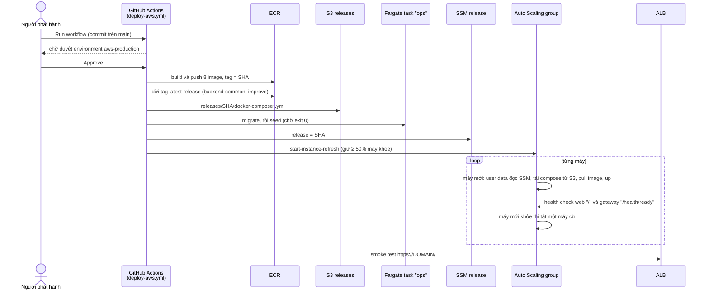

# Triển khai AWS: Terraform và CI/CD với GitHub Actions

Trang này hướng dẫn dựng hạ tầng giai đoạn 2 của [aws-plan.md](aws-plan.md) bằng Terraform, rồi phát hành bằng GitHub Actions. Thiết kế (vì sao ALB + EC2 + Docker Compose, vì sao không EKS, WAF, NAT) nằm ở aws-plan; trang này chỉ nói **làm thế nào**.

**Đã kiểm:** `terraform validate` và `terraform fmt` qua với provider AWS 6.73; hai workflow qua `actionlint`; user data qua `shellcheck`; file compose AWS dựng được bằng `docker compose config`; image `telesales-improve` build và chạy được; `tests/agent/test_improve_runner.py`. **Chưa kiểm:** chưa có lần `terraform apply` hay lần deploy nào trên tài khoản AWS thật. Lần đầu làm theo trang này là lần kiểm đầu tiên; ghi lại chỗ sai vào đây.

---

## 1. Những gì có trong repo

| File | Làm gì |
|---|---|
| [infra/terraform/aws/](../../infra/terraform/aws/) | toàn bộ hạ tầng: VPC 2 AZ, ALB + ACM, Auto Scaling group, RDS, EFS, ECR, S3 cho release, Secrets Manager, ECS (chỉ Fargate task), lịch EventBridge, role IAM cho GitHub, alarm và budget |
| [infra/terraform/aws/templates/user_data.sh.tftpl](../../infra/terraform/aws/templates/user_data.sh.tftpl) | việc mỗi EC2 làm khi khởi động: cài Docker, mount EFS, đọc release và secret, chạy compose |
| [infra/compose/docker-compose.aws.yml](../../infra/compose/docker-compose.aws.yml) | compose ghép đè lên `docker-compose.yml`: image từ ECR, không Caddy, không Postgres, file của agent trên EFS, log lên CloudWatch |
| [infra/improve/](../../infra/improve/) | image `telesales-improve` và `run.py` cho vòng cải tiến hằng tuần (thay Airflow) |
| [.github/workflows/terraform-aws.yml](../../.github/workflows/terraform-aws.yml) | `plan` trên mỗi pull request đụng tới Terraform; `apply` khi chạy tay và đã được duyệt |
| [.github/workflows/deploy-aws.yml](../../.github/workflows/deploy-aws.yml) | build và push image, migrate, seed, thay từng máy; hoặc quay lui về một release cũ |

## 2. Luồng một lần phát hành

Câu hỏi sơ đồ trả lời: **từ lúc bấm "Run workflow" tới lúc khách thấy version mới, ai làm gì?**



- **Tag bất biến:** ECR không cho ghi đè một tag, nên mỗi release là một SHA cố định. Ngoại lệ duy nhất là `latest-release`: Fargate task không đổi được image lúc chạy, nên workflow dời tag này sang release mới.
- **Migrate trước khi thay máy:** trong lúc refresh, máy cũ vẫn phục vụ. Migration phải tương thích ngược với version đang chạy.
- **Thời gian:** build khoảng 10–20 phút (lần sau nhanh hơn nhờ cache), refresh 2 máy khoảng 30–50 phút, vì mỗi máy mới phải đợi agent nạp xong (`health_check_grace_seconds` = 1200).

---

## 3. Lần đầu: dựng hạ tầng

Làm từ máy của người có quyền admin trên tài khoản AWS. Cần AWS CLI v2, Terraform ≥ 1.10 (repo kiểm với 1.14.4), Session Manager plugin cho AWS CLI, Python có `psycopg` (để tạo role database), và một domain.

### Bước 1: bucket cho Terraform state

Một lần cho cả tài khoản. Bucket này không do Terraform quản lý, vì state không thể nằm trong chính nó.

```powershell
$Region = "ap-southeast-1"; $Bucket = "<tên-bucket-state-duy-nhất>"
aws s3api create-bucket --bucket $Bucket --region $Region --create-bucket-configuration LocationConstraint=$Region
aws s3api put-bucket-versioning --bucket $Bucket --versioning-configuration Status=Enabled
aws s3api put-public-access-block --bucket $Bucket --public-access-block-configuration "BlockPublicAcls=true,IgnorePublicAcls=true,BlockPublicPolicy=true,RestrictPublicBuckets=true"
```

Khóa state dùng chính S3 (`use_lockfile = true`), không cần bảng DynamoDB.

### Bước 2: apply lần đầu, chưa có release

```powershell
Set-Location infra/terraform/aws
Copy-Item backend.hcl.example backend.hcl            # điền bucket, region
Copy-Item terraform.tfvars.example terraform.tfvars  # domain, hosted_zone_id, github_repository, tf_state_bucket, alarm_email
terraform init -backend-config=backend.hcl
terraform plan  -var asg_min=1 -var health_check_type=EC2 -out tfplan
terraform apply tfplan
```

Hai biến `-var` chỉ dùng cho lần này:

- **`asg_min=1`:** chưa có release nào, nên một máy là đủ để làm bước 5.
- **`health_check_type=EC2`:** máy chưa chạy ứng dụng, nên ALB thấy nó không khỏe. Với health check `ELB`, ASG sẽ thay máy liên tục.

**DNS và chứng chỉ:**

- Có `hosted_zone_id`: Terraform tự tạo bản ghi xác thực ACM và alias A trỏ về ALB.
- Không có: `apply` dừng chờ ở `aws_acm_certificate_validation`. Lấy bản ghi từ `terraform output certificate_validation_records`, tạo nó ở nhà cung cấp DNS, rồi trỏ domain (CNAME) về `terraform output alb_dns_name`.

**Tài nguyên có `deletion_protection`:** RDS và ALB. Muốn gỡ thì phải tắt cờ này trước, có chủ đích.

### Bước 3: điền secret

Terraform chỉ tạo secret rỗng `telesales/production/app` (`terraform output app_secret_arn`); giá trị không bao giờ nằm trong state. Viết một file JSON **ngoài repo**, rồi đưa lên:

```json
{
  "DATABASE_URL": "postgresql+psycopg://telesales_runtime:<mật-khẩu-runtime>@<rds_endpoint>:5432/app_db?sslmode=require",
  "MIGRATION_DATABASE_URL": "postgresql+psycopg://telesales_admin:<mật-khẩu-master>@<rds_endpoint>:5432/app_db?sslmode=require",
  "EVAL_DATABASE_URL": "postgresql://telesales_admin:<mật-khẩu-master>@<rds_endpoint>:5432/app_db_eval?sslmode=require",
  "APP_SECRET": "<32+ byte ngẫu nhiên; KHÔNG đổi sau khi có dữ liệu>",
  "ENCRYPTION_KEY": "<khóa Fernet>",
  "ADMIN_TOKEN": "...", "AGENT_TOKEN": "...", "SELLER_TOKEN": "...", "DEVELOPER_TOKEN": "...",
  "HOTLINE_BRIDGE_KEY": "...",
  "OPENAI_API_KEY": "...",
  "ENVIRONMENT": "production",
  "OTP_DELIVERY_URL": "", "OTP_DELIVERY_TOKEN": ""
}
```

```powershell
aws secretsmanager put-secret-value --secret-id (terraform output -raw app_secret_arn) --secret-string file://C:/secure/telesales-app.json
Remove-Item C:/secure/telesales-app.json
```

- `<rds_endpoint>`: `terraform output rds_endpoint`.
- Mật khẩu master do RDS tự quản lý trong Secrets Manager (`terraform output rds_master_secret_arn`); lấy bằng `aws secretsmanager get-secret-value`. Nếu RDS xoay vòng mật khẩu này thì phải cập nhật `MIGRATION_DATABASE_URL` và `EVAL_DATABASE_URL`.
- Mật khẩu runtime do bạn chọn (ít nhất 20 ký tự), dùng lại ở bước 5.
- **Giá trị không được chứa dấu nháy đơn** `'`: user data ghi `.env` bằng nháy đơn để compose đọc nguyên văn, kể cả ký tự `$`.
- Các khóa tùy chọn khác (Zalo, `GOOGLE_API_KEY`, `ASR_URL`, `ASR_API_KEY`, `LANGFUSE_*`) thêm vào cùng object. Bảng đầy đủ ở [aws-plan.md, mục 5](aws-plan.md#5-secret-cần-có).

### Bước 4: GitHub

1. **Environment** `aws-production` (Settings → Environments):
   - **Required reviewers**: ít nhất một người khác người bấm chạy;
   - **Deployment branches**: chỉ `main`.

   Role deploy và role apply chỉ tin token của environment này, nên một workflow ở nhánh khác không lấy được quyền vào AWS.
2. **Variables** (Settings → Secrets and variables → Actions → Variables). Không có secret nào, vì quyền vào AWS đi qua OIDC:

   | Biến | Giá trị |
   |---|---|
   | `AWS_REGION` | `ap-southeast-1` |
   | `AWS_DEPLOY_ROLE_ARN`, `AWS_TERRAFORM_PLAN_ROLE_ARN`, `AWS_TERRAFORM_APPLY_ROLE_ARN` | từ `terraform output github_roles` |
   | `TF_STATE_BUCKET` | bucket ở bước 1 |
   | `DOMAIN`, `HOSTED_ZONE_ID`, `ALARM_EMAIL` | như `terraform.tfvars` |
   | `AWS_DEPLOY_PARAMETER` | tùy chọn; mặc định `/telesales/production/deploy` |
   | `AGENT_WITH_VOICE`, `VOICE_TTS`, `HOTLINE_NUMBER`, `ZALO_OA_ID`, `BUILD_ASR` | tùy chọn; mặc định `1`, `openai:coral`, `1900 6868`, trống, `false` |
   | `IMPROVE_SCHEDULE_ENABLED` | `false` cho tới mục 7 |

3. **`terraform.tfvars` và biến GitHub phải khớp nhau.** Workflow Terraform đọc biến từ GitHub, không đọc file. Lệch nhau thì `plan` trên CI sẽ đòi đổi hạ tầng.

### Bước 5: lần deploy đầu, rồi database

RDS nằm trong private subnet, không mở ra Internet. Việc tạo role database đi qua một tunnel SSM, xuyên qua máy EC2 dựng ở bước 2.

1. **Chạy Deploy AWS lần đầu** (Actions → Deploy AWS → Run workflow trên `main`), rồi duyệt.
   - Workflow build và push image, rồi migrate bằng `MIGRATION_DATABASE_URL` (user master), nên các schema được tạo.
   - Sau đó nó **dừng ở bước seed**: seed dùng `DATABASE_URL` của role runtime, mà role này chưa có. Lần dừng này là dự kiến.
   - Vì dừng trước khi ghi release, máy chưa bị thay.
2. **Mở tunnel** tới RDS qua máy đang chạy (cần Session Manager plugin):
   ```powershell
   $id = aws autoscaling describe-auto-scaling-groups --auto-scaling-group-names (terraform output -raw asg_name) --query "AutoScalingGroups[0].Instances[0].InstanceId" --output text
   aws ssm start-session --target $id --document-name AWS-StartPortForwardingSessionToRemoteHost `
     --parameters "host=$(terraform output -raw rds_endpoint),portNumber=5432,localPortNumber=15432"
   ```
3. **Tạo role và database**, ở một terminal khác, qua `localhost:15432` (cần `psql` và Python có `psycopg`):
   ```powershell
   $env:ADMIN_DATABASE_URL = "postgresql://telesales_admin:<mật-khẩu-master>@localhost:15432/app_db?sslmode=require"
   python scripts/migration/provision_db_role.py         # nhập mật khẩu runtime của bước 3
   psql $env:ADMIN_DATABASE_URL -c "GRANT CREATE ON DATABASE app_db TO telesales_runtime;" -c "CREATE DATABASE app_db_eval;"
   ```
   - `GRANT CREATE`: agent tự tạo schema `agent` khi khởi động ([aws-plan.md 3.5](aws-plan.md#35-những-điểm-riêng-của-ai-agent-service)).
   - `app_db_eval`: database của các run đánh giá trong vòng cải tiến. Nó bị xóa bảng mỗi lần chạy, nên tuyệt đối không phải `app_db`.

### Bước 6: release đầu tiên, rồi trả về cấu hình thường

1. **Chạy lại Deploy AWS.** Image đã có, nên workflow bỏ qua bước build, rồi migrate, seed, ghi release và thay máy. Lúc này ASG chỉ có một máy, nên trang sẽ gián đoạn vài phút trong lúc thay.
2. **Apply lại với cấu hình thường**, bỏ hai `-var` của bước 2 (2 máy, health check `ELB`):
   ```powershell
   terraform plan -out tfplan; terraform apply tfplan
   ```
   Từ đây nên apply qua workflow (mục 6), không apply từ máy nữa.
3. **Tạo tài khoản nhân viên đầu tiên**, qua SSM vào một máy:
   ```bash
   cd /opt/telesales && sudo docker compose -f docker-compose.yml -f docker-compose.aws.yml run --rm identity-service python /app/scripts/admin/create_admin.py
   ```

---

## 4. Kiểm sau khi lên

| Kiểm | Cách |
|---|---|
| shop mở được | `https://DOMAIN` |
| API và rate limit theo đúng IP khách | từ hai mạng khác nhau, mỗi bên gửi 100 request `/api/...` trong một phút: không bên nào nhận 429 ([aws-plan 1.1](aws-plan.md#11-ip-của-khách-sau-proxy-đã-sửa)) |
| SSE và WebSocket | chat một lượt có stream; gọi thử trên trình duyệt, giữ hơn 60 giây |
| agent ghi vào RDS | `agent.turns` có dòng mới |
| hai máy dùng chung EFS | `ls /mnt/efs/kb` trên cả hai máy giống nhau |
| log | CloudWatch Logs `/telesales/production/app`, mỗi stream là `<instance-id>/<container>` |
| alarm | xác nhận email đăng ký SNS mà AWS gửi về `alarm_email` |

## 5. Phát hành hằng ngày

- **Phát hành:** merge vào `main`, chạy **Deploy AWS** trên `main`, rồi duyệt.
- **Quay lui:** chạy **Deploy AWS** với `image_tag` là SHA của một release cũ. Workflow bỏ qua build và migration, chỉ dời tag và thay máy. Migration đã chạy thì không lùi được; vì vậy mỗi migration phải tương thích ngược.
- **Đổi secret:** `put-secret-value`, rồi chạy Deploy AWS với `image_tag` là release đang chạy. Máy chỉ đọc secret lúc khởi động.
- **Bật một version skills** (admin bấm trên `/admin`): agent chỉ đọc skills lúc khởi động. Có hai cách để mọi máy dùng version mới:
  - thay máy, giống quay lui về release đang chạy;
  - hoặc restart agent trên từng máy, lần lượt:
    ```powershell
    aws ssm send-command --document-name AWS-RunShellScript --targets "Key=tag:aws:autoscaling:groupName,Values=<asg_name>" `
      --max-concurrency 1 --parameters 'commands=["cd /opt/telesales && docker compose -f docker-compose.yml -f docker-compose.aws.yml restart ai-agent-service"]'
    ```

## 6. Thay đổi hạ tầng

1. Sửa `infra/terraform/aws`, mở pull request.
2. Workflow **Terraform AWS** chạy `fmt`, `validate` (không cần AWS), rồi `plan` bằng role chỉ đọc. Kết quả nằm trong job summary.
3. Merge, rồi chạy **Terraform AWS** bằng tay trên `main`. Job `apply` đợi duyệt environment `aws-production`, rồi plan lại và apply đúng bản plan đó.

Pull request từ fork không có OIDC, nên không có `plan`; chỉ có `fmt` và `validate`.

Đổi AMI, user data hay cỡ máy là đổi launch template, nên ASG tự refresh theo khối `instance_refresh`: từng máy một, như một release.

## 7. Bật vòng cải tiến hằng tuần

Vòng tốn phí model mỗi tuần, nên mặc định tắt (`improve_schedule_enabled = false`). Trước khi bật:

1. Secret có `OPENAI_API_KEY` và `EVAL_DATABASE_URL` (bước 3), và đã tạo `app_db_eval` (bước 5).
2. Đã có ít nhất một release, để `telesales-improve:latest-release` tồn tại.
3. Nếu muốn đặt trần chi tiêu: tạo ledger ([evaluation/README.md](../../evaluation/README.md)) trên EFS, dưới `/mnt/efs/runs/`, rồi đặt `eval_budget_db` (đường dẫn trong container: `/opt/telesales/evaluation/runs/<file>`).
4. Đặt biến GitHub `IMPROVE_SCHEDULE_ENABLED=true` và apply (mục 6).

Hai lịch EventBridge chạy task `improve` (giờ Việt Nam):

- `learn`: thứ Hai 02:00;
- `tick`: 10:00, 16:00 và 22:00 mỗi ngày.

Cách chúng thay Airflow: [aws-plan.md 3.7](aws-plan.md#37-vòng-cải-tiến-hằng-tuần-không-airflow). Task kết thúc với lỗi thì alarm gửi về SNS. Chạy tay một lần để thử:

```powershell
aws ecs run-task --cluster $c.cluster --task-definition telesales-production-improve --launch-type FARGATE `
  --network-configuration "awsvpcConfiguration={subnets=[$($c.subnets -join ',')],securityGroups=[$($c.task_sg)],assignPublicIp=ENABLED}" `
  --overrides '{"containerOverrides":[{"name":"improve","command":["tick"]}]}'
```

`tick` chỉ đọc trạng thái, và không làm gì khi chưa có vòng nào, nên không tốn phí model. Hãy thử nó trước `learn`.

---

## 8. Khi có sự cố

| Thấy | Nguyên nhân thường gặp | Làm gì |
|---|---|---|
| `apply` đứng lâu ở `aws_acm_certificate_validation` | chưa có bản ghi xác thực ở DNS | tạo bản ghi từ `certificate_validation_records` |
| máy bị thay liên tục, target không khỏe | chưa có release (SSM `release` = `none`), hoặc ứng dụng không lên | xem `/var/log/telesales-boot.log` trên máy (Session Manager) và log `/telesales/production/app` |
| máy lên nhưng agent không khỏe sau 20 phút | thiếu khóa trong secret, sai `DATABASE_URL`, role runtime chưa có quyền `CREATE` | log của container `ai-agent-service`; bước 3 và 5 |
| Deploy dừng ở migrate hoặc seed | lỗi SQL, hoặc secret thiếu một khóa mà task `ops` cần (danh sách `ops_secrets` trong [ecs.tf](../../infra/terraform/aws/ecs.tf)) | log `/telesales/production/ops`; workflow in tên stream |
| `start-instance-refresh` báo đang có refresh khác | Terraform vừa đổi launch template và đang tự refresh | đợi xong, rồi chạy lại Deploy với `image_tag` = SHA vừa build |
| mọi khách nhận 429 | gateway không thấy IP thật | kiểm `FORWARDED_ALLOW_IPS` của gateway (`docker compose ... config`) |
| task `improve` báo "Another evaluation is using this database" | `learn` và `tick` đo cùng lúc | lịch đã cách nhau 8 giờ; một lần chạy tay chen vào thì đợi rồi chạy lại |
| `plan` trên CI muốn đổi tài nguyên dù không sửa gì | biến GitHub khác `terraform.tfvars` | cho hai bên khớp nhau (bước 4) |

## 9. Giới hạn

- Chưa chạy trên AWS thật (đầu trang). Các con số về thời gian ở mục 2 là ước lượng.
- `create_admin.py` và `provision_db_role.py` hỏi mật khẩu tương tác, nên bước 5 và bước 6 còn làm tay qua SSM.
- Không có môi trường staging riêng. Muốn có thì dùng một state key khác (`key` trong backend) và `environment = "staging"`, cộng một GitHub environment khác. Hai workflow hiện chỉ trỏ `production`.
- Migration không quay lui được. Quay lui chỉ áp cho image.
- Agent đọc skills lúc khởi động, nên bật version mới phải restart (mục 5).
