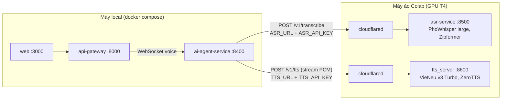

# ASR và TTS trên GPU Colab

Trang này dành cho người cần chạy nhận dạng giọng nói (ASR) và giọng đọc (TTS) trên một GPU thay vì CPU của laptop, mà không có máy GPU riêng. Agent vẫn chạy trên máy local; chỉ hai service nặng chạy trên một máy ảo Colab và nối về qua tunnel Cloudflare.

Điều quan trọng nhất: **Colab miễn phí không đủ ổn định cho demo.** Phiên tạo bằng CLI bị tắt sau khoảng 15–20 phút (hai lần trong ngày 19/11/2026, tài khoản 0 compute unit), và mỗi lần chạy lại tunnel đổi URL. Dùng trang này để thử và đo. Demo thật nên chạy các service này trên một máy GPU thuê, theo [apps/asr-service/README.md](../../apps/asr-service/README.md) ("Lên GPU thuê").

---

## 1. Kiến trúc



- **asr-service** là chính [apps/asr-service](../../apps/asr-service), chạy với `ASR_DEVICE=cuda`. Agent gọi nó qua `ASR_URL` như với service trong Docker; không phải sửa code.
- **tts_server** ([infra/colab/tts_server.py](../../infra/colab/tts_server.py)) là một FastAPI nhỏ: `POST /v1/tts` trả PCM 16-bit theo từng mẩu ngay khi sinh ra, tần số lấy mẫu ở header `X-Sample-Rate`. Mọi lỗi trả JSON kèm traceback.
- Phía agent, engine giọng `remote:<engine>[:<giọng>]` ([tts.py](../../apps/ai-agent-service/src/ai_agent_service/components/voice/tts.py), `RemoteVoice`) đọc `TTS_URL`, `TTS_API_KEY`.
- Hai service dùng chung một key ngẫu nhiên, lưu ở `/content/run/key` trên máy Colab. Tunnel là "quick tunnel" của Cloudflare: miễn phí, không cần tài khoản, URL dạng `https://….trycloudflare.com`, đổi mỗi lần chạy.

---

## 2. Cài một lần

1. Cài Google Colab CLI (công cụ chính thức, [googlecolab/google-colab-cli](https://github.com/googlecolab/google-colab-cli)):
   ```
   uv tool install google-colab-cli
   ```
2. Đăng nhập. Mở một Terminal riêng (lệnh cần dán mã xác nhận) và chạy:
   ```
   ~/.local/bin/colab sessions
   ```
   Mở đường link nó in ra, đăng nhập Google, cho phép, dán mã vào Terminal. Quyền cấp gồm Colab, Google Cloud và các file Drive do công cụ tạo. Thu hồi tại myaccount.google.com, mục Bảo mật, Ứng dụng bên thứ ba.
3. Trên trình duyệt, đóng mọi notebook Colab đang giữ GPU: tài khoản miễn phí chỉ có một GPU một lúc, và CLI không dừng được phiên tạo từ trình duyệt.

---

## 3. Bật và tắt

Từ gốc repo, khi `docker compose` đã chạy:

```
bash infra/colab/up.sh
```

[up.sh](../../infra/colab/up.sh) làm lần lượt:

1. Tạo phiên `voice` với GPU T4 (`colab new -s voice --gpu T4`); bị từ chối thì thử lại mỗi 60 giây, tối đa 6 lần.
2. Đóng gói `apps/asr-service` cùng `infra/colab/tts_server.py`, tải lên cùng [setup.sh](../../infra/colab/setup.sh).
3. Chạy `setup.sh` trên máy Colab qua `colab ssh`. Script này:
   - cài thư viện, thêm cuBLAS và cuDNN của CUDA 12 cho `faster-whisper`;
   - tải PhoWhisper large và medium, Whisper large-v3-turbo, Zipformer 30M, ZeroTTS;
   - chạy hai service tách khỏi phiên ssh;
   - mở hai tunnel, ghi URL vào `/content/run/urls`.

   Lần đầu mất khoảng 10 phút.
4. Lấy key và URL về `~/.cache/telesales-colab/`, nạp VieNeu và ZeroTTS, ghi `ASR_URL`, `ASR_API_KEY`, `TTS_URL`, `TTS_API_KEY`, `VOICE_TTS` vào `.env` (không in key), khởi động lại `ai-agent-service`, rồi chọn model ASR.

Tham số tùy chọn: `bash infra/colab/up.sh "remote:zerotts:maichi" phowhisper-medium`. Biến môi trường `COLAB_SESSION`, `COLAB_GPU` đổi tên phiên và loại GPU.

Quay về chạy hoàn toàn trên máy local (ASR trong container `asr-service`, giọng qua API) và dừng phiên Colab:

```
bash infra/colab/down.sh
```

Phiên Colab tự chết (tunnel trả HTTP 530, agent báo "Voice preparation failed"): chạy `down.sh` để voice dùng được ngay, rồi `up.sh` lại khi cần.

---

## 4. Giọng và model

| Engine | Giọng | Ghi chú |
|---|---|---|
| `remote:vieneu:<tên>` | 25 giọng, có giới tính, vùng miền, phong cách, ví dụ `Mỹ Duyên` (nữ, Nam), `Trúc Ly` (nữ, Bắc), `Ngọc Trân` (nữ, Trung), `Hải Đăng` (nam, Bắc) | Chạy CUDA khi máy có torch CUDA |
| `remote:zerotts:<tên>` | `baotrang`, `giahuy`, `hamy`, `huuduc`, `kimoanh`, `maichi`, `quangminh`, `tiendat` | Trọng số tải vào thư mục thường `/content/zerotts`, vì onnxruntime từ chối trọng số ngoài nằm trong cache có liên kết của Hugging Face |

Model ASR trên GPU: `phowhisper-large`, `phowhisper-medium`, `whisper-turbo`, `zipformer-30m`. Đổi bằng trang Developer hoặc `POST /api/developer/voice {"asr": "..."}`. Lựa chọn này nằm trong bộ nhớ của agent, mất khi khởi động lại; `up.sh` đặt lại.

---

## 5. Số đo (19/11/2026, GPU T4)

ASR, bộ 120 câu TTS tự sinh (15 câu × 4 giọng OpenAI, bản sạch và bản giả lập điện thoại), WER theo luật chuẩn hóa của BTC:

| Model | WER sạch | CER sạch | WER điện thoại | CER điện thoại | Một câu 4,2 s qua tunnel |
|---|---|---|---|---|---|
| `phowhisper-large` | 10,1% | 3,7% | 10,4% | 3,7% | 1,0–1,25 s |
| `phowhisper-medium` | 10,6% | 5,2% | 12,1% | 6,4% | |
| `whisper-turbo` | 10,9% | 6,2% | 14,3% | 7,6% | 0,7–0,9 s |
| `zipformer-30m` trên CPU laptop (để so) | 10,2% | 6,2% | 10,7% | 7,9% | khoảng 0,1 s (không qua mạng) |

`whisper-turbo` tự bịa câu khi audio nhiễu ("Cảm ơn các bạn đã theo dõi"), nên không dùng. Audio TTS sạch hơn giọng thật qua mic, nên đây là số để so các model, không phải WER thật.

TTS, một câu khoảng 6–8 giây audio:

| Engine | Tiếng đầu (đo trên Colab) | Tiếng đầu qua tunnel | RTF |
|---|---|---|---|
| VieNeu v3 Turbo, CUDA | khoảng 170 ms | 420–500 ms | 0,82–0,94 |
| ZeroTTS, CUDA | | khoảng 330 ms | 0,88–0,91 |
| VieNeu trên CPU laptop Intel (để so) | 1,3–6 s | | 2,8–4 |

RTF gần 1 nghĩa là sinh chỉ nhỉnh hơn tốc độ phát; mạng chập chờn thì có thể khựng.

---

## 6. Khi có sự cố

| Triệu chứng | Nguyên nhân | Cách xử lý |
|---|---|---|
| `Allocation refused (precondition failed)` | Đã có phiên khác giữ GPU (thường là notebook trên trình duyệt) | Đóng notebook trên trình duyệt (Runtime, Disconnect and delete runtime) rồi chạy lại |
| `Already-active SSH session (HTTP 429)` | Mỗi phiên chỉ cho một kết nối ssh | Chờ lệnh ssh kia xong, hoặc xem tiến độ bằng `colab exec -s voice` |
| ASR chết lúc khởi động, log `libcublas.so.12 is not found` | Colab không có sẵn cuBLAS của CUDA 12 cho CTranslate2 | `setup.sh` đã cài `nvidia-cublas-cu12`, `nvidia-cudnn-cu12` và đặt `LD_LIBRARY_PATH`; kiểm tra `/content/run/pip.log` |
| `address already in use` ở cổng 8600 | Còn tiến trình cũ | `setup.sh` gọi `fuser -k` trước khi chạy; chạy lại `up.sh` |
| ZeroTTS lỗi `External data path escapes model directory` | Trọng số nạp từ cache có liên kết của Hugging Face | `tts_server.py` đã tải vào `/content/zerotts`; dùng bản trong repo |
| Tunnel trả HTTP 530, agent báo `Voice preparation failed` | Phiên Colab đã bị tắt | `bash infra/colab/down.sh`, sau đó `up.sh` |
| Xem log | | `colab ssh -s voice -- tail -50 /content/run/asr.log` (hoặc `tts.log`, `tunnel-8500.log`) |

---

## 7. Giới hạn

- Phiên Colab miễn phí bị tắt sau khoảng 15–20 phút khi không có hoạt động của kernel; URL tunnel đổi mỗi lần.
- ASR qua tunnel thêm 1–2 giây mỗi lượt, nên TTFA khó đạt 2,5 giây (BTC tính từ lúc khách ngừng nói). Cần TTFA thì giữ ASR local (`zipformer-30m`) và chỉ đưa TTS lên GPU, hoặc chạy cả hai trên một máy GPU gần agent.
- Quick tunnel của Cloudflare không có cam kết uptime; demo cần URL cố định thì dùng named tunnel hoặc máy GPU có HTTPS riêng.
- Chưa có số đo TTFA trên cuộc gọi thật với cấu hình này.
