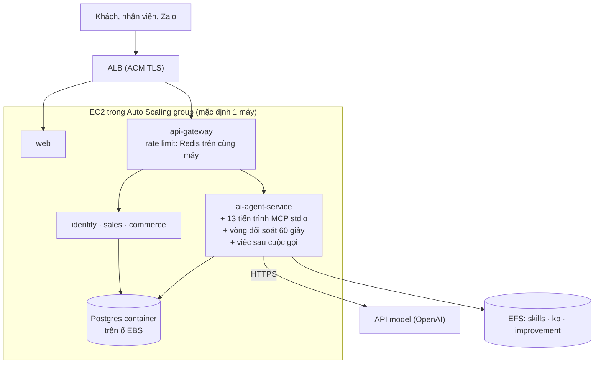
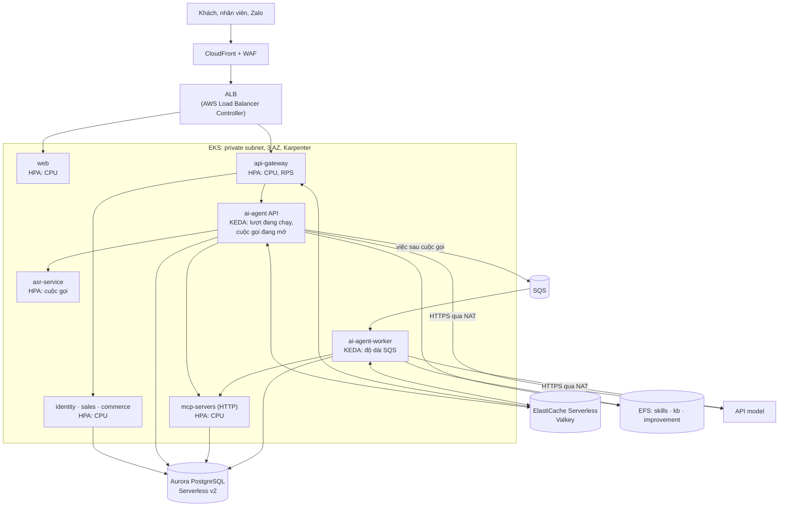

# Kiến trúc trên AWS EKS: hiện tại và đề xuất

Trang này so sánh hạ tầng **đang có trong repo** với kiến trúc **đề xuất** để chạy trên Amazon EKS, scale theo số khách đang gọi và chat cùng lúc. Nó cũng ghi ElastiCache (Valkey) dùng vào việc gì và vì sao.

**Trạng thái: đề xuất.** Chưa có Terraform EKS, chưa có manifest cho AWS, và chưa sửa code nào trong các mục dưới. Mọi giá đều là ước lượng từ bảng giá niêm yết ở `ap-southeast-1`, chưa kiểm bằng AWS Pricing Calculator. Chưa có số đo tải nào cho kiến trúc này.

Ngoài phạm vi:

- **LiveKit và tổng đài SIP** (profile `hotline`). Cuộc gọi trên trình duyệt vẫn chạy, vì nó đi qua WebSocket của `ai-agent-service`, không qua LiveKit.
- **SaaS nhiều doanh nghiệp** (mỗi doanh nghiệp một shop). "Nhiều khách" ở đây là nhiều người mua cùng dùng một shop. Đa tenant cần thiết kế riêng cho việc tách dữ liệu.

Trang liên quan:

- [aws-plan.md](aws-plan.md): bản gọn EC2 + Compose, các điểm nghẽn đọc từ code (mục 7.1), phác thảo EKS (mục 7.2).
- [aws-terraform-cicd.md](aws-terraform-cicd.md): Terraform và CI/CD của bản gọn.

## 1. Hiện tại

### 1.1 Repo đang có gì

| Thành phần | Ở đâu | Trạng thái |
|---|---|---|
| Docker Compose (local, hoặc một VM) | [docker-compose.yml](../../docker-compose.yml), [infra/compose](../../infra/compose) | chạy được |
| AWS bản gọn: ALB + Auto Scaling group EC2 chạy Compose, Postgres trong container trên EBS (hoặc RDS khi `use_rds = true`), EFS, ECR, Secrets Manager, Fargate task cho vòng cải tiến | [infra/terraform/aws](../../infra/terraform/aws) | có code, chưa apply trên tài khoản thật |
| Manifest Kubernetes: 10 Deployment, Service, PodDisruptionBudget (overlay production) | [infra/kubernetes](../../infra/kubernetes) | overlay `aws-production` (20/11/2026) thêm Ingress ALB, HPA, KEDA, NetworkPolicy, Deployment cho MCP và worker; stack Terraform EKS ở `infra/terraform/aws-eks` (mục 6) |
| GKE Autopilot + Cloud SQL + Memorystore | [infra/terraform/gcp](../../infra/terraform/gcp) | có code, không dùng cho AWS |
| Terraform EKS | — | **chưa có** |

Câu hỏi sơ đồ trả lời: **ở bản AWS hiện có, request đi qua đâu và cái gì không scale được?**

### 1.2 Vì sao hiện tại chưa scale được nhiều khách

Các điểm nghẽn này đọc từ code, không phụ thuộc nơi chạy. Chi tiết ở [aws-plan.md, mục 7.1](aws-plan.md#71-cái-gì-nghẽn-trước-đọc-từ-code-ngày-12112026).

| Điểm nghẽn | Trong code | Hệ quả khi thêm máy hoặc pod |
|---|---|---|
| Rate limiter model nằm **trong từng tiến trình** | `_LIMITERS` trong [factory.py](../../apps/ai-agent-service/src/ai_agent_service/llm/factory.py), [rate_limiter.py](../../apps/ai-agent-service/src/ai_agent_service/llm/rate_limiter.py) | N pod gọi provider tới N lần giới hạn trong `config/models.yaml`, rồi bị 429 hàng loạt |
| MCP chạy bằng stdio, mỗi agent một bộ | [mcp/client.py](../../apps/ai-agent-service/src/ai_agent_service/mcp/client.py), pool `max_size=2` trong [server_base.py](../../apps/ai-agent-service/src/ai_agent_service/mcp/server_base.py) | khoảng 31 kết nối Postgres mỗi agent; pod nặng, khởi động chậm |
| ~~Việc nền chạy trong tiến trình API~~ **đã gỡ (20/11/2026)** | khi đặt `JOBS_QUEUE_URL`, API chỉ gửi một tin SQS mỗi cuộc gọi kết thúc ([runtime/jobs.py](../../apps/ai-agent-service/src/ai_agent_service/runtime/jobs.py)); `after_call` và vòng quét 60 giây chạy trong [worker.py](../../apps/ai-agent-service/src/ai_agent_service/worker.py). Không đặt thì chạy trong API như cũ (local, staging, stack EC2) | MemoryAgent và QaAgent không còn dùng chung CPU với lượt chat của khách |
| Rate limit gateway theo **từng máy** khi không có Redis dùng chung | [api-gateway/src/main.py](../../apps/api-gateway/src/main.py) | thực tế là 120 request/phút/IP nhân với số máy |
| Không có tín hiệu tải của agent | — | không scale được theo số cuộc gọi đang mở |

## 2. Đề xuất

### 2.1 Tổng quan

Câu hỏi sơ đồ trả lời: **mỗi phần chạy ở đâu và scale theo tín hiệu nào?**

### 2.2 Từng thành phần

| Thành phần | Chạy ở đâu | Scale theo | Vì sao |
|---|---|---|---|
| `web`, `api-gateway`, `identity`, `sales`, `commerce` | node Spot, tối thiểu 2 pod rải 2 AZ | CPU; gateway thêm số request mỗi target | stateless; Spot rẻ hơn khoảng 60–70% |
| `ai-agent-service` (API) | node **on-demand** | KEDA theo số lượt đang chạy và số WebSocket thoại đang mở (mục 3.6) | agent chủ yếu chờ model nên CPU không phản ánh tải. Không đặt trên Spot, vì máy bị thu hồi sẽ cắt ngang cuộc gọi |
| `mcp-servers` | Deployment riêng, Spot | CPU | chế độ HTTP đã có (`MCP_<SERVER>_URL`, cổng 8801–8806). Agent nhẹ đi, số kết nối DB giảm |
| `ai-agent-worker` (mới) | Spot | KEDA theo độ dài hàng đợi SQS, **tối thiểu 1** ([after-call-worker.yaml](../../infra/kubernetes/overlays/production/after-call-worker.yaml)) | `after_call` và vòng quét không còn chạy trong tiến trình API. Không về 0: vòng quét nằm ở đây, và cuộc gọi khách bỏ dở không gửi tin nào, chỉ vòng quét mới cúp máy nó |
| `asr-service` | CPU trước, 1 replica ([asr.yaml](../../infra/kubernetes/overlays/aws-production/asr.yaml)); thêm node pool GPU khi đo thấy chậm | số cuộc gọi đang mở | model Zipformer int8 chạy được trên CPU; weight tải một lần vào EFS (`asr-models`). Chỉ agent và worker gọi được (NetworkPolicy) |
| Migration, vòng cải tiến hằng tuần | Job / CronJob | — | dùng lại lệnh của [infra/improve/run.py](../../infra/improve/run.py) |
| S3 | một bucket, versioning | — | chỉ giữ Terraform state (`infra/terraform/aws-eks`, key riêng). App không đọc hay ghi S3 |
| ACM | cùng region với ALB | — | chứng chỉ HTTPS của tên miền; Terraform tạo và xác thực qua DNS ([acm.tf](../../infra/terraform/aws-eks/acm.tf)) |
| Karpenter | — | pod đang chờ chỗ chạy | thêm hoặc bớt node trong khoảng 1 phút; gom pod để trả bớt máy |
| Aurora PostgreSQL Serverless v2 | Multi-AZ | tự tăng giảm ACU; có thể tạm dừng về 0 ACU | không phải chọn cỡ máy trước; hợp với việc chỉ bật khi demo. Thêm RDS Proxy chỉ khi số kết nối gần trần, vì Proxy trên Serverless v2 tính tối thiểu 8 ACU |
| ElastiCache Serverless (Valkey) | Multi-AZ | tự động | mục 3 |
| SQS | — | — | hàng đợi việc sau cuộc gọi kèm DLQ (sau 5 lần nhận) và hai cảnh báo: có tin trong DLQ, tin cũ nhất chờ quá 10 phút ([sqs.tf](../../infra/terraform/aws/sqs.tf), `jobs_queue_enabled`); gần như miễn phí ở tải nhỏ. Không dùng Kafka/MSK: sự kiện outbox chạy thẳng trên Postgres |
| EFS (qua EFS CSI) | — | — | skills, kb và improvement dùng chung giữa các pod, như bản gọn |

> Bảng trên là thiết kế cho tài khoản trả phí. Tài khoản đang ở gói Free plan, không có Spot, nên pod nào ghi "Spot" thực tế chạy trên pool `general` với máy on-demand `m7i-flex.large` hoặc `c7i-flex.large`. Aurora cũng không Multi-AZ: Free plan chỉ cho chế độ express, gồm 1 instance, 0–4 ACU, không mã hóa ổ đĩa, do script tạo rồi Terraform import ([eks-deploy.md](eks-deploy.md) mục 2.2).

## 3. ElastiCache (Valkey) dùng vào việc gì

**Nguyên tắc: Valkey không phải nơi lưu chính.** Tri thức (FAQ, chính sách, phiên bản `data/kb/v<N>.jsonl`), hội thoại, checkpoint, đơn hàng và OTP vẫn ở Postgres. Những thứ này cần bền, có lịch sử, rollback được, và evaluation phải chạy lại cho cùng kết quả. Valkey chỉ giữ bộ đếm, khóa ngắn hạn và tín hiệu, thứ mất đi thì hệ thống vẫn đúng.

**Vì sao không dùng Valkey làm "kho FAQ agent tìm trước":** chỉ mục tri thức đã nằm ngay trong bộ nhớ của server `mcp-knowledge` (BM25 kết hợp embedding chạy tại chỗ, xem [knowledge.py](../../apps/ai-agent-service/src/ai_agent_service/mcp/servers/knowledge.py) và [search.py](../../apps/ai-agent-service/src/ai_agent_service/components/knowledge/search.py)). Trên bộ `data/dev`, p50 của brief (gồm cả bước tìm này) là khoảng 40–75 ms, còn thời gian tới chữ đầu tiên là 1,8–2,4 giây, gần như toàn bộ là chờ model. Tra qua Valkey thêm một lượt gọi mạng nên chậm hơn, và tri thức sẽ nằm ở hai nơi. Muốn bớt thời gian và tiền ở bước model thì dùng prompt caching của provider, không cache câu trả lời.

Mỗi mục dưới đây ghi rõ code hiện tại đã làm gì, để không làm lại việc đã có.

| # | Việc | Hiện tại trong code | Đề xuất | Ưu tiên |
|---|---|---|---|---|
| 1 | Rate limit dùng chung | gateway đã hỗ trợ `REDIS_URL`; limiter model ở trong tiến trình | trỏ gateway vào Valkey; chuyển limiter model sang Valkey | **bắt buộc** |
| 2 | Báo khi tri thức đổi | mỗi server tự kiểm `kb_chunks` tối đa 10 giây một lần; đổi bản release phải restart | pub/sub `kb:changed` | nên làm |
| 3 | Chống gửi OTP hàng loạt | mã OTP hết hạn sau 5 phút, tối đa 5 lần nhập sai mỗi mã; **không giới hạn số mã được yêu cầu** | cooldown theo số điện thoại và theo IP | nên làm |
| 4 | Chống xử lý trùng | đã có ở Postgres: `idempotency_key` của đơn, `zalo_msg_id UNIQUE`, khóa theo hội thoại | **không cần Valkey** | không làm |
| 5 | Cache catalog | công cụ của agent đọc mock BTC trong bộ nhớ; chỉ trang web shop đọc Postgres | chỉ cache các API đọc của `commerce-service` khi đo thấy DB quá tải | khi có tín hiệu |
| 6 | Tín hiệu tải cho KEDA | chưa có | đếm lượt đang chạy và cuộc gọi đang mở | **bắt buộc** cho scale |
| 7 | Sổ chi tiêu model | limiter có đếm token nhưng không giới hạn tiền | cộng dồn tiền theo ngày và theo hội thoại, chặn khi vượt | nên làm |

### 3.1 Rate limit dùng chung

**Gateway.** [api-gateway/src/main.py](../../apps/api-gateway/src/main.py) đã đếm theo cửa sổ một phút bằng Lua (`INCR` + `EXPIRE`, khóa `<RATE_PREFIX>:<ip>:<phút>`, ngưỡng 120) khi có `REDIS_URL`. Chỉ cần trỏ biến này vào Valkey, không phải sửa code. Đây là cửa sổ cố định theo phút, không phải cửa sổ trượt như khi không có Redis. Khi Redis lỗi, gateway trả **503** cho mọi `/api/*` (fail closed), nên Valkey thành phụ thuộc bắt buộc của gateway. ElastiCache Serverless chạy Multi-AZ.

**Limiter model (phải sửa code).** `AdvancedTokenRateLimiter` hiện giữ cửa sổ trượt request và token trong bộ nhớ, và vào trạng thái nghỉ khi provider trả 429. Đề xuất:

- giữ request và token trong một sorted set theo `provider:model`. Lệnh `acquire` chạy bằng một script Lua: xóa phần cũ, cộng thử, rồi trả về được đi hay phải chờ bao lâu;
- trạng thái nghỉ sau 429 là một khóa có TTL, dùng chung cho mọi pod;
- Valkey lỗi thì quay về limiter trong tiến trình, với giới hạn chia cho số pod tối đa (fail open có giới hạn), để khách vẫn được trả lời.

### 3.2 Báo khi tri thức đổi

Hiện `base()` trong [knowledge.py](../../apps/ai-agent-service/src/ai_agent_service/mcp/servers/knowledge.py) kiểm dấu thời gian của `kb_chunks` mỗi khi được gọi, tối đa một lần mỗi `REFRESH_SECONDS` (10 giây), rồi dựng lại chỉ mục nếu có thay đổi. Mục admin lưu lúc chạy đã tới các pod khác trong khoảng 10 giây. Riêng **bản release** (`config/knowledge.yaml` chọn `v<N>`) chỉ được chép vào `kb_chunks` lúc khởi động (`sync_release`), nên đổi bản thì phải restart.

Đề xuất:

1. Sau khi admin bật bản kb mới hoặc lưu một mục, service ghi Postgres trước, rồi `PUBLISH kb:changed <stamp>`.
2. Mỗi pod `mcp-knowledge` đăng ký kênh này. Khi nhận tin thì đánh dấu chỉ mục là cũ, và lượt tìm tiếp theo sẽ dựng lại.
3. Vẫn giữ việc kiểm 10 giây làm đường dự phòng: pub/sub không lưu tin, pod mất kết nối lúc có tin vẫn tự bắt kịp.

Mục 3 (đổi bản release không cần restart) cần sửa thêm để `sync_release` chạy cả khi nhận tin, không chỉ lúc khởi động. Đổi tri thức là đổi agent: sau khi làm phải chạy lại evaluation (thử một kịch bản trước).

### 3.3 Chống gửi OTP hàng loạt

[identity/service.py](../../packages/backend-common/src/identity/service.py) tạo một bản ghi `challenges` cho mỗi lần yêu cầu mã, hết hạn sau 5 phút, tối đa 5 lần nhập sai mỗi mã. Hiện không có gì chặn một người yêu cầu mã mới liên tục, mỗi lần là một SMS tính tiền.

Đề xuất trước khi tạo challenge:

| Khóa | Giới hạn | Khi vượt |
|---|---|---|
| `{otp}:cooldown:<bước>:<digest số điện thoại>` | 1 mã mỗi 60 giây (`SET NX EX 60`) | 429 kèm số giây phải chờ |
| `{otp}:hour:<digest số điện thoại>` | 5 mã mỗi giờ | 429 |
| `{otp}:ip:<ip>` | 20 mã mỗi giờ | 429 |

ElastiCache Serverless chạy ở chế độ cluster: một script hay lệnh chạm nhiều khóa thì các khóa phải chung một slot, không thì báo `CROSSSLOT`. Vì vậy khóa OTP mang chung hash tag `{otp}`, và khóa của limiter mang `{<provider>}` (`ratelimit:{openai}:req`). Tín hiệu tải đọc khóa của từng pod bằng từng lệnh `GET` trong một pipeline, không dùng `MGET`.

Khóa dùng digest (`security.digest`), không dùng số điện thoại gốc. Bảng `challenges` và token `customer_access` (có `revoked_at`) vẫn ở Postgres: đó là nguồn đúng và có lịch sử.

### 3.4 Chống xử lý trùng: không cần Valkey

Ba chỗ đã được bảo vệ bằng ràng buộc của Postgres, và nên giữ như vậy vì Postgres là nơi ghi dữ liệu thật:

- đơn hàng: `orders.idempotency_key` là duy nhất; gửi lại cùng khóa trả về đơn cũ, khác nội dung thì trả 409 ([commerce/service.py](../../packages/backend-common/src/commerce/service.py));
- tin Zalo gửi lại: `zalo_msg_id UNIQUE` với `ON CONFLICT DO NOTHING` ([runtime/zalo.py](../../apps/ai-agent-service/src/ai_agent_service/runtime/zalo.py));
- hai lượt cùng một hội thoại: `pg_advisory_xact_lock` theo `conversation:<id>` ([runtime/calls.py](../../apps/ai-agent-service/src/ai_agent_service/runtime/calls.py)).

Thêm Valkey ở đây chỉ tạo thêm một nơi có thể lệch với database.

### 3.5 Cache catalog: chỉ khi có tín hiệu

Công cụ `catalog.search`, `inventory.check` và `pricing.get_quote` của agent bọc mock của BTC, đọc dữ liệu trong bộ nhớ ([catalog.py](../../apps/ai-agent-service/src/ai_agent_service/mcp/servers/catalog.py), [btc.py](../../apps/ai-agent-service/src/ai_agent_service/mcp/servers/btc.py)), nên cache không làm agent nhanh hơn. Chỉ trang web shop đọc Postgres qua `commerce-service`.

Khi Performance Insights cho thấy các truy vấn catalog chiếm phần lớn tải đọc:

- cache theo từng sản phẩm, TTL 60 giây;
- commerce xóa khóa ngay khi giá, tồn kho hoặc khuyến mãi đổi;
- không cache giỏ hàng hay giá của một đơn.

### 3.6 Tín hiệu tải cho KEDA

Mỗi pod agent giữ hai bộ đếm. Bộ đếm tăng khi bắt đầu và giảm trong `finally`:

- `load:turns:<pod>`: số lượt đang chạy;
- `load:calls:<pod>`: số WebSocket thoại đang mở.

Mỗi khóa có TTL 30 giây và được gia hạn định kỳ, để pod chết không để lại số ảo. KEDA dùng scaler Redis đọc tổng các khóa và giữ khoảng N cuộc gọi mỗi pod. N phải đo bằng `run_eval.py --performance --sessions <mức>`.

### 3.7 Sổ chi tiêu model

Sau mỗi lần gọi model, cộng tiền vào hai khóa:

- `spend:day:<ngày>`;
- `spend:conv:<id hội thoại>`, TTL 7 ngày.

Giá tính từ token theo bảng giá trong cấu hình. Đề xuất hai ngưỡng:

- một hội thoại vượt ngưỡng: chuyển sang nhân viên;
- tổng trong ngày vượt ngưỡng: cảnh báo, rồi chuyển sang model rẻ.

Sổ này chỉ để chặn sớm. Số liệu chính xác vẫn lấy từ trang hóa đơn của provider. Nó khác `EVAL_BUDGET_DB`, vốn chỉ dùng cho evaluation.

## 4. Bảo mật

| Lớp | Đề xuất |
|---|---|
| Biên | CloudFront + WAF: bộ rule quản lý của AWS và rule rate-based cho `/api/*`. ALB chỉ nhận traffic từ prefix list của CloudFront |
| Mạng | node, Aurora và Valkey ở private subnet. Ra Internet qua NAT. VPC endpoint cho ECR, S3, STS, Secrets Manager, Logs |
| Cluster | endpoint API private, hoặc public nhưng giới hạn IP; quyền qua EKS access entries; mỗi service một IAM role (EKS Pod Identity) |
| Trong cluster | NetworkPolicy: chỉ gateway gọi service nội bộ, chỉ agent và worker gọi MCP. Pod Security Standards mức `restricted`, non-root, root filesystem read-only (manifest đã mount `/tmp` riêng) |
| Secret | Secrets Manager qua External Secrets Operator. `APP_SECRET` sinh khóa của PII vault: **không xoay vòng tự động**, vì đổi giá trị thì vault cũ không giải mã được |
| Dữ liệu | KMS cho Aurora, EFS, S3, Valkey và secret của Kubernetes; `rds.force_ssl = 1`; Valkey bật TLS và xác thực IAM |
| Giám sát | GuardDuty (có EKS Runtime Monitoring), CloudTrail, quét image trên ECR, AWS Budgets |

## 5. Chi phí

Ước lượng thô, sai khoảng ±30%, **chưa tính phí API model** (gần như chắc chắn là khoản lớn nhất).

| Khoản | USD/tháng, chạy 24/7, tải nhỏ |
|---|---|
| EKS control plane | ≈ 73 |
| Node: 2 on-demand `m7i.large` + Spot khi tăng tải (gói trả phí; Free plan: chỉ on-demand `m7i-flex`/`c7i-flex`, [eks-deploy.md](eks-deploy.md) mục 2.2) | ≈ 190 trở lên |
| NAT Gateway (1) + VPC endpoint | ≈ 75 |
| ALB, CloudFront, WAF | ≈ 35–45 |
| Aurora Serverless v2 (0,5–2 ACU) | ≈ 70–150 |
| Valkey, SQS, EFS, ECR, Logs, Secrets | ≈ 20–30 |
| **Tổng** | **≈ 470–560** |

Chỉ bật khi demo hoặc dùng thử thì có hai cách (lệnh cụ thể: [eks-deploy.md, mục 5](eks-deploy.md#5-tắt-hệ-thống)):

| Cách | Khi tắt | Bật lại mất |
|---|---|---|
| Xóa cluster, NAT, ALB; giữ ECR, Secrets, EFS, S3, Route 53, ACM và Aurora đang tạm dừng | ≈ 5–10 USD/tháng | ≈ 20–30 phút |
| Giữ cluster, Karpenter đưa node về 0, Aurora tạm dừng | ≈ 120–150 USD/tháng (EKS, NAT, ALB) | ≈ 3–5 phút |

Tên miền vẫn trỏ đúng sau mỗi lần tạo lại: bản ghi alias trong Route 53 được tạo lại theo ALB mới, còn chứng chỉ ACM gắn với tên miền nên giữ nguyên. Hosted zone và chứng chỉ phải nằm ở phần "giữ luôn".

## 6. Việc phải làm

Trạng thái ngày 20/11/2026. "Viết xong" nghĩa là có code, test và `terraform validate` hoặc `kubectl kustomize` qua; chưa có gì được apply lên AWS.

| # | Việc | Trạng thái |
|---|---|---|
| 1 | Terraform: VPC 3 AZ, EKS, Karpenter, Aurora Serverless v2, ElastiCache Serverless, SQS, EFS, ECR, IAM Pod Identity | **viết xong**: [infra/terraform/aws-eks](../../infra/terraform/aws-eks), root riêng, không chung state với stack EC2. Chưa `plan` trên tài khoản thật |
| 2 | Add-on: AWS Load Balancer Controller, EFS CSI, External Secrets, KEDA, metrics-server, Karpenter | **viết xong**: [addons.tf](../../infra/terraform/aws-eks/addons.tf) (Helm, phiên bản ghim); EFS CSI là EKS add-on. `karpenter_version` mặc định `1.14.3` (LTS, hỗ trợ Kubernetes 1.34); nâng Kubernetes thì kiểm bảng tương thích |
| 3 | Overlay `aws-production`: Ingress ALB, HPA và KEDA ScaledObject, NetworkPolicy, Deployment cho MCP và worker | **viết xong**: [overlays/aws-production](../../infra/kubernetes/overlays/aws-production) và [overlays/aws-cluster](../../infra/kubernetes/overlays/aws-cluster) (NodePool, EC2NodeClass). `render_deployment.py --environment aws-production --terraform-output` điền giá trị từ Terraform và từ chối nếu còn placeholder |
| 4 | Limiter model dùng Valkey (3.1), tín hiệu tải (3.6) | **xong**: [shared_limiter.py](../../apps/ai-agent-service/src/ai_agent_service/llm/shared_limiter.py) (Lua, thử trên Redis thật), [runtime/load.py](../../apps/ai-agent-service/src/ai_agent_service/runtime/load.py) và `GET /internal/load` cho scaler `metrics-api` của KEDA. Bật bằng `AGENT_REDIS_URL` |
| 5 | `after_call` và vòng đối soát chuyển sang worker đọc SQS | **xong**: [runtime/jobs.py](../../apps/ai-agent-service/src/ai_agent_service/runtime/jobs.py), [worker.py](../../apps/ai-agent-service/src/ai_agent_service/worker.py), hàng đợi trong [queue.tf](../../infra/terraform/aws-eks/queue.tf) |
| 6 | `kb:changed` (3.2), cooldown OTP (3.3), sổ chi tiêu (3.7) | **xong một phần**: `kb:changed` ([notify.py](../../apps/ai-agent-service/src/ai_agent_service/components/knowledge/notify.py)); giới hạn OTP ([otp_limits.py](../../packages/backend-common/src/identity/otp_limits.py), cooldown theo từng bước, trần theo giờ tính chung); sổ chi tiêu **chỉ đếm**. Còn: đổi bản release không cần restart, và ngưỡng chi tiêu chuyển nhân viên hoặc đổi model (đổi hành vi agent: cần duyệt và chạy evaluation) |
| 7 | Script bật/tắt, CI/CD đẩy ECR và deploy lên EKS | chưa làm; workflow `terraform-aws.yml` mới chỉ plan stack EC2 |

Con số mỗi pod của ScaledObject (6 lượt, 4 cuộc gọi thoại) là số khởi đầu, phải đo bằng `run_eval.py --performance --sessions <mức>`. Sau mỗi mục sửa agent, chạy evaluation để chắc TSR, CCR, RQR, HR không giảm.

### 6.1 Theo dõi

- **Trace LLM chi tiết** (prompt, cây lời gọi, token, chi phí theo model): Langfuse, đã tích hợp sẵn ([llm/tracing.py](../../apps/ai-agent-service/src/ai_agent_service/llm/tracing.py)). Đặt `LANGFUSE_PUBLIC_KEY`, `LANGFUSE_SECRET_KEY` trong secret, `LANGFUSE_HOST` và `LANGFUSE_PROJECT_ID` để trang dev mở đúng session của từng lượt.
- **Trang dev, tab Trực tiếp** (`/developer`): từng lượt ngay khi được lưu (SSE, [api/routes/live.py](../../apps/ai-agent-service/src/ai_agent_service/api/routes/live.py)), với model, TTFT, token và chi phí theo agent, tool và lỗi, guard; 15 phút gần nhất, tải của cả fleet và chi tiêu hôm nay.
- **Trang Đánh giá** (admin và tab Đánh giá của trang dev): bốn chỉ số, hiệu năng (p50/p95, token, chi phí kể cả `after_call`), chất lượng (guardrail, lượt lỗi, `after_call` thất bại), so sánh hai run, và từng kịch bản đạt/trượt kèm lý do. Run cũ cần `run_eval.py --ingest` lại để có các số mới.
- **Hạ tầng**: CloudWatch (log, cảnh báo của SQS và DLQ trong [queue.tf](../../infra/terraform/aws-eks/queue.tf)). Không dùng Kibana/OpenSearch: log tìm được trong CloudWatch Logs Insights, còn trace LLM thì Langfuse hợp hơn.

## 7. Giới hạn

- Chưa có code cho bất kỳ phần nào trong mục 2–6.
- Giá chưa kiểm bằng AWS Pricing Calculator. Cỡ node, cỡ Aurora và N cuộc gọi mỗi pod là giả định; chưa đo.
- Trần thật của hệ thống là quota của provider model (request và token mỗi phút). Thêm hạ tầng không nâng trần đó; phải xin provider nâng quota.
