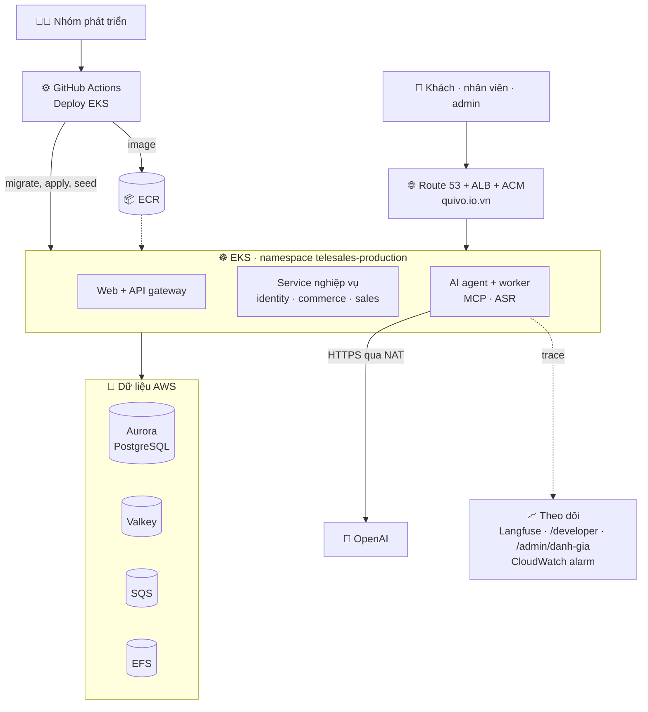
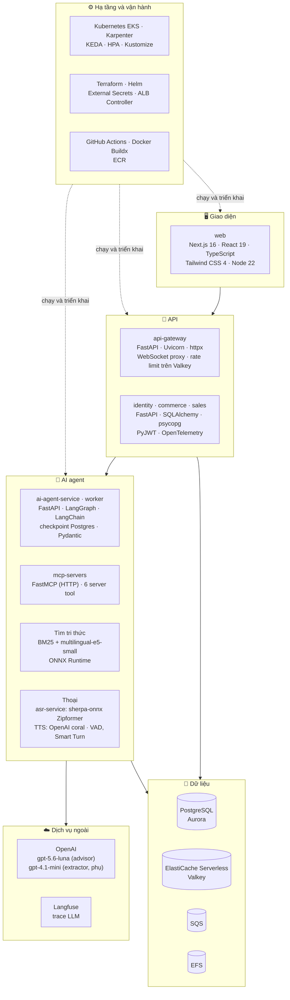
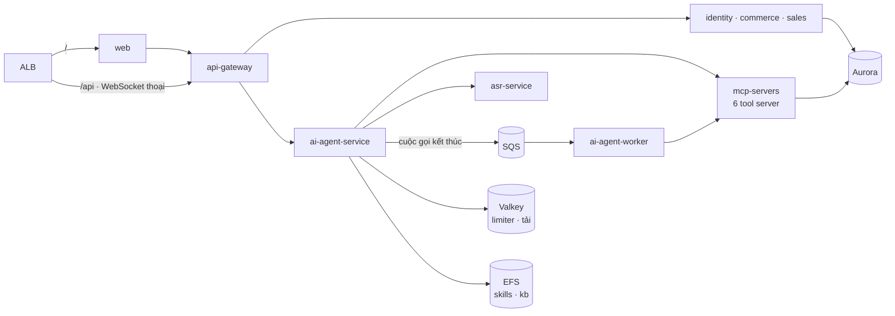
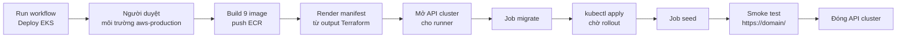
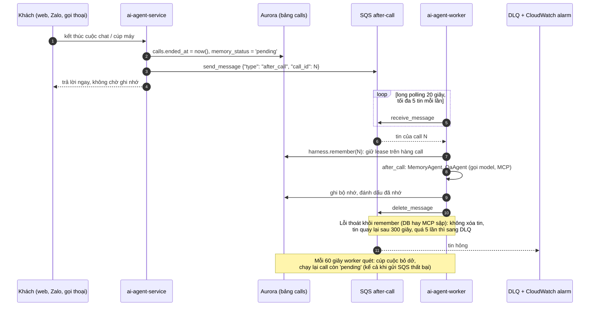

# Kiến trúc trên AWS EKS

Trang này mô tả hệ thống **đang chạy** trên Amazon EKS (`ap-southeast-1`, tên miền `quivo.io.vn`): từng thành phần chạy ở đâu, scale theo tín hiệu nào, CI/CD đưa bản mới lên ra sao, và theo dõi bằng gì. Mục 6 ghi phần còn là đề xuất.

**Trạng thái (27/11/2026): hệ thống đang dừng.** Tài khoản AWS ở gói Free plan đã dùng hết credit, nên AWS đóng tài khoản ngày 27/11/2026. Web, DNS (Route 53 trả `REFUSED`), API của cluster và access key ngừng cùng lúc. Đang làm thủ tục mở lại tài khoản và lên gói trả phí. Sau sự cố, cấu hình được thu gọn cho rẻ hơn (mục 5.1) nhưng **chưa apply**: cần chạy lại Terraform và deploy khi tài khoản mở lại.

Lần kiểm trước đó (24/11/2026, bằng `kubectl` và Terraform): đã apply [infra/terraform/aws-eks](../../infra/terraform/aws-eks) và overlay [aws-production](../../infra/kubernetes/overlays/aws-production); 14 Deployment chạy đủ replica; Kubernetes 1.34; 7 node. Free plan không có Spot và Aurora chạy chế độ express (mục 2.3). Giá ở mục 5 vẫn là ước lượng từ bảng giá niêm yết, chưa kiểm bằng AWS Pricing Calculator. Chưa có số đo tải cho kiến trúc này.

Ngoài phạm vi:

- **LiveKit và tổng đài SIP** (profile `hotline`). Cuộc gọi trên trình duyệt vẫn chạy, vì nó là WebSocket qua `api-gateway` tới `ai-agent-service`, không qua LiveKit.
- **SaaS nhiều doanh nghiệp.** "Nhiều khách" ở đây là nhiều người mua cùng dùng một shop.

Trang liên quan:

- [eks-deploy.md](eks-deploy.md): các bước deploy, tắt và bật lại, xử lý sự cố.
- [eks-cicd.md](eks-cicd.md): workflow GitHub Actions.
- [aws-plan.md](aws-plan.md), [aws-terraform-cicd.md](aws-terraform-cicd.md): bản gọn EC2 + Compose (có code, không dùng cho bản đang chạy).

## 1. Toàn cảnh: hệ thống, CI/CD và theo dõi

Bốn sơ đồ dưới đây đi từ tổng quan tới chi tiết. Tên khớp manifest render từ overlay `aws-production`.

### 1.1 Tổng quan

Câu hỏi sơ đồ trả lời: **hệ thống gồm những khối nào, và khối nào nói chuyện với khối nào?**

- **GitHub Actions** đưa bản mới lên (mục 1.4). **Người dùng** vào qua một tên miền; ALB chuyển tiếp vào cluster.
- **EKS** chia ba nhóm: phần ngoài cùng (web, gateway), service nghiệp vụ, và phần AI. Mục 1.2 ghi công nghệ của từng khối, mục 1.3 vẽ đường đi của request.
- **Dữ liệu** nằm ngoài cluster, trong dịch vụ của AWS, nên xóa hay dựng lại cluster không mất dữ liệu.
- **Theo dõi:** mục 6.1.

### 1.2 Công nghệ theo từng tầng

Câu hỏi sơ đồ trả lời: **mỗi tầng của hệ thống được viết và chạy bằng công nghệ gì?** Lấy từ `requirements.txt`, `package.json`, Dockerfile và cấu hình model của từng service.

| Tầng | Công nghệ | Dùng vào việc gì | Ở đâu |
|---|---|---|---|
| Giao diện | **Next.js 16**, **React 19**, TypeScript 5.9, **Tailwind CSS 4** cùng các file CSS riêng; test giao diện bằng Playwright | trang shop, `/ban-hang` của nhân viên, `/admin`, `/developer`; gọi thoại qua WebSocket | [apps/web](../../apps/web) |
| API gateway | **FastAPI**, Uvicorn, httpx, `websockets`, client `redis` (redis-py) nói chuyện với Valkey | một cổng `/api` cho mọi service; chuyển tiếp WebSocket thoại; rate limit theo IP | [apps/api-gateway](../../apps/api-gateway) |
| Service nghiệp vụ | **FastAPI**, **SQLAlchemy**, **psycopg**, PyJWT, cryptography, OpenTelemetry | tài khoản và OTP, sản phẩm và đơn hàng, bán hàng; outbox trên Postgres | [packages/backend-common](../../packages/backend-common) |
| Agent | **LangGraph** (đồ thị xử lý một lượt, checkpoint trên Postgres), **LangChain** (`langchain-openai`), FastAPI, Pydantic, jsonschema | trả lời từng lượt, gọi tool, guard, bộ nhớ khách, việc sau cuộc gọi | [apps/ai-agent-service](../../apps/ai-agent-service) |
| Tool của agent | **FastMCP** (Model Context Protocol, chạy HTTP trên EKS) | 6 server: memory, catalog, crm, order, knowledge, account | [mcp/servers](../../apps/ai-agent-service/src/ai_agent_service/mcp/servers) |
| Tìm tri thức | BM25 + **multilingual-e5-small** (int8 ONNX, chạy bằng **ONNX Runtime** trên CPU) | tìm đoạn chính sách, FAQ cho từng lượt | [config/knowledge.yaml](../../apps/ai-agent-service/config/knowledge.yaml) |
| Thoại | **sherpa-onnx** (Zipformer 30M int8) cho nhận dạng giọng nói; TTS giọng `openai:coral`; VAD và Smart Turn (ONNX Runtime, transformers) để biết khách nói xong | tin nhắn thoại, gọi điện trực tiếp, ngắt lời | [apps/asr-service](../../apps/asr-service), [requirements-voice.txt](../../apps/ai-agent-service/requirements-voice.txt) |
| Model | **OpenAI**: `gpt-5.6-luna` cho advisor, `gpt-4.1-mini` cho các agent phụ và extractor đánh giá | sinh câu trả lời; gán nhãn khi chấm | [config/models.yaml](../../apps/ai-agent-service/config/models.yaml) |
| Theo dõi | **Langfuse**, SSE cho trang Trực tiếp, CloudWatch alarm | trace LLM; xem từng lượt ngay khi lưu; cảnh báo hàng đợi | mục 6.1 |
| Dữ liệu | **PostgreSQL** (Aurora), **Valkey** trên ElastiCache Serverless (tương thích giao thức Redis; code dùng client `redis-py`, biến `REDIS_URL`, `AGENT_REDIS_URL`), **SQS**, **EFS** | dữ liệu chính; bộ đếm và tín hiệu; việc sau cuộc gọi; skills và kb dùng chung | mục 2.2, mục 3 |
| Hạ tầng | **Kubernetes** (EKS 1.34), **Karpenter**, **KEDA**, HPA, **Kustomize**, **Terraform**, **Helm**, External Secrets, AWS Load Balancer Controller | chạy, co giãn, tạo hạ tầng, lấy secret, tạo ALB | [infra/](../../infra) |
| CI/CD | **GitHub Actions**, Docker Buildx, ECR; image nền `python:3.12-slim`, `node:22-alpine` | build, push, migrate, deploy, quay lui | mục 1.4 |
| Đánh giá | `reference_eval.py` của BTC, `run_eval.py` | chấm TSR, CCR, RQR, HR; nạp kết quả vào trang Đánh giá | [evaluation/README.md](../../evaluation/README.md) |

Có trong code nhưng **không chạy** trên bản EKS: Kafka (`confluent-kafka`; sự kiện đi qua outbox trên Postgres), LiveKit (`hotline-bridge`, tổng đài SIP), các provider Gemini, Groq, NVIDIA (`langchain-google-genai`, `langchain-groq`, `langchain-nvidia-ai-endpoints`; `models.yaml` chọn OpenAI).

### 1.3 Một request đi qua cluster

Câu hỏi sơ đồ trả lời: **tin nhắn hay cuộc gọi của khách đi qua những pod nào, và pod nào dùng dữ liệu gì?**

- `ai-agent-service` trả lời từng lượt; tool đi qua `mcp-servers` bằng HTTP (`MCP_TRANSPORT=http`). NetworkPolicy chỉ cho agent và worker gọi MCP và ASR.
- Việc sau cuộc gọi (`after_call`: bộ nhớ, QA) đi qua SQS sang `ai-agent-worker`, nên không tranh CPU với lượt chat của khách. Chi tiết từng bước: mục 2.4.
- Không vẽ cho gọn: các worker `*-events` (relay outbox vào Aurora), `zalo-mock` (web chuyển tiếp `/zalo-mock` cho admin, mock gọi webhook của gateway), và gateway cũng dùng Valkey để rate limit.

### 1.4 CI/CD: từ commit lên cluster

Câu hỏi sơ đồ trả lời: **bấm "Run workflow" xong thì những gì xảy ra, theo thứ tự nào?**

- [deploy-eks.yml](../../.github/workflows/deploy-eks.yml) chạy tay. Tag image là 12 ký tự đầu của commit và không ghi đè được. Quay lui: chạy lại với `image_tag` của bản cũ (bỏ qua build, migrate, seed).
- [terraform-eks.yml](../../.github/workflows/terraform-eks.yml) chỉ chạy `fmt` và `validate` khi Terraform đổi; `plan` và `apply` làm bằng tay.
- Route 53 trỏ tên miền về ALB; ALB có hai đường `/api` và `/` ([ingress.yaml](../../infra/kubernetes/overlays/aws-production/ingress.yaml)); chứng chỉ ACM do Terraform tạo ([acm.tf](../../infra/terraform/aws-eks/acm.tf), [domain.tf](../../infra/terraform/aws-eks/domain.tf)).

## 2. Từng thành phần

### 2.1 Workload trong cluster

Từ 27/11/2026, pod của app không bị ghim vào pool nào. Scheduler đặt pod lên phần trống của 2 node hệ thống trước; chỗ nào không đủ thì Karpenter thêm node từ pool `general` (mục 5.1). Chỉ hai CronJob cải tiến còn ghim vào `general`.

| Thành phần | Replica tối thiểu | Node | Scale theo | Ghi chú |
|---|---|---|---|---|
| `web`, `api-gateway`, `identity-service`, `commerce-service`, `sales-service` | 1 mỗi cái (trước 27/11: 2) | bất kỳ | HPA theo CPU 70% ([scaling.yaml](../../infra/kubernetes/overlays/aws-production/scaling.yaml)) | stateless |
| `ai-agent-service` | 1 (trước 27/11: 2) | bất kỳ, có `karpenter.sh/do-not-disrupt` | KEDA `metrics-api`: số lượt đang chạy và số WebSocket thoại đang mở (`GET /internal/load`, mục 3.6) | agent chủ yếu chờ model nên CPU không phản ánh tải. Annotation `do-not-disrupt` cấm Karpenter dọn node đang có pod agent, để không cắt ngang cuộc gọi ([agent-patch.yaml](../../infra/kubernetes/overlays/aws-production/agent-patch.yaml)) |
| `mcp-servers` | 1 (trước 27/11: 2) | bất kỳ | HPA theo CPU | 6 server, cổng 8801–8806 ([mcp.yaml](../../infra/kubernetes/overlays/aws-production/mcp.yaml)). Chỉ agent và worker gọi được (NetworkPolicy) |
| `ai-agent-worker` | 1 | bất kỳ | KEDA theo độ dài hàng đợi SQS, **tối thiểu 1** ([after-call-worker.yaml](../../infra/kubernetes/overlays/production/after-call-worker.yaml)) | vòng quét 60 giây nằm ở đây, nên không về 0 |
| `asr-service` | 1 | bất kỳ | — | Zipformer int8 trên CPU ([asr.yaml](../../infra/kubernetes/overlays/aws-production/asr.yaml)); chỉ agent và worker gọi được |
| `identity-events`, `commerce-events`, `sales-events`, `ai-agent-events` | 1 mỗi cái | bất kỳ | — | relay outbox trên Postgres, không dùng Kafka |
| `zalo-mock` | 1 | bất kỳ | — | demo kênh Zalo khi chưa có Official Account ([zalo-mock.yaml](../../infra/kubernetes/overlays/aws-production/zalo-mock.yaml)) |
| Job `telesales-migrate`, `telesales-seed` | mỗi lần deploy | bất kỳ | — | do `deploy-eks.yml` tạo |
| CronJob `improve-learn`, `improve-tick` | mỗi lần chạy | `general` | — | xin 1 CPU, 2 GiB; Karpenter thêm node rồi trả lại sau 2 phút ([improve.yaml](../../infra/kubernetes/overlays/aws-production/improve.yaml)) |

### 2.2 Hạ tầng AWS

| Thành phần | Cấu hình đang chạy | Ở đâu |
|---|---|---|
| VPC | subnet private, public và database ở 3 AZ; **một** NAT Gateway (`single_nat_gateway = true`) | [network.tf](../../infra/terraform/aws-eks/network.tf) |
| EKS | Kubernetes 1.34; API public nhưng chỉ mở cho `cluster_admin_cidrs`, workflow deploy mở tạm cho runner | [eks.tf](../../infra/terraform/aws-eks/eks.tf) |
| Node | 2 node hệ thống do Terraform tạo, app dùng chung với add-on (`dedicated_system_nodes = false`), cộng NodePool `general` của Karpenter cho phần không vừa. Hôm 24/11, trước khi thu gọn: 7 node `c7i-flex.large` / `m7i-flex.large`, ở `ap-southeast-1a` và `1b` | [eks.tf](../../infra/terraform/aws-eks/eks.tf), [overlays/aws-cluster](../../infra/kubernetes/overlays/aws-cluster) |
| AWS Budgets | ngân sách tháng `monthly_budget_usd` (mặc định 150 USD), email `alarm_email` khi chi thật vượt 50% và 100%, và khi dự báo vượt 80% | [budget.tf](../../infra/terraform/aws-eks/budget.tf) |
| Add-on | AWS Load Balancer Controller, External Secrets, KEDA, metrics-server, Karpenter (Helm); EFS CSI (EKS add-on) | [addons.tf](../../infra/terraform/aws-eks/addons.tf) |
| Aurora PostgreSQL | chế độ express của Free plan, script tạo rồi Terraform import | [aurora-import.tf](../../infra/terraform/aws-eks/aurora-import.tf), [eks-deploy.md](eks-deploy.md) mục 2.2 |
| ElastiCache Serverless (Valkey) | TLS (`rediss://`); gateway (`REDIS_URL`) và agent (`AGENT_REDIS_URL`) dùng chung | [data.tf](../../infra/terraform/aws-eks/data.tf), mục 3 |
| SQS | hàng đợi `after-call` kèm DLQ, hai alarm gửi SNS; chỉ dùng cho việc ghi nhớ sau khi cuộc gọi kết thúc (mục 2.4) | [queue.tf](../../infra/terraform/aws-eks/queue.tf) |
| EFS | một access point uid 1000; agent và worker gắn `skills`, `improvement`, `kb` | [storage.yaml](../../infra/kubernetes/overlays/aws-production/storage.yaml) |
| ECR | một repo mỗi image, tag không ghi đè được | [data.tf](../../infra/terraform/aws-eks/data.tf) |
| Secrets Manager | secret app điền bằng tay; External Secrets dựng `telesales-secrets`, `DATABASE_URL` ghép từ secret của Aurora | [secrets.yaml](../../infra/kubernetes/overlays/aws-production/secrets.yaml) |
| Quyền AWS của pod | EKS Pod Identity, mỗi service account một role | [identity.tf](../../infra/terraform/aws-eks/identity.tf) |
| Route 53, ACM | hosted zone của tên miền, chứng chỉ xác thực qua DNS | [domain.tf](../../infra/terraform/aws-eks/domain.tf), [acm.tf](../../infra/terraform/aws-eks/acm.tf) |
| S3 | chỉ giữ Terraform state; app không đọc hay ghi S3 | [backend.hcl.example](../../infra/terraform/aws-eks/backend.hcl.example) |

### 2.3 Khác với thiết kế cho tài khoản trả phí

Thiết kế ban đầu đặt các service stateless lên Spot và chạy Aurora Multi-AZ. Gói Free plan không có Spot, nên pool `general` dùng máy on-demand `m7i-flex.large` hoặc `c7i-flex.large`. Aurora chỉ có chế độ express: 1 instance, 0–4 ACU, không mã hóa ổ đĩa. Khi lên gói trả phí, đổi NodePool `general` sang Spot và dựng lại Aurora theo Terraform thay vì import.

### 2.4 SQS nằm ở khúc nào: việc sau cuộc gọi

SQS chỉ dùng cho **một việc**: sau khi một cuộc chat hoặc cuộc gọi **kết thúc**, ghi nhớ cuộc đó (MemoryAgent cập nhật bộ nhớ khách, QaAgent kiểm câu hỏi chưa trả lời được). Lượt trả lời của khách **không** đi qua SQS: lượt nào cũng đi thẳng gateway → `ai-agent-service` như mục 1.3.

Câu hỏi sơ đồ trả lời: **từ lúc cuộc gọi kết thúc tới lúc bộ nhớ khách được cập nhật, ai làm gì?**

| Bước | Ở đâu trong code | Ghi chú |
|---|---|---|
| Đánh dấu cuộc gọi kết thúc, rồi gửi tin | `hang_up` trong [runtime/calls.py](../../apps/ai-agent-service/src/ai_agent_service/runtime/calls.py) gọi `after_call` trong [runtime/jobs.py](../../apps/ai-agent-service/src/ai_agent_service/runtime/jobs.py) | Hàng `calls` chuyển `memory_status = 'pending'` **trước** khi gửi. Gửi lỗi thì chỉ ghi log: vòng quét sẽ nhặt lại |
| Nhận tin, ghi nhớ, xóa tin | `consume` và `handle` trong [worker.py](../../apps/ai-agent-service/src/ai_agent_service/worker.py) | Long polling 20 giây, mỗi lần tối đa 5 tin (`WORKER_BATCH`). Tin bị xóa khi `remember` trả về, kể cả khi `after_call` thất bại (lỗi đã ghi trên hàng, vòng quét chạy lại) |
| Vòng quét 60 giây | `sweep` trong [runtime/jobs.py](../../apps/ai-agent-service/src/ai_agent_service/runtime/jobs.py) | Cúp cuộc khách bỏ dở (không ai gửi tin cho cuộc này) và chạy lại các call còn `pending`. Một khóa `pg_try_advisory_lock` để chỉ một worker quét mỗi lúc |
| Cấu hình hàng đợi | [queue.tf](../../infra/terraform/aws-eks/queue.tf) | `visibility_timeout` 300 giây, giữ tin 4 ngày; DLQ sau 5 lần nhận, giữ 14 ngày |
| Cảnh báo | [queue.tf](../../infra/terraform/aws-eks/queue.tf) | Alarm 1: DLQ có tin (bất kỳ). Alarm 2: tin cũ nhất chờ quá 600 giây, hai chu kỳ 5 phút liền. Cả hai gửi SNS |
| Co giãn worker | [after-call-worker.yaml](../../infra/kubernetes/overlays/production/after-call-worker.yaml) | KEDA theo độ dài hàng đợi: 5 tin mỗi replica, từ 1 đến 6 replica. Không về 0, vì vòng quét chạy trong worker |

**Vì sao cần hàng đợi:** ghi nhớ một cuộc gọi gọi model nhiều lần và có thể mất hàng chục giây. Nếu chạy trong `ai-agent-service`, việc này tranh CPU và kết nối với lượt chat của khách khác. Tách ra worker thì API chỉ trả lời lượt, còn worker tăng theo số cuộc gọi vừa kết thúc.

**Vì sao mất tin cũng không sao:** Aurora là nơi ghi đúng, SQS chỉ là lời nhắc. Tin gửi hai lần hay nhận hai lần cũng an toàn: `remember` giữ lease trên hàng call và bỏ qua call đã nhớ. Tin không gửi được thì vòng quét 60 giây vẫn tìm ra call còn `pending`.

Khi chạy local hoặc chạy đánh giá (`JOBS_QUEUE_URL` không đặt), không có SQS: `after_call` chạy ngay trong tiến trình API như trước.

## 3. ElastiCache (Valkey) dùng vào việc gì

**Nguyên tắc: Valkey không phải nơi lưu chính.** Tri thức (FAQ, chính sách, phiên bản `data/kb/v<N>.jsonl`), hội thoại, checkpoint, đơn hàng và OTP vẫn ở Postgres. Những thứ này cần bền, có lịch sử, rollback được, và evaluation phải chạy lại cho cùng kết quả. Valkey chỉ giữ bộ đếm, khóa ngắn hạn và tín hiệu, thứ mất đi thì hệ thống vẫn đúng.

**Vì sao không dùng Valkey làm "kho FAQ agent tìm trước":** chỉ mục tri thức đã nằm ngay trong bộ nhớ của server `mcp-knowledge` (BM25 kết hợp embedding chạy tại chỗ, xem [knowledge.py](../../apps/ai-agent-service/src/ai_agent_service/mcp/servers/knowledge.py) và [search.py](../../apps/ai-agent-service/src/ai_agent_service/components/knowledge/search.py)). Trên bộ `data/dev`, p50 của brief (gồm cả bước tìm này) là khoảng 40–75 ms, còn thời gian tới chữ đầu tiên là 1,8–2,4 giây, gần như toàn bộ là chờ model. Tra qua Valkey thêm một lượt gọi mạng nên chậm hơn, và tri thức sẽ nằm ở hai nơi.

| # | Việc | Trạng thái |
|---|---|---|
| 1 | Rate limit dùng chung | **đang chạy**: gateway đếm theo `REDIS_URL`; limiter model dùng chung qua [shared_limiter.py](../../apps/ai-agent-service/src/ai_agent_service/llm/shared_limiter.py) (`AGENT_REDIS_URL`) |
| 2 | Báo khi tri thức đổi | **đang chạy**: pub/sub `kb:changed` ([notify.py](../../apps/ai-agent-service/src/ai_agent_service/components/knowledge/notify.py)); đổi bản release vẫn cần restart |
| 3 | Chống gửi OTP hàng loạt | **đang chạy**: [otp_limits.py](../../packages/backend-common/src/identity/otp_limits.py) |
| 4 | Chống xử lý trùng | **không dùng Valkey**: đã có ràng buộc của Postgres (mục 3.4) |
| 5 | Cache catalog | chưa làm; chỉ làm khi đo thấy DB quá tải (mục 3.5) |
| 6 | Tín hiệu tải cho KEDA | **đang chạy**: [runtime/load.py](../../apps/ai-agent-service/src/ai_agent_service/runtime/load.py), `GET /internal/load` |
| 7 | Sổ chi tiêu model | **chỉ đếm**: chưa có ngưỡng chuyển nhân viên hay đổi model |

### 3.1 Rate limit dùng chung

**Gateway.** [api-gateway/src/main.py](../../apps/api-gateway/src/main.py) đếm theo cửa sổ một phút bằng Lua (`INCR` + `EXPIRE`, khóa `<RATE_PREFIX>:<ip>:<phút>`, ngưỡng 120). Khi Valkey lỗi, gateway trả **503** cho mọi `/api/*` (fail closed), nên Valkey là phụ thuộc bắt buộc của gateway.

**Limiter model.** Request và token giữ trong sorted set theo `provider:model`; `acquire` chạy bằng một script Lua; trạng thái nghỉ sau 429 là một khóa có TTL dùng chung cho mọi pod. Valkey lỗi thì quay về limiter trong tiến trình, với giới hạn chia cho `MODEL_LIMITER_PODS` (10), để khách vẫn được trả lời.

### 3.2 Báo khi tri thức đổi

Sau khi admin lưu một mục hoặc bật bản kb mới, service ghi Postgres trước rồi `PUBLISH kb:changed`. Mỗi `mcp-knowledge` đánh dấu chỉ mục là cũ và dựng lại ở lượt tìm sau. Việc kiểm `kb_chunks` mỗi 10 giây vẫn giữ làm đường dự phòng, vì pub/sub không lưu tin. Bản release (`config/knowledge.yaml` chọn `v<N>`) chỉ được chép vào `kb_chunks` lúc khởi động (`sync_release`), nên đổi bản vẫn phải restart.

### 3.3 Chống gửi OTP hàng loạt

Cooldown theo từng bước và trần theo giờ, khóa mang hash tag `{otp}` vì ElastiCache Serverless chạy chế độ cluster (lệnh chạm nhiều khóa phải chung slot). Khóa dùng digest số điện thoại, không dùng số gốc. Bảng `challenges` và token `customer_access` vẫn ở Postgres.

### 3.4 Chống xử lý trùng: không cần Valkey

- đơn hàng: `orders.idempotency_key` là duy nhất ([commerce/service.py](../../packages/backend-common/src/commerce/service.py));
- tin Zalo gửi lại: `zalo_msg_id UNIQUE` với `ON CONFLICT DO NOTHING` ([runtime/zalo.py](../../apps/ai-agent-service/src/ai_agent_service/runtime/zalo.py));
- hai lượt cùng một hội thoại: `pg_advisory_xact_lock` theo `conversation:<id>` ([runtime/calls.py](../../apps/ai-agent-service/src/ai_agent_service/runtime/calls.py)).

### 3.5 Cache catalog: chỉ khi có tín hiệu

Tool `catalog.search`, `inventory.check` và `pricing.get_quote` của agent đọc mock của BTC trong bộ nhớ, nên cache không làm agent nhanh hơn. Chỉ trang shop đọc Postgres qua `commerce-service`. Khi đo thấy truy vấn catalog chiếm phần lớn tải đọc: cache theo sản phẩm, TTL 60 giây, xóa khóa khi giá, tồn kho hoặc khuyến mãi đổi; không cache giỏ hàng hay giá của một đơn.

### 3.6 Tín hiệu tải cho KEDA

Mỗi pod agent giữ `load:turns:<pod>` (lượt đang chạy) và `load:calls:<pod>` (WebSocket thoại đang mở), TTL 30 giây, gia hạn định kỳ. KEDA đọc tổng qua `GET /internal/load` (chỉ namespace `keda` gọi được). Mức mỗi pod trong ScaledObject (6 lượt, 4 cuộc gọi thoại) là số khởi đầu, chưa đo; đo bằng `run_eval.py --performance --sessions <mức>`.

### 3.7 Sổ chi tiêu model

Sau mỗi lần gọi model, cộng tiền vào `spend:day:<ngày>` và `spend:conv:<id hội thoại>` (TTL 7 ngày). Hiện chỉ đếm, trang dev hiện chi tiêu hôm nay. Số chính xác vẫn lấy từ hóa đơn của provider. Sổ này khác `EVAL_BUDGET_DB`, vốn chỉ dùng cho evaluation.

## 4. Bảo mật

| Lớp | Đang có | Chưa có |
|---|---|---|
| Biên | ALB với chứng chỉ ACM; rate limit ở gateway | CloudFront + WAF |
| Mạng | node, Aurora, Valkey ở subnet private; ra Internet qua một NAT | VPC endpoint cho ECR, S3, STS, Secrets Manager |
| Cluster | API public nhưng giới hạn IP (`cluster_admin_cidrs`), workflow deploy mở tạm rồi đóng; EKS Pod Identity, mỗi service account một role | API private |
| Trong cluster | NetworkPolicy: mặc định chặn ingress; chỉ gateway (và web, các worker sự kiện) gọi service nội bộ; chỉ agent và worker gọi MCP và ASR; chỉ KEDA gọi `/internal/load` ([network-policy.yaml](../../infra/kubernetes/overlays/aws-production/network-policy.yaml)). Pod chạy non-root, root filesystem read-only | Pod Security Admission ở mức `restricted` cho cả namespace |
| Secret | Secrets Manager qua External Secrets; không có giá trị secret trong git hay Terraform state. `APP_SECRET` sinh khóa của PII vault nên **không xoay vòng tự động** | — |
| Dữ liệu | Valkey TLS | Aurora express không mã hóa ổ đĩa (giới hạn Free plan) |
| Giám sát | alarm SQS và DLQ | GuardDuty, CloudTrail riêng cho app |

## 5. Chi phí

Ước lượng thô, sai khoảng ±30%, **chưa tính phí API model** (gần như chắc chắn là khoản lớn nhất). Từ khi lên gói trả phí, mọi khoản là tiền thật.

**Bài học ngày 27/11/2026:** cấu hình cũ chạy 7 node suốt ngày đêm và đã dùng hết credit Free plan. AWS đóng tài khoản mà không ai được báo trước. Hai thay đổi dưới đây nhằm để chuyện đó không lặp lại.

### 5.1 Cấu hình thu gọn (27/11/2026)

Lý do cũ cần 7 node: 2 node hệ thống có taint `CriticalAddonsOnly` nên app không được dùng; pod app lại bị ghim vào hai pool của Karpenter (`on-demand` cho agent, `general` cho phần còn lại); mỗi service chạy tối thiểu 2 replica. Trong khi đó, tổng tài nguyên các pod xin ở mức tối thiểu chỉ khoảng 2 vCPU và 5 GiB.

| Thay đổi | File |
|---|---|
| Bỏ taint node hệ thống: app dùng phần trống mà add-on để lại (`dedicated_system_nodes = false`) | [eks.tf](../../infra/terraform/aws-eks/eks.tf), [variables.tf](../../infra/terraform/aws-eks/variables.tf) |
| Bỏ ghim pod vào pool; xóa pool `on-demand`. Agent giữ node bằng `karpenter.sh/do-not-disrupt` | [agent-patch.yaml](../../infra/kubernetes/overlays/aws-production/agent-patch.yaml), [asr.yaml](../../infra/kubernetes/overlays/aws-production/asr.yaml), [mcp.yaml](../../infra/kubernetes/overlays/aws-production/mcp.yaml), [zalo-mock.yaml](../../infra/kubernetes/overlays/aws-production/zalo-mock.yaml), [karpenter.yaml](../../infra/kubernetes/overlays/aws-cluster/karpenter.yaml) |
| Replica tối thiểu 2 → 1 (HPA và KEDA); vẫn tự scale lên khi tải tăng | [scaling.yaml](../../infra/kubernetes/overlays/aws-production/scaling.yaml) |
| PDB `minAvailable: 1` → `maxUnavailable: 1`, để node có 1 pod vẫn dọn được | [availability.yaml](../../infra/kubernetes/overlays/production/availability.yaml) |
| AWS Budgets gửi email khi chi tiêu vượt ngưỡng | [budget.tf](../../infra/terraform/aws-eks/budget.tf) |

Đổi lại: mỗi service chỉ còn 1 pod, nên pod chết thì service gián đoạn vài giây đến vài phút, trong lúc pod mới khởi động. Với shop thật, đặt lại mức tối thiểu 2 và `dedicated_system_nodes = true` nếu cần.

| Khoản | Trước (7 node) | Sau, khi bật | USD/tháng |
|---|---|---|---|
| EKS control plane | ≈ 73 | ≈ 73 | cố định khi còn cluster |
| Node `*-flex.large` on-demand | ≈ 400–450 | ≈ 120–130 (2 node hệ thống; Karpenter chỉ thêm khi tải tăng hoặc CronJob chạy) | lớn nhất |
| NAT Gateway (1) | ≈ 35–45 | ≈ 35–45 | |
| ALB | ≈ 20–25 | ≈ 20–25 | |
| Aurora express (0–4 ACU) | tùy tải | tùy tải | về gần 0 khi không có kết nối |
| Valkey, SQS, EFS, ECR, Secrets | ≈ 20–30 | ≈ 20–30 | |
| **Tổng, bật 24/7** | **≈ 550–620** | **≈ 270–300** | |

Số "sau" là ước lượng, chưa đo trên hóa đơn: sau khi deploy, kiểm `kubectl get nodes` (mong đợi 2 node lúc vắng khách) và Cost Explorer sau vài ngày.

### 5.2 Chỉ bật khi demo

Ngay cả cấu hình thu gọn vẫn tốn khoảng 270–300 USD/tháng nếu bật suốt. Khi không demo, mặc định nên **xóa cluster, giữ dữ liệu** (cách đầu trong bảng dưới). Lệnh: [eks-deploy.md, mục 5](eks-deploy.md#5-tắt-hệ-thống).

| Cách | Khi tắt | Bật lại mất |
|---|---|---|
| Xóa cluster, NAT, ALB; giữ ECR, Secrets, EFS, S3, Route 53, ACM và Aurora | ≈ 5–10 USD/tháng | ≈ 20–30 phút |
| Giữ cluster, app và node về 0 | ≈ 120–150 USD/tháng (EKS, NAT, ALB, Valkey) | ≈ 3–5 phút |

## 6. Việc còn lại

| # | Việc | Trạng thái |
|---|---|---|
| 1 | Terraform, add-on, overlay `aws-production`, limiter dùng chung, tín hiệu tải, worker SQS, `kb:changed`, giới hạn OTP | **đang chạy** trên cluster |
| 2 | CI/CD | **đang chạy**: `deploy-eks.yml` (build, migrate, apply, seed, smoke test, quay lui bằng `image_tag`), `terraform-eks.yml` (fmt, validate). `plan`/`apply` Terraform vẫn bằng tay |
| 3 | Vòng cải tiến hằng tuần bằng CronJob `improve-learn`, `improve-tick` và nút bấm tay trên `/admin` | **có code, chưa deploy**: nhánh `feat/eks-weekly-improvement` ([improve.yaml](../../infra/kubernetes/overlays/aws-production/improve.yaml), [eks-deploy.md](eks-deploy.md) mục 2.11) |
| 4 | Đổi bản release kb không cần restart; ngưỡng chi tiêu chuyển nhân viên hoặc đổi model | chưa làm; đổi hành vi agent nên cần duyệt và chạy evaluation |
| 5 | Đẩy log pod lên CloudWatch (Fluent Bit hoặc add-on CloudWatch Observability) | chưa làm |
| 6 | CloudFront + WAF, VPC endpoint, GuardDuty | chưa làm |
| 7 | Đo mức tải mỗi pod của KEDA | chưa đo |

### 6.1 Theo dõi

- **Trace LLM** (prompt, cây lời gọi, token, chi phí theo model): Langfuse cloud ([llm/tracing.py](../../apps/ai-agent-service/src/ai_agent_service/llm/tracing.py)). `LANGFUSE_HOST` nằm trong ConfigMap; `LANGFUSE_PUBLIC_KEY`, `LANGFUSE_SECRET_KEY` trong secret app; `LANGFUSE_PROJECT_ID` để trang dev mở đúng session của từng lượt.
- **Trang dev, tab Trực tiếp** (`/developer`): từng lượt ngay khi được lưu (SSE, [api/routes/live.py](../../apps/ai-agent-service/src/ai_agent_service/api/routes/live.py)), với model, TTFT, token, chi phí, tool, lỗi và guard; 15 phút gần nhất, tải của cả fleet và chi tiêu hôm nay.
- **Trang Đánh giá** (`/admin/danh-gia`): bốn chỉ số BTC, hiệu năng, chất lượng, so sánh run, từng kịch bản đạt hoặc trượt. Số do `run_eval.py --ingest` nạp vào Aurora.
- **Hạ tầng:** alarm CloudWatch cho DLQ có tin và tin cũ nhất chờ quá 10 phút, gửi SNS ([queue.tf](../../infra/terraform/aws-eks/queue.tf)). Log của pod **chưa** đẩy lên CloudWatch: xem bằng `kubectl logs`, và log mất khi pod bị xóa (mục 6, việc 5).

## 7. Giới hạn

- Giá chưa kiểm bằng AWS Pricing Calculator. Mức tải mỗi pod của KEDA và cỡ Aurora là giả định, chưa đo.
- Node chỉ nằm ở 2 AZ (`1a`, `1b`) dù subnet có 3; một NAT là một điểm hỏng cho đường ra Internet.
- Trần thật của hệ thống là quota của provider model (request và token mỗi phút). Thêm hạ tầng không nâng trần đó.
