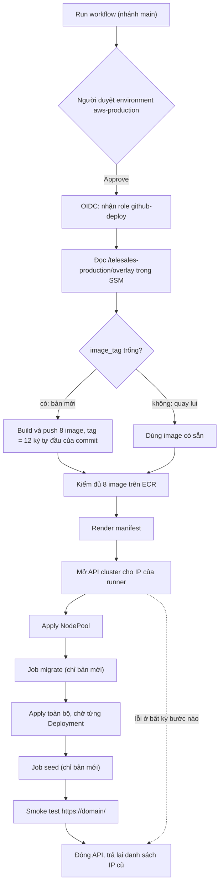

# CI/CD cho EKS bằng GitHub Actions

Trang này hướng dẫn cấu hình GitHub để phát hành lên cluster EKS bằng một nút bấm, và cách dùng nó. Hạ tầng phải dựng xong trước theo [eks-deploy.md](eks-deploy.md) mục 2, ít nhất một lần bằng tay, vì Terraform vẫn chạy bằng tay.

**Điều quan trọng nhất:** GitHub **không giữ key AWS nào**. Workflow xin quyền qua OIDC: GitHub cấp cho mỗi lần chạy một token ngắn hạn, AWS đổi token đó lấy role `telesales-production-github-deploy`. Role chỉ nhận lần chạy nằm trong environment `aws-production` của đúng repo. Key của app (OpenAI, Langfuse...) vẫn chỉ nằm trong AWS Secrets Manager (mục 2.3 của eks-deploy).

Stack EC2 cũ có hai workflow riêng (`deploy-aws.yml`, `terraform-aws.yml`, hướng dẫn ở [aws-terraform-cicd.md](aws-terraform-cicd.md)). Hai file đó không dùng cho EKS và không có trong git.

## 1. Các workflow

| Workflow | Khi nào chạy | Làm gì | Cần AWS |
|---|---|---|---|
| [offline-checks.yml](../../.github/workflows/offline-checks.yml) | mỗi push và PR | pytest với Postgres và Redis; typecheck, test, build web; Playwright với dữ liệu giả | không |
| [terraform-eks.yml](../../.github/workflows/terraform-eks.yml) | push và PR có đụng `infra/terraform/aws-eks` | `terraform fmt -check`, `validate`, và kiểm hai overlay Kubernetes vẫn render được | không |
| [deploy-eks.yml](../../.github/workflows/deploy-eks.yml) | bấm tay, rồi có người duyệt | build 8 image, migrate, rollout, seed, smoke test | có (OIDC) |

`terraform plan` và `apply` cho EKS **không** chạy trong CI. State và tài khoản do người vận hành giữ, và mỗi lần apply có thể tốn tiền, nên vẫn làm bằng tay ([eks-deploy.md](eks-deploy.md) mục 2.2).

## 2. Một lần phát hành chạy những gì

Workflow đi qua các bước sau, theo thứ tự:



Giải thích từng bước:

- **Đọc cấu hình.** [github.tf](../../infra/terraform/aws-eks/github.tf) ghi tham số SSM `/telesales-production/overlay`. Nó chứa đúng giá trị của `terraform output overlay`, thêm `ecr_registry` và `cluster`. Đó là endpoint và ARN, không có secret. Nhờ vậy workflow không cần quyền đọc state Terraform.
- **Build.** Mỗi image được build bằng `--provenance=false --sbom=false`, vì repo ECR đặt tag `IMMUTABLE`. Image đã có tag đó trên ECR thì bỏ qua, nên chạy lại một lần lỗi không build lại từ đầu. Cache build nằm trong GitHub Actions cache, nên lần sau nhanh hơn.
- **Mở API.** API cluster chỉ mở cho `cluster_admin_cidrs` (IP của bạn). Runner của GitHub đổi IP mỗi lần chạy, nên [eks_endpoint.sh](../../scripts/deployment/eks_endpoint.sh) thêm IP của runner vào danh sách, và chờ EKS áp xong (khoảng 3–5 phút). Bước cuối trả lại danh sách cũ, kể cả khi bước giữa lỗi. Mỗi lần phát hành vì vậy dài thêm khoảng 10 phút.
- **Migrate.** Job [migrate-job.yaml](../../infra/kubernetes/migrate-job.yaml) dùng secret `telesales-migration-secrets`. Secret này tạo bằng tay một lần (eks-deploy mục 2.6); thiếu nó thì workflow dừng và báo lỗi.
- **Rollout.** Workflow apply toàn bộ manifest, rồi chờ từng Deployment sẵn sàng, mỗi cái tối đa 10 phút.
- **Seed.** Job [seed-job.yaml](../../infra/kubernetes/seed-job.yaml) chạy lại sau mỗi bản mới. Chạy lặp vẫn an toàn: hàng nào đã có thì bỏ qua.

## 3. Cấu hình một lần

### 3.1 Terraform: role cho GitHub

Đặt tên repo trong `infra/terraform/aws-eks/terraform.tfvars`, rồi apply:

```hcl
github_repository = "queenley/capstone_sudocode2026"   # owner/tên repo, đúng như trên GitHub
```

```powershell
Set-Location infra/terraform/aws-eks
terraform plan -out="$env:TEMP\github.tfplan"     # 6 to add: OIDC provider, role, policy, access entry, quyền admin trong cluster, tham số SSM
terraform apply "$env:TEMP\github.tfplan"
terraform output -raw github_deploy_role_arn       # dùng ở mục 3.3
```

Role được làm những việc sau:

| Quyền | Để làm gì |
|---|---|
| `ecr:*` trên `repository/telesales-*`, `ecr:GetAuthorizationToken` | push và kiểm image |
| `eks:DescribeCluster`, `UpdateClusterConfig`, `DescribeUpdate`, `ListUpdates` trên cluster | lấy kubeconfig, mở và đóng API |
| `ssm:GetParameter` trên `/telesales-production/overlay` | đọc giá trị để render |
| Access entry với `AmazonEKSClusterAdminPolicy` | apply cả object cấp cluster (NodePool, PersistentVolume) |

Mỗi tài khoản AWS chỉ có một OIDC provider cho `token.actions.githubusercontent.com`. Nếu đã có (ví dụ stack EC2 đã tạo), đặt `create_github_oidc_provider = false`.

### 3.2 GitHub: environment `aws-production`

Vào repo trên GitHub → **Settings → Environments → New environment**, đặt tên đúng là `aws-production`. Trust policy của role chỉ nhận đúng tên này.

- **Required reviewers:** thêm bạn (hoặc người được duyệt phát hành). Mỗi lần chạy sẽ dừng chờ người này bấm Approve rồi mới chạm AWS.
- **Deployment branches and tags:** chọn *Selected branches*, thêm `main`, để không phát hành từ nhánh khác.
- **Prevent self-review:** chỉ bật khi có từ hai người duyệt trở lên; một người thì để tắt, nếu không sẽ không ai duyệt được.

### 3.3 GitHub: variables (không phải secrets)

Vào **Settings → Secrets and variables → Actions → tab Variables → New repository variable**:

| Variable | Giá trị | Bắt buộc |
|---|---|---|
| `AWS_EKS_DEPLOY_ROLE_ARN` | kết quả `terraform output -raw github_deploy_role_arn`, dạng `arn:aws:iam::<account>:role/telesales-production-github-deploy` | có |
| `AWS_REGION` | `ap-southeast-1` | không (mặc định đã là giá trị này) |
| `EKS_OVERLAY_PARAMETER` | `/telesales-production/overlay` | không |
| `AGENT_WITH_VOICE` | `0` để build agent không có gói thoại, chỉ cho shop chỉ nhắn chữ. Thiếu gói thoại thì cuộc gọi không bao giờ được trả lời | không, mặc định `1` |
| `VOICE_TTS` | giọng đọc của cuộc gọi | không, mặc định `openai:coral` |
| `HOTLINE_NUMBER`, `ZALO_OA_ID` | số hotline và Zalo OA hiện trên web | không |

Không cần secret nào trong GitHub:
- ARN của role không phải bí mật, vì chỉ lần chạy đúng repo và đúng environment mới assume được role đó.
- Key của app nằm trong Secrets Manager, và External Secrets đưa nó vào cluster.

Đừng thêm `AWS_ACCESS_KEY_ID` hay `AWS_SECRET_ACCESS_KEY` vào GitHub: key dài hạn bị lộ thì dùng được mãi, còn token OIDC hết hạn sau mỗi lần chạy.

### 3.4 Đưa workflow lên GitHub

`.gitignore` loại mọi file trong `.github/workflows/`, trừ `offline-checks.yml`, `deploy-eks.yml` và `terraform-eks.yml`. Commit và push ba file sau:

- `deploy-eks.yml`
- `terraform-eks.yml`
- [eks_endpoint.sh](../../scripts/deployment/eks_endpoint.sh)

Workflow chạy bằng tay chỉ hiện trong tab Actions khi file đã nằm trên nhánh mặc định (`main`).

## 4. Phát hành và quay lui

**Phát hành bản mới:**
1. Merge vào `main`.
2. Vào **Actions → Deploy EKS → Run workflow**, để trống `image_tag`, chọn nhánh `main`.
3. Người duyệt bấm **Review deployments → Approve**.
4. Xong, trang tóm tắt của lần chạy ghi `Released <tag> to https://quivo.io.vn`.

Lần đầu mất khoảng 40–60 phút, chủ yếu do build `ai-agent` và `web`. Các lần sau nhanh hơn nhờ cache.

**Quay lui:** chạy lại workflow với `image_tag` là tag của một bản cũ, ví dụ `775e87f57740`. Lần chạy này không build, không migrate, không seed, chỉ rollout các image đó với manifest của commit hiện tại. Danh sách tag có sẵn:

```powershell
aws ecr describe-images --repository-name telesales-web --query "sort_by(imageDetails,&imagePushedAt)[].imageTags[0]" --output text
```

Quay lui không đụng database. Hiện 8 file trong [migrations](../../packages/backend-common/migrations) không có `DROP` hay `RENAME`, nên code cũ vẫn chạy trên schema mới. Nếu sau này có migration xóa hoặc đổi tên cột, phải quay lui database bằng tay trước.

## 5. Khi có sự cố

| Triệu chứng | Nguyên nhân | Cách xử lý |
|---|---|---|
| `Not authorized to perform sts:AssumeRoleWithWebIdentity` | Environment không tên `aws-production`, hoặc `github_repository` khác tên repo, hoặc chạy từ fork | Sửa tên environment hay biến Terraform rồi apply lại |
| Không thấy nút Run workflow | File chưa có trên `main` | Push `deploy-eks.yml` lên `main` |
| Treo ở bước "Open the cluster's API" | Đang có một update EKS khác, ví dụ Terraform đang apply | Script tự chờ tối đa 15 phút. Đừng chạy `terraform apply` cùng lúc |
| `create telesales-migration-secrets once by hand` | Cluster mới, chưa có secret migration | Làm eks-deploy mục 2.6 một lần |
| `telesales-<x>:<tag> is not in ECR` | Quay lui về tag không có đủ 8 image, ví dụ `-r2` chỉ có `ai-agent` và `identity` | Chọn tag có đủ 8 image, hoặc chạy bản mới |
| Lần chạy lỗi và API còn mở cho IP lạ | Bước đóng cũng lỗi (hiếm) | `bash scripts/deployment/eks_endpoint.sh telesales-production <IP-của-bạn>/32` |
| `terraform plan` báo đổi `endpoint_public_access_cidrs` | Có lần chạy chưa trả lại danh sách IP | Chạy dòng trên, hoặc `terraform apply` để đặt lại theo `cluster_admin_cidrs` |

Bảng lỗi khi deploy (secret, image, ASR, KEDA) nằm ở [eks-deploy.md](eks-deploy.md) mục 4.

## 6. Giới hạn

- **Chưa chạy thật trên GitHub.** Đã kiểm:
  - YAML của hai workflow đọc được.
  - `bash -n` của script qua, và script chạy đúng trên cluster thật ở nhánh "không đổi gì".
  - `terraform validate` qua, plan ra 6 tài nguyên mới.
  - Các lệnh trong workflow là các lệnh đã chạy tay ở eks-deploy mục 2.4–2.7.

  Chưa kiểm bằng `actionlint`. Lần chạy đầu trên GitHub là lần kiểm đầu tiên.
- Không có `terraform plan` tự động trên PR cho EKS, vì cần thêm một role chỉ đọc và quyền đọc state.
- Image build từ code đã commit. Image build tay khi có thay đổi chưa commit (như `775e87f57740-r2`) không tái tạo được bằng workflow.
- `agent-seed` (bộ nhớ cuộc gọi trước của khách mẫu) chưa có trên EKS, nên workflow cũng không chạy nó.
