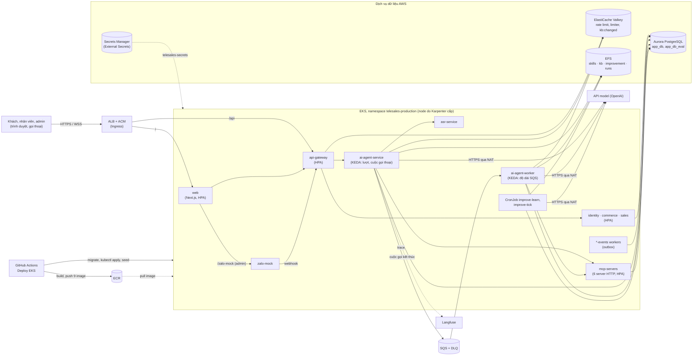
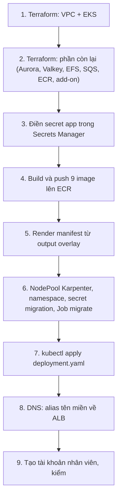
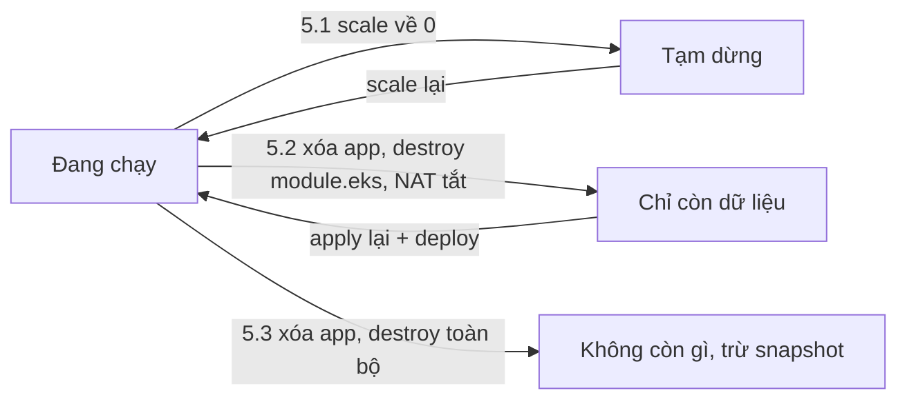

# Deploy lên EKS và tắt hệ thống

Trang này hướng dẫn dựng hệ thống trên EKS bằng [infra/terraform/aws-eks](../../infra/terraform/aws-eks) và overlay [aws-production](../../infra/kubernetes/overlays/aws-production), rồi tắt nó theo ba mức. Thiết kế và lý do chọn từng thành phần nằm ở [eks-architecture.md](eks-architecture.md); trang này chỉ nói làm thế nào.

**Chưa ai chạy các bước này trên tài khoản AWS thật.** Đã kiểm `terraform validate`, `kubectl kustomize` và `render_deployment.py`. Chưa kiểm `terraform plan`, quyền IAM, quota, rollout, TLS hay chi phí thật. Lần chạy đầu nên có người theo dõi từng bước.

**Có phát sinh chi phí ngay khi apply**, kể cả khi không có khách. Ước tính ở [eks-architecture.md, mục 5](eks-architecture.md#5-chi-phí). Phí API model tính riêng.

Mọi lệnh viết cho PowerShell, chạy từ thư mục gốc repo. Tham số có dấu chấm như `"-target=module.eks"` phải để trong ngoặc kép: PowerShell tách tham số tại dấu chấm, và Terraform báo `Too many command line arguments`.

## 1. Tổng quan

Câu hỏi sơ đồ trả lời: **khi đã deploy, request của khách và nhân viên đi qua đâu, và mỗi pod dùng dịch vụ AWS nào?** Tên khớp manifest render từ overlay `aws-production`.



- **Vào:** ALB chỉ có hai đường: `/api` vào `api-gateway`, còn lại vào `web` ([ingress.yaml](../../infra/kubernetes/overlays/aws-production/ingress.yaml)). Cuộc gọi thoại là WebSocket qua cùng `/api`.
- **Agent:** `ai-agent-service` trả lời từng lượt; tool đi qua `mcp-servers` bằng HTTP, nên chỉ agent và worker gọi được MCP ([network-policy.yaml](../../infra/kubernetes/overlays/aws-production/network-policy.yaml)). Việc sau cuộc gọi (`after_call`) đi qua SQS sang `ai-agent-worker`.
- **Co giãn:** KEDA theo số lượt đang chạy và số cuộc gọi thoại cho agent, theo độ dài hàng đợi cho worker; HPA theo CPU cho các service còn lại ([scaling.yaml](../../infra/kubernetes/overlays/aws-production/scaling.yaml)). Karpenter thêm, bớt node.
- **Dữ liệu dùng chung:** EFS giữ skills, kho tri thức và trạng thái cải tiến, để mọi pod agent, worker và CronJob cải tiến thấy cùng một version (mục 2.11).

Thứ tự một lần deploy:



| Bước | Ai tạo | Nằm ở |
|---|---|---|
| Mạng, cluster, node hệ thống, Karpenter | Terraform | [network.tf](../../infra/terraform/aws-eks/network.tf), [eks.tf](../../infra/terraform/aws-eks/eks.tf) |
| Aurora, Valkey, EFS, ECR, secret rỗng | Terraform | [data.tf](../../infra/terraform/aws-eks/data.tf) |
| Hàng đợi SQS sau cuộc gọi và DLQ | Terraform | [queue.tf](../../infra/terraform/aws-eks/queue.tf) |
| Quyền AWS của từng pod (Pod Identity) | Terraform | [identity.tf](../../infra/terraform/aws-eks/identity.tf) |
| Load Balancer Controller, External Secrets, KEDA, metrics-server, Karpenter | Terraform (Helm) | [addons.tf](../../infra/terraform/aws-eks/addons.tf) |
| NodePool, EC2NodeClass của Karpenter | Manifest | [overlays/aws-cluster](../../infra/kubernetes/overlays/aws-cluster) |
| Service, worker, MCP, Ingress, KEDA, NetworkPolicy | Manifest | [overlays/aws-production](../../infra/kubernetes/overlays/aws-production) |
| Chứng chỉ ACM (và bản ghi xác thực nếu có Route 53) | Terraform | [acm.tf](../../infra/terraform/aws-eks/acm.tf) |
| Giá trị secret, bản ghi DNS trỏ về ALB | Người làm, bằng tay | mục 2.3, 2.8 |

## 2. Deploy lần đầu

### 2.1 Cần có trước

- Công cụ: AWS CLI v2 **từ 2.7 trở lên** (`aws --version`), Terraform ≥ 1.10, `kubectl`, Docker, Python 3. AWS CLI cũ hơn ghi kubeconfig dạng `client.authentication.k8s.io/v1alpha1`, và `kubectl` mới báo `exec plugin: invalid apiVersion`. Cập nhật: `winget upgrade Amazon.AWSCLI`, rồi chạy lại `aws eks update-kubeconfig`.
- Tài khoản AWS có quyền admin để dựng hạ tầng. Người chạy Terraform trở thành admin của cluster (`enable_cluster_creator_admin_permissions`).
- Một bucket S3 cho Terraform state, bật versioning. Cách tạo: [aws-terraform-cicd.md, bước 1](aws-terraform-cicd.md#bước-1-bucket-cho-terraform-state). App không dùng S3; bucket này chỉ giữ file state, tức danh sách những gì Terraform đã tạo. Mất file state thì Terraform không còn biết để sửa hay xóa các tài nguyên đó. Dùng key riêng, không dùng chung state với stack EC2.
- Tên miền **`quivo.io.vn`**, đã mua ở nhà đăng ký Việt Nam. Terraform tạo hosted zone Route 53 cho nó ([domain.tf](../../infra/terraform/aws-eks/domain.tf)) và chứng chỉ HTTPS (ACM, [acm.tf](../../infra/terraform/aws-eks/acm.tf)).

**Tên miền: `quivo.io.vn`.** Đây là mặc định của biến `domain` ([variables.tf](../../infra/terraform/aws-eks/variables.tf)), và là **chỗ duy nhất** cần sửa khi đổi tên. Từ đó tên miền đi vào:

- hosted zone Route 53 giữ DNS của tên miền ([domain.tf](../../infra/terraform/aws-eks/domain.tf));
- chứng chỉ ACM, xác thực trong zone đó ([acm.tf](../../infra/terraform/aws-eks/acm.tf));
- output `overlay`, rồi `render_deployment.py` điền vào Ingress (`host`), `CORS_ORIGINS` và `SHOP_PUBLIC_URL`.

**Vì sao vừa mua xong, tên miền chỉ mở được bằng `http://`.** HTTPS cần một máy chủ giữ chứng chỉ cho đúng tên đó. Lúc này `quivo.io.vn` còn trỏ về trang "đỗ" (parking) của nhà đăng ký, và trang đó không có chứng chỉ cho tên của bạn. HTTPS có sau khi:

1. nameserver ở nhà đăng ký trỏ về Route 53 (mục 2.2);
2. ACM cấp chứng chỉ;
3. Ingress tạo ALB nghe cổng 443 với chứng chỉ đó (mục 2.7), và bản ghi tên miền trỏ về ALB (mục 2.8).

Từ đó, `http://quivo.io.vn` tự chuyển sang `https://` (`ssl-redirect` trong [ingress.yaml](../../infra/kubernetes/overlays/aws-production/ingress.yaml)).

**Cách khác** (đặt trong `terraform.tfvars`):

| Trường hợp | Đặt |
|---|---|
| Đã có hosted zone Route 53 cho tên miền | `create_hosted_zone = false`, `route53_zone_id = "Z..."` |
| Giữ DNS ở nhà đăng ký, không dùng Route 53 | `create_hosted_zone = false`; thêm bản ghi tay (mục 2.2 Chứng chỉ, mục 2.8) |
| Mua tên miền mới ngay trong Route 53 (không có đuôi `.vn`; tài khoản AWS phải ở gói trả tiền) | `register_domain = true`, `domain = "..."`, `domain_contact = {...}` (họ tên, email, số điện thoại `+84.<số>`, địa chỉ). Trả tiền ngay, không hoàn lại; ICANN gửi email xác nhận, phải bấm trong 15 ngày |

Không có tên miền thì không có HTTPS. Khi đó trình duyệt chặn micro, nên kênh gọi thoại trên web không chạy được.

### 2.2 Terraform

Tạo hai file trong `infra/terraform/aws-eks`, **không commit** (đều chứa thông tin riêng của tài khoản):

```powershell
Set-Location infra/terraform/aws-eks
Copy-Item backend.hcl.example backend.hcl        # sửa bucket, region
```

`terraform.tfvars`:

```hcl
region              = "ap-southeast-1"
# domain = "quivo.io.vn"   mặc định; bỏ comment để đổi
cluster_admin_cidrs = ["<IP-văn-phòng>/32"]      # 0.0.0.0/0 bị từ chối
alarm_email         = "ops@example.com"           # tùy chọn: nhận báo động hàng đợi
# create_ecr = false   nếu stack infra/terraform/aws đã tạo repo ECR trong cùng tài khoản, region
# certificate_arn = "arn:aws:acm:..."   chỉ khi đã có chứng chỉ sẵn: Terraform không tạo nữa
```

**Chứng chỉ:** ACM chỉ cấp chứng chỉ khi bạn chứng minh sở hữu tên miền, bằng một bản ghi CNAME trong DNS.

- **DNS ở Route 53** (mặc định): Terraform tự ghi bản ghi đó và chờ ACM cấp xong. ACM chỉ thấy bản ghi khi nameserver ở nhà đăng ký đã trỏ về Route 53, nên làm bước nameserver trước (ngay dưới).
- **DNS ở nơi khác:** sau `terraform apply`, chạy `terraform output certificate_validation_records` và thêm bản ghi CNAME đó ở nhà cung cấp DNS. Chờ `aws acm list-certificates --query "CertificateSummaryList[].[DomainName,Status]"` báo `ISSUED` rồi mới làm mục 2.7. Ingress không có HTTPS khi chứng chỉ chưa được cấp.

**Karpenter:** EKS tự quản phần điều khiển cluster, nhưng không tự thêm máy cho pod. Karpenter là phần mềm cài vào cluster để thêm máy khi pod cần chỗ và trả máy khi rảnh. Nó cài bằng Helm chart, và mỗi bản Karpenter chỉ hỗ trợ một dải phiên bản Kubernetes. Vì vậy `karpenter_version` được ghim, mặc định `1.14.3`: dòng LTS, hỗ trợ Kubernetes 1.34 (bảng tương thích: Kubernetes 1.34 cần Karpenter từ 1.6). Khi nâng `kubernetes_version`, kiểm bảng tương thích trên karpenter.sh trước.

**Loại máy và tài khoản Free plan:** tài khoản AWS ở gói Free plan chỉ bật được các loại máy Free Tier và không có Spot. Nếu chạy loại khác, node group báo `CREATE_FAILED ... The specified instance type is not eligible for Free Tier`. Vì vậy cấu hình mặc định chỉ dùng máy on-demand và hai loại máy lớn nhất được phép:
- Node hệ thống (`system_instance_types`): 2 máy `m7i-flex.large` (2 vCPU, 8 GiB).
- Node của Karpenter, cả hai NodePool `on-demand` và `general`: `m7i-flex.large` hoặc `c7i-flex.large` (2 vCPU, 4 GiB).

Danh sách loại máy được phép trong region:

```powershell
aws ec2 describe-instance-types --region ap-southeast-1 --filters "Name=free-tier-eligible,Values=true" --query "InstanceTypes[].InstanceType"
```

Sau khi nâng lên gói trả phí, có thể mở rộng lại: đổi `system_instance_types` trong `terraform.tfvars`, và đổi requirements của hai NodePool theo comment đầu [karpenter.yaml](../../infra/kubernetes/overlays/aws-cluster/karpenter.yaml). Pool `general` thêm Spot sẽ rẻ hơn khoảng 60–70%.

Free plan còn hai giới hạn khác. Tài khoản tự đóng khi hết credit hoặc hết 6 tháng. Một số dịch vụ khác cũng có thể bị chặn: nếu apply báo lỗi có chữ `Free Tier` hay `free plan` ở dịch vụ nào khác, chỉ còn cách nâng gói.

**Aurora trên Free plan.** Tài khoản Free plan chỉ được tạo Aurora ở chế độ *express configuration* (lỗi `FreeTierRestrictionError: ... you need to set WithExpressConfiguration`). Terraform chưa hỗ trợ tùy chọn này: `aws_rds_cluster` không có thuộc tính nào cho nó. Vì vậy:

- [create-aurora-express.ps1](../../scripts/deployment/create-aurora-express.ps1) tạo cluster bằng AWS CLI, trong subnet database và security group `telesales-production-data` mà Terraform đã tạo. Chạy lại nhiều lần vẫn an toàn.
- Express tự chọn thông số: 1 instance ghi (`telesales-production-instance-1`), 0–4 ACU, tự dừng sau 5 phút không kết nối, backup giữ 1 ngày, **không mã hóa ổ đĩa**. Express cũng không cho tạo database ban đầu, không cho đặt mật khẩu cho user chủ, và không cho RDS quản mật khẩu.
- User chủ `cluster_admin` chỉ đăng nhập bằng IAM. Script dùng nó tạo user Postgres thường `telesales` làm chủ database `app_db`. Mật khẩu của `telesales` nằm trong secret `telesales-production/database`, cùng định dạng `username`/`password` như secret RDS, nên [secrets.yaml](../../infra/kubernetes/overlays/aws-production/secrets.yaml) ghép `DATABASE_URL` không cần đổi.
- [aurora-import.tf](../../infra/terraform/aws-eks/aurora-import.tf) đưa cluster, instance và secret vào state. [data.tf](../../infra/terraform/aws-eks/data.tf) đặt `ignore_changes = all`, nên Terraform chỉ đọc chúng. Muốn đổi thông số thì dùng `aws rds modify-db-cluster`.
- Sau khi nâng lên gói trả phí, có thể quay lại cluster do Terraform tạo (mã hóa, 2 instance, backup 7 ngày). Lấy cấu hình cũ trong git log của `data.tf`, và chuyển dữ liệu bằng `pg_dump`.

**Bước nameserver, làm đầu tiên.** Tạo hosted zone, rồi trỏ tên miền về nó:

```powershell
terraform init "-backend-config=backend.hcl"
terraform apply "-target=aws_route53_zone.shop"     # hosted zone: 0,5 USD/tháng
terraform output name_servers                        # 4 nameserver, dạng ns-123.awsdns-45.com
```

Vào trang quản lý tên miền `quivo.io.vn` ở nhà đăng ký, mục **Nameserver / DNS**. Chọn dùng nameserver riêng, thay hết nameserver cũ bằng 4 nameserver trên, rồi lưu. Thường mất từ vài phút đến vài giờ thì có hiệu lực, có khi tới 24 giờ với tên miền `.vn`. Kiểm:

```powershell
nslookup -type=NS quivo.io.vn 8.8.8.8     # thấy 4 nameserver awsdns là xong
```

Sau đó apply hai lần, xen giữa là bước tạo Aurora:

1. Lần đầu chỉ dựng mạng và cluster, vì provider Helm cần cluster có sẵn mới cài add-on được.
2. Script [create-aurora-express.ps1](../../scripts/deployment/create-aurora-express.ps1) tạo Aurora, vì Terraform không tạo được trên Free plan (xem **Aurora trên Free plan** bên dưới).
3. Lần hai tạo phần còn lại và nhận Aurora vào state. Lần này chờ ACM cấp chứng chỉ, tối đa 75 phút; nameserver chưa đúng thì báo hết giờ.

```powershell
terraform plan "-target=module.vpc" "-target=module.eks" -out="$env:TEMP\eks.tfplan"   # đọc plan trước khi apply
terraform apply "$env:TEMP\eks.tfplan"
Invoke-Expression (terraform output -raw update_kubeconfig)   # kubectl trỏ vào cluster mới
pwsh ../../../scripts/deployment/create-aurora-express.ps1     # khoảng 10 phút
terraform plan -out="$env:TEMPull.tfplan"                    # có dòng "3 to import"
terraform apply "$env:TEMPull.tfplan"
New-Item -ItemType Directory -Force ../../../reports/generated | Out-Null
terraform output -json overlay | Out-File -Encoding utf8 ../../../reports/generated/overlay.json
Set-Location ../../..
```

Lần apply đầu mất khoảng 20–30 phút; EKS và Aurora chiếm phần lớn thời gian. `kubectl get nodes` phải thấy 2 node hệ thống. Node cho app chưa có: Karpenter chỉ thêm node khi có pod cần chỗ.

`overlay.json` chứa endpoint và ARN, không chứa mật khẩu. Thư mục `reports/generated` không có trong git.

### 2.3 Điền secret của app

Terraform tạo secret rỗng `telesales-production/app`. Giá trị không bao giờ nằm trong state. External Secrets đọc secret này thành `telesales-secrets` trong cluster ([secrets.yaml](../../infra/kubernetes/overlays/aws-production/secrets.yaml)), rồi tự ghép thêm `DATABASE_URL` (từ mật khẩu Aurora mà RDS quản lý) và `REDIS_URL` (endpoint Valkey). **Không ghi hai khóa này vào secret app.**

Viết file JSON **ngoài repo**, đưa lên, rồi xóa file:

```json
{
  "APP_SECRET": "<32+ byte ngẫu nhiên; KHÔNG đổi sau khi có dữ liệu>",
  "ENCRYPTION_KEY": "<khóa Fernet>",
  "ADMIN_TOKEN": "...", "AGENT_TOKEN": "...", "SELLER_TOKEN": "...", "DEVELOPER_TOKEN": "...",
  "OPENAI_API_KEY": "...",
  "LANGFUSE_PUBLIC_KEY": "...", "LANGFUSE_SECRET_KEY": "...", "LANGFUSE_PROJECT_ID": "...",
  "ENVIRONMENT": "staging"
}
```

```powershell
aws secretsmanager put-secret-value --secret-id telesales-production/app --secret-string file://C:/secure/telesales-app.json
Remove-Item C:/secure/telesales-app.json
```

Ý nghĩa từng khóa và khóa tùy chọn: bảng ở [README.md, mục 3](README.md#3-cluster-secret-và-database). `LANGFUSE_PROJECT_ID` để trang dev mở được trace của từng lượt.

`BRAVE_SEARCH_API_KEY` (tùy chọn): chỉ cần khi chạy nghiên cứu thị trường (`improve market-research`, `market-gaps`) trong cluster. Thẻ và gợi ý ghi vào EFS (`data/improvement/market`), nơi trang `/admin/kien-thuc` đọc. Không có key thì các lệnh đó dừng với `NOT_CONFIGURED`; lượt của khách không dùng key này. `put-secret-value` **thay cả secret**: đọc giá trị đang có (`aws secretsmanager get-secret-value`), thêm khóa vào JSON đó, rồi mới đưa lên, nếu không sẽ mất các khóa khác.

**`ENVIRONMENT=staging`: bắt buộc, vì chưa có nhà cung cấp SMS.** Configmap đặt `ENVIRONMENT=production`; ở chế độ đó mã OTP chỉ gửi qua SMS (`OTP_DELIVERY_URL`), nên khách không đăng ký hay xác minh được. Với `staging`, mã OTP hiện trên màn hình. Secret được nạp sau configmap nên giá trị trong secret thắng. Khi có SMS thật: bỏ dòng này, thêm `OTP_DELIVERY_URL` và `OTP_DELIVERY_TOKEN` ([README.md, OTP webhook](README.md#otp-webhook)).

`staging` còn đổi hai điều khác ([config.py](../../packages/backend-common/src/core/config.py), [auth.py](../../packages/backend-common/src/security/auth.py)), nên tự giữ kỷ luật mà production vốn ép:

- Backend **không còn từ chối secret yếu**. Vẫn dùng `APP_SECRET` từ 32 byte trở lên và bốn token vai trò khác nhau, mỗi token từ 32 ký tự.
- Token vai trò (`ADMIN_TOKEN`...) **dùng thẳng được như phiên đăng nhập nhân viên**. Ai có token là có quyền đó, nên không đưa token cho ai và không ghi vào log.

### 2.4 Build và push image

Overlay dùng 8 image. Gắn tag bằng commit SHA; repo ECR đặt `IMMUTABLE` nên không ghi đè được tag cũ.

```powershell
$Region   = (Get-Content reports/generated/overlay.json | ConvertFrom-Json).region
$Registry = terraform -chdir=infra/terraform/aws-eks output -raw ecr_registry
$Tag      = git rev-parse --short=12 HEAD
aws ecr get-login-password --region $Region | docker login --username AWS --password-stdin $Registry
```

Sau đó build và push cả 8 image. Không dán vòng lặp ở [README.md, mục 2](README.md#2-build-và-push-image): dòng đầu của nó đặt `$Registry` cho GCP và ghi đè registry ECR ở trên.

```powershell
$images = @(
  @("telesales-backend-common", "packages/backend-common/Dockerfile", @()),
  @("telesales-gateway",        "apps/api-gateway/Dockerfile",        @()),
  @("telesales-commerce",       "apps/commerce-service/Dockerfile",   @()),
  @("telesales-identity",       "apps/identity-service/Dockerfile",   @()),
  @("telesales-sales",          "apps/sales-service/Dockerfile",      @()),
  # Gói thoại (VAD, phát hiện hết lượt nói, TTS): thiếu thì cuộc gọi không bao giờ được trả lời.
  @("telesales-ai-agent",       "apps/ai-agent-service/Dockerfile",   @("--build-arg", "WITH_VOICE=1", "--build-arg", "VOICE_TTS=openai:coral")),
  # Địa chỉ gọi thoại nằm sẵn trong bundle của trình duyệt: thiếu thì trình duyệt gọi wss://<domain>:8000, cổng ALB không mở.
  @("telesales-web",            "apps/web/Dockerfile",                @("--build-arg", "NEXT_PUBLIC_VOICE_URL=https://quivo.io.vn")),
  @("telesales-asr",            "apps/asr-service/Dockerfile",        @())
)
foreach ($i in $images) {
  # Một manifest, không attestation: Docker Desktop mặc định thêm index provenance, mà tag IMMUTABLE của ECR
  # từ chối (push báo "400 Bad Request" khi PUT manifest)
  docker build --provenance=false --sbom=false @($i[2]) -f $i[1] -t "$Registry/$($i[0]):$Tag" .; if ($LASTEXITCODE) { throw "build $($i[0])" }
  docker push "$Registry/$($i[0]):$Tag"; if ($LASTEXITCODE) { throw "push $($i[0])" }
}
# kiểm: mỗi repo có đúng tag $Tag
foreach ($i in $images) { "$($i[0]): $(aws ecr list-images --repository-name $i[0] --query 'imageIds[].imageTag' --output text)" }
```

Chỉ bỏ gói thoại của agent khi shop không dùng gọi thoại; image nhẹ hơn vài trăm MB.

Tag là commit `HEAD`, không tính thay đổi chưa commit. Build lại khi chưa commit thì thêm hậu tố, ví dụ `775e87f57740-r2`, rồi render với tag gốc và đổi riêng các image đã build lại sang tag mới. Image build từ cây đang sửa dở vẫn mang tag của `HEAD`, và vì tag bất biến nên không push lại được cùng tag. Commit trước khi build. Nếu đã push nhầm, commit rồi build tag mới.

Image phải có trong ECR **trước** mục 2.6. Thiếu image thì pod migration báo `ImagePullBackOff ... not found`, và `kubectl wait` hết giờ.

### 2.5 Render manifest

```powershell
python scripts/deployment/render_deployment.py --environment aws-production `
  --registry $Registry --tag $Tag --terraform-output reports/generated/overlay.json
```

Kết quả: `reports/generated/deployment.yaml`, gồm cả app ([aws-production](../../infra/kubernetes/overlays/aws-production)) lẫn NodePool của Karpenter ([aws-cluster](../../infra/kubernetes/overlays/aws-cluster)). Script **không apply gì**. Còn sót placeholder `__TÊN__` nào thì script dừng và nêu tên; điền bằng `--set TÊN=giá-trị`.

### 2.6 Database: migration

Node hệ thống chỉ nhận add-on (taint `CriticalAddonsOnly`), nên Job migration cần node của Karpenter. Apply NodePool trước, riêng phần có nhãn `telesales/part=cluster`:

```powershell
kubectl apply -f reports/generated/deployment.yaml -l telesales/part=cluster
kubectl get nodepools          # on-demand và general, READY True
```

Overlay không tạo `telesales-migration-secrets`, vì credential này có quyền DDL. Tạo bằng tay từ secret của user `telesales`, chủ của `app_db`:

```powershell
$o  = Get-Content reports/generated/overlay.json | ConvertFrom-Json
$db = aws secretsmanager get-secret-value --secret-id $o.database_secret_arn --query SecretString --output text | ConvertFrom-Json
$url = "postgresql+psycopg://$($db.username):$([uri]::EscapeDataString($db.password))@$($o.database_endpoint):5432/app_db?sslmode=require"
kubectl create namespace telesales-production
kubectl create secret generic telesales-migration-secrets -n telesales-production --from-literal=MIGRATION_DATABASE_URL=$url
Remove-Variable db, url

(Get-Content infra/kubernetes/migrate-job.yaml -Raw) -replace 'image: telesales-backend-common:dev', "image: $Registry/telesales-backend-common:$Tag" |
  kubectl apply -n telesales-production -f -
kubectl wait --for=condition=complete job/telesales-migrate -n telesales-production --timeout=15m
```

Nếu Aurora đang tạm dừng (0 ACU), kết nối đầu tiên chờ khoảng 15 giây. Job chờ Karpenter thêm node, nên lần đầu lâu hơn vài phút.

**Dữ liệu mẫu.** Migration chỉ tạo bảng. Không có bước này thì shop không có sản phẩm nào. Job [seed-job.yaml](../../infra/kubernetes/seed-job.yaml) làm việc của service `seed` khi chạy local: nạp danh mục BTC (40 sản phẩm, 130 SKU), 70 khách CRM với 52 đơn cũ, và ảnh sản phẩm. Chạy lại vẫn an toàn. Job cần ConfigMap và secret của app, nên chạy **sau mục 2.7**. Kustomize đặt tên ConfigMap có đuôi hash, nên lệnh dưới lấy tên thật từ một Deployment:

```powershell
$cm = kubectl get deploy api-gateway -n telesales-production -o jsonpath='{.spec.template.spec.containers[0].envFrom[0].configMapRef.name}'
(Get-Content infra/kubernetes/seed-job.yaml -Raw) -replace 'image: telesales-backend-common:dev', "image: $Registry/telesales-backend-common:$Tag" -replace 'name: telesales-config\}', "name: $cm}" |
  kubectl apply -n telesales-production -f -
kubectl wait --for=condition=complete job/telesales-seed -n telesales-production --timeout=8m
kubectl logs -n telesales-production job/telesales-seed     # BTC catalogue: 40 products ... BTC customers: 70
```

Runtime hiện cũng dùng user `telesales`: `secrets.yaml` ghép `DATABASE_URL` từ chính secret đó. Muốn tách role runtime ít quyền, xem `scripts/migration/provision_db_role.py` ở [README.md, mục 3](README.md#3-cluster-secret-và-database).

### 2.7 Rollout

```powershell
$ns = "telesales-production"
kubectl apply -f reports/generated/deployment.yaml
kubectl get externalsecret telesales-secrets -n $ns       # READY phải là True trước khi pod chạy được
foreach ($d in "commerce-service","identity-service","sales-service","mcp-servers","ai-agent-service","ai-agent-worker","api-gateway","web") {
  kubectl rollout status deployment/$d -n $ns --timeout=15m
}
```

Lần đầu, init container của `ai-agent-service` chép skill và dữ liệu tri thức từ image vào EFS (`cp -rn`, không ghi đè thứ đã có), nên pod đầu tiên khởi động chậm hơn.

### 2.8 Tên miền

Load Balancer Controller tạo ALB từ Ingress `telesales`. Không có external-dns, nên bản ghi DNS phải tạo bằng tay:

```powershell
kubectl get ingress telesales -n telesales-production   # cột ADDRESS: tên DNS của ALB, có sau 2–3 phút
```

Trong Route 53, tạo bản ghi **A alias** cho tên miền trỏ về ALB này. Dùng nhà cung cấp DNS khác thì tạo CNAME. Mỗi lần xóa rồi tạo lại Ingress (mục 5.2), ALB có tên mới và phải sửa lại bản ghi.

### 2.9 Tài khoản nhân viên và kiểm

```powershell
kubectl exec -n telesales-production deploy/identity-service -it -- python /app/scripts/admin/create_admin.py
```

Kiểm:

- `https://<domain>/` mở shop.
- `kubectl port-forward -n telesales-production svc/api-gateway 8000:8000`, rồi mở `http://localhost:8000/health/ready`: gateway báo cả bốn service (commerce, identity, sales, ai_agent) sẵn sàng.
- Trang `/developer`, tab Trực tiếp, hiện lượt chat mới sau khi chat thử một câu.
- Gọi xong một cuộc: hàng đợi có message rồi về 0 (`aws sqs get-queue-attributes --queue-url $o.jobs_queue_url --attribute-names ApproximateNumberOfMessages`), DLQ vẫn rỗng.
- `kubectl get scaledobject -n telesales-production`: cả hai `READY True`.

### 2.10 Zalo mock (chỉ admin)

Kênh Zalo chạy với Zalo mock ([zalo-mock.yaml](../../infra/kubernetes/overlays/aws-production/zalo-mock.yaml)) thay cho Official Account thật. Đăng nhập admin, vào **Quản trị → Zalo mock** (`https://<domain>/admin/zalo`). Trang kiểm token admin rồi mở mock trong khung. Ai mở thẳng `/zalo-mock/` mà chưa qua trang đó thì bị đưa về trang admin. Mỗi tin nhắn trên mock là một lượt trợ lý thật, có tính phí model. Mock giữ người dùng và tin nhắn trong bộ nhớ, nên pod khởi động lại là mất hết.

Dùng OA thật: bỏ sáu dòng `ZALO_*` trong ConfigMap của [kustomization.yaml](../../infra/kubernetes/overlays/aws-production/kustomization.yaml), đưa khóa thật vào secret app (mục 2.3), và bỏ `zalo-mock.yaml` khỏi `resources`.

### 2.11 Vòng cải tiến hằng tuần (CronJob)

Trên EKS không có Airflow. Hai CronJob trong [improve.yaml](../../infra/kubernetes/overlays/aws-production/improve.yaml) chạy đúng các lệnh của DAG, qua [infra/improve/run.py](../../infra/improve/run.py), bằng image `telesales-improve`. `deploy-eks.yml` build image này cùng 8 image còn lại.

| CronJob | Lịch (giờ Việt Nam) | Làm gì | Tốn phí model |
|---|---|---|---|
| `improve-learn` | thứ Hai 02:00 | `restate_gaps`, rồi `weekly_learn`: đo R0, Reflection học, nộp đề xuất | có |
| `improve-tick` | 10:00, 16:00, 22:00 | `weekly-status`; khi mọi đề xuất đã duyệt thì `weekly-measure` (R1) | chỉ khi đo |

- Không bước nào tự duyệt hay tự bật version. Admin duyệt và bật trên `/admin` → **Cải tiến hằng tuần**.
- **Nút bấm tay:** khung **Pipeline cải tiến (Kubernetes)** có nút **Chạy vòng mới** cho tuần đã chọn và **Chạy lại từ đây**. Agent tạo Job từ template của CronJob qua Kubernetes API ([runtime/k8s_pipeline.py](../../apps/ai-agent-service/src/ai_agent_service/runtime/k8s_pipeline.py)), dùng Role `improve-runner`. ConfigMap đặt `IMPROVE_RUNNER=kubernetes` để bật chế độ này. Khi đang có Job cải tiến chạy thì nút từ chối.
- Pod chỉ đọc secret `telesales-secrets`, không đọc `telesales-config`, vì `MCP_TRANSPORT=http` sẽ đưa tool call của bài đo vào MCP và database thật của shop.
- Database đo: `EVAL_DATABASE_URL` trong secret app (mục 2.3). Không đặt thì lệnh tự tạo `app_db_eval` cạnh `app_db`, nên role app cần quyền `CREATEDB`. Nếu không có quyền đó, tạo database một lần bằng tay rồi đặt `EVAL_DATABASE_URL`.
- Muốn có trần chi tiêu: tạo ledger ([evaluation/README.md](../../evaluation/README.md)) trên EFS, dưới `runs/`, rồi đặt `EVAL_BUDGET_DB=/opt/telesales/evaluation/runs/<file>` trong secret app.
- Thử trước bằng `tick`, vì bước này chỉ đọc trạng thái:

  ```powershell
  kubectl create job improve-tick-try --from=cronjob/improve-tick -n telesales-production
  kubectl logs -f job/improve-tick-try -n telesales-production
  ```

- Tạm dừng lịch mà vẫn bấm tay được: `kubectl patch cronjob improve-learn -n telesales-production -p '{"spec":{"suspend":true}}'`.
- Nạp một run đánh giá chạy ở máy vào trang **Đánh giá**: chép thư mục run vào pod agent, rồi chạy `main(['--ingest', <dir>, '--purpose', 'dev_full'])` của `ai_agent_service.pipeline.eval.cli`. Lệnh này ghi vào Aurora qua `DATABASE_URL` của pod.

## 3. Phát hành bản mới

Có thể phát hành bằng GitHub Actions thay cho các lệnh dưới: [eks-cicd.md](eks-cicd.md). Workflow chạy đúng các bước 2.4–2.7 và seed.

```powershell
$Tag = git rev-parse --short=12 HEAD
# build + push (mục 2.4), rồi:
python scripts/deployment/render_deployment.py --environment aws-production --registry $Registry --tag $Tag --terraform-output reports/generated/overlay.json
# có migration mới thì chạy lại Job ở mục 2.6 (xóa job cũ trước: kubectl delete job telesales-migrate -n telesales-production)
kubectl apply -f reports/generated/deployment.yaml
```

**Quay lui:** render lại với tag cũ và apply. Image cũ vẫn ở ECR vì tag không ghi đè được.

Đổi hạ tầng (biến Terraform): `terraform plan`, đọc, `terraform apply`, rồi xuất lại `overlay.json` và render lại. Chưa có CI chạy `plan` cho stack này.

## 4. Khi có sự cố

| Thấy | Thường do | Làm |
|---|---|---|
| Pod `ImagePullBackOff`, sự kiện báo `not found` | Image với tag đó chưa được push lên ECR (mục 2.4 bị bỏ qua hoặc build lỗi giữa chừng) | Build và push theo mục 2.4 với cùng `$Tag`, rồi `kubectl delete pod <tên-pod> -n telesales-production` để kéo lại ngay |
| `docker push` báo `400 Bad Request` khi PUT manifest | Build không có `--provenance=false --sbom=false`: Docker Desktop đẩy thêm index attestation cùng tag, ECR (tag `IMMUTABLE`) từ chối | Xóa tag dở: `aws ecr batch-delete-image --repository-name <repo> --image-ids imageTag=$Tag`, build lại với hai cờ đó |
| Pod `CreateContainerError`, `parent snapshot ... does not exist` | Node đã kéo image lúc push còn dở | Xóa và push lại image như dòng trên, xóa pod, rồi `kubectl delete nodeclaim <tên>` để Karpenter thay node |
| Pod `CreateContainerConfigError`; ExternalSecret `SecretSyncedError`, log External Secrets báo `unable to unmarshal secret ... invalid character` | Secret app không phải JSON. Hay gặp: `put-secret-value --secret-string ./file.json` thiếu `file://`, nên AWS lưu nguyên chữ đường dẫn | Chạy lại lệnh mục 2.3 với `file://`, rồi `kubectl annotate externalsecret telesales-secrets -n telesales-production force-sync=$(Get-Date -UFormat %s) --overwrite` |
| Log có `ClusterCrossSlotError` / `CROSSSLOT` | Lệnh Redis chạm nhiều khóa ở các slot khác nhau; ElastiCache Serverless là cluster | Khóa dùng chung phải mang hash tag `{...}` ([eks-architecture.md](eks-architecture.md) mục 3.3) |
| ScaledObject `ai-agent-worker` báo `annotation 'eks.amazonaws.com/role-arn' not found` | `identityOwner: workload` tìm annotation IRSA, mà cluster dùng Pod Identity | Overlay đặt `identityOwner: keda`; KEDA operator có role riêng (`keda_identity` trong identity.tf) |
| Agent trả "hệ thống tra cứu đang chậm"; log có `POST http://mcp-servers:88xx/mcp 404`, `MCPError`, `Circuit open for tool` | MCP qua HTTP có session: pod MCP khởi động lại (hay request sang replica khác) thì session mất, server trả 404, agent không mở session mới | MCP server chạy stateless (`FASTMCP_STATELESS_HTTP=true` trong [mcp.yaml](../../infra/kubernetes/overlays/aws-production/mcp.yaml)). Image cũ chưa có biến này: `kubectl rollout restart deploy/ai-agent-service deploy/ai-agent-worker` để mở session mới |
| Tin nhắn thoại báo "Chưa nhận dạng được"; log agent `No ASR: set ASR_URL` | Không có `asr-service`, hoặc `ASR_URL` trống | [asr.yaml](../../infra/kubernetes/overlays/aws-production/asr.yaml) và `ASR_URL` trong kustomization; kiểm `kubectl exec deploy/ai-agent-service -- python -c "import urllib.request;print(urllib.request.urlopen('http://asr-service:8500/health/ready').read())"` |
| Gọi thoại đóng ngay với mã `1011`; log agent `VieNeu-TTS is not installed here` | `VOICE_TTS` lúc chạy trống, nên agent dùng giọng VieNeu chạy tại chỗ, mà image không cài. `VOICE_TTS` lúc build chỉ quyết định gói nào được cài | ConfigMap có `VOICE_TTS=openai:coral` ([kustomization.yaml](../../infra/kubernetes/overlays/aws-production/kustomization.yaml)) |
| Gọi thoại: nói xong chờ mãi không thấy trả lời, hoặc không nối được | Image agent build thiếu `WITH_VOICE=1` (`/health` báo `voice: unavailable`, thiếu `soxr`, `transformers`, không có Smart Turn để biết lượt nói đã hết), hoặc web build thiếu `NEXT_PUBLIC_VOICE_URL` (trình duyệt gọi cổng 8000) | Build lại hai image theo vòng ở mục 2.4 |
| Pod `Pending` lâu, không có node mới | Karpenter chưa chạy, hoặc chưa apply NodePool | `kubectl logs -n kube-system deploy/karpenter`; kiểm `kubectl get nodepools` |
| Pod `CreateContainerConfigError: secret "telesales-secrets" not found` | ExternalSecret chưa đọc được Secrets Manager | `kubectl describe externalsecret telesales-secrets -n telesales-production`: secret app còn rỗng, hoặc sai tên |
| `terraform apply` lần đầu báo lỗi provider Helm | Chưa apply cluster trước | Chạy lại bước `-target=module.vpc -target=module.eks` |
| Ingress không có ADDRESS | Load Balancer Controller lỗi quyền, hoặc chứng chỉ khác region | `kubectl logs -n kube-system deploy/aws-load-balancer-controller` |
| Request đầu sau lúc vắng chậm khoảng 15 giây | Aurora vừa thức dậy từ 0 ACU | Bình thường. Muốn bỏ: `aws rds modify-db-cluster --db-cluster-identifier telesales-production --serverless-v2-scaling-configuration MinCapacity=0.5,MaxCapacity=4 --apply-immediately` |
| MCP trả lỗi kết nối | NetworkPolicy chặn: pod gọi không mang nhãn `telesales-ai-agent` hoặc `telesales-ai-agent-worker` | Đúng thiết kế; xem [network-policy.yaml](../../infra/kubernetes/overlays/aws-production/network-policy.yaml) |
| Message nằm trong DLQ | `after_call` lỗi 5 lần | Xem log `ai-agent-worker`; vòng sweep 60 giây vẫn bù cho cuộc gọi đó |

## 5. Tắt hệ thống

Ba mức, từ nhẹ đến hết. Chọn theo thời gian sẽ không dùng.

| Mức | Còn trả tiền | Bật lại | Mất dữ liệu |
|---|---|---|---|
| 5.1 Tạm dừng: app về 0, node về 0 | EKS control plane, NAT, ALB, Valkey, lưu trữ Aurora/EFS: khoảng 120–150 USD/tháng | 5–10 phút | Không |
| 5.2 Xóa cluster, giữ dữ liệu | Valkey, lưu trữ Aurora/EFS/ECR, secret: vài chục USD/tháng hoặc ít hơn | 30–40 phút | Không |
| 5.3 Xóa hết | Chỉ snapshot cuối của Aurora (và ECR nếu giữ) | Như deploy lần đầu | Có: EFS, Valkey, hàng đợi |

Các con số là ước tính thô từ [eks-architecture.md, mục 5](eks-architecture.md#5-chi-phí), chưa đo trên hóa đơn thật.



### 5.1 Tạm dừng (giữ cluster)

App xuống 0 trước. Karpenter tự xóa node trống: node của pool `general` sau 2 phút, node của pool `on-demand` sau 10 phút. Sau đó mới đưa 2 node hệ thống về 0, vì Karpenter chạy trên chính chúng.

```powershell
$ns = "telesales-production"; $cluster = "telesales-production"
# 1. KEDA giữ ai-agent-service và ai-agent-worker ở 0 (không thì KEDA kéo lên lại)
kubectl annotate scaledobject --all -n $ns autoscaling.keda.sh/paused-replicas=0 --overwrite
# 2. Mọi Deployment về 0. HPA tự ngừng khi Deployment ở 0
kubectl scale deployment --all -n $ns --replicas=0
# 3. Chờ Karpenter xóa hết node của app (danh sách rỗng)
kubectl get nodeclaims -w
# 4. Node hệ thống về 0
$ng = aws eks list-nodegroups --cluster-name $cluster --query "nodegroups[0]" --output text
aws eks update-nodegroup-config --cluster-name $cluster --nodegroup-name $ng --scaling-config minSize=0,maxSize=3,desiredSize=0
```

Aurora tự tạm dừng sau 5 phút không có kết nối (express đặt 0 ACU tối thiểu). Nếu đã nâng mức tối thiểu lên trên 0 thì Aurora không tự dừng; khi đó dùng `aws rds stop-db-cluster --db-cluster-identifier telesales-production`. AWS tự bật lại cụm đã dừng sau 7 ngày.

Ngoài ra, ALB vẫn tính tiền. Muốn tiết kiệm thêm khoảng 20 USD/tháng, chạy `kubectl delete ingress telesales -n $ns`; lúc bật lại phải sửa bản ghi DNS (mục 2.8).

**Bật lại:**

```powershell
aws eks update-nodegroup-config --cluster-name $cluster --nodegroup-name $ng --scaling-config minSize=2,maxSize=3,desiredSize=2
kubectl get nodes -w            # chờ 2 node Ready (3–5 phút), rồi Ctrl+C
kubectl annotate scaledobject --all -n $ns autoscaling.keda.sh/paused-replicas-     # KEDA đưa agent về 2, worker về 1
kubectl scale deployment -n $ns --replicas=2 api-gateway web commerce-service identity-service sales-service mcp-servers
kubectl scale deployment -n $ns --replicas=1 commerce-events identity-events sales-events ai-agent-events
```

`terraform plan` lúc đang tạm dừng sẽ báo node group lệch (`desired_size` 0 so với 2). Đừng `apply` lúc đó: apply sẽ bật lại 2 node.

### 5.2 Xóa cluster, giữ dữ liệu

Giữ Aurora, Valkey, EFS, ECR, secret và hàng đợi. Xóa cluster, add-on, node và NAT.

**Bước 1: xóa app trước Terraform.** Xóa Ingress để Load Balancer Controller gỡ ALB. Xóa NodePool để Karpenter tắt máy EC2 của nó. Bỏ bước này thì ALB và máy EC2 thành mồ côi: Terraform không biết chúng, chúng vẫn tính tiền và chặn việc xóa mạng.

```powershell
kubectl delete -f reports/generated/deployment.yaml --wait=true
kubectl get nodeclaims                     # chờ đến khi rỗng
aws elbv2 describe-load-balancers --query "LoadBalancers[?contains(LoadBalancerName, 'k8s-telesale')].LoadBalancerName"   # phải rỗng
```

`kubectl delete` xóa PersistentVolume EFS trong cluster, không xóa dữ liệu trên EFS: PV trỏ tĩnh vào access point.

**Bước 2: Terraform.**

```powershell
Set-Location infra/terraform/aws-eks
terraform plan -destroy "-target=module.eks"        # đọc: chỉ cluster, node group, add-on, Karpenter, Pod Identity
terraform destroy "-target=module.eks"
terraform apply "-target=module.vpc" "-var=nat_gateway=false"   # bỏ NAT (khoảng 35 USD/tháng mỗi cái)
```

`-target=module.eks` xóa luôn mọi thứ phụ thuộc vào cluster: add-on Helm, Karpenter, các liên kết Pod Identity.

**Bật lại:** apply lại như mục 2.2 (NAT bật lại vì `nat_gateway` mặc định `true`), rồi làm các mục 2.5, 2.7, 2.8. Secret app, dữ liệu Aurora và EFS vẫn còn. Không cần chạy lại migration nếu image không đổi. ALB mới có tên mới, nên phải sửa bản ghi DNS.

Trong lúc cluster đã xóa, đừng chạy `terraform apply` không có `-target`: nó sẽ dựng lại cả cluster.

### 5.3 Xóa hết

**Mất vĩnh viễn:** EFS (skill, trạng thái cải tiến, bản tri thức đã release), Valkey, message trong hàng đợi, **và Aurora**: cluster express không để lại snapshot cuối (`skip_final_snapshot`). Muốn giữ dữ liệu, trước khi destroy chạy `aws rds create-db-cluster-snapshot --db-cluster-identifier telesales-production --db-cluster-snapshot-identifier telesales-production-final`. Muốn giữ EFS thì sao lưu bằng AWS Backup trước.

1. Làm bước 1 của mục 5.2 (xóa app, chờ node và ALB biến mất).
2. Bỏ hai chốt chặn xóa nhầm:

   ```powershell
   # Aurora express không bật chốt chặn xóa; với cluster Terraform tạo trên gói trả phí thì cần dòng này:
   # aws rds modify-db-cluster --db-cluster-identifier telesales-production --no-deletion-protection --apply-immediately
   # Repo ECR còn image thì Terraform không xóa được. Bỏ qua dòng này nếu muốn giữ image (rồi chạy terraform state rm cho các repo)
   foreach ($r in aws ecr describe-repositories --query "repositories[?starts_with(repositoryName,'telesales-')].repositoryName" --output text) {
     $r -split "\s+" | ForEach-Object { aws ecr delete-repository --repository-name $_ --force | Out-Null }
   }
   ```

3. Destroy:

   ```powershell
   Set-Location infra/terraform/aws-eks
   terraform plan -destroy
   terraform destroy
   ```

Sau khi xóa:

- **Snapshot Aurora** (nếu đã tạo tay) vẫn tính tiền lưu trữ. Xóa trong RDS khi không cần.
- **Secret `telesales-production/database`** vào thời gian chờ 30 ngày. Dựng lại trong thời gian đó thì chạy `aws secretsmanager restore-secret --secret-id telesales-production/database` trước script Aurora; script giữ mật khẩu cũ và đặt lại cho user `telesales`.
- **Secret app** vào thời gian chờ 7 ngày (`recovery_window_in_days`). Dựng lại trong 7 ngày đó thì `apply` báo trùng tên. Khi đó chạy `aws secretsmanager restore-secret --secret-id telesales-production/app`, rồi `terraform import aws_secretsmanager_secret.app <arn>`.
- **Tên miền `quivo.io.vn`** mua ở nhà đăng ký, Terraform không quản, nên vẫn còn.
- **Hosted zone Route 53** bị xóa cùng stack. Dựng lại thì zone mới có 4 nameserver mới: phải sửa lại ở nhà đăng ký (mục 2.2). Muốn giữ zone, trước khi destroy chạy `terraform state rm "aws_route53_zone.shop[0]"`; lần dựng sau đặt `create_hosted_zone = false` và `route53_zone_id` bằng ID của zone đó.
- **Bucket state** không do stack này tạo, nên vẫn còn. Chứng chỉ ACM do Terraform tạo thì bị xóa cùng stack; nếu bạn tự đưa `certificate_arn` thì chứng chỉ đó vẫn còn.

## 6. Giới hạn

- Chưa chạy `plan` hay `apply` trên AWS thật. Các con số thời gian và chi phí ở trên là ước tính.
- Chưa có script bật/tắt hay workflow CI cho stack `aws-eks`. Mọi bước ở trang này chạy bằng tay.
- Ngưỡng co giãn của KEDA (6 lượt, 4 cuộc gọi thoại mỗi pod) là số khởi đầu, chưa đo.
- Overlay chưa chạy ASR trên GPU hay tổng đài (hotline). Muốn kênh gọi thoại cần image có voice và một ASR riêng ([apps/asr-service/README.md](../../apps/asr-service/README.md)).
