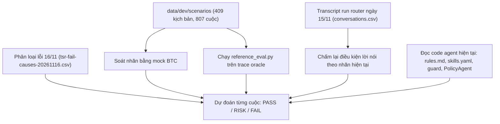

# Soát `data/dev` theo BTC và dự đoán agent hiện tại (19/11/2026)

Trang này trả lời câu hỏi: trên 409 kịch bản `data/dev` (807 cuộc), nếu chạy agent hiện tại thì cuộc nào trượt, và mỗi cuộc trượt do agent, do nhãn, hay do chỗ BTC chưa nói rõ.

**Không gọi model.** Mọi con số ở đây là dự đoán từ đọc code, mock BTC và transcript cũ. Đó là **cận trên**, không phải kết quả một lần chạy. Run thật gần nhất của v0 trên một phần của 190 kịch bản đầu đạt TSR 73.3 trên 15 kịch bản ([reflection-2-run-20261118.md](reflection-2-run-20261118.md)). Chênh lệch giữa dự đoán và run thật chủ yếu là độ ngẫu nhiên của model, thứ không đọc ra được từ code.

Kết luận ngắn:

- **Nhãn hiện tại không còn sai so với mock BTC.** Mọi trường tính lại được đều khớp. Còn 9 nhãn trái nghiệp vụ BTC (mục 4).
- **Agent dự đoán trượt 23 cuộc, rủi ro thêm 33 cuộc.** Cụm lớn nhất là đọc lại đơn nhiều lần (vượt `max_agent_questions`) và "khách chốt trước, nói chuyển khoản sau".
- **Một bug thật đã sửa:** guard COD cộng trùng máy đã nằm trong đơn nhiều dòng (mục 5).

Bảng từng cuộc: [dev-prediction-20261119.csv](dev-prediction-20261119.csv).

---

## 1. Cách làm

Cách nối các nguồn để ra một dự đoán cho từng cuộc:

1. **Soát nhãn bằng mock BTC.** Với mọi cuộc, tính ngày gọi theo `call_date`/`days_later` rồi gọi lại [mock_tools.py](../../apps/ai-agent-service/data/btc/eval/mock_tools.py), có thêm khách của `crm_seed_synthetic.json` như MCP server của agent. Các trường được đối chiếu:
   - `args_match`: giá và `price_vnd` theo biến thể, `quote_order` cho đơn nhiều máy, `total_match_vnd`;
   - mã đơn có trong CRM hoặc khớp mã khách đọc;
   - `callback_at` theo LN-01;
   - `ground_truth_facts`: giá, giá niêm yết, tồn kho, hạn khuyến mãi, ngày giao;
   - `forbidden_claims` không cấm chính sự thật;
   - `payment` khớp lời khách.
2. **Trace oracle.** `reference_eval.py` của BTC trên `data/dev/trace_log/`.
3. **Transcript cũ.** Run `router` trên đủ 409 kịch bản ([conversations.csv](conversations.csv)), dùng hàm `_say_norm`/`said` của `reference_eval.py` để chấm lại `must_say_any`, `agent_must_say` và cụm cấm theo nhãn hiện tại. CSV không có `tool_calls`, nên điều kiện về tool chỉ suy được từ lời thoại.
4. **Code hiện tại.** Đọc [rules.md](../../config/prompts/agent/advisor/rules.md), [skills.yaml](../../config/prompts/agent/advisor/skills.yaml), [actions.py](../../apps/ai-agent-service/src/ai_agent_service/components/guardrails/actions.py), [advisor.py](../../apps/ai-agent-service/src/ai_agent_service/agents/advisor.py) (cơ chế đồng ý mua) và [policy_rules.md](../../config/prompts/agent/policy_rules.md), rồi so với code lúc chạy `router` (`git diff d67309c5 HEAD`).

Quy tắc dự đoán:

| Kết quả ngày 15/11 | Mã lỗi 16/11 | Dự đoán |
|---|---|---|
| Qua | | PASS, trừ khi rơi vào rủi ro ở mục 3 |
| Trượt | A1, A2, A4, A5, A7, A8, A9, A11, C1 | PASS: đã sửa trong code có test |
| Trượt | D1–D7 (trừ hai ca không sửa) | PASS: nhãn đã sửa 16/11 |
| Trượt | A3 | FAIL: bản sửa A3 bị đảo ngày 18/11 nên hành vi quay lại như ngày 15/11 |
| Trượt | A10, A12 | FAIL: chưa sửa |
| Trượt | A6, E1 | RISK |

---

## 2. Kết quả

| | 190 kịch bản đầu | Cả 409 |
|---|---|---|
| Cuộc PASS / RISK / FAIL | 298 / 21 / 15 | 751 / 33 / 23 |
| TSR kịch bản nếu mọi RISK đều trượt | 81.1% | 86.3% |
| TSR kịch bản nếu mọi RISK đều qua | 92.1% | 94.4% |

190 kịch bản đầu là bộ của run `reflection-2` dừng giữa chừng. Bộ này khó hơn phần còn lại: gồm 159 kịch bản `SCN-ADV`, 31 `SCN-GEN`, 42 ca khó. Ngày 15/11 cùng một agent đạt 52.6% trên 190 kịch bản này và 70.3% trên 219 kịch bản còn lại. Không lấy TSR của 190 kịch bản đầu làm TSR của cả bộ.

---

## 3. Do agent

| Cụm | Dự đoán | Số cuộc | Cuộc |
|---|---|---|---|
| Đọc lại đơn mỗi lần khách bổ sung thông tin; mỗi lần đọc lại tính là một câu hỏi xác nhận nên vượt `max_agent_questions` (A10) | FAIL | 11 | ADV-0007 c1, 0039 c1, 0068 c1, 0088 c1, 0102 c1, 0134 c1; GEN-0003 c3, 0042 c3, 0160 c3, 0176 c3, 0210 c3 |
| Khách chốt hoặc xác nhận mua trước, nói chuyển khoản sau. Ngày 15/11 các cuộc này qua vì PolicyAgent chưa cho tạo đơn ở câu đầu; skill sau 18/11 đẩy agent tạo đơn sớm hơn | RISK | 20 | ADV-0003 c2, 0018 c2, 0024 c1, 0082 c2, 0101 c2, 0112 c3, 0119 c1, 0121 c2, 0137 c1; GEN-0004 c2, 0060 c3, 0068 c2, 0098 c1, 0108 c1, 0139 c2, 0156 c2, 0157 c2, 0190 c1, 0196 c3, 0227 c2 |
| Nhắc lại "11/11" khi khách hỏi đợt sale chưa bắt đầu (A6; skill đã sửa, nhưng `trace_must_not_match` tính cả `memory_writes`) | RISK | 4 | ADV-0022 c1, 0054 c1, 0117 c1, 0149 c1 |
| Khách nói đồng ý xóa dữ liệu nhưng agent không nhận | RISK | 1 | GEN-0237 c2 |
| Agent gợi ý sản phẩm trước khi biết giỏ hàng (làm sai skill `order-lookup`), nên bộ nhớ ghi nhầm sản phẩm đã tư vấn | FAIL | 1 | ADV-0090 c2 |

Về ADV-0090: bộ nhớ chọn `product_advised` là sản phẩm đặt hàng, không có đơn thì là sản phẩm báo giá đầu tiên ([memory.py](../../apps/ai-agent-service/src/ai_agent_service/agents/memory.py), `from_tools`). Luật này khớp nhãn ở 6/6 cuộc dev có nhiều sản phẩm được báo giá; đổi sang "sản phẩm cuối" thì hỏng cả 6. Vì vậy không đổi luật; lỗi nằm ở việc agent gợi ý trước khi khách nói cần gì.

Rủi ro do evaluation, không do agent: 5 cuộc extractor gán claim sai ở câu phủ định hoặc câu điều kiện (E1): ADV-0033 c1, 0083 c1, 0150 c1, GEN-0029 c2, 0063 c2.

---

## 4. Nghiệp vụ chốt đơn theo BTC, và nhãn trái BTC

### Nguồn BTC

| Nguồn | Nói gì |
|---|---|
| `mock_tools.order_create` | `payment="COD"` khi không truyền |
| Trace mẫu `eval/runs/full.jsonl` | SAMPLE-01 turn 3 "lên đơn cho chị đi", SAMPLE-02 turn 3 "chị lấy cái đó": `order.create` ngay trong lượt đó, không có `payment`, không hỏi lại. SAMPLE-06 khách đã nói COD trước thì truyền `payment: COD` |
| `schemas/tools.schema.json` | `order.update` chỉ có `exchange_size`, `exchange_product`, `return`, `update_address`: không đổi được thanh toán, không hủy |
| PB-09 | Đọc lại một lần trước `order.create` (sản phẩm, giá, địa chỉ, thanh toán, ngày giao) |
| KM-05 | AIR-2ND-50 chỉ áp khi hai máy nằm trong cùng một đơn |
| SAMPLE-03 | Khách nói rõ "em làm thủ tục đổi cho anh nhé" rồi mới `order.update` |

Kết luận: khách nói một câu giục chốt thì tạo đơn ngay trong lượt đó; chưa nói cách thanh toán thì là COD. Agent sau bản sửa ngày 18/11 (skill `place-order`) làm đúng như vậy, nên giữ nguyên.

### Nhãn trái BTC

| Cuộc | Nhãn đòi | Vì sao trái BTC |
|---|---|---|
| ADV-0017 c3, ADV-0078 c3, ADV-0099 c2, ADV-0105 c1, GEN-0034 c2, GEN-0061 c2, GEN-0234 c2 | `payment: bank` | Khách nói chốt hoặc đặt ở một lượt, chuyển khoản ở lượt sau. Theo BTC đơn được tạo ở câu chốt với COD và không đổi được |
| ADV-0060 c2 | Mini giá 1.095.000đ (giảm 50%) | Khách chốt máy X ở turn 2, thêm Mini ở turn 3: hai đơn, nên theo KM-05 Mini không được giảm |
| ADV-0071 c2 | `order.update return` | Khách chỉ hỏi có trả được không và hoàn bao nhiêu, chưa lần nào đồng ý trả |

Cách sửa đề xuất: đưa câu thanh toán lên trước câu chốt (hoặc ghi `payment: COD`); ADV-0060 c2 cho khách nói đủ hai máy trước câu chốt; ADV-0071 c2 thêm một câu khách đồng ý trả. Nhãn do [build_dev_r4.py](../../evaluation/datasets/ground-truth-review/build_dev_r4.py) dựng, nên cần người làm dữ liệu đồng ý trước khi sửa. 20 cuộc RISK ở mục 3 cùng kiểu với 7 ca A3, nên soát chung khi sửa.

### Chưa rõ so với BTC

| Cuộc | Điểm chưa rõ |
|---|---|
| ADV-0012 c1, ADV-0073 c1, ADV-0107 c1 | Nhãn đòi `pricing.get_quote` cho tổng giỏ hai máy lọc, trong khi BTC 11/2026 hướng dẫn dùng `pricing.quote_order`. Agent v2 vẫn qua vì bước tra trước gọi `get_quote` cho sản phẩm khách gọi tên |
| ADV-0022, 0054, 0117, 0149 c1 | `trace_must_not_match` cấm "11/11" kể cả khi bộ nhớ ghi lời khách. BTC định nghĩa trường này cho PII và thông tin nội bộ; mẫu công khai không dùng nó |
| ADV-0155 đến 0159 | Thêm ngày 12/11, chưa người duyệt ký. Nhãn khớp mock (đơn nhiều máy, một máy giảm 50%) |

---

## 5. Dataset

- **Nhãn:** không còn trường nào lệch mock. Các lỗi D1–D7 sửa ngày 16/11 đều đúng khi kiểm lại, ví dụ:
  - RUN-10 chỉ áp một lần: ADV-0024 c2 giá 1.690.000đ là đúng;
  - phụ thu size XL;
  - tồn kho theo biến thể;
  - giờ gọi lại Chủ nhật được đẩy về 17:30.
- **Trace oracle cũ:** `reference_eval.py` trên `data/dev/trace_log/` cho TSR 98.5% (403/409). 10 cuộc trượt (GEN-0035, 0069, 0101, 0135 c1 và c2; ADV-0068 c2; GEN-0070 c3) vì trace oracle chưa sinh lại sau bản sửa D1. Mock xác nhận nhãn mới đúng. Không ảnh hưởng điểm của agent.

---

## 6. A12: năm lỗi agent còn mở ngày 16/11

| Cuộc | Kết luận ngày 19/11 |
|---|---|
| ADV-0008 c1 | Agent chuyển máy khi khách hỏi bảo hành; luật 9 ngày 16/11 đã cấm (cùng nhóm A5) |
| ADV-0060 c2 | Có bug guard COD, đã sửa (dưới). Riêng cuộc này vẫn trượt vì nhãn trái KM-05 |
| ADV-0071 c2 | Nhãn trái BTC (mục 4) |
| ADV-0090 c2 | Agent làm sai skill (mục 3) |
| GEN-0067 c2 | Nhãn đã sửa ở nhóm D6 |

**Bug đã sửa:** `_cod_order` cộng thêm giá các máy trong `basket_skus` chưa đặt. Máy đã nằm trong một đơn nhiều dòng vẫn bị coi là chưa đặt, vì `placed_lines` ghi `sku` của đơn nhiều dòng là chuỗi ghép. Ví dụ: đơn đã đặt 6.480.000đ cộng máy mới 1.095.000đ bị báo 12.465.000đ, guard chặn với lý do vượt COD. Sửa trong [actions.py](../../apps/ai-agent-service/src/ai_agent_service/components/guardrails/actions.py); test `test_a_basket_product_already_in_a_placed_order_of_lines_is_not_counted_twice_for_cod` trong `tests/agent/test_order_lines.py`. Ghi ở [IMPROVEMENT-LOG](../plan/IMPROVEMENT-LOG.md), mục 19/11.

---

## 7. Vòng cải tiến

| Vòng | Bộ đo | Kết quả | Nguồn |
|---|---|---|---|
| Reflection trên bộ warranty (11–12/11) | frozen `data/reflection/warranty` | Học đủ ba cuộc warranty, ổn định qua các lần chạy; trạng thái `xong` | IMPROVEMENT-LOG mục 12/11 |
| `reflection-2` (17–18/11) | 7 kịch bản frozen + 190 kịch bản dev | Skills v1 không tốt hơn v0, không áp vào agent | [reflection-2-run-20261118.md](reflection-2-run-20261118.md) |
| Đo 2×2 GapLoop, Reflection, Combined (16/11) | control + gap-loop + bộ Reflection, k = 3 | Chưa đo: các run nằm ở máy chạy vòng học | IMPROVEMENT-LOG mục 16/11 |
| Bản dựng `improved-1` (18/11) | | Đã dựng: kb v5 cộng một dòng skill BH-05 của `reflect-warranty-8`. Chưa đo, code `build-agent` chưa commit | `apps/ai-agent-service/data/agents/improved-1/manifest.json` |

Đề yêu cầu ít nhất một vòng cải tiến (nâng cao: hai vòng), chứng minh bằng số qua các vòng trên cùng bộ frozen và có người duyệt. Hiện mới có vòng warranty đạt yêu cầu đó; vòng trên `data/dev` vẫn chưa có kết quả tốt hơn v0. Bước kế tiếp nên là đo `improved-1` với v0 trên cùng bộ frozen (k = 3), sau khi sửa 9 nhãn ở mục 4, để hai bên không cùng trượt vì nhãn.

---

## 8. Giới hạn

- Không gọi model: các cuộc PASS có thể trượt khi chạy thật, vì model trả lời mỗi lần một khác.
- CSV ngày 15/11 không có `tool_calls`: điều kiện về tool chỉ suy được từ lời thoại.
- Harness v2 (công tắc `ADVISOR_*`) chưa được chạy trên một bộ đủ lớn. Dự đoán dựa trên prompt và guard dùng chung giữa v1 và v2.
- Không có trace của run `reflection-2`: các file đó nằm ở máy chạy run.
