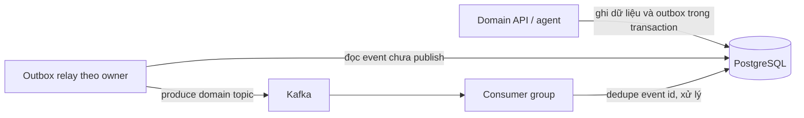

# Kafka và domain events

Tài liệu mô tả event flow đang chạy và giới hạn migration. Kafka là tùy chọn cho local; HTTP API vẫn hoạt động khi broker tắt.

## Luồng sự kiện

Các service hiện còn dùng chung PostgreSQL, outbox và processed_events. Runtime chung nằm trong packages/backend-common/src/messaging/worker.py. Đây là giai đoạn chuyển đổi, chưa phải database ownership riêng.

## Topic ownership

| Topic | Owner | Event types |
|---|---|---|
| telesales.identity.events | Identity | identity.customer.verified, identity.customer.deleted, identity.staff.created, identity.staff.disabled |
| telesales.sales.events | Sales | conversation.created, conversation.ended, conversation.claimed, conversation.transferred, handoff.requested, feedback.created, improvement.reviewed |
| telesales.commerce.events | Commerce | order.created, order.cancelled |
| telesales.ai-agent.events | AI Agent | knowledge_gap.created (khai báo; agent hiện tại chưa phát) |
| telesales.domain.events | Legacy mirror | Bản sao compatibility nếu bật |

## Envelope

Schema đầy đủ trong contracts/kafka/event-envelope.schema.json; topic list trong contracts/kafka/topics.md.

    {
      "id": "2b9cd4c6-1ac1-4d81-b6aa-58fd1a04ed00",
      "event_type": "conversation.created",
      "aggregate_id": "7a32dd1d-3b22-442c-9f98-dd126a7c0b11",
      "payload": {
        "conversation_id": "7a32dd1d-3b22-442c-9f98-dd126a7c0b11",
        "channel": "web"
      },
      "version": 1
    }

| Field | Ý nghĩa |
|---|---|
| id | UUID outbox ổn định, khóa chống xử lý trùng |
| event_type | Tên sự kiện có namespace domain |
| aggregate_id | UUID aggregate; dùng làm Kafka key |
| payload | Dữ liệu event theo từng type |
| version | Version envelope, hiện tại 1 |

## Outbox relay và delivery

1. API ghi thay đổi nghiệp vụ và outbox trong cùng PostgreSQL transaction.
2. Worker khóa batch tối đa 20 outbox chưa publish; lọc event type theo owner khi chạy worker riêng.
3. Khi KAFKA_BROKERS có giá trị, producer gửi lên topic owner và chờ broker ack rồi đặt published_at. Producer bật idempotence.
4. Nếu KAFKA_LEGACY_TOPIC_MIRROR=true, cùng envelope được gửi thêm vào telesales.domain.events.
5. Không có KAFKA_BROKERS, worker chạy nhánh xử lý database nội bộ và đánh dấu event processed; đây là fallback local, không tương đương message broker bền vững.
6. Consumer lưu event ID trong processed_events và commit Kafka offset sau transaction xử lý. Event lặp được bỏ qua.

Thiết kế cần chịu at-least-once delivery. Consumer phải idempotent theo envelope id; không dùng timestamp làm khóa dedupe.

Hiện worker chỉ có side effect nghiệp vụ cho `conversation.ended`: tổng hợp `memory.episodes` và tạo proposal nếu `turn_traces` có lỗi tool. Hai bảng này là của agent cũ, agent hiện tại không ghi nữa. Bộ nhớ của agent hiện tại do after_call trong chính AI service xử lý (MemoryAgent ghi fact ledger trong schema `agent`), không đi qua Kafka. Các event type khác chỉ được đánh dấu processed.

AI service phát `handoff.requested` vào outbox khi agent chuyển cho nhân viên (`runtime/platform.py`).

## Chạy local

Trong .env đặt:

    KAFKA_BROKERS=kafka:9092
    KAFKA_LEGACY_TOPIC_MIRROR=true

Khởi động Kafka profile:

    docker compose --profile async up --build -d
    docker compose ps
    docker compose logs -f kafka commerce-events identity-events sales-events ai-agent-events

Compose worker tương ứng chạy:

    python -m src.messaging.worker --service <commerce|identity|sales|ai-agent>

Chạy một lần:

    docker compose run --rm commerce-events python -m src.messaging.worker --service commerce --once

## Cấu hình

| Biến | Ý nghĩa |
|---|---|
| KAFKA_BROKERS | Danh sách broker Confluent Kafka; ví dụ kafka:9092; trống để tắt Kafka |
| KAFKA_LEGACY_TOPIC_MIRROR | Mặc định true, publish thêm vào topic legacy |
| DATABASE_URL | DB chung chứa outbox và dedupe trong giai đoạn hiện tại |

Compose local dùng một broker, replication factor 1 và PLAINTEXT. Chỉ dùng local/demo. Cloud cần TLS/SASL, ACL tối thiểu, secret manager, broker HA, retention và theo dõi consumer lag.

## Consumer groups, key và ordering

Group ID hiện tại là telesales-<service>-events-v1. Worker owner subscribe topic tương ứng; --service all subscribe toàn bộ domain topics. Kafka chỉ bảo đảm thứ tự trong partition. Giữ aggregate_id làm key nếu cần thứ tự trên cùng aggregate.

Tăng consumer cùng group để xử lý partition song song. Nhiều group khác nhau mỗi group nhận bản sao toàn bộ event. Consumer nghe cả legacy lẫn domain topic phải dedupe theo event id.

## Thêm event mới

1. Chọn owner; cập nhật EVENT_OWNERS trong worker, schema JSON và contracts/kafka/topics.md.
2. Tạo outbox cùng transaction nghiệp vụ; không publish trực tiếp trong HTTP handler.
3. Payload nhỏ, không chứa password, OTP, access token, dữ liệu thanh toán hay PII không cần thiết.
4. Viết consumer handler idempotent; cập nhật processed_events và side effect trong cùng transaction.
5. Thêm tests cho envelope, topic routing, duplicate delivery và retry.
6. Deploy consumer tương thích trước producer phát schema mới.
7. Tắt legacy mirror chỉ sau khi toàn bộ consumer cũ đã chuyển topic.

## Giới hạn hiện tại

- Domain data, outbox và deduplication đang dùng database chung.
- Worker nằm trong backend-common, chưa có adapter Kafka độc lập cho mỗi service.
- Compose chạy worker cả khi broker tắt; khi ấy là fallback database processing.
- Nhiều event type đã khai báo nhưng chưa có consumer side effect riêng; handler `conversation.ended` còn đọc bảng của agent cũ.
- Tách database cần migration/backfill/cutover theo docs/architecture/data-ownership-migration.md; không chỉ thay DATABASE_URL.
