# Kịch bản demo: trợ lý bán hàng AI trên website

Trang này dành cho người trình bày demo. Kịch bản theo một khách hàng đi hết vòng mua hàng: tạo tài khoản, được tư vấn, chốt đơn, nhận hàng, đổi size, hỏi lại qua Zalo, gọi điện, rồi xin gặp nhân viên. Sau đó chuyển sang phía cửa hàng: nhân viên nhận cuộc chuyển giao có copilot, admin xem chỉ số và cải tiến, developer theo dõi trên Langfuse.

Mỗi cảnh ghi bốn thứ: **làm gì** trên màn hình, **khách nói gì** (gõ hoặc nói gần đúng là được), **trợ lý phải làm gì**, và **chỉ vào đâu** để khán giả thấy điều nhóm đã xử lý. Tổng thời lượng khoảng 25–30 phút; mục 4 ghi cách rút gọn còn 10 phút.

> Mọi lượt trả lời của trợ lý đều gọi model thật và tốn phí. Chạy thử toàn bộ kịch bản một lần trước buổi demo.

## 1. Tổng quan

Câu hỏi sơ đồ trả lời: **khán giả đi qua những màn hình nào, theo thứ tự nào?**

```mermaid
flowchart LR
    subgraph KH["Khách hàng"]
        A0["0. Đăng ký, đăng nhập"] --> A1["1. Tư vấn, đổi sản phẩm"]
        A1 --> A2["2. Chốt đơn, địa chỉ"]
        A2 --> A4["4. Hỏi đơn trên web"]
        A4 --> A5["5. Hỏi đơn qua Zalo"]
        A5 --> A6["6. Đổi size"]
        A6 --> A7["7. Hỏi chính sách cũ"]
        A7 --> A8["8. Tin nhắn thoại, gọi điện"]
        A8 --> A9["9. Đòi gặp nhân viên"]
    end
    subgraph NV["Nhân viên bán hàng"]
        B3["3. Giao đơn: Giao hàng, Đã giao"]
        B9["10. Nhận chuyển giao, trả lời với copilot"]
    end
    subgraph AD["Admin và developer"]
        C1["11. Đánh giá, so sánh phương pháp"]
        C2["12. Kiến thức, GapLoop"]
        C3["13. Cải tiến hằng tuần, Skills"]
        C4["14. Developer console, Langfuse"]
    end
    A2 --> B3 --> A4
    A9 --> B9 --> C1 --> C2 --> C3 --> C4
```

## 2. Chuẩn bị

| Việc | Ở đâu | Ghi chú |
|---|---|---|
| Ba cửa sổ trình duyệt | (1) shop, ẩn danh; (2) `/ban-hang/hoi-thoai` đăng nhập nhân viên; (3) `/admin` | Đặt cạnh nhau để chuyển cảnh nhanh |
| Một số điện thoại chưa có trong CRM | điện thoại của người trình bày | Dùng cho đăng ký ở cảnh 0; cần nhận được mã xác minh |
| Khách quen có Zalo | khách `C001` (chị Hoa) trong [crm_seed.json](../data/btc/catalog/crm_seed.json) | Có `zalo_id`, dùng ở cảnh 5 |
| Khách có đơn đang giao | khách `C032` (chị Tâm), đơn `OD301177` đang giao | Dự phòng nếu không kịp giao đơn ở cảnh 3 |
| Zalo mock | `/admin` → **Zalo mock** | Xem mục Zalo mock trong [channels.md](channels.md) |
| Micro và loa | trình duyệt cho phép micro | Cho cảnh 8 |
| Langfuse | đã cấu hình `LANGFUSE_HOST` | Cho cảnh 14; không có thì bỏ phần Langfuse |
| Lịch sử đánh giá | `/admin/danh-gia` đã có run | Đã ingest 5 run cùng nhãn (Router, GapLoop, Reflection, Kết hợp) |

Ngày làm việc của trợ lý quyết định giá và khuyến mãi. Phần lớn khuyến mãi trong [promotions.json](../data/btc/catalog/promotions.json) đã hết hạn trước cuối tháng 11/2026. Cảnh 7 dựa vào điều này.

## 3. Các cảnh

### Cảnh 0. Đăng ký và đăng nhập (2 phút)

**Làm gì:** mở `/dang-ky`, nhập họ tên, số điện thoại, mật khẩu (email không bắt buộc), nhập mã xác minh gửi về số đó. Sau đó đăng xuất và đăng nhập lại ở `/dang-nhap`.

**Chỉ vào:**
- Dòng giới thiệu của form: tài khoản gắn với số điện thoại, nên đơn hàng, giỏ hàng và lịch sử tư vấn qua hotline hay Zalo đều về một nơi. Cảnh 5 chứng minh điều này.
- Khi đã đăng nhập, trợ lý có thêm tool tài khoản (`account_cart`, `account_orders`): nó đọc được giỏ hàng và đơn đặt trên website mà không phải hỏi lại khách.

**Dự phòng:** không nhận được mã thì đăng nhập bằng một tài khoản demo đã tạo sẵn.

### Cảnh 1. Tư vấn, rồi đổi sang sản phẩm khác (4 phút)

**Làm gì:** mở trang chủ, bấm khung chat.

| Khách nói | Trợ lý phải làm | Chỉ vào |
|---|---|---|
| "Mình cần máy lọc không khí cho phòng ngủ khoảng 25 m², nhà có bé nhỏ, tầm 5 triệu." | Tra catalog, chỉ gợi ý mẫu đủ điều kiện: phòng 25 m² **và có khóa trẻ em**. AirPure X rẻ hơn nhưng không có khóa trẻ em, nên mẫu chính phải là AirPure Y (30 m², có khóa trẻ em) | Skill `product-advice`: nhu cầu đã nêu là điều kiện phải đạt; giá lấy từ `pricing_get_quote` theo ngày gọi |
| "Mẫu đó hơi nhỉnh, có mẫu nào rẻ hơn không?" | Không ép, không tự giảm giá; nói rõ mẫu rẻ hơn thiếu điều gì so với nhu cầu | Skill `objection-handling` (PB-02) |
| "Thôi cho mình xem giày chạy bộ, size 39." | Đổi chủ đề sạch, không hỏi lại thông tin cũ, tra RunLite và tồn kho từng size và màu | CCR, RQR: không hỏi lại điều khách đã nói |

**Điểm nhấn:** thẻ sản phẩm chỉ hiện dưới câu đầu tiên nhắc tới sản phẩm đó. Mỗi bước trợ lý đang làm (tra catalog, báo giá) hiện trực tiếp trong khung chat.

### Cảnh 2. Chốt đơn và hỏi địa chỉ (3 phút)

| Khách nói | Trợ lý phải làm | Chỉ vào |
|---|---|---|
| "Lấy RunLite 1 size 38 màu đen." | Chọn đúng biến thể còn hàng; hỏi gộp **một lần** thanh toán và địa chỉ | Skill `place-order`: hỏi gộp một câu, chỉ một lần |
| Đưa địa chỉ giao hàng, chọn COD | Gọi `order_create`; báo mã đơn và thời gian giao dự kiến; không đọc lại toàn bộ đơn lần thứ hai | PB-09: hệ thống đọc lại đơn một lần |

**Biến thể nên thử nếu có thời gian:** đặt hai máy lọc không khí trong một đơn. Trợ lý dùng `pricing_quote_order` và chỉ nhắc khuyến mãi máy thứ hai khi còn hiệu lực vào ngày làm việc (KM-05).

### Cảnh 3. Nhân viên giao đơn (1 phút)

**Làm gì:** cửa sổ nhân viên, `/ban-hang/don-hang`, mở đơn vừa tạo, bấm **Giao hàng** (đơn chuyển sang đang giao). Để lại bước **Đã giao** sau cảnh 4.

**Chỉ vào:** đơn trợ lý tạo nằm cùng hệ thống đơn của nhân viên; trạng thái đổi ở đây là trạng thái khách sẽ hỏi.

### Cảnh 4. Hỏi tình trạng đơn trên website (1 phút)

| Khách nói | Trợ lý phải làm | Chỉ vào |
|---|---|---|
| "Đơn giày của mình tới đâu rồi?" | Gọi `order_status` (hoặc `account_orders` khi đã đăng nhập); không đoán; đọc trạng thái bằng tiếng Việt; không xin khách đọc mã đơn | Skill `order-lookup` |

Sau cảnh này, quay lại cửa sổ nhân viên bấm **Đã giao**, để đơn đúng thực tế trước khi khách đổi size ở cảnh 6.

### Cảnh 5. Cùng số điện thoại, hỏi qua Zalo (2 phút)

**Làm gì:** mở **Zalo mock**. Chọn người dùng có `zalo_id` của khách quen (ví dụ `C001`), hoặc tạo người dùng mới rồi dùng **Chia sẻ thông tin** với số điện thoại vừa đăng ký ở cảnh 0.

| Khách nói | Trợ lý phải làm | Chỉ vào |
|---|---|---|
| "Shop ơi đơn của mình giao chưa?" | Nhận ra khách qua số điện thoại hoặc `zalo_id`; trả lời đúng đơn đặt trên web mà không hỏi lại | Một khách, nhiều kênh: Call Brief mang lịch sử từ web sang Zalo |

**Chỉ vào thêm:** ở cửa sổ nhân viên, hàng đợi gộp một hàng cho mỗi khách CRM; phiên web và phiên Zalo mở từ cùng một hàng.

### Cảnh 6. Đổi size (2 phút)

| Khách nói | Trợ lý phải làm | Chỉ vào |
|---|---|---|
| "Giày hơi chật, mình đổi sang size 39 màu đen được không?" | Tra tồn kho: size 39 màu đen đang hết, size 39 màu trắng còn hàng. Báo thật và đề xuất màu trắng, không tạo đổi sang biến thể hết hàng | DT-03: nếu size/màu mới hết hàng, khách được chọn sản phẩm khác cùng giá hoặc hoàn tiền |
| "Ừ lấy màu trắng." | Gọi `order_update` (đổi size), không hỏi lại lý do; báo phí đúng như tool trả: lần đổi đầu tiên miễn phí | Skill `change-order`; mọi thay đổi trên đơn có sẵn là `order_update`, không tạo đơn mới |

### Cảnh 7. Hỏi chính sách cũ và khuyến mãi đã hết (2 phút)

| Khách nói | Trợ lý phải làm | Chỉ vào |
|---|---|---|
| "Mình nhớ shop cho đổi trả 14 ngày, đổi size mất 20 nghìn đúng không?" | Nói chính sách đó đã hết hiệu lực từ 01/10/2026; chính sách hiện hành: 7 ngày, đổi size lần đầu miễn phí | DT-OLD-01, DT-OLD-03 (bản hết hiệu lực) so với DT-01, DT-03; trợ lý chọn đúng phiên bản theo ngày |
| "Tháng trước AirPure X còn giảm 500 nghìn mà?" | Nói thẳng khuyến mãi đã hết và báo giá hiện tại; không giữ giá cũ | KM-01; HR: không bịa giá hay khuyến mãi |

### Cảnh 8. Tin nhắn thoại và gọi điện (3 phút)

**Làm gì:**
1. Trong khung chat, bấm ghi âm, nói một câu hỏi (ví dụ hỏi áo khoác gió còn size M không). Trợ lý nhận dạng giọng nói rồi trả lời như tin nhắn chữ.
2. Bấm **Gọi**: cuộc gọi trực tiếp, nghe trợ lý chào và nói chuyện hai chiều; thử nói chen ngang khi trợ lý đang nói.

**Chỉ vào:** đồng hồ micro, bản ghi lời nói chạy theo thời gian thực, trợ lý dừng khi bị ngắt lời; giọng theo miền của khách trong CRM khi khách được nhận ra ([channels.md](channels.md)). Cùng cuộc gọi hiện trong hàng đợi của nhân viên.

**Dự phòng:** micro hoặc mạng không ổn thì chuyển sang tin nhắn chữ, không dừng demo.

### Cảnh 9. Khách đòi gặp nhân viên (1 phút)

| Khách nói | Trợ lý phải làm | Chỉ vào |
|---|---|---|
| "Thôi cho mình nói chuyện với nhân viên." | Không cố giữ khách; xin lỗi ngắn, chuyển máy (`handoff.transfer`) kèm Handoff Brief; báo khách đang chờ nhân viên | PB-10; J05 (chất lượng chuyển giao) trong rubric của BTC |

### Cảnh 10. Nhân viên nhận chuyển giao, trả lời với copilot (3 phút)

**Làm gì:** cửa sổ nhân viên, chuông báo có cuộc chuyển giao. Mở cuộc, đọc Call Brief và Handoff Brief ở đầu hội thoại, bấm nhận.

1. Khách gõ tiếp một câu ở cửa sổ shop.
2. Ở cửa sổ nhân viên, copilot soạn sẵn câu trả lời. Nhân viên gửi nguyên văn, sửa rồi gửi, hoặc tự viết.
3. Thử viết một câu vi phạm (ví dụ hứa một mức giảm giá không có): hard guard cảnh báo trước khi gửi.

**Chỉ vào:** nhân viên không phải hỏi lại khách điều trợ lý đã biết; bằng chứng bên phải (lane, tool, guard của từng lượt); câu của nhân viên đi qua cùng hard guard như câu của trợ lý; tin nhắn đến đúng khung chat của khách.

### Cảnh 11. Admin: chỉ số chất lượng (3 phút)

**Làm gì:** `/admin/danh-gia`.

- **Bốn chỉ số:** TSR, CCR, RQR, HR theo tuần; nút **Xem bảng**.
- **So sánh phương pháp:** Router, GapLoop, Reflection, Kết hợp, mỗi run một cột, cùng 409 kịch bản và cùng nhãn. Số hiện có (nhãn của `data/dev` ngày 24/11/2026, `product-extractor-v13`): TSR Router 66,7%, GapLoop 66,5%, Reflection 73,3%, Kết hợp 67,5% và 69,2%; baseline không bộ nhớ 59,2%. Nguồn: [RUN-LEDGER.md](evaluation/RUN-LEDGER.md), mục 24/11/2026.
- **Theo kịch bản:** mở một kịch bản trượt để thấy lý do của bộ chấm BTC.

**Chỉ vào:** chỉ so các run cùng bộ kịch bản và cùng extractor; bộ chấm là `reference_eval.py` của BTC.

### Cảnh 12. Admin: GapLoop, kiến thức còn thiếu (2 phút)

**Làm gì:** `/admin/kien-thuc` và `/admin/de-xuat`.

**Chỉ vào:** câu khách thật hỏi mà tài liệu chưa có được gom, viết lại, gộp trùng; admin viết câu trả lời và duyệt thì mới thành kiến thức (FAQ) cho trợ lý. Không có gì tự xuất bản. `/admin/chinh-sach` cho thấy chính sách trợ lý dựa vào và hiệu lực của từng mục, kể cả bản đổi trả hết hiệu lực của cảnh 7.

### Cảnh 13. Admin: Reflection, cập nhật skill (3 phút)

**Làm gì:**
1. `/admin/skills`: tám skill của trợ lý (`place-order`, `change-order`, `order-lookup`, `schedule-callback`, `product-advice`, `objection-handling`, `data-request`, `conversation`), mỗi skill có mô tả khi nào dùng và các bước làm. Sửa được, bật version được.
2. `/admin/cai-tien`: vòng cải tiến hằng tuần.
   - Đề xuất của Reflection: từng câu thêm vào skill, kèm bằng chứng từ cuộc gọi trượt; admin duyệt hoặc từ chối.
   - **Pipeline cải tiến**: bốn bước (gom câu hỏi thiếu kiến thức, đo R0 và học, chờ duyệt, đo version ứng viên); nút **Chạy vòng mới**.
   - Phép đo trước và sau; admin tự bật version, có nút quay lui.

**Chỉ vào:** không bước nào tự duyệt hay tự bật version. Bấm **Chạy vòng mới** tốn phí model: trong demo chỉ cho xem, không bấm, trừ khi đã đặt trần chi tiêu.

### Cảnh 14. Developer: theo dõi trực tiếp và Langfuse (2 phút)

**Làm gì:** mở `/developer`.

- Màn theo dõi trực tiếp: mỗi lượt trả lời xuất hiện ngay khi lưu, kèm thời gian tới chữ đầu tiên, token, chi phí và việc nó đã làm; các ô tổng hợp 15 phút gần nhất.
- Bấm một lượt để mở phiên trong Langfuse: prompt, cây lời gọi model và tool của lượt đó.
- Console agent: model của advisor, độ trễ so với ngưỡng của BTC, pipeline xử lý một lượt.

**Chỉ vào:** lượt của chính buổi demo vừa rồi (cảnh 1–10) đều có ở đây, kể cả cuộc gọi thoại.

## 4. Bản rút gọn 10 phút

Giữ cảnh 1, 2, 5, 7, 9–10 và 11. Đổi size (cảnh 6) và gọi điện (cảnh 8) là hai cảnh nên giữ tiếp nếu còn thời gian.

## 5. Khi có sự cố

| Thấy | Nguyên nhân thường gặp | Làm gì |
|---|---|---|
| Không nhận được mã xác minh khi đăng ký | Tin nhắn mã đến chậm hoặc không đến môi trường demo | Dùng tài khoản demo tạo sẵn |
| Zalo mock không nhận ra khách | Người dùng Zalo không có số trong CRM | Bấm **Chia sẻ thông tin** với số đã đăng ký |
| Gọi điện đóng ngay hoặc không có tiếng | Micro bị chặn, hoặc agent thiếu gói voice | Kiểm `/health` của agent (`voice: ok`); chuyển sang chat chữ |
| Khung **Pipeline cải tiến** báo chưa có bộ lập lịch | Bản deploy chưa có CronJob cải tiến | Chỉ trình bày phần đề xuất và phép đo; xem [eks-deploy.md](deployment/eks-deploy.md), mục 2.11 |
| Bấm lượt trong `/developer` không mở Langfuse | Chưa đặt `LANGFUSE_HOST` | Bỏ phần Langfuse, trình bày màn theo dõi trực tiếp |

## 6. Giới hạn

- Câu trả lời của trợ lý thay đổi theo từng lần chạy. Cột "Trợ lý phải làm" ghi hành vi mà skill và chính sách yêu cầu, không phải câu chữ cố định. Chạy thử trước để biết bản deploy hiện tại có làm đúng từng cảnh không.
- Tồn kho và khuyến mãi lấy từ dữ liệu của BTC theo ngày làm việc của trợ lý. Đổi ngày thì cảnh 6 và cảnh 7 có thể khác.
- Số ở cảnh 11 là số của các run đã chạy trên máy dev rồi nạp lên; demo không chạy đánh giá mới.
