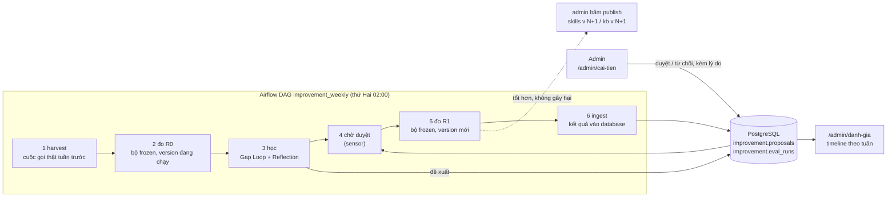
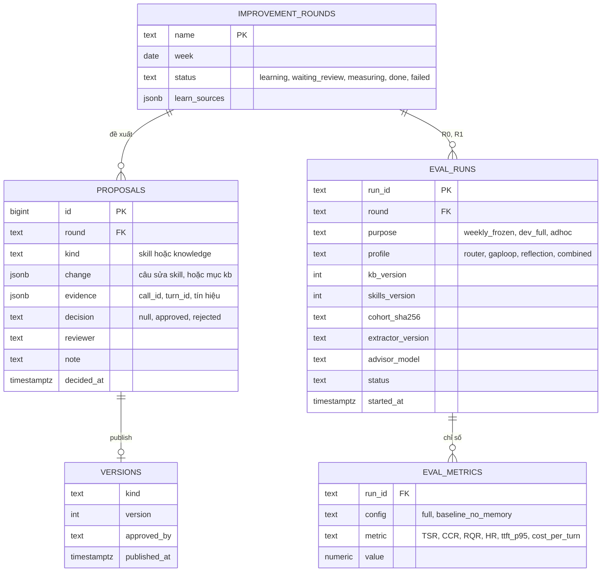

# 001. Vòng cải tiến hằng tuần, admin duyệt trên web, dashboard đánh giá

| | |
|---|---|
| Trạng thái | đang đo (A xong; B, C, D đã code và test, chưa chạy một tuần thật) |
| Người phụ trách | |
| Ngày tạo | 2026-11-12 |
| Loại | config / tool / frontend / evaluation (không đổi prompt, guard hay bộ nhớ của agent) |
| Chỉ số mục tiêu | theo dõi TSR / CCR / RQR / HR / latency / chi phí theo tuần; chính đề xuất này không hứa tăng chỉ số nào |

Đã chốt với người dùng ngày 12/11/2026:

- Vòng hằng tuần **học từ cuộc gọi thật** và **đo trên bộ frozen cố định**.
- Kết quả đánh giá lưu vào **bảng PostgreSQL**.
- Hằng tuần chỉ chạy **bộ frozen**. `data/dev` chỉ chạy khi admin duyệt một thay đổi, hoặc hằng tháng.
- Làm **phần A (tách trang admin và sales) trước**; các phần khác chờ duyệt đề xuất này.

## 1. Vấn đề

1. **Vòng cải tiến chỉ chạy tay.** `python -m ai_agent_service.pipeline.improve round` phải có người gõ. Bước duyệt là sửa tay file `IMPROVEMENT_DIR/review/<round>.json`, rồi chạy lại với `--approved`. Không có lịch, và admin không duyệt được trên web.
2. **Không có chỗ xem kết quả đánh giá theo thời gian.** `run_eval.py` ghi `report.json`, `performance.json`, `manifest.json` vào thư mục trong `evaluation/runs/` (không vào git). Muốn so tuần này với tuần trước phải mở từng thư mục. Bảng `--report` chỉ ghép vài run đặt tên tay.
3. **Trang admin và trang sales lẫn vào nhau.**
   - Đăng nhập bằng tài khoản admin xong vẫn vào `/ban-hang` (`destination()` trong `apps/web/src/app/login/page.tsx` chỉ tách `developer`).
   - `/ban-hang` hiện link "Quản trị" cho mọi vai.
   - `/admin` là trang cũ tiếng Anh (`features/workspace.tsx`), có ô dán "Staff access token" và link sang trang của mọi vai.
   - Backend thì đã tách đúng: `/api/admin/*` và `/api/developer/*` (vai `admin`, `developer`) từ chối token của `agent`, `seller`.

## 2. Bằng chứng

- `apps/web/src/app/login/page.tsx`: `return role === "developer" ? "/developer" : "/ban-hang";`
- `apps/web/src/app/ban-hang/page.tsx`: link `/admin` và `/developer` ở chân thanh bên, không điều kiện theo vai.
- `apps/ai-agent-service/src/ai_agent_service/components/improvement/review.py`: review là file JSON, `decision` và `reviewer` điền tay.
- `apps/ai-agent-service/src/ai_agent_service/components/improvement/signals.py`: tín hiệu và gap là file trong `IMPROVEMENT_DIR`, không phải bảng database.
- Run `evaluation/runs/eval_3`: kết quả chỉ nằm trên đĩa của máy chạy.

## 3. Giải pháp

Bốn phần, làm theo thứ tự A → B → C → D. Mỗi phần dùng được khi đứng riêng.

### Tổng quan

Câu hỏi sơ đồ trả lời: **mỗi tuần, cái gì chạy, ai duyệt, và kết quả hiện ở đâu?**

### A. Tách trang admin và sales (làm ngay, không tốn phí model)

- **Đăng nhập** chuyển theo vai: `admin` → `/admin`, `developer` → `/developer`, `agent` và `seller` → `/ban-hang`.
- **`/ban-hang`** chỉ còn việc bán hàng. Link "Quản trị" chỉ hiện với vai `admin`, link "Agent Console" chỉ với `admin` và `developer`.
- **`/admin`** thành trang quản trị riêng, cùng giao diện với `/ban-hang`, tiếng Việt, đọc token đăng nhập (`staff-token`), không còn ô dán token. Các mục:
  - Duyệt đề xuất (hiện có ở `/api/admin/proposals`);
  - Kiến thức (FAQ và knowledge gap, tái dùng `faq-admin.tsx` và `knowledge-gaps.tsx`);
  - Sản phẩm;
  - Người dùng;
  - sau này thêm Cải tiến (phần C) và Đánh giá (phần D).
- Trang `[role]` cũ vẫn giữ cho `agent`, `seller` để không làm vỡ đường dẫn đang dùng. `/developer` giữ nguyên (Agent Console).
- Backend không đổi: quyền đã được kiểm ở API.

### B. Lưu trạng thái cải tiến và kết quả đánh giá trong database

Hôm nay tín hiệu, gap và review là file trong `IMPROVEMENT_DIR`. Airflow worker, web API và nhiều pod không dùng chung được một thư mục trên AWS. Đề xuất chuyển sang schema `improvement` (đã có `improvement.outbox`):

- **Ingest:** thêm lệnh `run_eval.py --ingest <run_dir>`. Lệnh đọc `manifest.json`, `report.json` và `performance.json` của một run đã `COMPLETE`, rồi ghi vào `eval_runs` và `eval_metrics`.
  - Không gọi model.
  - Chạy lại thì không nhân đôi, vì khóa là `run_id`.
  - Run cũ như `eval_3` cũng đưa vào được.
- **Không mất dữ liệu cũ:** file review JSON cũ vẫn đọc được. Lệnh `improve` ghi vào cả bảng và file trong một thời gian chuyển tiếp.
- **Quy tắc so sánh giữ nguyên:** dashboard chỉ nối điểm của các run cùng `cohort_sha256` và cùng `extractor_version`, như `evaluation/README.md` yêu cầu.

### C. Lịch hằng tuần bằng Airflow, admin duyệt trên web

**Học từ cuộc gọi thật, đo trên bộ frozen.** Cuộc gọi thật không có nhãn, nên bộ chấm của BTC không chấm được chúng. `signals.py` cũng cố ý không học từ ý kiến của model về chính cuộc gọi của nó. Vì vậy mỗi cơ chế lấy tín hiệu thật như sau:

| Cơ chế | Học từ cuộc gọi thật tuần trước | Đo trên |
|---|---|---|
| Knowledge Gap Loop | câu khách hỏi mà tài liệu không có (`gaps.record_from_run` trên các lượt từ chối hoặc chuyển máy), cộng câu trả lời của nhân viên sau handoff | `data/gap-loop/frozen` (13 kịch bản), cộng các kịch bản frozen mới mà admin thêm từ gap đã duyệt |
| Reflection | lựa chọn của nhân viên với gợi ý copilot (dùng, sửa, tự viết; 👍/👎), khách nhắc lại ("em nói rồi mà"), kết quả cuộc (`outcome`). Không dùng điểm do QaAgent tự chấm làm tín hiệu học | `data/reflection/*/frozen`, cộng bộ học có nhãn hiện có |

**DAG `improvement_weekly`** (file mới `infra/airflow/dags/improvement_weekly.py`). Mỗi task gọi CLI có sẵn trong image `ai-agent-service`, nên không viết lại logic:

1. `harvest_production`: lệnh mới `improve harvest-production --since <tuần trước>`. Đọc `agent.turns` và `calls` qua `runtime/trace_export.py`, cùng tín hiệu nhân viên, rồi ghi failure và gap vào `improvement.*`. Không gọi model.
2. `measure_r0`: `run_eval.py --scenarios <bộ frozen> --config full`, với version đang chạy.
3. `learn`: `improve score`, `reflect`, `gaps` cho round tuần này. Tạo đề xuất với `decision = null`. **Không có `--scripted`:** không tự duyệt.
4. `wait_for_review`: sensor đợi mọi đề xuất của round có `decision`, hoặc hết hạn 7 ngày (round chuyển `expired`, không publish gì).
5. `publish_and_measure_r1`: publish đề xuất đã duyệt thành version mới, rồi chạy `run_eval.py --profile gaploop|reflection|combined` trên bộ frozen, rồi `improve compare` R0 với R1.
6. `ingest`: `run_eval.py --ingest` cho R0 và R1.
7. Nếu R1 kém hơn R0, hoặc `compare` thấy tác hại (một cuộc trượt mà trước đó đạt): rollback version, đánh dấu round `rejected_by_measure`, báo admin.

Các ràng buộc vận hành:

- **Database đánh giá riêng:** mỗi lần chạy evaluation dùng database `*_eval` riêng và khóa advisory, nên DAG đặt `max_active_runs=1` và không chạy song song với run tay.
- **Trần chi tiêu:** DAG đặt `EVAL_BUDGET_DB` trỏ tới một sổ ngân sách cho mỗi tuần, nên một tuần lỗi không đốt tiền không giới hạn.

**Trang `/admin/cai-tien`:**

- Danh sách round: tuần, trạng thái, số đề xuất.
- Mỗi đề xuất hiện:
  - câu sửa skill (so với bản đang chạy), hoặc mục kiến thức mới;
  - bằng chứng: các cuộc gọi đã che PII, link sang transcript;
  - kết quả các cổng kiểm (`screen_patch`, PolicyAgent).
- Admin bấm Duyệt hoặc Từ chối, kèm lý do.
  - API ghi `reviewer` là tài khoản đang đăng nhập.
  - Theo luật sẵn có trong `review.py`, người duyệt không được là một agent, cũng không được là tác giả của đề xuất.
- Sau R1, admin thấy R0 và R1 cạnh nhau rồi mới bấm "Đưa vào chạy" (publish thật). Rollback cũng ở trang này.

**API mới** (ai-agent-service, vai `admin`): `GET /api/developer/improvement/rounds`, `GET /api/developer/improvement/proposals?round=`, `POST /api/developer/improvement/proposals/{id}/review`, `POST /api/developer/improvement/versions/{kind}/publish`, `POST /api/developer/improvement/versions/{kind}/rollback`.

**Airflow ở đâu:**

| Môi trường | Cách chạy |
|---|---|
| Local | profile compose `airflow`: scheduler, webserver, metadata database riêng; task chạy `DockerOperator` với image AI |
| AWS | ~~Amazon MWAA + `EksPodOperator`~~. Đổi ngày 13/11/2026 để tiết kiệm: EventBridge Scheduler gọi Fargate task chạy cùng lệnh `STEPS`; một lịch học thứ Hai, một lịch 6 giờ một lần chạy `weekly-status` rồi `weekly-measure` (cả hai chạy lặp được). Xem [aws-plan.md](../deployment/aws-plan.md), mục 3.7 |

### D. Dashboard đánh giá `/admin/danh-gia`

Đọc `GET /api/developer/evaluations?purpose=&from=&to=` (vai `admin`, `developer`):

- **Timeline theo tuần:** mỗi chỉ số TSR, CCR, RQR, HR một đường, hai đường `full` và `baseline_no_memory`. Mốc trên trục thời gian là lúc publish version (skills v N, kb v N), để thấy chỉ số đổi sau thay đổi nào.
- **Bảng ablation** của lần đo `dev_full` gần nhất: Router, GapLoop, Reflection, Kết hợp (cùng logic với `run_eval.py --report`).
- **Hiệu năng:** p95 TTFT và Total, token và chi phí mỗi lượt, theo tuần.
- **Ghi chú tự động** như `tables.notes`: khác cohort, khác extractor, khác model thì không nối điểm và ghi lý do.
- Bấm vào một điểm thì ra chi tiết run: version, cohort, link danh sách cuộc trượt (`errors.jsonl` đã ingest).

## 4. Rủi ro

- **Học từ cuộc gọi thật đưa dữ liệu khách vào đề xuất.** Bằng chứng chỉ được giữ `call_id` và `turn_id`, cùng câu đã che PII qua `components/intake/pii.py`. Không lưu số điện thoại hay địa chỉ trong `proposals`.
- **Admin duyệt cho nhanh.** Giữ đủ các cổng tự động (`screen_patch`, PolicyAgent, `compare` thấy tác hại thì rollback). Không có nút "duyệt tất cả".
- **Bộ frozen nhỏ** (13 và 6 kịch bản), nên một tuần dao động vài điểm là nhiễu. Dashboard hiện số kịch bản và khoảng dao động, và chạy `--r0-runs 2 --r1-runs 2` nếu ngân sách cho phép.
- **Mỗi tuần tốn phí model** (R0, R1, score, reflect). Cần một trần trong `EVAL_BUDGET_DB` và một người nhận cảnh báo.
- **Đổi lưu trữ từ file sang bảng** chạm `components/improvement/*`. Cần chuyển tiếp hai chiều và test các lệnh `improve` hiện có.

## 5. Cách đo

- **Phần A:** test Playwright (`apps/web/e2e`):
  - admin đăng nhập vào `/admin`; agent và seller vào `/ban-hang`;
  - `/ban-hang` của seller không có link "Quản trị";
  - `/admin` với token của seller báo không có quyền.
- **Phần B:**
  - ingest `eval_3` và một run có `--config` vào database test, kiểm từng chỉ số khớp `report.json`;
  - ingest lại không nhân đôi.
- **Phần C:**
  - chạy DAG với `--scripted` trên bộ frozen nhỏ ở môi trường dev;
  - kiểm round đi qua đủ trạng thái;
  - kiểm từ chối thì không publish gì.
- **Phần D:** dashboard hiện đúng số của các run đã ingest; hai run khác cohort không bị nối điểm.

## 6. Kết quả

| Phần | Trạng thái | Ở đâu |
|---|---|---|
| A. Tách trang admin và sales | xong | `apps/web/src/app/admin/page.tsx`, `login/page.tsx`, `ban-hang/page.tsx` |
| B. Lưu trong database, ingest | đã code, đã chạy trên database dev | `runtime/evaluations.py`, `pipeline/eval/history.py`, `run_eval.py --ingest` |
| C. Vòng hằng tuần, Airflow, duyệt trên web | đã code và test, **chưa chạy một tuần thật** | `pipeline/improve/weekly.py`, `api/routes/improvement.py`, `features/improvement-admin.tsx`, `infra/airflow/` |
| D. Dashboard | đã code và test với dữ liệu giả | `features/evaluation-dashboard.tsx` |

Đã kiểm ngày 12/11/2026:

- `tests/agent/test_weekly_improvement.py` (11), `test_airflow_dag.py` (3), `test_eval_resume.py`, `test_eval_tables.py`: qua.
- `tests/agent` toàn bộ: 1.632 passed. 48 lỗi còn lại đều ở test ASR/voice, do môi trường (thiếu `soundfile`, `soxr`; console `cp1252`), không liên quan.
- Playwright `improvement-admin.spec.ts` (3), `staff-roles`, `faq-admin`, `gap-admin`: 14 passed.
- `run_eval.py --ingest` thật trên `app_db` với `thu-1` và `eval2-full-relabel-3`: ingest hai lần không nhân đôi.
- `docker compose -f docker-compose.yml -f infra/airflow/docker-compose.airflow.yml config`: hợp lệ. Image Airflow chưa build, DAG chưa chạy trên Airflow thật.

Khác với kế hoạch ở mục 3, ghi rõ để không đọc nhầm:

1. **Reflection hằng tuần học từ bộ học có nhãn**, không từ tín hiệu cuộc gọi thật (lựa chọn của nhân viên với copilot, khách nhắc lại). `signals.py` chỉ nhận lỗi do bộ chấm BTC tìm ra, mà cuộc gọi thật không có nhãn. Lệnh `harvest-production` **chưa viết**, vì cần thiết kế cách biến các tín hiệu đó thành `Failure` mà không thành "model tự chấm mình".
2. **Gap Loop học từ cuộc gọi thật** bằng bước `restate_gaps` (`improve gaps`, không `--answers`): viết lại và gộp câu khách hỏi mà tài liệu không có. Admin duyệt câu trả lời ở tab Kiến thức như trước. Vòng hằng tuần đo trên bộ frozen của Gap Loop.
3. **Trạng thái cải tiến chưa chuyển hết sang database.** Bảng chỉ giữ vòng, đề xuất, quyết định và lịch sử đánh giá. Lesson, diagnosis, file review, `signals.jsonl`, `knowledge-gaps.json` vẫn là file. Compose giờ mount chúng thành volume dùng chung (`agent-skills`, `agent-improvement`) giữa agent và Airflow. Trên AWS cần EFS (xem `aws-plan.md`).
4. **Bật skills phải khởi động lại `ai-agent-service`**: agent đọc skills một lần lúc khởi động (`components/context/skills.py`). API trả `reload_required`, trang admin nhắc.
5. **Knowledge version (`data/kb`) không nằm trên volume**: một version do admin duyệt từ knowledge gap trong container sẽ mất khi container được tạo lại. Việc này có từ trước, chưa sửa.
