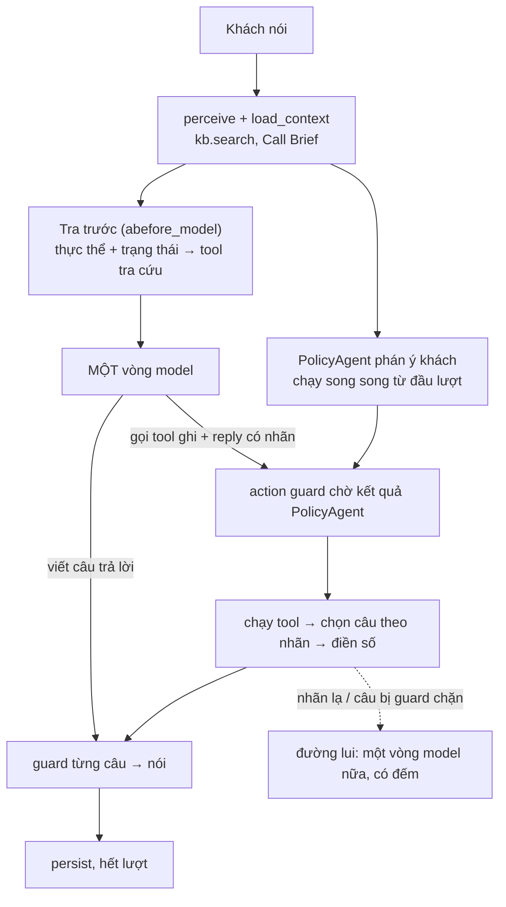

# 002. Một vòng model mỗi lượt: model chọn tool và soạn sẵn câu trả lời, harness chạy tool rồi nói

| | |
|---|---|
| Trạng thái | đang làm: bước 0–5 đã code, sau công tắc, mặc định tắt; chưa đo bước 6 |
| Người phụ trách | |
| Ngày tạo | 2026-11-15 |
| Loại | tool / action guard / soft guard / config / voice |
| Chỉ số mục tiêu | TTFA p95 ≤ 2,5 s, TTFT p95 ≤ 3 s, Total p95 ≤ 8 s; TSR, RQR, CCR, HR, vi phạm guardrail không xấu đi |

File này viết cho người (hoặc agent) sẽ implement mà không có mặt trong các buổi đo. Đọc hết mục 0 trước khi sửa dòng nào.

---

## 0. Lấy ngữ cảnh ở đâu

### 0.1 Đọc theo thứ tự này

| # | Đọc gì | Ở đâu | Để biết |
|---|---|---|---|
| 1 | Quy tắc làm việc của repo | `CLAUDE.md` (gốc repo, không commit), `AGENTS.md` | Quy tắc cứng, cách commit, những thứ không được đụng |
| 2 | Định nghĩa latency của BTC | `BTC-Data-Vong1-TEAMS/eval/huong-dan-do-latency.md`, `DIEU-CHINH-DE.md` mục 1 | TTFT, Total, TTFA đo từ đâu tới đâu, bỏ 3 lượt warm-up, cần ≥ 100 lượt |
| 3 | Cách chấm | `BTC-Data-Vong1-TEAMS/BTC-cap-nhat-11-2026/eval/reference_eval.py`, `schemas/scenario_format.md`, `schemas/trace_log.schema.json`, `schemas/tools.schema.json`, `schemas/handoff_brief.schema.json` | RQR, CCR, TSR, HR, vi phạm guardrail tính thế nào trên trace |
| 4 | Vòng lặp harness trong đề | `SUDO CODE 2026.pdf` trang 4–5 (C.2) | RETRIEVE đứng trước PLAN; "giá phải lấy từ tool"; phải bảo vệ được "khi nào gọi tool" |
| 5 | Kiến trúc đang chạy | `docs/ai/00-kien-truc.md`, `docs/ai/01-pipeline.md` | Bảy node của hot graph |
| 6 | Đường nóng | `apps/ai-agent-service/src/ai_agent_service/pipeline/hot/nodes.py`: `_streamed`, `_stream_once`, `_offer`, `_say`, `respond` | Câu được kiểm rồi nói thế nào; chỗ harness đã tự nói (`_confirmation_draft`, `read_back`, câu kết quả tool) |
| 7 | Advisor và middleware | `agents/advisor.py`: `AgentContext`, `prompt_parts`, `ContextPromptMiddleware`, `ActionGuardMiddleware`, `_intents`, `AdvisorAgent` | Prompt ghép thế nào, guard trước tool ghi, thứ tự middleware |
| 8 | Tool | `mcp/tools.py`: `ChainLookupMiddleware`, `named_lookups`, `ToolGuardMiddleware`, `StrictToolsMiddleware`, `LaneToolsMiddleware`, `declared_arguments` (ở `agents/advisor.py`) | Chỗ harness tự gọi tool, chỗ thêm bớt tham số |
| 9 | PolicyAgent | `agents/policy.py` (`judge`, `INTENTS`, `INTENT_THRESHOLDS`), `pipeline/hot/review.py`, `llm/decisions.py` | Phán ý khách trước tool ghi; review câu chạy nền |
| 10 | Nhận diện thực thể | `components/intake/commerce.py` (`named_products`, `commerce`, `observe`), `components/intake/lexicon.py` | Catalogue matcher nhận SKU, diện tích, ngân sách từ lời khách |
| 11 | Voice | `api/routes/voice.py` (`Session.audio`, `turn`, `_sink`, `_speak_stream`, `_figures`), `components/voice/turns.py`, `components/voice/tts.py` | TTFA được ghi thế nào; nhận ra ngừng nói; các engine TTS |
| 12 | Lời thoại mẫu, playbook | `config/prompts/agent/advisor/` (`rules.md`, `skills.yaml`, `notes.yaml`), `BTC-Data-Vong1-TEAMS/policy/` (playbook phát ngôn) | Giọng điệu câu trả lời |
| 13 | Số đo và script | `apps/ai-agent-service/workbench/latency/` (local, không commit) | Mọi bench của 14–15/11 và log kết quả |
| 14 | Nhật ký | `docs/plan/IMPROVEMENT-LOG.md` mục 2026-11-07 "Đo thời gian từng bước của một lượt" | Số nền của `eval2` |

### 0.2 Quy tắc của người dùng phải giữ

- Không câu đệm trước tool ("Dạ em xem ngay ạ"); TTFA tính trên tiếng của câu trả lời thật.
- Không bắt chữ lời khách để quyết định hành động hay lane. Việc cần hiểu ý khách thì hỏi `PolicyAgent.judge`. Regex trên lời khách chỉ được dùng để **lấy thêm thông tin** (như `kb.search`, tra trước), không để chặn hay kích hoạt hành động ghi.
- Không viết code, test, cờ gắn với một kịch bản cụ thể.
- Không sửa `pipeline/eval/` và `evaluation/`.
- Baseline (`baseline_no_memory`) chỉ được khác hệ thống ở bộ nhớ: mọi tối ưu ở đây bật như nhau cho cả hai cấu hình.
- Code, comment, test viết tiếng Anh; lời agent nói với khách tiếng Việt. Commit kiểu `FEAT: ...`, `FIX: ...`, không ghi tên Claude. Chỉ commit khi người dùng bảo.
- Gọi model có kiểm soát: mỗi loại lượt 1–2 mẫu khi thử; báo lại số lần gọi.
- Biến môi trường mới phải có trong `.env.example` và `docker-compose.yml`.

### 0.3 Cách chạy

```sh
cd apps/ai-agent-service
.venv/bin/python -m pytest ../../tests/agent -q
ADVISOR_PREFETCH=1 .venv/bin/python workbench/latency/bench_hard.py after vieneu: 1
BENCH_BASELINE=1 .venv/bin/python workbench/latency/bench_hard.py before vieneu: 1
.venv/bin/python workbench/latency/bench_endpoint.py ../../scripts/dev/question.wav
```

- Bench chạy trong schema riêng `bench_ttfa` của database `capstone_agent` (Postgres ở cổng 55432), không đụng cuộc gọi thật.
- `bench_hard.py` và `bench_sale.py` in từng lượt: số vòng model, TTFT, lúc đủ câu đầu, lúc có tiếng đầu (tính từ khi ASR xong). TTFA = số đó + phần nhận ra ngừng nói và ASR.
- Một test fail sẵn từ trước, không liên quan: `tests/agent/test_improve_runner.py::test_learn_runs_the_dags_two_first_steps_for_this_week` (đường dẫn repo có dấu cách).
- Venv đã có gói voice và VieNeu. ASR là dịch vụ riêng (`apps/asr-service`), máy dev chưa chạy nên bench đưa câu khách vào dạng chữ.

---

## 1. Vấn đề

Một lượt có tool đang tốn 2–4 vòng gọi model, mỗi vòng 0,8–1,5 s. Lượt hai vòng không thể có tiếng đầu dưới 2,5 s, và làm TTFT p95 vượt 3 s.

Ví dụ, lượt "Ừ em lên đơn cho chị đi": vòng 1 model gọi `order_create`, harness chờ PolicyAgent phán ý khách (2,0 s) rồi chạy tool, vòng 2 model mới viết "Dạ em đã lên đơn…". Tiếng đầu ra sau khoảng 5 s.

## 2. Bằng chứng

### 2.1 Run evaluation (chat)

`evaluation/runs/base-40fea307-sample`, `-hard`, `-gap-r0`, 110 lượt, phân tích bằng `workbench/latency/lat.py`:

- TTFT p95 3,5–4,1 s. Mọi lượt TTFT trên 3 s đều có từ 2 vòng model.
- Lượt 1 vòng: TTFT p50 khoảng 1,0 s, p95 khoảng 1,5 s. Lượt 2 vòng: p50 2,5–3,2 s.
- 43 trên 110 lượt có từ 2 vòng: 22 lượt chỉ tra cứu, 14 lượt có tool ghi, 7 lượt không gọi tool nghiệp vụ.
- Harness ngoài model chỉ khoảng 20 ms mỗi lượt. Prompt khoảng 8.000 token, cache trúng 82%.

### 2.2 Bench voice qua harness thật (14–15/11)

Voice VieNeu cục bộ, mỗi loại 1–2 lượt; log ở `workbench/latency/hard-*.log`, `sale-*.log`. "Trước" là code trước 14/11; "sau" là có tra trước sản phẩm có tên, câu kết quả tool do harness nói, Smart Turn và ASR chạy sớm.

| Loại lượt | TTFA trước | TTFA sau | Vòng model sau |
|---|---|---|---|
| Hỏi giá sản phẩm có tên | 3,5 / 4,0 s | 2,0 / 2,2 s | 1 |
| Câu ASR không dấu | 3,6 s | 1,9 s | 1 |
| Hẹn gọi lại | 3,6 / 3,9 s | 2,0 / 2,4 s | 2 |
| Hỏi chính sách | 2,2 / 2,2 s | 2,0 / 2,1 s | 1 |
| Chuyển máy | 5,4 s | 3,4 s | 2 |
| Đổi địa chỉ đơn | 6,0 s | 4,3 s | 3 |
| Hỏi trạng thái đơn | 3,1 s | 3,1 s | 2 |
| Đọc lại đơn trước khi tạo | 3,3 s | 3,3 s | 2 |
| Khách đồng ý, tạo đơn | 4,9 s | 5,1 s | 2 |
| Tư vấn theo nhu cầu | 4,1 / 5,8 s | 5,2 / 5,9 s | 3–4 |

TTFA "trước" cộng 0,55 s nhận ra ngừng nói và ASR (bench 7/11); "sau" cộng khoảng 0,3 s (0,25 s đo trên một file wav; phần ASR chạy song song chưa đo).

### 2.3 Thời gian đi đâu ở các lượt còn chậm

- **PolicyAgent phán ý khách nằm trong tool ghi**: lượt tạo đơn 2,0 s, chuyển máy 0,9 s (`stages_ms.policy`, `stages_ms.tools` trong meta của lượt, schema `bench_ttfa`).
- **Model viết tham số dài**: vòng viết Handoff Brief khoảng 2,7 s.
- **Model tự tìm rồi tự báo giá**: lượt tư vấn theo nhu cầu 3–4 vòng.
- **Vòng thứ hai chỉ để viết câu kết quả** ở mọi tool ghi.

### 2.4 Đã thử và loại

| Thử | Kết quả | File |
|---|---|---|
| Đổi model (gpt-6-luna, gpt-4.1-mini, gpt-4o-mini, Groq) | Sàn 0,75–0,9 s tới chữ đầu ở mọi model OpenAI; gpt-5-nano trả lời sai | `bench_opt.py models`, `bench_models2.py`, `bench_nano.py` |
| `service_tier=priority` | Khoảng −0,2 s ở vòng tool, dao động lớn | `bench_opt.py tier` |
| Responses API qua WebSocket | TTFT 2,4–2,8 s, chậm hơn Chat Completions đang dùng (2,15 s) | `bench_ws.py` |
| TTS: `tts-1`, Gemini Flash TTS | Chậm hơn hoặc ngang `gpt-4o-mini-tts`; VieNeu cục bộ 0,33–0,42 s là nhanh nhất | `bench_opt.py tts`, `bench_gemini_tts.py` |
| Câu đệm trước tool | Người dùng đã loại | |

### 2.5 Trạng thái code hiện tại (chưa commit)

Những thứ dưới đây đã có trong working tree; bước nào dùng lại thì ghi rõ.

| Đã có | Ở đâu | Công tắc |
|---|---|---|
| Tra trước giá và tồn kho cho sản phẩm có tên trong lời khách | `mcp/tools.py` (`prefetch`, `named_lookups`, `ChainLookupMiddleware`), `components/intake/commerce.py` (`named_products`) | `ADVISOR_PREFETCH=1`, mặc định tắt |
| Câu kết quả do harness nói sau tool ghi, và báo cho vòng model sau | `components/guardrails/fallback.py` (`result_line`), `pipeline/hot/nodes.py` (`_stream_once`), `agents/advisor.py` (`harness_said`, section `said`) | luôn bật |
| Smart Turn chạy sớm, ASR chạy sớm (`EndLikely`) | `components/voice/turns.py`, `api/routes/voice.py` | luôn bật |
| Làm ấm advisor lúc khởi động | `agents/advisor.py` (`warm`), `runtime/harness.py` (`warm`), `main.py` | luôn bật ở service |
| Test | `tests/agent/test_latency_head_starts.py` | |

Hai lỗi chất lượng đã thấy với câu kết quả cố định: model ở vòng hai lặp lại ý của câu đó, và câu harness gọi "anh/chị" trong khi model gọi "chị". Giải pháp ở mục 3 thay câu cố định bằng câu do chính model soạn, nên cả hai lỗi biến mất cùng vòng hai.

---

## 3. Giải pháp

### 3.1 Ý chính

Trong **cùng một vòng model** gọi tool ghi, model soạn luôn câu trả lời cho từng kết quả có thể xảy ra, mỗi câu gắn một nhãn kết quả, chỗ nào cần số liệu thì để chỗ trống có tên. Tool chạy xong, harness chọn câu theo nhãn, điền số từ kết quả tool, đưa qua guard như mọi câu khác, nói ra và kết thúc lượt. Không có vòng model thứ hai.

Ví dụ tham số model gửi kèm `order_create`:

```json
{"sku": "SKU-AP-X", "qty": 1, "payment": "COD", "price_vnd": 4890000,
 "reply": {
   "ok": "Dạ em lên đơn {order_id} cho chị rồi ạ, tổng {total_vnd}, dự kiến {estimated_delivery} giao tới chị nhé.",
   "out_of_stock": "Dạ em xin lỗi chị, máy vừa hết hàng mất rồi ạ; chị có muốn em giữ đơn chờ hàng về không ạ?",
   "cod_limit_exceeded": "Dạ đơn trên {limit_vnd} thì bên em chưa nhận thanh toán khi nhận hàng ạ, chị chuyển khoản giúp em được không ạ?"}}
```

Kết quả `ok` → khách nghe: "Dạ em lên đơn OD600003 cho chị rồi ạ, tổng 4.890.000đ, dự kiến 17/10 giao tới chị nhé."

### 3.2 Ai đã làm cách này

| Nguồn | Họ làm gì | Khác ta ở đâu |
|---|---|---|
| Vapi, tool messages | Mỗi tool khai sẵn câu `request-complete`, `request-failed`; trợ lý đọc câu đó thay vì hỏi lại model | Câu cố định theo tool; ta để model soạn theo ngữ cảnh từng lượt |
| ReWOO (Xu và cộng sự, 2023) | Lập kế hoạch trước với chỗ trống `#E1`, `#E2` cho kết quả tool chưa biết, rồi mới chạy tool | Họ vẫn có bước "solver" gọi model lần nữa; ta để harness điền |
| LangChain `return_direct` | Kết quả tool trả thẳng cho người dùng, bỏ vòng model sau | Trả nguyên kết quả thô; ta trả câu đã soạn |
| Rasa CALM, Pipecat Flows | Model ra lệnh, luồng viết bằng code chạy và trả lời | Lời thoại theo mẫu viết tay |

Mình chưa tìm thấy nguồn nào mô tả đúng tổ hợp "model soạn câu có nhãn kết quả trong tham số tool"; đây là ghép từ các mẫu trên, nên bước 0 phải đo trước khi xây.

### 3.3 Ưu, nhược

| Ưu | Nhược, và cách chặn |
|---|---|
| Bỏ hẳn vòng model thứ hai của tool ghi | Vòng một dài hơn vì model viết thêm câu: đo ở bước 0, giới hạn 3 nhãn và 200 ký tự mỗi câu |
| Câu do model viết trong ngữ cảnh: đúng xưng hô, đúng giọng, không lặp | Model có thể tự viết số: chỗ trống là cách duy nhất đưa số vào; câu có số tiền không qua chỗ trống bị loại (hard guard hiện có đã kiểm nguồn số tiền) |
| Tool vẫn được gọi thật, trace vẫn có `tool_calls` | Kết quả rơi vào nhãn model không soạn: dùng câu cố định của harness cho nhãn đó; không có thì cho thêm một vòng model và đếm |
| Mọi câu vẫn qua guard và PolicyAgent | Câu soạn trước không thấy kết quả thật: chỉ dùng cho tool có tập kết quả đóng (bảng 3.4) |

### 3.4 Tool nào dùng, nhãn nào

Nhãn lấy từ logic tham chiếu `apps/ai-agent-service/data/btc/eval/mock_tools.py` và guard của ta.

| Tool | Nhãn kết quả | Chỗ trống được phép |
|---|---|---|
| `order_create` | `ok`, `out_of_stock`, `cod_limit_exceeded`, `price_mismatch` | `order_id`, `total_vnd`, `estimated_delivery`, `limit_vnd`, `qty` (tồn kho) |
| `order_update` | `ok`, `new_variant_out_of_stock`, `order_not_found` | `order_id`, `fee_vnd`, `price_diff_vnd`, `refund_vnd`, `extra_payment_vnd`, `refund_days` |
| `schedule_callback` | `ok`, `moved` (tool dời lịch vì ngày nghỉ, LN-02) | `callback_at`, `moved_from` |
| `handoff_transfer` | `ok` | (không có; `ticket_id` không đọc cho khách) |
| `memory_request_deletion` | `ok` | (không có) |

Không dùng cho tool tra cứu (`catalog_search`, `pricing_get_quote`, `inventory_check`, `order_status`, `delivery_estimate`): kết quả mở, cần model đọc. Các tool này đi đường tra trước (bước 4).

Kết quả `CONFIRMATION_REQUIRED` của `order_create` giữ nguyên như hiện tại: harness tự hỏi câu xác nhận và kết thúc lượt (`_confirmation_draft`).

### 3.5 Một lượt sau khi xong



---

## 4. Các bước implement

Làm theo thứ tự. Mỗi bước: code, test offline, bench 1–2 lượt mỗi loại, rồi mới sang bước sau.

### Bước 0. Đo trước khi xây (không sửa code sản phẩm)

Mục đích: biết model viết thêm `reply` thì vòng một dài ra bao nhiêu, và câu có tự nhiên không.

1. Viết `workbench/latency/bench_reply_plan.py` từ `bench_opt.py`: cùng prompt advisor, một tool `order_create` có thêm tham số `reply` (schema strict như mục 3.1), lượt "Ừ em lên đơn cho chị đi" sau một lượt đã báo giá.
2. Đo 2 lượt mỗi biến thể: không có `reply`; `reply` chỉ có `ok`; `reply` có `ok` cộng 2 nhãn lỗi.
3. Ghi: thời gian tới khi tham số tool xong, số token ra, câu model soạn.

Điều kiện đi tiếp: vòng một có `reply` (3 nhãn) dài hơn không quá 0,6 s so với không có, và câu soạn dùng đúng chỗ trống, không tự viết số. Nếu 3 nhãn quá chậm thì chỉ bắt buộc `ok`, nhãn lỗi dùng câu cố định của harness.

### Bước 1. Tham số `reply` trên tool ghi

File: `mcp/tools.py` (middleware mới `ReplyPlanMiddleware`), `agents/advisor.py` (đăng ký middleware, `AgentContext.reply_plans`).

1. Bảng `REPLY_OUTCOMES` trong `mcp/tools.py`: tool → danh sách nhãn và chỗ trống được phép (bảng 3.4). Một nguồn duy nhất cho schema, cho bộ kiểm và cho test.
2. `awrap_model_call`: với mỗi tool trong bảng, thêm vào schema gửi cho model thuộc tính `reply` (object strict: `ok` bắt buộc là string; các nhãn khác `string | null`). Mô tả thuộc tính viết bằng tiếng Việt vì nó là một phần của prompt: câu nói với khách khi tool trả về nhãn đó, đúng xưng hô đang dùng, tối đa 2 câu, số liệu chỉ qua chỗ trống `{ten}` trong danh sách, không nhắc tên tool hay mã lỗi. Đặt sau `StrictToolsMiddleware` để schema strict vẫn hợp lệ, và giữ thứ tự tool không đổi để không vỡ prompt cache.
3. `awrap_tool_call`: lấy `reply` ra khỏi tham số **trước** `ActionGuardMiddleware` và trước khi gọi MCP, cất vào `context.reply_plans[tool_call_id]`. MCP server và schema BTC không đổi.
4. `tool_results_of` (`agents/advisor.py`): `args` ghi vào trace không được chứa `reply`. Lý do: `reference_eval.py` quét regex `trace_must_not_match` và tính CCR trên tên tham số của tool call; tham số riêng của ta không được lẫn vào.
5. Lane không có tool ghi (CLARIFY, CONFIRM_IDENTITY) không bị ảnh hưởng.

Test (`tests/agent/test_reply_plan.py`, theo mẫu endpoint giả trong `test_latency_head_starts.py`):
- schema gửi đi có `reply` strict cho đúng các tool trong bảng, không có ở tool tra cứu;
- tool nhận được tham số không có `reply`; trace không có `reply`;
- danh sách và thứ tự tool giữa hai lần gọi model giống nhau.

### Bước 2. Chọn câu, điền số, nói, kết thúc lượt

File: `components/guardrails/fallback.py` (thay `result_line`), `pipeline/hot/nodes.py` (`_stream_once`).

1. `outcome_of(result) -> str | None`: nhãn của một kết quả tool. `ok` khi envelope `ok`; `moved` khi `schedule.callback` có `moved_from`; mã lỗi của tool khi thất bại và mã đó có trong bảng; ngoài ra `None`.
2. `render(template, result, who) -> str | None`:
   - chỉ nhận chỗ trống trong danh sách của tool đó; chỗ trống lạ hoặc thiếu dữ liệu → `None`;
   - định dạng bằng hàm có sẵn: tiền `format_vnd`, giờ hẹn `clock.moment_label`, ngày giao theo `clock`;
   - câu có chữ số tiền nằm ngoài chỗ trống → `None`;
   - quá 2 câu hoặc quá 300 ký tự sau khi điền → `None`.
3. Trong `_stream_once`, tại sự kiện `tools` (chỗ đang gọi `fallback.result_line`):
   - với mỗi tool ghi vừa chạy: lấy `outcome_of`, lấy câu trong `view.reply_plans` theo nhãn, `render`;
   - không có câu hợp lệ → câu cố định của harness cho nhãn đó (`LINES`), nếu có;
   - đưa câu qua `_offer` (hard guard và review PolicyAgent như mọi câu), không gọi `_say` trực tiếp;
   - đã nói được câu cho **mọi** tool ghi của vòng này → gán `attempt.draft`, `return attempt` (đóng stream là dừng run, như `_confirmation_draft` đang làm). Lượt kết thúc với đúng một vòng model;
   - còn tool ghi nào chưa có câu, hoặc câu bị guard chặn → không kết thúc; để model chạy vòng nữa như hiện tại (đường lui), và ghi `fallback_round` vào diagnostics.
4. Câu `read_back` khi khách vừa đồng ý trong lượt (PB-09) giữ nguyên, nói trước câu kết quả.
5. `handoff_transfer`: câu của model thay cho `LINES["bridging"]` chỉ khi `fallback.is_bridging(câu)` đúng; không thì nói `LINES["bridging"]`. `respond` hiện tự thêm câu bridging nếu chưa có, nên không cần sửa `respond`.
6. Bỏ section `said` và `AgentContext.harness_said` nếu sau bước này không còn chỗ nào dùng (đường lui vẫn cần: giữ lại cho đường lui).

Test:
- `render` với từng nhãn, chỗ trống lạ, số tiền viết tay, câu quá dài;
- một lượt qua `AdvisorAgent.stream` với endpoint giả: model gọi `schedule_callback` kèm `reply`, chỉ có **một** request tới model, câu nói ra đã điền giờ hẹn;
- nhãn không có câu và không có câu cố định → có request thứ hai;
- câu bị hard guard chặn → không nói, có request thứ hai.

### Bước 3. PolicyAgent phán ý khách từ đầu lượt

File: `agents/advisor.py` (`_intents`, `ActionGuardMiddleware`), `pipeline/hot/nodes.py` (`_agent_context`), `agents/policy.py`.

1. Chia `INTENTS` thành hai nhóm:
   - chỉ cần lời khách và vài câu gần nhất: đồng ý mua (consent trong `purchase`), `handoff`, `delete`, `one_more`;
   - cần tham số tool: `change` (đổi gì trên đơn nào).
2. Đầu lượt, khi lane có tool ghi, tạo một task hỏi PolicyAgent nhóm thứ nhất trong **một** request (Decisions API nhận nhiều câu hỏi một lần, xem `PolicyAgent.evaluate`). Cất task vào context (`context.early_intents`).
3. `_intents`: với intent thuộc nhóm một, `await` task đã chạy thay vì gọi mới. Vòng model mất khoảng 1 s nên thường task đã xong: thời gian chờ thêm gần bằng 0. Nhóm hai giữ nguyên.
4. `handoff` hiện đưa cho PolicyAgent cả `reason_given` và `tools_called` lấy từ tham số tool. Giữ một lần hỏi đầy đủ như cũ **chỉ khi** câu trả lời sớm không chắc (xác suất nằm giữa hai ngưỡng); chắc rồi thì dùng luôn.
5. Hết giờ hoặc lỗi: hành vi như hiện tại (danh sách từ dự phòng, hoặc để quyết định của advisor đứng).
6. Task không ai dùng (lượt không gọi tool ghi) bị hủy cuối lượt; chi phí là một request Decisions mỗi lượt có tool ghi trong lane.

Test: `_intents` không gọi `judge` lần hai cho nhóm một; hết giờ thì rơi về hành vi cũ; lượt không có tool ghi không để lại task treo.

Chỉ số phải xem: vi phạm guardrail (chuyển máy thừa), TSR các ca `chuyen_may`, ca xin xóa dữ liệu.

### Bước 4. Tra trước mở rộng (retrieve trước plan)

File: `mcp/tools.py` (`ChainLookupMiddleware`), `components/memory/recall.py`.

Nguyên tắc cho mọi mục: chỉ thêm thông tin; không quyết định; không kích hoạt tool ghi; tối đa 4 lần gọi tool tra trước mỗi lượt; tham số đúng schema BTC, không thêm tham số.

| Mục | Kích hoạt bằng | Gọi gì | Ghi chú |
|---|---|---|---|
| a. Sản phẩm có tên | `commerce.named_products(lời khách)` khớp đúng tên catalogue, tối đa 2 | `pricing_get_quote`, `inventory_check` | Đã có sau `ADVISOR_PREFETCH`; bật mặc định sau khi qua bước 6 |
| b. Sản phẩm đang chốt | Trạng thái: có `pending_purchase` hoặc giỏ đang chọn | `pricing_get_quote` cho SKU trong giỏ | Bỏ vòng báo giá lại trước `order_create`; không đọc lời khách |
| c. Tư vấn theo nhu cầu | Bộ nhận diện bắt được loại hàng cộng diện tích hoặc ngân sách | `catalog_search(category, min_room_area_m2, max_price_vnd)`, rồi báo giá và tồn kho cho tối đa 2 kết quả đầu | Loại hàng lấy từ `_kind_groups` của `commerce.py`; không có loại hàng thì không tra |
| d. Đơn của khách đã nhận diện | Trạng thái: tier VERIFIED và Call Brief có đơn chưa giao | `order_status` lúc nhận diện, kết quả vào `earlier_results` | Thuộc bước làm mới Call Brief; BTC tính thời gian này vào Call Brief latency (hiện p50 84 ms, ngưỡng 3 s) |
| e. Ngày giao | Trạng thái: đã có địa chỉ trong cuộc và có sản phẩm đang chốt | `delivery_estimate` | |

Thiếu thông tin để tư vấn (chưa có loại hàng hoặc nhu cầu): model hỏi **một** câu rồi dừng, lượt sau tra tiếp. Câu hỏi này không được trúng slot trong `must_not_ask`: quy tắc hiện có trong prompt đã cấm, không thêm quy tắc mới.

An toàn của nhận diện thực thể, làm trước khi bật mục a và c:
1. Chạy `commerce.named_products` và `commerce.commerce` trên mọi lượt khách của `data/dev` (có nhãn `sku`), không gọi model. Báo precision, recall, và tỷ lệ lượt tra thừa.
2. Điều kiện bật: precision từ 98% trở lên. Thấp hơn thì chỉ dùng khớp tên chính xác, bỏ nhánh nghe gần đúng (`_heard_product`, `_fuzzy_brand_product`) khỏi tra trước.
3. Kết quả tra trước mang đúng tên sản phẩm; hard guard hiện có đã kiểm số tiền theo kết quả tool, nên báo nhầm giá của sản phẩm khác vẫn bị chặn khi SKU không khớp câu.

Test: mỗi mục một test với endpoint giả (một request tới model, tool message có sẵn); test "không đủ điều kiện thì không tra"; test giới hạn 4 lần gọi.

### Bước 5. Handoff Brief do harness điền

File: `components/handoff/render.py`, `mcp/tools.py` (`ToolGuardMiddleware._with_context`), `agents/advisor.py`.

1. Schema `handoff_transfer` gửi cho model chỉ còn: `escalation_reason` (enum hiện có), `escalation_reason_detail` (một câu), `conversation_summary` (tối đa 2 câu).
2. Harness điền các trường còn lại của `schemas/handoff_brief.schema.json` từ state: `customer_id`, `customer_phone`, `channel`, `product_advised`, `price_quoted_vnd`, `open_questions`, `next_action`, `generated_at` (`AgentContext.handoff_defaults` đã có một phần).
3. Brief sau khi ghép phải qua đúng validator đang dùng; thiếu trường bắt buộc thì coi như tool lỗi, đi đường lui.

Chỉ số phải xem: TSR các ca `expected_outcome: "chuyen_may"` (`brief_must_contain`), số trường brief hợp lệ. Bước này làm sau cùng trong nhóm code vì rủi ro TSR cao nhất.

### Bước 6. Đếm, đo, và điều kiện bật

1. Diagnostics mỗi lượt thêm: `rounds_to_first_sentence` (câu đầu ra ở vòng model thứ mấy), `fallback_round` (có phải đi đường lui không), `prefetched` (tên các tool tra trước), `reply_outcome` (nhãn đã dùng). Ghi qua `observability/stopwatch.py` và meta của lượt, không sửa `pipeline/eval/`.
2. Bench khó (`workbench/latency/bench_hard.py`, `bench_sale.py`), 1–2 lượt mỗi loại, trước và sau từng bước.
3. Evaluation hai cấu hình trên cohort đã dùng cho `base-40fea307-*` (BTC public sample, `data/hard-cases`, gap-r0), một kịch bản trước rồi mới cả cohort:
   ```sh
   apps/ai-agent-service/.venv/bin/python run_eval.py --scenarios <dir> --config full --out full.jsonl
   ```
4. Voice: ≥ 100 lượt qua WebSocket với `VOICE_BENCH=1` và message `bench_text` (`api/routes/voice.py`), cần cả stack và dịch vụ ASR chạy; đọc `ttfa_ms` do hệ thống ghi.

Điều kiện bật mặc định (`ADVISOR_PREFETCH`, `reply`):

| Chỉ số | Điều kiện |
|---|---|
| Lượt có câu đầu ở vòng 1 | ≥ 95% |
| TTFT p95 | ≤ 3 s |
| TTFA p95 (voice, ≥ 100 lượt) | ≤ 2,5 s |
| TSR, TSR ca khó | không thấp hơn run nền quá 1 kịch bản |
| RQR | không tăng |
| HR giá và khuyến mãi | ≤ 5% và không tăng |
| Vi phạm guardrail | không tăng |
| Rubric LLM-judge về độ tự nhiên (nếu chạy) | không giảm |

Điều kiện quay lui: bất kỳ dòng nào ở trên không đạt sau hai lần sửa → tắt công tắc của bước đó, ghi lý do vào `IMPROVEMENT-LOG.md`.

### Bước 7. Voice (phần còn lại)

1. Đo ASR chạy sớm với dịch vụ ASR thật: `asr_ms` trong `_figures` phải gần 0.
2. `VOICE_TTS=vieneu:` ở local (đã đặt trong `.env` gốc); build lại image để có VieNeu.
3. Ghi vào báo cáo cách đo: `speech_end` là cuối cửa sổ có tiếng cuối cùng, chặt hơn mốc "VAD end-of-speech" của BTC.

### Bước 8. Tài liệu

1. `docs/ai/01-pipeline.md`: thêm bước tra trước và câu trả lời có nhãn (dùng skill `write-docs`).
2. `docs/plan/IMPROVEMENT-LOG.md`: một mục cho mỗi bước đã đo (dùng skill `improvement-log`).
3. Phần "khi nào gọi tool và khi nào không" (đề trang 5) viết thành một đoạn trong tài liệu kiến trúc: harness tra cái thực thể và trạng thái đã xác định; model gọi cái cần phán đoán hoặc có tác động, và soạn sẵn câu trả lời cho các kết quả có thể xảy ra.

---

## 4b. Tiến độ (2026-11-15)

| Bước | Trạng thái | Ghi chú |
|---|---|---|
| 0 | xong | `workbench/latency/bench_reply_plan.py`, log `reply-plan.log`, 12 lần gọi gpt-5.6-luna. Hết tham số tool (median): không `reply` 1447 ms; chỉ `ok` 1526 ms (+79); 3 nhãn bắt buộc 2064 ms (+618); 4 nhãn, lỗi nullable 2248 ms (+802). Câu soạn đúng chỗ trống, không tự viết số. → Chỉ câu thành công. |
| 1 | xong, `ADVISOR_REPLY_PLAN` | `reply` là một chuỗi (chỉ còn nhãn `ok`), không phải object. Bảng chỗ trống `REPLY_HOLES` đặt ở `components/guardrails/fallback.py` (hàm điền cũng đọc), `ReplyPlanMiddleware` ở `mcp/tools.py`, đứng giữa `StrictToolsMiddleware` và `ActionGuardMiddleware`. `reply` không vào args của trace, không lưu vào state. |
| 2 | xong | `fallback.render`, `outcome_of`; `nodes._tell`, `_planned`. Câu của model qua hard guard trước (bị chặn thì dùng câu cố định hoặc đường lui, không bắt cả lượt viết lại), rồi qua `_offer` như mọi câu. Hẹn gọi lại bị dời và chuyển máy: câu cố định đủ ý nên cũng kết thúc lượt. Lỗi tool: đường lui (vòng model). Đường nóng chờ đủ kết quả của mọi tool trong vòng (LangChain chạy mỗi tool một task, kết quả về lẻ). Meta của lượt: `planned_lines`, `ended_on_tools`, `fallback_round`. |
| 3 | xong, `ADVISOR_EARLY_INTENTS` | `PolicyAgent.probabilities` hỏi gộp `EARLY_INTENTS` (purchase, handoff, delete, one_more) đầu lượt khi lane có tool ghi; task bị hủy cuối lượt nếu không dùng. Khác kế hoạch: câu trả lời sớm chỉ đứng khi là "có" rõ (≥ ngưỡng + 0,25); mọi trường hợp khác hỏi lại đầy đủ như cũ, vì câu hỏi sớm không thấy dữ kiện của hành động (`intent_input`). Nó chỉ bỏ được thời gian chờ, không bao giờ từ chối thay check đầy đủ. |
| 4 | xong a, b, c, e; chưa làm d | Sau `ADVISOR_PREFETCH`. Nhận diện trên `data/dev` (`workbench/latency/entity_precision.py`, log `entity-precision.log`, không gọi model): precision 99,3% (143/144 lượt có nhãn; lần "sai" duy nhất là khách nêu hai máy, nhãn ghi một), nên giữ nhánh nghe gần đúng. 96% lượt tìm thấy sản phẩm thì lượt agent mẫu không tra giá: lần tra thừa nhiều nhưng mỗi lần chỉ vài ms trên mock. Thêm `commerce.named_category`, `need_search`, `ahead_lookups`, `search_follow_ups`; tối đa 4 lần gọi. d (`order_status` lúc nhận diện) thuộc bước làm mới Call Brief, chưa làm. |
| 5 | xong, `ADVISOR_SHORT_BRIEF` | Model viết `escalation_reason`, `escalation_reason_detail`, `conversation_summary`; `actions.fill_handoff` điền `open_questions` (lời khách vừa nói) và `next_action` (theo lý do, `NEXT_ACTION`) khi model bỏ trống, ở cả khi tắt công tắc. `brief_must_contain` chỉ kiểm trường có giá trị (`reference_eval.py:191`). |
| 6 | chưa | Cần bench và evaluation, phải được người dùng cho phép trước khi gọi model. |
| 7, 8 | chưa | |

Test: `tests/agent/test_reply_plan.py`, `test_early_intents.py`, mở rộng `test_latency_head_starts.py`; cả bộ `tests/agent` qua trừ test fail sẵn.

### Bench qua harness thật, 2026-11-15 (`workbench/latency/bench_plan002.py`, log `plan002-*.log`, `.jsonl`)

1 mẫu mỗi loại lượt, voice VieNeu cục bộ, gpt-5.6-luna. Làm ấm: một cuộc 3 lượt trước khi đo; prompt cache trúng 83% (trung vị) ở cả hai cấu hình. `off2` và `on` chạy liền nhau. Lần `off` đầu không dùng được: một lần gọi OpenAI mất tới 64–68 s, PolicyAgent timeout nhiều lần.

| | tắt (`off2`) | bật (`on`) |
|---|---|---|
| Lượt xong trong 1 vòng model | 1/11 | 7/11 |
| Tổng vòng model | 23 | 15 |
| Token vào của advisor | 192.586 | 129.863 (−33%) |
| TTFT trung vị / lớn nhất | 2.522 / 4.249 ms | 2.078 / 3.505 ms |
| Lượt TTFT > 2,5 s | 6 | 3 |
| Tiếng đầu trung vị / lớn nhất (chưa gồm ngừng nói + ASR) | 2.923 / 5.115 ms | 2.876 / 4.449 ms |
| Lần gọi PolicyAgent (Decisions) | 23 | 33 |

Độ nhiễu: cùng cấu hình tắt, hai lần chạy chênh nhau 1–3 s ở từng lượt (hỏi giá có tên 5.800 với 2.817 ms). Với 1 mẫu, chênh lệch TTFT từng lượt dưới khoảng 1 s chưa có ý nghĩa. Số vòng và số token thì ổn định.

Sau bench: câu trả lời sớm của `purchase` chỉ còn được dùng khi khách đã nghe đọc lại đúng đơn đó. Lý do: ở lượt hẹn gọi lại sau khi đã tạo đơn, câu hỏi sớm vẫn trả `purchase` 0,98, tức đồng ý cũ của khách. Thay đổi này chưa đo lại. Lượt đọc lại đơn sẽ chờ PolicyAgent như cũ (khoảng 1 s).

## 4c. Bổ sung sau bench (2026-11-15, chưa đo)

Người dùng duyệt các hướng sau khi đọc lại tài liệu BTC:
- TTFA tính tới "byte audio đầu tiên được phát" (`eval/huong-dan-do-latency.md`), không phải audio của câu trả lời.
- Được thêm tool riêng (`DIEU-CHINH-DE.md` mục 3).
- RQR chỉ đếm câu hỏi.
- Rubric J06 giới hạn tối đa 3 câu mỗi lượt.

| Mục | Công tắc | Làm gì |
|---|---|---|
| A1. Câu mở trước tool tra cứu | `ADVISOR_PREAMBLE` | Ghi chú `preamble` trong `notes.yaml`: model viết một câu ngắn trong cùng message với tool call. Câu không có số, không báo kết quả, không hỏi, không hứa (luật 7). `AdvisorAgent.stream` giờ đưa ra cả text nằm chung message với tool call. |
| A2. Câu giữ lượt của voice | `VOICE_HOLD_MS` (người dùng chọn 1600) | `voice.py`: `_hold` và `_prepare_holds`, với `fallback.HOLD_LINES` (audio tổng hợp sẵn). `ttfa_ms` theo định nghĩa BTC; thêm `ttfa_answer_ms` và `hold_ms`. |
| C. PolicyAgent theo vùng xác suất | luôn bật | `policy.INTENT_BANDS`, `band`, `PolicyAgent.probability`; `advisor._verdict` và `_agreed`. Vùng không chắc đi đường an toàn: mua, xóa, đổi đơn, thêm đơn thì hỏi xác nhận. Chuyển máy thì cho qua nếu lý do là y tế, khách xin gặp người, khiếu nại, lỗi hệ thống hoặc khách mất kiên nhẫn; lý do "tài liệu không có" chỉ cho qua khi tìm kiếm không thấy đoạn nào. Mọi xác suất ghi vào `draft.intent_probabilities`. |
| C4. Câu trả lời sớm "chắc chắn không chuyển máy" | theo `ADVISOR_EARLY_INTENTS` | Ngưỡng ≤ 0,02 (`NO_HANDOFF`): chặn mà không hỏi lại, và các vòng sau có dòng `no_handoff` trong phần prompt của lượt. Không bỏ tool khỏi vòng một, vì muốn vậy phải chờ PolicyAgent trước, và vì danh sách tool nằm trong prefix của prompt cache. |
| B1. Nới luật chữ số | theo `ADVISOR_REPLY_PLAN` | `fallback.HAND_FIGURE`: chỉ chặn tiền, ngày, giờ viết tay. Các số khác để hard guard kiểm. |
| B3. Tool `product_advise` | `ADVISOR_PRODUCT_ADVISE` | `mcp/tools.py`: `ChainLookupMiddleware._advise` gọi `catalog_search`, xếp hạng theo phòng, ngân sách, khóa trẻ em, rồi `pricing_get_quote` và `inventory_check` cho 3 mẫu. Trace ghi các lần gọi tool BTC bên trong. Ghi chú `advise` trong `notes.yaml`; thêm vào `lanes.yaml`. |

Bench (`bench_plan002.py`) mô phỏng A2: tới hạn mà chưa có câu nào thì tính là có tiếng. Vì bench đưa câu khách vào dạng chữ, mốc của nó là lúc ASR xong. Muốn tương đương 1,6 s tính từ lúc khách ngừng nói thì đặt khoảng 1,3 s trong bench.

## 4d. Sau bench `on3`/`off3` (2026-11-15)

**Kết quả** (12 lượt, cache trúng 68–89%):

| | tắt (`off3`) | bật (`on3`) |
|---|---|---|
| Lượt xong trong 1 vòng model | 1/12 | 10/12 |
| Tiếng đầu của câu trả lời, trung vị | 3.150 ms | 2.424 ms |
| TTFA theo BTC, trung vị | 3.150 ms | 1.301 ms |

**Câu giữ lượt thiết kế lại.** Ở `on3` câu giữ lượt phát ở 12/12 lượt, và người dùng cho là sẽ bị trừ điểm. Giờ harness chỉ đăng ký câu (`hold_line`) khi model gọi một tool tra cứu, nên chỉ lượt cần vòng hai mới có. Câu lấy theo nghiệp vụ (`fallback.HOLD_BY_TOOL`, `hold_line`) và xưng hô theo khách. Voice chỉ phát khi tới hạn mà khách chưa nghe gì, kể cả câu mở A1 của model. Lượt một vòng không có câu giữ lượt.

**Lượt một vòng: thời gian đi đâu** (đọc trong DB bench, không gọi model):
- Request đúng: `reasoning_effort: none`, `prompt_cache_key: advisor`, stream bật. Không có retry hay 429.
- Harness ngoài model chỉ 30–150 ms.
- Prompt: phần cố định (luật + skill) 3.954 token, schema tool khoảng 3–5 nghìn, phần của lượt và kết quả tra trước 1,5–3,3 nghìn token không trúng cache.
- Token đầu của model ra sau 0,9–2,9 s, phần dao động là của provider. Lượt tool ghi phải chờ model viết xong tham số và câu soạn sẵn (60–120 token).
- Từ token đầu đến tiếng đầu mất 0,4–1,2 s: chờ đủ một câu, cộng TTS khoảng 0,4 s.

**Audit mạng và provider** (sub-agent):
- Sàn khoảng 0,4 s TTFB từ Việt Nam tới OpenAI.
- Đã sửa: client advisor tách timeout mở kết nối 3 s và chờ pool 2 s (trước đó 60 s cho mọi bước). Client Decisions dùng keep-alive 120 s (trước là 5 s) và timeout mở kết nối 1 s. `harness.warm` mở sẵn kết nối Decisions bằng `models.list`, không gọi model.
- Chưa làm: HTTP/2 (`h2`), `service_tier` priority, endpoint vùng (`jp.api.openai.com` chỉ có gpt-6-luna), Azure B1 có 1 vCPU dùng chung với ASR/TTS.

## 4e. Guard, tham số tool, HTTP/2, service_tier (2026-11-15)

**Guard.** Hard guard chạy trên từng câu, mất 1–50 ms.

Review của PolicyAgent chạy nền và không giữ câu lại trước khi nói (`REVIEW_HEAD_START_MS` = 0). Mỗi lượt chỉ có một request tại một thời điểm; câu đến trong lúc review đang chạy được gộp vào request sau (`review.py`). Trong DB bench: 1–2 review mỗi lượt, tổng 0,37–1,03 s, không có cờ nào.

Có hai chỗ phải chờ review: trước tool ghi (`flags` → `settle`, tối đa 2 s) và cuối lượt (`recheck`). Chỗ cuối chỉ ảnh hưởng Total, không ảnh hưởng TTFA.

Mỗi review hỏi đủ 10 câu; cache chỉ trúng phần luật (khoảng 1.400 trên 3.000–5.600 token).

Câu cố định của harness không qua guard, và như vậy là đúng.

**Tham số tool.** Các tham số hệ thống luôn bị harness ghi đè, và bị ẩn khỏi schema của OpenAI.

Model vẫn phải viết vài thứ harness đã điền hoặc không ai dùng:
- `order_create.price_vnd`: harness lấy từ báo giá.
- `order_create.promo_code`: mock bỏ qua, chỉ nằm trong hash của sự đồng ý mua.
- `schedule_callback.note`: không được chấm.
- Strict mode bắt model ghi null cho `lines`, `basket_skus`, `order_group`.

Chưa sửa, chờ người dùng duyệt.

**HTTP/2** (`bench_http2.py`, không kèm key, 10 vòng): không cải thiện. Kết nối mới 410 ms so với 378 ms, kết nối giữ sẵn 289 so với 252, ba request song song 400 so với 419. Không bật; đã gỡ `h2`.

**service_tier** (`bench_tier.py`, 14 lần gọi):

| Tier | Token đầu: trung vị / lớn nhất | Hết câu trả lời: trung vị / lớn nhất |
|---|---|---|
| default | 938 / 1.779 ms | 1.295 / 2.078 ms |
| priority | 842 / 1.151 ms | 1.038 / 1.321 ms |

API xác nhận đã chạy priority ở cả 6 lần đo.

## 4f. Theo quyết định của người dùng (2026-11-15, chưa đo)

| Mục | Công tắc | Làm gì |
|---|---|---|
| service_tier khi bench | `ADVISOR_SERVICE_TIER=priority` | `llm/factory.py`: chỉ áp cho advisor; `models.yaml` không đổi. |
| Ẩn tham số harness điền | luôn bật | `mcp/tools.HARNESS_ARGS`: `order_create.price_vnd` và `promo_code`, `schedule_callback.note`. Thông báo khi chưa có giá giờ yêu cầu gọi `pricing_get_quote` (`actions.py`). Docstring trong `crm.py` cập nhật theo. Giữ strict mode, vì các trường null ở đây (`lines`, `basket_skus`, `order_group`) cần cho đơn nhiều máy. |
| Cụm đầu sang TTS | `ADVISOR_FIRST_CLAUSE` | `SentenceSplitter.pieces(first_clause=True)` trên kênh thoại, ở câu đầu của câu trả lời. Dấu phẩy có dấu cách theo sau; cụm ≥ 20 ký tự và ≥ 4 chữ. Cụm đầu chỉ qua hard guard rồi nói ngay. Phần còn lại được hard guard kiểm trên cả câu, và PolicyAgent review cả câu, gộp chung với câu sau (`_offer_rest`). Cả câu vẫn tính là 1 trong 3 câu. |
| Bỏ review cho câu "an toàn" | không làm | Câu không có số vẫn vi phạm được: xưng là người, hứa không có căn cứ, báo đã làm khi chưa gọi tool, báo đang chuyển máy, nói về đối thủ, tạo áp lực, nói shop không có. |

## 4g. Trước bench: giọng ở chỗ cắt, dấu câu, kỹ thuật thêm (2026-11-15)

**Giọng VieNeu ở chỗ cắt** (`workbench/latency/clause_voice.py`; file wav ở `clause_audio/`; chạy local, không gọi API):
- Chỗ cắt có khoảng lặng 0,25–0,35 s.
- Câu tách dài hơn câu liền 0–0,4 s.
- Phần còn lại luôn sẵn trước khi cụm đầu phát xong, nên không có khoảng chờ.
- Tiếng đầu: cụm đầu ra sau 0,27–0,31 s, cả câu 0,33–0,42 s.
- Ngữ điệu ở cuối cụm cần người nghe.

**Dấu câu đầu ra.** Ghi chú `spoken` yêu cầu:
- câu đầu mở bằng cụm 6–10 chữ mang ý chính rồi dấu phẩy;
- mỗi câu khoảng 20 chữ trở xuống;
- chỉ dùng dấu phẩy, dấu chấm, dấu hỏi.

Bộ tách cắt cụm đầu ở `,` `;` `:` khi có dấu cách theo sau, nên "09:00" và "4,5" không bị cắt.

**Kỹ thuật ứng viên (chưa làm):**
- Gửi trùng request advisor ở tầng HTTP (hedging) khi chưa có byte đầu sau khoảng 1,2 s, lấy bên nào ra trước.
- Bắt đầu LLM sớm khi mới đoán khách ngừng nói (`EndLikely`, preemptive generation): chỉ chạy model và tool tra cứu, chặn tool ghi và không nói gì cho tới khi lượt được chốt; khách nói tiếp thì hủy. Trước khi làm phải kiểm checkpointer của LangGraph.
- Rút khoảng lặng ở chỗ cắt.
- Câu giữ lượt cho lượt tool ghi chậm.

## 4h. Vì sao token đầu dao động (`bench_variance.py`, 21 lần gọi, 2026-11-15)

| Nhóm | Token đầu: trung vị (thấp nhất–cao nhất) | Server tự xử lý |
|---|---|---|
| Prompt giống hệt, đã cache | 904 ms (729–1.811) | 436–723 ms |
| Thêm khoảng 2,4 nghìn token không cache | 881 ms (801–981) | 494–657 ms |
| VieNeu chạy song song trong cùng process | 912 ms (838–1.244) | 494–637 ms |

- Token đầu đến khoảng 30 ms sau header.
- Phần nằm ngoài xử lý của server (header trừ `openai-processing-ms`) bình thường là 260–300 ms. Lần chậm 1.811 ms có khoảng 1.040 ms nằm ngoài, tức chờ trên đường đi hoặc trong hàng đợi, không phải do model sinh chậm.
- Không phải do phần prompt không trúng cache.
- Không phải do GIL: lần chậm ở nhóm "busy" là lần mở kết nối mới, vì client thô trong bench chỉ giữ kết nối 5 s.

Đã gắn bộ đo vào client HTTP của advisor (`factory._answered`): mỗi lần gọi log thời gian tới header, thời gian xử lý của server, phần nằm ngoài và mã request. Bench in các dòng này ra.

## 4i. Bench `on4` (bật hết, priority, 14 lượt, 2026-11-15)

**Kết quả so với `off3` (tắt hết), cùng kịch bản**

| | off3 | on4 |
|---|---|---|
| TTFA bench, trung vị | 3.150 ms | 1.630 ms |
| TTFA bench, p90 | 4.387 ms | 2.422 ms |
| TTFA bench, lớn nhất | 5.365 ms | 3.142 ms |
| Lượt có TTFA trên 2 s | 11/12 | 3/14 |
| Lượt xong trong 1 vòng model | 1/12 | 11/14 |
| Lượt có câu giữ lượt | — | 1 (lượt hỏi trạng thái đơn) |

TTFA thật bằng số của bench cộng thêm 0,25–0,55 s (nhận ra khách ngừng nói và ASR).

**Thời gian chờ token đầu (bộ đo mới)**
- Thời gian tới header: 684–1.207 ms.
- Server tự xử lý: 411–697 ms.
- Phần nằm ngoài server: 273–691 ms.
- Với priority, không còn lần chậm vượt 1,3 s, nên chưa cần làm A (gửi trùng request khi chậm).

**Bốn lỗi tìm được**
1. **Ledger đọc sai cache ở tier priority.** LangChain ghi token trúng cache vào khóa `priority_cache_read`, ledger đọc ra 0. Đã sửa (`callback_handler.cached_tokens`). Cache vẫn trúng bình thường.
2. **Câu mở trước tool bị giữ tới vòng sau.** Bộ tách chờ dấu cách sau dấu chấm, mà sau câu mở là lệnh gọi tool nên dấu cách không tới. Lượt hỏi trạng thái có token đầu lúc 958 ms nhưng câu đầu tới 2.489 ms mới nói. Đã sửa: khi có `tool_started`, đẩy phần đang giữ ra nói ngay.
3. **Câu soạn sẵn của lượt đổi địa chỉ có chỗ trống `{fee_vnd}`**, mà đổi địa chỉ không trả phí, nên lượt rớt về hai vòng. Đã thêm hướng dẫn chỗ trống theo từng việc (`REPLY_EXTRA_DOC["order_update"]`).
4. **Lượt đọc lại đơn còn sót nửa câu.** Model viết một cụm trước khi gọi `order_create`; cụm đó được nói, phần còn lại không bao giờ tới. Chưa sửa.

## 5. Rủi ro

| Rủi ro | Dấu hiệu | Cách chặn |
|---|---|---|
| Model soạn `reply` làm vòng một chậm quá | Bước 0: chậm thêm trên 0,6 s | Chỉ bắt buộc nhãn `ok`; nhãn lỗi dùng câu cố định |
| Câu soạn trước sai với kết quả thật (hứa giao hôm nay nhưng tool trả ngày khác) | HR tăng; PolicyAgent gắn cờ sau khi nói | Số liệu chỉ qua chỗ trống; câu qua guard; nhãn lạ đi đường lui |
| Kết thúc lượt sau tool ghi làm mất gợi ý tiếp theo | TSR giảm ở kịch bản cần hai hành động trong một lượt | Model được gọi nhiều tool ghi trong cùng vòng; mỗi tool một câu; lượt chỉ kết thúc khi mọi tool đã có câu |
| Tra trước nhầm sản phẩm | Precision dưới 98% ở bước 4 | Chỉ khớp tên chính xác; tối đa 2 sản phẩm |
| Tra trước làm lệch chỉ số có lợi cho ta một cách không trung thực | CCR tăng mà lời agent không đổi | Lần tra của harness chỉ dùng tham số đúng schema; báo cáo tách tool do harness gọi và do model gọi |
| PolicyAgent trả lời sớm khác với lúc có tham số | Chuyển máy thừa tăng | Hỏi lại đầy đủ khi xác suất nằm giữa hai ngưỡng |
| Hỏi một câu thay vì tìm làm tăng câu hỏi thừa | RQR tăng | Chỉ áp dụng khi không có loại hàng; slot trong `must_not_ask` không được hỏi |
| Handoff Brief thiếu nội dung kịch bản đòi | TSR ca `chuyen_may` giảm | Giữ `conversation_summary` do model viết; làm bước này sau cùng |
| Prompt cache vỡ vì schema tool đổi giữa các vòng | `cached_tokens` giảm trong `full.usage.json` | Thứ tự và nội dung tool cố định theo lane; kiểm bằng test ở bước 1 |

## 6. Cách đo

- Test offline thêm: `tests/agent/test_reply_plan.py`, mở rộng `tests/agent/test_latency_head_starts.py`; cả bộ `tests/agent` phải qua (trừ test fail sẵn nêu ở 0.3).
- Cohort đo trước và sau: BTC public sample (`apps/ai-agent-service/data/btc/test_set/public_sample`), `data/hard-cases`, tập gap-r0; run nền `evaluation/runs/base-40fea307-sample`, `-hard`, `-gap-r0`.
- Kỳ vọng: tỷ lệ lượt một vòng từ 61% (67/110) lên ≥ 95%; TTFT p95 từ 3,5–4,1 s xuống dưới 3 s; TTFA lượt tool ghi từ 3,4–5,1 s xuống khoảng 2,0–2,4 s.
- Điều kiện quay lui: bảng ở bước 6.

## 7. Kết quả

| Chỉ số | Trước | Sau |
|---|---|---|
| Lượt có câu đầu ở vòng 1 | 61% (67/110) | |
| TTFT p95 | 3,5–4,1 s | |
| TTFA p95 | chưa có số đủ 100 lượt | |
| TSR / RQR / CCR / HR | theo run nền | |

## 8. Nguồn

- Vapi, tool messages: https://docs.vapi.ai/tools/custom-tools , https://docs.vapi.ai/tools/mcp/messages-and-results
- ReWOO: https://arxiv.org/abs/2305.18323
- LangChain `return_direct`: https://docs.langchain.com/oss/langchain/tools
- Rasa CALM: https://rasa.com/docs/learn/concepts/calm/
- Pipecat Flows: https://docs.pipecat.ai/guides/features/pipecat-flows
- LiveKit, ReAct cho voice agent: https://livekit.com/blog/react-pattern-voice-agents
- LiveKit, turn handling (preemptive generation): https://docs.livekit.io/agents/logic/turns/tuning/
- Talker–Reasoner (Google DeepMind): https://arxiv.org/abs/2410.08328
- OpenAI, latency optimization: https://developers.openai.com/api/docs/guides/latency-optimization
- Anthropic, Building effective agents: https://www.anthropic.com/research/building-effective-agents

Các nguồn trên được đọc qua tóm tắt tìm kiếm, chưa mở toàn văn; kiểm lại trang gốc trước khi trích vào báo cáo.
