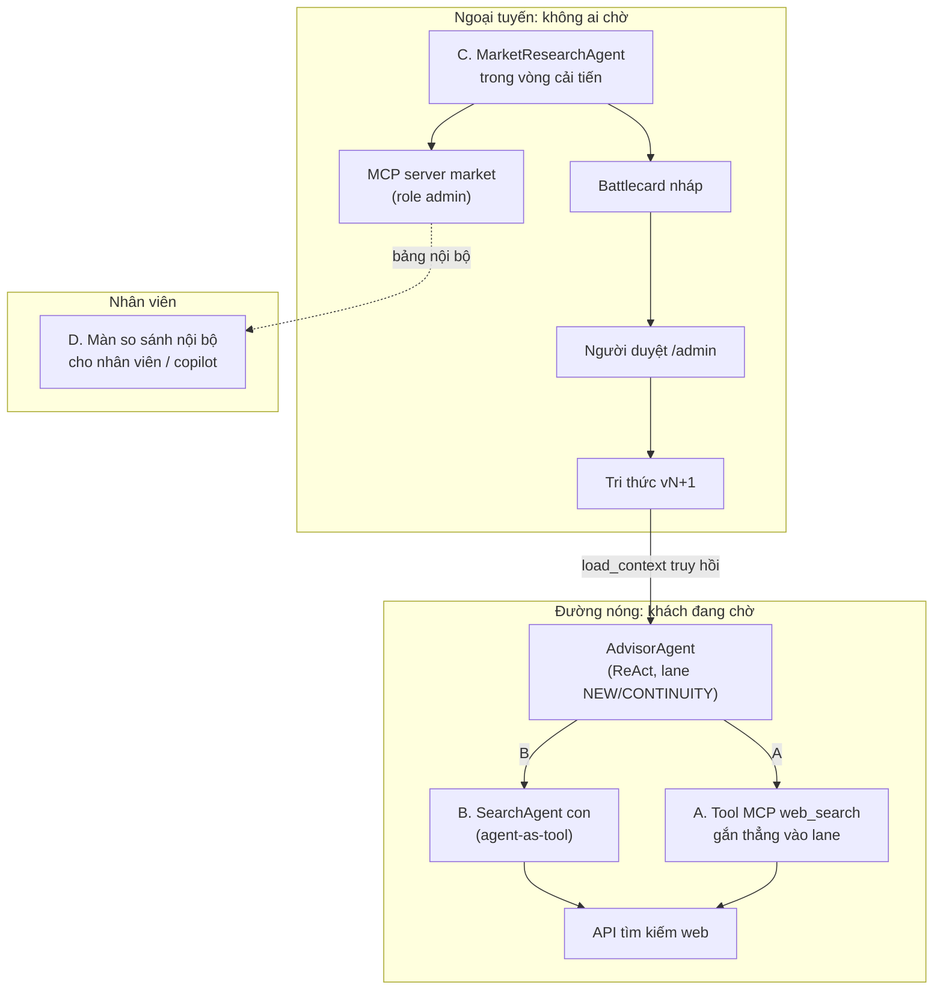
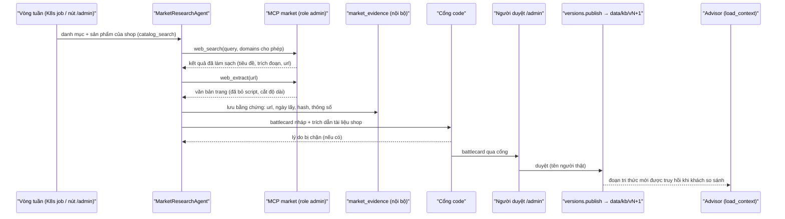
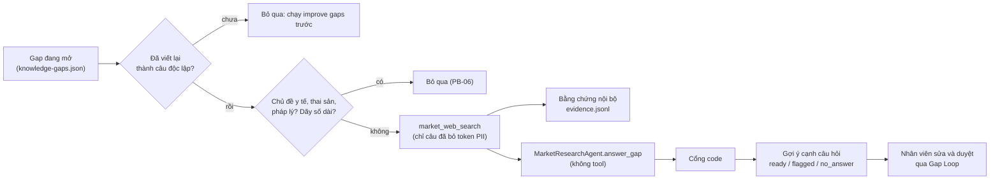
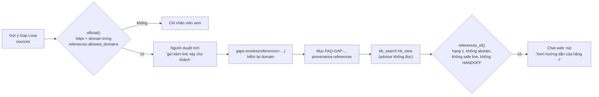

# 002. So sánh với sản phẩm trên thị trường: SearchAgent, MCP hay vòng ngoại tuyến

| | |
|---|---|
| Trạng thái | đang làm: bước 1–3 đã có code và test offline (2026-11-27); chưa gọi API tìm kiếm thật, chưa có số đo. Xem [mục 10](#10-đã-làm) |
| Người phụ trách | |
| Ngày tạo | 2026-11-27 |
| Loại | tool (MCP, chỉ role `admin`) + tri thức (battlecard đã duyệt) |
| Chỉ số mục tiêu | TSR trên kịch bản persona `khach_so_gia`; số vi phạm luật `competitor` của PolicyAgent; HR; TTFT không đổi |

## Kết luận trước

**Không cho advisor tự tìm trên internet khi đang nói với khách, dù bằng MCP tool hay SearchAgent con.** Làm một vòng
ngoại tuyến:

1. Một **MCP server mới `market`** bọc API tìm kiếm web. Tool của nó chỉ mở cho một role riêng, `researcher` (bản
   thiết kế ban đầu ghi `admin`, xem mục 10), nên
   `RoleMiddleware` trong [server_base.py](../../apps/ai-agent-service/src/ai_agent_service/mcp/server_base.py) từ chối
   advisor, dù prompt có nói gì.
2. Một **MarketResearchAgent**, chỉ một agent, chạy cùng vòng cải tiến hằng tuần như Reflection và Gap Loop. Nó tìm sản
   phẩm cùng loại, rồi viết **battlecard**: điểm mạnh của sản phẩm mình, kèm nguồn trong catalog hoặc tài liệu BTC.
3. **Người duyệt** battlecard trong `/admin`. Bản đã duyệt được phát hành thành một phiên bản tri thức mới qua
   `versions.publish`, như Gap Loop đang làm.
4. Advisor không cần tool mới. `load_context` đã truy hồi đoạn tri thức cho mỗi lượt. Khi khách nói "bên kia rẻ hơn",
   advisor nhận đúng battlecard và trả lời bằng quyền lợi của shop. Nó không nêu giá, không xác nhận và không chê nơi khác.

Thông tin về đối thủ (giá, thông số, link, ngày lấy) chỉ nằm ở bảng nội bộ cho nhân viên đọc. Nó không bao giờ vào
prompt của advisor.

Câu hỏi "agent hay MCP" thật ra không phải chọn một trong hai. MCP là **cách đưa tool cho model**, và dự án đã dùng
FastMCP cho mọi tool. Agent là **ai quyết định gọi tool và gọi mấy vòng**. Câu hỏi cần trả lời là: việc tìm kiếm chạy
**lúc nào** (khi khách đang chờ hay ngoại tuyến), và kết quả đi đến **ai** (khách, nhân viên hay kho tri thức).

---

## 1. Vấn đề

Muốn agent biết sản phẩm tương tự trên thị trường và nói được vì sao khách nên mua ở shop. Ví dụ: khách nói "Xiaomi
bên Shopee rẻ hơn mà cũng HEPA". Hiện advisor chỉ có câu chung trong skill `objection-handling`
([skills.yaml](../../config/prompts/agent/advisor/skills.yaml)): nêu bảo hành, quà và đổi trả. Câu này không gắn với
điều khách vừa so sánh.

## 2. Ràng buộc đã có trong repo (đọc từ code, không phải giả định)

Năm ràng buộc này quyết định kiến trúc. Mỗi phương án ở mục 3 được chấm theo chúng.

| # | Ràng buộc | Ở đâu | Hệ quả |
|---|---|---|---|
| R1 | **BTC cấm so giá đối thủ.** "Không so giá với đối thủ, không xác nhận hay phủ nhận giá đối thủ khách nêu… Tuyệt đối không nói xấu đối thủ" (PB-02, PB-04). "Không so sánh với giá cụ thể của đối thủ (chỉ được nêu giá trị đi kèm: bảo hành, giao nhanh, đổi trả)" (FAQ-15) | `apps/ai-agent-service/data/btc/policy/playbook-telesale.md`, `faq.md` (gói chỉ đọc) | Câu trả lời cho khách **không được** chứa "bên kia bán X đồng" hay "máy bên đó kém hơn". Câu "vì sao chọn shop" chỉ được dựa vào quyền lợi của shop |
| R2 | **PolicyAgent đã chặn chuyện này.** Luật `competitor`: "Vi phạm khi so với giá nơi khác, xác nhận hay phủ nhận giá đó, hoặc chê nơi khác" | [policy_rules.md](../../config/prompts/agent/policy_rules.md), [policy.py](../../apps/ai-agent-service/src/ai_agent_service/agents/policy.py) | Nếu advisor có dữ liệu đối thủ, nó sẽ hay dùng dữ liệu đó, guard sẽ chặn, câu bị viết lại hoặc thành safe line. Tốn thêm thời gian mà khách không được gì |
| R3 | **Hard guard tin mọi số tiền có trong kết quả tool của lượt.** "every amount … must come from … this call's tool results" | [hard.py](../../apps/ai-agent-service/src/ai_agent_service/components/guardrails/hard.py) | Nếu `web_search` là tool của advisor, **giá đối thủ lấy từ web sẽ qua được hard guard** như một số "có nguồn". Đây là lỗ hổng an toàn nghiêm trọng nhất của phương án A và B |
| R4 | **Đường nóng đã chậm.** TTFT p95 3779 ms (42 lượt), mục tiêu dưới 3 s; voice cần câu đầu nhanh | [BACKLOG.md](BACKLOG.md) mục 6; chú thích `advisor` trong [models.yaml](../../apps/ai-agent-service/config/models.yaml) | Thêm một lần gọi web (0,35 đến 1,9 s tùy nhà cung cấp, xem mục 4) và một vòng model nữa sẽ làm p95 tệ hơn |
| R5 | **Advisor có tool ghi.** `order_create`, `order_update`, `handoff_transfer`, `memory_request_deletion` ở lane `NEW` và `CONTINUITY` | [lanes.yaml](../../apps/ai-agent-service/config/lanes.yaml) | Trang web là dữ liệu không tin được. Đưa nội dung web vào cùng context với tool ghi là đúng mẫu tấn công *indirect prompt injection* (OWASP LLM01) và *excessive agency* |

Ràng buộc phụ:

- Gap Loop đã có cổng chặn số tiền, mã khuyến mãi và tồn kho trong mục tri thức. Phát hành bắt buộc có người duyệt,
  không chấp nhận "người duyệt" là một agent
  ([gap.py](../../apps/ai-agent-service/src/ai_agent_service/components/improvement/gap.py),
  [gaps.py](../../apps/ai-agent-service/src/ai_agent_service/components/improvement/gaps.py)). Battlecard có thể dùng
  lại cả hai.
- Tool không thuộc bộ tool BTC phải khai báo (`tools_audit`, theo [README kế hoạch](README.md)). Thêm tool mới cho advisor
  là thay đổi cái được chấm.
- **Pháp luật Việt Nam.** Luật Quảng cáo 2012, khoản 10 Điều 8 cấm quảng cáo so sánh trực tiếp với hàng cùng loại của
  người khác. Luật sửa đổi 75/2025/QH15 (hiệu lực 01/01/2026) theo các bản tóm tắt đổi thành "cấm khi không có tài liệu
  hợp pháp chứng minh". Luật Cạnh tranh cũng coi việc cung cấp thông tin không trung thực về doanh nghiệp khác là cạnh
  tranh không lành mạnh. Chúng tôi **chưa đọc toàn văn bản chính thức** của khoản đã sửa. Trước khi cho agent nói bất kỳ
  câu so sánh nào ngoài cuộc thi, cần người có chuyên môn pháp lý xác nhận.

## 3. Bốn phương án



| Tiêu chí | A. Tool MCP trên advisor | B. SearchAgent con | **C. Vòng ngoại tuyến + battlecard** | D. Chỉ cho nhân viên |
|---|---|---|---|---|
| R1, R2: đúng luật BTC | Dễ vi phạm. Có giá đối thủ trong tay thì model hay nhắc | Như A | **Đúng.** Battlecard chỉ chứa quyền lợi của shop | Đúng với khách. Nhân viên tự chịu trách nhiệm lời nói |
| R3: hard guard | **Thủng.** Giá web thành "số có nguồn" | Thủng nếu kết quả con trả về có số | Không đổi gì | Không đổi gì |
| R4: TTFT | Thêm khoảng 0,4–2 s cho web, cộng một vòng model | Tệ nhất: một agent con lặp nhiều vòng | **0 ms.** Truy hồi đã có sẵn trong `load_context` | 0 ms với khách |
| R5: prompt injection | Nội dung web ở cùng context với `order_create` | Cách ly hơn A, nhưng câu tóm tắt của agent con vẫn chở nội dung web về | **Agent ngoại tuyến không có tool ghi nghiệp vụ.** Có người duyệt trước khi phát hành | Người đọc, không phải model |
| Chi phí mỗi lượt khách | Phí tìm kiếm + token | 3–10 lần token so với một agent (theo Anthropic) | Chỉ trả theo vòng tuần | Theo lượt nhân viên bấm |
| Đo được bằng `run_eval.py` | Kết quả web đổi theo ngày, chạy lại ra số khác | Như A | **Có.** Phiên bản tri thức cố định, so R0/R1 trên cùng cohort | Không thuộc phần được chấm |
| Độ mới dữ liệu | Theo thời gian thực | Theo thời gian thực | Theo tuần (đủ cho định vị sản phẩm, không đủ cho giá theo giờ) | Theo lần bấm |

**Chọn C.** D có thể làm sau, dùng chung MCP server `market`. A và B bị loại vì R1, R3 và R5. Chúng không gây chậm
"một chút": chúng mở đường cho đúng loại câu mà BTC chấm là sai.

Vì sao C dùng **một** agent, không phải nhiều agent: Anthropic khuyên bắt đầu từ một agent có tool tốt. Hệ nhiều agent
tốn khoảng 3 đến 10 lần token và chỉ đáng dùng khi việc cần chạy song song lớn hoặc vượt một cửa sổ context. Một danh
mục khoảng chục sản phẩm, mỗi sản phẩm vài truy vấn, chưa cần đến mức đó. Nếu sau này có hàng trăm SKU, có thể chạy
song song **nhiều lần cùng một agent**, mỗi lần một danh mục. Như vậy vẫn không cần một "lead agent".

## 4. Chọn nhà cung cấp tìm kiếm

Các số dưới đây lấy từ bài so sánh do các nhà cung cấp tự viết (tháng 8–11/2026). **Chưa có số nào đo trên truy vấn
tiếng Việt của shop.**

| Nhà cung cấp | Độ trễ trung bình (Openbenchmarks 9/2026, truy vấn tra cứu) | Giá niêm yết | MCP server chính thức | Ghi chú |
|---|---|---|---|---|
| Brave Search API | khoảng 600 ms | khoảng 5 USD / 1.000 truy vấn, tặng 5 USD mỗi tháng | `brave/brave-search-mcp-server` (chạy local) | Có chỉ mục riêng, rẻ nhất |
| Exa | khoảng 400 ms (gói Instant) | trả theo lượt | `exa-labs/exa-mcp-server`, có bản host | Mạnh về tìm theo ngữ nghĩa và thực thể |
| Tavily | khoảng 1,9 s (gói Basic) | khoảng 5–8 USD / 1.000 | `tavily-ai/tavily-mcp` | Có search, extract và crawl trong một API |
| OpenAI `web_search` (Responses API) | không công bố | khoảng 10–25 USD / 1.000, cộng token nội dung; một yêu cầu có thể tự tìm nhiều lần | không cần | Dính chặt vào model OpenAI, khó kiểm soát số lần tìm và domain |

Đề xuất:

- **Tự bọc API bằng FastMCP**, theo khung của [server_base.py](../../apps/ai-agent-service/src/ai_agent_service/mcp/server_base.py).
  Không cắm thẳng MCP server của nhà cung cấp vào service. Bản tự bọc có role, có envelope `{"ok", "data"/"error"}`,
  có danh sách domain cho phép và có bộ làm sạch nội dung. MCP server của nhà cung cấp vẫn dùng tốt khi khám phá thủ
  công trong Claude Code.
- Để nhà cung cấp là một dòng cấu hình. Chọn bằng một lần đo nhỏ, như cách `models.yaml` chọn model: khoảng 20 truy vấn
  tiếng Việt (ví dụ "máy lọc không khí 40m2 HEPA giá", "giày chạy bộ nam size 42"). Đo độ trễ, tỷ lệ ra trang bán
  hàng ở Việt Nam và giá mỗi truy vấn. Brave và Exa là hai ứng viên đầu, vì rẻ và nhanh.
- Ước tính chi phí một vòng tuần (**chưa đo**): khoảng 30 sản phẩm × 3 truy vấn × 0,005–0,01 USD, tức dưới 1 USD phí
  tìm kiếm. Thêm token để đọc trang và viết battlecard, với model ghi cho agent `market` trong `models.yaml`.

## 5. Thiết kế phương án C

### 5.1. Luồng một vòng

Câu hỏi: từ lúc bấm nút đến lúc advisor dùng được battlecard, dữ liệu đi qua những đâu?



### 5.2. Từng thành phần

| Thành phần | File (mới, trừ khi ghi khác) | Làm gì |
|---|---|---|
| MCP server `market` | `apps/ai-agent-service/src/ai_agent_service/mcp/servers/market.py`; thêm `"market"` vào `SERVERS` trong [client.py](../../apps/ai-agent-service/src/ai_agent_service/mcp/client.py) | Hai tool `web_search(query, max_results)` và `web_extract(url)`, `roles={"admin"}`. Gọi API nhà cung cấp, chỉ giữ domain cho phép. Bỏ HTML, script và chỉ dẫn dạng "ignore previous…" khỏi văn bản. Cắt độ dài. Trả `ToolFailure("RATE_LIMITED", retryable=True)` khi bị giới hạn |
| Cấu hình | `apps/ai-agent-service/config/market.yaml` | Nhà cung cấp, danh sách domain, số truy vấn tối đa mỗi vòng, trần chi phí. Key nằm trong `.env`, không nằm trong file này |
| MarketResearchAgent | `apps/ai-agent-service/src/ai_agent_service/agents/market.py`; khối `agents.market` trong `models.yaml`; prompt `config/prompts/agent/market/` | Kế thừa `BaseAgent`, chỉ có tool `market_*` và `catalog_search` (đọc). **Không có tool ghi nghiệp vụ.** Đầu ra có cấu trúc: `competitor_facts[]` (nội bộ) và `battlecard` (cho tri thức) |
| Bảng bằng chứng | thêm migration cho `agent.market_evidence` | `url`, `fetched_at`, `content_hash`, `product_ref`, `specs`, `price_seen` (nội bộ). Để nhân viên kiểm lại và để biết dữ liệu đã cũ |
| Cổng code | `apps/ai-agent-service/src/ai_agent_service/components/improvement/market.py` | Dùng lại `gate()` của [gap.py](../../apps/ai-agent-service/src/ai_agent_service/components/improvement/gap.py) (không số tiền, không mã khuyến mãi, không tồn kho). Thêm: không tên thương hiệu hay shop ngoài catalog của mình; không từ chê ("hàng giả", "kém", "dỏm"); mỗi ý phải trích một mã tài liệu BTC (PB-, FAQ-, BH-…) hoặc một thuộc tính trong catalog |
| Phát hành | dùng lại `versions.publish` trong [versions.py](../../apps/ai-agent-service/src/ai_agent_service/components/improvement/versions.py) | `chunk_id` dạng `BC-<sku>`, `source: "battlecard"`, `approved_by` là người thật, `provenance` gồm id bằng chứng. Quay lui bằng `versions.rollback` và `revoke` như hiện có |
| Vòng tuần | [weekly.py](../../apps/ai-agent-service/src/ai_agent_service/pipeline/improve/weekly.py) | Thêm bước `market`, chạy trước `learn` để battlecard có trong vòng đo |
| `/admin` | `apps/web` | Tab duyệt battlecard, giống phần duyệt Gap Loop. Tab nội bộ "thị trường" đọc `market_evidence` (phương án D) |

### 5.3. Battlecard trông thế nào

Ví dụ tự viết, không lấy từ hội thoại thật. Battlecard viết về **shop**, không viết về đối thủ:

```json
{
  "chunk_id": "BC-SKU-AP-X",
  "source": "battlecard",
  "title": "AirPure X: khi khách so với máy lọc không khí bán online giá thấp hơn",
  "text": "Khi khách so với máy cùng loại ở nơi khác: không bình luận giá hay chất lượng bên đó. Nêu điều khách nhận được ở shop: hàng chính hãng, bảo hành theo BH-01, đổi trả theo DT-01, giao lắp theo VC-01. Nếu khách nhắc phòng rộng, đối chiếu diện tích phòng với thuộc tính room_area của AirPure X trong catalog_search.",
  "cites": ["PB-02", "PB-04", "BH-01", "DT-01", "VC-01"],
  "approved_by": "<tên người duyệt>",
  "provenance": {"evidence_ids": ["…"], "round": "2026-W48"}
}
```

Các mã tài liệu trong ví dụ chỉ để minh họa. Khi làm thật, chỉ trích mã có trong gói BTC.

Giá trị so với hiện tại: thông tin đối thủ cho biết **khách hay so với cái gì** (HEPA, diện tích, chế độ ngủ…). Nhờ vậy
battlecard nhắm đúng thuộc tính của sản phẩm mình đáp ứng điều đó. Câu nói với khách vẫn chỉ nói về shop.

### 5.4. Vì sao không sửa skill hay lane

- Skill `objection-handling` đã nói đúng hướng. Battlecard là **tri thức** cụ thể theo sản phẩm, không phải quy tắc. Đặt
  nó trong KB đúng bảng "Thêm skill ở đâu" của [README kế hoạch](README.md): chỗ rẻ nhất, dễ quay lui nhất.
- Không thêm lane: lane chọn theo trạng thái code biết được, không theo chủ đề khách nói (chú thích trong
  [lanes.yaml](../../apps/ai-agent-service/config/lanes.yaml)).
- Không thêm hard guard mới cho câu trả lời của khách: R3 vẫn đúng vì advisor không có nguồn số tiền mới. Luật
  `competitor` của PolicyAgent đã bắt phần còn lại.

## 6. Rủi ro

| Rủi ro | Cách giảm |
|---|---|
| Battlecard làm truy hồi lệch, kéo `BC-*` lên cho câu hỏi chính sách thường | Đo lại Recall@k bằng `python evaluation/rag_offline.py` trước và sau. Battlecard chỉ trích, không chép lại nội dung chính sách |
| Advisor nói dài hơn, vượt `MAX_SENTENCES` của hard guard | Mỗi battlecard tối đa 3 ý. Kiểm trên cohort |
| Trang web có prompt injection, làm battlecard sai | Agent ngoại tuyến không có tool ghi. Cổng code chặn tên thương hiệu ngoài catalog và số tiền. Người duyệt đọc từng thẻ |
| Dữ liệu đối thủ cũ | `fetched_at` trong bảng bằng chứng. Battlecard không chứa giá nên không bị cũ theo giá |
| Điều khoản sử dụng của sàn (Shopee, Lazada…) cấm thu thập tự động | Chỉ dùng API tìm kiếm (trích đoạn công khai). `web_extract` chỉ chạy với domain cho phép, ưu tiên trang hãng. Không crawl sàn. Chưa đọc điều khoản của từng sàn: cần kiểm trước khi thêm domain |
| Sau này muốn so sánh trực tiếp với khách (ngoài cuộc thi) | Là thay đổi riêng: phải có xác nhận pháp lý theo Luật 75/2025, sửa luật `competitor` và tài liệu chứng minh lưu cùng bằng chứng. Không nằm trong đề xuất này |

## 7. Cách đo

- **Test offline** (không tốn tiền model):
  - `tools_for("advisor")` không có tool `market_*`. Gọi `web_search` với role `advisor` bị `FORBIDDEN`.
  - Cổng `market.py`: chặn số tiền, tên thương hiệu ngoài catalog, từ chê và ý không trích nguồn.
  - `versions.publish` từ chối battlecard không có người duyệt thật.
- **Cohort:** kịch bản persona `khach_so_gia` của BTC (`apps/ai-agent-service/data/btc/simulator/personas.json`).
  `data/dev` có kịch bản gắn persona này (78 file JSON nhắc tới, chưa tách bản trùng giữa các thư mục review). Chọn ID
  chưa dùng theo [evaluation/datasets/README.md](../../evaluation/datasets/README.md). **Thử một kịch bản trước cả
  cohort** (AGENTS.md).
- **So R0 (tri thức `version` hiện tại) với R1 (thêm battlecard)**, cùng `extractor_version`, cùng model advisor, qua
  `run_eval.py`.
- **Kỳ vọng, chưa đo:** TSR trên cohort `khach_so_gia` không giảm. Số lần PolicyAgent bắt `competitor` không tăng. Số
  lượt thành safe line giảm. TTFT p95 không đổi.
- **Quay lui khi:** TSR hoặc HR giảm, Recall@5 trên `qa_labeled` giảm, hoặc PolicyAgent bắt `competitor` nhiều hơn. Quay
  lui bằng `versions.rollback`.

## 8. Thứ tự làm

1. MCP server `market` + test role + đo 20 truy vấn tiếng Việt để chọn nhà cung cấp (vài USD).
2. Bảng `market_evidence` + MarketResearchAgent chạy tay cho **một** danh mục (`gia-dung/may-loc-khong-khi`).
3. Cổng code + tab duyệt `/admin` + phát hành một phiên bản tri thức.
4. Đo R0/R1 trên một kịch bản, rồi trên cohort `khach_so_gia`.
5. Gắn vào vòng tuần. Sau đó mới làm tab nội bộ cho nhân viên (phương án D).

## 9. Kết quả

Chưa đo.

| Chỉ số | Trước | Sau |
|---|---|---|
| | | |

## 10. Đã làm

Code đã có (2026-11-27). Nhật ký: [IMPROVEMENT-LOG.md](IMPROVEMENT-LOG.md).

Bản đã làm khác thiết kế ở mục 5 ba chỗ, đều để chặt hơn hoặc đơn giản hơn:

| Thiết kế | Đã làm | Vì sao |
|---|---|---|
| Tool cho role `admin` | Role mới `researcher`, chỉ server `market` phục vụ nó | `admin` còn dùng để xóa dữ liệu khách (`lazy_toolbox`). Role riêng nghĩa là tiến trình đọc web không có quyền nào khác, và việc xóa dữ liệu không phải khởi động server `market` |
| Agent tự gọi tool tìm kiếm | Code tạo truy vấn từ catalog và gọi tool; agent chỉ nhận kết quả dưới dạng dữ liệu và trả **một** câu trả lời có cấu trúc | Một trang web không thể bảo agent gọi gì cả, vì agent không có tool. Chạy lại cho cùng kết quả (kho câu trả lời `answers`) |
| Bảng `agent.market_evidence` (migration) | File `IMPROVEMENT_DIR/market/evidence.jsonl` và `cards.json` | Giống Gap Loop (`knowledge-gaps.json`), không cần migration. Chuyển sang bảng khi có nhiều người duyệt cùng lúc |

### Chạy thế nào

Chạy từ gốc repo bằng interpreter của service. Cần key của nhà cung cấp (`BRAVE_SEARCH_API_KEY` hoặc `TAVILY_API_KEY`, theo `search.provider` trong [market.yaml](../../apps/ai-agent-service/config/market.yaml)) và key của model `agents.market` (OpenAI). **Mỗi lần chạy tốn tiền tìm kiếm và token model**: thử một SKU trước.

```bash
# Một sản phẩm trước: 2 truy vấn, 1 lần gọi model.
python -m ai_agent_service.pipeline.improve market-research --sku SKU-AP-X
# Cả danh mục, tối đa 5 sản phẩm.
python -m ai_agent_service.pipeline.improve market-research --category gia-dung/may-loc-khong-khi --limit 5
# Xem thẻ và lý do cổng chặn.
python -m ai_agent_service.pipeline.improve market-cards --status pending
# Người duyệt: thẻ thành mục BC-<SKU>-… trong phiên bản tri thức mới.
python -m ai_agent_service.pipeline.improve market-decide --card <id> --decision approved --reviewer <tên>
```

Hoặc duyệt trên `/admin/kien-thuc`, khung "Thẻ so sánh thị trường". Sau khi duyệt, nạp lại dịch vụ tri thức (như Gap Loop).

| Lỗi | Nguyên nhân | Xử lý |
|---|---|---|
| `Web search unavailable: BRAVE_SEARCH_API_KEY is not set` | Chưa có key | Đặt key trong `.env`, hoặc đổi `search.provider` |
| `No model for agents.market` | Thiếu key OpenAI | Đặt `OPENAI_API_KEY` |
| Thẻ ở trạng thái `flagged` | Cổng code chặn (tên nơi bán, lời chê, số tiền, ý không có nguồn…) | Đọc `gate` của thẻ. Thẻ bị chặn không bao giờ duyệt được; chạy lại hoặc bỏ |
| `only a pending card is decided` | Thẻ đã duyệt hoặc đã từ chối | Không cần làm gì |

### Kiểm

`tests/agent/test_market_research.py` (không mạng, không model) kiểm:

- chỉ `researcher` mở được server `market`, và server từ chối role `advisor`;
- không lane nào có tool `market_*`;
- kết quả tìm kiếm được làm sạch;
- thiếu key thì trả lỗi có cấu trúc, không làm sập;
- cổng chặn từng loại câu sai;
- một agent không duyệt được thẻ;
- mục tri thức không chứa tên, giá hay link của nơi khác;
- thẻ mới thay thẻ cũ của cùng SKU.

### Thử thật lần đầu (2026-11-27)

Một SKU (SKU-AP-X), Brave và `gpt-5.6-luna`, trên `IMPROVEMENT_DIR` và KB tạm. Kết quả và ba lỗi tìm ra: [IMPROVEMENT-LOG.md](IMPROVEMENT-LOG.md). Luật quan trọng nhất rút ra: **một battlecard chỉ được truy hồi khi câu của khách so sánh với nơi khác** ([search.py](../../apps/ai-agent-service/src/ai_agent_service/components/knowledge/search.py), `market.compares`). Nếu không có luật này, thẻ của sản phẩm sẽ chiếm hạng 1 ở mọi câu hỏi về sản phẩm đó.

Lệnh CLI của service chỉ nạp `apps/ai-agent-service/.env`. Key đặt ở `.env` gốc repo thì phải export vào shell trước khi chạy, hoặc chạy qua một script nạp `.env` gốc như `run_eval.py` đang làm.

Giới hạn: ở chế độ chỉ-từ-khóa (không có model embedding), thẻ đã duyệt vẫn làm đổi thống kê BM25, nên thứ hạng các mục khác có thể xê dịch nhẹ dù thẻ không hiện ra. Ở chế độ hybrid, kết quả đo giống hệt.

### Còn lại

Bước 1 (đo 20 truy vấn để chọn nhà cung cấp), bước 4 (R0/R1) và bước 5 (gắn vào `weekly.py` và K8s job) chưa làm.

## 11. Mở rộng: gợi ý câu trả lời cho Knowledge Gap Loop

Cùng server `market` và role `researcher`, việc thứ hai: soạn nháp câu trả lời cho các câu hỏi khách đã hỏi mà tài liệu chưa trả lời (`knowledge-gaps.json`). Mục tiêu là giảm số lần khách nghe "em chưa có thông tin" (PB-05). Gợi ý **không bao giờ tự phát hành**. Nhân viên đọc nó cạnh câu hỏi trong khung "Câu hỏi còn thiếu kiến thức" trên `/admin/kien-thuc`, bấm "Dùng gợi ý" để điền vào ô trả lời, sửa, rồi duyệt qua cổng và quy trình Gap Loop sẵn có (`gaps.resolve` hoặc FAQ nháp).

Câu hỏi: dữ liệu đi từ câu hỏi của khách đến gợi ý cho nhân viên qua những bước nào, và bước nào chặn?



| Bước | File | Ghi chú |
|---|---|---|
| Chọn gap | [market_gaps.py](../../apps/ai-agent-service/src/ai_agent_service/components/improvement/market_gaps.py) `open_gaps` | Gap đang mở chưa có gợi ý, hỏi nhiều nhất trước, tối đa `gaps.max_gaps_per_run` |
| Truy vấn | `query_of` | Chỉ dùng câu `restated` (câu độc lập do Gap Loop viết). Lời gốc của khách có thể chứa tên người, mà `pii` không che tên. Bỏ mọi token `<PHONE_1>`… Không tìm chủ đề phải chuyển người |
| Viết nháp | [agents/market.py](../../apps/ai-agent-service/src/ai_agent_service/agents/market.py) `answer_gap`, prompt [gap_answer.md](../../config/prompts/agent/market/gap_answer.md) | Đọc câu hỏi, sản phẩm được nhắc (theo catalog), tài liệu công khai, kết quả web. Catalog thắng web |
| Cổng | `gate` | Cổng Gap Loop (tiền, mã KM, tồn kho, chủ đề chuyển người); link phải nằm trong kết quả tìm kiếm; phải dựa vào ít nhất một link hoặc mã tài liệu công khai; không tên nơi bán, không chê, không dãy số dài; tối đa `gaps.max_answer_chars` |
| Loại nguồn | `grounds` | `documents`: tài liệu đã trả lời, tức là **trợ lý tra cứu sót**, không phải thiếu kiến thức; giao diện báo nhân viên chuyển cho đội kỹ thuật thay vì thêm câu trả lời mới. `web`, `documents_and_web` |
| Lưu và API | `IMPROVEMENT_DIR/market/gap-suggestions.json`; `GET /api/developer/improvement/market/gap-suggestions` | Chỉ trả gợi ý của gap còn mở |

```bash
python -m ai_agent_service.pipeline.improve gaps          # viết lại câu hỏi thành câu độc lập (model)
python -m ai_agent_service.pipeline.improve market-gaps --limit 5
```

### Thử thật (2026-11-27)

Brave và `gpt-5.6-luna`, gap tổng hợp trong `IMPROVEMENT_DIR` tạm.

- **Ba câu hỏi đầu (nồi chiên Philips rửa máy, giày RunLite giặt máy, máy hút sữa Medela dùng pin) đều đã có trong tài liệu BTC** (SP-AF-01, SP-SN-02, SP-MB-01). Model trả lời đúng theo các mục đó và trích đúng mã, không bịa. Với Medela, nó thêm thông tin bản 2.0 có link trang chính hãng và ghi chú cho nhân viên kiểm đúng phiên bản. Phát hiện này dẫn đến việc thêm `grounds`.
- **Hai câu không có trong tài liệu** (quạt Panasonic F-409 đảo gió lên xuống; nồi Philips 6.2L kèm sách công thức) ra `no_answer`. Lý do: kết quả web là mẫu gần giống (F-409K/KB/U) hoặc chỉ nói về công thức trong app. Model từ chối thay vì đoán, và ghi chú điều nhân viên nên kiểm.
- **Chưa có lần nào ra gợi ý `web` dùng được.** Câu hỏi thật trong kho hiện có 0 gap (`data/improvement/knowledge-gaps.json`), nên chưa đo được trên câu khách hỏi thật.

### Giới hạn

- Thương hiệu giả lập trong catalog (AirPure, RunLite, HikePro…) không có trên web: chỉ trả lời được từ tài liệu.
- Model thận trọng nên số gợi ý `web` có thể ít. Cần đo tỷ lệ gợi ý được nhân viên dùng trên gap thật trước khi nới prompt.
- Chưa gắn vào vòng tuần hay chạy tự động sau `improve gaps`.

## 12. Gửi link trang chính hãng cho khách

Một câu trả lời Gap Loop dựa vào trang của nhà sản xuất có thể đi kèm link trang đó cho khách, như nguồn để khách tự đọc thêm. **Model không bao giờ viết link.** Link do người duyệt chọn, chỉ được nhận khi thuộc domain chính hãng đã khai báo, và chỉ hiện dưới câu trả lời mà đúng mục tri thức đó đã trả lời.

Câu hỏi: một link đi từ kết quả tìm kiếm tới màn hình của khách qua những chốt nào?



| Chốt | File | Luật |
|---|---|---|
| Domain | [market.yaml](../../apps/ai-agent-service/config/market.yaml) `references`; `official`, `references` trong [components/market](../../apps/ai-agent-service/src/ai_agent_service/components/market/__init__.py) | https, đúng domain hoặc domain con, tối đa `max_per_answer` (2). Danh sách ban đầu: philips.com.vn, samsung.com, panasonic.com, mi.com. Chỉ thêm domain sau khi kiểm đó là trang của chính hãng. Thương hiệu giả lập trong catalog không có domain |
| Người chọn | [knowledge-gaps.tsx](../../apps/web/src/features/admin/knowledge-gaps.tsx) | Chỉ link trong `official_sources` của gợi ý mới có ô chọn. Có link thì mã tài liệu không bắt buộc |
| Phát hành | [gaps.py](../../apps/ai-agent-service/src/ai_agent_service/components/improvement/gaps.py) `resolve(references=…)`; route `POST /api/developer/knowledge-gaps/{id}/resolve` | Kiểm lại domain ở server. Không có mã tài liệu thì mục được ghi `source: consultant`; vẫn phải có ít nhất mã tài liệu hoặc link |
| Truy hồi | [knowledge.py](../../apps/ai-agent-service/src/ai_agent_service/mcp/servers/knowledge.py) `hit_view` | `references` đi cùng hit nhưng không nằm trong khối advisor đọc (`_knowledge_block` chỉ đọc mã, tiêu đề, nội dung) |
| Hiển thị | [conversations.py](../../apps/ai-agent-service/src/ai_agent_service/api/routes/conversations.py) `references_of`; [ChatReferences.tsx](../../apps/web/src/components/shop/ChatReferences.tsx) | Chỉ link của mục đứng hạng 1 (bỏ qua mục `pinned`), khi tra cứu không abstain, câu trả lời không phải safe line, không chuyển nhân viên. Mở tab mới, `rel="noopener noreferrer nofollow"` |

### Giới hạn

- Link chỉ hiện ngay sau lượt trả lời. Tải lại trang thì mất, vì lịch sử tin nhắn không lưu link.
- Chỉ trên chat web. Zalo và cuộc gọi không có.
- "Hạng 1" là quy tắc gần đúng cho "mục này đã trả lời câu hỏi": câu trả lời của advisor không ghi nó dựa vào mục nào (luật 17 cấm ghi mã tài liệu).
- Chưa thử trên trình duyệt và chưa có mục nào thật mang link.

## Nguồn tham khảo

- Anthropic, [Building multi-agent systems: when and how to use them](https://claude.com/resources/articles/building-multi-agent-systems-when-and-how-to-use-them)
  và [How we built our multi-agent research system](https://www.anthropic.com/engineering/multi-agent-research-system): bắt đầu từ một agent; nhiều agent tốn 3 đến 10 lần token.
- So sánh API tìm kiếm (do nhà cung cấp viết, chỉ để tham khảo):
  [Parallel, 2026](https://parallel.ai/articles/the-honest-2026-comparison-web-search-apis-for-ai-agents),
  [Firecrawl](https://www.firecrawl.dev/blog/best-search-tools-for-agents),
  [You.com](https://you.com/resources/best-web-search-apis-for-ai-agents).
- OpenAI [web search tool](https://developers.openai.com/api/docs/guides/tools-web-search) và
  [thảo luận về chi phí](https://community.openai.com/t/heads-up-web-search-tool-billing-can-be-higher-than-you-expect-here-s-why/1236954).
- MCP server chính thức: [tavily-ai/tavily-mcp](https://github.com/tavily-ai/tavily-mcp),
  [brave/brave-search-mcp-server](https://github.com/brave/brave-search-mcp-server),
  [exa-labs/exa-mcp-server](https://github.com/exa-labs/exa-mcp-server).
- Prompt injection gián tiếp: [Indirect Prompt Injection in the Wild](https://arxiv.org/pdf/2604.27202);
  OWASP LLM01 và Excessive Agency ([tóm tắt](https://idvorkin-ai-tools.github.io/red-teaming-ramp-up/risks/llm06-excessive-agency.html)).
- Luật Quảng cáo: [Luật 2012](https://thuvienphapluat.vn/van-ban/Thuong-mai/Luat-Quang-cao-2012-142541.aspx),
  [Luật sửa đổi 75/2025/QH15](https://thuvienphapluat.vn/van-ban/Thuong-mai/Luat-Quang-cao-sua-doi-2025-so-75-2025-QH15-555035.aspx),
  [văn bản hợp nhất 88/VBHN-VPQH](https://luatvietnam.vn/thuong-mai/van-ban-hop-nhat-88-vbhn-vpqh-nam-2025-do-van-phong-quoc-hoi-ban-hanh-hop-nhat-luat-quang-cao-409764-d5.html).
  Chưa đọc toàn văn khoản 10 đã sửa.
