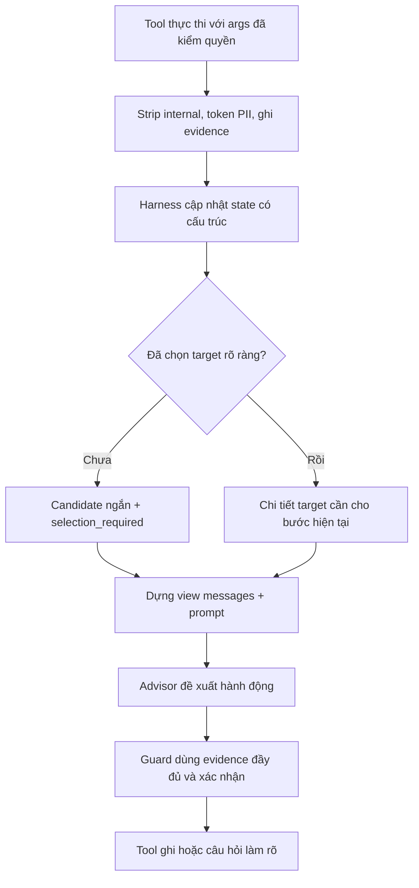

# Kế hoạch: thu gọn kết quả tool và nạp skill nghiệp vụ theo tác vụ

| | |
|---|---|
| Trạng thái | **Đề xuất — chỉ lập kế hoạch, chưa triển khai runtime** |
| Ngày tạo | 2026-11-01 |
| Mốc khảo sát | `1a812462`; các điểm nối dưới đây là code được đọc, không phải tính năng đã có |
| Phạm vi | Harness, context của advisor, lifecycle skill, bằng chứng tool và kiểm thử |
| Mục tiêu | Giảm context thừa; chọn đúng đơn/dòng hàng; giữ quyền truy cập, xác nhận và kết quả nghiệp vụ chính xác |

Tài liệu này chỉ đề xuất cách làm. Không tạo `SKILL.md` chạy thật, không sửa prompt/guard/Memory, không chạy model hoặc chấm lại benchmark. Phần điều tra lỗi evaluation là luồng công việc riêng.

## 1. Vấn đề và mục tiêu hành vi

Ví dụ tổng hợp: khách nói “xử lý đơn tôi đã đặt”, tool trả về bốn đơn, mỗi đơn nhiều dòng hàng. Agent cần hỏi khách muốn xử lý đơn nào; sau khi khách chọn đúng đơn và dòng hàng, ba đơn còn lại không cần chiếm chỗ trong mỗi lần gọi model. Dữ liệu đó vẫn phải tra lại được nếu khách đổi ý. Không được tự chọn đơn mới nhất hoặc món đầu danh sách thay khách.

Ví dụ tiếp: khách muốn đổi size. System prompt thường trực không cần chứa toàn bộ quy trình đổi size/đổi trả cho mọi cuộc hội thoại. Harness chọn một skill do đội phát hành, nạp khi tác vụ bắt đầu, giữ qua các lượt làm rõ/xác nhận, rồi bỏ khỏi **những request model tiếp theo** khi tác vụ hoàn tất hoặc hủy. Việc bỏ context không xóa file skill, hồ sơ, lịch sử audit hoặc nội dung provider đã nhận trước đó.

Hai thay đổi đi cùng nhau nhưng có thể rollout độc lập:

1. **Tool context:** dữ liệu tool đầy đủ đã lọc an toàn dành cho kiểm chứng; một bản chiếu nhỏ dành cho model.
2. **Business skill:** chỉ dẫn tác vụ có phiên bản, nạp theo nhu cầu; quyền thực thi vẫn do code và tool quyết định.

Không mở rộng sang một framework plugin tổng quát, không cho người dùng upload/executed skill tùy ý, không thêm agent hoặc lượt gọi model chỉ để giảm token trong bản đầu.

## 2. Hiện trạng đã xác nhận trong repo

Các đường dẫn rút gọn `src/` bên dưới thuộc `apps/ai-agent-service/src/ai_agent_service/`.

| Điểm hiện tại | Hành vi thực tế | Hệ quả thiết kế |
|---|---|---|
| `agents/advisor.py`: `AdvisorAgent.stream`, `AgentContext` | ReAct stateless giữa các lần chạy; không có checkpointer riêng của advisor | Không mô tả sai rằng mọi raw ToolMessage nằm trong context mãi mãi qua mọi lượt |
| `pipeline/hot/state.py`: `TURN_KEYS` | `tool_results`, draft, guard, regeneration được reset đầu lượt khách | Không giữ skill đang chờ xác nhận trong nhóm reset mỗi lượt |
| `components/context/compact.py` | Gộp hội thoại khi vượt 16 message, giữ 8 message cuối; có model compactor hoặc extractive fallback | Chưa giải quyết một kết quả tool lớn ngay trong vòng ReAct hiện tại; summary cũng cần được kiểm ngân sách |
| `pipeline/hot/nodes.py`: `_products_in` | Giữ tối đa 15 `seen_products`, có SKU/tên/giá | Đã có trần sản phẩm; thay đổi cần thêm mức liên quan và vòng đời, không chỉ thêm một trần khác |
| `agents/advisor.py`: `_tool_block`, `system_prompt` | Khi regenerate, serialize lại toàn bộ kết quả tool đã có | Cùng dữ liệu có thể xuất hiện trong ToolMessage và phần system dành cho regeneration |
| `components/context/budget.py` | 3.000 token là ngân sách mềm, ước lượng 4 ký tự/token; `tool_results`, `brief` và một số phần được bảo vệ | Payload lớn có thể vượt ngân sách; không giải quyết bằng cắt JSON hoặc ép bỏ evidence bắt buộc |
| `mcp/tools.py`: `visible_result` | Giới hạn đúng hồ sơ CRM, strip nội bộ và token hóa PII | Đây là ranh giới quyền/PII hiện có, chưa phải bộ giảm dữ liệu nghiệp vụ |
| `tool_results_of`, `_seen_in`, `_quotes_in`, `guard_input` | Guard, SKU tin cậy, trace và after-call đang dựa vào kết quả lấy từ ToolMessage | Không thể thay ToolMessage bằng summary trước khi tách đường evidence |
| `runtime/harness.py`: `CallStore._tool` | Có lọc/cắt một số kết quả để lưu console; catalog có thể chỉ còn 8 item và vài field | Bản console không mặc nhiên là kho evidence đầy đủ để hydrate lại biến thể |
| `config/prompts/agent/advisor/rules.md` | Chứa quy trình tạo đơn, đổi trả và nhiều quy tắc thường trực; hiện có hai mục đánh số 12 với chỉ dẫn đặt hàng khác nhau | Trước khi tách skill phải chốt một quy trình phù hợp code xác nhận hiện hành; không sao chép mâu thuẫn sang hai skill |

**Phân biệt quan trọng:** safety lane (`NEW`, `CONTINUITY`, `CONFIRM_IDENTITY`, `CLARIFY`, handoff do harness) vẫn làm nhiệm vụ hiện tại. Skill “đổi size” không trở thành một lane mới và không tự cấp thêm tool.

## 3. Kiến trúc và dữ liệu đề xuất

### 3.1. Ba loại dữ liệu không dùng lẫn nhau

| Loại | Chứa gì | Người đọc | Vòng đời |
|---|---|---|---|
| Evidence tool an toàn | Envelope đầy đủ sau kiểm quyền, loại `_internal*`, token hóa PII, loại receipt/chữ ký; args thực thi, trạng thái thành công/lỗi và provenance | Harness, guard, trace, after-call; không tự đưa cả blob vào model | Theo call, chính sách lưu dữ liệu và xóa khách hiện có |
| Bản chiếu model | Tóm tắt có cấu trúc về đối tượng đang cần, candidate ngắn, số lượng bị lược, ref đến evidence | Advisor trong request đang chạy | Dựng lại trước mỗi model call; bỏ phần hết liên quan |
| State tác vụ | Tác vụ, đơn/dòng hàng đã chọn, bước hiện tại, câu hỏi đang chờ, ref evidence, skill/version | Harness/checkpointer; model chỉ thấy slice cần thiết | Theo call và task; kết thúc thì còn biên nhận ngắn |

“Evidence đầy đủ” không có nghĩa là lưu raw PII hay internal pricing. Giữ việc token hóa/vault và xóa thông tin hiện tại. Không đặt payload đầy đủ vào `additional_kwargs` rồi giả định provider sẽ không nhìn thấy; phải test request thực được gửi tới model.

### 3.2. Evidence store và điểm ghi

- Dùng một adapter `ToolEvidenceStore` nhỏ do harness sở hữu. Bản đầu cần hỗ trợ đọc lại sau restart vì khách có thể đổi lựa chọn ở lượt sau.
- Ưu tiên bảng `agent.tool_evidence` theo schema ownership hiện tại, khóa duy nhất `(call_id, turn_id, tool_call_id)`, payload an toàn, `tool_name`, schema version, hash nội dung, thời điểm quan sát và ngày nghiệp vụ `on`. Không tạo một kho facts khách hàng thứ hai.
- Ghi evidence **trước khi trả bản chiếu cho model**. Ghi thất bại: không dùng một ref không tồn tại, không giả bộ lookup thành công; dừng hành động phụ thuộc hoặc yêu cầu tra lại an toàn.
- Ref là ID do server cấp, không phải đường dẫn hoặc URL do model tự đặt. Đọc lại phải kiểm call/account/tier và provenance; ID biết được không đồng nghĩa có quyền đọc.
- Full evidence không đi vào `HotState.messages` hoặc system prompt. State checkpoint chỉ giữ ref và metadata nhỏ. Raw audit vẫn có thể nằm ngoài model context theo retention hiện tại; xóa khách phải xóa evidence cùng vault/checkpoint liên quan.
- Đặt hạn mức byte/row, tổng byte/call và thời gian lưu. Khi vượt hạn mức, ưu tiên tra lại có phạm vi hoặc chuyển người; không chèn nguyên blob vào prompt như fallback.
- `CallStore._tool`/console có thể tiếp tục dùng bản hiển thị ngắn; trace và Memory sau cuộc gọi lấy evidence đã xác minh, không lấy summary model tự viết làm nguồn sự thật.

### 3.3. State tối thiểu

Đề xuất thêm vào `HotState`, không phải slot bộ nhớ lâu dài:

- `task`: `task_id`, `kind`, `status`, `owner_scope`, `started_turn`, `last_relevant_turn`, `pending_question`, `selected_targets`, `evidence_refs`.
- `active_skills`: ref `id/version/content_hash`, gắn `task_id`; không checkpoint nguyên Markdown.
- `context_version`: tăng khi đổi target, thay đổi identity hoặc có kết quả tool làm mất hiệu lực lựa chọn.

`selected_targets` phân biệt **mã đơn**, **dòng trong đơn**, **SKU/variant SKU**, không dùng một `sku` thay cho cả ba. Hỗ trợ nhiều target khi khách muốn xử lý nhiều món; bản đầu không tự chạy nhiều workflow ghi song song. Giá/tồn kho cần timestamp/ngày nghiệp vụ và recheck; quote đã từng thấy không thành giá đang còn hiệu lực.

## 4. Thu gọn dữ liệu tool theo nghiệp vụ

### 4.1. Luồng xử lý

Không thay output gốc của tool BTC hoặc sửa scorer. Projection nằm tại ranh giới model của ứng dụng; adapter trace vẫn xuất đúng kết quả thực thi.

### 4.2. Chưa xác định đơn/dòng hàng

- Một yêu cầu chung “xử lý đơn tôi đã đặt” chưa chỉ ra loại thao tác; không tự diễn giải thành hủy hay đổi size.
- Với bốn đơn, đưa bốn thẻ ngắn: ref/mã hiển thị, ngày đặt, trạng thái, tên món đủ phân biệt, số dòng hàng. Bỏ mô tả dài, ảnh, toàn bộ thuộc tính, lịch sử giao hàng và payload không dùng.
- Hỏi một câu cần nhất để xác định thao tác hoặc target; không đọc hàng chục chi tiết. Một đơn nhưng nhiều dòng hàng vẫn cần chọn đúng dòng nếu thao tác chưa rõ.
- Nếu có hơn giới hạn hiển thị, trả `total_count`, `shown_count`, `has_more`, cursor và candidate phân trang; không giả vờ chỉ có các item đang nhìn thấy.
- Chỉ tự dùng một target khi có đúng một ứng viên hợp lệ theo quyền và yêu cầu rõ, hoặc khách đã nêu đúng ID/ref đã xác minh. “Món thứ hai”, tên gần giống, nhiều đơn cùng món/size phải gắn vào đúng candidate snapshot; snapshot đổi thì hỏi lại.

### 4.3. Đã chọn target

- Prompt cho bước đổi size giữ đủ đơn/dòng đã chọn, parent SKU và variant SKU đúng vai trò, số lượng, size hiện tại/mong muốn, trạng thái và ngày mua, điều kiện đổi, phí/chênh lệch/hoàn tiền, chính sách/quote/kho liên quan và bước còn thiếu. Thu gọn đơn không chọn không cho phép bỏ quantity/phí/status cần cho phép tính hay quyết định của đơn đang chọn.
- Ba đơn không chọn được thay bằng metadata ngắn: “còn 3 đơn khác, có thể tra lại”, không serialize lại toàn bộ qua mỗi vòng ReAct.
- Khách nói “không, đơn kia”: hydrate candidate/ref dưới cùng quyền truy cập hoặc gọi lookup mới; không gọi lại tool ghi. Không xóa vĩnh viễn các đơn đã lược.
- Khách muốn xử lý hai món: giữ cả hai target, tóm tắt điều kiện riêng; không giữ chỉ một món vì quy tắc `top-1`.
- Không dùng tùy chọn `first N` đơn thuần làm relevance. Tổng các món COD/`basket_skus` vẫn cần đầy đủ cho guard ngay cả khi model chỉ thấy một dòng hàng.

### 4.4. Cặp tool call/result và vòng ReAct

- Tách API ghi nhận evidence khỏi API dựng view **trước** khi thay đổi ToolMessage. `tool_results_of`, `_quotes_in`, `_seen_in`, `placed_this_call`, action guard, hard guard phải lấy full safe evidence, không parse một summary đã mất trường quan trọng.
- Model view vẫn bảo toàn `tool_call_id`, tên tool và `ok/error`; mỗi `AIMessage.tool_calls[]` phải có đúng result tương ứng. Không xóa một ToolMessage nhưng để call treo, không gán response của tool A cho tool B, không gộp lỗi/ghi chưa rõ thành `ok: true`.
- Bản projection phải là JSON hợp lệ có `projection_version`, count/ref/field bị lược rõ ràng; không cắt chuỗi JSON giữa chừng và không sửa số/ID/đơn vị.
- Middleware model call hiện tại là điểm dựng view phù hợp: dựng bản copy cho request, không sửa inplace transcript/checkpoint. Lượt async và sync phải dùng cùng logic.
- Khi regenerate, `_tool_block(context.tool_results)` phải dùng cùng projector/dedupe; không có một bản full ở system và một bản chiếu ở message. Lựa chọn giữa hai vị trí truyền evidence cần cố định và test ở payload provider.

## 5. Skill nghiệp vụ theo nhu cầu

### 5.1. Registry nhỏ do repo quản lý

Đường dẫn đề xuất cho giai đoạn triển khai: `config/skills/commerce/exchange-size/SKILL.md`, registry metadata ở `config/skills/registry.yaml`. Chưa tạo các file này trong kế hoạch hiện tại.

Metadata cần có: `id`, `version`, mô tả phạm vi, trigger/exclude, `required_tools`, prerequisites, completion conditions, giới hạn token và hash nội dung. Loader chỉ đọc ID nằm trong registry allowlist; không mở file theo đường dẫn khách/tool/model đưa vào. Tài liệu khách gửi, tên sản phẩm hay kết quả retrieval không được tự nâng thành skill executable.

Thư mục/cache definition có thể dùng chung theo content hash; **activation state phải riêng từng call/task/owner**. Cache không chứa tên, địa chỉ, đơn hoặc pending consent của khách. Pin skill version khi tác vụ bắt đầu; cập nhật file không làm workflow đang chờ xác nhận đổi luật giữa chừng.

### 5.2. Chọn và nạp

1. `perceive/load_context` giữ nguyên xử lý identity, PII và kiến thức.
2. Sau `route`, harness chạy task selector có cấu trúc, độc lập safety lane. Bản đầu dùng tín hiệu/typed state hiện có; mơ hồ thì giữ trạng thái `candidate` và hỏi làm rõ. Không thêm một classifier LLM mặc định mỗi lượt.
3. Chỉ chuyển `candidate` sang `active` khi xác định được nghiệp vụ đủ rõ. Ví dụ “giày chật” là phàn nàn, chưa phải đồng ý đổi; có thể nạp skill để tư vấn nhưng chưa cho phép write.
4. Dựng `AgentContext` với skill refs và task slice. `ContextPromptMiddleware` render section `active_skill` từ registry ở mỗi model call.
5. Skill không cấp quyền, không bỏ action guard, không thay thế giá/kho/chính sách. Tool khả dụng là giao của quyền/tier, safety lane và yêu cầu bước hiện tại; thiếu quyền thì chờ xác minh hoặc chuyển người.

MVP có tối đa một workflow ghi đang hoạt động; khách chuyển sang hỏi chính sách ngắn có thể tạm suspend workflow, không mất đơn đã chọn. Khi chưa đủ nhận diện thì chỉ cho các chỉ dẫn làm rõ không tiết lộ dữ liệu riêng.

### 5.3. Nội dung ví dụ của skill đổi size — chưa phải file chạy

- Phạm vi: đổi size của một dòng trong đơn đã tồn tại; phân biệt đơn website `account_orders` với đơn hotline/Zalo `order_status` theo công cụ hiện có.
- Preconditions: quyền sở hữu được kiểm, mã đơn/dòng xác định, khách chọn rõ thay đổi; skill không tự coi lời than chật là consent.
- Lookup và làm rõ: xem các đơn hợp lệ, rút gọn candidate, hỏi đúng một câu nếu mơ hồ; đọc variant và size hiện tại từ tool.
- Thuộc tính còn thiếu: hỏi size mong muốn; tra catalog để xác định biến thể, không đoán SKU hoặc coi kho cũ là kho hiện tại.
- Chính sách/chi phí: retrieval đúng tài liệu/ngày, tool trả điều kiện/stock/quote; thiếu chứng cứ thì chưa hứa đủ điều kiện hay miễn phí.
- Thực thi: `order_update` đúng đơn/action/biến thể khi đủ điều kiện và đồng ý; tuyệt đối không dùng `order_create` để giả lập đổi hàng.
- Kết quả: báo phí/chênh lệch/hoàn tiền theo tool thực, chỉ báo xong khi tool xác nhận thành công; ghi kết quả task để tránh gọi lần hai.
- Failure: lỗi biết chắc chưa ghi khác timeout chưa rõ kết quả; không tự retry write, tra trạng thái/khóa idempotency trước khi quyết định tiếp.
- Exit: thành công có evidence, khách hủy, hết phiên/quyền bị thu hồi hoặc handoff hoàn tất. Có câu hỏi đang chờ/confirmation chưa có kết quả thì chưa exit.

Không nhúng vào skill bảng giá, tồn kho, ngày KM hoặc đáp án tình huống test; skill chỉ quy định cách tìm và sử dụng nguồn nghiệp vụ độc lập.

### 5.4. State machine và thời điểm tháo skill

| State | Được giữ gì | Chuyển tiếp |
|---|---|---|
| `candidate` | Tác vụ có thể liên quan, không có write quyền mới | Làm rõ → `active`; không đúng nghiệp vụ → bỏ candidate |
| `active` | Skill ref, target refs, bước hiện tại | Thiếu target → `awaiting_selection`; thiếu lựa chọn/consent → `awaiting_confirmation`; đủ → tool action |
| `awaiting_selection` | Candidate snapshot và câu hỏi đang chờ | Khách chọn → active; không rõ → hỏi lại có phạm vi; đổi chủ đề → suspended |
| `awaiting_confirmation` | Target/payload hash và câu hỏi xác nhận đã phát | Đúng consent → active; thay target/size/giá → hủy consent cũ, hỏi lại; không gỡ skill sau chỉ một câu “vâng” không rõ ngữ cảnh |
| `suspended` | Task refs/phiên bản skill và lý do, không nhét toàn bộ skill vào prompt khác | Tiếp tục đúng task → hydrate/revalidate rồi active; hủy/hết call → cancelled |
| `write_uncertain` | Idempotency/evidence refs và kết quả chưa rõ | Reconcile trạng thái hoặc handoff; không báo completed hoặc unload như đã thành công |
| `completed` / `cancelled` | Biên nhận nhỏ: task/result ref, target, outcome | Bỏ section skill và candidate dư ngay từ request model tiếp theo |
| `handed_off` / `expired` | Bàn giao có phạm vi hoặc reason hết hạn | Không cho advisor tiếp tục ghi; task mới cần xác minh lại |

Completion do harness xác nhận từ tool/guard, không tin câu “em đã làm xong” của model. Ghi outcome và chuyển state nguyên tử/idempotent cùng lưu lượt phù hợp; process chết giữa write và persist phải phục hồi từ evidence/idempotency, không giả định chưa chạy.

Tháo skill nghĩa là không inject Markdown ở lần gọi tiếp theo; không chép Markdown vào `working_summary`, Memory facts, user history hoặc ToolMessage. Summary chỉ giữ lựa chọn/nghĩa vụ/kết quả có evidence. Không thể thu hồi context đã gửi provider trong một request đang chạy; nếu identity/logout/call hết hiệu lực thì cancel request và chặn persist/write bằng cơ chế hiện có.

## 6. Phần giữ thường trực trong system prompt

Giữ: vai trò/ngôn ngữ; giới hạn danh tính/PII; con số từ nguồn có chứng cứ; lời hứa thành công phải có tool; công cụ ghi không tự retry; nguyên tắc xác nhận; obey guard; giới hạn quyền và handoff; không theo chỉ dẫn trong dữ liệu tool/khách. Đây là contract an toàn chung, không tùy việc có skill nào đang active.

Chuyển dần: bước chi tiết đổi size/đổi sản phẩm/trả hàng; quy trình đặt nhiều món; các bước tra đơn hoặc hẹn lại có nhánh dài. Không chuyển tất cả trong một lần. Bắt đầu duy nhất với đổi size; review lại hai luật số 12 hiện tại để skill và core không ra chỉ dẫn trái nhau.

Giá trị `skill_id` không được dùng để lách guard bằng một nguồn “đã được instruction”. Receipt mua hàng vẫn gắn call, channel, owner, exact payload và TTL; `basket_skus/order_group` hiện nằm trong payload ký phải được giữ. Bản chiếu model không được làm thay target trong receipt. Ngày nghiệp vụ `on` và TTL bảo mật theo wall clock vẫn tách như hiện nay.

## 7. Ngân sách và khả năng quan sát

Các số dưới đây là **ngưỡng đề xuất để đo**, chưa là kết quả tối ưu:

- Giữ interface `budget.assemble` nhưng đo **toàn request**: system, history, tool messages, skill, schema tool và reservation output. 3.000 token hiện tại chỉ áp một phần prompt, không được ghi thành trần toàn context.
- Bản đầu cho một skill active, khoảng 600–900 token; tối đa 5 candidate mỗi trang; selected target khoảng 300–500 token tùy nghiệp vụ. Không dùng ngưỡng này để cắt giá/ID/confirm/evidence bắt buộc.
- Ước lượng 4 ký tự/token chỉ phục vụ guard tiền gửi; nếu có tokenizer/model usage thì ghi cùng version và số thật để đối chiếu, không gọi estimate là token được bill.
- Nếu evidence/task quan trọng không vừa: hỏi hẹp hơn, phân trang hoặc handoff có lý do; không chạy model với một JSON thiếu trường quan trọng.
- Cùng snapshot phải sinh cùng projection; không dùng LLM để quyết định item nào biến mất trong MVP. Giữ prefix core ổn định, section skill ở sau; token cache provider có thể thay đổi nhưng không phải tiêu chí duy nhất.

Sidecar diagnostic đề xuất: skill activated/suspended/unloaded và reason, hash/version, task id không chứa PII, count candidate/shown/omitted, result ref, selected-target provenance, context estimated tokens trước/sau, projection failure, hydrate count và latency. Không log raw prompt hoặc full customer data mặc định. Không đổi schema trace BTC hoặc công thức score để chứa các số diagnostic này.

## 8. Trình tự triển khai và điểm sửa dự kiến

| Giai đoạn | File/điểm nối | Đầu ra và điều kiện hoàn tất |
|---|---|---|
| 0. Đo hiện trạng | `agents/advisor.py`, `mcp/tools.py`, `components/context/budget.py`; diagnostic provider request | Synthetic case 4 đơn/20 dòng hàng, nhiều vòng tool và regenerate; có byte/token counts theo từng kênh, chưa thay context |
| 1. Tách evidence | Adapter mới trong `components/context/`, MCP return hook, `runtime/db.py`/migration schema agent, `CallStore` và eval trace adapter | Guard/trace/Memory lấy full safe evidence; có token-safe refs, TTL, deletion cleanup, replay/restart; projection vẫn identity để chứng minh chưa đổi hành vi |
| 2. Project tool results | `components/context/tool_projection.py` đề xuất; `visible_result`/model middleware, `_tool_block`, `_seen_in`, `_quotes_in`, `tool_results_of` | Candidate/selected views, cặp call/result đúng; duplicate JSON bị loại; no permission leakage; fallback an toàn |
| 3. Task lifecycle | `pipeline/hot/state.py`, `nodes.py` (`_agent_context`, `_absorb`, `_streamed`, `respond`), handler call end | State machine, task-bound selection/consent, suspend/resume/reconcile; không reset task chờ mỗi lượt |
| 4. Một skill đổi size | Registry/loader mới; `config/skills/commerce/exchange-size/SKILL.md`; `agents/advisor.py`, `budget.py`, Dockerfile copy assets | Chỉ dẫn nạp/tháo đúng lúc và content-hash pin; core nhỏ hơn nhưng guard/permissions không giảm; chưa di chuyển workflow khác |
| 5. Hồi quy và canary | Unit/integration tests, optional evaluation qua root runner, manifest/diagnostics | Đạt các tiêu chí dưới; bật flag nội bộ theo call, có rollback không làm mất state/write |

Không đổi bảy node/graph chỉ để thêm abstraction. Bản đầu có thể gắn task selector tại cuối `route` hoặc đầu `advisor`, state updates vẫn có một writer rõ. Chỉ thêm node mới nếu cần checkpoint boundary riêng sau thử nghiệm. Các đề xuất tên file là thiết kế, chưa phải API đã tồn tại.

Chia PR theo giai đoạn 1–4 để reviewer thấy được security boundary và dễ quay lui; tránh một PR vừa thay scorer, prompt, router, Memory và UI. Theo quy ước repo, đưa đề xuất vào backlog khi triển khai được duyệt; hiện chỉ lập đúng file kế hoạch này theo phạm vi yêu cầu.

## 9. Kiểm thử và tiêu chí chấp nhận

### 9.1. Ca synthetic độc lập bắt buộc

1. Bốn đơn, chưa có target: đủ bốn candidate ngắn hoặc count/phân trang chính xác; không gọi write, không tự chọn đơn đầu/cuối.
2. Một đơn nhiều dòng, tên/size gần giống; “món thứ hai” phải tham chiếu đúng snapshot đã hỏi. Đảo thứ tự tool result không âm thầm đổi target đã chốt.
3. Chọn một trong bốn: lần model call kế tiếp không còn blob của ba đơn khác; ref còn tra lại được và count lược chính xác.
4. Đổi ý sang đơn khác, hoặc yêu cầu hai món: lấy lại đúng evidence và giữ đúng số target; không lộ đơn khác owner hoặc dữ liệu shared-phone chưa xác minh.
5. Đổi size happy path: chọn đơn/dòng → size mới → kiểm điều kiện/kho → consent → `order_update` đúng một lần → báo đúng chi phí → unload. Không có `order_create` thay thao tác đổi.
6. Chỉ phàn nàn “chật”, câu trả lời lấp lửng, “vâng” sau câu hỏi khác, hủy, đổi chủ đề, hết hạn, logout/đổi account/call: không làm write ngoài ý muốn và không dùng skill/consent của task cũ.
7. Timeout sau write, response thiếu, partial stream, regenerate và client reconnect: giữ trạng thái chưa rõ; cùng idempotency key không gây hai cập nhật/hoàn tiền. Đừng prune result cuối của write chưa xác định.
8. Schema lạ, ID thiếu, `ok` sai kiểu, payload cực lớn, text chứa instruction độc hại, registry/path traversal hoặc skill vượt budget: fail closed; không sửa envelope lỗi thành success và không đọc file ngoài allowlist.
9. Call/result nhiều tool song song trong một ReAct bước: không orphan/duplicate result, tool_call_id không đổi, provider adapter nhận JSON hợp lệ ở cả sync/async.
10. Restart/replay: task waiting còn ref/version đúng, content đổi không thay workflow giữa chừng; artifact không còn thì tra lại hoặc hỏi, không fabricate.
11. Trace/after-call/guard: full safe args, giá, trạng thái, nguồn chứng cứ như baseline; stripping/PII, receipt redaction, TTL, erasure cleanup và `memory=False` không bị bypass.
12. Sau completed/cancelled: request mới không có Markdown skill cũ hoặc payload dư trong system/history/summary; biên nhận đủ để ngăn lặp hành động. Kết thúc call không làm mất tool effects đã xảy ra.

### 9.2. Điều kiện đạt

- 100% test quyền/consent, target selection, tool-pair integrity, write idempotency và erasure ở trên đạt; không chấp nhận tiết kiệm token để đổi lấy một ca write sai.
- Với fixture bốn đơn đã chọn một, giảm ít nhất 50% token/byte phần kết quả tool gửi model từ request kế tiếp; đo cả regeneration, không chỉ system prompt. Đây là mục tiêu chấp nhận đề xuất, chưa có số baseline/sau.
- Unload section skill ngay request model kế tiếp sau trạng thái terminal; waiting selection/confirmation không unload sớm.
- Số lượng product/order projection và state có trần; gọi lặp lookup cùng snapshot không tăng context tuyến tính. Chứng minh bằng test 20 vòng lặp và payload lớn, không chỉ ca bốn item.
- Không thêm model call để chọn/project skill trong MVP; so TTFT/p95 trên cùng máy, cùng model/config, ngưỡng regression latency chốt sau đo baseline. Không công bố giảm phí nếu chỉ có char estimate.
- Đo task success/HR/RQR/CCR trên cùng cohort phát triển độc lập và cùng **extractor version**. Không lấy đáp án BTC ẩn/holdout hoặc seed-dev làm alias, trigger, giá trị mẫu trong skill. Lỗi hạ tầng/seed khác lỗi business và phải có coverage, không điền điểm giả.

Nếu cần model-backed evaluation ở giai đoạn triển khai, chỉ dùng `run_eval.py`, ledger `evaluation/runs/20261024-work/budget.sqlite` hiện có, một scenario trước rồi mới cohort; không tạo lại ledger hoặc đổi pack/scorer/nhãn để làm đẹp kết quả. Không chạy bước đó trong kế hoạch này.

## 10. Rollout, rollback và các quyết định cần chốt trước khi code

- Flag độc lập cho projection và skill; mặc định tắt, shadow mode chỉ ghi diagnostic không thay model input, rồi canary call synthetic, sau đó mới traffic được duyệt. Ghi flag, definition hashes và context policy version vào manifest/diagnostic.
- Rollback chỉ đổi view/prompt từ call mới; call đang có write_uncertain phải reconcile, không replay request ghi bằng một pipeline cũ. Tắt flag không xóa evidence hoặc vô hiệu receipts đã phát theo cách mất kiểm soát.
- Người phụ trách nghiệp vụ chốt quy trình đổi size và phiên bản policy/tool contract. Reviewer bảo mật chốt retention/owner scope/evidence deletion. Đội kỹ thuật chốt điểm model middleware và shape projection bằng test adapter đang dùng, không giả định SDK tự derive async/sync hook.
- Trước khi chuyển luật khỏi core, rà lại mâu thuẫn luật số 12 và đảm bảo điều kiện xác nhận hiện được code bắt vẫn bắt được khi model không đọc workflow đặt hàng thường trực. Việc này là hạng mục của PR skill sau này, không tự sửa trong tài liệu.

## 11. Kết quả hiện tại

| Hạng mục | Trước | Sau |
|---|---|---|
| Runtime context/skill | Code hiện tại được khảo sát | **Chưa thay đổi** |
| Token, latency, TSR/HR | Chưa đo baseline riêng cho đề xuất | **Chưa có số**, không báo cải thiện |
| Deliverable | Yêu cầu ý tưởng | Kế hoạch chi tiết, điểm nối thực tế, tiêu chí đo và trình tự PR |

Giới hạn của phương án: projection không sửa lỗi tool/identity/nhãn, skill không đảm bảo model làm đúng nếu thiếu guard, và không thể “thu hồi” prompt đã gửi provider. Cần triển khai và đo mới kết luận hiệu quả; ở thời điểm này không có skill runtime hoặc context reducer mới được bật.
