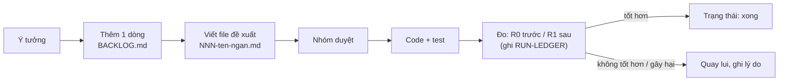

# Kế hoạch cải tiến AI agent

Nơi ghi các ý tưởng và kế hoạch cải tiến cho trợ lý tư vấn **trước khi** sửa code. Mỗi cải tiến là một file riêng, viết theo [mẫu](_TEMPLATE.md). Danh sách tổng: [BACKLOG.md](BACKLOG.md).

Muốn hiểu hệ thống đang chạy thế nào trước khi đề xuất, đọc [docs/ai](../ai/README.md).

---

## Quy trình

1. **Ghi vào backlog** một dòng: tên, vấn đề, ưu tiên.
2. **Viết file đề xuất** `NNN-ten-ngan.md` (đánh số tăng dần, ví dụ `001-khong-hoi-lai-ma-don.md`) từ [`_TEMPLATE.md`](_TEMPLATE.md). Nêu rõ bằng chứng (trace, kịch bản trượt), chỗ sửa, cách đo.
3. **Duyệt** trước khi code nếu thay đổi chạm prompt, guard hoặc bộ nhớ: những chỗ này ảnh hưởng mọi cuộc gọi.
4. **Đo** trên cùng cohort trước và sau (retest có chủ đích, theo [AGENTS.md](../../AGENTS.md)). Không chỉnh sản phẩm dựa trên holdout.
5. **Cập nhật trạng thái** trong file và backlog, kể cả khi cải tiến thất bại: biết cái gì không hiệu quả cũng là kết quả.

Trạng thái dùng chung: `ý tưởng` · `đề xuất` · `đã duyệt` · `đang làm` · `đang đo` · `xong` · `bỏ`.

---

## Thêm "skill" ở đâu

"Skill" của agent có nhiều dạng. Chọn đúng chỗ theo **loại thay đổi**. Ưu tiên từ trên xuống: chỗ ở trên rẻ hơn, an toàn hơn, dễ quay lui hơn.

| Muốn agent... | Loại | Sửa ở đâu | Cần thêm |
|---|---|---|---|
| Biết thêm một câu trả lời (FAQ, cách xử lý một tình huống) | **Tri thức** | thêm mục vào `apps/ai-agent-service/data/kb/v<N+1>.jsonl`, tăng `version` trong `config/knowledge.yaml` | đo lại Recall (`python -m scripts.evaluation.evaluate`) |
| Xử lý một **tình huống bán hàng** theo cách đã thắng (chê đắt, hỏi người nhà...) | **Playbook** | mục playbook trong `data/kb/` gắn `situation` từ `config/situations.yaml` | thêm situation mới nếu chưa có; vòng tự cải tiến tự động (`components/improvement/playbook.py`) **chưa xây** |
| Tuân theo một **quy tắc hành xử** mới | **Prompt** | `HARD_RULES` hoặc `LANE_NOTES` trong `src/ai_agent_service/agents/advisor.py` | quy tắc nào kiểm được bằng code thì thêm luôn guard (dòng dưới) |
| **Không bao giờ** nói một loại câu | **Hard guard** | `components/guardrails/hard.py`: thêm regex + nhánh trong `check()` | test trong `tests/agent/`; lý do viết tiếng Việt (được đưa thẳng cho model) |
| Bắt lỗi chính sách tinh vi (hứa quá, ép mua) | **Soft guard** | thêm câu hỏi `Boolean` + ngưỡng trong `agents/policy.py` | tập nhãn nhỏ để chọn ngưỡng |
| Kiểm tham số trước khi **ghi** (tạo đơn, hẹn...) | **Action guard** | `components/guardrails/actions.py` | test |
| **Làm được việc mới** (tra phí ship, áp mã giảm giá...) | **Tool MCP** | hàm `@server.tool(roles={...}, name="...")` trong `src/ai_agent_service/mcp/servers/<server>.py`; thêm tên vào lane phù hợp trong `config/lanes.yaml` | docstring `Args:` (model đọc làm schema); trả `{"ok": ..., "data"/"error": ...}`; khai báo nếu không thuộc bộ tool BTC (`tools_audit`) |
| Nhận ra một **ý định / tín hiệu** mới của khách | **Signal** | `components/intake/signals.py` | dùng ở `route` hoặc ghi chú lane |
| Có **hướng xử lý riêng** cho một loại lượt | **Lane** | `components/orchestration/rules.py` (bảng luật) + `config/lanes.yaml` (tool) + `LANE_NOTES` (chỉ dẫn) | test từng luật; thứ tự luật quan trọng (khớp đầu tiên thắng) |
| **Nhớ** thêm một loại thông tin về khách | **Slot bộ nhớ** | `components/memory/ontology.py` (loại, tuổi thọ, nhạy cảm, kiểu, gợi ý) | tên slot trùng BTC nếu BTC có; thứ tự dòng trong `memory/brief.py` (`LINE_ORDER`) |
| Hiểu thêm cách **nói số / giờ** | **ITN** | `components/intake/itn.py` | test; cẩn thận chiều ngược `amounts()` dùng chung |
| Nghe đúng thêm **tên sản phẩm** (voice) | **Lexicon** | `voice.lexicon` trong `config/models.yaml` | chỉ thêm lỗi đã nghe thật, không lấy từ bộ test |
| Đổi **model** | **Config** | `config/models.yaml` | đo lại toàn bộ: model khác là hệ thống khác |

Nguyên tắc chung (xem [docs/ai/03-thuat-toan.md](../ai/03-thuat-toan.md)):

- Cái gì kiểm được bằng code thì không chỉ dặn trong prompt.
- Con số (giá, kho, ngày) chỉ đến từ tool; skill mới không được mở đường cho model tự nói số.
- Thêm tool ghi (có tác dụng nghiệp vụ) thì phải thêm action guard và không tự retry.
- Dữ liệu cá nhân đi qua token PII, không vào prompt hay log thô.
