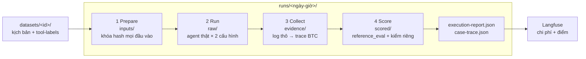
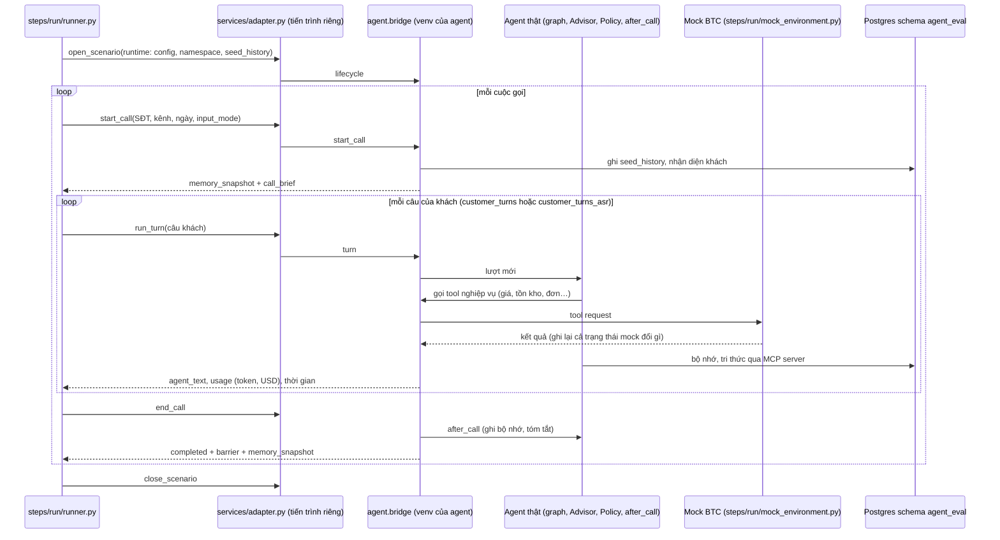

# Đánh giá AI agent

Thư mục này **chấm điểm AI tư vấn** (`apps/ai-agent-service`) bằng các kịch bản hội thoại có sẵn đáp án.

Mỗi kịch bản được chạy **hai lần**:

- **full**: AI được nhớ khách từ cuộc gọi trước;
- **baseline**: AI không có trí nhớ.

So hai kết quả cho biết trí nhớ giúp được bao nhiêu. Điểm được chấm bằng chính code chấm của BTC (`reference_eval.py`).

Logic của AI không bị sửa để chấm: `src/services/agent/` chỉ khởi động AI thật và nối nó với bộ chấm. Chạy được trên Windows và Linux.

Một script chạy toàn bộ: **`run_eval.py evaluate`** (4 bước: chuẩn bị → chạy agent full + baseline → thu bằng chứng → chấm). `run_eval.py --help` liệt kê mọi lệnh. Cấu trúc code ở mục 8, luồng chi tiết ở mục 9.

---

## 1. Chuẩn bị (làm một lần)

1. **Bật database**: `docker compose up -d postgres` (từ thư mục gốc repo).
2. **Key AI**: file `.env` ở thư mục gốc có `OPENAI_API_KEY` (hoặc `GEMINI_API_KEY`).
3. **Cài thư viện** (Python 3.12) vào môi trường của AI agent:

   ```powershell
   py -3.12 -m venv apps/ai-agent-service/.venv          # bỏ qua nếu đã có
   apps/ai-agent-service/.venv/Scripts/python -m pip install -r evaluation/agent-evaluation/requirements.txt
   ```

   [`requirements.txt`](requirements.txt) gồm thư viện của AI agent và của bộ chấm. AI luôn chạy bằng Python trong `apps/ai-agent-service/.venv` (đổi bằng biến `AGENT_PYTHON`), kể cả khi bạn gõ lệnh bằng Python khác.

Mọi lệnh dưới đây chạy **từ thư mục gốc repo**. Cho gọn, đặt trước:

```powershell
$PY = "apps/ai-agent-service/.venv/Scripts/python"
```

---

## 2. Chạy đánh giá trong 3 bước

**Bước 1. Chuyển dữ liệu từ `evaluation/data-generation` sang dạng bộ chấm đọc được** (một lần cho mỗi lần sinh dữ liệu mới):

```powershell
& $PY evaluation/agent-evaluation/run_eval.py data-import --name create-data-diagnostic-v5   # tên mới: một bản đã dùng không bao giờ bị ghi đè
& $PY evaluation/agent-evaluation/run_eval.py label-check --dataset-id create-data-diagnostic-v5  # giá, tồn kho của nhãn so với mock BTC
```

Kết quả lưu ở `datasets/create-data-diagnostic-v5/` và được đăng ký trong `datasets/registry.json`. Lý do loại (nếu có) ghi trong `conversion-report.json`. Bộ hiện có sẵn và là **mặc định** khi bỏ `--dataset-id`: `create-data-diagnostic-v4` (150 kịch bản; hằng `DEFAULT_DATASET` trong `src/steps/prepare/prepare.py`). Đổi sang tên bạn vừa tạo khi dùng dữ liệu mới.

- **Lịch sử cuộc gọi cũ** (`seed_history`): trước cuộc gọi, `src/services/agent/bridge.py` ghi các phiên cũ và đơn cũ vào trí nhớ của khách, giống lệnh chấm của BTC (`pipeline/eval/runner.py`, hàm `seed`), ở cả hai cấu hình; riêng `baseline_no_memory` không đọc lại chúng.
- **Khách tổng hợp** (`SYN-C...`, 28 kịch bản): ngoài 50 khách của BTC, agent và mock của bộ chấm cùng nạp `apps/ai-agent-service/data/btc/catalog/crm_seed_synthetic.json`. Mỗi lần chạy chép và khóa hash file này (`crm-extension.json`); `BTC_SYNTHETIC_CRM=0` tắt cả hai. Sinh lại khách tổng hợp thì phải sinh lại kịch bản của họ và tạo bản dataset mới (`conversion-report.json` ghi hash file đã dùng).
- Bản cũ vẫn giữ: `v1` (101 kịch bản, không có `seed_history`), `v2` (122, không có khách tổng hợp).

**Bước 2. Kiểm tra trước, không tốn tiền gọi AI:**

```powershell
& $PY evaluation/agent-evaluation/run_eval.py prepare --dataset-id create-data-diagnostic-v4 --level M2 --limit 5
```

Thấy `"allowed": true` là đầu vào hợp lệ.

**Bước 3. Chạy thật và chấm điểm:**

```powershell
& $PY evaluation/agent-evaluation/run_eval.py evaluate --dataset-id create-data-diagnostic-v4 --level M2 --limit 5
```

- `--level M2` hoặc `M1`: chỉ chạy một cấp độ. **Bỏ `--level`** thì chạy cả hai, mỗi cấp độ thành một lần chạy riêng (thư mục `<tên>-M1` và `<tên>-M2`), vì một lần chạy chỉ chứa được một cấp độ.
- `--limit 5`: chạy 5 kịch bản đầu (của mỗi cấp độ). **Nên bắt đầu nhỏ**, vì mỗi lượt chat gọi AI nhiều lần, nhân 2 cấu hình. Chạy toàn bộ 150 kịch bản là khoảng 2.500 lượt AI cộng 2.500 lượt chấm (luồng chi tiết: mục 9), mất nhiều giờ và tốn phí API đáng kể.
- `--only SCN-GEN-0003`: chạy đúng một kịch bản (lặp lại để chọn nhiều kịch bản).
- Trong lúc chạy, màn hình in tiến độ: bước đang làm (1/4 → 4/4), từng lượt chat (khách nói gì, AI trả lời gì, mất bao lâu, tốn bao nhiêu tiền, tổng tiền đến lúc đó) và thời gian ước tính. Mỗi kịch bản mất khoảng 1 phút để khởi động AI. Đặt `$env:EVAL_QUIET="1"` để tắt các dòng này.
- Bước chấm (extract) chạy **song song 6 lượt một lúc**, nhanh hơn khoảng 2 lần. Đổi bằng `$env:EVAL_EXTRACT_WORKERS="4"` (đặt `1` để chạy tuần tự). Không nên đặt quá cao vì OpenAI giới hạn số request mỗi phút.
- Bỏ `--dataset-id`: dùng bộ mặc định `create-data-diagnostic-v4`.

---

## 3. Đọc kết quả

Mỗi lần chạy tạo một thư mục `evaluation/agent-evaluation/runs/<ngày-giờ>/`. Bảng điểm in ra cuối lệnh và lưu ở `scored/scorer.stdout.txt`:

```
Chỉ số                                Baseline      Hệ thống
Repeat-Question Rate (%)                  None           0.0
Context Carryover Rate (%)                 0.0           0.0
Task Success Rate (%)                      0.0         100.0
...
```

| Chỉ số | Nghĩa | Tốt khi |
|---|---|---|
| **TSR**, Task Success Rate | Tỉ lệ kịch bản AI làm đúng việc (gọi đúng tool, nói đúng ý) | cao |
| **CCR**, Context Carryover Rate | AI có dùng lại thông tin khách đã nói ở cuộc trước không | cao |
| **RQR**, Repeat-Question Rate | AI có hỏi lại điều khách đã nói không | thấp |
| **HR**, Hallucination Rate | AI có bịa giá, khuyến mãi, tồn kho không | thấp |
| Latency | Thời gian AI trả lời (p50, p95) | thấp |

Các file khác trong thư mục run:

| File | Xem để làm gì |
|---|---|
| `case-trace.json` | Đọc lại từng hội thoại: khách nói gì, AI trả lời gì, gọi tool nào |
| `execution-report.json` | Tóm tắt các giai đoạn, lỗi nếu có |
| `scored/official-report.json` | Điểm chi tiết theo code chấm của BTC |
| `evidence/validation.json` | Những gì còn thiếu bằng chứng |

**Mã thoát của lệnh `evaluate`:** `0` = đạt hết · `1` = chạy xong nhưng AI trượt một số kiểm tra (kết quả bình thường) · `2` = thiếu bằng chứng để kết luận · `3` = lỗi khi chạy.

Thư mục `runs/` có thể chứa dữ liệu khách nên **không đưa lên Git**.

---

## 4. Theo dõi chi phí trên Langfuse

Mỗi lần `evaluate` chạy xong, số token và **số tiền (USD)** được tự động ghi lên Langfuse, kèm điểm TSR/CCR/RQR/HR. Chỉ ghi con số, không ghi nội dung hội thoại hay dữ liệu khách.

1. Đặt khóa trong `.env` (một lần): `LANGFUSE_PUBLIC_KEY`, `LANGFUSE_SECRET_KEY`, `LANGFUSE_BASE_URL` (ví dụ `https://cloud.langfuse.com`). Đây cũng là khóa mà AI dùng để trace.
2. Mở Langfuse → **Tracing**, lọc theo tên trace **evaluation-run** (môi trường `evaluation`). Các lần chạy cùng bộ dữ liệu nằm chung session `eval:<dataset>`.

Mỗi lần chạy là một trace:

| Trong trace | Nghĩa |
|---|---|
| Generation `agent:full:<kịch bản>`, `agent:baseline:<kịch bản>` | Token và tiền của AI theo từng kịch bản và cấu hình — Langfuse tự cộng vào cột Cost |
| Generation `extractor` | Token và tiền của model chấm (đọc câu trả lời) |
| Score `total_cost_usd` | Tổng tiền của lần chạy (AI + chấm) |
| Score `full_cost_usd`, `baseline_cost_usd`, `extractor_cost_usd` | Tiền theo từng phần |
| Score `cost_per_turn_usd` | Tiền trung bình mỗi lượt chat |
| Score `*_input_tokens`, `*_output_tokens` | Số token |
| Score `full_tsr`, `baseline_tsr`, ... | Điểm, để so chi phí với chất lượng |

- **Giá** lấy từ `apps/ai-agent-service/config/models.yaml` (`input_token_price_per_million`, `output_token_price_per_million` của từng provider). Hiện đã đặt giá OpenAI `gpt-4.1-mini`; Gemini chưa có giá nên chỉ ghi token (`agent_priced = 0`). Đổi model thì cập nhật giá ở đó.
- **Ghi lại lần chạy cũ** (hoặc khi lúc chạy chưa có khóa / mất mạng): `& $PY evaluation/agent-evaluation/run_eval.py langfuse-log --run evaluation/agent-evaluation/runs/<tên>`. Mỗi lần chạy chỉ được ghi một lần; thêm `--force` để ghi lại.
- Trong lúc chạy, từng lời gọi model của AI cũng tự lên Langfuse (trace của LangChain), nếu muốn xem chi tiết.

---

## 5. Đánh giá ASR (AI nghe và hiểu lời khách đúng đến đâu)

Đo **WER/CER** (tỉ lệ sai từ/ký tự), **entity accuracy** (hiểu đúng ngân sách, diện tích, cách thanh toán…) và **diarization** (ai nói lúc nào) bằng hàm `wer_cer` của BTC. Hai luồng tách bạch:

| | Làm gì | Ở đâu |
|---|---|---|
| **data-generation** (đáp án) | Lấy câu chuẩn → LLM viết thành dạng nói → TTS đọc đúng câu đó; entity trích từ chính câu chuẩn theo khóa của BTC | `output/asr_reference/ground_truth.json` (theo lượt), `output/asr_test/ground_truth.json` (hội thoại hai người) |
| **agent-evaluation** (đo) | Engine nghe audio (chọn qua factory) → **pipeline của ai-agent-service** xử lý và hiểu câu → chấm với đáp án | `src/services/asr/` |

### 5.1 Dữ liệu đi qua những đâu

```text
data-generation
  synthesize_scenario_audio  → output/asr_reference/ground_truth.json + output/audio/…/turn_K.wav   (mỗi clip = 1 lượt khách)
  build_asr_testset          → output/asr_test/ground_truth.json + audio/T01.wav + T01.segments.json (cả cuộc gọi, 2 giọng)
        │  run_eval.py asr-build --kind turns|dialogues    (không gọi model: chép đáp án + audio, kiểm WAV, ghi hash)
        ▼
  datasets/<set>/  ground_truth.json · audio/ · conversion-report.json · (đăng ký trong registry.json → asr_sets)
        │  run_eval.py asr --engine …                      (engine nghe → agent hiểu → wer_cer của BTC)
        ▼
  runs/asr/<ngày-giờ>-<engine>/  raw/ · lexicon/ · report.json
```

Đáp án **không bị tính lại** ở bước chấm: `full_text` là đúng câu TTS đã đọc, `entities` là entity data-generation trích từ câu đó.

### 5.2 Engine nghe audio (`--engine`, [`engines.py`](src/services/asr/engines.py))

| `--engine` | Nghe bằng | Phân vai |
|---|---|---|
| `agent` (mặc định) | **client ASR của agent** (`ai_agent_service.components.voice.asr`), model `voice.asr` trong `config/models.yaml`, hotword của lexicon: đúng thứ một cuộc gọi thật nghe được | không |
| `agent:<model>` | cùng client, model khác của `asr-service` (`zipformer-2025`, `phowhisper-small`, `whisper-turbo`) | không |
| `openai:<model>` | API OpenAI (`gpt-4o-transcribe`, `gpt-4o-mini-transcribe`, `whisper-1`), hotword của agent làm prompt | không |
| `openai:gpt-4o-transcribe-diarize` | như trên, kèm đoạn theo người nói | có |
| `file:<hypotheses.json>` | hypothesis của hệ khác (định dạng BTC) | khi có `turns` |

### 5.3 Agent hiểu câu (`--understanding`, [`understanding.py`](src/services/asr/understanding.py))

Chữ nghe được đi qua **đúng các hàm của ai-agent-service** mà một cuộc gọi thật đi qua:

1. `lexicon.correct` (route voice): sửa tên sản phẩm nghe nhầm ("e pia" → AirPure);
2. `pipeline/hot/nodes.perceive`: `lexicon.correct`, `intake.text.clean`, `itn.normalise` (số dạng chữ → chữ số), `pii.tokenise`;
3. `MemoryAgent.extract`: model `agents.memory` (`--understanding model`, mặc định) hoặc luật của nó (`--understanding rules`, không tốn phí).

Slot agent trích được đổi sang khóa của BTC: `room_area_m2`, `has_children`, `budget_vnd`, `competitor_price_vnd`, `payment`, `blocker` (bỏ dấu: "cần hỏi chồng" → `can hoi chong`), `size` → `size_new`, `color`. Entity accuracy **chỉ tính các khóa này**. Các khóa còn lại trong đáp án (giá, SKU, mã đơn agent lấy từ tool; số điện thoại bị token hóa) được liệt kê riêng ở `entities_not_from_speech`, không tính là agent sai.

Hai biến thể được chấm: `raw` (chữ của engine, không qua lexicon) và `lexicon` (qua lexicon, đúng như agent nhận). Trước khi tính WER, chữ số trong câu nghe được được viết thành chữ bằng `spoken.py` của data-generation, cùng dạng với đáp án, theo `normalization_rule` của BTC.

### 5.4 Phân vai cho bộ hội thoại (`--diarizer`, [`diarization.py`](src/services/asr/diarization.py))

Bộ `dialogues` bắt buộc có phân vai:
- `native` (mặc định khi engine hỗ trợ): `--engine openai:gpt-4o-transcribe-diarize`;
- `sherpa`: chạy local trên CPU ([`sherpa.py`](src/services/asr/sherpa.py)), cần `pip install sherpa-onnx` trong venv của agent và hai model ONNX (`--segmentation`, `--embedding`).

Vai được gán như cách BTC ghi âm: người nói đầu tiên là shop (`A`), người còn lại là khách (`C`). Bộ `turns` không phân vai, vì mỗi clip chỉ có giọng khách. Agent thật cũng không cần phân vai, vì trên cuộc gọi nó chỉ nghe kênh của khách.

### 5.5 Các bước chạy

Mọi lệnh chạy từ thư mục gốc repo, `$PY` như ở mục 1.

```powershell
# 0. Dịch vụ ASR cho engine `agent` (một lần)
docker compose up -d asr-service
curl http://127.0.0.1:8500/v1/models          # thấy zipformer-30m "loaded": true

# 1. Đáp án + audio từ data-generation (ElevenLabs, tốn ký tự; xem README của data-generation)
cd evaluation/data-generation
.venv/Scripts/python -m src.pipeline.synthesize_scenario_audio --resume        # bộ theo lượt
.venv/Scripts/python -m src.pipeline.build_asr_testset --limit 24              # bộ hội thoại hai người
cd ../..

# 2. Ghim thành bộ chấm (không gọi model; tên mới, không bao giờ ghi đè)
& $PY evaluation/agent-evaluation/run_eval.py asr-build --set-id asr-team-v3 --kind turns
& $PY evaluation/agent-evaluation/run_eval.py asr-build --set-id asr-dialogues-v1 --kind dialogues
& $PY evaluation/agent-evaluation/run_eval.py data-check --set asr-team-v3

# 3. Chấm
& $PY evaluation/agent-evaluation/run_eval.py asr --set asr-team-v3 --limit 10                          # thử 10 clip
& $PY evaluation/agent-evaluation/run_eval.py asr --set asr-team-v3                                     # client ASR của agent
& $PY evaluation/agent-evaluation/run_eval.py asr --set asr-team-v3 --engine openai:gpt-4o-transcribe   # so engine khác
& $PY evaluation/agent-evaluation/run_eval.py asr --set asr-dialogues-v1 --engine openai:gpt-4o-transcribe-diarize
```

Muốn chấm audio D01–D04 của BTC khi có: đặt `audio/<id>.wav` và `audio/<id>.segments.json` cạnh `evaluation/data-generation/data/asr/ground_truth.json`, rồi chạy `asr-build --kind dialogues --source evaluation/data-generation/data/asr/ground_truth.json --set-id asr-btc-v1`.

| Tùy chọn của `asr` | Nghĩa |
|---|---|
| `--set` | Bộ trong `datasets/` (mặc định `asr-team-v2`) |
| `--engine` | Mục 5.2 |
| `--understanding model\|rules` | Mục 5.3 |
| `--diarizer auto\|native\|sherpa\|none`, `--segmentation`, `--embedding` | Mục 5.4 |
| `--url` | Địa chỉ `asr-service` cho client của agent (mặc định `http://127.0.0.1:8500`) |
| `--limit N`, `--no-hotwords`, `--out` | N mục đầu; không gửi hotword; thư mục kết quả (phải chưa tồn tại) |

### 5.6 Đọc `report.json`

| Trường | Nghĩa |
|---|---|
| `raw.official` / `lexicon.official` | Kết quả `wer_cer` của BTC: `WER`, `CER`, `entity_accuracy`, `diarization_turn_accuracy`, `wer_noisy`, `wer_clean` (%) |
| `raw.breakdown` / `lexicon.breakdown` | WER trung bình theo loại nhiễu, `input_mode`, câu có số hoặc mã |
| `raw.entities` / `lexicon.entities` | Theo từng khóa: số lần có trong đáp án, số lần agent hiểu đúng, có thuộc phần agent hiểu từ lời nói không |
| `entities_not_from_speech` | Khóa trong đáp án mà agent không trích từ lời nói, theo thiết kế |
| `understanding` | Pipeline và extractor đã dùng (`model-gpt-4.1-mini-…` hay `rules-…`), token và USD |
| `engine`, `diarizer`, `rtf_mean`, `worst_lexicon`, `timing` | Engine, cách phân vai, tốc độ, 25 mục sai nhiều nhất |

### 5.7 Kết quả trước đây và giới hạn

Ngày 25/10/2026, bộ `asr-team-v2` (674 clip, 0,62 giờ) với `zipformer-30m` cho WER **6,2%**, CER 4,2%, entity **97,1%**, `weak_signal` 15,9%. Lần đó chấm theo cách **cũ**: đáp án tính bằng luật, entity trích bằng luật của bộ chấm. Không so trực tiếp với kết quả của luồng mới. Lần chạy đó cũng phát hiện và sửa một lỗi ITN của agent: chữ "không" đứng sau một số bị ghép vào số.

- Giọng vẫn là giọng tổng hợp ElevenLabs, nhiễu là nhiễu nhân tạo. Bộ hội thoại có hai giọng và nhiễu băng thông điện thoại như 4/12 hội thoại của BTC, nhưng chưa phải ghi âm thật.
- Đáp án do máy sinh, chưa có người duyệt (`status: diagnostic`).
- `asr-team-v2` là clip cũ, đáp án đoán bằng luật. Đáp án do LLM viết (khớp từng chữ TTS đọc) chỉ có sau khi sinh lại audio và dựng bộ mới (bước 1–2).
- Không chỉnh lexicon hay hotword dựa trên chính bộ này rồi báo điểm trên bộ đó, vì như vậy là học thuộc đáp án.

### 5.8 Vì sao audio không lên Git

`datasets/asr-*/audio/` nằm trong `.gitignore`. Git chỉ giữ `ground_truth.json` và `conversion-report.json`, trong đó có hash của từng file. Trên một bản clone mới, chép audio về từ data-generation:

```powershell
& $PY evaluation/agent-evaluation/run_eval.py asr-build --set-id asr-team-v2 --restore   # kiểm hash từng file
```

File nào thiếu hoặc khác hash được liệt kê trong `missing_or_changed` (mã thoát 2). Khi đó audio nguồn đã đổi, cần tạo bộ mới.

---

## 6. Các lệnh khác

| Lệnh | Làm gì | Gọi AI? |
|---|---|---|
| `run_eval.py evaluate` | Chạy toàn bộ: prepare → run → collect → score (mục 2, 9) | Có |
| `run_eval.py prepare` | Chỉ bước 1: khóa đầu vào, preflight | Không |
| `run_eval.py simulate --dataset-id … --level M2` | Khách giả lập của BTC thay cho câu khách cố định, 3 seed (mục 9.8) | Có |
| `run_eval.py history` | Liệt kê mọi lần chạy cũ và điểm của chúng | Không |
| `run_eval.py langfuse-log --run …` | Ghi chi phí và điểm của một run lên Langfuse (mục 4) | Không |
| `run_eval.py data-import --name …` | Kịch bản của data-generation → bộ dữ liệu mới trong `datasets/` | Không |
| `run_eval.py data-check --set create-data-diagnostic-v4` | Kiểm tra bộ dữ liệu có hợp lệ không | Không |
| `run_eval.py label-check --dataset-id …` | Giá và tồn kho trong nhãn so với mock của BTC | Không |
| `run_eval.py asr-build --set-id … --kind turns\|dialogues` | Ghim đáp án ASR + audio của data-generation thành bộ chấm (mục 5) | Không |
| `run_eval.py asr --engine …` | Engine nghe, pipeline của agent hiểu, chấm bằng `wer_cer` của BTC (mục 5) | Engine (local hoặc API) + `agents.memory` |
| `run_eval.py rag-recall --out evaluation/agent-evaluation/runs/rag-1` | Recall@3/@5 qua `kb_search` của agent trên 60 câu BTC (cần database) | Không |
| `run_eval.py rag-offline` | Cùng phép đo, gọi thẳng kho tri thức, không cần database (`make eval`) | Không |

Đổi model:

- `--advisor openai:gpt-4.1-mini`: model AI tư vấn (mặc định lấy theo `apps/ai-agent-service/config/models.yaml`).
- `--extractor openai:gpt-4.1-mini`: model đọc câu trả lời để chấm (mặc định OpenAI khi có key).

---

## 7. Gặp lỗi thường gặp

| Hiện tượng | Cách xử lý |
|---|---|
| `Postgres is not reachable` hoặc treo rất lâu lúc khởi động | Bật `docker compose up -d postgres`. Dùng `127.0.0.1`, không dùng `localhost`, trong URL database (trên Windows `localhost` làm mỗi server chậm vài phút) |
| `No API key for provider ...` | Thêm key vào `.env` ở thư mục gốc |
| Gemini báo 402 `RESOURCE_EXHAUSTED` | Hết tiền tài khoản Google; dùng `--advisor openai:gpt-4.1-mini` |
| `The selection mixes levels` | Thêm `--level M1` hoặc `--level M2` |
| `Choose a new run directory` | `--out` đã tồn tại; chọn tên khác |
| Nhiều lượt chấm báo `OpenAIConnectionError` | Đã xử lý tự động trên Windows (dùng bộ chứng chỉ `certifi`). Nếu vẫn gặp, giảm `EVAL_EXTRACT_WORKERS` |
| `Langfuse not reachable` / `Langfuse keys not set` | Kiểm tra mạng và khóa `LANGFUSE_*` trong `.env`, rồi ghi lại bằng `run_eval.py langfuse-log --run ...` |
| `The agent's ASR at http://127.0.0.1:8500 cannot load …` | `docker compose up -d asr-service`; kiểm tra `docker-compose.override.yml` có `ports: ["127.0.0.1:8500:8500"]` cho `asr-service` |
| `asr-team-v2 fails its offline check` | Chạy `data-check --set asr-team-v2` xem lỗi; thiếu `audio/` thì `asr-build --set-id asr-team-v2 --restore` |
| `... exists: a used revision is never overwritten` | `asr-build` không ghi đè; dùng `--set-id` mới (hoặc `--restore` nếu chỉ thiếu audio) |
| `A dialogue set needs speaker turns` | Bộ hội thoại cần phân vai: `--engine openai:gpt-4o-transcribe-diarize` hoặc `--diarizer sherpa --segmentation … --embedding …` |
| `The agent's code changed after preparation` | Đã sửa code AI sau bước `prepare`; chạy lại `evaluate` từ đầu |

---

## 8. Cấu trúc thư mục

```text
evaluation/agent-evaluation/
├── run_eval.py                 Script chạy toàn bộ (evaluate) và các lệnh phụ; tự bật UTF-8 trên Windows
├── src/
│   ├── cli.py                  Các lệnh của run_eval.py và mã thoát
│   ├── pipeline.py             evaluate(): 4 bước theo thứ tự, ghi execution-report.json, case-trace.json
│   ├── steps/                  Các bước của một lần chạy
│   │   ├── prepare/            1. prepare.py: chọn kịch bản, khóa hash đầu vào · preflight.py: kế hoạch phủ, cổng chạy
│   │   ├── run/                2. runner.py: gọi hook của agent · mock_environment.py: mock_tools của BTC làm tool nghiệp vụ
│   │   ├── collect/            3. collector.py: log thô → trace BTC + bằng chứng · extraction.py: định danh, fixture
│   │   └── score/              4. scoring.py: điều phối chấm · official.py: chạy reference_eval của BTC
│   │                              supplement.py: số liệu bên cạnh bảng BTC · side_reports.py: báo cáo phụ
│   ├── criteria/               Mỗi tiêu chí một file (bảng trong criteria/__init__.py)
│   │   ├── evidence.py         CallEvidence: mọi thứ một tiêu chí đọc về một cuộc gọi
│   │   ├── coverage.py         đủ lượt, đủ trích xuất, hợp đồng chấm đủ nhãn
│   │   ├── tool_state.py       kết quả tool có thật trong trạng thái mock (đơn, hẹn gọi, vé chuyển máy)
│   │   ├── tool_accuracy.py    tool gọi so với nhãn (TP/FP/FN), tool bắt buộc thành công
│   │   ├── memory.py           toàn vẹn bộ nhớ, memory_expectation
│   │   ├── carryover.py        must_carry_over dùng đúng giá trị (CCR theo giá trị)
│   │   ├── claims.py           khẳng định có trong ground truth và đúng (HR)
│   │   ├── briefs.py           Call Brief / Handoff Brief hợp lệ, đúng khách, đúng sự thật
│   │   ├── guardrail.py        không lộ PII, giá vốn… trong lời nói, tool, bộ nhớ
│   │   ├── latency.py          p50/p95 bỏ lượt khởi động
│   │   ├── calls_to_close.py   số cuộc tới khi có đơn thật trong mock
│   │   └── assertions.py       chạy các assertion của hợp đồng chấm qua các module trên
│   ├── baseline/
│   │   └── configs.py          full vs baseline_no_memory: đọc bộ nhớ, ẩn lịch sử CRM, Call Brief, tên file trace
│   ├── services/               Gọi ra ngoài bộ chấm
│   │   ├── agent/              Chạy trong venv của agent: launch, bridge, runner, extract_command, langfuse_log, rag_retrieval
│   │   ├── adapter.py          Mở tiến trình agent cho mỗi kịch bản × cấu hình, nói chuyện bằng JSON lines
│   │   ├── agent_settings.py   Hỏi agent đang dùng model nào; ghi chi phí lên Langfuse
│   │   ├── extractor.py        Gọi extract_command một tiến trình mỗi lượt
│   │   ├── asr/                ASR (mục 5): dataset, engines (factory), diarization + sherpa, understanding (pipeline agent), evaluate
│   │   ├── rag.py, rag_corpus.py  Recall qua kb_search của agent
│   │   └── rag_offline.py      Recall gọi thẳng kho tri thức, không database
│   ├── simulation/             customer.py: 8 quy tắc phản ứng của BTC · simulate.py: lệnh simulate
│   ├── datasets/               normalize_create_data.py (data-import) · registry.py (data-check) · validate_labels.py (label-check)
│   ├── reports/                case_trace.py · history.py
│   └── common/                 assets.py (JSON chặt, file khóa hash) · contracts.py (schema, nguồn BTC) · progress.py
├── contracts/                  Schema của bộ chấm + bản gốc nguồn BTC trong sources/btc (khóa hash, không sửa)
├── datasets/                   Các bộ kịch bản (registry.json là danh sách), ground-truth-review/SKILL.md
├── tests/                      Test không gọi AI (pytest.ini của thư mục này)
├── docs/                       Lỗi đã gặp và guardrail khi sửa code
└── runs/                       Kết quả các lần chạy (không lên Git)
```

---

## 9. Logic và luồng đánh giá agent

Phần này mô tả `run_eval.py evaluate` làm gì, theo đúng thứ tự trong code: [`src/pipeline.py`](src/pipeline.py) điều phối bốn bước trong [`src/steps/`](src/steps/), mỗi bước ghi vào một thư mục riêng của lần chạy và không bao giờ ghi đè.



| Giai đoạn | Code | Gọi model? | Ghi vào | Đọc gì đầu tiên |
|---|---|---|---|---|
| 1 Prepare | `steps/prepare/prepare.py`, `preflight.py` | không | `inputs/` | `preparation-report.json` |
| 2 Run | `steps/run/runner.py`, `mock_environment.py`, `services/adapter.py`, `services/agent/bridge.py`, `baseline/configs.py` | advisor của agent | `raw/` | `runner-report.json`, `full/adapter-*.log` |
| 3 Collect | `steps/collect/collector.py`, `services/extractor.py`, `services/agent/extract_command.py` | extractor, 1 lần/lượt | `evidence/` | `full.jsonl`, `baseline.jsonl`, `validation.json` |
| 4 Score | `steps/score/scoring.py`, `official.py`, `criteria/*`, `supplement.py` | không | `scored/` | `scorer.stdout.txt`, `official-report.json` |

### 9.1 Đầu vào: kịch bản và nhãn

- **Bộ dữ liệu** là một thư mục trong `datasets/`, khai báo trong `datasets/registry.json`: `scenarios/` (kịch bản đúng định dạng BTC) và `tool-labels.json` (nhãn tool của từng cuộc gọi). Bỏ `--dataset-id` thì dùng `create-data-diagnostic-v4`.
- **Từ data-generation sang bộ dữ liệu:** `run_eval.py data-import` ([`src/datasets/normalize_create_data.py`](src/datasets/normalize_create_data.py)) đọc `evaluation/data-generation/output/scenarios/` và chỉ đổi những chỗ contract của harness khác (ví dụ `expected_outcome` ngoài 5 giá trị của BTC thành `khac`). Mọi thay đổi được ghi theo từng cuộc trong `conversion-report.json` kèm hash nguồn. Kịch bản không chạy được (khách không có trong CRM đã khóa, sai schema) bị loại kèm lý do, không bỏ âm thầm.
- **Nhãn tool** lấy từ `success_if.tool_called` / `args_match` của chính kịch bản. Bộ sinh tự động có trạng thái `diagnostic`; chỉ khi người duyệt từng cuộc mới thành `approved` ([quy tắc](datasets/ground-truth-review/SKILL.md)).
- `--only`, `--level`, `--limit` chọn kịch bản; một lần chạy chỉ chứa một cấp độ (M1 hoặc M2).

### 9.2 Giai đoạn 1 — Prepare: khóa đầu vào, không gọi model

1. Copy vào `inputs/` mọi thứ lần chạy cần, mỗi thứ kèm SHA-256 trong manifest:
   - kịch bản đã chọn, một grading contract mỗi kịch bản, phạm vi;
   - adapter (`src/services/adapter.py`, chép thành `inputs/product_adapter.py`) và bundle mô tả agent;
   - policy chỉ số;
   - extractor: prompt `config/prompts/evaluation/extractor.txt` (lưu thành `extractor-prompt.txt`), lệnh `src/services/agent/extract_command.py`, cấu hình model;
   - CRM giả lập (`crm-extension.json`), để mock của bộ chấm biết cùng tập khách với agent.
2. Bundle chứa **một hash duy nhất trên toàn bộ code agent**: `apps/ai-agent-service/src`, `config/`, catalog, `config/prompts/agent/` và `src/services/agent/` của bộ chấm. Sửa bất kỳ file nào trong đó sau bước này thì lần chạy bị từ chối ("The agent's code changed after preparation").
3. **Preflight** kiểm schema của mọi đầu vào, dựng *kế hoạch phủ*: mỗi `(cấu hình, kịch bản, cuộc, lượt)` phải có đúng một dòng trace. Kết quả là `execution_gate.allowed`; nếu `false` kèm `blocking_codes` thì dừng ở đây.
4. Model và tham số của agent đọc từ `apps/ai-agent-service/config/models.yaml`, giống agent thật (đổi bằng `--advisor`); extractor mặc định là OpenAI `gpt-4.1-mini` (đổi bằng `--extractor`).

### 9.3 Giai đoạn 2 — Run: agent thật nói chuyện với khách theo kịch bản

Mỗi kịch bản chạy **hai lần**, mỗi lần một tiến trình agent mới. Mọi khác biệt giữa hai cấu hình nằm ở một chỗ, [`src/baseline/configs.py`](src/baseline/configs.py):

| | `full` | `baseline_no_memory` |
|---|---|---|
| Đọc bộ nhớ từ cuộc trước | có (`memory_read_previous: true`) | không |
| `seed_history` (phiên cũ, đơn cũ trong CRM) | ghi vào bộ nhớ trước cuộc gọi | vẫn ghi, nhưng agent không đọc lại |
| `crm.get_customer` | trả về đủ | mock giấu `sessions` |
| Call Brief | được kỳ vọng từ cuộc 2 (khách đã nhận diện) | không |



- **Tool nghiệp vụ không chạy trong agent.** Mọi tool `crm.*`, `catalog.*`, `inventory.*`, `pricing.*`, `order.*`, `schedule.*`, `handoff.*` được trả lời bởi một bản `mock_tools.py` của BTC, khởi tạo mới cho mỗi kịch bản và cấu hình (`src/steps/run/mock_environment.py`). Nhờ đó biết chính xác agent gọi gì với tham số nào, và mock đã đổi trạng thái gì (đơn mới, vé chuyển máy…), qua các *business snapshot* trước và sau mỗi cuộc.
- **Bộ nhớ và tri thức** vẫn chạy qua MCP server thật của agent, trên schema `agent_eval`, xóa trước mỗi kịch bản. Dữ liệu thật trong schema `agent` không bị đụng tới.
- **Agent là agent thật** (`src/services/agent/runner.py` lắp ráp giống API): đồ thị 7 nút, `AdvisorAgent`, `PolicyAgent`, `after_call`. Chỉ khác hai điểm, đều do harness yêu cầu: không thử lại khi lỗi, và khách được nhận diện ngay khi kết nối (như hotline), nên Call Brief có trước lượt đầu.
- **Không thử lại.** Một lỗi (timeout, tool lỗi, barrier không xong) được ghi kèm giai đoạn xảy ra, và cuộc tiếp theo của kịch bản đó không chạy. Lỗi ở `start_call`/`run_turn`/`end_call` được đánh dấu cần đối chiếu.
- **Ghi:** `raw/<config>/raw-execution.jsonl` (mọi hook, câu khách, snapshot), `raw/<config>/tools.jsonl` (mọi tool call), `adapter-*.log`, `execution-plan.json`, `runner-report.json` (lượt quan sát được so với kế hoạch).

### 9.4 Giai đoạn 3 — Collect: từ log thô thành trace của BTC

Giai đoạn này đọc lại `raw/` (kiểm hash từng file trước), không chạy agent.

1. **Tài liệu của từng lượt:** câu khách, câu agent, văn bản kết quả tool, câu của nhân viên (nếu có chuyển máy), và `facts_used` do agent tự báo.
2. **Trích xuất** ([`src/services/agent/extract_command.py`](src/services/agent/extract_command.py), một tiến trình mỗi lượt, song song `EVAL_EXTRACT_WORKERS`):
   - model đọc lượt đó với prompt `extractor.txt`, trả về các mục `question` / `claim` / `fact_usage` theo schema;
   - mỗi trích dẫn được tìm lại đúng vị trí trong câu gốc (vị trí sai thì bỏ);
   - slot ngoài bộ từ vựng thành `other`;
   - JSON hỏng được sửa bằng `json-repair`, sai schema thì hỏi lại 1 lần.

   Extractor chỉ đọc lời agent, kết quả tool và lời nhân viên; **không bao giờ đọc nhãn hay bộ nhớ**.
3. **Dựng dòng trace** theo `trace_log.schema.json` của BTC:

   | Trường | Lấy từ |
   |---|---|
   | `questions` | các mục `question` của agent (open/confirm, theo slot) |
   | `claims` | các mục `claim` |
   | `facts_used` | `fact_usage` của extractor, cộng slot agent tự báo |
   | `tool_calls` | tool call thật kèm kết quả mock |
   | `latency` | thời gian đo được |
   | `customer_input_mode` | mode của kịch bản |
   | `call_brief_latency_ms` | lượt 1 của cuộc 2 trở đi |
   | `memory_writes` | bộ nhớ ghi sau cuộc, đúng những ghi chép có nguồn là chính lượt đó |

   Dòng nào sai schema thì bị loại và ghi `TRACE_SCHEMA`.
4. **Kiểm bằng chứng:**
   - Call Brief có khi phải có (cấu hình `full`, cuộc 2 trở đi, khách đã nhận diện) và đúng schema, đúng hồ sơ;
   - Handoff Brief đủ trường và có thời gian;
   - bộ nhớ đúng namespace, đúng hồ sơ khách, nguồn không ở tương lai;
   - đủ lượt so với kế hoạch.

   Mỗi vấn đề được phân loại `agent_violation` (agent làm sai) hoặc `missing_evidence` (thiếu bằng chứng để kết luận).
5. **Ghi:** `evidence/full.jsonl`, `evidence/baseline.jsonl` (trace đúng định dạng BTC), bản ghi hội thoại, kết quả trích xuất, bộ nhớ, brief, `extractor-audit.json` (mẫu ngẫu nhiên để người kiểm extractor), `validation.json`.

### 9.5 Giai đoạn 4 — Score: chấm điểm

1. **Điểm chính thức:** chạy `reference_eval.py` của BTC *nguyên bản* (so hash với `contracts/sources/btc`; [`src/steps/score/official.py`](src/steps/score/official.py)) trên `scorer-input/scenarios/`, `full.jsonl` và `baseline.jsonl`. Ra `official-report.json` và bảng `scorer.stdout.txt`: RQR, CCR, TSR (+ ca khó), HR (+ giá & khuyến mãi), guardrail, latency, so sánh full với baseline. Harness không bao giờ sửa điểm này.
2. **Các tiêu chí của bộ chấm**, theo từng cuộc gọi và cấu hình. Mỗi tiêu chí là một file trong [`src/criteria/`](src/criteria/), cùng đọc một `CallEvidence`:

   | Kiểm (`check_id`) | File | Nghĩa |
   |---|---|---|
   | `planned_trace_coverage`, `grading` | `coverage.py` | đủ dòng trace và trích xuất theo kế hoạch; hợp đồng chấm đủ nhãn |
   | `tool_execution_state` | `tool_state.py` | đơn "đã tạo" phải thật sự có trong trạng thái mock, đúng SĐT, SKU, giá, số lượng, thanh toán |
   | `memory_integrity` | `memory.py` | không ghi nhầm hồ sơ, không để giá trị cũ còn hiệu lực, có lịch sử supersede |
   | `fact_carryover` | `carryover.py` | thông tin phải nhớ được dùng đúng giá trị |
   | `claim_gt_coverage` | `claims.py` | mọi khẳng định đều có trong ground truth và đúng |
   | (trong `grading`) | `briefs.py` | Call/Handoff Brief đúng schema, đúng khách, đúng sự thật |
   | `tool_accuracy_<config>`, assertion khác | `assertions.py` → `tool_accuracy.py`, `guardrail.py`, `memory.py`… | tool bắt buộc được gọi đúng tham số, không lộ mẫu cấm, `memory_expectation` đúng |

3. **Bổ sung** (`supplemental-report.json`, `run-summary.json`):
   - latency bỏ 3 lượt khởi động (`criteria/latency.py`), đúng quy tắc 2 của `huong-dan-do-latency.md` (script của BTC lấy mọi lượt);
   - Calls-to-Close chỉ đếm đơn đã chứng minh trong mock (`criteria/calls_to_close.py`).
4. **Báo cáo phụ, không đổi điểm chính thức:**
   - `claim-adjudication.json`: khẳng định khác đáp án nhưng có thể tương đương;
   - `tool-business-error-review.json`: tool báo lỗi nghiệp vụ, agent có tự sửa không;

### 9.6 Kết luận một lần chạy

- `execution-report.json` tóm tắt bốn giai đoạn; `case-trace.json` cho đọc lại từng hội thoại; chi phí và điểm được ghi lên Langfuse (mục 4).
- **Mã thoát:**
  - `3`: lỗi ở một giai đoạn;
  - `1`: chạy xong nhưng có `agent_violation`, tức agent trượt một kiểm tra;
  - `2`: thiếu bằng chứng để kết luận (`INCOMPLETE`);
  - `0`: đạt hết.

  Chạy nhiều cấp độ thì lấy kết quả xấu nhất theo thứ tự 3 → 1 → 2 → 0.
- `quality_accepted` luôn là `false`: nhãn của bộ `diagnostic` chưa được người duyệt, nên đây không phải nghiệm thu của BTC.

### 9.7 Những bảo đảm

| Bảo đảm | Cách làm |
|---|---|
| Kết quả ứng với đúng một phiên bản code và dữ liệu | mọi đầu vào và cây code agent khóa hash ở Prepare; nguồn BTC khóa trong `sources.lock.json`; mỗi giai đoạn kiểm lại hash của giai đoạn trước |
| Agent không thấy đáp án | agent chỉ nhận câu khách và kết quả tool; nhãn, ground truth, `success_if` chỉ nằm trong bộ chấm |
| Bằng chứng không bị sửa | thư mục run không bao giờ ghi đè; mỗi giai đoạn khóa file của mình (`artifacts.lock.json`) |
| Không làm đẹp số | không thử lại; lỗi được ghi như nó xảy ra; dòng trace sai schema bị loại chứ không sửa |
| Không đụng dữ liệu thật | schema `agent_eval` riêng, xóa trước mỗi kịch bản; tool nghiệp vụ chạy trên mock |

### 9.8 Biến thể: khách mô phỏng (`simulate`)

`run_eval.py simulate` dùng cùng Prepare và Run, nhưng câu khách do simulator của BTC sinh ra thay vì `customer_turns` cố định ([`src/simulation/`](src/simulation/)):

- một nhân luật áp 8 quy tắc phản ứng (kiên nhẫn theo persona và theo cuộc, tối đa 12 lượt);
- một model *quan sát* phân loại từng câu agent (câu hỏi, giá nêu ra, lạc đề, đã trả lời trước dòng nào);
- một model *giọng* nói câu khách theo persona.

Chạy 3 seed × 2 cấu hình. "Đạt" tính bằng `check_call` của BTC trên các tool call thật trên mock. Báo cáo có TSR trung bình ± độ lệch giữa các seed.

Biến môi trường có thể đổi:
- `EVAL_DB_SCHEMA` (mặc định `agent_eval`, phải kết thúc bằng `_eval`);
- `EVAL_DATABASE_URL`;
- `AGENT_PYTHON` (Python chạy agent);
- `EVAL_EXTRACT_WORKERS` (số tiến trình trích xuất song song);
- `EVAL_QUIET` (tắt in tiến độ);
- `BTC_SYNTHETIC_CRM=0` (tắt khách giả lập).

---

## 10. Quy tắc khi sửa dữ liệu hoặc code chấm

- **Trước khi sửa code** trong thư mục này: đọc [lỗi đã gặp và guardrail](docs/CODING-INCIDENTS-AND-GUARDRAILS.md).
- **Trước khi thêm hoặc sửa kịch bản, đáp án, nhãn:** đọc [hướng dẫn duyệt ground truth](datasets/ground-truth-review/SKILL.md). Tóm tắt:
  - không sửa dữ liệu gốc, luôn tạo bản (revision) mới;
  - nhãn do máy sinh chỉ là `diagnostic`; muốn `approved` phải có người duyệt từng cuộc gọi;
  - không đổi điều kiện chấm sau khi đã xem điểm.
- Các bộ dữ liệu hiện có:
  - `create-data-diagnostic-v4` (**mặc định**): 150 kịch bản từ data-generation, từ vựng thanh toán của BTC (`bank`), nhãn chờ duyệt;
  - `create-data-diagnostic-v3`: 150 kịch bản, gồm cả `seed_history` và khách tổng hợp, nhãn chờ duyệt;
  - `create-data-diagnostic-v2`: bản cũ, 122 kịch bản, không có khách tổng hợp;
  - `create-data-diagnostic-v1`: bản cũ, 101 kịch bản, không có `seed_history`;
  - `asr-team-v2` (trong `asr_sets`): 674 lượt nói của khách có audio, cho đánh giá ASR (mục 5), nhãn chờ duyệt.

Chạy test của bộ chấm:

```powershell
Set-Location evaluation/agent-evaluation
$env:PYTHONUTF8 = "1"; & ../../apps/ai-agent-service/.venv/Scripts/python -m pytest -q
```

---

## 11. Tài liệu gốc

Đề bài gốc: [requirements/project-brief.pdf](requirements/project-brief.pdf).
