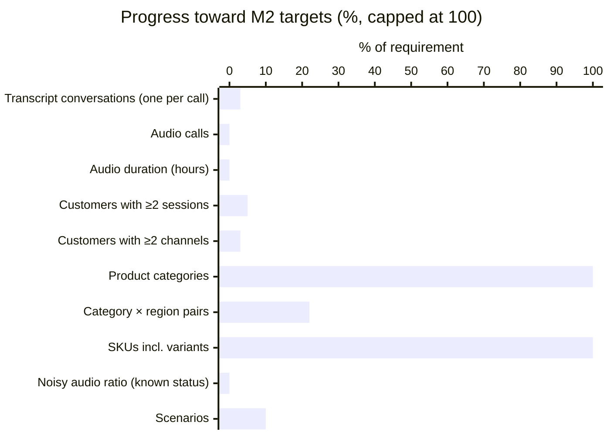
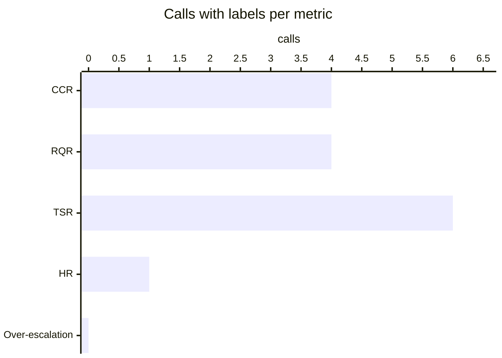
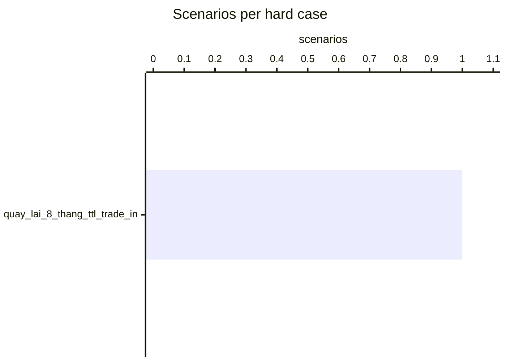
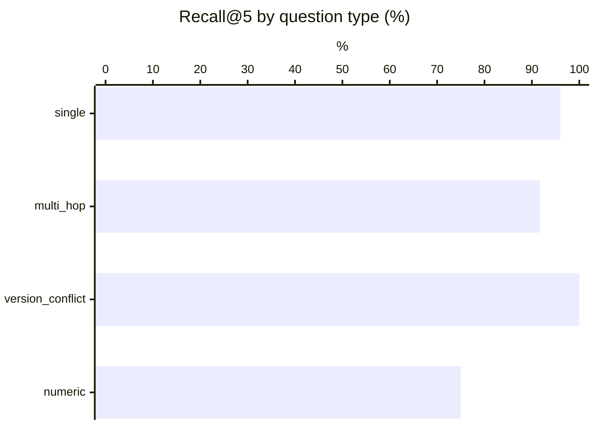
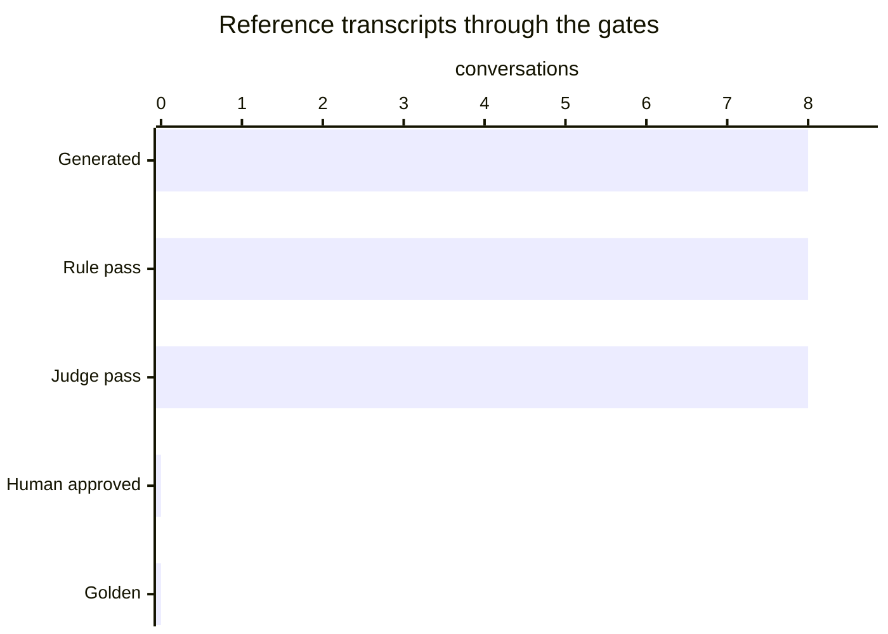

# Data generation report

_Generated 2026-10-26 03:38. Visual version: [validation_report.html](validation_report.html)._

Generated records are not golden until they pass rules and the judge (or a human approves them).

## M2 volume targets

| Metric | Required | Current | Status |
|---|---:|---:|---|
| Transcript conversations (one per call) | 250 | 8 | ○ PENDING |
| Audio calls | 100 | 0 | ○ PENDING |
| Audio duration (hours) | 3 | 0.0 | ○ PENDING |
| Customers with ≥2 sessions | 60 | 3 | ○ PENDING |
| Customers with ≥2 channels | 30 | 1 | ○ PENDING |
| Product categories | 3 | 3 | ✓ PASS |
| Category × region pairs | 9 | 2 | ○ PENDING |
| SKUs incl. variants | 100 | 136 | ✓ PASS |
| Noisy audio ratio (known status) | 20% | 0% | ○ PENDING |
| Scenarios | 40 | 4 | ○ PENDING |

## Chapter A metric coverage

| Metric | Calls with labels | Labels | Reference transcript score |
|---|---:|---:|---|
| CCR | 4 | 11 | 100.0 |
| RQR | 4 | 11 | 0.0 |
| TSR | 6 | 6 | 100.0 |
| HR | 1 | 1 | 0.0 |
| Over-escalation | 0 | 0 | 0 |

## Official scores (BTC reference_eval.py)

| Trace | RQR | CCR | TSR | TSR_hard_cases | HR | HR_price_promo | guardrail_violations |
|---|---:|---:|---:|---:|---:|---:|---:|
| oracle | 0.0 | 100.0 | 100.0 | 100.0 | 0.0 | 0.0 | 0 |
| reference | 0.0 | 100.0 | 100.0 | 100.0 | 0.0 | 0.0 | 0 |

Oracle perfect (every label satisfiable with BTC mock_tools): **True**. Score the agent with `data/eval/reference_eval.py --scenarios output/scenarios --trace <agent trace>`.

### Test set: 4 scenarios, 8 calls, 1 hard cases

## RAG (Recall@k on rag/qa_labeled.json)

Method: baseline BM25 (syllable uni+bi-grams, 1 chunk per ## [XX-nn], expired docs ×0.6, abstain on restricted intent / internal doc / topical absence)

| recall@3 | recall@5 | multi-hop full@3 | multi-hop full@5 | abstain unanswerable | abstain restricted | false abstain |
|---:|---:|---:|---:|---:|---:|---:|
| 84.7 | 93.2 | 58.3 | 66.7 | 87.5 | 80.0 | 6.4 |

## ASR (WER / CER / entity accuracy)

Team ASR set: 0 dialogues (BTC requires >= 20 plus the 12 BTC dialogues).
- btc: no hypotheses scored yet (`python -m src.pipeline.eval_asr --set btc ...`)
- team: no hypotheses scored yet (`python -m src.pipeline.eval_asr --set team ...`)

## Tools vs BTC tool set

Tools not in BTC set: none · extra params: none · details: `output/reports/tools_audit.md`.

## LLM-judge vs human agreement

Not measured yet: `python -m src.pipeline.judge_agreement --export` then `--ingest`.

## Simulator repeatability

- Replays: 24 across 3 seeds.
- TSR across seeds: 100.0 ± 0.0 points (within the ≤ 10-point BTC tolerance).

## Audio analysis

No synthesized audio yet (`python -m src.pipeline.synthesize_scenario_audio`).

## Review funnel

Generated **8** → Rule pass **8** → Judge pass **8** → Human approved **0** → Golden **0**

- CRM profiles: 70 (incl. synthetic when generated)
- Model API requests: 41 · cache hits: 0 · prompt tokens: 351095 · output tokens: 22530
- ElevenLabs characters: 0
