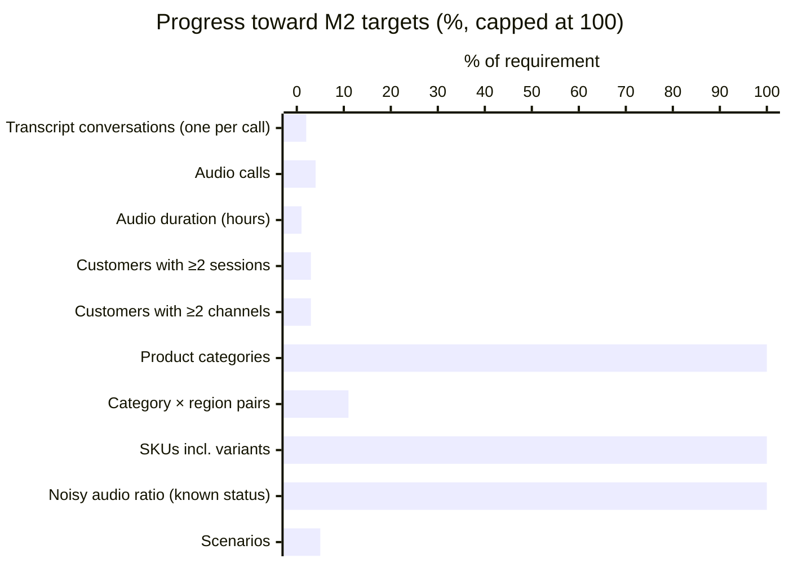
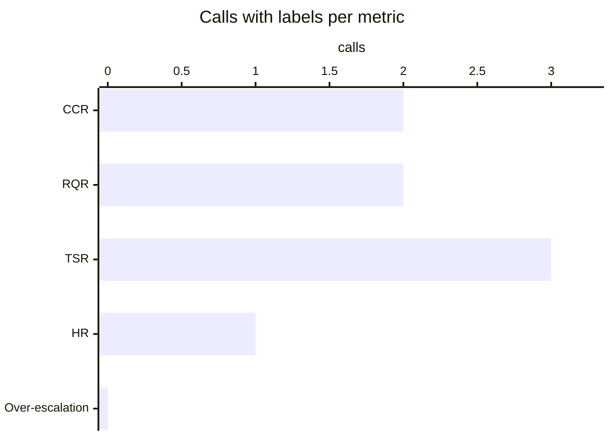
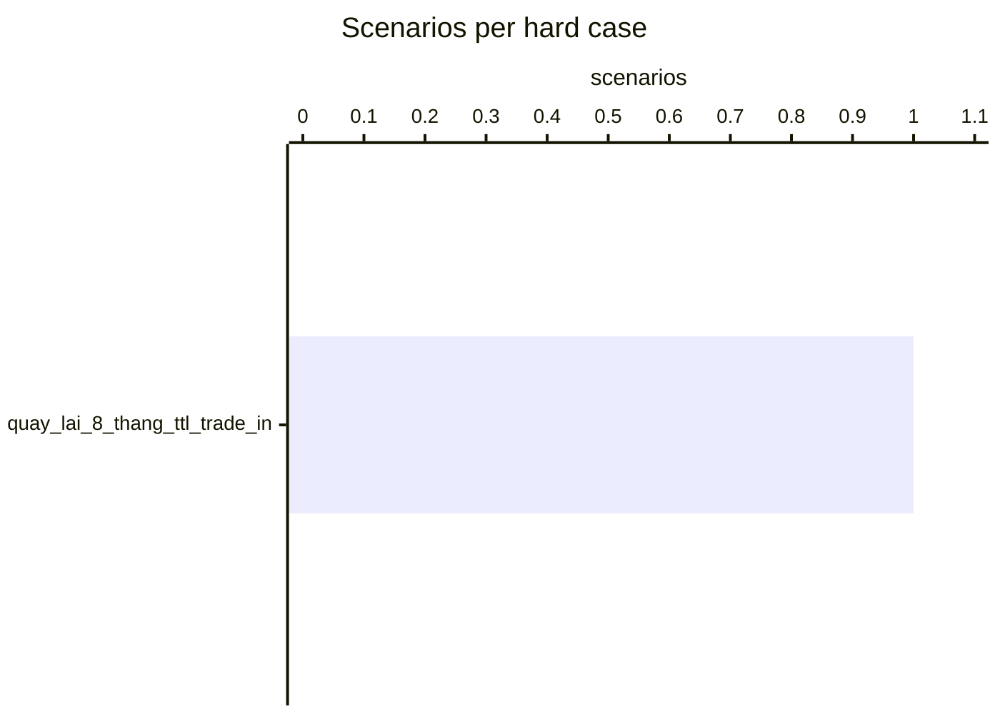
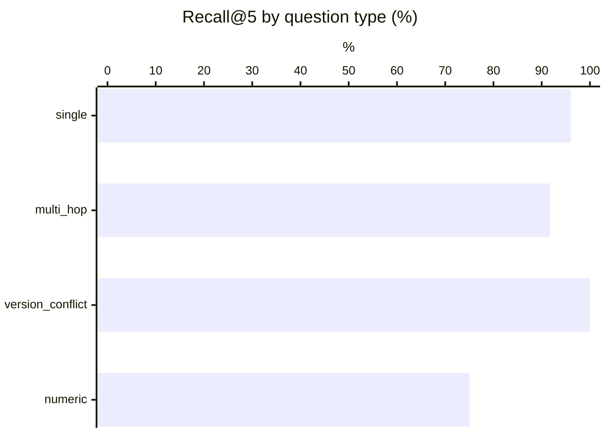
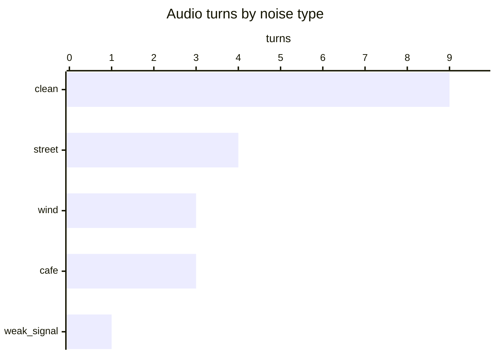
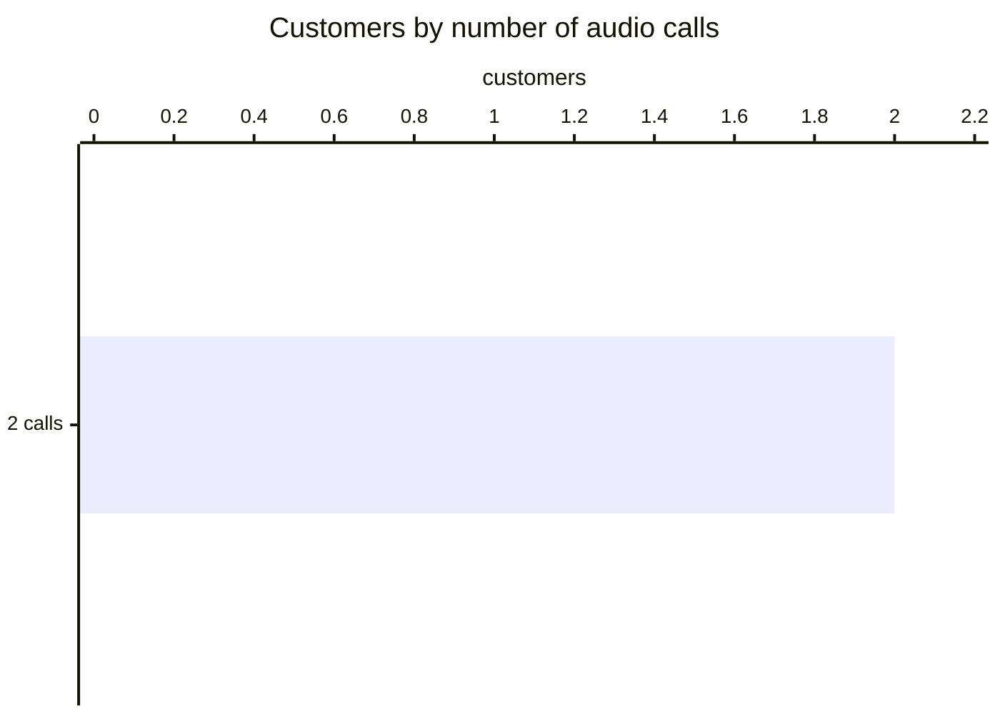
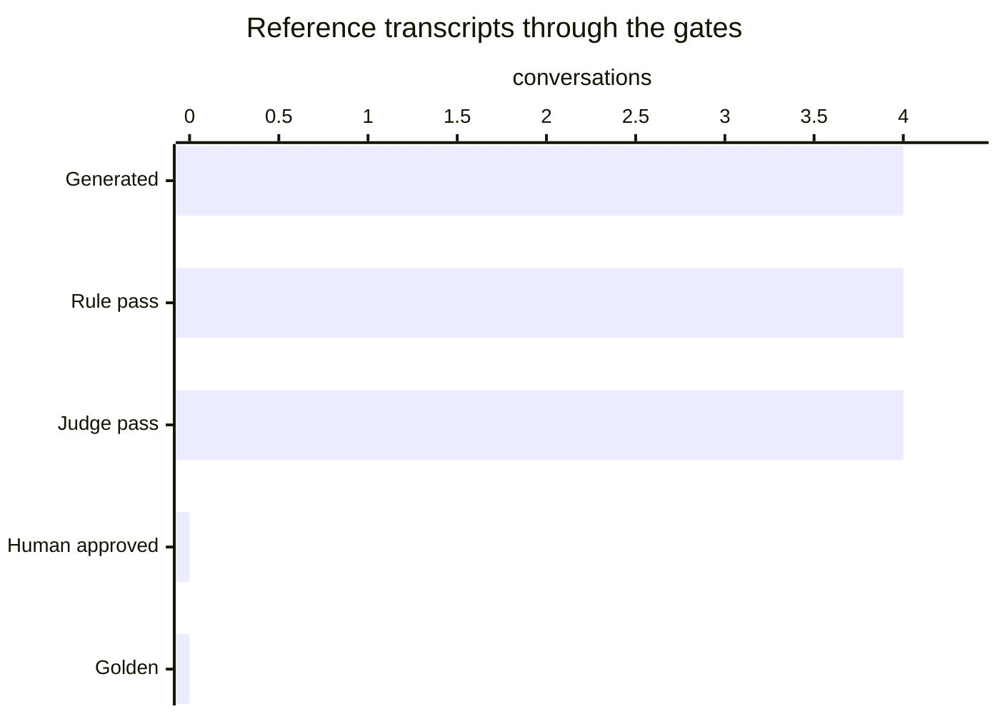

# Data generation report

_Generated 2026-10-28 20:24. Visual version: [validation_report.html](validation_report.html)._

Generated records are not golden until they pass rules and the judge (or a human approves them).

## M2 volume targets

| Metric | Required | Current | Status |
|---|---:|---:|---|
| Transcript conversations (one per call) | 250 | 4 | ○ PENDING |
| Audio calls | 100 | 4 | ○ PENDING |
| Audio duration (hours) | 3 | 0.02 | ○ PENDING |
| Customers with ≥2 sessions | 60 | 2 | ○ PENDING |
| Customers with ≥2 channels | 30 | 1 | ○ PENDING |
| Product categories | 3 | 3 | ✓ PASS |
| Category × region pairs | 9 | 1 | ○ PENDING |
| SKUs incl. variants | 100 | 136 | ✓ PASS |
| Noisy audio ratio (known status) | 20% | 55% | ✓ PASS |
| Scenarios | 40 | 2 | ○ PENDING |

## Chapter A metric coverage

| Metric | Calls with labels | Labels | Reference transcript score |
|---|---:|---:|---|
| CCR | 2 | 9 | 100.0 |
| RQR | 2 | 9 | 0.0 |
| TSR | 3 | 3 | 100.0 |
| HR | 1 | 1 | 0.0 |
| Over-escalation | 0 | 0 | 0 |

## Official scores (BTC reference_eval.py)

| Trace | RQR | CCR | TSR | TSR_hard_cases | HR | HR_price_promo | guardrail_violations |
|---|---:|---:|---:|---:|---:|---:|---:|
| oracle | 0.0 | 100.0 | 100.0 | 100.0 | 0.0 | 0.0 | 0 |
| reference | 0.0 | 100.0 | 100.0 | 100.0 | 0.0 | 0.0 | 0 |

Oracle perfect (every label satisfiable with BTC mock_tools): **True**. Score the agent with `data/eval/reference_eval.py --scenarios output/scenarios --trace <agent trace>`.

### Test set: 2 scenarios, 4 calls, 1 hard cases

## RAG (Recall@k on rag/qa_labeled.json)

Method: baseline BM25 (syllable uni+bi-grams, 1 chunk per ## [XX-nn], expired docs ×0.6, abstain on restricted intent / internal doc / topical absence)

| recall@3 | recall@5 | multi-hop full@3 | multi-hop full@5 | abstain unanswerable | abstain restricted | false abstain |
|---:|---:|---:|---:|---:|---:|---:|
| 84.7 | 93.2 | 58.3 | 66.7 | 87.5 | 80.0 | 6.4 |

## ASR (WER / CER / entity accuracy)

Team ASR set: 0 dialogues (BTC requires >= 20 plus the 12 BTC dialogues).
Scoring: BTC's `reference_eval.py` grades an ASR hypotheses file against this ground truth (`--asr`).

## Tools vs BTC tool set

Tools not in BTC set: none · extra params: none · details: `output/reports/tools_audit.md`.

## LLM-judge vs human agreement

Not measured yet: `python -m src.pipeline.judge_agreement --export` then `--ingest`.

## Simulator repeatability

- Replays: 12 across 3 seeds.
- TSR across seeds: 100.0 ± 0.0 points (within the ≤ 10-point BTC tolerance).

## Audio analysis

- **20 customer turns** in **4 calls** from 2 scenarios and 2 customers; **0.02 h** total (mean 3.52 s/turn, 17.62 s/call), 1 distinct voices.
- Customers with ≥2 audio calls: 2 · with ≥2 channels: 1.
- Noisy turns: 11/20 with known status (55%); calls with ≥1 noisy turn: 4/4 (100%).

### Noise

| Noise | Turns | Share of turns | Minutes |
|---|---:|---:|---:|
| clean | 9 | 45% | 0.56 |
| street | 4 | 20% | 0.23 |
| wind | 3 | 15% | 0.13 |
| cafe | 3 | 15% | 0.22 |
| weak_signal | 1 | 5% | 0.03 |

SNR (dB) of noisy turns: 6 dB × 11

### By channel

| Channel | Calls | Turns | Customers | Minutes | Noisy turns | Noise mix |
|---|---:|---:|---:|---:|---:|---|
| hotline | 3 | 15 | 2 | 0.91 | 7/15 (47%) | cafe 3, clean 8, street 2, weak_signal 1, wind 1 |
| zalo_oa | 1 | 5 | 1 | 0.26 | 4/5 (80%) | clean 1, street 2, wind 2 |

### By input mode

| Mode | Calls | Turns | Customers | Minutes | Noisy turns | Noise mix |
|---|---:|---:|---:|---:|---:|---|
| text | 4 | 20 | 2 | 1.17 | 11/20 (55%) | cafe 3, clean 9, street 4, weak_signal 1, wind 3 |

### Distinct voices by region and gender

| Region | Gender | Voices | Calls | Turns | Customers |
|---|---|---:|---:|---:|---:|
| bac | female | 1 | 4 | 20 | 2 |

### Calls per customer

Distribution — 2 call(s): 2 customers.

| Customer | Name | Region | Scenarios | Audio calls | Turns | Minutes | Channels | Noisy turns |
|---|---|---|---:|---:|---:|---:|---|---:|
| C001 | Hoa | bac | 1 | 2 | 10 | 0.5 | zalo_oa ×1, hotline ×1 | 5/10 |
| C031 | Oanh | bac | 1 | 2 | 10 | 0.7 | hotline ×2 | 6/10 |

## Review funnel

Generated **4** → Rule pass **4** → Judge pass **4** → Human approved **0** → Golden **0**

- CRM profiles: 70 (incl. synthetic when generated)
- Model API requests: 16 · cache hits: 0 · prompt tokens: 123609 · output tokens: 11461
- ElevenLabs characters: 1084
