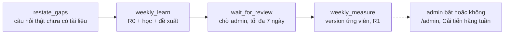

# Airflow: vòng cải tiến hằng tuần

DAG `improvement_weekly` chạy vòng Gap Loop + Reflection mỗi thứ Hai lúc 02:00 (giờ Việt Nam). Thiết kế: [docs/plan/001](../../docs/plan/001-vong-cai-tien-hang-tuan-va-dashboard.md). Các lệnh của từng bước: [pipeline/improve/weekly.py](../../apps/ai-agent-service/src/ai_agent_service/pipeline/improve/weekly.py).



DAG **không bao giờ tự duyệt và không tự bật version**. Admin duyệt từng đề xuất, rồi xem phép đo trước/sau trên `/admin` trước khi bật.

## Chạy local

```powershell
docker compose -f docker-compose.yml -f infra/airflow/docker-compose.airflow.yml up -d --build airflow
```

- Giao diện Airflow: http://127.0.0.1:8080. Tài khoản `admin`; mật khẩu in trong log của container `airflow` ở lần chạy đầu (`docker compose ... logs airflow`).
- Image cài agent vào một venv riêng (`/opt/agent-venv`), để các gói của agent không đụng ràng buộc phiên bản của Airflow. Repo được mount vào `/opt/telesales`, nên vòng chạy đúng code và bộ kịch bản của bản checkout.
- Skills và trạng thái cải tiến dùng chung volume với `ai-agent-service` (`agent-skills`, `agent-improvement` trong `docker-compose.yml`). Không có volume chung thì admin bật một version mà agent không thấy.
- **Tốn phí model mỗi tuần.** Đặt `EVAL_BUDGET_DB` trong `.env` để có trần.

Chạy tay một tuần (không cần Airflow), từ gốc repo:

```powershell
$env:PYTHONPATH = "apps/ai-agent-service/src;packages/backend-common"
$py = "apps\ai-agent-service\.venv\Scripts\python.exe"
& $py -m ai_agent_service.pipeline.improve weekly-learn --week 2026-W46 `
  --learn data/reflection/budget/learn/scenarios `
  --frozen data/reflection/budget/frozen/scenarios --frozen data/gap-loop/frozen/scenarios `
  --frozen-ids data/reflection/budget/frozen.json --frozen-ids data/gap-loop/frozen.json
# admin duyệt trên /admin, rồi:
& $py -m ai_agent_service.pipeline.improve weekly-measure --week 2026-W46 `
  --frozen data/reflection/budget/frozen/scenarios --frozen data/gap-loop/frozen/scenarios
```

## Khi có sự cố

| Thấy | Nguyên nhân | Làm gì |
|---|---|---|
| `weekly_learn` báo "Another evaluation is using this database" | một run đánh giá khác đang chạy (khóa của database `*_eval`) | chờ run kia xong, rồi clear task trong Airflow |
| `wait_for_review` fail ngay, exit 2 | không có vòng của tuần đó (bước học đã lỗi) | xem log `weekly_learn`; vòng có trạng thái `failed` kèm lỗi trên `/admin` |
| Vòng chuyển `failed`, báo "skills moved" | có version khác được bật sau khi vòng học | chạy lại cả tuần (`weekly-learn` bắt đầu lại vòng) |
| Admin bật version nhưng agent vẫn trả lời như cũ | agent chỉ đọc skills lúc khởi động | khởi động lại `ai-agent-service` |

## Giới hạn

- DAG chưa chạy trên một Airflow thật. Mới kiểm: cấu hình compose hợp lệ, và test `tests/agent/test_airflow_dag.py` kiểm thứ tự bước và lệnh của từng bước.
- Reflection hằng tuần học từ bộ học có nhãn; học từ tín hiệu cuộc gọi thật của Reflection chưa làm (xem 001, mục 6).
- Trên AWS không dùng Airflow: EventBridge Scheduler gọi Fargate task chạy cùng các lệnh trong `STEPS`, rẻ hơn MWAA chạy 24/7 ([docs/deployment/aws-plan.md](../../docs/deployment/aws-plan.md), mục 3.7).
