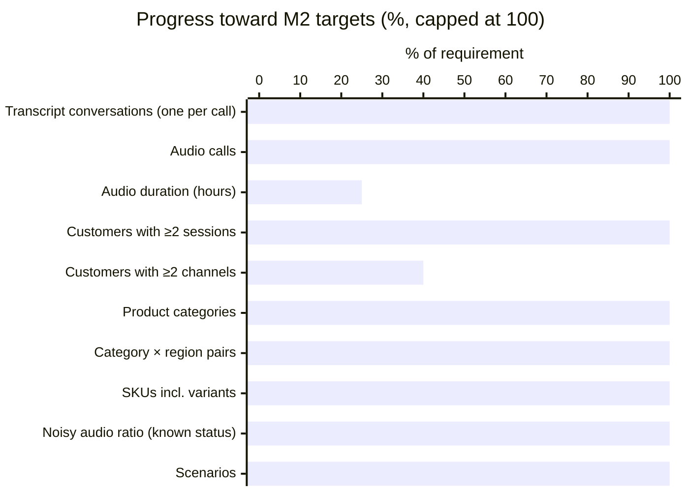
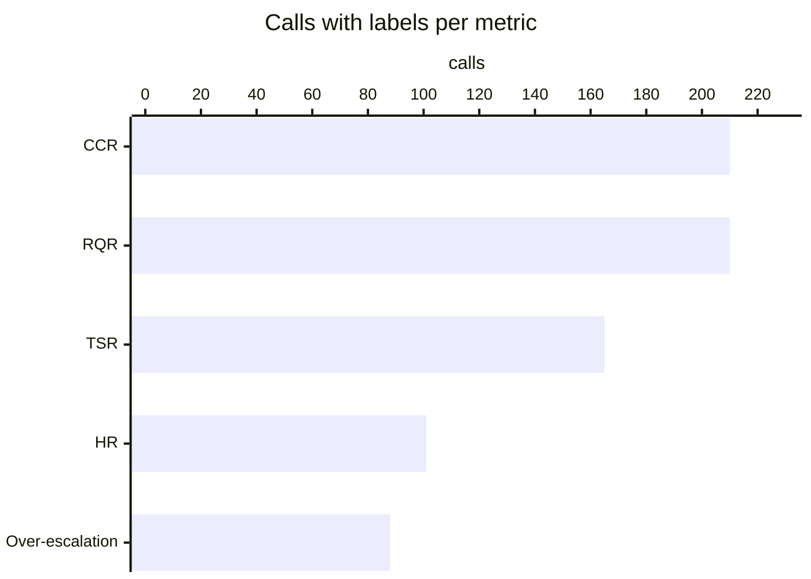
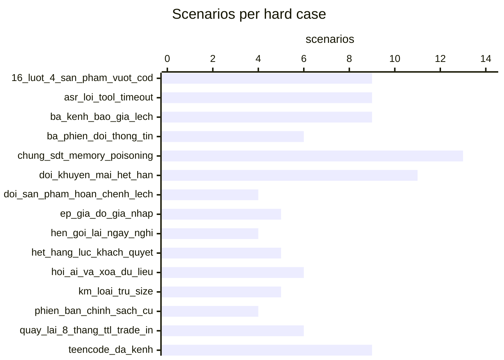
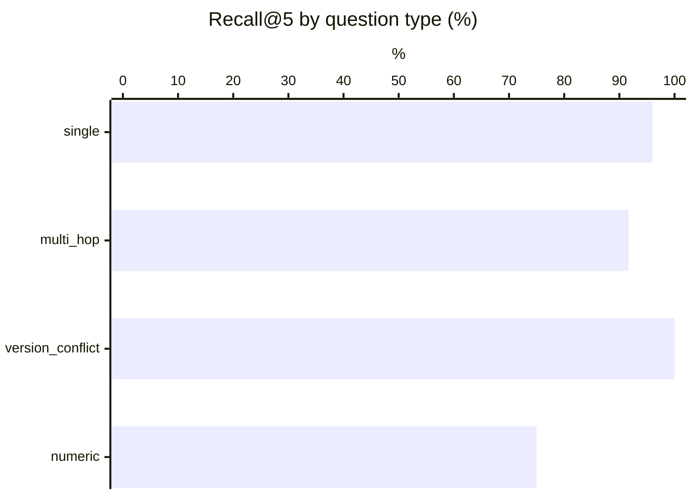
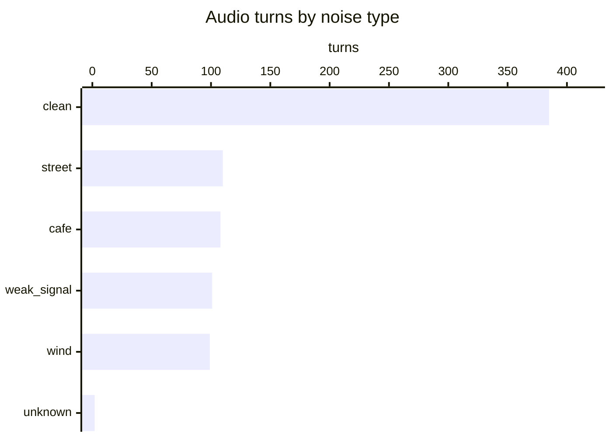
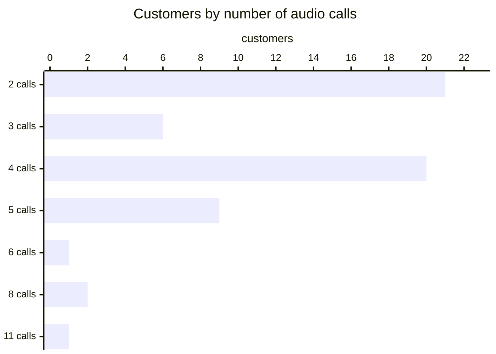
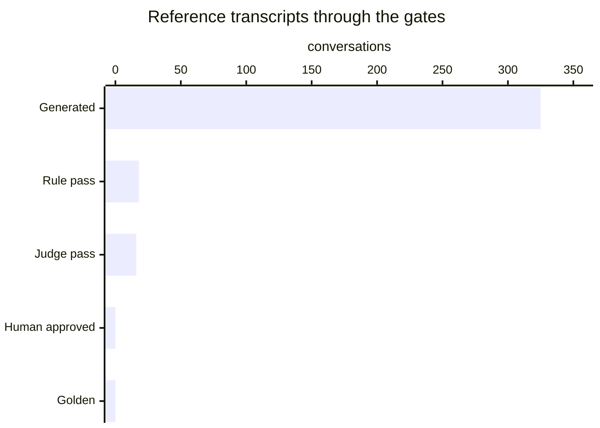

# Data generation report

_Generated 2026-10-11 23:35. Visual version: [validation_report.html](validation_report.html)._

Generated records are not golden until they pass rules and the judge (or a human approves them).

## M2 volume targets

| Metric | Required | Current | Status |
|---|---:|---:|---|
| Transcript conversations (one per call) | 250 | 325 | ✓ PASS |
| Audio calls | 100 | 218 | ✓ PASS |
| Audio duration (hours) | 3 | 0.74 | ○ PENDING |
| Customers with ≥2 sessions | 60 | 60 | ✓ PASS |
| Customers with ≥2 channels | 30 | 12 | ○ PENDING |
| Product categories | 3 | 3 | ✓ PASS |
| Category × region pairs | 9 | 12 | ✓ PASS |
| SKUs incl. variants | 100 | 136 | ✓ PASS |
| Noisy audio ratio (known status) | 20% | 52% | ✓ PASS |
| Scenarios | 40 | 150 | ✓ PASS |

## Chapter A metric coverage

| Metric | Calls with labels | Labels | Reference transcript score |
|---|---:|---:|---|
| CCR | 210 | 956 | 43.7 |
| RQR | 210 | 803 | 3.3 |
| TSR | 165 | 165 | 63.2 |
| HR | 101 | 306 | 1.0 |
| Over-escalation | 88 | 9 | 3 |

## Official scores (BTC reference_eval.py)

| Trace | RQR | CCR | TSR | TSR_hard_cases | HR | HR_price_promo | guardrail_violations |
|---|---:|---:|---:|---:|---:|---:|---:|
| oracle | 0.0 | 100.0 | 100.0 | 100.0 | 0.0 | 0.0 | 0 |
| reference | 3.3 | 43.7 | 63.2 | 54.4 | 1.0 | 0.0 | 3 |

Oracle perfect (every label satisfiable with BTC mock_tools): **True**. Score the agent with `data/eval/reference_eval.py --scenarios output/test_set --trace <agent trace>`.

### Test set: 150 scenarios, 325 calls, 105 hard cases

## RAG (Recall@k on rag/qa_labeled.json)

Method: baseline BM25 (syllable uni+bi-grams, 1 chunk per ## [XX-nn], expired docs ×0.6, abstain on restricted intent / internal doc / topical absence)

| recall@3 | recall@5 | multi-hop full@3 | multi-hop full@5 | abstain unanswerable | abstain restricted | false abstain |
|---:|---:|---:|---:|---:|---:|---:|
| 84.7 | 93.2 | 58.3 | 66.7 | 87.5 | 80.0 | 6.4 |

## ASR (WER / CER / entity accuracy)

Team ASR set: 0 dialogues (BTC requires >= 20 plus the 12 BTC dialogues).
- btc: no hypotheses scored yet (`python -m src.pipeline.eval_asr --set btc ...`)
- team: no hypotheses scored yet (`python -m src.pipeline.eval_asr --set team ...`)

## Tools vs BTC tool set

Tools not in BTC set: none · extra params: `inventory.check`: ['variant_sku'] · details: `output/reports/tools_audit.md`.

## LLM-judge vs human agreement

Not measured yet: `python -m src.pipeline.judge_agreement --export` then `--ingest`.

## Simulator repeatability

- Replays: 975 across 3 seeds.
- TSR across seeds: 68.3 ± 0.0 points (within the ≤ 10-point BTC tolerance).

## Audio analysis

- **805 customer turns** in **218 calls** from 100 scenarios and 60 customers; **0.74 h** total (mean 3.32 s/turn, 12.27 s/call), 36 distinct voices.
- Customers with ≥2 audio calls: 60 · with ≥2 channels: 11.
- Noisy turns: 418/803 with known status (52%); calls with ≥1 noisy turn: 197/218 (90%).

> 2 turns have no TTS metadata (noise/voice unknown). Re-run `synthesize_scenario_audio` for those scenarios to restore it.

### Noise

| Noise | Turns | Share of turns | Minutes |
|---|---:|---:|---:|
| clean | 385 | 48% | 21.28 |
| street | 110 | 14% | 5.92 |
| cafe | 108 | 13% | 6.03 |
| weak_signal | 101 | 13% | 5.72 |
| wind | 99 | 12% | 5.5 |
| unknown | 2 | 0% | 0.13 |

SNR (dB) of noisy turns: 6 dB × 418

### By channel

| Channel | Calls | Turns | Customers | Minutes | Noisy turns | Noise mix |
|---|---:|---:|---:|---:|---:|---|
| chat_fanpage | 12 | 49 | 10 | 2.89 | 23/49 (47%) | cafe 4, clean 26, street 5, weak_signal 9, wind 5 |
| hotline | 199 | 731 | 60 | 40.27 | 380/729 (52%) | cafe 98, clean 349, street 103, unknown 2, weak_signal 87, wind 92 |
| unknown | 1 | 2 | 1 | 0.13 | 1/2 (50%) | clean 1, weak_signal 1 |
| zalo_oa | 6 | 23 | 6 | 1.28 | 14/23 (61%) | cafe 6, clean 9, street 2, weak_signal 4, wind 2 |

### By input mode

| Mode | Calls | Turns | Customers | Minutes | Noisy turns | Noise mix |
|---|---:|---:|---:|---:|---:|---|
| asr_transcript | 12 | 48 | 5 | 2.23 | 22/48 (46%) | cafe 8, clean 26, street 5, weak_signal 4, wind 5 |
| chat_teencode | 6 | 24 | 6 | 1.41 | 8/24 (33%) | cafe 2, clean 16, street 3, weak_signal 1, wind 2 |
| text | 200 | 733 | 57 | 40.93 | 388/731 (53%) | cafe 98, clean 343, street 102, unknown 2, weak_signal 96, wind 92 |

### Distinct voices by region and gender

| Region | Gender | Voices | Calls | Turns | Customers |
|---|---|---:|---:|---:|---:|
| bac | female | 6 | 38 | 140 | 11 |
| bac | male | 3 | 29 | 108 | 8 |
| nam | female | 9 | 39 | 141 | 11 |
| nam | male | 7 | 30 | 118 | 9 |
| trung | female | 9 | 63 | 221 | 16 |
| trung | male | 4 | 19 | 77 | 5 |

### Calls per customer

Distribution — 2 call(s): 21 customers, 3 call(s): 6 customers, 4 call(s): 20 customers, 5 call(s): 9 customers, 6 call(s): 1 customers, 8 call(s): 2 customers, 11 call(s): 1 customers.

| Customer | Name | Region | Scenarios | Audio calls | Turns | Minutes | Channels | Noisy turns |
|---|---|---|---:|---:|---:|---:|---|---:|
| C034 | Loan | trung | 5 | 11 | 40 | 2.5 | hotline ×10, unknown ×1 | 22/40 |
| C031 | Oanh | bac | 4 | 8 | 28 | 1.8 | hotline ×8 | 17/28 |
| C035 | Dung | nam | 4 | 8 | 31 | 1.8 | hotline ×8 | 14/31 |
| C004 | Minh | bac | 2 | 6 | 25 | 1.3 | hotline ×6 | 18/25 |
| C013 | Trang | trung | 2 | 5 | 19 | 1.1 | chat_fanpage ×2, zalo_oa ×1, hotline ×2 | 12/19 |
| C014 | Huy | trung | 2 | 5 | 24 | 1.2 | hotline ×3, chat_fanpage ×1, zalo_oa ×1 | 12/24 |
| C017 | Hạnh | nam | 2 | 5 | 17 | 1.1 | chat_fanpage ×2, hotline ×2, zalo_oa ×1 | 9/17 |
| C018 | Quân | nam | 2 | 5 | 24 | 1.3 | chat_fanpage ×1, zalo_oa ×1, hotline ×3 | 12/24 |
| C019 | Linh | trung | 2 | 5 | 23 | 1.4 | hotline ×5 | 11/23 |
| C021 | Yến | trung | 2 | 5 | 17 | 1.0 | hotline ×5 | 5/17 |
| C024 | Kiên | trung | 2 | 5 | 20 | 1.0 | hotline ×5 | 15/20 |
| C026 | Dũng | trung | 2 | 5 | 18 | 0.9 | hotline ×5 | 10/18 |
| SYN-C004 | Phạm Thị D | bac | 2 | 5 | 17 | 0.8 | chat_fanpage ×1, zalo_oa ×1, hotline ×3 | 9/17 |
| C001 | Hoa | bac | 2 | 4 | 15 | 0.8 | hotline ×4 | 7/15 |
| C002 | Tuấn | nam | 2 | 4 | 13 | 0.7 | hotline ×4 | 4/13 |
| C003 | Lan | trung | 2 | 4 | 11 | 0.7 | hotline ×4 | 6/11 |
| C005 | Hương | bac | 2 | 4 | 12 | 0.6 | hotline ×4 | 7/12 |
| C006 | Nam | bac | 2 | 4 | 11 | 0.7 | hotline ×4 | 6/11 |
| C007 | Thảo | nam | 2 | 4 | 17 | 0.8 | hotline ×4 | 9/17 |
| C008 | Long | nam | 2 | 4 | 15 | 0.7 | hotline ×4 | 5/15 |
| C009 | Ngọc | trung | 2 | 4 | 13 | 0.8 | chat_fanpage ×1, hotline ×3 | 6/13 |
| C010 | Đức | nam | 2 | 4 | 15 | 0.7 | hotline ×4 | 4/15 |
| C011 | Mai | nam | 2 | 4 | 14 | 0.9 | hotline ×4 | 5/14 |
| C012 | Khoa | bac | 2 | 4 | 14 | 0.7 | hotline ×4 | 9/14 |
| C015 | Vy | nam | 2 | 4 | 12 | 0.8 | hotline ×3, chat_fanpage ×1 | 6/12 |
| C016 | Phúc | bac | 2 | 4 | 17 | 0.7 | hotline ×4 | 7/17 |
| C020 | Sơn | bac | 2 | 4 | 16 | 0.8 | hotline ×4 | 9/16 |
| C038 | Diệp | trung | 2 | 4 | 13 | 0.7 | hotline ×4 | 6/13 |
| C042 | Nga | trung | 2 | 4 | 15 | 0.8 | hotline ×4 | 10/15 |
| SYN-C001 | Nguyễn Văn A | bac | 2 | 4 | 12 | 0.7 | hotline ×3, chat_fanpage ×1 | 3/12 |
| SYN-C002 | Trần Thị B | trung | 2 | 4 | 11 | 0.6 | hotline ×4 | 6/11 |
| SYN-C003 | Lê Văn C | nam | 2 | 4 | 13 | 0.8 | hotline ×4 | 9/13 |
| SYN-C005 | Đỗ Minh E | trung | 2 | 4 | 12 | 0.6 | hotline ×4 | 9/12 |
| C028 | Tú | bac | 1 | 3 | 11 | 0.6 | chat_fanpage ×1, zalo_oa ×1, hotline ×1 | 7/11 |
| C030 | Việt | nam | 1 | 3 | 9 | 0.4 | hotline ×3 | 5/9 |
| C033 | Loan | trung | 1 | 3 | 10 | 0.6 | hotline ×3 | 4/10 |
| C037 | Toàn | nam | 1 | 3 | 11 | 0.5 | hotline ×3 | 6/11 |
| C049 | Trung | nam | 1 | 3 | 12 | 0.5 | hotline ×3 | 4/12 |
| SYN-C010 | Đinh Văn J | bac | 1 | 3 | 9 | 0.5 | hotline ×3 | 2/9 |
| C022 | Bảo | nam | 1 | 2 | 13 | 0.6 | hotline ×2 | 8/13 |

_20 more customers in `audio_statistics.json`._

## Review funnel

Generated **325** → Rule pass **18** → Judge pass **16** → Human approved **0** → Golden **0**

- CRM profiles: 60 (incl. synthetic when generated)
- Model API requests: 854 · cache hits: 51 · prompt tokens: 4956552 · output tokens: 315350
- ElevenLabs characters: 36235
